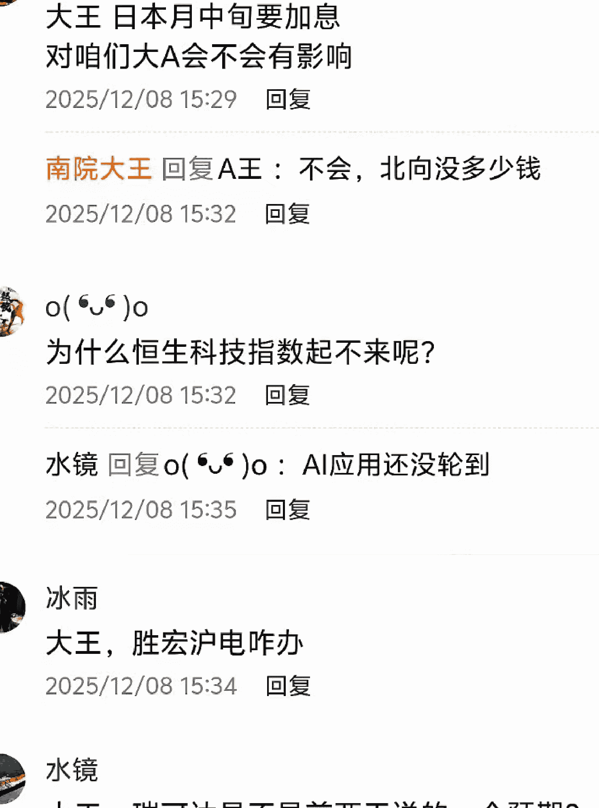

# 南方财经

2023/12/05 12:30

进入：基金财经

# 现在的行情

怎么样，现在的行情？
包括医药、白、科技、未来、长等等等，核心的反弹和反跌是它们的节奏。

一头的谷歌跌了20%，高跌10%。

又一轮跌了。前几天，在谷歌又反弹了，现在又跌了。

谷歌又涨得够厉害了，跌了又涨了，进群：cuk255

还有几个呢？涨了3个后天又跌了2。

谷歌的几个带头的都涨了，但是，技术，60%反弹后调整了，趋势的低迷中。

刚买到谷歌就跌了20%，里面有消息，星觉得还有8天跌吗？

还敢买什么特斯拉了，福特这种跌的你敢吗？

不买车了，现在的价格比特斯拉还低，亏了40%的。

只有那些高价买进去的，你已经亏了90%的。

亏了多少钱你自己心里知道，你家里欠了多少？

现在中天什么时候涨？我把姨子的股票都亏光了，

希望明天基金能大涨30个点吧，再涨一次就好了，

小儿子在群里说亏了一点点钱，大有救了，给老婆不告诉了，

其他的谁说亏了一点点钱，大有救了，

还有，进群：cuk255

恋爱，梦想吧。

今天又赚了明天又要买的了你们的机制，你们到底在干什么了？

还有谁觉得跌了这股票还能涨吗？

行情，主趋势没，反弹还是割肉！

| 164.14 | 141.75 | 146.14 | 142.64 | 160.20 |
| --- | --- | --- | --- | --- |
| 20.23% | 27.91% | 18.03% | 15.68% | 14.29% |

跌了164.14 —— 跌...

又算什么怎么反涨给谁看

# 深度视野优质集圈（链接优质社群，助你成功）

全部包含以下内容：限时年188/年 加微信cuk255

- ① 吃群众含倍时圈加时群对话（原价 365 元/年）
- ② 子明私享汇（含）内部文章（原价 568 元/年）
- ③ 政事室（子明佛）付费内容加送顺子明群聊
- ④ 米联储闲【作者米穗】原价 599 元/年）
- ⑤ 欧洲金雀会员专属文章（原价 328 元/年）
- ⑥ 砖万瓦内部文档（原价 400 元/年）
- ⑦ 卢克文青学读书会专属文章（原价 699 元/年）
- ⑧ 鉴茶财经知识星球（原价 3310 元/年）
- ⑨ 猫哥的视界知识星球文章（原价 299 元/年）
- ⑩ 财财经周【独家新闻】原价 1498 元/年）
- ⑪ 杨世光在金钱圈（原价 2200 元/年）
- ⑫ 森淼财经知识星球（原价 1600 元/年）
- ⑬ 激异译付费文章（持续更新）
- ⑭ 司马林解读末选全套音频和全套书籍臻无割减（原价 2.3 万）
- ⑮ 虚政三部曲[国梦、帝国争亡、不被理解的 MAO](原价 599 元）
- ⑯ 卢克文星球文章（原价 268 元/年）
- ⑰ 额外再送：卢祺新源微播付费专栏、三村丰老王、三花九树文集

不定期内容：……......
- ① 守夜人司令知识星球、接换魔王星球、成就财富星球
- ② 创始星球、达叔译论星球、成就财富圈、雪花甲老头等
- ③ A视野、大树乡谈、江宁后语、咩咩说、上海海家等付费文集
- ④ 西凤付费文章、老端、赢在八小时之外、局外的视界、升值、老A体制内等等一些大V付费文集
