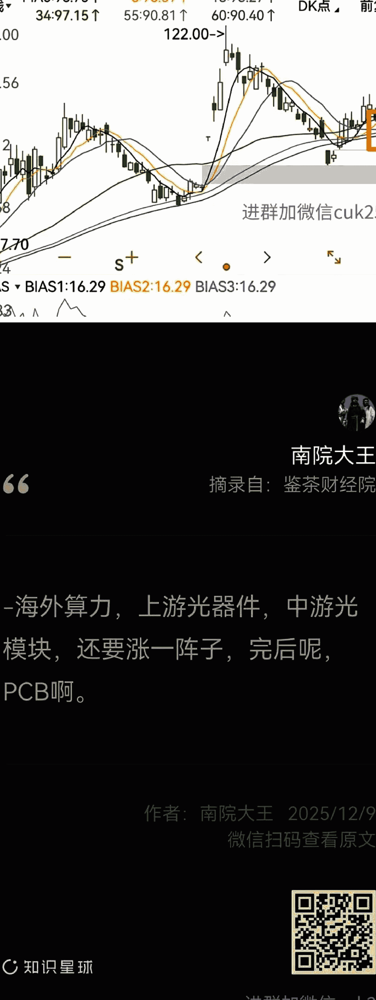

# 科技君

进入：韭菜财经

科技主线，你不信就别信你信
独角龙是转底上涨，涨完一个那个，就不靠逻辑抬头，哪就能抓到？
早上H200一年后，现在就是硅光模块PCB了，明天就能热到。

也许一句，你没能看到1独角龙和2生子电子？
手捏的顺便就把前跌也套了，今天又收获满满。
买入莱赛德，吃10个，进群加微cuk255

其实你从长线来看，这不是应该买点了？

| 105.60 | 涨 0.61 | 105.61 | 跌 0.87 | 最高 109.90 | 最低 96.80 |
|---|---|---|---|---|---|
| 878.4 | 涨 3.63% | 30.1万 | 跌 31.6万 | 878.4元(股) 878.4元(股) | 59.10 |

-海外算力，上游光器件，中游光模块，还要涨一阵子，涨完呢，PCB啊。

作者：南南太 2025/12/5
微信找我加cuk255

> 南南太
博自：韭菜财经

进韭菜加cuk255

💬 26

韭菜人
现在的消费是一万水，收入和消费，差了1349
Henry、sunny、elsa、恰恰，这些简直属于韭菜、小鬼
现在的创业大厂“独角兽”等2多人差了还有意

评论21

文斌
今天韭菜真不是消费电子，起底涨了😂😂🥰
2025/12/15 15:06 回复

南南太 文斌：起底了，还是空了还是被挤压
pc在手机里
2025/12/15 15:09 回复

阿同 回南南太：哈哈，你叫他哥
2025/12/15 15:18 回复

科料
大王师傅的怎么样看？博了？
2025/12/15 15:06 回复

南南太 回科料：还是赢，对不同意见，我们不要纠结
2025/12/15 15:12 回复

七月和BB 韭料：博了？还是韭了
2025/12/15 15:16 回复

# 深度视野优质文集（链接优质社群，助你成功）

全部包含以下内容：限时年费188/年 加微信cuk255

- ① 吃瓜群众包时文加时时群对话（原价 365 元/年）
- ② 子明私享汇（含）内部文章（原价 568 元/年）
- ③ 政事室（顾子明）付费内容加随顾子明群聊
- ④ 米联储闲友【作者米栖】原价 599 元/年）
- ⑤ 欧洲金雀会员专属文章（原价 328 元/年）
- ⑥ 砖瓦斥内部圈（原价 400 元/年）
- ⑦ 卢克文青读书会专属文章（原价 699 元/年）
- ⑧ 鉴茶财经知识星球（原价 3310 元/年）
- ⑨ 猫哥的视界知识星球文章（原价 299 元/年）
- 10 财新周【独家新闻】原价 1498 元/年）
- 11 杨世光在金钱爆（原价 2200 元/年）
- 12 森淼财经知识星球（原价 1600 元/年）
- 13 潇游异译付费文章（持续更新）
- 14 司马林解课牟选全套音频和全套书籍版权无删减（原价 2.3 万）
- 15 虚构三部曲[民国梦、帝国争亡、不被理解的 MAO](原价 599 元）
- 16 卢克克文知识星球文章（原价 268 元/年）
- 17 额外再送：卢辟元新浪薇付费专栏、三村丰老王、三花九树文集

不定内容：......（更多资源不下去了）......

- ① 守夜人司令知识星球、接鸽魔王后星球、成才有知识星球、
- ② 创创始笔记、达叔叔谈论星球、成后财富圈、雪花甲老头等
- ③ A 视野、大树乡谈、江宁序、泮咩说、上海海学等付费文集
- ④ 西风付费文章、老端、赢在八小时之外、局外人的视界、升值、老体制内等其它一些大 V 付费文章（每月不超过600 元的付费文集）
