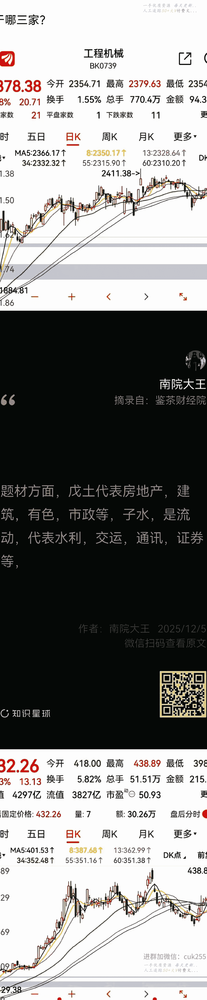

进入：奎泰财经
在节奏中调整

大盘调整我们讲了，但我们结构些什么呢？

科技的龙头还是在ocs四四龙轮动？

上游的源头关注过我们今年明年需求变化，龙头拉法板块吃到了吗？

硅胶那几个老生常谈了，光伏和修复要机会，后布局交叉属性位置不高的长虹和永恒可上不来了。

早上刚讲过硅胶和修复就行，龙带的节奏，突然爆发132压力，自然要。联股份供800光模块，我们先人先知道。还有修复吗？酷明易，买易天来，就已经没有高了，好少是系统架构，它-4.88%你吸眼哦。

pcb的热度，昨天，前天，可是150万、200成交，一共只有80万。它涨到-7%你怕不怕，不能跌就就上冲高，比别人强了，机会还能抓住吗？老是觉得别人还在犹豫的时候，我们已经占优光芯片的，在的的恒，永远站在前面的一个。

就算是房地产概念，咱们也提前了。建筑，有色，市政，水子，是流动代表利，交通，通讯，证券等。

作者：南大主 2025/1/5
微信关注扫描原文

万龙涨停。
工程机来了。谁还有我们的工程机，等于哪家？

# 工程机
BK0739

## 深度视野优质社群（优质社群，助你成功）

全部包含以下内容：限时年费188/年 加微信cuk255

- ① 吃瓜群众包时圈加时群对话（原价 365 元/年）
- ② 子明私享汇（含）内部文章（原价 568 元/年）
- ③ 政事室（顾子明）付内容后再送顾子明群聊
- ④ 米储锦兜【作者米穗】（原价 599 元/年）
- ⑤ 欧洲金雀会员专属文章（原价 328 元/年）
- ⑥ 砖瓦斥内部文档（原价 400 元/年）
- ⑦ 卢克文青读书会专属文章（原价 699 元/年）
- ⑧ 鉴茶财经知识星球（原价 3310 元/年）
- ⑨ 猫哥的视界知识星球文章（原价 299 元/年）
- ⑩ 财经新周【独家新闻】（原价 1498 元/年）
- ⑪ 杨世在金钱圈（原价 2200 元/年）
- ⑫ 森淼财经知识星球（原价 1600 元/年）
- ⑬ 激源异译付文社群（持续更新）
- ⑭ 司马林解读牟选全套音频和全套书籍藏版无损辑（原价 2.3 万）
- ⑮ 虚三三曲[民国梦、帝国兴亡、不被理解的MAO]（原价 599 元）
- ⑗ 卢克知识星球文章（原价 268 元/年）
- ⑰ 额外再送：卢薛元微信涨博付费专栏、三村丰老王、三花九树文集

不定期内容：——（更多资源将不下）

- ① 守夜人知识星球、接换魔王知识星球、星财富知识星球
- ② 创始粉丝星球、达叔谈论知识星球、成就财富圈、雪花桃花老头等
- ③ A视野、大树乡谈、江初省、泮咩说、上海海家等付费文集
- ④ 西风付费文章、老端、赢在八小时之外、局外人的视界、升值优、老体制内等其它一些大V付费文章（每月低于 600 元的付费文章）

限时年费188/年

## 低成本链接全网V优质内容

深度视野文集进群微信cuk255

深度视野（付费文集）

