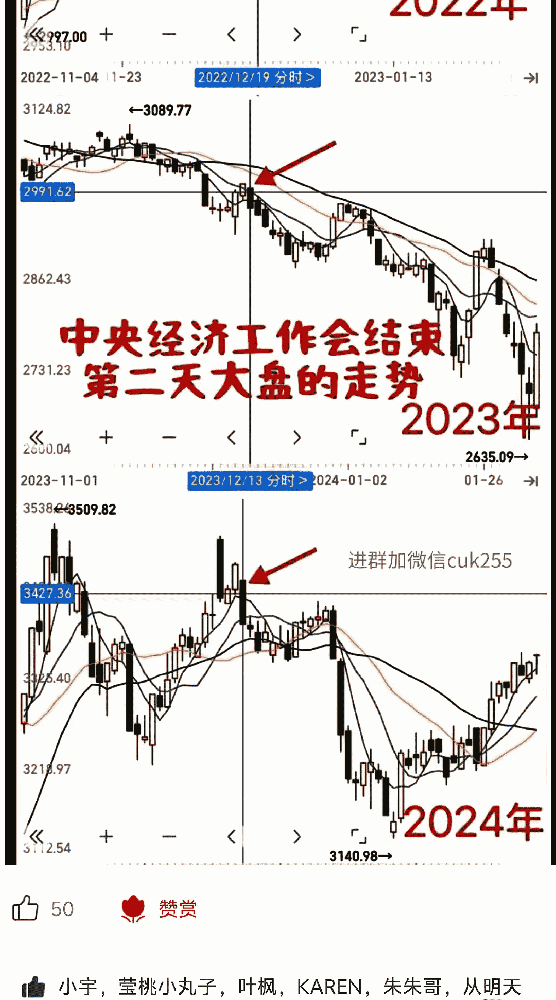

## 分歧 25211鉴院：存在分歧

昨天美联储如降25个bp，但26年预期比较激进，只打算降一次。

王者说想快降，速降，美联储希望缓降，变法派和金融派分歧很大。

大A的很多人，认为要为B浪回踩，跌破386的位置，再重冲新高。

我们建立中心的，还是那个观点，月线MA5 3820点，是强力支撑位。

依托这个位置，会操作的大大买，小小买所付出风险，则不控仓位。

市场的主线在哪里？

谷歌及其延伸。进群加微信cuk255。一边往上游延伸，光芯片，光器件，一边往下游扩容延伸，mpo，光纤等。军军龙头是光模块。

具体都是那些不屑闲谈了多次了。

今天周的压力，34日，3941压力。

## 上证指数

3900.50 今日 3901.13 高 3906.12 低 3876.47
0.23% -0.92 跌 1.05% 总 4.97 亿 成7304万
上证人数1109 平盘77 下跌 1143 更多

新发ETF 上证增强ETFETF基金正在发售 >

| 分时 | 日 | 周 | 月 | 年 | 更多 |
|---|---|---|---|---|---|
| MA:3902.54 | 8900.30 | 55915.22 | 13887.48 | 60910.29 | DK点 |
| 均线:3941.41 | | BIAS:1:-0.38 | BIAS:2:-0.38 | BIAS:3:-0.38 | |

2022年

中央经济工作会议结束第二天大走势

2023年

进群加微信cuk255

2024年

小子，赞赞小丫，针叶，KAREN，朱朱哥，明天也是希望的人和阳光日子，大爱，心里藏着君王术术，捂脸等50字表态了感情

## 深度视野优质集圈（链接优质社群，助你成功）

全部包含以下内容：限时年费188/年 加微信cuk255

- ① 吃瓜群众包时圈文加时群对话（原价 365 元/年）
- ② 子明私享汇（含）内部文章
- ③ 政事室（狮明）付费内容内加顺梯子明群
- ④ 咪联储寂美【作者米横】（原价 599 元/年）
- ⑤ 欧洲金雀会员专属文章（原价 328 元/年）
- ⑥ 砖瓦仁内部文档（原价 400 元/年）
- ⑦ 卢克文青读书会专属文章（原价 699 元/年）
- ⑧ 鉴茶财经知识星球（原价 3310 元/年）
- ⑨ 猫哥的视界知识星球文章（原价 299 元/年）
- 十 财经周刊【独家新闻fact】（原价 1498 元/年）
- 十一 杨世光在金钱圈（原价 2200 元/年）
- 十二 森淼跃财经知识星球（原价 1600 元/年）
- 十三 激异译付费文章（持续更新）
- 十四 司马林解读末选全套音频和全套书籍收藏无割减（原价 2.3 万）
- 十五 虚构三部曲[民国梦、帝国争国、不被理解的MAO](原价 599 元）
- 十六 卢克知识星球文章（原价 268 元/年）
- 十七 额外再送：卢锐元新浪微播付费专栏、三村丰老王、三花九树文集

不定期内容：......（更多资源下去了......

- ① 守夜人司令星球、接换魔后星球、成达泛论星球、成就财富圈、雪花花甲老头等
- ② A视野、大树乡谈、江初师傅、泮咩说、上海海家等付费文集
- ③ 西凤付费文章、老端、赢在八小时之外、局外的视界、升值、老体制内等其它一切大付费文集（每月不超过600元的付费文集）
