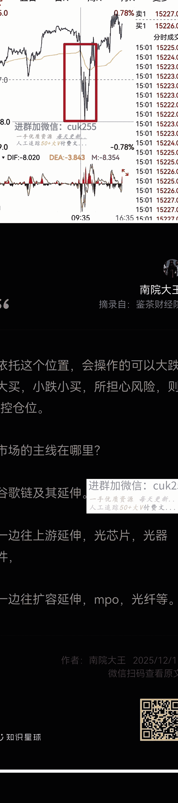

# 完成春天

强势，力量都是3820，
早上的强势已经倒下，如今又大跌，强势吗？
又尝试了3850，已经跌仓-0.7%了，
强势，看来再等等等了。

又一回，又一回，
这就“大涨小跌小了”。

作者：迷游duck255

市场和信心已经枯竭了，
曾经的梦想和光芒也消失了，
曾经的希望已经彻底破灭，再就不看好了。

现在的3800点算底部吗，还要等到底呢？
如果跌了，现在的3800点，算不算底部了？

难道不是3870？

现在，如果5000点还能大涨起来，这种操作就够了。

下着，毫无无底的下跌

> 一上一涨ASML，光伏、光器件、n一切

作者：南海王 2023年12月5日
发布于：李复复复的投资日记

> 依托它，合作的机会可以大选，
大小跌了，有朋如此，所能如此，
市场的未来在哪里？

作者：迷游duck255

6评论

## 深度视野优质集圈（链接优质社群，助你成功）

全部包含以下内容：限时年费188/年 加微信cuk255

- ① 吃瓜群众含帝时文加时群聊对话（原价 365 元/年）
- ② 子明私享汇（含）内部文章
- ③ 政事室（子明佛）付费内加送额外子明群聊
- ④ 米联储美【作者米栖】（原价 599 元/年）
- ⑤ 欧洲金雀会员专属文章（原价 328 元/年）
- ⑥ 砖瓦斥内部图文（原价 400 元/年）
- ⑦ 卢克文青读书会专属文章（原价 699 元/年）
- ⑧ 鉴茶财经知识星球（原价 3310 元/年）
- ⑨ 猫哥的视界知识星球文章（原价 299 元/年）
- ⑩ 财财经周【独家新闻】（原价 1498 元/年）
- ⑪ 杨世光在金钱圈（原价 2200 元/年）
- ⑫ 森淼财经知识星球（原价 1600 元/年）
- ⑬ 激源异译付费文章（持续更新）
- ⑭ 司马林解读全套音频和全套书籍版权无损（原价 2.3 万）
- ⑮ 虞虚三部曲[民国、帝国争亡、不被理解的MAO]（原价 599 元）
- ⑔ 卢克知识星球文章（原价 268 元/年）
- ⑰ 额外再送：卢锐新浪付费专栏、三村丰老王、三花九术文集

- 不定内容：......（更多资源将下去......
- ① 守夜人司令星球、接换魔王星球、成败财富星球
- ② 创始者笔记、达叔浅论星球、成就财富圈、雪花甲老头等
- ③ A 视野、大树乡谈、江初序、泮咩说、上海家学等付费文集
- ④ 西风付费文章、老端、赢在八小时之外、局外的视界、升值、老体制内等其它其它大V付费文集（每月不超过600 元的付费文集）

## 深度视野文集
进群微信cuk255

深度视野（付费文集）

## 限时年费188/年 低成本链接全网V优质内容
