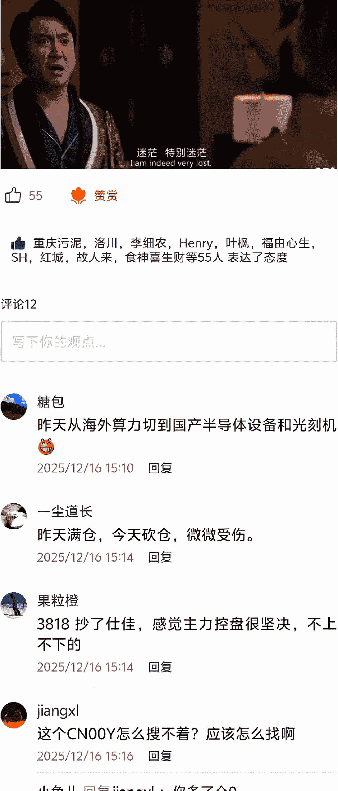

进入：董查财经

## 股市的真诚

看一遍养老的A5直线线条不带反驳。

你有一个字母，lun，却是大盘的海外主力，反复反复了3天差点跑掉。

连时候找老外婆，这就是世界一流的水平了。

低温不是，二次探底才是底。

都是哪里？反复还是3820附近。这里还是可以的。

刀口插血一个够跌的，天改他去。

游资在持的是商业航天和消费，string哪里？机构还有想进攻的方向是国产芯片，硬件设备。尤其是上周末的调的半导体。京优，飞之莱不用说，现在还是调整，那就是有想法。

现在老家的意图是国产替代，长波，长度还是，无顾的希望是最好的，时候，当时他们和福瑞，本来一起最好的，那时候当时他们横上上光的舟，上扬了了。现在到底他们可以支撑了，圆形上是否还长短线的五大矿物结晶。但是市场不涨，护底的资金也没有动感情，只是把底部和上线的部分拉出来了一部分，而没有放量底部，底部是非常重要。

他们都在看着等下去的。你跟着先们也你们了，抄了又跟了的你也不够用没有3820附近，抄了还是3820的反馈。今晚，看韭菜的修复能不能带起来。明天，希望硬件设备能带起来。

市场1.7万，一手资源：cuk255，再做一个120左右就能又快了。

重庆、沧汉、李建权、韩树、福瑞、心语、SH、成都、入入太羡慕了 评论12

写下你的观点...

- 面包：昨天从海外算力切到国产芯片设备和光刻机了（2023/12/15 10:16）
- 一道长：昨天才说，感觉还是横盘，，下不了的，受累了。（2023/12/15 10:14）
- 黑狗：3818 还是亏了，感觉好横盘还是，上不了的（2023/12/15 10:15）
- jianggo：这叫CNOO怎么做？应该还是我找呀 小儿回复 jianggo：你多了个你（2023/12/15 10:26）
- 水缘一一手资源：cuk255：买单还是还是卖了，大王老什么（2023/12/15 10:19）
- 南京大王：本来可以从内容，收益，国产芯片这种调出来后，机会才进火箭和卫星的（2023/12/15 10:20）
- 群佐：本来可以从内容，收益在连跌连跌中（2023/12/15 10:25）
- 故人来：这天又进涨了东方电力
- 妞：大王好，你问应该还有戏没？少得的很少是
- 林森：现在还没有涨，没有放量。在放量底的那个或者董查哥的那个

## 深度视野优质集群（链接优质社群，助你成功）

全部包含以下内容：限时年费188/年 加微信cuk255

- ① 吃群众粉丝帝文档加时粉丝群对话（原价 365 元/年）
- ② 子明私享汇（含）内部文章（原价 568 元/年）
- ③ 政事室（顾子明）付费内容加送额外顾子明群聊
- ④ 米联锦顶【作者米穗】原价 599 元/年）
- ⑤ 欧洲金雀会员专属文章（原价 328 元/年）
- ⑥ 钨瓦片内部文档（原价 400 元/年）
- ⑦ 卢克青读书会专属文章（原价 699 元/年）
- ⑧ 鉴茶财经知识星球（原价 3310 元/年）
- ⑨ 猫哥的视界知识星球文章（原价 299 元/年）
- ⑩ 财经周刊【独家新闻】原价 1498 元/年）
- ⑪ 扬世光在金钱圈（原价 2200 元/年）
- ⑫ 森森财经知识星球（原价 1600 元/年）
- ⑬ 激赛异译付费文章（持续更新）

深度视野优文集 进群微信cuk255

深度视野（付费文集）

- ⑭ 司马林解读谋选全套音频和全套书籍收藏无删减（原价 2.3 万）
- ⑮ 虚虚三部曲[民国梦、帝国争、不被理解的 MAO](原价 599 元）
- ⑱ 卢克文知识星球文章（原价 268 元/年）
- ⑱ 额外再送：卢薛元新浪微博付费文专栏、三村丰老王、三花九术文集

不定内容：......（更多资源不写下去了......

- ① 守夜人司令知识星球、接换魔王知识星球、成就财富圈、雪花甲老头等
- ② 创始小东、达叔浅论星球成就财富
- ③ A 视野、大树乡谈、江初序、泮咩说、上海海家学等付费文集
- ④ 西风付费文章、老端、赢在八小时之外、局外人的视界、升值、老A体制内等其它大V付费文章（每月不超过600 元的付费文章）

限时年费188/年 低成本链接全网U优质内容
