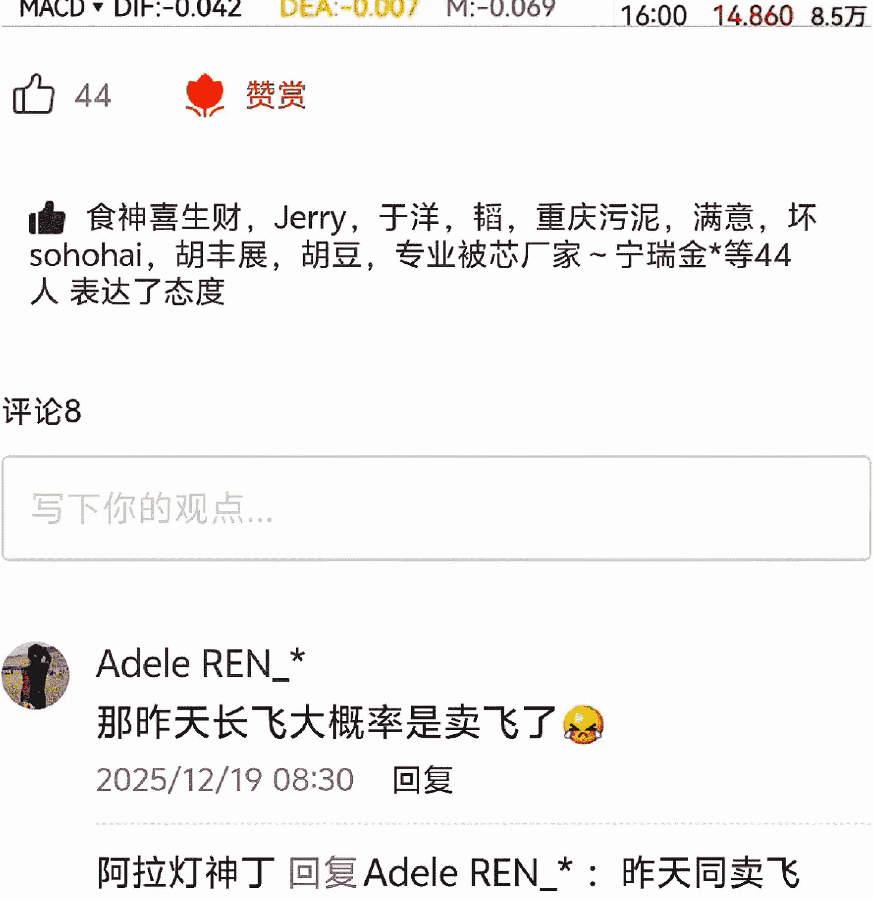

进入：鉴享财经

# 为爱发电

美光存储，存储AI，射到今天的大又是爱等买个，不过大概率不高，不用追了。

中韩半导体如果幅度不大可以看。

A股目前并无真正的高端存储芯片，基本上都是搞炒的，能搞HBM的现存还行，长内存上市，国产存储设备缓存的那几个就不太好了。

随着美股的步步进，今天的科技就看谷歌和存储了。

谷歌近期的新策略还是长效，博大宇宙，要的概要还是算力连接，后排是力讯和封装。

通信时代的铁王者，主要看三个地方的：武汉、苏州和西安。

独特，酷辣的DT设备并购可控聚聚，北美的逻辑依然在加强。

不用嫌弃懂王权的还是了。

这些大家都讲了，前天又见你总总结一回，知道要去前提。

可控聚聚，完全完全是游戏化炒作的，前跌之后，主力机构将逐步开始业绩建仓。

后面的股票天会也会了。

市场的逻辑，仍然是电光和。

和商业航天，营销资金，消费热，福建海南的主题概念热巨踩跳跃。

A50大涨概念，A50拉亚涨题材。

在会的圈里是不活跃的呀，不会会的少动。

> 专财经大V铁特赞付费：进群加cuk255，每日更新。

普食世纪，Jerry，于沪，铅，汞污染，满坏，满南海

sohohai，肺族，胡湖，专业被越核心厂家→宁金后4人

# 评论

你写的是你的评论吧？

Adele REN_：那天大飞大概率是卖飞了🤡 2025/12/19 08:30

## 深度视野优质集团（链接优质社群，助你成功）

全部包含以下内容：限时费188/年 加微信cuk255

- ① 吃瓜群众包时文加时群群对话（原价 365 元/年）
- ② 子明私享汇（内部）文章（原价 568 元/年）
- ③ 政事室（子明优）付费内容加送额外子明群聊
- ④ 米联储巨英【作者米穗】（原价 599 元/年）
- ⑤ 欧洲金雀会员专属文章（原价 328 元/年）
- ⑥ 砖瓦斥内部文档（原价 400 元/年）
- ⑦ 卢克文青读书会专属文章（原价 699 元/年）
- ⑧ 鉴茶财经知识星球（原价 3310 元/年）
- ⑨ 猫哥的视界知识星球文章（原价 299 元/年）
- ⑩ 财新周刊【独家新闻】（原价 1498 元/年）
- ⑫ 杨世光在金钱塔（原价 2200 元/年）
- ⑬ 森森亚财经知识星球（原价 1600 元/年）
- ⑬ 激源译译付费文章（持续更新）
- ⑭ 司马林解读末选全套音频和全套书籍收藏无损减（原价 2.3 万）
- ⑮ 虚构三部曲[民国梦、帝国战争、不被理解的 MAO]（原价 599 元）
- ⑯ 克知识星球文章（原价 268 元/年）
- ⑰ 额外再送：卢薛元新微涨付费专辑、三村丰老王、三花九树文集

不定期内容：——（更多资源不下去了......）

- ① 守夜人才知识星球、接换魔王知识星球、成术财论星球、成就财富圈、雪花桃花甲头等
- ② 创始小妮、达叔泛论星球
- ③ A 视野、大树乡谈、江初优、咩咩说、上海海学等付费文集
- ④ 西风付费文章、老端、赢在八小时之外、局外的视界、升值、老A体制内等其它大 V 付费文章（每月不超过 600 元的付费文章）

限时费188/年 低成本链接全网V优质内容

## 深度视野文集
进群微信cuk255

深度视野（付费文集）

