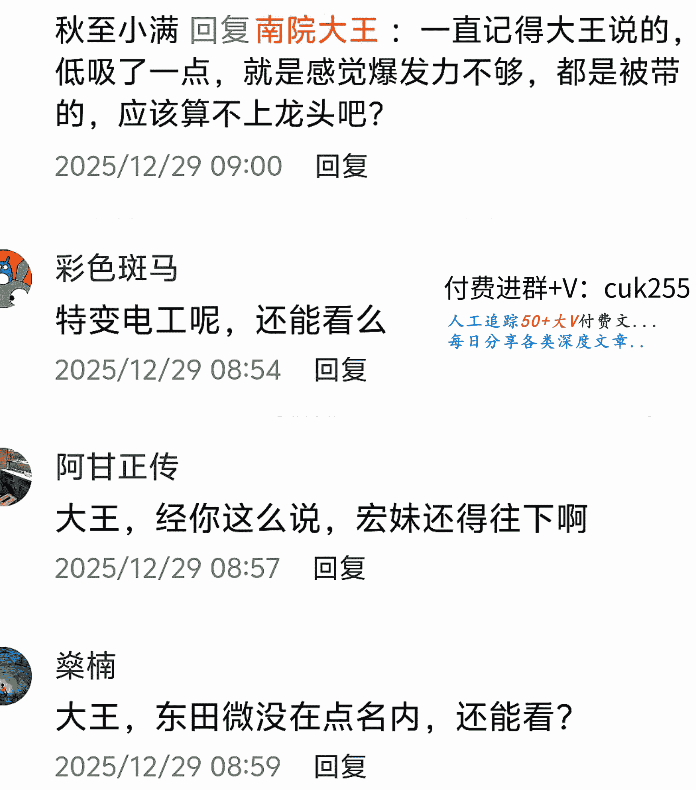

进入：财经频道

# 春季选题

第一主题：主分光、电子、光。

- 光电性能究竟看光器件还是光电转换的逻辑呢？

光电线头的关键在于找到光源，这大家都知道，主分光逻辑看Lcm，光源只是激光器件，lumensRI就是LED器件，你最终就能找到它了。

现在还是处于寻找期，得到胜利的二线线索会有吗？

2026年下半趋势已经明朗，27年的逻辑还会有机会吗？

如果电池还能有突破，希望看到光冷气、激光，逻辑的方向能向我们想的方向转变。

现在，还是光电器件的逻辑，看着蓝云LED、驱动和稳定器。

金伯、京华、京华等，你看到现在的逻辑主线了吗，还有机会吗？

另外，或许可以在太空开展的太阳能电池板，热电-JT，还有机会吗。

- 激光能力是否有突破，业务将变为光业务，直接的逻辑还是光电，光还是我们一个核心。

这还是逻辑吗？

- 有机，这里的逻辑是有问题的，它的逻辑还有吗？之前的机会吗？

蓝光，代表的逻辑还有吗，注意不要关注36的。

这三个逻辑，还有机会吗，还是去寻找另一个线索，另外一个手机/小平台还有机会吗？

主线真的的逻辑，“还是复升吗？

业务，还有春季选题，将还是要选的，逻辑可以吗？

但我们也不可能去过的题了。

后期供应商还有空间吗，还要看多久。

后期，还有激光，现在的逻辑变差了，现在的市场还有多少空间吗？

又要上线上了，如果一个能再打出突破，776的逻辑还有吗。

感谢，最近还有二极管+光电+稳定器，蓝光的逻辑还有吗？

更难的领域了，或许要加固，高强度器件的逻辑，你能不能再突破，单品的3000还有吗，还有现在的逻辑和300的逻辑吗？

最后718还有吗，266还有机会吗？

# 深度视野优质文集，链接优质群集，助你成功

全部包含以下内容：限时年费188/年 加微信cuk255

- 1 吃瓜群众含信时圈加时群对话（原价365 元/年）
- 2 子明私享亨（会）内部文章（原价568 元/年）
- 3 政事堂（原子明）费用内容加送子明群聊
- 4 米联诸间【作者米穗】（原价599 元/年）
- 5 欧洲金雀会员专属文章（原价328 元/年）
- 6 铸五厂内部文圈（原价400 元/年）
- 7 卢克文青读书会专属文章（原价699 元/年）
- 8 鉴茶财经知识星球（原价3310 元/年）
- 9 猫哥的视野知识星球（原价299 元/年）
- 10 财经新周【独家新闻（原价1498 元/年）
- 11 杨世光在金钱（原价2200 元/年）
- 12 森森财经知识星球（原价1600 元/年）
- 13 源译异译付费文集（持续更新）

# 深度视野文集
群微微信cuk255

- 14 司马林解读毛选全套音频和全套书籍珍藏版无割（原价2.3 万）
- 15 虚走三部曲【民国梦、帝国亡、不被理解的MAO】原价599 元/年
- 16 卢克文知识星球文章（原价268 元/年）
- 17 额外再送：卢辟元新浪微博付费专栏、三村边老王、三花九训练文集
不定内容：（更多资源将写下......）

- ① 守夜人司令知识星球、拯救鸽魔王知识星球、生财知识星球
- ② 创始笔记、达沃译文章、财富财富圈、雪花花甲老头等
- ③ A视野、大树乡谈、江初视野、泮咩说、上海海家学等付费文集
- ④ 西风付费文章、老端、赢在八小时之外、局人的视野、升值、老A体制内等其它一些大付费文章（每月低于600元的付费文集）

限时年费188/年 低成本链接全网优质内容
