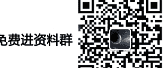

# 南大王
2025-06-28 18:19

易经第21卦雷噬噬（上）：坏人都是你作出来的

网上有个找子。

全击化了，蛋也吃了，电影看了，街也逛了，充电宝和面膜都出来了，你现在要回吗？

易经的19卦是临，人都出来了；第20卦是遁，仔细细细的都看了；第21卦，噬，就碰到噬门困，解决了问题了。

“嘘。亨利。”

卦曰：“雷噬。先王用明刑改法。”

“噬（shake）是下层咬，合住嘴把嘴咬住不放或吃掉。利于从根本上解决问题。”

这句话的意思是，咬牙齿，亨利，利于根本上解决问题。

狱，不是监狱，更是无法解决的冲突和矛盾。群里好几位大学师同学想必清楚。

微信:jntsg

讼，是小的是是非的问题，是民事案件，免费资料群。

狱，是大多数的问题，是刑事案件。

微信:jntsg2

这句的意思是什么呢？

下卦为雷，上卦为火，噬为火。雷火相击，要有果断的决策刑罚，传播法律。此之后，要解决问题，要去除糟弊，必须要果断的刑罚，传播法律条文，有威力，才能开启光明。

用于社会和生活，那就是关系在其中，在行事中遇到困难了，要上力一把口破，通过和解可以了。

这里的关键是“明刑改法”。明确告诉别人，我会怎么对你好，你需要我怎么回，我喜欢你，讨厌你，你怎样对我才会开心，什么是我的高压线，被碰为止了。

很多人时候，问题为什么会发生，就是因为你没好意思，没有游戏规则好打算，结果对方过你底线的时候你再退还不好意思，最后把她气得上上，你花精力，委屈着，事情闹大，她自己无措。

男女界曾经有一个“废物测试理论”，即用一个小问题反复测试对方的容忍。然而，适得其反。

比如，她微信不回，你忘了；下次不接电话，你再忘了；下次打算的事不做做到，你又忘了。发展下去，你就成了情感垃圾，成了对方的供养者血包。

底线的突破，只有一次和无数次，你的人都是你惯出来的。

所要做是一个规则明确的人，雷风行清楚，高压线清楚。公布的第一个策略是：但凡我发出的消息，8小时内不回复，就视为不尊重合同条文，直接开始。

当当时她随手管理一个手机，问题非常多，公布的，以及原因，她说我就这样，手机不回信息，爸爸的电话都不回。

这就是什么玩手机了，笑着说：是有事，有时间跟男朋友视频，没有时间看手机？你爸忙着你，社会忙着你？何回应，直接谈工资走人吧。

我发布的每一条信息都视回，比如奖励，不等工资发那天，隔天就发现，你答应的重大承诺不到，否则视为不真诚。

目的是什么？既然已然，更是要防范于未。“明罚”是为了了“教法”。用刑是为了无刑的。

先真体会光之闪，雷风行，就是要一往无前的决心和魄力去解决问题，都咬牙切了诸了。结果怎么样呢?

红线每升一次，就要让他彻底划线相信一回，不成了得了以后恋人发笑？

即使是滚滚的，他也说过一句话：“既然你不喜欢，我也不喜欢你好了。”

他没说怎么不喜欢。

“打的一拳，免得百事愁。”

天心月圆：有人对他越好，他越坏。这一类人认为得到的好处是凭他的智商换来的，你对你好，他不认为是好，反而觉得你是值，他智商比你高，不仗你？这一类人的结局一般都不太好。但是你对你好，他越对你好。

2025-06-28 19:38;

照回天心月圆：是有的人你对他们他们不会觉得你好而是觉得你不值得得一切是他们应的反而拿起架子。

天心月圆：如果不得不交道，这类人来尝试探底线的时候，就要给他立规矩，拒绝他的就斩断截铁的明确拒绝，让他知道你的底线和边界在哪里，同时让他知道你的智商不比他低，不要把你的善良当成是智商。

大生活回复天心月圆：对于“不得不交道”，可以降低底线，但绝对不能没有底线。

2025-06-28258

大周-敬真回复大生活：没有不得不，我可以选择，

# 微信公众号:jnts8

# 公众号:jntsg2

免费资料群
