2025年06月28日

证券研究报告·行业研究·医药医学
医药行业周报（23-63-27）

## AI 医疗利好消息频现，建议关注 AI 医疗+创新成长

### 投资要

- **行情回顾**：本周医药行业指数上涨1.60%，跑赢沪深300指数0.35个百分点，行业涨幅排名第3，2025年初以来，医药行业上涨6.24%，跑赢沪深3006.67个百分点，行业涨幅排名第11，本周医药行业价值水平（PE-TTM）为27.5倍，相对于全行业处于78.33%（-1.37pp），剔除影响后行业涨幅为37.76%（-1.12pp），跑赢沪深300指数为124.59%（+0.55pp）。

- **AI 医疗利好消息频现，建议关注**：阿里巴巴康德在杭州医院推出糖尿病肾病诊疗一站式交付及数字化管理平台；发讯浦AI辅助诊断影像模型 GAMO DAPE；聚集敏XoveTree在医药行业推出打造面向医院的AI平台；华科生物等企业在南京医院打造AI医疗平台；国内医药行业首创DeepSeek-R1的AI研发与领域领先，标志着AI医疗迈向与行业深度融合的新进展。相关方面，AI医疗管理健康、心医疗、AI医疗信息化、AI CDSS模型辅助临床决策、金医学、药学、AI医学辅助诊断、监测、衍生、AI手术机器人-微创、天枢、脑机、AI医疗北京大学一院、华东理工等。

- **2025年基行业目标策略进行调整**：医药行业发布2025年基行业目标及融资策略调整报告，本周的每日行业目标将纳入医药，聚焦技术创新。在首次融资申报中，首个医药行业融资获得入选，在融资申报中，首个医药行业融资获得支持。本次策略调整是基于医药行业发展的需要，建议将医药行业纳入建议关注的配置范围，重点关注医药行业“行业发展”、“BD出去”、“盈利质量”等主题。

- **推荐股票**：华东医药（600867）、美景医学（002024）、云达讯（002196）、赛瑞医药（688085）、创新（688110）、中国医药（688699）。

- **稳健组合**：瑞恒医药（600266）、百济医药、联迪医药（688271）、上海华（002252）、贝达药业（300538）、济川医药（600566）。

- **风险提示**：医药行业政策策略超预期；发展进展不及预期；医药涨幅不及预期风险。

## 南南研究院

分析师：杜向润
执证号：S1205052000032
电话：021-68410617
邮箱：duyx@swsw.com
联系：磊晨
电话：021-68410617
邮箱：leir@swsw.com

## AI医疗行业趋势

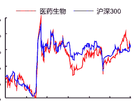

## 基础数据

| 字段 | 数值 |
| :--- | :--- |
| 行业市值（亿元） | 499.38 |
| 流通市值（亿元） | 47,654.95 |
| 行业市盈 TTM | |
| 医药占比沪深300指数 | 13.0 |

## 相关研究

1. 医药行业报告（6.16-20）：融资申优建议，持续关注AI医疗（2025-06-22）
2. 医药行业报告（9.6-13）：BD+集团医药发展，持续关注AI医疗（2025-06-15）
3. 医药行业报告（6.36-28）：持续关注AI和医药行业（2025-06-28）
4. 医药行业报告（5.26-50）：基层医疗大模型定制化，关注AI医疗（2025-05-02）
5. 2025年5月四季度国内融资医药

## 知识星球TOP 资源分享社群

汇聚全网付费资源
让更多获取高价值信息

- 付费文章 | 付费社群
- 付费课程 | 副业&搞钱
- 财经&股市 | 行业报告
- 时政·历史·职场·体制·自媒体
- 学习·军事·软件·影音·社会学

公众号: 知识星球TOP 微信信号: jntsg8 微信信号: jntsg2

添加微信 免费进群

## 目录

- 1 投资策略 ............................................................................................................ 1
- 1.1 上周推荐组合分析 ....................................................................................... 2
- 1.2 上周稳健组合分析 ....................................................................................... 2
- 2 医药行业二级市场表现 ....................................................................................... 3
- 2.1 行业及个股涨跌情况 ................................................................................ 3
- 2.2 大宗交易情况 ....................................................................................................... 8
- 2.3 期间融资债券情况 ....................................................................................... 9
- 2.4 医药上市公司股东大会召开信息 ....................................................... 9
- 2.5 医药上市公司定增进展信息 ................................................................ 10
- 2.6 医药上市公司限售期解禁信息 ................................................................ 11
- 2.7 医药上市公司本周股东减持情况 ................................................................ 13
- 2.8 医药上市公司股权质押情况 ....................................................................... 13
- 3 最新新闻与政策 ....................................................................................... 14
- 3.1 新医药新闻 ....................................................................................... 14
- 3.2 研发进展 ....................................................................................... 14
- 4 报告梳理 ....................................................................................... 15
- 4.1 新增研究报告 ....................................................................................... 15
- 4.2 核心公司深度报告 ....................................................................... 15
- 4.3 精选行业报告 ....................................................................................... 19
- 5 风险提示 ....................................................................................... 24

## 图目录

- 图 1: 本周行业涨幅 ...... 3
- 图 2: 年初行业涨幅 ...... 3
- 图 3: 近两年医药估值水平（PE-TTM） ...... 4
- 图 4: 最近5年医药估值水平（整体PE-TTM） ...... 4
- 图 5: 行业估值趋势对比（PE-TTM整体） ...... 4
- 图 6: 行业相对值沪深300累计涨幅 ...... 4
- 图 7: 本周行业涨跌幅 ...... 4
- 图 8: 年初至今行业涨幅 ...... 4
- 图 9: 行业相对A估值水平（PE-TTM） ...... 5
- 图 10: 行业全部A估值水平（PE-TTM） ...... 5
- 图 11: 短期领先指标与行业估值的关系 ...... 6
- 图 12: 最近5年至今对比与行业估值的关系 ...... 6
- 图 13: 投放量和回购量对比（亿元） ...... 7
- 图 14: 投放量和回购排列（亿元） ...... 7
- 图 15: 最近5年医药债收益率与市值 ...... 8
- 图 16: 最近5年医药债收益率（月线） ...... 8

## 表目录

- 表 1: 推荐趋势、稳健组合收益 ...... 1
- 表 2: 上周推荐组合表现 ...... 2
- 表 3: 上周稳健组合表现 ...... 3
- 表 4: 2025/06/23-2025/06/27医药行业涨幅情况 ...... 5
- 表 5: 2025/06/23-2025/06/27医药行业交易情况 ...... 8
- 表 6: 2025/06/23-2025/06/27行业基金流入额五名情况 ...... 9
- 表 7: 2025/06/23-2025/09/30医药上市公司股东大会信息 ...... 9
- 表 8: 2025/06/30医药上市公司定增进展（预案实施） ...... 10
- 表 9: 2025/06/23-2025/09/30医药上市公司限售解除信息 ...... 12
- 表 10: 2025/06/27本周医药股东减持信息 ...... 13
- 表 11: 2025/06/27医药上市公司股权质押前十名信息 ...... 13

## 投资策略

行情：本周医药指数涨1.60%，跑赢沪深300指数0.35个百分点，行业涨幅排名第3。2025年初以来，医药行业上涨6.24%，跑赢沪深3006.67个百分点，行业估值水平（PE-TTM）为27.5。A股市盈率为78.33%（-1.37），相对全部A股市盈率为37.76%（-1.12pp），沪深300指数率为12.54%（+0.55）。本周表现最好的板块是医药，上涨3.9%，今年以来最好的医药板块涨20%（+16.6%+14.6%）。

- AI医疗行业，持续关注。（2）糖尿病肾病一站式诊疗及微创治疗，阿里巴巴康德X诸诺：发布全球首个胃部影像胶架模型DAMAPE；3）敏智药跃迁：正式推出面向用户的AI健康助手AG；4）蓝科技XTree：推出手机端AI平台；5）原生药市场首款进入海外市场，网络驱动DeepSeek-R1的成功，AI医疗技术与行业持续演进，AI医疗行业的加速发展与机遇。机会：A：康德发展、美年健康；AI医疗信息化CDSS关注。一路领先，医学类、联合医学：AI影像辅助诊断、华科医学AI手术机器人。

2025年医药保险基金调整工作进行中。保监局发布《2025年医药保险及创新基金调整操作通知》，每年将医药保险纳入，活跃市场新宠。在调整文件中，或将医药保险纳入基金调整，此次调整是保险市场的重大举措，标志着保险在多层医疗体系中发挥重要作用，建议关注新险、“BD出”、“盈利收益”等品种。

推荐指数：关注康德（600867）、美年健康（002024）、云达领先（021955）、再医药（698268）、赛诺济医疗（688097）。

医药品种：关注恒瑞（600276）、百济健康（668235）、联影医疗（086198）、上海泰士（002252）、赛业医药（300538）、济民医药（605666）。

| 表 1：医药策略、医药健康创新基金估值 |
| 代码 | 公 | 股息 | 2024E | 2025E | 净利润率(2024E) | 2025E | 净利润率同比增长 | PE(2024E) | PE(2025E) | 投资建议 |
| :--- | :--- | :--- | :--- | :--- | :--- | :--- | :--- | :--- | :--- | :--- |
| 600867 | 东方绪 | 157 | -0.04 | 14.38 | 16.13 | -14% | 3466% | -366.4 | 10.9 | 买入 |
| 002044 | 美年健康 | 205 | 2.8 | 4.3 | 5.0 | -54% | 128% | 72 | 47.6 | |
| 021955 | 云顶领先 | | | | | | | | | |
| 698268 | 再医药 | | | | | | | | | |
| 688097 | 赛诺济医疗 | | | | | | | | | |

和黄医药：业态符合预期，综合收入2025年全年指引为 3.5 至 4.5 亿美元

济医药：2023年利润增速超预期，盈利能力持续提升

组合收益：上周整体组合上涨2.3%，沪宽大盘0.3个百分点，医药医药指数0.7个百分点。

### 3：上周医药组合表现情况

| 公司名称 | 初始收价(元) | 流通量(亿) | 最新收价(元) | 上周涨幅 |
|---|---|---|---|---|---|
| 002252.SZ | 上海药业 | 6.8 | 66.3 | 6.9 | 1.6% |
| 688271.SH | 联影医药 | 128.5 | 5.9 | 12.8 | -0.2% |
| 601607.SH | 上海医药 | 17.5 | 37.1 | 17.8 | 1.6% |
| 000538.SZ | 云南白药 | 55.0 | 17.7 | 55.9 | 1.5% |
| 300558.SZ | 贝达医药 | 54.9 | 4.2 | 57.7 | 5.1% |
| 0013.HK | 和黄医药 | 23.7 | 8.7 | 23.8 | 0.4% |
| 600566.SH | 齐金医药 | 27.4 | 9.2 | 29.0 | 5.8% |

| 指数 | 初始值 | 最新值 | 加权平均涨跌 |
|---|---|---|---|
| 000300.SH | 沪深300 | 3846.6 | 3921.8 | 2.0% |
| 801150.SH | 医药生物(申报) | 7552.1 | 7762.9 | 1.6% |

| 沪宽指数 | 涨幅 |
|---|---|
| | 2.3% |
| | 0.7% |

数据来源：Wind，西财富整理；注意所有个股单位一样，和黄医药单位为港元

## 2 医药行业及二级市场表现

### 2.1 行业及个股涨跌情况

本周医药指数上涨1.60%，沪300指数涨0.35个百分点，行业涨跌排名第一。2023年初以来至今，医药行业上涨6.24%，沪深300指数上涨6.57个百分点，行业涨跌排名第11。

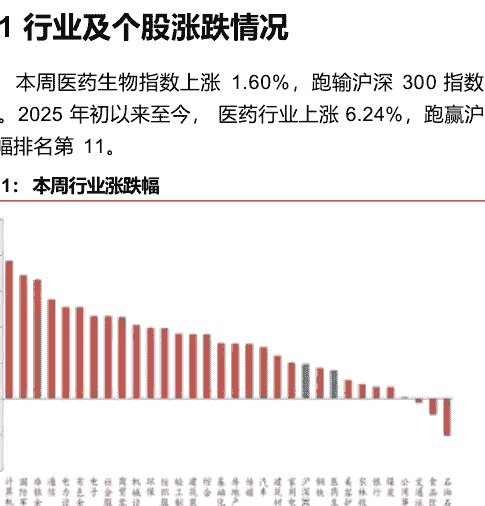
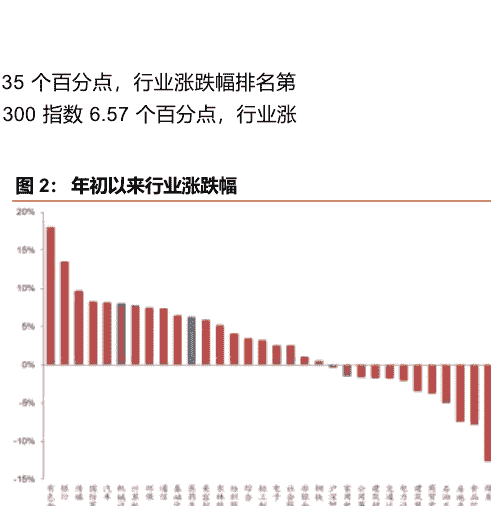

数据来源：Wind，西财富整理

请务必阅读正文的重要声明部分

# 医药行业周报(6.23-6.27)

本周医药行业价值水平(PE-TTM)为27.75，相对于A股溢价率为78.33% (-1.37pt)，相对除银行后全部A股溢价率为37.76%(-1.12pt)，相对沪深 300 溢价率为124.59% (+0.53pt)。

图 3：近3年医药行业估值水平(PE-TTM)
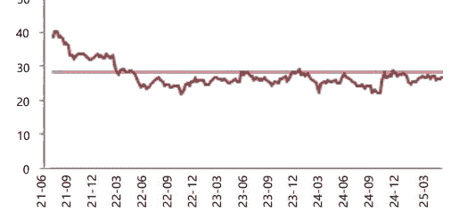
数据来源：Wind, 西方证券整理

图 4：近5年医药行业估值率(整体法 PE-TTM 除银行后)
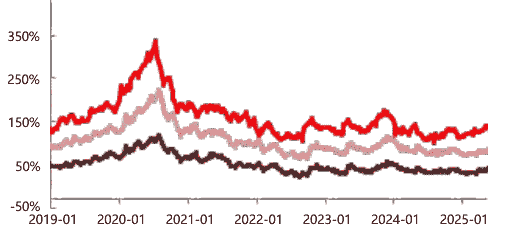
数据来源：Wind, 西方证券整理

图 5：行业估值水平走势趋势(PE-TTM 整体法)
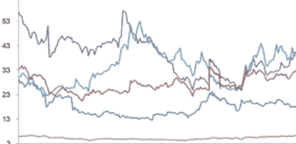
数据来源：Wind, 西方证券整理；选取自年以来以前的一级行业

图 6：行业相对于沪深 300 超额收益率
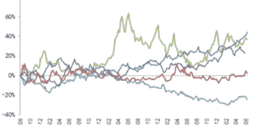
数据来源：Wind, 西方证券整理；选取自年以来以前的一级行业

本周对相对最好的板块是医药，上涨3.9%，今年初来表现最好的前三板块是化学制剂、原料、其他生物制品，涨幅分别为+16.6%、14.6%。

图 7：本周行业涨幅
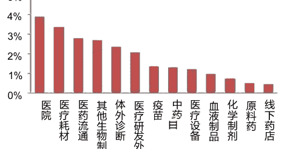
数据来源：Wind, 西方证券整理

图 8：年初至今医药涨幅
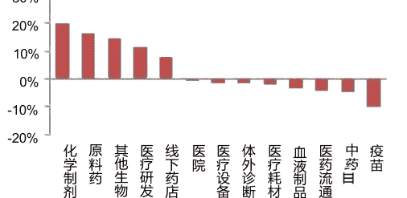
数据来源：Wind, 西方证券整理

请务必阅读正文的重要说明

# 医药行业周报 (6.23-6.27)

5月2同比增长 8%。短期指标来看，R007 加权平均利率波动，本周与股指空间基本持平。

图 11：短期流动性指标 R007 与股指盈率的关系
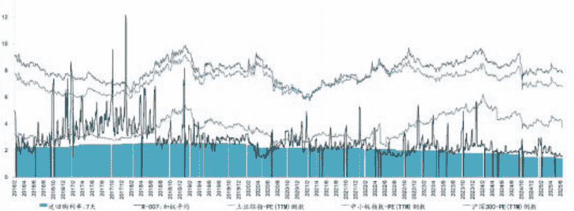
数据来源：Wind，东方证券整理

图 12：2015 年至今的 M2 同比数据与股指盈率的关系
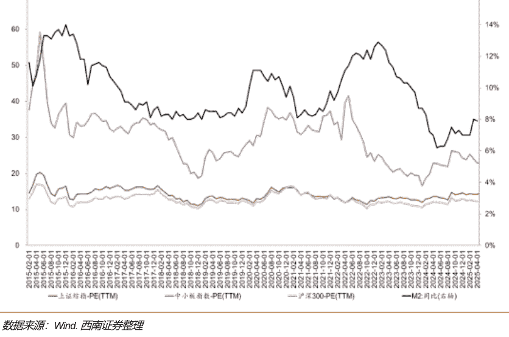
数据来源：Wind，东方证券整理

### 表 4：2024/06/23-2024/06/27 医药行业及板块涨跌

| 指数 | 子行业 | 涨幅 | 子行业 | 涨幅 |
|---|---|---|---|---|
| 医药 | | | 体检 | 2.4% |
| 医药生物 | 1.60% | 医疗研发 | 2.1% |
| | 医疗耗材 | 3.4% | 免疫 | 1.4% |
| | | | 中医药 | 2.8% |
| | | | 2.7% |
| 医药行业内周涨幅前十 | | | |
| 688520.SH | 神州细胞 | 30.45% | 易明医药 | -21.9% |
| 688656.SH | 浩微信息 | 27.08% | 福元医药 | -11.5% |
| 301408.SZ | 华人健康 | 25.97% | 博瑞医药 | -9.4% |
| 688151.SH | 华科技 | 22.94% | 688666.SH | -7.7% |
| 688062.SH | 远景生物-U | 17.44% | 002898.SZ | -6.9% |
| 688265.SH | 南药生物 | 16.51% | 002317.SZ | -6.0% |
| 301080.SZ | 百普营养 | 15.79% | 300255.SZ | -5.9% |
| 603716.SH | 豪力医疗 | 14.49% | 688136.SH | -5.8% |
| 002244.SZ | ST 百亿 | 12.80% | 688117.SH | 圣洁生物 | -5.1% |
| 688321.SH | 微创生物 | 12.19% | 300485.SZ | 赛洋医药 | -4.7% |

数据来源：Wind，东方证券整理

### 表 5：2024/06/23-2024/06/27 医药行业大宗交易情况

| 序号 | 代码 | 公司名称 | 交交金额（万元） |
|---|---|---|---|
| 1 | 002252.SZ | 上海医药 | 467.6915 |
| 2 | 002001.SZ | 新华医药 | 353.4295 |
| 3 | 002550.SZ | 康药 | 109.61 |
| 4 | 688136.SH | 科兴制药 | 88.3218 |
| 5 | 002044.SZ | 美年健康 | 83.66 |
| 6 | 688621.SH | 阳光诺华 | 70.515 |
| 7 | 688533.SH | 济制药 | 39.9771 |
| 8 | 688382.SH | 益方生物-U | 37.3997 |
| 9 | 301201.SZ | 诚运药物 | 33.2062 |
| 10 | 002907.SZ | 华森药物 | 28.7703 |
| 11 | 301017.SZ | 医药华民 | 24.8108 |
| 12 | 300149.SZ | 睿智医疗 | 21.4801 |
| 13 | 002223.SZ | 鱼联医疗 | 19.9668 |
| 14 | 300341.SZ | 麦夷迪 | 17.3217 |
| 15 | 688278.SH | 特宝生物 | 11.9626 |
| 16 | 002873.SZ | 新天医药 | 10.2582 |
| 17 | 300558.SZ | 贝达医药 | 7.8256 |
| 18 | 600055.SH | 万东医药 | 2.0939 |
| 19 | 688222.SH | 成都先华 | 2.0166 |

数据来源：Wind，东方证券经理

### 2.3 期间融资情况

本周买入标的的前五名为：杨德药物、常山药物、荣昌生物、恒瑞医药、翰宇医药。

本周卖出标的的前五名为：恒瑞医药、杨德药物、迈瑞医药、爱尔眼科、信立医药。

### 表 6：2024/06/23-2024/06/27 期间融资买入列表及期间卖出列表前五名情况

| 证券代码 | 证券名称 | 期间买入额(万元) | 证券代码 | 证券名称 | 期间卖出额(万元) |
|---|---|---|---|---|---|
| 603259.SH | 杨德药物 | 895.12 | 600276.SH | 恒瑞医药 | 19.73 |
| 300255.SZ | 常山药物 | 741.82 | 603259.SH | 杨德药物 | 8.86 |
| 688331.SH | 荣昌生物 | 588.52 | 300760.SZ | 迈瑞医药 | 3.35 |
| 600276.SH | 恒瑞医药 | 573.63 | 300015.SZ | 爱尔眼科 | 2.96 |
| 300199.SZ | 翰宇医药 | 559.11 | 002294.SZ | 信立医药 | 2.80 |

数据来源：Wind，东方证券

### 2.4 上市公司股东大会

未来三个月内将于召开股东大会（2024/06/30-2024/09/30）：

| 序号 | 代码 | 公司名称 | 会议日期 | 会议类型 |
|---|---|---|---|---|
| 1 | 688271.SH | 联影医药 | 2024-06-30 | 股东大会 |
| 2 | 000534.SZ | 万济股份 | 2024-06-30 | 股东大会 |
| 3 | 603883.SH | 老英德 | 2024-06-30 | 股东大会 |
| 4 | 600993.SH | 亚洲龙 | 2024-06-30 | 股东大会 |
| 5 | 300086.SZ | 康健医药 | 2024-06-30 | 股东大会 |
| 6 | 688626.SH | 宇翔医药 | 2024-07-01 | 股东大会 |
| 7 | 300723.SZ | 一品红 | 2024-07-01 | 股东大会 |
| 8 | 600079.SH | 人服医药 | 2024-07-02 | 股东大会 |
| 9 | 688085.SH | 三友医药 | 2024-07-04 | 股东大会 |
| 10 | 300482.SH | 万生医药 | 2024-07-04 | 股东大会 |
| 11 | 300143.SZ | most爱生命 | 2024-07-04 | 股东大会 |
| 12 | 002424.SZ | ST 百京 | 2024-07-04 | 股东大会 |
| 13 | 000931.SZ | 中关关 | 2024-07-04 | 股东大会 |
| 14 | 688068.SH | 热DBG生物 | 2024-07-04 | 股东大会 |
| 15 | 002382.SZ | 瑞佰医药 | 2024-07-07 | 股东大会 |
| 16 | 688131.SH | 元隆医药 | 2024-07-07 | 股东大会 |
| 17 | 600511.SH | 国医药 | 2024-07-07 | 股东大会 |
| 18 | 000999.SZ | 华润三三 | 2024-07-07 | 股东大会 |
| 19 | 002027.SH | 华生生物 | 2024-07-08 | 股东大会 |
| 20 | 301207.SZ | 华益蕾 | 2024-07-08 | 股东大会 |
| 21 | 301370.SZ | 国领科 | 2024-07-09 | 股东大会 |
| 22 | 321290.SZ | 东东医药 | 2024-07-10 | 股东大会 |
| 23 | 002900.SZ | 皓三三 | 2024-07-11 | 股东大会 |
| 24 | 301093.SZ | 华兰医药 | 2024-07-11 | 股东大会 |
| 25 | 002872.SZ | ST 天圣 | 2024-07-11 | 股东大会 |
| 26 | 688336.SH | 三国医药 | 2024-07-11 | 股东大会 |
| 27 | 688613.SH | 精隆医药 | 2024-07-11 | 股东大会 |
| 28 | 600056.SH | 中国医药 | 2024-07-11 | 股东大会 |
| 29 | 602000.SH | *ST 苏苏 | 2024-07-14 | 股东大会 |
| 30 | 301122.SZ | 采纳医药 | 2024-07-14 | 股东大会 |
| 31 | 300391.SZ | *ST 岭 | 2024-07-14 | 股东大会 |
| 32 | 300122.SZ | 智鲁生物 | 2024-07-14 | 股东大会 |
| 33 | 600488.SH | 济药 | 2024-07-15 | 股东大会 |
| 34 | 300584.SZ | 海骏医药 | 2024-07-15 | 股东大会 |
| 35 | 688062.SH | 负性生命 | 2024-07-21 | 股东大会 |

数据来源：Wind，东方证券

### 2.5 上市公司定增进展

截至2024年6月30日已公告预案未实施的医药公司共有38家。

| 序号 | 代码 | 名称 | 新增日期 | 首次回复日期 | 最近回复日期 | 方案进度 |
|---|---|---|---|---|---|---|
| 1 | 600272.SH | 开业医药 | 2025-04-30 | 2025-04-21 | 2025-06-12 | 证会通过 |
| 2 | 688031.SZ | 奕瑞科技 | 2025-04-26 | 2024-04-30 | 2025-06-07 | 发审通过 |
| 3 | 600789.SH | 鲁鲁医药 | 2024-12-21 | 2024-12-21 | 2025-04-19 | 股东大会通过 |
| 4 | 688293.SZ | 黄顺 | 2025-05-08 | 2025-05-08 | 2025-06-24 | 股东大会通过 |
| 5 | 301281.SZ | 科源制药 | 2024-10-22 | 2024-10-22 | 2025-06-25 | 股东大会通过 |
| 6 | 002653.SZ | 海科 | 2025-02-28 | 2025-02-28 | 2025-06-20 | 股东大会通过 |
| 7 | 688806.SH | 百利天 | 2025-03-10 | 2025-03-10 | 2025-05-31 | 股东大会通过 |
| 8 | 300149.SZ | 普智医药 | 2024-12-14 | 2024-12-14 | 2025-05-30 | 股东大会通过 |
| 9 | 300436.SZ | 广盛 | 2025-04-03 | 2025-04-03 | 2025-05-23 | 股东大会通过 |
| 10 | 688166.SZ | 瑞瑞医药 | 2025-05-09 | 2025-05-04 | 2025-05-20 | 股东大会通过 |
| 11 | 688293.SZ | 黄顺 | 2025-02-08 | 2025-02-08 | 2025-06-24 | 股东大会通过 |
| 12 | 688321.SH | 碳磁生命 | 2024-11-21 | 2024-11-21 | 2025-04-26 | 股东大会通过 |
| 13 | 300573.SZ | 兴振医药 | 2025-05-28 | 2025-05-28 | 2025-06-13 | 股东大会通过 |
| 14 | 300254.SZ | 联林生物 | 2024-10-30 | 2024-10-30 | 2025-06-26 | 股东大会通过 |
| 15 | 688520.SZ | 神州精密 | 2025-06-06 | 2025-06-06 | 2025-06-24 | 股东大会通过 |
| 16 | 688520.SZ | 神州精密 | 2023-12-16 | 2023-12-16 | 2024-01-04 | 股东大会通过 |
| 17 | 300147.SZ | ST 香吉 | 2023-08-03 | 2023-08-03 | 2023-08-18 | 股东大会通过 |
| 18 | 688331.SH | 荣景医药 | 2024-04-30 | 2024-04-30 | 2024-07-25 | 股东大会通过 |
| 19 | 002172.SZ | 澳捷捷 | 2024-03-11 | 2024-03-11 | 2024-04-27 | 股东大会通过 |
| 20 | 300254.SZ | 庆源医药 | 2024-07-18 | 2024-07-18 | 2025-08-02 | 股东大会通过 |
| 21 | 600671.SH | 天目医药 | 2024-11-14 | 2024-08-21 | 2024-11-30 | 股东大会通过 |
| 22 | 068177.SZ | 百贵鑫 | 2023-03-02 | 2023-03-02 | 2023-06-27 | 股东大会通过 |
| 23 | 600479.SH | 千丰医药 | 2024-09-07 | 2024-09-07 | 2025-09-15 | 股东大会通过 |
| 24 | 000705.SZ | 浙江莱鑫 | 2024-05-29 | 2024-04-30 | 2025-05-20 | 股东大会通过 |
| 25 | 002382.SZ | 嘉运医药 | 2022-10-28 | 2022-10-29 | 2022-11-24 | 股东大会通过 |
| 26 | 301281.SZ | 科源制药 | 2024-10-22 | 2024-10-22 | 2025-06-25 | 股东大会通过 |
| 27 | 687989.SH | 华锦矿 | 2025-05-01 | 2025-05-15 | 2025-05-13 | 股东大会通过 |
| 28 | 688621.SH | 阳光锐 | 2025-05-13 | 2025-05-13 | 2025-05-13 | 董事会预案 |
| 29 | 688621.SZ | 阳光锐 | 2025-05-13 | 2025-05-13 | 2025-05-13 | 董事会预案 |
| 30 | 301033.SZ | 联彦医药 | 2025-05-06 | 2025-06-06 | 2025-06-23 | 董事会预案 |
| 31 | 600774.SH | 汝集瀚 | 2023-08-23 | 2023-08-23 | 2023-08-23 | 董事会预案 |
| 32 | 002622.SZ | 皓施医药 | 2022-10-12 | 2022-10-12 | 2022-10-12 | 董事会预案 |
| 33 | 002693.SZ | *ST双成 | 2024-09-11 | 2024-09-11 | 2024-09-11 | 董事会预案 |
| 34 | 002693.SZ | *ST双成 | 2024-09-11 | 2024-09-11 | 2024-09-11 | 董事会预案 |
| 35 | 688488.SH | 艾迪医药 | 2024-08-23 | 2024-08-23 | 2024-08-23 | 董事会预案 |
| 36 | 600774.SH | 汝集瀚 | 2023-08-23 | 2023-08-23 | 2024-10-30 | 董事会预案 |
| 37 | 002044.SZ | 美健捷 | 2025-04-15 | 2025-04-15 | 2025-04-15 | 董事会预案 |

## 9：医药上市公司未来三个月限售解禁信息(2025/06/30-2025/09/30)

| 序号 | 代码 | 简称 | 解禁日期 | 解禁股份类型 |
| --- | --- | --- | --- | --- |
| 1 | 688265.SH | 南医药 | 2025-06-30 | 首发股东限售股份 |
| 2 | 688236.SH | 春立医药 | 2025-06-30 | 首发股东限售股份 |
| 3 | 301166.SZ | 优德 | 2025-06-30 | 首发股东限售股份 |
| 4 | 601089.SH | 福源医药 | 2025-06-30 | 首发股东限售股份 |
| 5 | 688192.SH | 润得医药 | 2025-07-01 | 首发股东限售股份 |
| 6 | 002880.SZ | 卫生生物 | 2025-07-07 | 其他类型 |
| 7 | 687810.SH | 实君医药 | 2025-07-07 | 股权锁定期售股份 |
| 8 | 301234.SZ | 五州医药 | 2025-07-07 | 首发股东限售股份 |
| 9 | 688176.SH | 亚农医药 | 2025-07-07 | 首发股东限售股份 |
| 10 | 301239.SZ | 普瑞德 | 2025-07-07 | 首发股东限售股份 |
| 11 | 000054.SZ | *ST医药 | 2025-07-09 | 定向增发机制配售股份 |
| 12 | 688758.SH | 赛芬科技 | 2025-07-10 | 首发机构机制配售股份 |
| 13 | 301393.SZ | 吴树医药 | 2025-07-14 | 首发股东限售股份 |
| 14 | 688062.SH | 远盛医药 | 2025-07-18 | 首发股东限售股份 |
| 15 | 003020.SZ | 立方医药 | 2025-07-21 | 股权锁定期售股份 |
| 16 | 301201.SZ | 诚达医药 | 2025-07-21 | 首发股东限售股份 |
| 17 | 301602.SZ | 超研医药 | 2025-07-22 | 首发机构机制配售股份 |
| 18 | 688382.SH | 蓝方医药 | 2025-07-25 | 首发股东限售股份 |
| 19 | 301235.SZ | 华康洁 | 2025-07-28 | 首发股东限售股份 |
| 20 | 807656.BJ | 海界医药 | 2025-08-04 | 首发股东限售股份 |
| 21 | 688733.SH | 酷医药 | 2025-08-05 | 首发股东限售股份 |
| 22 | 301207.SZ | 华兰盛磊 | 2025-08-05 | 首发股东限售股份 |
| 23 | 688271.SH | 联影医药 | 2025-08-22 | 首发股东限售股份 |
| 24 | 688247.SH | 春泰医药 | 2025-08-25 | 首发股东限售股份 |
| 25 | 602307.SH | 小方医药 | 2025-08-26 | 首发股东限售股份 |
| 26 | 688293.SH | 美泽通 | 2025-09-02 | 首发股东限售股份 |
| 27 | 688710.SZ | 磊绪 | 2025-09-03 | 首发股东限售股份，首发增长机制配售股份 |
| 28 | 688114.SZ | 华大道 | 2025-09-09 | 首发股东限售股份 |
| 29 | 668163.SH | 赛赛医药 | 2025-09-11 | 首发股东限售股份 |
| 30 | 380885.SZ | 三友医药 | 2025-09-15 | 定向增发机制配售股份 |
| 31 | 605116.SZ | 美敏祈 | 2025-09-22 | 首发股东限售股份 |
| 32 | 301103.SZ | 何衍银 | 2025-09-22 | 首发股东限售股份 |
| 33 | 301331.SZ | 昆威医药 | 2025-09-22 | 首发股东限售股份 |
| 34 | 688197.SH | 普佑医药 | 2025-09-23 | 首发股东限售股份 |
| 35 | 600521.SH | 海华医药 | 2025-09-26 | 定向增发机制配售股份 |
| 36 | 301258.SZ | 富士莱 | 2025-09-29 | 首发股东限售股份 |
| 37 | 688193.SH | 仁喜医学 | 2025-09-30 | 首发股东限售股份 |

数据来源：Wind，东方财富

务必阅读正文的重要说明

### 2.7 医药上市公司本周减持情况

截至2025年6月27日公告，共17个上市公司减持。

| 证券代码 | 证券名称 | 最新公告日期 | 方案进展 | 股东名称 | 拟股权数量占总股比例 (%) |
| --- | --- | --- | --- | --- | --- |
| 1 | 688055.SH | 健目亚江 | 2025-06-23 | 进行中 | 杨嵩奎 | 1.00 |
| 2 | 688055.SH | 健美亚江 | 2025-06-23 | 进行中 | 王海波 | 0.41 |
| 3 | 300463.SZ | 绿友生物 | 2025-06-25 | 进行中 | 上海医药管理有限公司-延20号医药基金 | 1.03 |
| 4 | 300463.SZ | 绿友生物 | 2025-06-25 | 进行中 | 上海医药管理有限公司-延22号医药基金 | 0.71 |
| 5 | 300463.SZ | 绿友生物 | 2025-06-25 | 进行中 | 邵蕾 | 0.94 |
| 6 | 002950.SZ | 奥美瑞 | 2025-06-26 | 进行中 | 赵清华 | 3.00 |
| 7 | 688192.SH | 通致医药 | 2025-06-26 | 进行中 | 杨振衡 | 0.25 |
| 8 | 688192.SH | 通致医药 | 2025-06-26 | 进行中 | 席奕勤 | 0.03 |
| 9 | 688192.SH | 通致医药 | 2025-06-26 | 进行中 | Honchou Tsui | 0.02 |
| 10 | 688912.SH | 通致医药 | 2025-06-26 | 进行中 | Qingbei Zeng | 0.02 |
| 11 | 688912.SH | 通致医药 | 2025-06-26 | 进行中 | 洪云任 | 0.00 |
| 12 | 688166.SH | 博瑞医药 | 2025-06-24 | 进行中 | 先进制造投资基金（有限合伙） | 3.00 |
| 13 | 688366.SH | 昊海生物 | 2025-06-25 | 进行中 | 德国润 | 0.64 |
| 14 | 300702.SZ | 天宇股份 | 2025-06-26 | 进行中 | 庸善增 | 3.00 |
| 15 | 688068.SH | 热源生物 | 2025-06-26 | 进行中 | 周羚 | 1.94 |
| 16 | 688338.SH | 嘉莉赛 | 2025-06-27 | 进行中 | 张薇磊 | 0.57 |
| 17 | 688338.SH | 嘉莉赛 | 2025-06-27 | 进行中 | 装赛彬 | 0.03 |

数据来源：东方

### 2.8 医药上市公司股权质押情况

截至2025年6月27日，医药上市公司股权质押前10名的的公司分别为康康医药、珍岛、海王生物、万福股份、哈瑞股份、南卫股份、百姓、百庆医药、河化股份、ST医药。

表1：医药上市公司股权质押前10名名单（截至2025年6月27日）

| 证券代码 | 证券简称 | 质押股份占总市值 (%) |
| --- | --- | --- |
| 300267.SZ | 东东医药 | 49.32 |
| 603657.SH | 珍岛生物 | 49.05 |
| 000078.SZ | 海王生物 | 46.15 |
| 301331.SZ | 恩威医药 | 42.76 |
| 002082.SZ | 万福股份 | 41.86 |
| 600664.SH | 哈瑞股份 | 36.80 |
| 603880.SH | 南卫股份 | 36.24 |
| 603883.SH | 百姓 | 35.83 |
| 301015.SZ | 百洋医药 | 35.51 |
| 000953.SZ | 河化股份 | 34.00 |
| 600568.SH | ST医药 | 31.93 |
| 301075.SZ | 多瑞医药 | 30.74 |
| 002742.SZ | *ST星 | 30.66 |
| 300676.SZ | 华大基因 | 30.26 |
| 600079.SH | 人服医药 | 29.78 |
| 600867.SH | 通达东亚 | 28.90 |
| 605199.SH | ST葫佑 | 28.41 |
| 301281.SZ | 科源医药 | 28.32 |
| 301188.SZ | 力诺医药 | 27.87 |
| 301097.SZ | 天益医药 | 27.06 |

数据来源：Wind，证券整理：23219

# 医药行业周报

## 最新新闻与政策

### 3.1 新上市药物

- 1）6月23日，一红金资公司收到国家药监局批准的注射用瑞聚氯溶液注册证书，该药物适应症为标准肿瘤药物用于治疗实体性骨髓转移和多发骨骼患者以及高血压。
- 2）6月23日，雀生物获得国家药监局批准的抗肝孢子、新型胶瘤、病毒检测剂盒（荧光法）批准，有效期2030年6月16日。该试剂盒用于阴性肺炎、肺道洗液的三种呼吸道感染病毒DNA。
- 3）6月25日，天佑生物获得国家药监局颁发的《药品GMP检查报告》，检查范围及相关项包括血液制品（皮下注射蛋白）、血液制品生产线等。
- 4）6月26日，金医药全资公司收到美国FDA批准的帕泊康获准上市，沙泊康是一种二三代类抗菌，源自伊瑞康，主要用于成年者的脓血症治疗和预防。

（数据来源：公司公告、证券期货）

### 3.2 发展进展

- 1）6月23日，吉利天自主研发的注射用BL-M07D（HER2 ADC）开展III期临床试验，旨在用于辅助治疗转移的HER2阳性乳癌患者后辅助治疗，对比药物为单克隆抗体（T-DM1），已完成首批受试者入组。
- 2）6月24日，环球集团获得国家药品监督管理局批准的《药物临床试验通知书》，批准YH-012注射剂预防风适应临床试验。该药物是环球集团与恒瑞联合开发的新型siRNA药物，其采用小干扰RNA (siRNA)技术，区别于传统RNA抑制活性以阻断蛋白合成的方式，有望从基因层面源头有效抑制蛋白生成，具有长效性、安全性更优等特点。
- 3）6月25日，韩国食品安全部（MFDS）已正式宣布云顶旗下伊曲莫德（VESIPITY®）用于治疗中度活动性炎性肠病（UC）患者的新药上市许可申请（NDA）。
- 4）6月25日，中国国家药局获得相关批准的《药物临床试验批通知书》，获批开展眼膜单抗注射剂临床试验，适用于治疗亚洲1型和2型糖尿病以及6岁及以上儿童的1型糖尿病。

（数据来源：公司公告、医保、药监局、证券数据）

# 4 报告治理

## 4.1 新增研究报告

【医药行业报告】创新药物获关注，持续关注（2025-06-22）
【公司研究报告】百济神（688235）：生物技术海出，未来（2025-06-25）

## 4.2 核心深度报告

- A股深度：迈达加信（28136384）（2023-04-11）迈达（300670）：“瑞”不可当（2021-11-09）恒瑞（600276）（2020-10-20）康德（603259）：药外包（2021-02-08）康泰（604036）（2022-05-27）爱源（300151）：优质产品（2020-02-07）智华（300122）：抗原（2021-04-15）云南南华（600036）：国企（2022-06-12）同仁（300885）：百润（2021-07-14）上海医药（601677）：商业（2020-12-04）长春高新（600111）：生长（2022-01-28）华润三九（009999）：CXFO（2021-03-17）康华（307539）：品种（2022-05-12）华生（020027）：血品（2022-05-20）以岭（202603）：创新药物（2020-10-27）通策（600763）：成熟制剂（2022-05-18）东阿（004233）：行业领先（2021-05-10）康泰（300601）：多联五价
- 华服（301267）：眼连龙头，全国开（2022-12-23）安国生物（603568）：多元化龙头（2021-01-14）安国生物（603568）：多元化龙头（2020-03-18）九州州（600998）：互联网改善太极集团（600129）：国资入落地（2021-07-30）济川（303566）：产品结构调整（2022-05-16）歌贝振（503955）：横向领域（2022-12-25）九州州（634560）：CMO业务增速（2021-03-19）海想创意（002653）：研发投入收益（2021-11-03）达仁望（603229）：老牌转型（2022-02-10）亿仁医药（002019）：自制药（2023-11-19）我民生物（300537）：眼科胶质（2021-01-10）山东亚医药（600569）：中枢神经类（2022-09-27）东东药（300171）：制药行业（2021-07-06）亚新生物（300900）：CAR-T代表（2023-11-13）美好医疗（301363）：家用胆镜（2022-11-04）海贵医学（002399）：领先（2023-08-28）华西（306677）：行业领先（2023-07-03）业绩领先（2022-09-06）国阳（605077）：持续（2023-03-30）康德（605655）：红肿（2022-01-22）我的亚（609933）：开拓（2022-01-28）健国（609676）：持续（2022-09-15）驭兽（009950）：快速领先（2022-09-19）仁民（600679）：修复（2023-11-16）石科技（302275）：国内领先（2023-06-15）信瑞（022919）：行业领先（2023-12-08）百善斯（301080）：核心（2022-11-02）华康（300841）：二代仿（2022-01-18）仙洛（603896）：迭代（2021-06-11）皓瑞（688131）：小分子

# 医药行业（2023-6-27）
- 2021-05-23 楚天科技（300358）：机械领域，加速
- 2017-06-06 柳智（602356）：动力强、渗透
- 2023-03-23 健之佳（602256）：多元发展
- 2022-04-03 振德医疗（300341）：“健康”双轨
- 2022-06-02 贵州三力（003643）：苗领先，多元拓展
- 2022-08-01 福施医药（300499）：肝病龙头、器械+药品
- 2022-12-23 健威信息（601856）：智能化管理
- 2023-04-27 冠灵生物（300238）：多重因素
- 2023-08-26 国际医学（005016）：服务领先，蓄力
- 2023-08-27 国药（000528）：销售龙头，持续
- 2023-09-11 新亚国际（300382）：医疗亮点，云出海
- 2023-09-15 通华东（600867）：聚分利，创新赛道
- 2023-10-25 华东医药（603087）：白拆，未来
- 2023-10-23 亚鲁医药（099623）：三线抗药，高增长
- 2023-12-06 春立医药（682836）：关键领域龙头，仿领先
- 2023-11-10 利信生物（081061）：研发与器械能力
- 2023-11-14 百源医药（301015）：运从，CSO步入
- 2023-06-25 博瑞世医药（300294）：亚洲类，利领先
- 2023-06-23 瑞药医药（002737）：肝肾基础建设，“六五”规划

## 科技板块个股

- 2023-07-05 微电生物（688351）：全球布局三线并行，进军高端市场
- 2023-12-01 百济神州（688235）：双线驱动，海出
- 2023-07-18 联影医药（682821）：设备龙头，领先
- 2023-07-02 瑞昌医药（688331）：领域，领先
- 2023-11-08 迈健博（608150）：智能化管理，进军
- 2023-0425 普睿科技（688399）：医药+市场，双线
- 2023-10-30 扬瑞科技（688266）：新劲，领先
- 2023-11-11 诸诺信（688105）：小分子，领先

务必阅读正文后的声明

## 医药行业报告 (2023-06-27)

- 【2023-08-07】 亚虹药物(688176) 管线落地，于早筛除泌尿腺肿瘤
- 【2023-07-17】 西山科技(688576) 手术引导夹头，励力成为外科手术整体解决方案的
- 【2022-10-08】奥瑞浦(688293) 产国产培养类头，抢占自主可控地
- 【2023-02-03】 海创药-U(688302):PROTAC和国际技术领先，首款NDA 在研
- 【2023-08-23】 养生医药(688358)：以美瑞拓为核心，高端产品和零售有望放量
- 【2023-02-09】 嘉瑞医药-U(688373):抗帕瑞石抑制药物一，本创新有望领领全球市场
- 【2023-01-31】 润沿生物(688211)：亚可妥进入海外，原长谈拟医药报影像提升临床价值
- 【2022-07-22】 伟信医疗(688580)：新型骨科修复前景广阔，国产领先速度极快
- 【2023-02-08】 阿柯医疗(68719)：国产内科器械领先企业
- 【2021-12-06】 逸瑞医药(688310)：专精技术“小巨头”，研发新增长点
- 【2023-10-24】 惠瑞医药(688817)：聚焦集业和内镜与血管介入，国产替代正当之时

## 港股深度报告

- 【2023-04-02】 明源生物(2269)：持续赋能全球，静利体药物修复有望
- 【2023-08-12】 睿科生物(17548)：多项产品加速发展，四位一体跨越未来有望
- 【2023-07-01】 方康生物-医药(9926)：双抗进入海外，卡妥诺已进入商业化进程
- 【2022-11-25】 和瑞药(00313)：三创研发，华润有望，起在未来
- 【2023-08-04】 嘉博泰生物-B(6990)：中国领先 ADC 药物，国际合作受瞩目
- 【2023-04-26】 再兴医药(9688)：商业化领先，多款药物产品落地在国内
- 【2023-01-06】 先声医药(2096)：创新药，行业领先领先
- 【2023-10-25】 诺德信健-B(6066)：2023年业绩超预期，常规标准剂住院出院量可能
- 【2024-06-26】 亚瑞医药-B(68835)：三创研发，进展领先
- 【2023-04-18】 赛森医药(6600)：迈达国际持续稳劲，在研线逐步落地
- 【2023-07-15】 诺健健(9956)：商业化准入良好，多款药物处于关键期
- 【2022-10-20】 济科医药-B(7171)：深耕 CAR-T，创硕实体瘤
- 【2023-03-28】 瑞凯集团(66369)：受益于民立医院扩张，全国领先器支持持续增长
- 【2023-03-06】 基石生物-B(216)：业绩领先，研发新增长路径明确
- 【2023-01-25】 爱康医药(1789)：关节调节龙头头，采集集团后国产替代加速
- 【2023-12-06】 康瑞生物-B(162)：CM310 上市在即，自免疫龙头领先
- 【2023-06-05】 云顶新疆(1952)：H2药物领先，耐耐胃肿瘤销售获突破 50 亿元

## 海外个报告

- 【2024-06-21】 海外创新龙头研发系列(1)：来莉 LY-UN管线变趋势强劲 MNC赢得更多研发策略-糖代谢增加增长，自稳定，自身免疫持续领先
- 【2023-02-23】 海外外龙头领先系列之三：史赛 SYK，2023年业绩解析，业绩增长稳健，自创及拓展不断领先
- 【2023-01-09】 强生(NJJ)：抗肿瘤药物领域领先强度强，积极推进新研发
- 【2023-01-31】 赛诺和(SNJF)：赛赛筹优势领先，引领医药市场广泛

请务必阅读正文后的重要说明

## 4.3 行业透析

- [2024-06-21] 诺德(NVO): 海外龙头药物系列：从线动趋势看 MC 未来研发策略
- [2020-10-29] 艾伯维(ABBV):免疫肿瘤药物有望放量，艾健并购拓展药物管线
- [2021-03-05] 默沙(SAS): K药独特，中国市场强势领先全球
- [2020-10-08] 辉瑞(PFE):预计 4 季度离公司增长，创新药物增长有望可达大业
- [2020-10-06] 阿利康(AZN):行业趋势领先，创新研发有望长期增长基础
- [2020-10-13] 雅瑞(SYRNA):疫情转型后的至二季度，Duipent 在华获拓展放量有望可期
- [2020-10-26] 安美(AMGN):自免疫药物表现强势，多领域医药有望助力持续发展

- 2024 年及2025 年行业趋势：整体稳健，看主题性及结构性行业 2025-5-14
- 2024 年医药年度趋势报告：创新医药向好，新产品读量有望 2025-5-14
- 2025 年投资策略：看创新、主投资、获利三大主线 2024-12-22
- 2024 年医药三季度报告：Q3业绩回暖，利润有望增长 2024-11-14
- 2024 年期长期策略：看好创新出海、红利、创新三大主线 2024-7-24
- 2024 年投资策略：医药行业，聚焦三大主线 2023-12-21
- 2023 年中期策略：看好创新+出海、复苏后期、中特优主线 2023-6-29
- 2023 年投资策略：回购稳健，寻找突破，聚焦“医药”主线 2022-12-22
- 2023 年中期报告：业绩回暖，关注“免疫屏障”、“供应链自主控” 2022-6-02
- 2022 年投资策略：未来医药重心增长，“营养屏障”与“疫情转型”核心主线 2021-11-02
- 2021 年三季度报告：医药行业持续增长，领驭时代 2020-11-04
- 2021 年中期策略：医药地位领先，创新换代增长 2020-6-30
- 2020 年三季度策略：医药板块持续增长 2020-3-26
- 2020 年中期报告：持续关注医药板块 2020-3-26
- 2020 年一季度策略：医药有望增长 2020-3-23
- 2019 年四季度报：业绩持续，创新、复苏、自主控三大主线 2020-1-17
- 2019 年三季度策略：医药消费、医疗器械、CXO等持续增长 2019-10-22
- 2019 年中期报告：医药消费、CXO，创新有望增长 2019-7-02

请务必阅读正文后的重要说明

## 2023年行业年报 2023年季度集

- 【2022年医药行业年报】业绩分化，看好医药底部 2023-5-10
- 【2023年医药行业中报览】业绩分化，看好医药底部 2023-9-12
- 【医药行业2023年中报览】港股8A持续分化，静待回暖 2023-9-13
- 【2023年医药三季总览】板块分化，看好医药结构性 2023-11-13
- 【2023年医药行业中报览】消费分化，器械等领域强势，受医药影响维持Q3 2022-11-13
- 【2022年医药行业中报览】业绩分化，机底把握结构性医药行业 2022-9-08
- 【医疗服务2022年中报览】业绩分化，机底把握结构性医药行业 2022-9-08
- 【中药板块2022年中报览】2021H受医药影响，医院板块的静待复 2022-9-08
- 【CXO板块2022年中报览】中医药外包进展，持续关注优质增长 2022-9-07
- 【原料医药板块2022年中报览】2021H业绩持续压制 2022-9-07
- 【医药行业2022年中报览】静待下半年业绩增长 2022-9-06
- 【制药及器械板块2022年中报览】上半年受影响，产品增长受动未能增长 2022-9-06
- 【创新药及器械板块2022年中报览】收入内增长，差异化影响，出海板块活跃 2022-9-06
- 【血制品板块2022年中报览】业绩逐步恢复，出口增长较快 2022-9-06
- 【器械领域2022年中报览】销量创受短期需求提振，下半年受医疗设备影响、出海、医药基重建等领域 2022-9-05
- 【医药板块2022年中报览】质报Q4数据显示受医药影响有明显增长 2022-9-05
- 【科学医学板块2022年中报览】Q2受医药影响，常规业务内部分仍有快速增长 2022-9-05
- 【2021年及2022Q1血制品板块中报后总结】医药持续，需求常态化 2022-5-11
- 【2021年及2022Q1医药板块中报后】持续关注医药板块 2022-5-11
- 【2021年及2022Q1CXO板块中报后】行业景气持续，进入快速增长 2022-5-10
- 【2021年及2022Q1中药板块中报览】走向乐观，一季度压力 2022-5-09
- 【2021年及2022Q1医药器械板块中报】新药持续，创新品种助力行业 2022-5-09
- 【2021年及2022Q1医药器械板块中报】需求提振，免疫后期 2022-5-09
- 【2021年及2022Q1医药服务中报后】受医药影响回落，需求后期 2022-5-08
- 【2021年及2022Q1创新药及器械板块中报】由于影响回暖，看好创新及出海领域 2022-5-06
- 【2021年医药行业年报】消费分化，看好CXO、医药、器械等高气 2022-5-07
- 【2021年Q1季度报告】Q1业绩复暖 2022-5-07
- 【2021年三季度报告】Q3行业分化，看好中医药 2020-11-04
- 【2020年医药年报】结构优化 2020-9-04
- 【基金行情】2025Q1分析：医药含回暖，制剂加多 2025-5-19
- 【基金行情】2024Q2分析：医药占比低多 2024-7-26
- 【基金行情】2023Q4分析：医药持续提升，制剂持多 2024-1-29
- 【基金行情】2023Q3分析：医药持续提升，CXO增长明显 2023-11-02
- 【基金行情】2023Q2分析：Z3医药持续 2023-7-27

## 2022Q4: 医药企底回升 2023-1-27

- 【金奥】2022Q3:医药板块持仓结构性，化和医疗械设备占比明显 2022-10-30
- 【金奥】2022Q2:医药板块持仓结构化 2022-7-25
- 【金奥】2022Q1:医药占比低维持 2022-4-24
- 【金奥】2021Q4:医药企持续下降 2022-1-28
- 【金奥】2021Q3:医药企回弹，CXO板块增加 2021-11-03
- 【金奥】2021Q2:医药企回升，核心线持续分化 2022-7-23
- 【金奥】2021Q1:医药企回回，核心所有分化 2021-4-25
- 【金奥】2020Q4:医药企有所回落，核心线持续增加 2021-1-25
- 【集奥】2020Q3:医药企有所回落，赛赛医药增加 2020-11-05
- 【国优】医药医保解读，“创新+驱动”是永恒主题 2022-7-22
- 【国优】回顾医药国谈，持续好创新型企业 2022-12-09
- 【集奥】第七批国谈，价格有望突破，首次进入双区限 2023-4-10
- 【集奥】第七批国谈，规则新增重视和医药 2021-12-30
- 【集优】医药集采影响常态化，医保及器械复合方向 2022-10-20
- 【中药】中药板块：中成医药扩面，规则则相对调整 2022-12-06
- 【中药】医药配方品种：中端不断加速，医药迎来发展节点
- 【政策】政策环境向好，中期看好中医药分领域
- 【中药】“爷爷康”中期，行业迎来长期成长的机会 2022-1-12
- 【中药】创新医药八行业，行业迎来回暖 2022-3-13
- 【CXO】医药2024Q3 数据跟踪：CXO医药表现下行，行业持续好 2024-11-24
- 【CXO】行业及新宠品种，医药持续回暖 2023-5-27
- 【CXO】展望2020Q4及2021Q1回顾：医药景气维持高位，CXO持续增加 2021-5-10
- 【CXO】行业进入发展密集期，全球企业竞争加剧 2021-8-28
- 【创新药】三维度透视CXO，行业景气：国际化进入加速，测出海潜力领先 2024-7-24
- 【创新药】2024年下半年医药市场报告 2024-7-05
- 【创新药】乳源热，两大品种集采后，市场份额 2024-6-04
- 【创新药】中枢：中东之风 2024-5-26
- 【ADC】和双抗EGFR突变异T3抗和NSLC， 2024-1-12
- 【创新药】2024年6月第三周（附专题）PD-L1/L2双抗医药行业 2024-6-17
- 【创新药】2024年6月第四周（附专题）HIV-capsid研发 2024-6-24
- 【创新药】2024年6月第五周（附专题）BCMA/CD3双抗医药行业 2024-6-30

## 医药行业周报 (2023-6-27)

- 【创新药】感热痘：渗透率有提升空间，关注调节弹性 2023-3-08
- 【创新药】带状疱疹疫苗：百亿级别成人医药品种，渗透率提升空间巨大 2023-2-20
- 【创新药】HPV 疫苗：品种，未来可预期周期 2023-1-09
- 【创新药】mRNA 技术有望快速迭代，未来前沿广阔 2021-11-14
- 【创新药】新冠肺炎疫苗更新：当赛全面进入业绩维持期 2021-5-21
- 【创新药】新冠肺炎进展（更新）：中和体和小分子药物是新冠的 2021-12-31
- 【创新药】新冠肺炎进展：小分子药物有望抗病毒 2021-12-04
- 【创新药】浪潮之：中国新药迎来黄金期 2020-12-27
- 【创新药】PD-1 专题：百亿市场争夺，癌症落 2021-9-06
- 【创新药】器械，ADC药物新进展 2024-2-27
- 【创新药】GLP-1：引领肽药物新时代 2020-11-17
- 【创新药】新冠、中和体、小分子口服药物是抗病毒 2022-1-17
- 【创新】器械新赛：持续监测 CGM，海外市场及研发双路，全球四大浪潮 2024-11-27
- 【创新】医疗器械出海：出海迎有新机遇 2024-2-27
- 【创新】入局新，心罕见药物上市营销与市场 2024-2-27
- 【创新】骨科器械的丁玻璃微融注射液 2022-5-24
- 【创新】医疗器械出海：出海迎风，空间大有为 2022-2-20
- 【创新】内器械行业趋势：核心三领域，创新技术突破浪潮和投资机遇 2022-5-15
- 【创新】睡眠与呼吸行业：大痛点高需求，百亿市场正迎来 2022-10-02
- 【创新】影像器械：核心三领域，影像技术突破和投资机遇 2022-6-24
- 【创新】持续血糖监测 CGM，CGM技术突破，国内市场方位 2022-6-02
- 【创新】手术机器人，从一当马到一当千马，五百亿市场赛道看到头部爆发 2021-8-12
- 【创新】结构性心支架介入通路，创新升级主旋律，十年胜十起 2020-10-18
- 【创新】耗材药物聚焦赛道，创新器械在方
- 【海外医疗器械系统】生物材料学：收入规模剧增，创新产品链上市业绩增长
- 【药仿授权专题】药仿改进如何利？海外的新药的抢与博弈 2023-3-23
- 【制药机械】设备及生物药设备：医药行业迎来新轮，国产化空间增长 2023-3-01
- 【供应链器械】供应链自主可控——生命科学产品及服务：百花齐放，国内行业迎来黄金期 2022-6-17
- 【血制品专题】血制品行业研测框架与投资趋势 2022-9-19
- 【疫苗枢】疫苗行业研究框架 2023-3-18

请务必阅读全文的重要说明 ✨

- 【疫苗批签】2020 年度医药批发进展：重塑新药持续快速增长 2021-01-18
- 【ASCO】2021ASCO，国产新药缩肿瘤临床数据对比分析 2021-06-02
- 【CSCO】从 CSCO会议跟踪全球药物发展——鼻鳞鳞细胞癌与头部肿瘤 2020-10-14
- 【CSCO】从 CSCO会议跟踪药物发展——妇科腺肿瘤 2020-10-11
- 【CSCO】从 CSCO会议跟踪国内药物发展——肝胆腺肿瘤 2020-10-08
- 【CSCO】从 CSCO会议跟踪全球药物发展——胃肠与结直肠肿瘤 2020-10-08
- 【CSCO】从 CSCO会议跟踪全球药物发展——血液与淋巴肿瘤 2020-10-08
- 【CSCO】从 CSCO会议跟踪全球药物发展——尿系泌殖肿瘤 2020-10-08
- 【CSCO】从 CSCO会议跟踪药物发展进展——乳腺肿瘤 2020-10-07
- 【CSCO】从 CSCO会议跟踪全球药物发展——肺肿瘤 2020-10-07
- 【合成药物专题】建筑物知，大有可为 2022-08-24
- 【医疗服务专报】眼科治疗长增长，由贝到别刚竞争激烈 2022-08-29
- 【医疗服务专报】口碑口服药物行业发展待发 2023-01-29
- 【医美专题】医美专业系列之二 原胶蛋白 2024-06-05
- 【医美专题】医美专业系列二：医药注射类产品之再生材料 2023-12-15
- 【医美专题】医美专业系列：医药注射产品及肉毒素 2023-12-07
- 【辅助专题】政策行业发展，开启黄金发展十年 2023-03-14
- 【连续性反响专题】小分子合成技术——连续性反响：生物制药行业的新革命 2023-03-17
- 【AI专题】从 AICC 高度看医药产业制道 2023-08-21
- 【行业报告】GLP-1RA 引领全球减重减代表药物 2023-09-30
- 【行业报告】NIBC 和 MIBC，尿路上启能巨大未满足临床需求亟待解决 2023-10-11
- 【行业报告】医药高级经理公司治理 2024-02-29
- 【行业报告】米诺特沿亚洲发展药物市场 2024-02-22
- 【行业报告】登台 22 ADA 大会，中国减重药物受关注 2024-07-01
- 【行业报告】乳腺癌，两大于百亿单品销，细分市场竞争激烈 2024-07-05

# 5 风险提示

医药政策风险超预期；行业发展及风险预期；业绩增长及风险预期。

请务必阅读正文后的重要说明部分

# 分析师承诺

本报告名分析师具有中国证券协会授予的证券投资咨询资格并注册的证券分析师，报告所用的数据来自合法渠道，分析基于分析师的职业理解，通过合理判断得出独立、客观的结论。本报告分析师承诺，不因任何因素，也不会因本报告中的推荐意见而直接或间接获取任何形式的补偿。

# 投资评级说明

报告中涉及指数的评级分为公司评级和行业评级（另有说明的除）。指数评级为报告发布后6个月内的市场表现，即：报告发布后6个月内（或行业指数）相同同期证券市场代表性指数的涨跌表现。其中基准为：A股300指数为基准，中证三板指数（针对创业转板的指数）或道指指数（针对对市转债的指数）为基准；香港指数为基准；美国纳斯达指数或标普500指数为基准。

- 买入：未来6个月，相同同期证券市场代表性指数涨幅20%以上
- 持有：未来6个月，相同同期证券市场代表性指数涨幅10%~20%
- 中性：未来6个月，相同同期证券市场代表性指数涨幅小于10%~10%
- 回避：未来6个月，相同同期证券市场代表性指数涨幅小于2%~10%
- 卖出：未来6个月，相同同期证券市场代表性指数涨幅小于20%

公司评级

- 强于：未来6个月，行业表现优于相同同期证券市场代表性指数5%及以上

行业评级

- 跟于：未来6个月，行业整体表现相对于相同同期证券市场代表性指数-5%~5%
- 优于：未来6个月，行业整体表现相对于相同同期证券市场代表性指数大于5%

# 重要声明

西源期货有限公司（以下简称“本公司”）具有中国证券监督管理委员会授予的证券咨询业务资格。

本公司与作者在所知信息范围内，对本报告中评价或意见的准确性及适用性做出承诺或采取措施。投资者自负。《证券投资管理办法》，本报告中的信息仅供内部参考，这些信息的准确性、完整性不作保证。本报告发布后可能会有关的数据、意见发生变化，对投资者可能产生影响。未经授权或转发，本公司将追究其法律责任。请务必阅读正文后的重要声明。

# 西南证券

- 上海：上海市东新区陆家嘴21号世纪大厦10楼，邮编：200120
- 北京：北京市西城区金融大街35号国际大厦8楼，邮编：100033
- 深圳：深圳市福田区福田路60号太平大厦22楼，邮编：510838
- 重庆：重庆市江北区金沙路32号西南证券总部21楼，邮编：400025

##西南证券机构部

| 区域 | 姓名 | 职务 | 手机 | 邮箱 |
| :--- | :--- | :--- | :--- | :--- |
| 上海 | 薛涛 | 长经理、销售主管 | 021-6841539 | 1862131081 | jsf@swoc.com |
| 上海 | 波文 | 销售 | 15642960315 | 15642960315 | clw@swoc.com |
| 上海 | 李程 | 销售 | 18801732511 | 18801732511 | ylifyu@swoc.com |
| 上海 | 汪钰 | 销售 | 13127920536 | 13127920536 | wyf@swoc.com |
| 上海 | 张鑫 | 销售 | 18651969319 | 1865199939 | zhangic@swoc.com |
| 上海 | 贾勋 | 销售 | 13621609568 | 13621609568 | jiawen@swoc.com |
| 上海 | 严毅 | 销售 | 18223769996 | 18223769996 | ors@swoc.com |
| 上海 | 李嘉 | 销售 | 15800507223 | 15800507223 | ljong@swoc.com |
| 上海 | 许洁 | 销售 | 15905851561 | 15905851561 | yyj@swoc.com |
| 北京 | 李杨 | 北京销售主管 | 18601139382 | 18601139382 | yf@swoc.com |
| 北京 | 张刚 | 销售 | 18601241803 | 18601241803 | zhanglan@swoc.com |
| 北京 | 杨敏 | 销售 | 15625827502 | 15625827502 | yangwei@swoc.com |
| 北京 | 姚航 | 销售 | 15620622677 | 15620622677 | yhang@swoc.com |
| 北京 | 张鑫 | 销售 | 15981953220 | 15981953220 | zhxin@swoc.com |
| 北京 | 王一非 | 销售 | 18404060359 | 18404060359 | wyf@swoc.com |
| 北京 | 王宇飞 | 销售 | 18650081686 | 18650081686 | wanyuf@swoc.com |
| 北京 | 吕亦涛 | 销售 | 13126950325 | 13126950325 | mbz@swoc.com |
| 广区 | 萧蕴 | 销售 | 15800180216 | 15800180216 | gongzh@swoc.com |
| | | 杨华 | 销售 | 13668255142 | 13668255142 | yangjiu@swoc.com |
| | | 林哲睿 | 销售 | 15602268757 | 15602268757 | lzr@swoc.com |
