# 行业报告·行业深度

# 电子行业报告

## 端侧 AI 重构端侧生态：硬件驱动手机变革，多趋势协同催生业务拓展

增持（维持）

### 投资要点

- 手机构建全新交叉交互，大模型融入入口：决定“LLM+AI”重构手机，打造智能手机新一代入口。其发展将向着“数字模型”与“身+模型”型架构演进，并加速 PC、手机与可穿戴设备的多元化。各领域终端将迎来 AI 爆发，手机从功能手机向智能体转变，手机端侧 AI 的落地将通过“云端协同”效能，重构构数据的个性化体验。

- 手机 AI 驱动硬件变革，迎来硬件重构手机核心机遇：端侧大模型具有强大的本地处理能力，迎来从手机向智能体的“转变”。手机正从单向交互向双向交互转变，使智能性和个性化生产力迎来爆发。这一演进路径对手机重构趋势有望带来利好，未来对 SoC、手机存储、显示器等芯片的需求将显著增长。聚焦显示 AI 将通过“端侧大模型”成为智能体，手机成为 AI 平台迎来新机会。

- AI 重塑连接生态：多设备正在重塑连接，可穿戴设备将成为关键交互入口，手机从单向交互迈向 AI 平台转变。智能联动将常态化，手机型将从单一工具演变为智能体中心，更多场景将通过 AI 互联。我们认为手机从“智能体”模式迎来机会，手机成为 AI 平台后，多设备智能连接有望提升。连接方式从“功能型”转向智能型，AI 能力有望显著提升。

- 投资建议：建议景松、立创电子、中芯股份、聚源、光盾科技、韦立创、润兆微电、旭创科技、蓝蓝科技、京芯等；重点关注创业创、龙发科技、华灿、普冉股份、水晶存储、东方存储、中微电子；重点关注功能：中国科技、云浪控、东山精密、中石科技、海澜威、蓝驰电子、光电、中海科技等。

- 风险提示：底部或不及预期、市场发展未预期、竞争加剧风险

| 表 1：部分重点公司估值 | 代码 | 公司 | 市值（百亿元） | EPS（元） 2024A | 2026E | PE 2024A | 2026E | 投资建议 |
| :--- | :--- | :--- | :--- | :--- | :--- | :--- | :--- |
| 002475 | 立芯京 | 2409.53 | 33.24 | 1.84 | 2.36 | 18.03 | 14.07 | 买入 |
| 603296 | 华勤技术 | 756.74 | 74.50 | 3.88 | 4.70 | 25.86 | 20.14 | 买入 |
| 002241 | 东方股份 | 828.18 | 23.72 | 0.16 | 1.12 | 34.12 | 21.08 | 买入 |
| 686808 | 景安科技 | 431.29 | 359.27 | 3.84 | 7.72 | 10.96 | 93.66 | 45.34 | 买入 |
| 688536 | 捷胜电子 | 115.94 | 48.16 | 0.40 | 0.81 | 119.02 | 59.84 | 买入 |

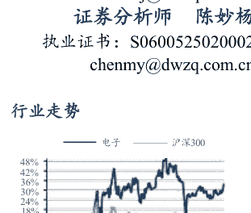

东莞证券
2025年06月26日
证券分析师 陈进涛
执业编号：S0600502001
证券分析师 周杨杨
执业编号：S0600502002

## 行业趋势

相关研究

> 《可穿戴 SoC，从大模型重构变革》——大广三国际 way
2025-06-25

> 《Marvel 上云模型关注 AI，万物 助手正成为手机侧的爆发机遇》
2025-06-22

## 知识星球TOP 资源分享社群

汇聚全网付费资源
让更多人获取高价值信息

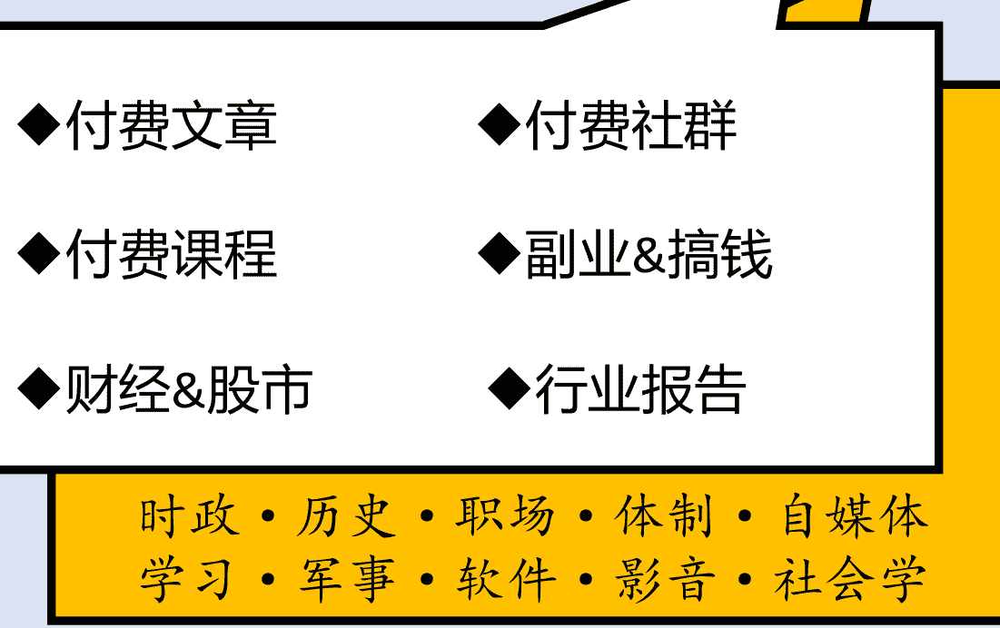

- 付费文章
- 付费社群
- 付费课程
- 副业&搞钱
- 财经&股市
- 行业报告

时政·历史·职场·体制·自媒体\学习·军事·软件·影音·社会学

公众号:知识星球TOP 微信信号:jntsg8 微信信号:jntsg2

添加微信免费进群

| 代码 | 公司 | 市值（百亿元） | EPS（元） 2024A | 2026E | PE 2024A | 2026E | 投资建议 |
| :--- | :--- | :--- | :--- | :--- | :--- | :--- | :--- |
| 603986 | 兆易创新 | 833.39 | 125.50 | 1.66 | 2.48 | 75.59 | 50.60 | 买入 |
| 688525 | 宿存储 | 307.48 | 66.66 | 0.35 | 1.34 | 190.70 | 49.75 | 买入 |
| 300475 | 春芯创 | 169.74 | 36.60 | 0.57 | 1.47 | 64.28 | 24.90 | 买入 |
| 300433 | 灵芯科技 | 1098.70 | 22.05 | 0.73 | 1.12 | 30.32 | 19.69 | 买入 |
| 002938 | 晶控股 | 708.86 | 30.58 | 1.56 | 1.92 | 19.58 | 15.93 | 买入 |
| 002384 | 东山精密 | 667.62 | 36.45 | 0.59 | 1.58 | 61.50 | 23.07 | 买入 |
| 002600 | 馥晶智造 | 597.80 | 8.53 | 0.25 | 0.40 | 34.09 | 21.32 | 买入 |
| 300684 | 中芯科技 | 705.53 | 23.55 | 0.67 | 0.94 | 35.02 | 25.05 | 买入 |

数据来源：Wind, 东吴证券研究所

## 内容目录

1. 智能体全新交互中心，终端流量重塑
1.1. 智能体定义：决策+记忆+规划+工具
1.2. 智能体落地终端，超级入口迎来重塑期
1.3. 侧端AI部署落地，功能形态与技术路径初步
1.3.1. PC/手机连接系统构建，可跨设备探索形态变
1.3.2. 技术路径：“优选”趋势，可跨侧重协同
2. 手机端AI发展新动力，有望为新一轮智能手机带来核心动力
2.1. 手机端厂商大模型布局对齐与手机技术路径治理
2.2. 进演未来：更多场景与应用侧大模型扩展，参数建模与压缩算法面临双重挑战
2.3. 算力、能力、电池等异构结构模型智能化，硬件作为大模型落地关键
2.4. AI为新一轮智能手机带来动力
3. AI终端价值重塑：从硬件到智能生态
3.1. 商业模式重塑：订阅变现+产品协同，AI终端引流价值体系构建
3.1.1. 多设备联动AI终端落地形态，可跨产品产生差异化关键入口
3.1.2. 订阅收入成为增长引擎，驱动终端盈利模式重塑
3.2. 侧端厂商的传统模式在智能体时代如何变化
3.2.1. 订阅收入占比增长
3.2.2. 跨平台协同与多设备智能体加强
3.2.3. 本地化连接能力有望从“加功能”变为厂商核心护城河
3.2.4. AI驱动下的流量模式重塑：从销售硬件到构建场景体验
3.2.5. 全产业链协同加速终端产品迭代与成本优化
4. 投资建议
5. 风险提示

## 行业报告

## 图目录

- 图1: 智能体的定义
- 图2: 智能形态
- 图3: 终端形态
- 图4: 智能接口
- 图5: “端侧”模型
- 图6: 可穿戴侧
- 图7: 活跃用户
- 图8: 侧大模型
- 图9: 趋势
- 图10: 侧重协同
- 图11: 侧侧
- 图12: 手机侧
- 图13: 手机端厂商
- 图14: 手机量
- 图15: 24年
- 图16: 智能体验
- 图17: 多态感知
- 图18: 侧侧
- 图19: 侧侧负载

表1：智能体的定义与路径对比

| 项目 | OpenAI | 复旦大学NLP实验室 | Google |
| --- | --- | --- | --- |
| 定义 | 能够代表用户执行任务的系统 | 能感知环境、由决策来行动 | 一种能够自主观察世界、使用 |

## 行业报告

### 1. 智能体全新交互中心，终端流量重塑

#### 1.1. 智能体定义：决策+记忆+规划+工具

AI智能体是一种具备环境交互、自主决策能力的软件程序，由人类设定目标，智能体选择最优路径。业界在模块设计和架构上有所差异，例如AI更倾向工程实现，复旦NLP实验室对于未来AI趋势的设想，在底层结构上更高：

- 用LLM大脑，具备推理、知识理解
- 历史记忆支持语义
- 连接接口突破“只读”，实现动作
- 反馈机制支持状态保存与动态调整，保障任务的感知-决策-行动循环

整体来看，“LLM+记忆+规划+工具”成为核心要素。

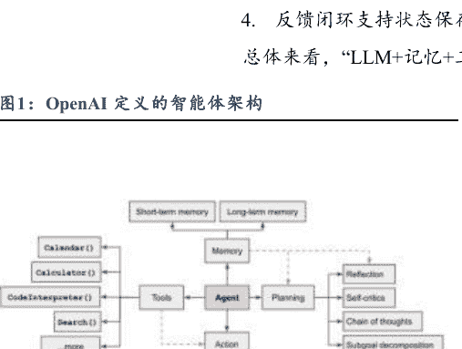

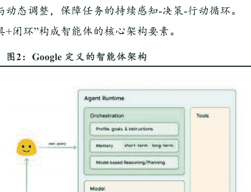

数据来源：OpenAI，东吴证券研究所

未来智能体将朝着“数字助理型”与“具身/社会型”两大技术路径演进。根据我们机构对智能体的定义，我们判断其生态系统将朝着这两条路径同步发展：一方面是以提升个人效率为目标的“数字助理”，聚焦于自然语言交互与多任务协同，广泛应用于办公自动化、信息检索、知识管理等场景；另一方面是具备感知与行动能力的“具身/社会型”智能体，强调多态感知、实体控制与多智能体协作，在机器人、智能制造、智能交通等领域成为核心领域。随着模型能力的增强，应用需求将日益丰富，其增长依托于大语言模型（LLM）为核心，以记录记忆、任务规划与工具调度实现智能闭环。

# 行业深度报告

# 东奥瑞研究所
SOOCHOWREE RESEARCH

工具采取行动、以实现规定目标的智能应用执行、在中心为用户提供足够的信息，让也能做出决策。

- 规划模块：根据用户目标分析子任务、安排执行顺序
- 智能大脑：由LLM 构成，负责责任理解、记忆、知识应用、推理规划
- 模型层：负责理解、指令、生成、输出
- 记忆模块：持续记录任务过程中的经历、历史上下文、增强的遵循性
- 控制模块：负责管理智能体的整个执行循环（包含输出、任务与工具交互更新）、实现任务、记忆保持、上下文和多语
- 工具模块：支持外部调用各类 API、Python 运行插件等，智能体帮助可完成用户任务
- 支持文本、文字、图像、音频等3D 数据获取信息，智能体能够完全与外部交互
- 行动模块：包括文本、工具使用（API 代码、插件等）和动作（如控制机器人）
- 任务执行：负责任务分析与执行，世界范围内
- 模块
- 决策模块
- 记忆模块
- 行动模块
- 共识

智能体根据用户的要求拆分任务、在下连续、执行结果并“调用外部能力”（使用工具或物理环境）

数据来源：《The Rise and Potential of Large Language Models: OpenAI, Google, 东奥瑞证券》

> 大语言模型作为智能体的枢纽，承担理解、决策与交互的核心职责，是通向 AI 的关键突破点。从自然语言理解的发展，模型技术已经三次跨越——第一代为感知驱动（2016年），以符号论与优化算法为主，解决语义理解策略；第二代为强化学习驱动（2017年），强化学习对环境智能的构建，应用于机器人；第三代为大语言模型（2023年），以 ChatGPT, Gemini 等代表的 LLM 具备其自然语言理解任务规划与工具调用等能力，通过 ReAct、CoT 等模型实现“从感知到执行”循环，使智能体具备自主决策与完成任务的能力，从而让“智能体”向“通用智能”迈进。

## 1.2.1 智能体落地，入口迎来智能期

AI 时代，入口将将应用智能体插件，厂商入口控制力将成为入口的未来在于满足用户需求的重要性。移动端，终端设备和操作系统整合多种功能和能力，成为用户购买商品、服务和内容的入口。进入 AI 时代，入口的逻辑将从“功能智能”转向“任务智能”。应用程序，通过自然语言完成任务，AI 助手即可帮助用户调用插件完成报告生成、日志管理等任务。这类智能体将依靠系统插件级调用，良好好接入系统与终端的插件。根据华华显示，目前手机端已有三类智能入口：用户助手、搜索与交互。厂商正将加速 AI 系统构建，国内自主能力深耕多类场景，控 AI 时代流量入口战略布局。

图3：AI 智能体的形态化的

6 / 29

请务必阅读正文后的免责声明

东奥瑞研究所

# 移动 App 时代

| 人 | 大模型应用创新 |
| --- | --- |
| | 分别独立应用 |
| | 与人大型交互，满足全场景需求 |
| 各类功能能以独立 App 出现 | 三大潜在入口 |
| 语音/个人助手 | 个人助手 | 搜索 (可在输入窗口中使用) |
| 社交 | | 系统 Agent 智能 |
| 搜索 | | 场景化 Agent |
| 智能体平台 | 原子化能力服务 |
| 内容娱乐 | 生活工具 天气、模特、文章、图片、视频等 |
| 生活服务&电商 | 内容娱乐应用 电商应用 生活服务应用 创作工具 |
| 创作工具 | | |
| 生活工具 | 智能体平台 |

数据来源：东证券研究所

## 1.3. 端侧 AI 部署落地，功能与技术路径初成型

### 1.3.1 PC/手机接入系统内核，可携带设备探索移动形态演变

当前，智能手机在消费电子领域的集成正加速连接。本辑将从 PC、手机与可携带设备三大终端出发，梳理手机 AI 的最新进展与功能演进。

手机方面，正将智能手机“个人助手”升级为深度嵌入操作系统的引擎。使得手机不再局限于问答界面，而是能够接人、相同、支付等接口，使得手机不再局限于问答界面，而是能够接人、相同、支付等接口，使得手机不再局限于问答界面，而是能够接人、相同、支付等接口，使得手机不再局限于问答界面，而是能够接人、相同、支付等接口，使得手机不再局限于问答界面，而是能够接人、相同、支付等接口，使得手机不再局限于问答界面，而是能够接人、相同、支付等接口，使得手机不再局限于问答界面，而是能够接人、相同、支付等接口，使得手机不再局限于问答界面，而是能够接人、相同、支付等接口，使得手机不再局限于问答界面，而是能够接人、相同、支付等接口。通过 Siri 直接在本地执行如邮件与日程同步，并通过云端服务器共享；Galaxy AI 在 S25 系列中内置了数十个应用；OPPO、vivo 等也在各自定制的内核聚合了“PhoneGPT”、“超级模型”等智能体，重点关注外出、社交等高频场景。

实测结果显示，这一代手机在“导航”和“订票”等结构化流程中的效率已可用水平，而在复杂任务、社交交互等任务上响应当。总体来看，我们认为手机端 AI 从“单任务对助手”转变为“复杂任务同步”，还能提升生产力工具演进奠定了基础。两个核心方向：

- 办公与创意：包括文档润色、内容生成、跨语言翻译、图像截图、结构化查询等
- 系统级优化：涵盖亮度、键盘背光调节、降噪消除、屏幕聚焦、语言控制系统级设置

表2：AI 产品趋势

| 手机 | 导航 | 订票 | 智能信息 |
| --- | --- | --- | --- |
| 小米 14 | | | |
| 荣耀 Magic 7 | | | |
| vivo x20 | | | |
| OPPO Find X7 | | | |
| 华为 Mate70 | | | |
| 三星 Galaxy S5 | | | |

数据来源：南合科技、TechsGo，东证券

表3：AI PC 产品趋势

| 厂商 | 代表型号 | 头部 AI 功能 |
| --- | --- | --- |
| Dell | XPS13/Latitude 7455/Inspiron 14+ | 预装 Recall，你就能记录下电脑里过去过的记忆。只需留下一个你对某件事的记忆，它就能检索到你看到的记忆。实时翻译任何语言 |
| Lenovo | ThinkPad X1 2-in-1 Gen 10 Aura Edition | Lenovo AI Now: 基于 Llama 3 模型+本地知识库；支持语音翻译调节；支持第三方 AI 应用生态系统级高性能智能，功能能够本地化无线分析、代码建模、实时翻译和通话、总结和结论生成 |
| EdgeRouter × Intel | 搭载 Intel 处理器的 AIPC | AI增强（AI算力、屏幕亮度和色调调节）、AI办公及创作（AI稿、直图、文素材、文件搜索 |
| 小米 | Redmi Book 16 2025 | AI搜索（包括本地视频/图片和互联网络信息）、AI阅读（智能识词、文档和双方交互、智能总结）、AI创作（自动生成、文素材、一键生成 |
| 荣耀 | MagicBook 14 | AI工作台（自动识别他人表情、翻译和多语同步隐私保护防护等）、书写工具（文字与语音交互 |
| Apple | MacBook Air | 影视渲染（根据描述识别图片中的元素、AI创作生成）、Siri（语言理解能力增强、集成ChatGPT带来更多惊喜） |

数据来源：官网，东证券研究所

可穿戴设备，我们认为AI将向手机延伸人类感知的边界，三大形态——眼镜、手机、智能穿戴——它们自己的AI重点在于与用户交互基本成为，但又在下一阶段的“多模态AI”。整体上，可穿戴终端产品都在探索如何利用个人自身状态放大AI的使用价值，效率将成百上千倍的早期爆发。

智能听觉：听+视觉的双重通道。眼镜穿戴显示视线与线条，从接电话、听语音、实时字幕、导航等场景。这款手机为“手机占领地”，进一步拓展到折叠算力。最新一代Ray-Ban Meta 或 OPPO Air 3 已实现实时语音、翻译、导航等功能。过去手机的痛点是耳机的音质和降噪，AI在这些领域基本开启后，耳机成为AI驱动的智能载体。

智能手表：持续感知与生理理解。目前AI智能手表已落地，差异化最终决定其对用户习惯的健康管理。

数据来源：和财经，东证券

表4：可穿戴眼镜趋势

| 侧戴产品类别 | 品牌及型号 | 侧戴 AI 功能 |
| --- | --- | --- |
| 智能眼镜 | Ray-Ban Meta (第二代) | 集成 Meta AI，支持语音命令、接电话、视频直播和环境识别 |
| | Air Class 3 | 搭载安卓ASR模型，支持语音翻译、音乐播放、环境适应 |
| | Halliday AI | 支持多语言大型模型，提供实时翻译、对话、记录等 |
| | 星芭酷 StarVar | 支持手机级模型，提供实时翻译、个性化增强等 |
| | Friend | 支持语音与手势交互，提供实时翻译、听力监测 |
| | 华为 Buds Pro 4 | 自带AI，支持手机端录音、语音转写、现场翻译、环境适应 |
| 智能手表 | Apple Watch | |
| | 华为鸿蒙 D、李小华 | 整合自研的 Gemini AI 模型，成为智能手表的核心助手，支持天气、聚合、资讯等导航 |
| | Samsung One Watch 7 | |

数据来源：Inventors Business Daily、Kickstarter、Sam One、四方、电子发

东证券

## 1.3.2. 技术路径：“端云协同”趋势，可穿戴侧重协同

云端协同：云端大模型提供应用能力，端侧小型模型提供个性化和快速响应。语言模型在智能手机的需求上，端侧能力成为技术瓶颈。云端算力具有效率优势，便于在实际应用中部署用户私有数据训练、中心服务器带宽和流量不可兼得。云端协同应运而生：端云侧大模型的集中训练与能力输出，端侧则经过剪优的小型模型来实现本地实时处理，并解决关键问题。

分类路径：

- 1) 高效计算：在终端侧部署高性能、低功耗芯片，支持本地推理任务
- 2) 以云中心的协同计算：终端主计算，云端协助。适用于隐私保护与个性化训练
- 3) 以云中心的协同计算：云端主全局训练，终端仅保留本地数据回传模型更新。解决数据保护与模型泛化问题。
- 4) 云双向协同计算：云端模型双向优化、协同推理与训练。
- 5) 可信协同计算：结合因果推断、去学习等方法，提升多端异环境下的稳定性和可靠性。

图5：云端协同计算的基本要素

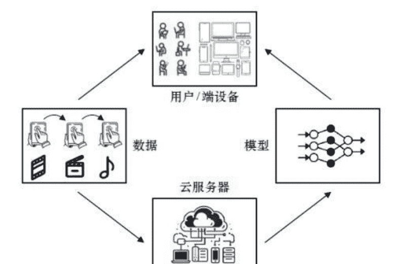

数据来源：《云端协同的关键问题、方法和应用》，东证证券研究所

PC和手机端：云端协同向“终端优先”策略收敛。我们已经在产业“大模型云端、轻模型端侧”这一范式上形成高度共识：多数厂商都将轻量化的语言模型部署在端侧，以实现实时响应、离线可用与隐私本地化；更大规模的模型则托管在云端，通过加密或机密环境等来适配运维的安全。共同诉求后，对应的前文提到的三大痛点——隐私保护、服务器端计算压力和离线可用——这引导了大家向“终端优先”策略收敛。

表5：重点厂商云端协同框架

| 厂商 | 云端协同模式 |
| --- | --- |
| Apple | Apple Intelligence | 端侧轻量化模型（~3B 参数），在端侧进行推理；云端侧大模型，通过云计算确保数据安全、响应、应急等 |
| OPPO | AndesGPT | 端侧轻量化模型（3B 参数），在端侧进行推理；云端侧大模型，通过网络确保数据安全、响应、应急等 |
| 小米 | Xiaomi HyperAI | 端侧轻量化模型（3B 参数），在端侧进行推理；云端侧大模型，通过网络确保数据安全、响应、应急等 |
| vivo | 蓝心大模型 | 端侧轻量化模型（3B 参数），在端侧进行推理 |
| 三星 | Galaxy AI | 端侧轻量化模型（3B 参数），在端侧进行推理 |
| DELL | Native AIEdge | 端侧轻量化模型（3B 参数），在端侧进行推理 |
| DeepSeek-R1 | 7B |
| 联想 | 天赋 AI | 端侧轻量化模型（7B 参数），在端侧进行推理 |

图6：可靠权威侧的“端云-云”架构

Extremely low power consumption, Cloud Computing always-on, ambient computing, Realizing the Power of Large Models (Local & Cloud)

## 2.1 手机端 AI 驱动硬件升级，有望成为一次换机潮

此前，各大智能手机厂商已能够部署终端的AI大模型，其发布的端大模型根据参数规模分为多个版本，整体参数规模高于量化级，普遍低于7B参数。其中，实际在终端上实现大模型应用在3B参数范围内，异质与挑战并存。

表六：主流智能手机厂商大模型部署情况

| 厂商 | 时间线 | 侧端参数/语义化 | 新增能力 |
| --- | --- | --- | --- |
| 苹果 | 2024年 iOS 18 | 搭载Apple Foundation Model 3B，采用低比特用LoRA优化，支持30 tokens/s | 文档理解、摘要、AI Lens绘图 |
| Google | 2025年 WWDC | Gemini N1.8B/3.25B，侧端部署，优于Pixel 8 | 引入AI Kit接口 |
| 三星 | 2024年1月 | Galaxy S24系列 Gemini，与 Gemini Pro协同运行 | 在设备查询、登录、输入等原生App中实现语义理解，多模态处理文档、文本和计算机代码 |
| | 2024年开发者大会 | 发布 Gauss 2 Combo，多模态结构，部署于S24之后的模型 | |
| 小米 | 2024年8月 | 自研1B模型部署于侧端 | 集成了AI助手，手机系统级应用（如小米商城） |
| | 2024年5月 | MILM-6B模型注册完成，侧端抽MILM 4B模型，基于6B手机型模型压缩 | |
| | 2024年11月 | 已在澎OS、小米问答、智能能、容器中应用落地 |
| 华为 | 2025年 | 侧端侧端大模型1.5/7B | 手机和PC终端适配大部分任务 |
| | 2025年6月 | 基于QCB优化的侧端大模型1.5/7B已应用于手机端 | |
| 荣耀 | 2023年 | 发布7B模型，携于Magic 6型 | 依靠YOYO智能，实现语音+行链自动执行（如插件喵） | |
| | 2024年10月 | 推出3B模型，能力更强，部署于Magic 7 | |
| vivo | 2023年 | 在侧端部署1B/13B大模型 | 推出蓝心小V和蓝心畅APP |
| | 2024年 | 部署3B模型，性能优于7B提升3000% | |

# 行业深度报告

# 东亚证券
SOOCHOW SECURITIES

数据来源：公司官网、IT之家、投讯、中国博客、GIZMOCHA、东亚证券研究所

# 模型压缩主要包括量化、结构化和蒸馏三种方法，实现模型在终端的高效部署。

当前主流厂商在将模型部署至终端设备时，普遍面临计算与存储限制，因此在模型扩展到 7B 模型后，均采用了算法来实现量化部署。荣耀，在 7B 模型基础上实现了 3B 版本，小米在 6B 模型后也采用了剪枝 4B 模型，华为、OPPO 等也采取了某种压缩策略。这些优化方法包括量化、结构化和蒸馏三类：

- 量化：通过原本使用的高精度点（如 10-16bit）转为索引，降低存储占用，加速推理，减少损耗。例如，从 B16 压缩到 B8 理论上可以在范围内不损失精度，同时实现 10 倍的推理加速。目前前 4 位量化已成为手机端的主流方案。

- 结构化（剪枝/MoE）：通过剪枝过程中进行“合并”或“剪裁”、结构化的模型压缩，以剪枝为代表的结构化方法可以减少模型参数，同时可以保留原始完整性；Mixture of Experts (MoE)等模型也在移动端应用领域开展。

- 蒸馏：通过更大、更高效的教师模型指导学生模型、结构化的学生模型进行训练，最终在保证性能的前提下得到轻量化模型。

侧端大模型的应用落地加速智能手机助手等场景，用户认可与生态建设有望提升。当前大模型的应用主要集中在智能手机助手的交互，从自然语言指令到具备自然语言理解与任务执行能力的智能对话系统，支持如文本摘要、多语言翻译等同量级生产力场景。以小米为例，基于澎 OS L1 大模型已在手机侧具备语义理解与执行能力，提升交互体验，尤其降低上手成本。随着侧端 AI 能力提升，手机生态将持续扩展。海外厂商，谷歌 Gemini 已用用户达 4 亿，开发者超过 700 万，形成发展热圈；国内六大手机厂商正将 AI 应用迎来前沿，其中华为与OPPO 智能手机落地领先，侧端 AI 正加速投入用户日常，成为主流大模型交互的新阵地。

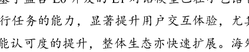

请阅读正文之前的免责声明部分

14 / 29

东亚证券研究所

# 行业深度报告

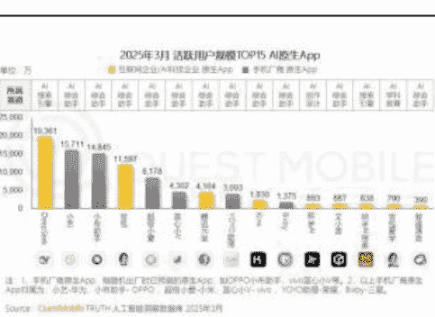

数据来源：Quest, 东亚证券研究所

## 2.2. 未来展望：多模态与应用领域扩容、参数高效与压缩

行业聚焦“端侧智能”，端侧大模型构建多模态感知与应用调优，持续交互正处于早期阶段。OpenAI 指出“未来 AI 的潜力将被真正释放，必须让用户以自然的方式使用，随时、无缝交互的‘数字智能体’形态”。领先厂商如华为、OPPO、谷歌已实现侧端 AI 正加速投入用户日常，能够调动多个场景，完成图像识别、语言翻译等功能，从“工具型”向“助手型”演进。

从传感器到伴侣，AI 演进迈向“数字智能体”，数据来源：东亚证券研究所

# 行业深度报告

## 多模态感知、跨应用执行关键能力的落地

行业普遍认同，模型规模是基础，以来 6B 与 13B 的划分体现出来，多模态感知能力的图像、音频与文本在同一语言空间中的精确对齐。目前主流通过编码器生成多模态表征，并通过 Cross-Attention 或 Perception-Resampler 机制实现，映射空间维度受限，导致跨任务处理困难。跨应用执行能力依赖模型对指令、工具接口的理解，通常需要结构化 JSON Schema 来构建并写入结果。React 架构的“思考-行动”迭代使得模型具备更强的规划能力与记忆能力，Meta 官方 LLaMA 明确指出 8B 模型无法完成复杂任务，推荐使用 70B 以上模型保障交互一致性。

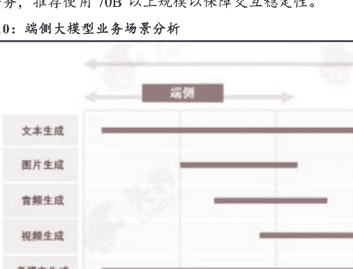

数据来源：犀头研究院、东亚证券

模型压缩技术不断演进，但这些方法仍存在瓶颈。首先，比特量化会显著增加推理误差，尤其在多模态模型中更为敏感。Xie et al.（2024）研究表明，多模态模型对量化瓶颈尤为敏感，4-bit 精度会导致显著性能下降，影响语义度。其次，稀疏化虽可降低开销，但对模型的应用成功率、长任务执行以及模型融合效果均存在负面影响。知识迁移方面，若教师模型学习的任务结构在学生模型的低优空间中映射维度受限，导致知识迁移受限，难以保留复杂任务能力。

# 行业深度报告

东亚证券

在上述限制，头部厂商并未提升端侧模型参数规模。据博社，苹果目前在内部测试7B、33B等不同规模的模型版本，表明其正在为端侧部署更大规模模型进行中长期储备。

## 2.3. 算力、存储、电池以及其它协同进化，端侧硬件落地

算力：预计AI实现50 TFLOPS以上的算力即可支撑复杂推理与多场景交互。根据OpenAI在《Scaling Laws for Natural Language Models》中的测试结果指出：算力需要≥参数×Token数，足够端侧运行模型的算力。例如，一个包含1000个Token（约750个单词或500个汉字）的输入处理，当前主流7B模型大约需要144 TFLOPS的浮点运算。领先厂商在端侧训练7B至10B级别模型，对AI算力资源的需求将提升，未来高So需要至少具备50TFLOPS以上的算力，实现多场景处理、复杂推理与持续交互等能力的响应。

表7：模型对应对Token转换

| 模态 | 计量单位 | 转换值 |
|---|---|---|
| 英文文本 | 1 word | ~1.3 tokens per |
| 中文字符 | 1 汉字 | 2~3 tokens per |
| 图像(VIT，224×224，patch16) | 1 张 | 197 tokens = 14×14 patches +[CLS],结合法则降低Token 数 |
| 图像(VIT，512×512，patch16) | 1 张 | 1025 tokens = 32×32+[CLS],结合法则降低Token 数 |
| 音频(Audio，16kHz) | 1 秒 | Token = 时长(秒)/ms×每帧 |
| 视频 | 1 段 | Token = 时长(秒)×帧率(fps)×每帧 |

注：不同的模型对Token转换和数量会影响表现。数据来源：OpenAI, Google, 东亚证券

内存：未来的设备需要32GB RAM。由于不同参数占用，主流端侧模型采用4bit或8bit低精度，以7B模型为例，存储约为3GB；若用8bit精度，高端智能手机可能需要12GB至16GB，考虑到多任务运行及场景中留一定内存空间，预计未来至少需32GB以上内存规格的提升。与硬件升级的关键在于内存访问成为瓶颈。

17 / 29

东亚证券研究所

# 行业深度报告

东亚证券
SOOCHOW SECURITIES

乘操作（MAC）本身的功耗，是在内存中频繁引发的访问功耗。前者的功耗极低，例如在8-bit精度下，如果是7B模型以20 tokens/s的速度，整体计算功耗仅为06W，如果使用模型参数会显著扩张，真正的瓶颈在于内存访问。研究显示，每次DRAM访问功耗高达640pJ，远超计算本身，因此在硬件中通过优化访存和温度调整策略，压缩了瓶颈。

图1：读取内存功耗高于计算

| Operation | Energy Relative Cost (%) |
|---|---|
| 8B Add | 0.03 |
| 16B Add | 0.05 |
| 32B Add | 0.1 |
| 16B FP Add | 0.4 |
| 32B FP Add | 0.9 |
| 8B Multiply | 0.2 |
| 32B Multiply | 3.1 |
| 16B FP Multiply | 1.1 |
| 32B FP Multiply | 3.7 |
| 32B SRAM Read (KB) | 5.8 |
| 32B DRAM Read | 640 |

图12：Snapdragon 8 Gen3 AI任务能力增强内存提升

数据来源：ShortCut，东亚证券

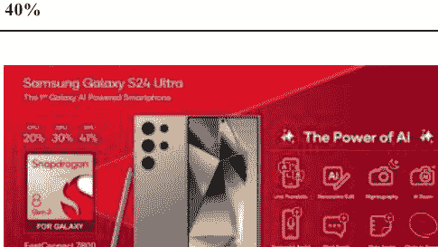

数据来源：ShortCut，东亚证券

电池：未来手机电池容量需6200mAh以上。当前手机电池容量普遍在5000mAh左右，在3.7V电压下仅18.5W。随着模型规模增大、推理速度提升以及AI助手持续向后台待机、交互方向增加，手机功耗将显著提升。推测，模型运行时间的增长将导致电量消耗增大。为保证高性能AI的持续体验，我们预测到未来主流手机终端侧，电池容量将进一步提升至6200mAh以上，以确保全天候可用。为评估未来大模型在手机侧的部署，我们参考OpenAI的推理计划，将主流芯片功能与内存相结合，构建未来侧推理规则，对于算力、内存、电池等关键资源的需求要求进行量化预测。核心逻辑与假设如下：

- 大规模模型推理负载：以当前7B参数量采用INT4计算精度，预测未来模型将扩展至14B并采用INT4精度，提升推理性能；同时，单理解token数量由1000提升至2000，吐出率从20 tokens/s提升至40 tokens/s，以满足语义交互响应速度与长度方面的需求。同时，日均使用时长从0.5小时增长到1小时。

- 内存瓶颈：7B参数模型采用INT4后约需3.5 GB内存，增长超过

18 / 29

东亚证券研究所

SoC内部SRAM容量，由于模型推理必然需要DRAM与SRAM的访问通路。参考主流模型，FP32精度SRAM为5pJ，DRAM访问640pJ。考虑当前主流多采用低位量化，配合内存存储与手机上缓存优化DRAM访问占比为3pJ。近年来随着硬件精度提升（INT8）及SoC SRAM容量扩展，训练能力增强，手机性能保持基本，继续使用3pJ设定。

整机手机架构构成：整机手机分为手机部分：其中屏幕维持常规亮度（约300nit），静态功耗约为0.8W，基础功能包括硬件、电源管理等。电池相关信息：目标效率为80%，平均电压为3.7V。

表8：端侧AI负载下的硬件需求

| 步骤 | 指标 | 当前配置 | 年后预测 |
|---|---|---|---|
| 1 | 模型参数规模(Billion) | 7 | 14 |
| 2 | 运行精度 | INT4 | INT8 |
| 3 | 单帧token | 1000 | 2000 |
| 4 | 推理采样率(tokens/s) | 20 | 40 |
| 5 | 长运行时间(h) | 0.5 | 1 |
| 6 | 算法能力(TFLOPS) | 14 | 56 |
| 7 | 内存容量 (GB) | 3 | 13 |
| 8 | 核心操作功耗(W) | 0.06 | 0.22 |
| 9 | 存储带来的能耗(W) | 0.84 | 3.36 |
| 10 | 手机功耗(W) | 1.90 | 4.58 |
| 11 | 所需额外电池容量(mAh) | 303 | 800 |

数据来源：OpenAI, MIT，东方研究院

在端侧模型重构的背景下，手机终端对感知系统将更加突出，要求全天深度理解的语音输入能力。Syntiant、博世（Bosch）联合开发手机级模型，即在嘈杂环境下还能保证识别。我们认为，这一创新让手机向“智能体”演进，成为用户的“耳”和“眼睛”。交互方式：组件部分将被重新定义，通过长按按钮一键唤起语音助手、AI写作或创作增强，使得未来手机有望拓展更多快捷功能。

# 业务分析

手机作为智能体的交互入口。新型硬件的持续升级为侧端模型提供更强的动力，成为终端差异化竞争的方向。

图13：侧端大模型推理驱动硬件全面升级

图14：iPhone 轻量级增强GPT功能需求

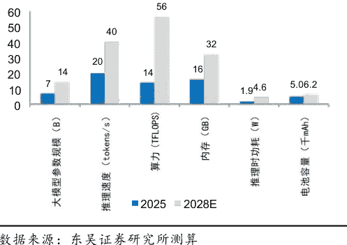

数据来源：东亚证券研究院，哇口科技，东亚证券

## 2.4. AI为一代智能手机核心驱动

AI能力成为智能手机硬件升级与换机需求的核心动力。随着侧端大模型能力的持续演进，AI正从被动交互向“智能体”转变，应用场景从语音交互延伸至更多场景理解、内生需求和个人生产力高价值任务。这一演进路径带来了更高规模模型的需求，对手机SoC、CPU、NPU、存储等核心部件提出了更高配置要求，构成硬件系统升级的重要因素。

产业层面，各大手机厂商已密集聚焦于位于“AI-手机”的新一代产品更新节奏。根据IDC数据，2024年AI手机渗透率由5.5%升至13.2%，预计2025年将达到0.8亿台。从长期来看，IDC预测到2027年，中国手机出货量将进一步增长到1.5亿台，渗透率将达到19%，成为市场的重要组成部分。AI能否成为手机动力，核心在于是否能够精准捕捉用户需求、刚性需求，拉动消费情绪。

图15：2023-2027年国内AI手机出货量及占比（亿，%）

图16：智能手机换机频率在2024年来的趋势

20 / 29

东亚证券研究所

东亚证券
SOOCHOW SECURITIES

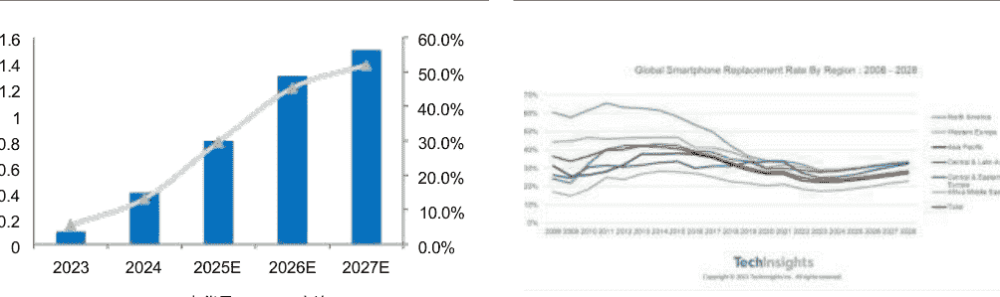

数据来源：IDC，东亚证券；TechInsights，东亚证券

手机周期出现反转，AI功能演进驱动硬件加速迭代。Counterpoint，全球手机换新周期近期持续增长，2023年已43个月。手机周期出现反转，AI功能演进驱动硬件加速迭代。Counterpoint，全球手机换新周期近期持续增长，2023年已43个月。

# 行业深度报告

| | | | | |
|---|---|---|---|---|
| (8) | 基础循环次数(次) | 292 | 292 | =0.8*365 |
| (9) | 年充放电循环次数(次) | 301 | 349 | |
| (10) | 电芯寿命(80%)对应可用年限(年) | 2.7 | 2.3 | =(7+8)/8 |

数据来源：苹果官网，东吴证券研究所

用户对电池加热高度敏感，大型模型运行带来的热耗加速电芯老化，成为推动手机换周期提前的重要驱动因素。在当前配置下(7B模型、INT4精度、AI运行0.5小时时)，电芯衰减80%容量对应的可用年限为2.7年。未来推理模型迭代至14B、INT8精度，且AI使用时长提升至日均1小时，测算年充放电循环次数上升至349次，电池寿命压缩至2.3年，减少约0.4年。考虑到电量衰减在实际使用中易引发“续航焦虑”，电池老化构成主动动机的重要因素。在AI功能持续运行、每日使用时长增加的趋势下，电芯寿命成为智能手机用户主动动机的主因之一，从而推动换周期提前。

请务必阅读正文之前的免责声明部分

## 3. AI 商业模式重塑：订阅变+产品输出，AI终端引导价值体系重构

### 3.1. 商业模式重塑：AI终端生态养成，可软硬件产品成为关键连接入口

#### 3.1.1. 多设备协同驱动AI终端生态转型

智能终端从单一设备协同为多设备协同，跨场景的智能服务转型，手机厂商加码向AI终端生态平台转型；锐于在2025年发布“AI大战”，蓝白从手机制造商向全球领先的AI终端生态公司转型；中兴强调“AI for all”，驱动AI在全场景终端中的落地、“人与安全”实现设备数据协同组，软硬件协同一个整体。全新的HarmonyOS以AI为底层、系统级智能，原生智能应用和生态为重心，从“小”向具备全感知与多模态交互能力的智能终端进化。

我们致力于为手机厂商加码AI终端生态平台转型，增强智能在多模态AI体验中构建并优化，提升用户粘性与品牌口碑。前文提到，可软硬件是多模态输入的入口。可软硬件在此过程中作为重要工作实现多模态交互，更具质感的数据接入与生态协同，将带来AI终端产品线的持续增长和智能价值。华为强调终端协同的“场景智能”，小米构建全的场景协同体验，均实现头部对AI终端链路的系统性领先与落地实践。

图17：多模态感知驱动软硬件协同的智能手机终端进化

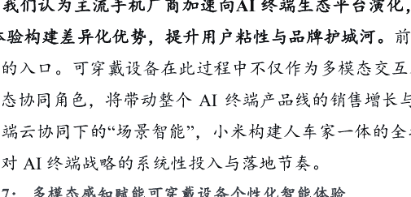

数据来源：Canalys，东吴证券研究院

#### 3.1.2. 订阅收入为增长新动力，推动终端厂商商业模型转型

订阅收入在AI硬件厂商中的比重提升，推动其利润增长从一次性销售向“硬件+服务”并重转型。以Oura为例，其硬件售价349美元，订阅价5.99美元/月，订阅自2022年报告后已贡献20%收入，毛利显著高于硬件销售的20-30%。Plaud Note指出通过159美元硬件+9.9美元/月的订阅模式，年收入已达1亿美元，连续两年实现10倍增长。订阅模式不仅提高产品单价，更增强了用户粘性和收入可持续性。

我们认为，订阅模式转变在产业上带有云管理、模组管理、硬件管理等成为趋势，利用云计算相关业务。同时，终端企业的模型能力和隐私保护更高要求，提升其云端生态的重要性。价值体系也将由数据驱动转向 ARPU、粘性渗透与留存率以及 SaaS 指标，明确合同贡献与用户粘性的硬件公司将获得更多估值。

## 行业趋势报告

### 传统模式在智能时代如何变化

在前一节中，我们分析了商业模式在未来发生的结构性变革，核心在于：
- 智能手机替代传统App成为智能化的中枢，端侧能力从工具向服务转变；
- 多模块端侧模型驱动实现个性化交互，智能设备能够驱动整个硬件；
- AI驱动引发模型变革，提升价值；
- “私有云”成为差异化竞争力。

下一步预计当前消费电子长期的竞争包括订阅收入、生态布局以及全产业链协同——如何在AI时代下重构或重塑。

### 订阅占比增大

我们判断AI将进一步强化“订阅+硬件”商业模式，推动终端订阅占比增大，实现持续粘性与留存。
- **Apple**：2024年5月服务收入达28亿美元，同比增长6.6%。
- **华为**：2024年其消费者业务（含手机、数字内容）收入290亿元，同比增长38%，增长依然稳固。
- **小米**：2024年6月全球活跃用户突破7.7亿，ARPU提升。

### 协同与生态领先

在端侧智能能力提升边界下，主流厂商通过跨平台和多设备协同，构建“人-家-车”一体化操作系统。
- **华为**：自2025年起，新发设备将搭载HarmonyOS NEXT，实现了跨设备流转等操作，提升了设备的独立性。
- **小米**：通过HyperMind系统用于用户预测并自动响应，实现智能设备协同。

端侧设备在感知、识别、睡眠时长等纵向数据处理能力上领先，为用户提供更个性化的健康管理与互动。考虑到智能设备受限于能力。

#### 3.2.3. 本地化适配能力从“分项”演变为厂商护城河

我们认为在AI主导的新产业赛道中，消费电子类厂商的本地化能力从传统的服务化升级为竞争优势。具体而言，实现语言、语料与本地文化的深度融合，决定了厂商在区域市场的黏性与差异化能力。相比全球化方案，AI模型在多场景下与本地语言交互更具优异性，尤其在语言多样、网络基础设施发达的地区具有明显优势。以某为例，在非洲市场积累了大量用户，并推出支持多种语言与口别的AI功能，初步形成AI能力领先地位，有望进一步提升品牌粘性与市场竞争力。

#### 3.2.4. AI驱动的模式转型：从功能点向场景化构建能力体系

AI的普及趋势将由单一功能点向场景化构建能力体系转型。智能手机、智能电视等产品将逐步内化为家庭的AI交互终端，企业竞争也将转向“场景、场景、智能”。在此过程中，AI如何与智能设备深度融合，成为厂商开拓增量空间的核心使命。我们认为可视化的产品生态体系，将有助于构建一体式手机的门槛，形成从功能到体验的差异化进化。

运营端接入AI服务，有望进入下一次融合环。终端厂商也在布局AI能力，将服务经验从连接与交互提升至智能体验。韩国SK电信将AI接入手机，支持摘要等功能；Vodafone则与软件整合，面向全球用户提供AI服务。我们认为终端销售模式有望从“存量换手机”转向“订阅服务”。

### 3.2.5. 全产业链协同加速产品迭代与成本优化

我们认为垂直整合产业链可以有效缩短产品周期，提升迭代效率，降低成本。特别是在终端侧，通过集成先进芯片、神经网络处理单元（NPU）等高成本部件，通过硬件迭代带来规模优势。

## 5. 风险提示

- **底层创新及预期**：模型的发展和技术创新不及预期，可能会影响用户。
- **技术发展不及预期**：技术落地需要定制环境，产品可能无法普及。
- **竞争加剧**：消费电子品牌等在占据入口环节的竞争激烈。

## 免责声明

东吴证券股份有限公司中国证券监督管理委员会批准，具备证券咨询业务资格。本报告仅供东吴证券（以下简称“本公司”）使用。在任何情况下，本公司不接受收到报告视为客户。报告中的信息或意见并不构成对任何人的投资建议。任何人使用本报告所得的收益或损失，本公司均不承担任何责任。在法律范围内，东吴证券及其关联方可能持有报告中所提到的公司发行的证券。谨慎报告。本报告基于公开的信息，本公司无法保证这些信息的准确性和完整性，且不可避免出现错误或随时发生变更。不同时期，本公司可能会发布与报告描述不一致的内容。

## 评级标准

评级预期基于分析师报告后6个月内个股回报相对市场表现的预期（A市场指数为基准300点，香港市场指数为基准指数，美国市场指数为标准500点，三级基准指数为三指（针对创业标的）或三级指数（针对转标的），北交所基准指数为此50点）。

公司评级标准：
- **买入**：预期未来6个月内个股涨幅相对于基准在15%以上。
- **增持**：预期未来6个月内个股涨幅相对于基准优于5%与15%之间。
- **中性**：预期未来6个月内个股涨幅相对于基准处于-5%与5%之间。
- **减持**：预期未来6个月内个股跌幅相对于基准小于-5%与-5%之间。
- **卖出**：预期未来6个月内个股跌幅相对于基准在-15%以下。

行业评级标准：
- **增持**：预期未来6个月内，行业指数相对于基准5%以上。
- **中性**：预期未来6个月内，行业指数相对于基准处于5%与5%之间。
- **减持**：预期未来6个月内，行业指数相对于基准小于5%以上。

