[content]
# 证券研究报告·行业研究·机械设备

# 无人叉车行业深度：AI驱动无人叉车技术持续发展，智慧物流有望迎来快速发展期

首席证券分析师：周尔双
执业证书编号：S0600515110002
zhouersh@dwzq.com.cn

证券分析师：韦译捷
执业证书编号：S0600524080006
weijj@dwzq.com.cn

2025年7月8日

请务必阅读正文之之后的免责声明部分

# 投资要点

- AI驱动无人车技术发展，智慧物流前景广阔：无人车的发展可追溯至自动引导车辆（AGV）发展至今已有60余年的历史，技术路径从磁导引导、二维导航、激光SLAM发展至自动移动（AMR），具备自主驾驶规划与动态避障能力，能够实现阶协同。展望未来，无人车将不再是单一设备，而是深度融入智能物流系统，与自动分拣、机械臂等协同作业，实现全链智能化。2023年中国无人车渗透率1.66%，随着头部厂商下探与AI崛起，市场有望快速增长，未来迎来大空间。

- 无人车行业由控制、车体供应商以及集成厂商组成：控制器是机器人的“大脑”，由嵌入式控制器与软件组成，以汇智能、NDC等为代表厂商，技术壁垒且盈利领先，产品利润高达80%。车体供应商竞争激烈，包括传统零部件企业、广沃、林德、以及专业无人车厂商贸易、Balyo、睿智等，海外奥龙丰田、伯格等在AGV、自动化物流领域起较早，在智能化方面受限于硬件转型的系统。集成厂商如蓝船智能、兰创等，通过对系统的深入理解，提供规划、制造、集成一体的智慧物流方案。由于集成厂商更多项目依赖及客户需求，技术门限有限，随着主机厂商加快建立系统能力，软件厂商硬件链集成，集成厂商在项目中的利润空间受到明显影响，市场向技术主导、多方协作转型，智能物流工具具备长期增长潜力。

- 产业规模增大，头部企业竞争优势持续增强：行业正从单一设备连接，迈向“机+软件+系统集成”融合发展，头部企业通过产业合作、技术并筹，持续竞争优势：【安盟合力】通过聚擎与德马科技、为丰、京东等携手构建物流智能规划方案领先厂商。【京东集团】持续发展智能物流，布局AGV、立式存储和软件集成系统，与京东兄弟携手打造数字供应链，2024年物流营收增长近80%。【中力股份】则依赖成都新蓝、浙江铁创、深圳等优秀技术储备，深耕机器人专用AI芯片、VSLAM等核心技术，强化智能枢运布局。

- 投资建议：受益于智能物流加速落地，推荐深耕智能无人车，客户资源深厚的行业龙头【杭芜集团】、【安盟合力】：关注AI技术赋能无人车渗透率提升，核心控制器硬件升级至AI智能功能【中力股份】【蓝创智能】、【吉音首席】、【兰创智能】

- 风险提示：行业需求不及预期；关键技术突破存在不确定性；海外业务拓展受地政治影响。

# 目录

- 一、AI驱动无人叉车技术持续发展，智慧物流前景广阔
- 二、无人叉车行业由控制器、车体供应商以及集成商组成
- 三、产业合作为大趋势，龙头企业竞争优势持续增强
- 四、投资建议与风险提示

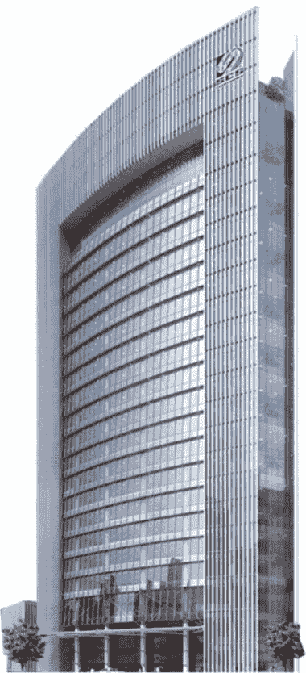

## 1.1 无人车的起点：AGV技术的起源与演进过程

东吴证券
SOOCHOW SECURITIES

AGV技术发展至今已有60年的历史。无人车的发展最初可以追溯到自动引导车辆（AGV, Automated Guided Vehicle）技术的兴起。AGV是指通过安装传感器、光、激光等引导装置，能够沿着预设路径自主行驶，并具备安全防护与物料搬运功能的移动运输设备。其主要应用于仓储、制造、物流等场景，用于替代人类完成物料搬运任务。AGV技术发展至今已有60年的历史，最早诞生于美国，并逐步传入欧洲。日本在1963年首次引入AGV，与欧美追求功能的完善和技术的先进不同，转向模块化、简单化的方向发展，将成本降到极值。随着新技术被逐渐应用到AGV中，工业的各个领域深度渗透，技术也愈成熟。

图1：AGV的发展历程

数据来源：MISUMI，东吴证券研究所

## 1.1 AGV发展路径：起步较慢，起速迅猛

图：中国AGV发展历史

| 时间 | 发展阶段 |
| :--- | :--- |
| 1970年代到90年代：AG起步阶段 | 1976年，北京重工研究所研制出第一台AGV演示系统，为AGV在中国的应用奠定了基础。 |
| 1990年代：技术突破与初步应用 | 1991年，天津理工学院研制了光引导AGV，为AGV在特定领域提供了可能。1995年，红河贸易成功实现了首个激光引导AGV，走向国际市场。 |
| 2000年至2010年：趋势发展 | 2000年，中国加入世界贸易，面临更广阔的市场，AGV在多个领域得到了应用，如汽车、电子、医药等。 |
| 2010年至2018年：快速发展 | 2010年，随着中国工业的快速发展，轻负载移动机器人在汽车、焊接及装配领域快速领先。 |
| 2017年至今 | 2017年，亚马逊收购Kiva公司，移动机器人（AMR）联盟成立，国内机器人企业、松股份、褚智等在仓储领域取得了显著成果。 |

数据来源：CSDN、东吴证券研究所

## 1.2 技术演进路径：从导航到AI驱动的协同

无人车的技术路径大致分为五个阶段，目前主流为激光SLAM与AMR；

第一阶段是引导AGV，起源于50年代，其工作原理是在地面铺设磁条并进行简单的引导；
第二阶段为二维引导AGV，从03年代起广泛应用，依靠二维码或图像识别进行定位，适用于灵活性较高的场景；
第三阶段是激光SLAMAGV，进入14年，通过安装激光雷达实现对环境的柔性改造，效率显著提升；
第四阶段是自动移动AGV (AMR)，具备自主规划和动态避障能力，不再依赖固定地图，而是多传感器融合实现高阶协同；
展望未来，第五阶段是AI驱动的智能叉车，将搬运、分拣、配送等环节实现深度交互与协作，构建端到端智能物流。

图：AGV技术路径分为五个阶段

| 引导式AGV | 二维导航AGV | 激光SLAM | 自主移动AGV (AMR) | 智能化 |
| :--- | :--- | :--- | :--- | :--- |
| 1953年，第一台引导式AGV发明。 | 2003年，二维码识别AGV。 | 2014年，激光雷达绘制地图，响应障碍物。 | 自主移动机器人，利用软件规划最优路线。 | 深度交互，根据环境的变化规划出路线。 |

数据来源：MISUMI、东吴证券

# 1 磁导航 AGV系统的良好化应用

东吴证券
SOOCHOW SECURITIES

* 磁导航分为电磁导航和磁带导航。磁导航的核心原理是通过感应传感器识别地面铺设的引导带，从而获取AGV与路径之间的相对坐标。信号传输至AGV控制器，控制器根据信号调节驱动系统，实现自动移动。②磁带导航：磁导航的主要实现形式，因其技术成熟、系统稳定，已广泛应用于总装、发动机装配等标准化较高的场所，优势在成本上相对较低、施工简便、对光纤敏感、具有较高稳定性。局限性在于路径影响，磁带易损耗且施工难度增大，后期维护成本偏高。相比之下，②电磁导航：在路中埋设通电丝，成本与复杂度方面优于磁带，但在高温、强磁等极端工业环境中具有更强的适应能力。

图：磁导航传感器与AGV驱动器示意图

图：磁带导航与电磁导航优缺点

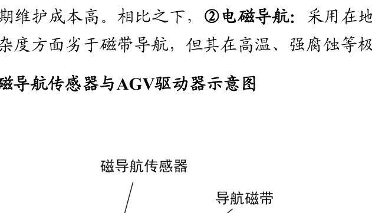

| 磁带导航 | 电磁导航 |
| :--- | :--- |
| 技术成熟，成本较低；施工简单、稳定可靠、对光电干扰等具有优点。 | 在高温、低温等极端环境下具有适应性。 |
| 目前行业应用中以磁带导航应用比较普通，在汽车装配厂、发动机组装厂等领域存在局限性。 | |
| 线路固定，后期调整困难。需要对路进行施工，且施工量大；标记容易丢失；线路变更时需要重新铺设，维护成本偏高。 | 施工复杂、成本高等。 |
| AGV不能沿着线路行驶，无法实现智能避障，无法通过控制系统实时更改路径。 | |

数据来源：LBOT、东方证券

### 1.2.2 二维码与光学色带：从感应变成视觉识别

视觉识别类因成本低、部署灵活，逐渐在标准化场景中获得应用。

①二维码式：基于图像识别的路径引导方式，其原理是在AGV运行路径上地面粘贴二维码标识，AGV本体搭载摄像头实时读取二维码信息，以实现路径识别与精准定位。具备部署灵活、易于更换的优点，且系统成本较低。但由于二维码为静态图像，其表面在高频运行环境下易受磨损，从而影响识别精度，需要定期维护以保障系统稳定性。

②光学色带：技术路径在地面粘贴具有色彩对比度的色带，由AGV的摄像头系统实时识别并沿其路径行驶。在实际应用中存在识别精度限、受灰尘影响等问题，抵抗能力有限。

图：二维码导航示意图

图：二维码与光学色带对比

| 优点 | 二维码式 | 光学色带 |
| :--- | :--- | :--- |
| 二维码是粘在地面上，灵活性高。 | 摄像头识别，综合成本低。 | 改造小，后期调整简单。 |
| 长时间使用易磨损，需要定期维护。 | 对地面平整度要求。 | 对污染敏感。 |

数据来源：机器智能、东吴研究所

### 1.2.3 激光导航从反射板引导到SLAM

东东方证券
SOOCHOW SECURITIES

- 激光导航分为两类：
- 激光雷达+反射板：需要大量安装反射板，通过扫描这些标志物的信号算出位姿，定位精度较高。这种方式适用于结构化的仓储、货架等，成本较高。
- 激光SLAM（Simultaneous Localization and Mapping）：核心在于无需依赖外部标志物，通过扫描环境构建二维地图并自主导航，灵活多变，适用于非结构化的场景。

图：激光导航示意图

图：激光雷达+反射板与SLAM对比

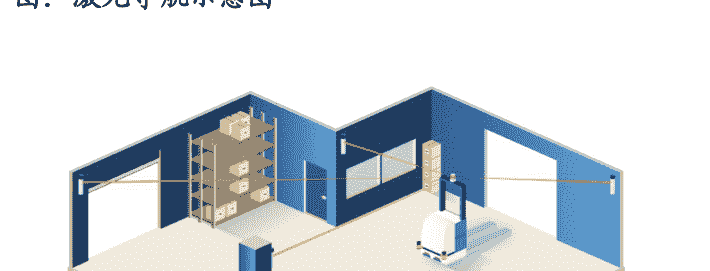

| 激光雷达+反射板 | SLAM |
| :--- | :--- |
| 优点：定位精度高，适应性差。 | 优点：灵活多变，适应不同的环境。 |
| 缺点：安装成本高，环境要求高。 | 缺点：研发门槛高，成本增加。 |

数据来源：机器智能、研究院

### 1.2.4 AMR:从被动执行到自主决策

工业移动机器人（AMR, Autonomous Mobile Robot）代表技术演进的重要阶段，从传统的依赖预设路径向自主决策跨越。AMR具备自主建图、自主导航、路径规划与避障能力，能够在复杂环境中灵活运行，实现独立任务。

### 1.2.5“AI+物流”时代：从AMR走向全智能交互

“AI+物流”的融合应用。尽管AMR在导航方式、部署灵活性和智能化水平上已显著提升，但当前大多数AMR仍然是“孤立运行”的个体，缺乏系统协同与设备交互能力。为进一步提升仓储系统的整体运行效率，就需要引入更高级的智能决策体系。通过AI驱动的统一机器人平台，原本各自独立的设备——包括AMR、自动抓取机、机器人手臂等——将被集成为一个有机系统，显著提升效率。未来，物流系统的角色将从传统的“搬运者”转变为智能化运营的核心载体。面对全球供应链重构、消费结构转型以及企业对激增的强烈诉求，与AI技术深度融合将加速推进物流行业的数字化、智能化进程。

图：自动引导车辆与机器人手臂协同作业图

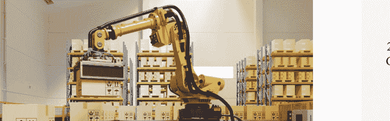

生成式AI快速发展

| 2017 | 2021 | 2024 |
| :--- | :--- | :--- |
| 2014 Transformer | CLIP | DeepSeek |
| GAN | GPT-3 | GPT-3.5 |
| 为后续大型语言模型提供数据基础 | 以40亿个文本-图像对训练数据实现文本到图像跨模态 | 中文长垂直场景深度泛化 |
| VAE和GAN的提出开启了深度学习图像 | 能够完成大部分任务 | 基于人工标签的学习的推理和生成 |

数据来源：机器智能漫谈、东吴研究所

## 1 无人叉车渗透率初期，替代空间广阔

智能物流加速落地：近年来无人叉车销量快速增长，新战略咨询预计2025年无人叉车渗透率提升。2023年中国无人车渗透率1.66%，随着头部厂商下探与AI崛起，市场有望快速增长，未来迎来大空间。核心控制器硬件升级至AI智能功能。

图：无人叉车渗透率趋势

数据来源：战略咨询、东吴研究所

# 1 行业正从单一设备连接，迈向“机+软件+系统集成”融合发展，头部企业通过产业合作、技术并筹，持续竞争优势：【安盟合力】通过聚擎与德马科技、为丰、京东等携手构建物流智能规划方案领先厂商。【京东集团】持续发展智能物流，布局AGV、立式存储和软件集成系统，与京东兄弟携手打造数字供应链，2024年物流营收增长近80%。【中力股份】则依赖成都新蓝、浙江铁创、深圳等优秀技术储备，深耕机器人专用AI芯片、VSLAM等核心技术，强化智能枢运布局。

# 投资建议：受益于智能物流加速落地，推荐深耕智能无人车，客户资源深厚的行业龙头【杭芜集团】、【安盟合力】：关注AI技术赋能无人车渗透率提升，核心控制器硬件升级至AI智能功能【中力股份】【蓝创智能】、【吉音首席】、【兰创智能】

## 机器人自主性趋势提升，助推控制器需求上升

随着机器人自主性的提升和普及，全球高性能控制系统持续增长。据决识咨询，全球机器人控制系统市场总规模预计在2024年达到人民币800亿元，控制器作为机器人控制系统的物理组件，由供应商通过两种销售模式提供：(i)安装于机器人内；(ii)作为独立产品销售。采用第二种销售模式的供应商向智能机器人产业链下游厂商及各类终端客户提供高灵活性和适配性的控制器，帮助其扩大业务规模，开辟向开放平台模式发展的路径。根据人工智能招募书，全球机器人控制系统市场中，从独立控制器供应（即不包含机器人制造商内部使用的控制器）的供应商的控制器供应由2020年的2700台至2024年的31000台，至2024年的复合增长率为84.4%，预计到2029年将至23.1万台，2024年至2029年的复合增长率为49.5%。

图：从独立控制器销售的供应商的机器人控制器销量

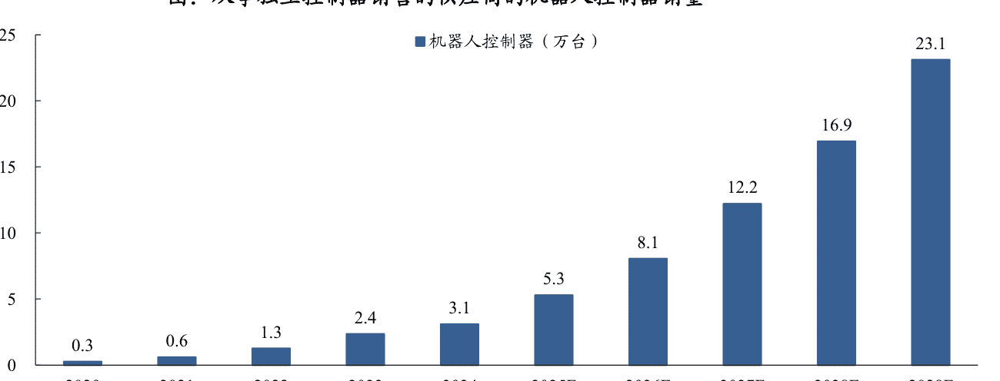

注：仅包括从事独立控制器销售的供应商的控制器销量，不包含机器人制造商内部使用的控制器的。

数据来源：人工智能招募书，东吴证券研究所

## 2 工业机器人市场较为分散，主要厂商占比仅四成

工业机器人销量前五大公司市占约四成，全球工业机器人市场仍较为分散，工业场景为智能机器人的关键领域之一。据决识咨询，全球工业智能机器人2024年的销量为11.8万台，则2024年全球工业智能机器人行业中，按载重智能控制器的工业智能机器人数量排名的前五大机器人公司，其产品总量约占工业机器人总销的37.0%。其中仙工是全球首家实现规模化运营的智能机器人开放平台。

图：工业智能机器人竞争格局

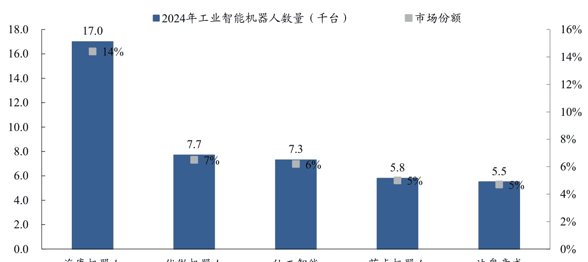

注：指标按载重智能控制器的工业智能机器人数量。

数据来源：仙工智能招股书，东美研究所

### 高技术壁垒与大市场空间，助力控制器高盈利

机器人控制器的技术壁垒较高，基于大市场空间能够创造更高的盈利水平。控制器的自主研发需要综合考虑技术、市场、成本等，前期需要对需求分析、硬件选型与设计、软件设计等过程，中间需要有系统集成和检测测试、优化与改进，最后才是产品化和批量化应用步骤，耗时长、难度大，基于大市场空间能够创造更高的盈利水平，以此为例，机器人控制器和软件产品毛利率都在80%以上。

图：仙工产品业务收入及其毛利率情况

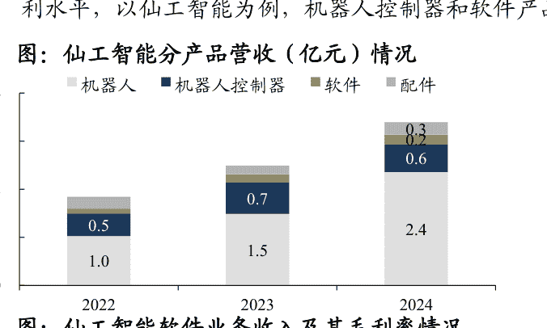

图：仙工机器人业务收入及其毛利率情况

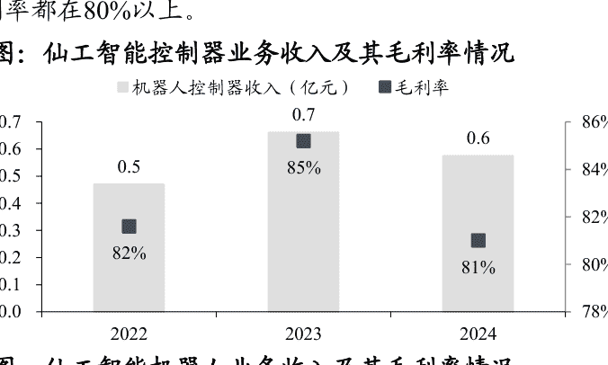

数据来源：仙工招股书，东吴证券研究所

### 2.2 无人车市场玩家图谱：多元主体共同产业格局

当前无人车市场呈现出多元化竞争格局，参与主体主要包括六类玩家。
①是专注于无人车研发的企业，产品线高度聚焦；
②是以仓储AGV为基础的企业，将无人车作为延伸品类布局；
③是AMR企业，借此自然领先技术切入无人车领域。
④除此之外，传统无人车企业在通过整机制造和方案整合两端发力，积极布局无人化；
⑤传统AGV厂商则凭借在工业场景的经验积累，将无人车纳入其热销产品体系中；
⑥最后，部分物流集成商为提升整体解决方案能力，也在自研或联合推出无人车产品。

整体来看，市场正在由单一智能企业主导，逐步走向技术主导、多元协作的产业格局。

图：无人车市场主要玩家类型

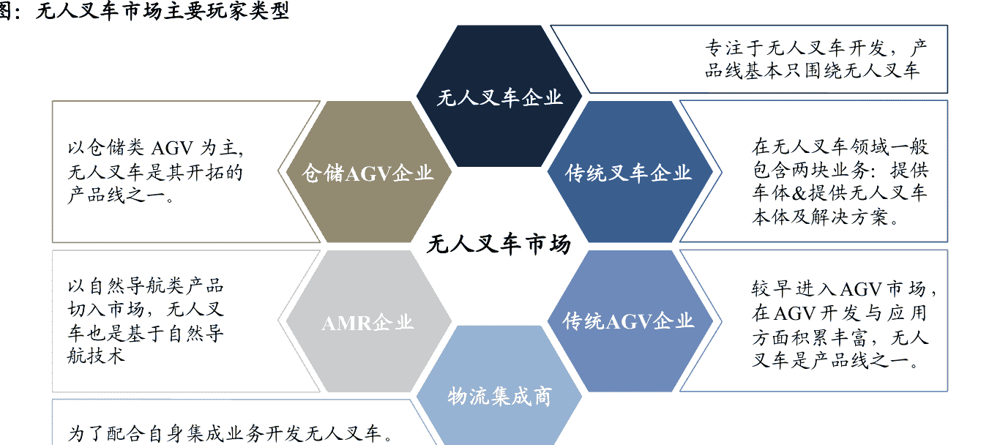

### 2.2.1 传统车辆供应商智能化转型

在智慧物流浪潮中，全球制造与仓储体系下，丰田、林德、永恒、安徽合力、杭友等头部车辆供应商积极深耕其产品矩阵和产业链能力，全面推进业务向智能化转型，形成了“整机+软件”融合的新格局。

图：传统车辆供应商基本情况（最新一）

| 公司 | 车辆业务收入（亿元） | 毛利率 | 智能化布局 |
| :--- | :--- | :--- | :--- |
| 丰田 | 271 | 6% | 通过自动化车辆与可编程机器人集成，实现自动化流程；在云端评估驾驶的安全性。 |
| 林德 | 887 | 27% | 在LogiMAT展现基于Omniverse数字孪生系统，利用传感器实时采集数据集，实现仓储作业与路径优化。 |
| 永恒 | 466 | 31% | 与Uplift Ventures成立初创企业，成功应用于汽车、轻量化等行业。 |
| 安徽合力 | 171 | 23% | 针对多个客户、多个AGV设备共同作业与柔性调度。 |
| 杭友 | 162 | 24% | 积极投入研发智能机器人，打造方位智能解决方案。 |

图：传统车辆与智能化形态

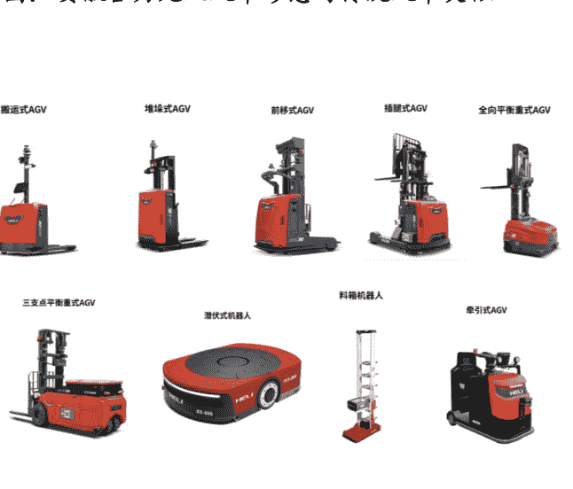

数据来源：Wind、安徽合力官网、东吴证券

### 全球布局无人车：丰田&Hive、Fujitsu

Hive Autonomy是一家科技公司，专门为工业领域提供AI驱动的机器人解决方案。2025年2月10日，Hive与丰田达成合作伙伴关系，为丰田的运输和起重机械提供即用的自动化系统。Hive依托自主研发平台，赋能丰田在传统AGV难以应对的复杂环境中实现自主避障及精准路径控制，从而显著提升设备效率、降低运营成本。

2024年7月23日，丰田与富士通联合宣布，基于富士通智能平台，共同开发日本首个“AI叉车驾驶分析”服务，通过AI自动分析行车画面，检测不安全操作生成驾驶评分，提升作业安全和效率。

图：丰田&Hive人工智能/远程驾驶车

图：丰田&Fujitsu使用AI分析驾驶视频

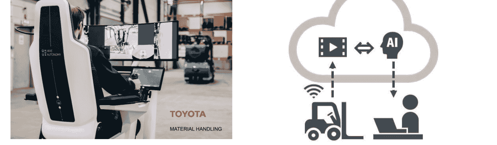

数据来源：Hiveautonomy官网、Toyota官网、东吴证券研究所

### 全球布局无人车：林德&英伟达、埃森哲

林德（Linde MH）积极推进无人车与智能仓储的数字化转型，携手NVIDIA和数字化专家埃森哲（Accenture），基于Omniverse AI平台打造仓库数字系统。通过整合AI、超宽带定位与高性能计算，林德实现实时协同调度、路径优化及运营模拟，显著提升仓储透明度和作业效率。这一布局不仅优化了多车协调及资源配置，也使企业能快速响应订单波动与现场变化。林德目前已与客户开展试点项目，助力客户建设智能物流领域。

图：林德在LogiMAT上展示的内部物流

图：林德自动化叉车工作示意

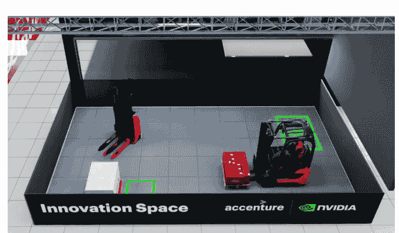

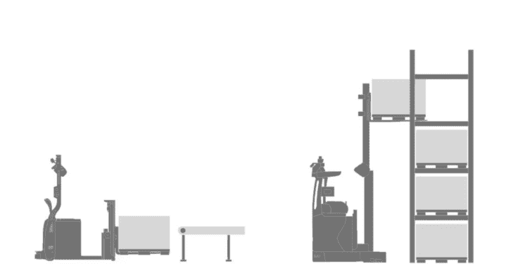

数据来源：Linde官网、东吴证券研究所

### 2.2.1 受限于硬件成本与内部转型压力，海外龙头领先较

虽然海外龙头在AGV领域具备多年领先优势，国内厂商在智能化领域实现领先。
①中国AI发展进展，平台化技术大幅降低研发成本：以国内无人车辆领先企业为例，其在智能驾驶、机器人等领域的研发技术产出以及硬件储备能够复用于无人车辆核心软硬件研发成本。
②下游控制刚需，智能化效率提高：国内物流大厂对智能化刚需，顺丰、京东、京三对智能仓储接受度高。长期来看，海外龙头相对封闭，内部压力大，整体智能化进展快；国内厂商积极领先。

| 企业名称 | 时间 | 合作方 | 具体内容 |
| :--- | :--- | :--- | :--- |
| 安徽合力 | 2024年1月 | 德码科技 | 资金7.1亿元，增持64.5%股份。 |
| 安徽合力 | 2024年4月 | 宇智机器人 | 增持17%股份。 |
| 安徽合力 | 2025年2月 | 华为 | 签署战略合作。 |
| 安徽合力 | 2025年4月 | 顺丰 | 签署战略合作。 |
| 安徽合力 | 2025年5月 | 京东 | 签署战略合作。 |
| 安徽合力 | 2025年5月 | 京东工程 | 签署战略合作。 |
| 聚友集团 | 2025年7月 | 宇智机器人 | 完成收购宇智机器人。 |
| 聚友集团 | 2025年7月 | 宇智机器人 | 引入宇智机器人。 |

数据来源：公司官网，东吴证券

### 2.2 专业无人车：集成能力与车体适配凸显

专业无人车供应商（AGV/AMR）：代表安徽合力、搬易通、极智嘉等。这类企业以AGV或AMR为核心切入仓储、制造、物流场景，具有较强的算法和软硬件协同能力。相较传统车辆，这类厂商普遍具备“车体制造+系统集成”一体化能力，能够根据行业定制化产品。以极智嘉为例，其产品已广泛适配大型电商仓储、工业制造等作业场景，货架到人、托盘到人、智能分拣、智能搬运、智能叉车等功能。

图：极智嘉货架到人解决方案

图：极智嘉智能搬运解决方案

| 产品型号 | P500R | P800R V6 | P1200R |
| :--- | :--- | :--- | :--- |
| 最大起升重量(kg) | 600 | 1000 | 1200 |
| 最大运行速度(m/s) | 空载2m/s，满载1.5m/s | 空载2.3m/s，满载2m/s | 空载2.6m/s，满载2.2m/s |
| 标准货架尺寸(mm) | 880*880 | 1220*1025 | 1250*1250 |
| 最大起升高度(mm) | 55 | 56 | 60 |
| 外形尺寸(mm) | L950×W702×H275 | L1095×W830×H195 | L1325×W1002×H275 |

| 产品型号 | M200C | M600C | MP1000R |
| :--- | :--- | :--- | :--- |
| 最大负载(kg) | 200 | 600 | 1000 |
| 运行速度(m/s) | 空载1.5m/s，满载1.5m/s | 空载1.5m/s，满载1.5m/s | 空载1.5m/s，满载1.5m/s |
| 停止精度 | ±10mm，1°(末端辅助定位) | ±10mm，1°(末端辅助定位) | ±10mm，1°(末端辅助定位) |
| 外形尺寸(mm) | L760×W520×H313 | L1100×W700×H316 | L1090×W830×H275 |

数据来源：极智嘉官网、东吴证券

### 2.2.3 系统集成商面临挑战

系统集成商具有较高的技术壁垒和毛利率水平。在智能物流建设中，安徽合力、兰智能等企业作为典型的系统集成商，技术壁垒在下游环节受到显著冲击，附加值下降。从财务表现来看，合力的附加值低于兰智能。原因在于两者路径不同：合力早期从事物流装备制造，兰智能则源于物流控制与管理，掌握关键算法，其附加值显著增强。

图：自动化物流解决方案

图：传统车辆与兰智能毛利率对比

物流设备：丰田、三丰联、昆智股份
物流软件：瑞世、今天智能

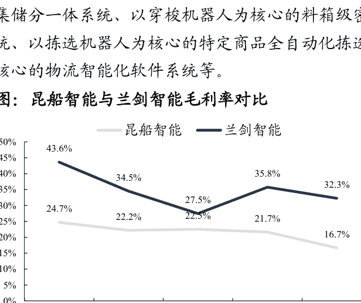

数据来源：Wind、公司年报、东吴证券

# 目录

一、AI驱动无人车技术持续发展，智慧前景广阔
二、无人车行业由控制器、车体供应商以及集成商组成
三、产业整合龙头企业竞争优势持续增强
四、投资建议与风险提示

## 3.1 安徽合力&德马：持续智能物流业务高质量发展

2024年1月，安徽合力子公司合力科技与德马科技成功举行战略合作签约仪式。合力科技引入德马科技作为战略投资者参与合力改革，并同步开展员工持股，双方致力于打造世界领先的智能物流产品和应用生态。德马科技是全球领先的智能物流装备及数字能源装备的提供者，2020年在交上市。公司控股股东为湖州德马投资有限公司，实际控制人为创始人/董事长卓序。公司长期专注于物流与数字能源的高端设备研发与应用，以智能物流+数字能源为引擎，高端装备+核心部件，国内市场+国际市场复合型双轮驱动为核心的产业。目前，德马以上总部和湖州中央工厂为基地，以澳洲、美国、罗马尼亚为区域工厂，以授权的本地化合作伙伴组装工厂辐射全球。

图：德马解决方案

图：德马科技与安徽合力深度合作（截至2025年第一季度末）

| 安徽合力 | 德马科技 |
| :--- | :--- |
| 2024年12月安徽合力全资子公司决定引入战略投资者并同步开展员工持股计划实施混合改革，德马科技最终成为增资方，增后持股20.95% | |
| | 73.33% |
| | 合力工业车辆（上海）有限公司 |

数据来源：德马科技官网、Wind、东吴证券

* 在输送分拣领域提供物流系统集成核心设备支持：作为国内智能物流输送分拣领域的企业，德马专注于自动化输送分拣系统和核心设备的研发、设计、制造和集成服务，经过多年积累输送分拣技术、驱动技术、机器人技术和软件技术等68项核心技术，在智能零部件和设备、人工智能、机器人输送和分拣、智能控制、智能驱动和软件等方面，取得了684项专利和著作权。其产品线涵盖分流分拣中心所需关键设备、核心零部件以及配套的软件系统（WMS仓储管理系统、WCS调度系统等）。

图：德马技术研发领域

| 技术领域 | 技术名称 | 成熟度 |
| :--- | :--- | :--- |
| 机器人技术 | 机器人全视角工作环境仿真设计 | 已实现产业化 |
| | 基于视觉的机器人引导直位技术 | 已实现产业化 |
| | 集团机器人工作环境感知系统的运动路线规划 | 小试点应用 |
| | AGV路径仿真技术 | 已实现产业化 |
| 分拣技术 | 机器人密集存储到拣选技术 | 已实现产业化 |
| | 机器人智能拣选技术 | 已实现产业化 |
| 驱动技术 | 智能调速服蜡控制技术 | 已实现产业化 |
| 软件技术 | 动态货物跟踪与智能仓位管理软件 | 已实现产业化 |

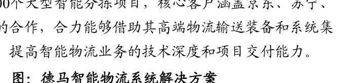
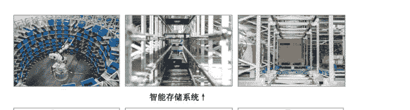
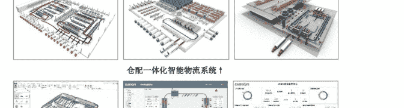

## 安徽合力&宇锋智能：推动智能化转型

- 2024年4月，安徽合力宣布现金出资2.71亿元收购宇锋智能64.59%的股权，增资1亿元，使持股比例提升至71.4172%，成为宇锋智能的新控股东。凭借利用宇锋智能在智能物流领域的先进技术，提升自身的产品创新能力，推动公司从传统设备供应商向智能物流解决方案提供者的转型升级。

- 宇锋智能：物流机器人与智慧物流解决方案提供商。自2014年成立以来，宇锋智能致力于推动物流行业智能化转型，以“打造世界级的物流机器人及智慧物流系统提供商”为愿景，通过不断的技术突破和市场深耕，创新推出一系列具有自主知识产权的智能物流装备，涵盖堆垛机、分拣机、AGV/AMR、RGV、四向穿梭车、工业车辆等多元产品。通过控股宇锋智能，合力快速补齐了自身在巷道立体仓储、智能搬运解决方案方面的短板，获得了完善的叉车AGV产品线和高密度仓储。

图：宇锋智能AGV产品集群

图：宇锋智能智能物流解决方案

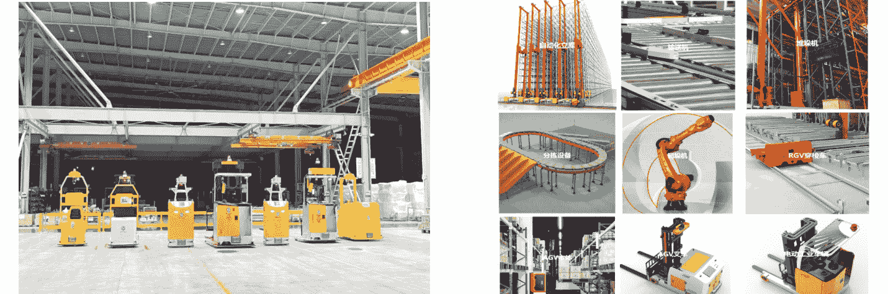

数据来源：宇锋智能官网，物流技术与应用公众号，东吴证券研究

### 3.1 物业收入占比提升，彰显智慧物流增长潜力

- 物业收入占比提升，彰显智慧物流增长潜力：2024年我国物流总额首次超过360万亿元，全年物流总收入达13.8万亿元，物流市场规模连续年位世界第一。2015年至2024年期间，中国物流总收入占社会总额的比重由3.4%上升至3.8%，反映我国物流行业正由传统延续模式向高附加值、智能化服务加速转型。

- 智慧物流对叉车行业提出更高要求，产业合作大趋势明显。一方面，产业结构升级及新能源、医药、电商等新行业的快速发展，显著提升了对定制化、精细化物流服务的需求；另一方面，智慧物流的兴起带动了仓储管理、智能监控、信息系统及供应链管理等增值服务的收入增长。物流收入占比的提升不仅反映了行业盈利模式的升级，更凸出智慧物流在降增效方面的巨大潜力。

图：中国社会物流总额（万元）及同比增速

图：中国物流总收入（万元）及同比增速

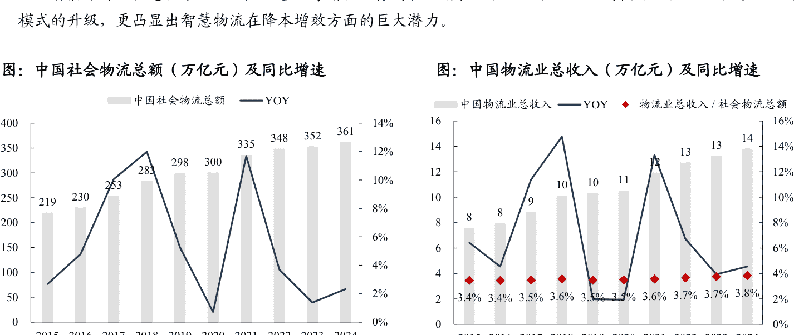

注：物流总收入包括物流活动中运输、储存、装卸运、包装、流通加工、配送、信息服务等方面业务活动的收入
数据来源：《中国物流与供应链发展报告（2024—2025）》

## 安徽合力&华为：依托现有智能物流经验，加强龙头竞争优势

2025年2月，安徽合力与华为举行深化合作协议签署仪式，双方将在数字化转型、智能物流、人工智能等领域深化合作，通过华为的合作，合力有望让用更高效的交互系统，推动物流设备的自动化和智能化：①软件层面，华为可以帮助实现与企业底层软件（ERP/MES）的全链条打通（从物料、生产、流转到出库），同时提高多辆车辆协同调度能力；②车辆端，华为可以充分利用在车载通信、视觉识别、自动驾驶等方面的技术。

华为正在构建以全链路数字化、全场景智能化、全要素协同为核心的全球智慧物流体系，通过物联网、大数据、人工智能、5G等技术的深度融合，实现供应链规划到交付的端到端智能化管理。此前的松山湖物流中心建成之后，华为启动了智能物流与数字化仓储项目，旨在通过构建实可视、安全高效、按需交付的物流服务能力，主动支撑交付保障，提升客户体验，改善物流运营效率。截至目前，项目已经实现了物流全过程，打造了收发预约、车辆模拟、RFID数字化等系列产品，已经获得千万级的收益。

图：华为与安徽合力合作协议

图：华为松山湖物流中心

| 收益（千万元） | 日均处理订单 | 日均调度订单 |
| :--- | :--- | :--- |
| 10,000 | 16,000 | LPN |

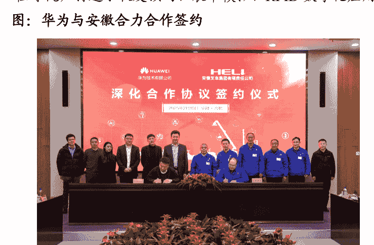

数据来源：华为中国，技术，东吴证券研究所

## 安徽合力&顺丰：持续拓展无人化场景与应用

2025年4月，顺丰与安徽合力正式签署合作协议，顺丰作为中国及亚洲最大的综合物流供应商，拥有全国各省核心物流网络，近期启动顺丰与合力的合作将聚焦智能物流装备与全球化升级：

（1）智能物流设备与研发：打造智慧物流样板，双方联合开发适配智慧仓储等高端物流设备。
（2）全球化网络协同：结合顺丰的全球物流网络与合力在海外市场的布局，共同拓展跨境物流服务端到端支持。
（3）无人化场景的探索与应用：依托顺丰在物流无人机、无人车、自动化分拣等领域的积累，结合合力在制造端的优势，重点布局全流程无人化解决方案。

图：顺丰智慧供应链

图：顺丰天津智慧物流中心

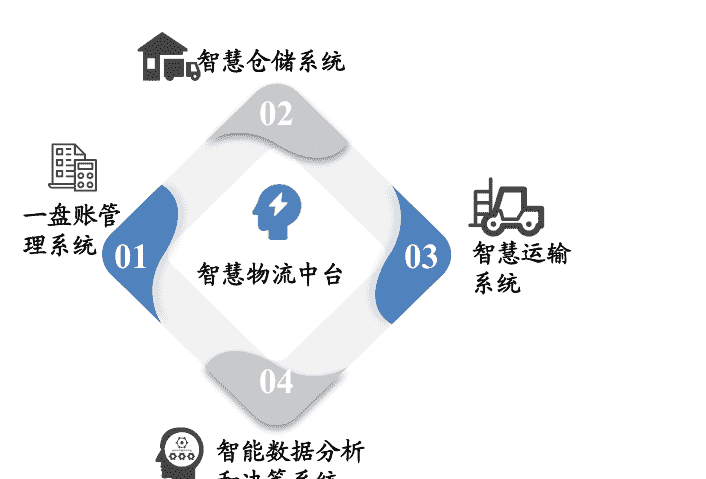

数据来源：顺丰集团，东莞证券研究所

## 物流巨头：顺丰建设国际网络与智能物流

顺丰控股于2024年1月港交上市，募资58.3亿。其主要计划包括：
①加强跨境物流能力（募资净额的45%），升级国际物流网络航线；
②维护海外仓库（募资净额的35%），实施效率提升，优化运输线路；
③研发先进技术（募资净额的10%），推动物流网络的数字化、开发大数据分析技术。

投资机器人与自动化领域：顺丰通过产业投资基金入股了多家智能物流装备企业，产品涵盖多向穿梭车、自主移动机器人、运输分拣机器人以及配套WMS/WCS/RCS软件系统，跻国内前五。截至2025年3月31日，顺丰通过其全资子公司凯尔科技（持股46%股权）与新石器（联合推出“芜获”无人运输方案）、白牛（L4自动驾驶，2025年5月顺丰领投B轮融资）等公司均多次合作。

图：顺丰“芜获”（物流+货箱）运输场景

图：顺丰物流体系下的白牛无人车

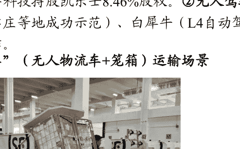
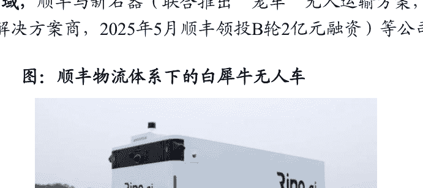

数据来源：顺丰控股招股书，凯尔士招股书，东望证券

## 安徽合力&京东：助力数字化升级

2025年京东集团与安徽合力签署合作协议，助力数字化升级：
（1）智能物流仓储领域，双方共同打造高柔性自动化仓库，并率先在京东“亚洲一号”智能园区开展试点。同时，京东将依托覆盖全国的智能化供应链基础设施网络，为合力开放工业品生产托管物流、仓储、运输等场景服务，助力合力优化供应链效率。
（2）海外市场拓展方面，京东将开放海外资源，双方将规划共建数字化、智能化海外仓。针对跨境物流场景，双方将推动合力重型叉车、集装箱搬运设备与京东国际物流需求相结合，加速全球市场布局。
（3）工业品供应链领域，京东工业将利用“一品多端”的全渠道销售通路，赋能合力精准触达国内外企业客户，高效电商销售新模式，同时打造一体化供应链解决方案，助力合力全球采购数智化升级。

图：京东物流智能仓储解决方案

图：京东物流智能仓储解决方案已落地十余国家和地区

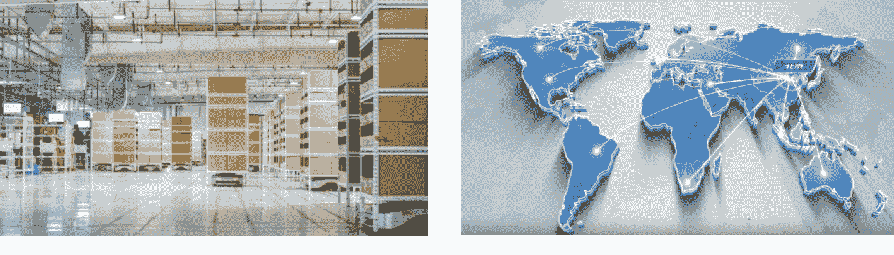

数据来源：京东物流官网，东吴证券研究所

## 物流巨头：京东建成最智能仓储中心

全球最大规模仓储一体化物流园区诞生：自2025年第一季度末，京东投入累计达456亿元。截至2024年，京东获得自动化专利超过3000项。2025年6月，京东在江苏昆山正式投亚洲一号园区，核心竞争力在于全链路智能化，通过80条自动分拣线，实现分拣准确率99.9%，自研“北斗”牵引系统结合AMR搬运，能够显著缩短货运距离从15公里降至5公里，单日处理订单突破5万。相比领先者，京东倾向于通过外部引入先进技术和模块化仓储系统与合作伙伴关系，在智能仓储仓库定制柔性化方面方面，京东集团授予“创新奖”。

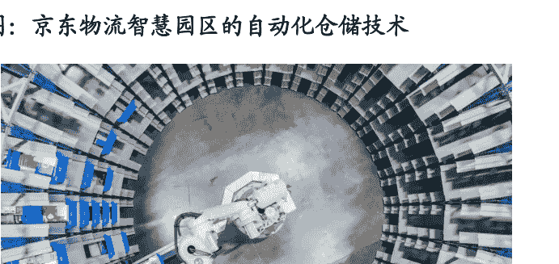
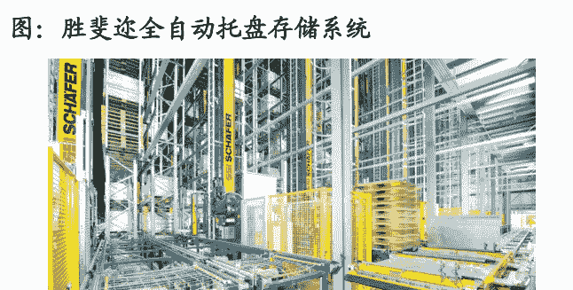

数据来源：京东官网、胜望官网、东吴证券

## 安徽合力：海外市场拓展，顺利增长

- 需求阶段性：2025年Q1实现营业总收入43亿元，同比增长2%。2025年Q1归净利润3.2亿元，同比下降20%。
- 毛利率稳定：2025年Q1实现销售毛利率22.3%，同比基本持平。2025年Q1费用率为12.0%，同比增长2.1%。
- 智慧物流板块拓展：费用支出约1.2亿元，阶段性增加影响净利润增长。

图：2019-2023年海外收入CAGR11%

图：2019-2024年公司归净利润CAGR15%

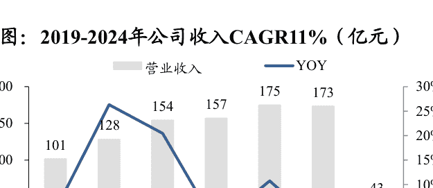
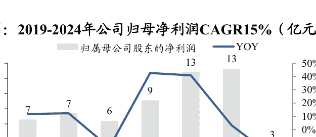

图：公司海外收入规模增长（亿元）

图：公司2025Q1毛利率维持稳定

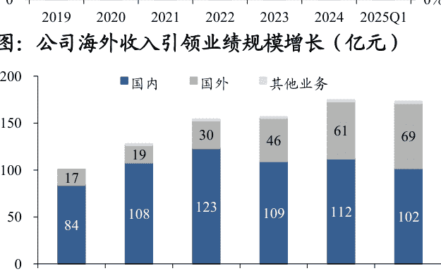
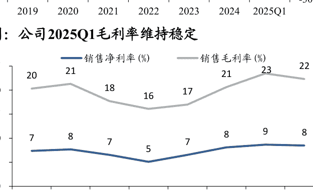

数据来源：Wind，东吴证券研究所

## 杭舟集团：智能物流表现亮眼，先发优势明显

杭舟集团布局智能物流赛，有望成为长期增长动力。构建了杭舟智能、杭奥智能、汉和智能三大业务群，形成涵盖了AGV、立式存储和软件集成系统在内的智能物流整体解决方案，截至2024年已实现1000余项目落地，中标全球快消、汽车领先企业项目。根据杭舟集团2024年年报，智能物流板块在2024年营收增长近80%，达到8亿元，订单金额首次突破10亿元。同时杭舟智能年万套自动化设备生产基地已开工建设，项目投产后，在大幅提升杭舟智能物流整体解决方案设计生产能力的同时，预计可实现营业收入10.3亿元，进一步打开公司成长空间。根据2024年订单&收入节奏赛测算，我们预计2025年智能物流板块营收将达到10亿元，订单预计12亿元以上。

图：杭舟集团AGV从仓储到装箱的全流程无人化

图：杭舟科技四季度效果图

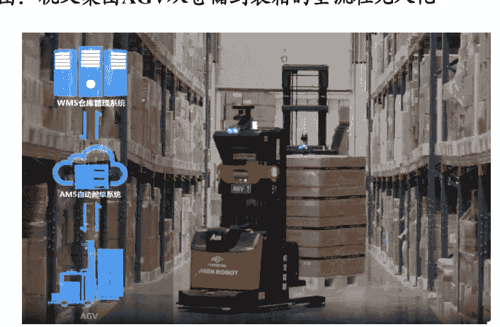
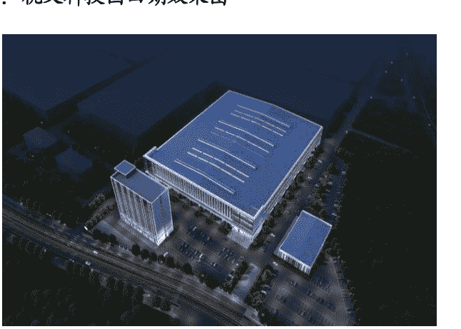

数据来源：杭舟集团官网，杭舟集团2024年年报，东吴证券研究所

## 杭舟集团&京东工业：以AI共迎数智供应链时代

2024年5月，杭舟集团与京东工业签署战略合作协议。双方将在营销、价格、服务等领域深度合作，通过数智驱动行业同步成本、提升全要素效率，带来符合需求、更具竞争力的价格和优质的服务。京东工业是京东集团旗下专注于供应链业务部门，其打造的解决方案能够带来海量终端用户、快速捕捉需求、更高产品效率，另一方面借助智能算法降低供应链成本。

图：京东工业全链路

| 商品专家 | 需求专家 | 合同专家 | 采购代理 | 运管代理 |
| :--- | :--- | :--- | :--- | :--- |
| 履约专家 | 集成专家 | 客户代理 | 业务代理 | 合规代理 |
| | | AI应用降本增效 | | |
| 物料代理 | 供应商代理 | 企业客户代理 | 工业代理 | |
| 采购源 | 履约代理 | 风控管理 | 销管理 |
| 需求管理 | 物料管理 | 合同管理 | 客户经理 | 商品经理 |
| 仓储管理 | 供应商管理 | 采购管理 | 风控经理 | 业务经理 |
| | | | | 采销 |

## 杭舟集团&国自机器人：全系列物流支撑

2025年7月7日，杭舟集团发布公告以增资扩股方式收购关联方昆震投资（原持有国自机器人52.4%）、巨星科技（原持有国自机器人19.5%）及其他转让方持有的国自机器人99.2%股份。本次交易完成后，公司持有杭舟智能的股权比例将81%变为44.3%，仍为控股股东；关联方昆震投资、巨星科技分别持有杭舟智能24%、8.9%的股权。

图：本次增资扩股前（2025年3月31日）后国自机器人相关股权结构

| 昆震投资 | 国自机器人 |
| :--- | :--- | :--- |
| 85.6% | 45.0% | 52.4% |
| 巨星控股集团有限公司 | 3.9% | 巨星科技 (A股上市公司) | 19.5% |
| 38.8% | 20.0% | 杭舟集团股份有限公司 | 44.3% | 巨星科技 8.9% |
| 79.0% | 杭舟智能 | 99.2% |
| 浙江杭舟控股有限公司 | 41.1% | 国自机器人 |
| 杭舟集团有限公司 | 81.0% | 杭舟智能 |

数据来源：Wind，杭舟集团公告，东奥证券研究

### 3.2 杭叉集团&国自机器人：全系列物流支撑

- 实控控股移动机器人头部企业，助力杭叉集团智能机器人产品研发。国自机器人成立于2011年，是国内移动机器人头部企业之一，以智能巡检、智能物流及智能制造为业务核心。2024年实现营业收入3.34亿元，净利润636万元，净利润率达19.8%。作为移动机器人行业内少数拥有全系列物流机器的公司之一，国自机器人的业务十分广泛，近年来以光伏为代表的新能源行业落地了多个标杆项目。目前，国自机器人已与策胶开展深度合作，“黑工厂”式智能仓储。本次收购后，国自机器人将进入杭叉集团上市公司主体，与杭叉主业务形成“硬件+软件”双轮回发展，实现“无人车+物流机器人+人形机器人”协同作业，进步仓储和搬运流程自动化、智能化水平。

图：2023-2Q1 国自机器人营业收入状况

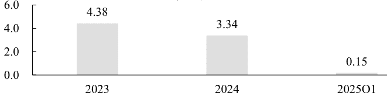

图：国自机器人光伏电池搬运一体式AGV

图：2023-2Q1 国自机器人归母净利润状况

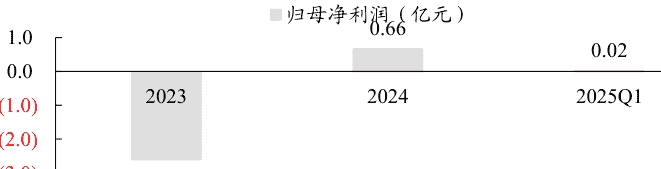
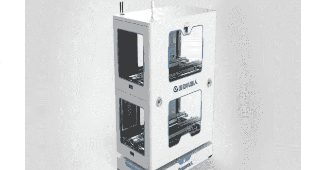

## 东杭合集团：盈利水平提升，全球布局加速

- 盈利稳步提升，2024年销售净利率创历史最佳。2024年实现营业收入165亿元，同比增长1%，归母净利润20亿元，同比增长18%，非后归母净利润20亿元，同比增长18%。2025年Q1销售净利率24%，同比15%。
- 持续全球布局，海外市场45亿元，归母净利润20亿元，同比18%。

图：2019-2024年收入CAGR13%

图：2019-2024年公司归母净利润CAGR26%

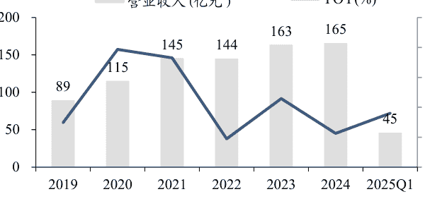
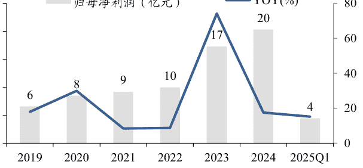

图：海外占比提升（亿元）

图：2024年销售净利率高

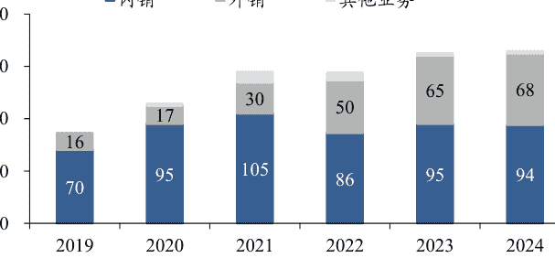
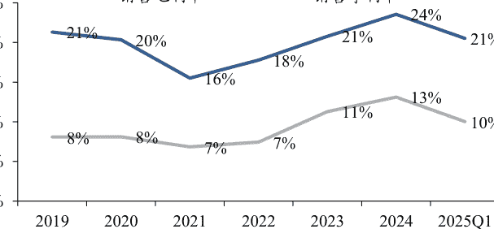

数据来源：Wind，东吴证券研究所

### 3.3 中力股份：持续投资布局智慧物流

2025年4月，顺丰与安徽合力正式签署合作协议，顺丰作为中国及亚洲最大的综合物流供应商，拥有全国各省核心物流网络，近期启动顺丰与合力的合作将聚焦智能物流装备与全球化升级：

（1）智能物流设备与研发：打造智慧物流样板，双方联合开发适配智慧仓储等高端物流设备。
（2）全球化网络协同：结合顺丰的全球物流网络与合力在海外市场的布局，共同拓展跨境物流服务端到端支持。
（3）无人化场景的探索与应用：依托顺丰在物流无人机、无人车、自动化分拣等领域的积累，结合合力在制造端的优势，重点布局全流程无人化解决方案。

图：顺丰智慧供应链

图：顺丰天津智慧物流中心

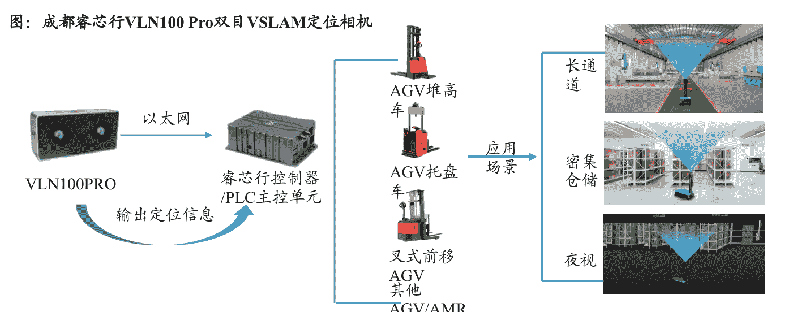

数据来源：顺丰集团，东莞证券研究所

## 3.3 中力股份：投资智慧物流技术

东吴证券

浙江科技机器人股份有限公司专注于企业内部车辆的无人驾驶控制器、物流机器人、智能物流自动化解决方案的研发、生产、销售及服务。核心技术团队包括浙江大学教授、海嵩博士等，技术实力强劲，拥有完全自主知识产权的系列导航与高精度定位技术（激光、视觉、二维码、引导、磁线磁钉）、工业车辆无人驾驶控制技术、多智能体分布式协作技术、基于深度学习的环境感知和动态路径规划技术。通过其智能的调优系统，多台科技机器人可在同一仓储环境下协同，实现资源共享和任务的高效分配。

深圳市有光摄像科技有限公司专注于生产经营机器人及自动化设备。自动叉车、传感器、机器视觉产品等，其自主开发的SLAM定位导航技术处于国际领先水平，在国内稳定可靠的工业导航传感器供应商，公司助力科技开发的1.5吨智能运机器人“智金刚”，适配跨楼/车间搬运，操作简单，性价比高，可完成单对多点的自动搬运。

图：浙江科技AGV叉运产品

图：深圳有光合作开发的“中力智金刚”

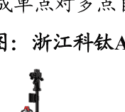

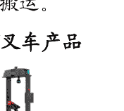

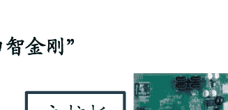

CP15托盘搬运机器人 (AMR)

CP20-S托盘搬运机器人 (AMR)

平衡堆高机器人 (AMR)

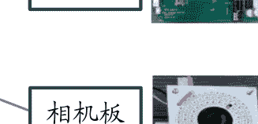

CP20托盘搬运机器人 (AMR)

电动堆垛系列机器人 (AMR)

平衡堆高机器人 (AMR)

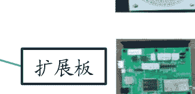

牵引系列机器人 (AMR)

数据来源：浙江钛，移动机器人产业联盟

## 3 中力股份：营收增速高于行业均值，外销占比持续提升

营收保持两位数以上增长，外销占比超过50%。2019-2024年营业总收入从22亿元增长至66亿元，CAGR达25%，高于行业平均水平。2025年Q1实现归母净利润1.9亿元，同比增长10%，毛利率接近30%，保持稳定增长。分领域来看，公司海外收入占比同比增加50%以上，显示出公司在海外市场的品牌竞争力较强。

### 图：2019-2024年公司收入CAGR25%

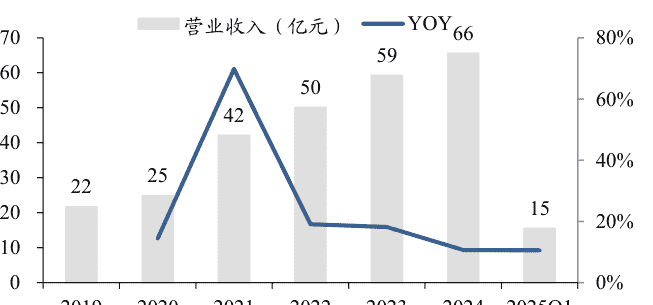

### 图：2019-2024年公司归母净利润CAGR41%

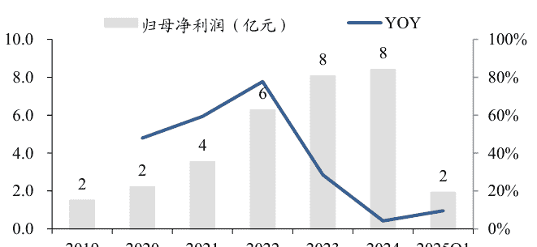

### 图：公司海外营收超50%

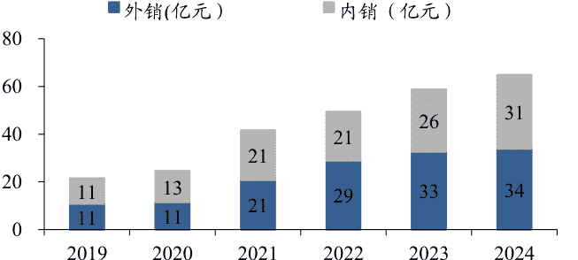

### 图：公司盈利能力保持稳定增长

数据来源：Wind、东望证券研究所

## 3.4 智能机器人：控制器为核心的双轮驱动模式

- 发展历史：2020年仙鸥智能正式成立，定位为SRC机器人的一站式机器人制造及方案供应商。2022年发布全球首款安全型机器人SRC-3000，获得SGS认证。2024年推出通用机器人SRC-5000，支持人形机器人开发，适配超过300种零部件。
- 业务模式：
  - 模块化平台：公司的产品包括控制器、组件（底盘、激光、电池等）、车型（如搬运式/堆高式/平衡式车）和软件。公司的核心产品是控制器；组件外购为主；车型（如特种叉车）与具备资质的客户合作。公司采取开放模式，以平台为核心，连接供应商、集成商及终端客户，降低门槛。通过“控制器+软件+机器人”三位一体，为上游供应商提供标准化接口，为下游集成商提供低价平台。
  - 双驱动模式：以技术算法为核心，通过控制器和软件提升机器人自主能力，通过云系统整合供应链，实现成本降低与交付。

图：智能控制器及机器人产品

数据来源：仙鸥智能招股书，东吴证券

## 仙工：以高毛利控制器为核心，提供多样化机器人矩阵

① 产品领先情况：仙智能通过平台化提供SRC系列控制器、机器人、软件和配件。其中机器人产品占比最高，但毛利率较低，2024年仅36%，而控制器和软件利润率都在80%以上。
② 机器人产品：公司起步专注于开发先进控制器，处于行业领先地位。作为机器人的“大脑”，负责处理环境数据、协调感知、运动控制等核心功能，2022-2024分别销售1685台、2553台和4055台。产品优势体现在三个方面：作为“大脑”实现决策一体化；采用工业级异构架构，具有实时响应与计算能力；支持插拔，通过模块化方式快速迭代。

图：仙智能符合不同要求的控制器概览

| 产品型号 | SRC-880系列 | SRC-1000系列 | SRC-2000系列 | SRC-3000系列 | SRC-5000系列 |
| :--- | :--- | :--- | :--- | :--- | :--- |
| 定位 | 入门级、差速机器人最佳 | 搬运叉车及双轮机器人专用、超性价比 | 高性能通用控制器 | 功能安全机器人 | 全球领先一体化 |
| 感知支持 | 2个激光雷达和3D避障相机 | 3个激光雷达、3D避障相机和1个3D识别 | 4个激光雷达、3D避障相机和1个3D识别 | 3个激光雷达、3D避障相机和1个3D识别 | 5个激光雷达、3D避障相机、1个3D识别相机和VSLAM模块 |
| 认证 | CE, LTE | CE, LTE | CE | CE, ETL, FCC | CE |
| 支持的多驱动器 | 4 | 8 | 8 | 12 | 64 |
| EtherCat | / | / | / | / | / |

数据来源：仙智能招募书，东吴证券

## 3.4 机器人：提供多样化机器人矩阵

③ 机器人产品：公司专注于机器人研发设计，所有机器人配备SRC系列控制器，具备较强易用性、可靠性和稳定性。目前已开发1000款机型，覆盖3C、汽车等多个行业，2022-2024分别售出756台、1229台、2576台。产品特点：模块化设计支持参数调整；多种引导技术确保运动精准；通过控制器与软件实现多机协作；符合CE、ISO 3694安全标准；二次开发与系统集成，适配300种零部件。公司持续从移动机器人向人形机器人发展，已突破从移动机器人到人形机器人的关键。

图：仙智能机器人主要产品列表

| 机器人 | 功能 | 使用场景 |
| :--- | :--- | :--- |
| 顶升机器人 | 有效载重从150公斤到3吨；多种方式，±5mm精准定位；长距离、模块化设计；配载激光雷达和3D相机，提供360°全监控； | 各类货架、箱垛搬运；为专业物流任务定制的机器人 |
| 搬送式智能机器人 | 有效载能力从300公斤到3吨，满足各种场景 | 高精度识别多种货架、货料、仓库等；实现不同货物的调度；多种搬运技术，±10mm运行精度；通过激光雷达 | 在仓库、生产线及出货区域调度，码及货物；在液货板及仓库自动装卸及分拣 |
| 推叉车机器人 | 有效载重从4吨到高位，满足不同的仓储需求 | | |
| 平衡机器人 | 先进的安全防护，包括超声波检测；支持电池热拔，持续续航 | |
| 料箱机器人 | 高精度识别多种类型的货物；双激光雷达相机提供全面保障 | 仓库搬运；原材料和产线间的流动 | 接入基于智能控制器的人形机器人

数据来源：仙智能招募书，东吴证券

## 仙工：以高毛利控制器为核心，提供多样化机器人矩阵

软件产品：公司聚焦工业场景的部署、管理，强调易用性，降低技术门槛。包含控制器、机器人和软件系列，2022-2024年销量分别为72套、668套、701套。其中机器人系统支持单机应用、多机调度、路径规划等优化；利用先进的空间建模和自动化设备（如输送线）无缝运行。

图：仓库管理

图：多机器人调度

数据来源：仙智能招股书，东吴证券

## 投资建议

受益于智能加速落地，推荐深入布局智能双车，客户资源深厚的行业龙头杭芜集团、安徽合力；建议关注AI技术赋能无人驾驶渗透率提升，核心控制器供应商仙工智能（上海市）（2025年4月完成IPO前最后一轮融资，投后估值约32.7亿元）；建议关注中力股份、仙工智能、音飞存储、兰氪智能。

表：盈利预测

| 2025/7/5 | | | | 归母净利润（亿元） | | | | | | | |
| :--- | :--- | :--- | :--- | :--- | :--- | :--- | :--- | :--- | :--- | :--- |
| 代码 | 公司 | 收益价（元） | 市值（亿元） | 2024 | 2025E | 2026E | 2027E | 2024 | 2025E | 2026E | 2027E |
| 603298.SH | 杭芜集团 | 21.35 | 280 | 20.2 | 22.1 | 24.1 | 26.6 | 14 | 13 | 12 | 11 |
| 600761.SH | 安徽合力 | 18.32 | 163 | 13.2 | 14.0 | 15.2 | 16.4 | 12 | 12 | 12 | 10 |
| 603194.SH | 中力股份 | 41.63 | 167 | 8.4 | 9.3 | 10.6 | 12.1 | 20 | 18 | 16 | 14 |
| 300532.SZ | 今天国际 | 12.20 | 55 | 2.8 | 2.9 | 3.7 | 4.2 | 20 | 19 | 15 | 13 |
| 301311.SZ | 仙工智能 | 21.76 | 52 | 0.1 | / | / | 81 | / | / | / | |
| 603066.SH | 音飞存储 | 12.08 | 36 | 0.5 | / | / | 71 | / | / | / | |
| 688557.SH | 兰氪智能 | 30.25 | 31 | 1.1 | 1.6 | 1.9 | 2.9 | 28 | 20 | 16 |

数据来源：杭芜集团、安徽合力盈利预测

## 风险提示

(1) 行业需求不及预期：全球制造业、物流等行业放缓将影响叉车及智能物流设备，制约行业增长。
(2) 关键技术突破存在确定性：SLAM导航、算法等仍在快速迭代，技术不达预期对行业发展造成较大影响。
(3) 海外业务受地缘政治影响：贸易环境复杂，地缘政治紧张、关税问题增加可能影响海外订单、交付及盈利水平。

## 免责声明

东吴证券有限公司经中国证券委员会批准，已具备证券咨询业务资质。本报告仅供东吴证券有限公司（简称“本公司”）使用。本公司因他人接收本报告而视为客户。任何情况下，本报告中的信息或意见并不构成投资建议，公司及作者不对任何人使用本报告导致的结果承担后果。在法律范围内，东吴证券及其关联机构可能会对报告涉及的公司发行并交易，还提供银行或其他服务。市场风险，投资需谨慎。本报告是基于公司分析得出的客观结论，公司力求保证信息的准确性和完整性，也不保证观点或阐述不会发生变化。在不同时间，公司发布的数据、意见及预测可能不一致。本报告的版权归公司所有，未经书面许可，任何机构和个人不得以任何形式复制、转发。未经授权，转发本报告或者摘要的，应当注明为东吴证券研究所，并注明报告和发布日期；保留使用报告的权利，且不得对报告进行有意的引用、编辑和修改。未经许可或要求的要求，转发本报告的，应承担相应的责任。

报告后6个月内行业或公司回报相对于基准的表现（A股市场基准为沪深300指数，香港市场基准为恒生指数，美国市场基准为标普500指数，北交所基准为北证50指数），具体如下：

公司投资级
- 买入：预期未来6个月内股票涨幅相对于基准在15%以上
- 增持：预期未来6个月内股票涨幅相对于基准小于5%~15%之间
- 中性：预期未来6个月内股票涨幅相对于基准处于-5%~5%之间
- 减持：预期未来6个月内股票涨幅相对于基准小于15%~5%
- 卖出：预期未来6个月内股票涨幅相对于基准在-15%以下

行业投资级：
- 增持：预期未来6个月内，行业指数相对于相对强度大于5%
- 中性：预期未来6个月内，行业指数相对于相对强度处于-5%~5%之间
- 减持：预期未来6个月内，行业指数相对于相对强度小于5%

我们在此提醒，不同证券研究机构采用的评级术语及评级标准。我们采用的是相对评价体系，表示投资的相对权重，投资者买入或卖出的决定取决于自身状况，如具有目的的财务状况以及特定需求等，并完全理解和使用本报告内容，不视本报告为投资决策的唯一依据。

东吴证券研究所
江苏省苏州区昆阳路55号
邮编：215021
传真：(0512)6293855
网址：http://www.dwse.com

## 东吴证券 财富家园

## 扫码加入 知识星球TOP免费资源群

免费

公众号:知识星球TOP

- 每日免费获取高价值资源
- 可提供各类资源搜索服务

价值

微信:jntsg8

| 热门付费文章 | 各行各业报告 |
| | 精选图书资源 | 副业赚钱方法 |
| | 职实用资源 | AI经政自媒体 |

及时

微信:jntsg2

专注

分享资料仅供个人学习，请及时删除，切勿商用传播
