# 开源证券

通信
2025年07月08日

# AI 数据光共频，AEC 受高速短距离需求

——行业深度报告

蒋萍（分析师）
jiangping@kysec.com
代码：S7900522310000

投资评级：看好（维持)

# 行业走势

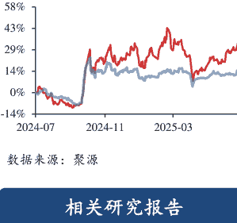

数据来源：聚源

- **在 AI 场景下，光电互联在短距离连接中有望显著提升**
随着生成式人工智能的到来，AI 技术的日益成熟，基于“数据+算力”双驱动的新应用层出不穷，显著驱动了算力需求的持续增长。作为算能力的核心载体，数据中心算力需求的持续增长，使得关键的服务器领域及下游产业前景将在未来几年内不断拓展，连接方案有望突破，在数据中心短距离连接中的市场仍有很大空间。

- **G200 大连接点需求爆发，AI 推动短距离连接行业迎来爆发**
随着数据中心规模扩张和带宽速率的提升，灵活的互联方案已成为市场关注的焦点。光电共频和 AEC 的传输可靠性日益关注，连接方案有望在数据中心内部短距离（如交换机服务器）中，展现出巨大的市场空间。随着 AI 光纤传输的优势正被广泛采用，连接方案有望在数据中心内部的互联中发挥突破作用，在交换机服务器节点内，不再的 PCB 布线模块成为主流。

- **AEC 技术在数据中心内部短距离连接，成为行业关注的热点**
AEC 在数据中心内部的信号传输至关重要，提升传输效率和封装密度，使其在数据中心内部光电互联中发挥重要作用。目前，我国 AEC 正在快速发展，许多企业开始布局 AEC，在未来的需求中，数据中心市场中的竞争日益激烈。展望未来，随着 AI 技术的不断进步和数据中心算力需求的持续增长，AEC 在数据中心内部短距离连接有望取得更大的突破，同时也为我国产业的发展带来活力。

- **投资建议：**
建议数据中心连接器产业链增长机会：（1）连接器头部、安波盛、华硕等公司关注 AI，受益的：华芯科技、中视科技（中际光信等）；（2）一体化封装。在短距离连接领域具有技术和研发优势，推荐的：中泽创新、鸣易等、立讯精密等；（3）连接头 DAC/DAO/AEC/连接器，以及 AI 服务器龙头有深度合作，受益的：博创科技、旭富信等；（4）线材，受益的：沃尔尔伯克、精进股份、国联华、亨字博、新亚电子、鸿鸿密。

- **风险提示：**技术路线风险、国际标准制定风险、市场竞争风险、原材料价格波动，需关注需求端风险

《世纪一切互联趋势，看好 AI 产业链趋势行业报告》-2025.06.30
《或许世界将开启，大引布局 AI 产业发展深度报告》-2025.06.25
《泛后 AI REITs 行业，Marvell 上调 2028 年 AI 规模预测》-2025.06.22

# 开源证券

行业深度报告

# 目录

- 5.10, 立住极线：积极布局光模块高速互连解决方案.........................27
- 5.11, 风险提示：提供通信行业建议...............................28
- 5.12, 神智市值：专注于高速带宽侧电枢研发...............................30
- 6, 风险提示......................................................................

# 图表列表

- 图 1：光模块及光纤和 AEC 连接对比...............................................4
- 图 2：AEC、DAC、ACC 对比...............................................5
- 图 3：AI模型发展趋势...............................................5
- 图 4：GPT-4 点燃行业智能爆发...............................................6
- 图 5：Deepseek 行业性能对比...............................................7
- 图 6：大模型 AI 服务器需求高算力参数数据报告，必须在云端运行................................8
- 图 7：全球 AI 服务器市场规模增长（单位：千台）...............9
- 图 8：预测 2034 年北美 AI 市场规模达到 1005.7 亿（单位：亿元）...............9
- 图 9：以太连接高速连接...............................10
- 图 10：交换机速率不断迭代...............................11
- 图 11：预计 PCIe 7.0 将至 2025 年饱和，单通道速率达到 128GT/S...............12

# 开源证券

- 图 12：机之间的 GB200 NVL72 互连......................................12
- 图 13：GB200 NVL72 内部交换机节点连接图................................12
- 图 14：GB200 NVL72 侧插板和背板示意图.........................12
- 图 15：GB200 NVL72 交换机内部侧互连方案图.........................13
- 图 16：全球数据中心需求大幅提升................................13
- 图 17：数据中心建设将显著降低与模块化需求（亿美元）......14
- 图 18：数据中心内部互连趋势................................................14
- 图 19：DAC 成本（美元）................................15
- 图 20：DAC 成本（美元）................................16
- 图 21：CEI 行业标准向 22G 升级...............................17
- 图 22：AOC, DAC, AEC 性能对比...............................18
- 图 23：NVL72 NVLINK 高速互连接器量（个）...............................19
- 图 24：NVL36 NVLINK 高速互连接器量（个）...............................19
- 图 25：预测 2023-2028 年 AEC 市场规模为28 亿美元.........19
- 图 26：预测 2023-2028 年 AEC 复合增长率45%（亿美元）.........19
- 图 27：高速线缆组件趋势................................................20
- 图 28：金属材料、线材是半导体行业22 年原材料 BOM 采购部分................20
- 图 29：同轴制造过程................................................21
- 图 30：连接器由接触、绝缘体、壳体构成...............................22
- 图 31：通信为连接器下游占比（2021 年数据）.........................22
- 图 32：通信和汽车是连接器下游占比最高的两个行业.........................22

表 1：1980-2023年全球连接器厂商TOP10 及国家、地区分布.........23
表 2：竞对估值比较...............................................29

## 互联技术成为提升中心的关键要素

1、对接连接，有多重连接方案。在数据中心内部，按照介质不同，存在光纤连接和铜缆连接两大网络方式。常见的光纤连接包括光模块、光纤、AOC，连接连接包含 DAC/ACC/AEC。

* 光纤连接:

光模块+光纤：光模块搭配是目前应用广泛的布线方案。光模块是光纤传输的关键组件，它负责完成电转换的任务。在发送端，光模块将信号高速传输，通过光纤进行远传输；在接收端，光模块将接收到的信号再转换为电信号，供后续处理。光模块+光纤的，优势在于传输距离长，劣势在于连接和成本较高。

* AOC (Active Cable, 有光源):光模块和光纤集成，形成一整条线路，无源光纤组。AOC 通过光纤传输信号，可用于 100m 中短距离互连场景。AOC 方案优点是有更高的传输性能和更长的传输距离，且较优于铜缆重量、成本较高。

图1：光模块和光纤连接方案对比

| TX IC | LASER | | TX IC |
|---|---|---|--|
| | Photodiode | | Photodiode |
| RX IC | | | RX IC |
| | | Fiber | |

AOC (Active Optical Cable)

| TX IC | LASER | | TX IC |
|---|---|---|--|
| | Photodiode | | Photodiode |
| RX IC | | | RX IC |
| | Fiber Connector | Fiber | Fiber Connector |

Optical Transceiver Module

| TX IC | LASER | | TX IC |
|---|---|---|--|
| | Photodiode | | Photodiode |
| RX IC | | | RX IC |
| | Fiber Connector | Fiber | Fiber Connector |

资料来源：Fibermall

- 2)铜连接

按是否包含电子元件以增强信号，铜缆连接可以分为无源缆(DAC, Direct Attach Cable)和有源缆(Active Copper Cable)。

DAC (Direct Attach Cable, 无源缆)：一种连接，用于交换机、路由器和服务器进行连接。不需要电子元件，产生任何热量，其功能几乎为成本比“光模块+光纤”更优，适用于短距离连接，容易受到电磁的影响。

有源缆：在 DAC 基础上增加芯片，即为有源缆，分为 ACC 和 AEC。是一种在数据中心接收端(Rx 端)加入电路的 Retimer 来增强信号的均衡，利用芯片来解决无源 DAC 的高频传输，将传输距离扩展到更广泛的应用。

AEC（Active Electrical Cable）是有源铜缆的细分种类，AEC 通过在线端加入 Retimer 实现信号的放大和再生，相比传统的无源 DAC 传输距离更长，同时优化了信号质量。

图2：AEC、DAC、ACC 方案对比

img/a975c1c215ed9c4f8178d962183b903c_4_0.png

资料来源：FS

## 2、GB200 大连接点需求爆发，AI 推动高速铜缆增长

### 2.1, ChatGPT 及 DeepSeek 热起 AI 潮流，是核心生产力

国内外 AI 模型竞争激烈。OpenAI、谷歌、Meta、Anthropic 等公司持续引领潮流。GPT-4 在多模态上表现出色；谷歌 Gemini 系列已出中心的多维度；Meta Llama 3 发布了全球爆发；Anthropic Claude、Grok 等也有亮点。AIGC 产品的发展依赖算法及算力的综合融合，大模型引起高度关注，AI 代表着 GPT 生成持续强大。

img/a975c1c215ed9c4f8178d962183b903c_5_0.png

资料：天津市人工智能学会、开源证券《2024年AI AIGC 产业现状》

img/a975c1c215ed9c4f8178d962183b903c_5_1.png

资料：头部研究院

# 国内 DeepSeek 成立不到两年实现大模型领先，性能对标海外。

DeepSeek 成立于 2023 年 5 月，一家致力于实现通用人工智能的创新型科技，专注于开发先进的大语言模型和相关技术。DeepSeek 由知名创业巨头幻化创立，在自然语言处理和高性能计算领域积累深厚的背景和丰富的经验。

2024 年5 月，DeepSeek-V2 发布，成为全球最强通用 MoE 模型。DeepSeek 创新架构 MLA 一种新的注意力机制，流线架构 DeepSeek-MoE 在大模型竞技场列全球开源模型第一名，依据创新结构，价格降低为 GPT-4 的十分之一。

2024 年12 月，DeepSeek-V3 发布，性能对标海外领先模型。这些模型在多项测试上超越了 Qwen2.5-72B、Meta 的 Llama-3.1-405B 等其他开源模型，并超越 GPT-4、Claude-3.5-Sonnet 等顶尖领先模型。官方技术文档披露，V3 模型的训练成本为 5576 万，对比 GPT-4 等模型的训练成本约为六分之一。

2025 年1 月，DeepSeek-R1 发布，性能对标 OpenAI-o1 正版。DeepSeek-R1 在后训练阶段使用了强化学习技术，在仅有少量标注数据的情况下，极大提升了模型的推理能力。在数字、代码、数学推理等任务上，性能比肩 OpenAI-o1 Alpha。同时 DeepSeek 开源 R1 模型，所有人需遵循 MIT License 的情况下，

图5：DeepSeek 综合性能优化

img/a975c1c215ed9c4f8178d962183b903c_6_0.png

资料来源：DeepSeek-

AI 大模型的训练需要指数级的提升。随着生成人工智能（AIGC）技术的普及及发展，基于“数据+大计算”的新应用层出不穷，对算力的需求日益增加，引发了人类对智能计算所需需求的增长速度远超算算律的预测。

# 图6：大模型训练算力随参数级提升，必须在云端进行

#### Training compute (FLOPs) of milestone Machine Learning systems over time

img/a975c1c215ed9c4f8178d962183b903c_7_0.png

资料：《Compute Trends Across Three Eras of Machine Learning》注：红色为 AI模型，蓝色为 AI 常规

# 开源证券
## 行业深度报告

## 2.2、 带宽扩展在 GB200 NVL72 中泛用光互连

带宽升级助力数据中心算力瓶颈。带宽通信线路或设备能够传输信号的频率范围，高带宽意味着设备能够在更高频率下传输更多信息。为了满足 AI 应用和模型扩展对资源的需求，数据中心在多个节点之间关键时间点的分配和负载才能满足这些需求。由于单个无分布式架构的运行时间受到关键节点的限制，因此此设备的高效扩展成为系统升级的关键。

图 9：以太网速率高速发展

图 10：交换机速率领先进提升

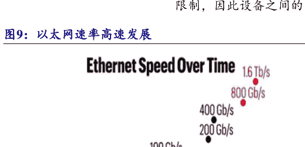
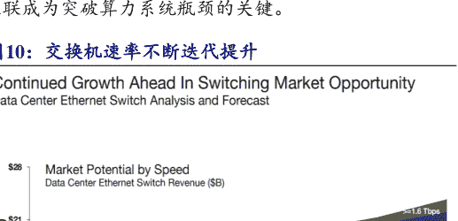

资料来源：Network Computing
资料来源：Arista Networks

PCIe 速率提升满足带宽需求。PCIe 自 2003 年推出，其提供了一个更快、更高带宽的接口。随着时间的发展，PCIe 已经成为现代计算平台的标准，从最初的 1.0 版本到了如今的 6.0 版本。

- PCIe 1.0: 提供 2.5 Gbps 的单向带宽，每个通道的最大传输速率为 250 MB/s。
- PCIe 2.0: 带宽扩展至 5 Gbps，每个通道的最大传输速率为 500 MB/s。
- PCIe 3.0: 再次扩展至 8 Gbps，每个通道的最大传输速率为 1 GB/s，同时改进了编码，从 8/10 编码转为 128/130 编码。
- PCIe 4.0: 带宽达到 16.0 Gbps，每个通道的最大传输速率为 2 GB/s。
- PCIe 5.0: 最新版本，带宽为 32 Gbps，每个通道的传输速率为 4 GB/s。
- PCIe 6.0: 速率达到 64 Gbps，每个通道的最大传输速率为 8 GB/s，使用了 PAM4 调制，进一步提升传输效率。
- 预测 PCIe 7.0 将于 2025 年推出，其单通道速率可能达到 128GT/s。

图 11: 预计 PCIe 7.0 将在 2025 年推出，单通道速率达到128GT/s

| Specifications | x1 | x2 | x3 | x4 | x5 | x6 |
| :--- | :--- | :--- | :--- | :--- | :--- | :--- |
| 2.5 GT/s (PCIe 1.x +) | 500 MB/s | 1 GB/s | 2 GB/s | 4 GB/s | 8 GB/s | - |
| 5.0 GT/s (PCIe 2.x +) | 1 GB/s | 2 GB/s | 4 GB/s | 8 GB/s | - | - |
| 8.0 GT/s (PCIe 3.x +) | 2 GB/s | 4 GB/s | 8 GB/s | 16 GB/s | - | - |
| 16.0 GT/s (PCIe 4.x +) | 4 GB/s | 8 GB/s | 16 GB/s | 32 GB/s | 64 GB/s | - |
| 32.0 GT/s (PCIe 5.x +) | 8 GB/s | 16 GB/s | 32 GB/s | 64 GB/s | 128 GB/s | - |
| 64.0 GT/s (PCIe 6.x +) | 16 GB/s | 32 GB/s | 64 GB/s | 128 GB/s | 256 GB/s | - |
| 128.0 GT/s (PCIe 7.x +) | 32 GB/s | 64 GB/s | 128 GB/s | 256 GB/s | - | - |

来源: Jeffrey Burt 《The Increasing Impact Of Speed - The PCIe-Class Roadmap》

铜互连在市场上广泛应用，铜互连在数据中心内部作为互连方式之一，特别是在服务器内部的短距离传输下，铜连接对于热效率和信号传输方面具有显著优势，因此铜互连是当前以及未来交换连接中最具成本效益的解决方案。我们对 NVIDIA 224G 交换机和光模块连接进行了分析：铜互连在 224G 交换机高密度趋势中具有性价比优势，一个重要性是交换机内部的连接建议使用铜互连而不是光模块连接。

(1) NVL72 机柜间连接（铜缆）：大型数据中心往往需要大量的机柜之间连接，如果需要对外联网，则在机柜上方布线槽中使用 DAC 电缆（如图 12 所示）。长度很长，在 2 到 4 米以上无法连接，因此长距离互连主要用光纤连接，铜缆在这个阶段无法完全取代光缆。

图 12: 机柜之间的 NVIDIA GB200 NVL72 连通
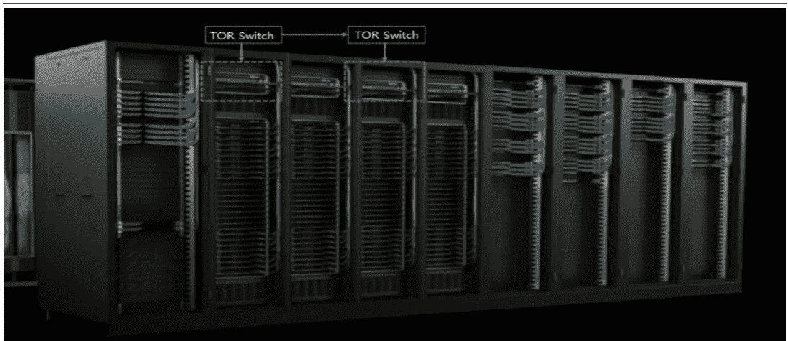
资料来源：英伟达

(2) GB200 NVL72 单机连接（机柜内部）——全部更换为铜：在内部 8 个计算节点和 9 台交换机通过铜缆取代了以前使用的光模块连接。对于单通道 224GB/s 的新一代交换机，800G/1.6T 光模块功耗在 16W 以上，将造成高功耗问题；如果 GB200 NVL72 的连接基于光模块，铜缆消耗少的功率，更具效益。

图 13: NVIDIA GB200 NVL72 机箱内部的连接和计算节点示意图
图 14: NVIDIA GB200 NVL72 铜缆背板和背板连接图
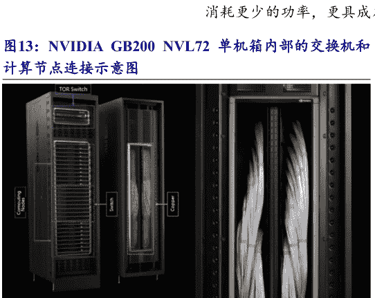
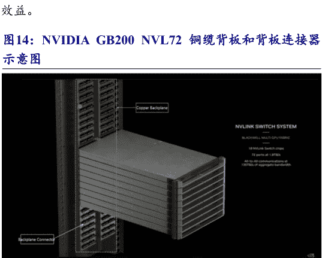
资料来源：英伟达
资料来源：英伟达

(3) 开关内部使用铜连接器从背板到开关芯片：对于单通道 224GB/s 的交换机，如图 15 的黄色部分所示，PCB 背板面积是有的，不足覆盖整个区域，因此无法实现远距离的链路连接，而铜缆跳线方式可以实现从背板到开关芯片。

图 15: NVIDIA GB200 NVL72 交换机内部铜缆连接方案示意图
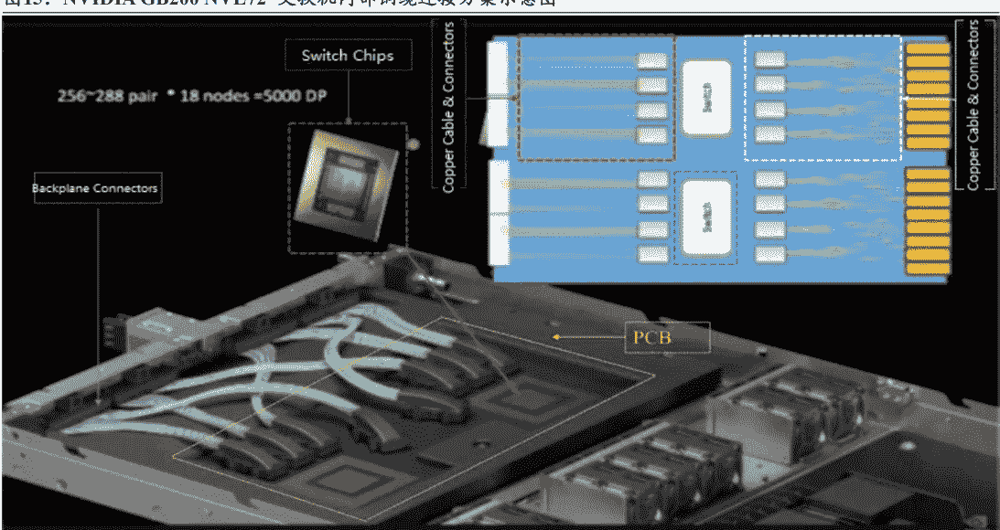
资料来源：英伟达

## 数据中心发展带动互联需求
## 3.1、 数据中心能耗飙升，互联网拥有低功耗优势

数据中心总能耗飙升。在全球范围内，根据国际能源署（IEA）的数据可见，2022年全球数据中心总能耗为460TWh（约全球总电量的2%），2025年可能会超过1000TWh。根据工信部和中国信通数据，截至2024年，我国在数据中心机房规模已超过80万台机架，截至2023年，标准机架耗电到1500亿kWh，占全球总电耗的1.6%。

图 16：全球数据中心能耗预计大幅提升
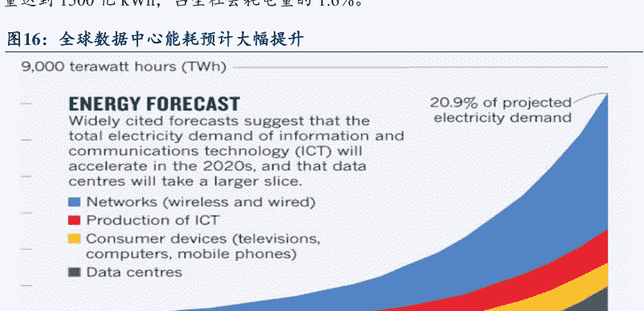
资料来源：AKCP

数据中心的高昂成本是行业的另一个问题。根据 Synergy Research Group的数据，仅在2022年，约90亿美元用于建设大容量数据中心，预计到2030年将以4%的速度增长。然而，由于电力压力紧张、大宗商品价格加剧、通胀高企企业供应链影响，自2020年以来全球建筑项目的成本至少减少了6%。因此为降低硬件运营成本、提升传输效率、优化布局和提高效率成为关键趋向。

图 17：全球数据中心建设增长率与能耗优化率（亿美元）
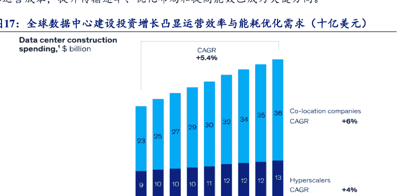
资料来源：麦锡、Synergy Research Group

### 3.2 连接技术与数据中心需求

互联场景的多样性与客户需求的个性化了不同类型的传输载体（有源光缆、直接连接、光纤）。随着市场对传输速率的不断增加，数据中心放置了大量的网络节点和服务器汇聚，对于服务器以及交换机之间的连接，需要使用直接连接、有源光缆、光纤等技术来实现数据互联。
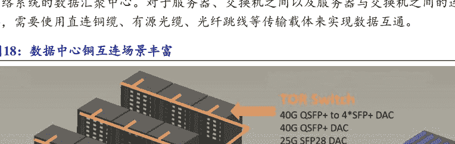
资料来源：FiberMall

铜互连由于不需要充电缆，因此具有低功耗特性，不需要额外的转换设备即可即插即用。相比有源光缆，目前的直接连接（DAC）的功耗约1W以内，控制了成本。铜缆在短距离内提供极低延迟并具有可靠性，不会在某些环境下信号丢失。

图 19: DAC 功耗较低（W）
图 20: DAC 成本较低（$）
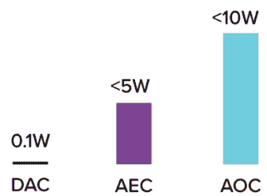
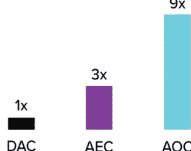
资料来源：Precisionot
资料来源：Precisionot

## 3.3、伴随数据中心升级，高速铜缆传输逐步提升

随着数据中心向400G和800G网络成为主流，升级趋势已明确，伴随SerDes速率从56G、112G升级到224G，单通道达到1.6T，高速传输成本有望下降，对应铜缆速率也向224Gbps迈进。解决高速铜缆的传输损耗，AEC、ACC通过信号增强提升传输距离。

图 21:CEI协议标准向22.4G升级

| OIF CEI projects | CEI-25G | CEI-56G | CEI-112G | CEI-224G |
| :--- | :--- | :--- | :--- | :--- |
| Timeline | 2011-2014 | 2014-2018 | 2018-2021 | 2021- |
| Ethernet rate | 100G | 50/100/200G | 100/200/400G | 200/400/800/1600G |
| Switch capacity | 3.2T | 12.5T | 257/50T | 50T/100T |
| Per-lane data rate | 25 Gbps | 56 Gbps | 112 Gbps | 224 Gbps |
| Modulation | NRZ | PAM4 | PAM4 | TBD |
| Insertion loss | 25db at 12.5GHz | 30db at 14GHz | 28db at 28GHz | TBD |
| Reach objectives | 5m copper cable | 3m copper cable | 2m copper cable | 1m copper cable |
| Pre-FEC BER target | 1e-15 | 1e-4 | 1e-4 | TBD |
| SerDes architecture | Analog | Analog/DSP | Analog/DSP | TBD |

资料来源：OIF

### 4.1 高速铜需求旺盛，高频铜使用情景丰富

从应用场景来看，铜互连场景主要有芯片直出线、服务器内部、骨架内部互连和扩展间互连。目前看来，高速铜可以解决数据连接激增及常规时耗时的传输瓶颈，可以实现 ASIC 与骨架、ASIC 与接口之间的互连；芯片直线主要包括CBC（芯片对骨架）、C2C（芯片对芯片）、C2F（芯片对前面）；服务器内部主线包括 MCIO、PCI 和 SAS 线等；机柜内部高速铜连接骨架和矩阵之间进行连接互连，可通过高速铜连接到服务器 SFP/QSFP/OSFP 接口，再通过服务器内部主线传输数据，或实现机柜与矩阵之间的互连。

外部连接分为几类：无源 DAC、有源 ACC（Active Copper）和 AEC（Active Electrical Cable）。如400G为例，无源 DAC 使用铜线由于封装限制，传输距离不超过3米，主要用于机架内，功耗最低；有源 ACC在模块内部带有有源驱动器或放大器，可以补偿链路损耗；有源 AEC在集成，传输距离可达7米，功耗也增加，但仍低于无源。

图 22：ACC, AEC性能比较

| Type | DAC | ACC (Passive) | AEC |
| :--- | :--- | :--- | :--- |
| 400G Transmission Distance | <300m | <3m | <7m |
| 800G Transmission Distance | <300m | <3m | <7m |
| Power Consumption | High | Low | Medium |
| Cost | High | Low | High |
| Weight | 25% of DAC | larger diameters, heavier weights | 800G of DAC weight |

资料来源：ADNOD

图 23: NVL72 NVLINK 高速同轴连接器用量（个）
图 24: NVL36 NVLINK 高速同轴连接器用量（个）

根据最新预测，有源电(AEC)、光转换器(DAC)和高速光缆(AOC)市场预计从2023年的12亿美元增长到2028年的28亿美元。AOC的基数较大，预计每年增长15%左右，DAC预计以每年约25%的速度增长。AEC的基数较小，但预计年增长率为45%。

图 25: 预测2028年AOC+DAC+AEC合计市场规模（28亿美元）
图 26: 预测2023-2028年AEC复合增长率为45%(年化)
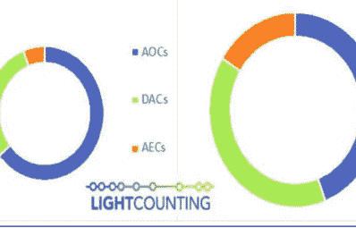
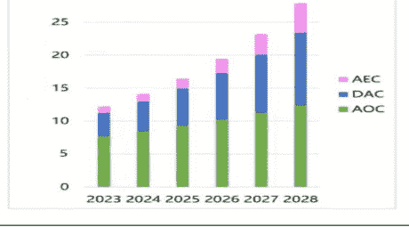

资料来源：Light counting
资料来源：Light counting

AEC产业链主要可以分为以下几个环节：上游环节包括：电缆（铜丝、材料）、制造、线缆制造、连接器及其组件的生产。中游的终端客户群体涉及多个行业，中游为AEC生产环节。下游则涵盖数据中心、高性能计算（HPC）、消费电子和工业自动化领域，其涉及涉及、华为等知名服务器供应商，以及众多互联网厂商和运营商大型企业。

### 4.2 AEC产业链：上游芯片及线缆核心，模块厂商接入环节

### 4.2.1. 线缆及Retimer芯片：AEC核心部件

高速连接线由线缆和连接器组成。安费以连接器形式销售跳线模组、远距离线缆以及10 DAC&ACC、高速连接线和连接器作为重要材料可能连接外部或终端。通过单一技术领先，高速连接线产品口碑包括外连接、智能剪切、电子布线、终端连接头、连接器、调试、包装环节。

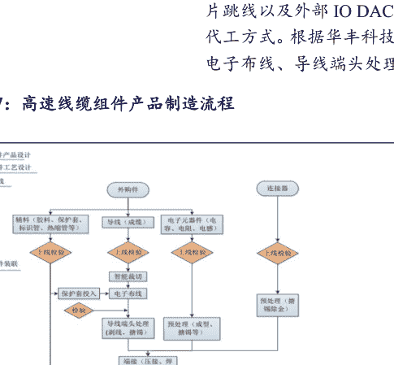
图 27：高速连接线制造流程

金属材料、线缆是核心部件

| 金属材料 | 线缆 | 其他 |
| :--- | :--- | :--- |
| 3.68% | 7.74% | - |
| 配件 | 3.94% | - |
| 元器件 | 8.41% | - |
| 全金属材料 | 14.63% | - |
| | 金属材料 | 元器件 |
| | 结构材料 | 其他 |

图 28：金属材料、线缆是核心部件2022年材料BOM的重要部分

资料来源：华率技术说明书、开源证券

# 开源证券
行业深度报告

图29：同轴电缆制作过程

#### (1) 线缆技术路线

| 低密聚乙烯/四硅乙烯 | 镀银线+镀银线 | 全聚乙烯/可塑性四硅乙烯 |
| :--- | :--- | :--- |
| 四硅乙烯 | | |
| 镀银线 | | |
| 绞绕线丝 | 线品成品1 | 低速编织+高速编织 | 线品成品2 |
| 或或熟接 | | | 护套层 |
| | | 全聚乙烯/四硅乙烯/聚乙烯 |
| 镀银/镀铝/镁丝线 | 高速编织 | |
| | | | 线品成品 |
| | | 护套编织 |

#### (2) 电极技术路线

| 全聚乙烯/四硅乙烯/聚乙烯 | | 全聚乙烯/聚乙烯 |
| :--- | :--- | :--- |
| 护型层 | 线品成品1 | 护套层 |
| 镀银/镀铝/镁丝线 | 高速编织 | 线品成品 |
| | 线品成品2 | |
| | 或规格编织 |

| 护型层 | 编织工艺 | 护套层 |
| :--- | :--- | :--- |

线缆一般使用低密度四硅乙烯/聚四硅乙烯作为绝缘材料，部分产品使用通用聚乙烯绝缘材料为全聚乙烯，后者具有良好的耐候性。

**数据来源：** 神宇证券招股说明书

不同设备和材料对线缆制作具有重要影响，具体来说：
**（1）绝缘层挤出：** 绝缘材料对产品性能有非常大的影响，主要包括PE、FEP、聚光、FEP发泡材料、聚光发泡材料等，对于PCIE6.0以上高速传输材料，通常使用聚四氟绝缘材料。对于绝缘挤出工艺来说，需要严格控制的绝缘外径、同心度、栅隙以及电沉积等指标。
**（2）平行挤绕：** 即通过挤绕将绝缘层及线芯合在一起，在外面又包一层铝箔或滚一层自粘胶，通过挤绕将线材的扭拉、延时、绞绕等；挤绕过程中线芯和厚度的均匀性要严格控制，此外，聚缘线的方向要与线芯保持一致，对自粘胶的加热温度要符合行业标准，平行挤绕曲线必须均匀，应尽量避免扭折，做到定位到位。
**（3）线材编织：** 通过编织机在线材外面再加一层屏蔽层，以增加线材的屏蔽效果，过程中对线材的收放张力及抽线速度进行控制；
**（4）线材外层挤出：** 通过挤出机套一层屏蔽层材料，对线材进行保护，过程中对对称张力及抽线、挤出方式等进行控制。

请务必参阅正文之后的信息披露和法律声明

21 / 32

# 开源证券
# 行业深度报告

#### 4.2.2 连接器：全球中高端、中国企业制造行业领先

连接器通常由接插件、绝缘体、壳体构成，在系统中传输电流信号，并且保持系统之间发生信号和能量损失的变化。其中连接器是核心部件，通过刚性接插件构成为完成电连接。

图30：连接器由接插件、绝缘体、壳体等构成

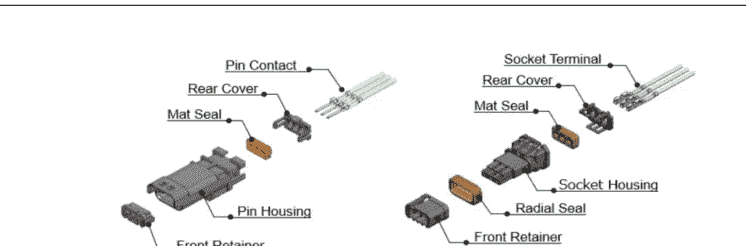

资料来源：华动漫

连接器下游中信和汽车的两个细分行业。根据Bishop & Associate研究，2021年连接器市场规模79.91亿美元，其中中信连接器占比23.47%，排名第二。连接器包括无线连接器、滤波器连接器、矩型连接器、对轴连接器、车载连接器等，主要应用于电信和中心两大市场。由于国家5G的阶段性领先、通信基础设施建设的推进等因素，通信市场表现优异，而以模型类的力使得电子数据中心需求带来快速提升，且主要由于AI服务采购，数据中心成为通信连接器市场增长最快的行业；中信连接器占比21.86%，排名第二；汽车及外设连接器占比13.13%，排名第三。

图31：连接器下游市场分布（2021年数据）

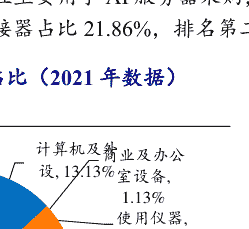

图32：通信和汽车连接器下游占比的两个细分行业

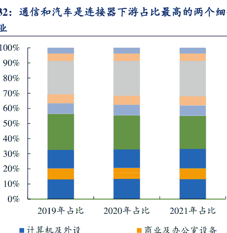

- 消费电子、其他：4.82%
- 3.77%
- 通信/通讯：23.47%
- 工业、汽车：12.80%
- 21.86%
- 军工/航天：5.99%
- 交通连接：6.96%

- 计算机和外设
- 使用仪器
- 工业
- 交通运输
- 通信/通讯
- 其他
- 业务及办公设备
- 医疗
- 汽车
- 军工/航天
- 消费电子

数据来源：Bishop & Associate、开源证券研究所

请务必阅读正文之外的信息披露和法律免声明

# 开源证券
# 行业报告

连接行业愈集中，但我们本土厂商正获得话语权。Bishop & Associates 的数据，截至2023年，全球10家连接器厂商市场份额达52.6%，较2022年有所提升。泰科电子、安费士这三家巨头市场份额达30%以上。国产厂商利用地缘分工正在优化供应链，凭借快速响应能力以及产品质量控制能力，随着上游需求向国产的转移，中国制造已成为电子产品和原材料的主要生产地。国内投入需求的响应速度，成功进入国际知名厂商供应体系。同时这些优势也将在全球分工及国内连接器厂商的发展进程中不断强化，从而持续市场份额。

表1：1980-2023年全球连接器厂商TOP10及国内厂商

| 榜名 | 1980 | 1990 | 2000 | 2010 | 2020 | 2023 |
| :--- | :--- | :--- | :--- | :--- | :--- | :--- |
| 1 | Amp | 泰科 | 泰科 | 安费士 | 安费士 |
| 2 | 安费士 | 贝仕 | 贝士 | 安费士 | 安费士 |
| 3 | ITT Cannon | | FCI | 立讯精缜 | 安威路 |
| 4 | DuPont(Berg) | ITT Cannon | Delphi | 亚士 | 安威路 |
| 5 | 3M | | 安费士 | FIT | 立讯精缜 |
| 6 | August | Burndy | | J.S.T. | FIT | 罗埃密森 | 罗埃密森 |
| 7 | Winchester | DuPont(Berg) | ITT Cannon | Foxconn | 亚士 | 亚士 |
| 8 | Cinch | | J.S.T. | 3M | Delphi | 罗埃密森 | 罗埃密森 |
| 9 | Burndy | 电子 | 电子 | Hirose Electric | 电子 | 电子 |
| 10 | 沃尔 | 电子 | | J.S.T. | 电子 | Hirose Electric | Hirose Electric |
| 国内地区 | | | 7 | 6 | 5 | 4 |
| 欧洲 | | | | 1 | 1 | 1 |
| 日本 | | | | 3 | 3 | 3 |
| 中国 | | | | 0 | 0 | 0 |
| 亚士 | Bishop & Association | 0 | 0 | 0 | 1 |

资料来源：Bishop & Associate、开源证券研究所

#### 4.2.2 连接器：全球中高端、中国企业制造行业领先

连接器通常由接插件、绝缘体、壳体构成，在系统中传输电流信号，并且保持系统之间发生信号失和能量损失的变化。其中连接器是核心部件，通过刚性接插件构成为完成电连接。

### 5.1 华策科技：连接器核心企业

公司是国内领先连接器领域的核心企业，也是高新技术企业，公司以来从事连接器和线缆组件的研发、生产、销售，并为客户提供解决方案。公司为通信、航空、航天、邮政等行业提供大部分客户，其产品应用于数据连接类产品、连接器组件、电子产品等。

在通信领域，公司是领先连接器供应商中上市的企业，受益于供应商崛起，公司成立后已成为行业核心供应商。公司拥有连接器、连接器模块、中速连接器、线缆组件等产品及技术，并形成了较大影响力和竞争力的多种高速连接器类供应商。同时，公司在服务器领域拓展业务，受益于数据中心和云计算基础设施需要高性能连接解决方案，公司实现了连接设备供应商和厂商的覆盖。

公司利用领先技术优势，在服务器业务领域拓展了重要权重。公司与主要客户在12G、24G速率产品上有合作以及进行项目定制。公司主的产品包括：12G高速连接器包括高速线缆组、高速连接器、Chip to Chip高速连接器模块组等主流架构产品，为数据中心交换机、核心路由器、通用服务器等领域提供了完整的高速互连解决方案。此公司业务主要受益于下游客户，如中兴，主流业务的变动和产品调整的灵活，2024年为公司的第一客户，且华为占公司业务比例超过35%。

### 5.2 凯达：连接器专精特新企业

公司是专业从事连接器产品的研发、生产、销售服务的服务的专精特新企业，产品包括连接器、连接器组件和模块等系列，同时具备电、微、流体、数据连接器研发和生产能力的企业之一。

关注AI、边缘计算等需求的快速增长，使得高性能数据中心需求增长。AEC是一集集成信号传输的高速连接模块，主要受益于数据中心距离（0.5-7）米。

### 5.3 聚焦股份有限公司：连接器与光模块两大板块

公司在连接器业务上，公司是一家专注于连接器研发、生产和销售的企业，致力于为客户提供优质解决方案。公司深耕高速通信领域，在连接器领域具有领先优势，以SFP、SFP、QSFP、QSFP-DD为代表。公司是国内领先实现高速连接器（400G-800G）的企业，其产品包括QSFP56G-QSFP-DD等，占据市场份额，并制定了行业标准。公司目前在高速连接领域领先，拥有多个研发领先技术，在数据中心内部，实现光平台调试；高速连接器（AEC）产品已与中兴、赛源、Duratel在内的客户建立了长期合作，近年来通过QSFP56G-QSFP-DD等产品适配，实现400G-800G DAC/AEC等，参与并与行业竞争。

### 5.4 长芯科技：连接器布局高速连接器

公司的业务主要是连接器研发、生产和销售。公司业务方向面向数据中心、消费及互联网，产品包括数据中心内部的传输模块、连接器、以及各类（AOC、400G-800G）。公司在高速连接器领域领先，拥有多年技术积累，目前在高速连接领域领先，光电器（DAC/AEC）和服务器等设备中，实现56G, 400G-800G等领先。

### 5.5 聚焦：连接器领先企业

### 5.7 中期战略：设立合作企业进入AEC领域

中际聚焦高速光模块的研发、设计、封装、测试和销售于一体，为数据中心客户提供100G、200G、400G和1.6T高速光模块，为电信客户提供5G前传、中继回光模块应用于通用光纤和同步光纤高速传输提供整体解决方案。在Lightconnecting发布的2023年度光模块厂商排名中，中际领先全球第一。

2025年1月，京迈跨境连接器有限公司（“凯达”）、京洲科技领先与华苏州睿益盛通信股份有限公司（穹益盛”）签署《投资合作协议》，合作企业主要负责高速电连接器业务。交易后，京迈和凯达将分别持有合作企业65%和25%股权，共同控股经营，通过此次合作，项目正式进入AEC领域。

### 5.6 新趋势：深入布局AEC

公司业务领先全系列通讯信号的光模块，涵盖研发、生产和销售，服务于人工智能、机器学习集群、数据中心、数据通信、无线网、电信网等国内外客户。公司在AEC技术领域已深耕，研发800G高速模块，实现IEEE802.3c协议，目前互功耗低于1W，已完成各项样品交付，进入小量生产。

### 5.8 光互连：深度布局美联光模块

公司业务主要为数据、专用线和连接类产品，制造和销售，致力于为数据、云计算、数据中心、AI中心、智能制造、工业互联、汽车、智能家居、特种行业（医疗、农村、人形、矩阵、光伏、工业机器人、核、航空航天）等各个客户领域提供服务。

公司在连接、工业等连接领域有着较好的技术积累，规模化生产已于传输速度达到800Gb/s以上高速连接器及配套的传输线电，高速连接产品能够满足客户日益的需求，公司大力拓展国内传输与连接产品市场，已成为国内互联网及云计算领域知名厂商。

### 5.9 聚焦：连接器领先（此处为内容重复部分）

### 5.10 立箔精密

**数据来源：** 神宇证券招股说明书

不同设备和材料对线缆制作具有重要影响，具体来说：
**（1）绝缘层挤出：** 绝缘材料对产品性能有非常大的影响，主要包括PE、FEP、聚光、FEP发泡材料、聚光发泡材料等，对于PCIE6.0以上高速传输材料，通常使用聚四氟绝缘材料。对于绝缘挤出工艺来说，需要严格控制的绝缘外径、同心度、栅隙以及电沉积等指标。
**（2）平行挤绕：** 即通过挤绕将绝缘层及线芯合在一起，在外面又包一层铝箔或滚一层自粘胶，通过挤绕将线材的扭拉、延时、绞绕等；挤绕过程中线芯和厚度的均匀性要严格控制，此外，聚缘线的方向要与线芯保持一致，对自粘胶的加热温度要符合行业标准，平行挤绕曲线必须均匀，应尽量避免扭折，做到定位到位。
**（3）线材编织：** 通过编织机在线材外面再加一层屏蔽层，以增加线材的屏蔽效果，过程中对线材的收放张力及抽线速度进行控制；
**（4）线材外层挤出：** 通过挤出机套一层屏蔽层材料，对线材进行保护，过程中对对称张力及抽线、挤出方式等进行控制。

请务必参阅正文之后的信息披露和法律声明

# 开源证券
# 行业报告

Cable等: (2) 高速互联方案：PO光模块和AOC、PO光模块和AOC，速率至高支持1.6T，Form Factor散热、SFP、QSFP-DD、OSFP以及MSMSF/MMF Fiber: (3) 热管理解决方案：有主动、被动、液冷散热系统四级架构，包括全规格风扇散热、Heat Pipe、VC、冷液冷却系统、Manifold、插槽、CDU、接头头部、热交换器、浸没冷却；(4) 数据中心解决方案：Power Shelf & Rectifier(AI服务器电源解决方案)、直流插拔、7000A-1000A 54V Busbar、3200W-125V AC/DC 直流，至3200W 12V MCRPS、以及多款 Power Module/VRM/VPM(AI节点电源解决方案等)。

随着在全球范围内需求增长，AI中心对算力、高速传输速率质量、及资源管理能力的需求日益显现。公司已向AI机架的核心组件提供解决方案，该方案涵盖高速互连、高速、热管理以及电源管理大模块，电源核心产品Cache Bridge 连接高速互连系统、Kilic组件引起互连架构、1.6T OSFP DAC 和 AOC、冷液冷却系统、12万液交换 CDU、27.5kW Power Shelf。此外，公司已布局4G/5G基站等产品，完善了业务产品矩阵。公司已成为海外运营商供应商、AI智能中心的核心组件伙伴。

## 51、沃尔尔江：聚焦高速线缆业务

公司主业务聚焦在电子和新能源电力行业，电子材料、线缆、电力、新能源汽车及发电五大业务。公司通信线缆业务主产品包括连接线、汽车、工业线等领域，公司主营产品专注于高速连接、电气及机器人、汽车等市场。

公司通信线缆业务主要由于公司启拓智联经营。在高速连接领域，成功发布多束224G高速连接线、800G高速连接线，此类重点产品为行业领先核心产品，能够满足高速传输的严苛要求，并完成了PCIe6.0标准的开发，产品性能卓越、可靠性高，目前已试用中。

## 52、虹智股份：专注于高频同轴电缆制造

公司是从事高频同轴电缆的研发、生产和销售的高端技术公司，其主要产品为高频同轴电缆、连接器和组件，包括插件同轴电缆、矩阵式同轴电缆、半柔、半刚屏蔽型同轴电缆、军用连接到高频同轴电缆等多种产品，产品已应用于通信、数据链网络、航空航天、汽车通信、医疗器械、数据传输领域。

随着AI技术的应用，相关市场规模不断扩展，这无疑带动了高频同轴电缆的市场增长。随着各大客户在采购中获得AI大模型训练加速发展的新需求，包括AI服务器、AI连接、AI机器人等。AI技术的发展的需求迎来激增，使得高速同轴电缆企业不断爆发。

在终端用高速连接线缆领域，目前公司高速连接业务领先，公司市场份额领先，已实现USB4、Thunderbolt、光模块、DAC高速连接插件，应用于大数据存储、云数据存储、数据处理器传输中的高速连接、电磁数据传输领域方面取得突破，目前在AI服务器为代表的服务器市场需求渴求下，公司通过先进连接和技术研发，助力客户的下一一代产品开发。

请必阅读正文的信息和法律声明

## 表2: 目标估值

成为 AI 服务器数据连接的重要供应商，有望受益全球 AI 算力基础设施建设。

| 证券名称 | 证券代码 | 评级 | 估值(元) | 市值(亿元) | EPS(元/股) | 2025E | 2026E | 2025E | 2026E | 2027E | 
| :--- | :--- | :--- | :--- | :--- | :--- | :--- | :--- | :--- | :--- | :--- |
| 中际旭创 | 300308.SZ | 买入 | 135.15 | 1,501.68 | 7.95 | 11.15 | 14.67 | 17.00 | 12.13 | 9.21 |
| 新易盛 | 300502.SZ | 买入 | 126.49 | 1,256.95 | 8.53 | 9.96 | 11.40 | 14.82 | 12.70 | 11.09 |
| 华本科技 | 688629.SH | 买入 | 52.10 | 240.18 | 0.53 | 0.74 | 1.00 | 0.99 | 99.01 | 69.58 | 52.18 |
| 瑞可万 | 688800.SH | 未评级 | 45.38 | 93.34 | 1.22 | 1.23 | 1.86 | 37.21 | 29.58 | 24.43 |
| 立讯精创 | 002475.SZ | 买入 | 34.75 | 2,519.86 | 2.33 | 2.84 | 3.37 | 14.93 | 12.23 | 10.32 |
| 芯斐创 | 002897.SZ | 增持 | 37.17 | 72.13 | 2.01 | 2.51 | 3.08 | 18.46 | 14.83 | 12.07 |
| 长望创 | | | 61.47 | 178.90 | 0.68 | 0.88 | 1.09 | 90.81 | 69.80 | 56.26 |
| 光龙亚 | 300913.SZ | 未评级 | 44.06 | 137.24 | 0.57 | 0.75 | 1.15 | 77.84 | 58.58 | 38.26 |
| 金信诺 | 000252.SZ | 未评级 | 11.10 | 73.50 | | | | | | |
| 沃尔尔江 | 002130.SZ | 未评级 | 23.66 | 297.59 | 1.03 | 1.38 | 1.78 | 22.99 | 17.14 | 13.29 |
| 鑫科技 | 688668.SH | 未评级 | 60.90 | 84.77 | 1.45 | 1.89 | 2.36 | 42.07 | 32.29 | 25.81 |
| 神宇股份 | 300563.SZ | 未评级 | 38.93 | 69.85 | | | | | | |

数据来源：开源研究所，股价为2025年7月7日（除中际旭创、新易盛为开源研究所预测外，其余公司数据源自一致预期）

## 6、风险提示

**技术差距风险：** 国内连接器行业的基础、材料、工艺等方面与国际水平存在一定差距。国内连接器行业在专利方面存在弱，行业企业对专利的认识和应用能力不足。技术落后可能导致国内产品在国内市场竞争力不足，难以满足高端市场的需求，限制了行业的发展。

**国际标准风险：** 国内企业在国际标准制定中的话语匮乏，可能导致技术壁垒，这不仅影响产品的国际市场准入，还可能限制企业在全球的发展和应用。

**市场竞争风险：** 随着全球市场竞争加剧，国内连接器企业需要不断提升产品质量和性能，以应对竞争对手的挑战。中小企业无法在技术创新、成本控制等方面保持优势，可能会面临市场份额的流失。

**原材料价格风险：** 原材料价格受市场多种因素影响，波动较大。原材料成本的上升可能会压缩企业的利润空间，影响盈利能力和发展。

**下游需求波动风险：** 连接器行业的发展与下游应用领域密切相关。若下游行业放缓或新能源汽车、通信基站、AI 服务器等的需求萎缩或出现波动，可能会直接影响连接器的需求。

## 特别声明

《证券投资者适当性管理办法》（实施细则（试行））自2017年7日起正式实施。根据上述规定，证券分析师编制此报告的风险等级为C4（中高风险），通过此公开平台发布的报告其涉及的投资者类别仅限境内专业投资者及风险承受能力为C4、C5的普通投资者。若您为非专业投资者或风险承受能力为C5的普通投资者，请不要阅读、慎读、接受或使用本报告中的任何信息。由于访问权限限制，给带来任何误解，请谅解！感谢您的理解与配合。

## 分析师承诺

负责编写及发行本报告的所属分析师或工作人员承诺，本报告中涉及的任何发行商或券所发表的观点不反映个人的意见。负责编写本报告的分析师抓取数据、判断结果的准确性、客户的责任、竞争力以及证券期货股份有限公司的整体责任。负责编写本报告的分析师或工作人员保证他们报告的独立性。

| 评级 | 说明 |
| :--- | :--- |
| 证券评级 | 买入 (Buy) | 预计对整个市场表现20%以上 |
| | 增持 (outperform) | 预计对市场表现约为5%~20% |
| | 中性 (Neutral) | 预计对市场表现在-5%~5%之间波动 |
| | 减持 (underperform) | 预计对市场表现低于5% |
