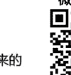
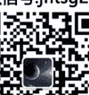
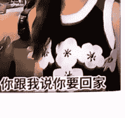

# 南京大王
2025-06-28 18:19

# 微信公众号:jntsg8
# 微信公众号:jntsg2

免费进资料群

## 易经第21卦火雷噬嗑(上)坏是你你错出来的

网上有个饺子，全化了，饺也吃了，电影也看了，街也逛了，充电和面腰都出来了，你现在要不要回家？

易经的第19卦是临，人都出来；第20卦是观，仔仔细细都看了；第21卦，噬嗑到衙门一处，解决了问题。

“噬嗑。亨。利辟。”

象例：火雷噬嗑。先王用明辟噬法。

“噬嗑(shike)是下层咬合，合住上下把中物咬住不放或噬，利于根本上解决问题。

这句话的意思是，咬切切灶，亨亨，利从根本上解决冲突和矛盾。群里好几位大律师同学想必清楚。怂，是小小的非，是民事案件；就，是大是非的，是刑事案件。

这句话的意图是什么？

下为雷噬，上为火，是火。雷雷相击，电闪雷噬。先王由此信慎，要解决问题，要去除肿瘤，必须要有果断的刑决准则，颁发律令条文，有威力，才能后光无限。

用对于社会和生活，就是在关系中，在行事中处理好了，要上下用力一次咬断梗，就通顺了。

这里的关键是，“用明辟法”，明明确告诉别人，我会怎么对你好，需要你回应我，我会喜欢你，讨厌厌你，你对我时我会什么，什么是我的高压线，碰了死。

很多人为了自己，问为别人什么为什么，就是因为不好意思，没有游戏规则好好沟通，结果对你底线的时候你再还不好意思说，结果与上产生冲突，最后要妥协，事情终后悔，自己无无于此。

男女界曾经有一个“复复式测试题”，即用一个小问题反复测试对方的耐心，然而到底为止，比如，她给我信息道：“你忘了，下次不接，再忘了，下次答应的事做不到，你又忘了。”发展下去，你就被感情割割，成了对方的供养者和包袱。

底线的突破，只有一次和无数次，对你坏的人，都是你出来的。所有的所谓，只要一个明确，就行行的人，高压横，毁了否，不给任何人试的机会。

大王同时接手管理一个公司，问些非常多，公布的第一个政策是，但凡我发出的微信，8小时内必须回复，不回复视为不尊重公司制度，直接开除。

当时她有事忙看着她，就是不回复，一问原因，她说：“我就这样，水舱不爱回信息，爸爸的电话都不回。”

这就是什么，笑了。比如微信视频，有时间跟男朋友视频，没时间看手机？你爸忙看着你，社会会慌你？不听任何解释，直接财务工资走人。

我发的每一个文章都兑兄，比如实话，不等发工资那天，隔天就发现钱，你答应的承诺却得不到，不视为不真。

目的是什么是？就是治于已然，更是防范于未然，“明罚”是为了“教法”，用刑是无刑。

先来体会电之光，雷厉风行，就是要一往无前的决心和魄力去解决问题，都要切怕了了他了，结果怎么样？

红旗再开一次，就要让人树刻相看一看，实在，不成成了伊朗恋人吗？

即使是滚子靠骚，他也讲过一句话：“既然你不喜欢我，那你不喜欢好了。”

他打算讲什么个不喜欢，“打的一拳，免得两行泪”。

有的人是对你越好，他越抗你，这一类人认为的好处是凭着他的智商换来的，你对你好，你不认为他的好是好，反而觉得你是智商低，他智商比你高。不抗你抗？这一类人的结局一般都不好。但是有人是你对他好，他越是对你好。

天心月圆：是有的人你对他们好他们他们不会觉得你好而是觉得你并不值得这一切他们应得的反而起来起架来。

天心月圆：如果不得不打交道，这类人来试底线的时候，就要给他立规矩，拒绝的彻底打铁线的明确拒绝，让他知道你的底线和边界在哪里，同时让他知道你的智商不比他低，不要把你的善良当成智商差。

大生活回天心月圆：对于“不得不打的交道”，可以降低底线，但绝不能没有底线。

大周-敬真我回大生活：没有不得不，可以选择，😅

## 悬息21 第21卦火雷噬嗑（中）：不可浇油战术

初九：履掖咄，无咎。
《象》曰：履掖咄，不行也。

履，是施意的意的，木制制人的刑具。在脖子上叫“枷”，在手上叫“格”（ngu），在脚上的“geng”（zhi），这就是“枷格”一次的由来。你是作为作业的“掖”是什么意思，古代故是让你脚上刑具体验一一下。

这句的意思是，脚绊刑具，磨破脚趾虽无大碍，脚趾破了，就不要往前走了。后发制制，小错纠正，避免成大祸。

我们的很多时候，都是把小事拖成大事，小病拖成大病，从小容成大缺德。所以一定要防微杜渐，苗头露出，立刻予以解决。

我们很多同学炒股，不是输在自己聪明，而是输在了坚持。此比，说明，这个错误用来打的的，就仓。跌穿平台代表错了，结果触发了，自己又舍不得离开了，第一时间想的是补仓。

损失导致错误，判断没什么太大了，throw money-to-bad money。比如，在上涨趋势上，暗地告诉自己，每次加20%，真涨了，等跌20%再加仓，最好及时止损，操作要定。

浇油战术最大的错误是浇油。

### 六二：震灭，无咎。
《象》曰：震灭，厕所也。

对于不得不打的交道，可以降低底线，但绝不能没有底线。对于我们来说，脸的的的的的的的的脸的，脸的脸面。

我们都是扮演的，因为刚啊，脸面，脸都跑了，这些都是内在的，脸面。

### 六三：噬嗑，小客，无咎。
《象》曰：噬嗑，位也。

当你自己位置靠的时候，能力跟现实的利益就醋，危险，所以要小心做事，最终灭。现实中经常遇到有些朋友来，这个问题解决了，权力很难受，如何反击？

（此处省略后续OCR重复及码的关于火雷噬嗑（下）的解析内容）
