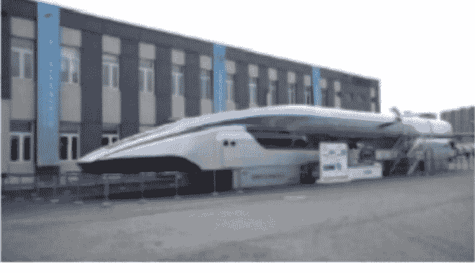

# 再论稳定币及问

20250714鉴茶财经院

南院大王：
在此之前，你需要先理解RWA，实资产代币化，即把一个资产切很多份，nRDA，数据资产代币化，数据确权可以来钱。

如果还未深入了解稳定币和这两个概念，隔离进阶课有详细的科普。稳定币一开始是牌照概念，随着深入会进入逐步实操阶段，看三个概念。

一种资产概念。继伏光RWA，充电桩RWA之后，比如协套，期新等，地产必然也会RWA，比如上海国资委学了稳定币，它的光大家宝，市北高新等平台，但请注意，地产很难把握，纯看图形筹码。

一种RDA概念，你的数据确权钱钱比如，这几天上海联的大宗商品数据，中远海科的航运数据，n一种是他们上游的服务/设备厂商，一开始是牌照概念，谁能发稳定币，然后就是销售概念，谁能把东西卖老外，

我们讲一定要有跨境支付概念的，如海联金汇，四方精创，最终会延伸到工具概念，谁有平台，谁有设备，谁有人马，如我们提到的恒生，金证股份，中科金财等，你有没发现他们都是蚂蚁系居多，

最后可能延伸到服务商，存储商，硬件，比如数据播，云擎智联，更后期的易华录等。叠加目前的牛市，我们认为券商IT+互联网金融or跨境支付+稳定币概念的，能走得更远的。

这篇，我们主要跟大家谈的是主力的思路，里面的一些公司仅为举例和学习，他们一定就是最好的，但逻辑是确定的，具体的同学们自行发掘把握。

还是那句话，不要追高，可等轮动，上峰要慢牛，人家把指数给你玩的炉火炼青，充分准备了就给你下去，冰点了就给你拉上来。

图为时速600公里高铁的测试照，北京到上海两个小时。

蓖麻喜洋：游戏巨人冰川调整阶段，还能继续看吧

叶枫：这技术换个颜色，三哥突说突破好几年了

叶枫：中国中车回来了？

智宇：同时具有券商IT+互联网金融or跨境支付+稳定币概念的有哪些，恒生电子算不算

发发花开：跨境通可以算吗

# 独门功夫：

大王，反内巷背景下，现在买光伏龙头ETF是不是好时机下行几年了，累计净值才0.42，感觉应该回升一大波吧！请大王指教

牛魔王：看看锂电

南院大王：阶段性机会会有，可较大调整买入有涨幅度卖做T

Singy 田：大王，华通这一轮的调整走完了么？

# 南院大王：村里要求，业绩增长50%

以上的，15日之前要发预报，早则今晚晓明则明天即可知道。他的《无尽冬日》全球手游收入5月就是第二了。

Singy 回复南院大王：谢大王

Jerry 回复南院大王：那就是可以买了

# 知识星球TOP

添加微信
免费入群

| 序号 | 公号/星球/社群 | 原价 | 领域 |
|---|---|---|---|
| 1 | 生财有术 | 2765/年 | 副业、财经 |
| 2 | 傲容恋吃虾 | 365/年 | 时政、历史 |
| 3 | 记忆斩/枫树币风 | 365/年 | 成长、财经 |
| 4 | 欧洲城堡 | 328/年 | 时政、历史 |
| 5 | 卢克文壬会 | 699/年 | 时政、社会 |
| 6 | 体制内主术 | 599/年 | 体制：职场 |
| 7 | 局外的视野 | 669/年 | 金融、时政 |
| 8 | 激源浅 | 4166/年 | 财富、成长 |
| 9 | 守夜忍司令 | 599/年 | 时政、经济 |
| 10 | 江子扣 | 365/年 | 时政、财经 |
| 11 | 政堂/颖明 | 568/年 | 财富、经济 |
| 12 | 唐书院 | 1399/年 | 金融、财富 |
| 13 | 大树粉谈 | 199/年 | 时政、成长 |
| 14 | 水座聚粒 | 10000 | 房产、经济 |
| 15 | 汹洒的宏观望 | 4376/年 | 经济、财经 |
| 16 | 金政通鉴/北方南海 | 4576/年 | 股票、听行 |
| 17 | 谐带的积累 | 299/年 | 时政、社会 |
| 18 | 飞沫王 | 3600/年 | 经济、财经 |
| 19 | 米联镜见闻 | 599/年 | 经济、金融 |
| 20 | 荣茶茶财经 | 330/年 | 房产、股票 |
| 21 | 盈在八小时之外 | 365/年 | 成长、职场 |

...... 更多资源，不再列出

+   +书籍、报告、课程等各类美高价值资源

+   ★ 免费群 每日份资源
★ VIP群 每日分享所有资源（日均20+），75/
