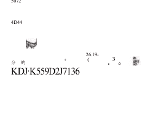

# 南弦大王

20250714 15.51

微信公众号:jtsg8
微信公众号:jtsg2

密切关注高低切的趋势

- 1、先以海外算实力的例为例，重温一下知识，算力硬件的几个领域：PCB、电源、光模块、液冷、铜连接、交换机等。
英伟达的PCB高低切，现在带头的是后排的铜盾、深南等。
PCB大的进入后期阶段，鱼尾行情，主要风向看整合。
光模块依然在前排继续延续高度，中际旭创还在涨，因此太辰光的亮点依然在后排。
整个算力板块内，有向低位的趋势，电源/液冷的趋势，虽非非常明显，但典型是前波布局，现在的吸回和运行。
这里仍然看市盈、低市率和高端业绩的更快。
内部密切的不是特别显的，是PCB和光模块的业绩太好了，近期经历的消息，老东山药信医药后，今年总净利20亿。

- 2、创新药在往后排，后排的是没怎么涨的BD预期和CRO企业，关于它的观点我们是一致的，行情未完，不会的涨ETF。

- 3、金矿持续低位的，我们暂且定位保险，它买了一票别人，又怎么能把自己掉下去？
这几天，百亿级的证券基金，就是专门入市炒股的，在不断备案。

- 4、反优集团本身，也是高低低的一个巨，因为市值大所以不流畅。
其他板块一列一列，都是排高度后后排跟，风向不侧就撤线，ETF更稳。
整个环境，不要等待，等待轮转，以牛市的眼光来看这一轮。
实在精准，讲过过多的，有缘的机会买保险，保险。

# 48.72

今天 2023-07-15 14:15:56 星期六

北京 25℃/31℃ 阴转多云 2km
上海 26℃/32℃ 阴转多云 2km
深圳 25℃/31℃ 阴转多云 1km
广州 25℃/33℃ 多云 1km

| 指标 | 数 |
| :--- | :--- |
| 昨日收盘价 | 0 |
| 今日涨跌价 | 0 |
| 涨跌幅 | 0.00% |
| 成交量 | 0 |
| 成交额 | 0万 |
| 最高价 | 0 |
| 最低价 | 0 |
| 开盘价 | 0 |
| 换手率 | 0% |

5972
6100
5264

1689 26-19 950

# 小李:

2025-07-14 15:56
五城: 还是去买平台底保险吧

2025-07-14 16:03
赛哥: 还是高前跟跌到平台底保险，今天收手调仓份额

2025-07-14 16:15
Jerry: 保险也不错，绿鱼的时候加仓

2025-07-14 16:35
山野夫: 买保险，保险!

2025-07-14 23:33
JIU: 那么多买保险…看风来涨牛真不容易

2025-07-15 08:05
孤岛走巷: 买保险就是买**

2025-07-15 08:25
Jerry: 我持有中国安，不过亏损比例较高，只能继续加仓吃股，留给退休

2025-07-15 08:26
洛储: 我险ETF一个

2025-07-15 09:08
南太王: 大的就不要

2025-07-15 09:28
新华: 看来跟上

# 知识星球
添加微信: jtsg2
付费资源群

| 序号 | 公号/星球 | 原价 | 领域 |
| :--- | :--- | :--- | :--- |
| 1 | 生业有木 | 275/年 | 副业、搞钱 |
| 2 | 庞容众 | 365/年 | 时政、历史 |
| 3 | 凯西树 | 365/年 | 成长、搞钱 |
| 4 | 欧洲靴 | 328/年 | 时政、历史 |
| 5 | 卢克文青 | 699/年 | 时政、社会 |
| 6 | 体内主任 | 599/年 | 体制、职场 |
| 7 | 外人的视界 | 669/年 | 金融、时政 |
| 8 | 濑泽异谈 | 4166/年 | 财富、成长 |
| 9 | 守夜人总 | 599/年 | 时政、经济 |
| 10 | 江宁知府 | 365/篇 | 时政、国际 |
| 11 | 政堂顾子明 | 568/年 | 时政、经济 |
| 12 | 唐书院 | 1399/篇 | 金融、财富 |
| 13 | 大树乡谈 | 199/年 | 时政、成长 |
| 14 | 水库欧大 | 10000 | 房产、经济 |
| 15 | 洪灏的宏观策略 | 4376/年 | 经济、搞钱 |
| 16 | 金政通鉴/北海道山 | 4576/年 | 股票、行研 |
| 17 | 猫留的世界 | 299/年 | 时政、社会 |
| 18 | 飞浅 | 3600/年 | 股市、经济 |
| 19 | 米联储见闻 | 599/年 | 经济、金融 |
| 20 | 鉴茶财经院 | 330/年 | 房产、股票 |
| 21 | 赢在八小时之外 | 365/年 | 成长、职场 |

+ 图书、报告、课程等各类高价值资源

-   * ★ 免费群 每日分享份资源
-   * ★ VIP群 每日分享所有资源（日均20+），75/年

# TOP级资源 TOP精英社群
