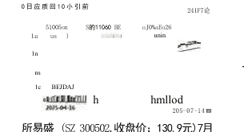

# 转疆
2025-07-15 08:14

请教大王，固态电池是否是未来几年的最重要的发展方向，在实际使用中，能否很快并将替换为固态电池？先感谢大王，期待感谢🙏🙏

微:jntsg8

微信号:jntsg2

免费进资料群
南院大王：对，产业化要2027年。目前的相对主流的路线是硫化物。火星情报局回复南院大王：大王您好，请问固态电池未来2-3年可否就一直看着宁德时代吗？感谢

固态板块现在高了，看要看调整20-30，看主要是设备。

2025-07-15:09:08

火星情报局回复南院大王：
南院大王回复火星情报局：它涨幅和弹性可能没有设备大，但产业是龙头无疑，现在20倍PE是不贵的

2025-07-15:09:27

春眠不觉晓回复火星情报局：那么乐观，现在在固态循环寿命，也就100多次，整体还在实验室阶段

2025-07-15:09:56

转疆回复南院大王：感谢大王🙏🙏

2025-07-15:10:57

# 南凡大王
2025-07-15 09:27

光模块的业绩以及产业进程

新易盛净利润增长3倍，同时由于此同类，整个CPO板块都会很不错。

从我们重读易中天，他们整整了一个多月，后面要说到“但是”。

但是1.新易盛业绩爆发的原因，是旭创的产能不够，全行业都面临产能不够的问题。

但是2.目前几乎所有CPO的业绩主要是800G产品支撑的，全新黄300芯片，用到1.6T的，到现在还没有放量。微信Free202577

服务器端，光模块与GPU配是1:3，如英伟达，黄300，是1:9。

但是3.后面还有3.2T的。

现在要谈的是产业逻辑，至于技术面的，可以再看的，没有的，等待整合或者看文档详解。

新易盛：2023年上半年净利润为3.74亿元，同比增长36.7%，85.47%

Meta Platform (META, OCH)扎尔克：计划投入千亿用于基础设施建设，好，非常好。

最后确认：2025-07-15 15:15:32

# 17217:1:3和1:9，光模块是1吗？
2025-07-15 09:28

南凡大王回复17217：你可以理解为英伟达光模块总量是普通的3的倍
2025-07-15 09:29

涨停回复南凡大王：所以模块和GPU是3:19:1的关系，文章里写了
2025-07-15 11:43

Tiger Li: 请教主：鸿利科技是否可以应用于服务器产业下游。谢谢！
2025-07-15 09:038

2025-07-15:09:38

SONG 回南凡大王：明了，谢大王！
2025-07-15 12:35

SONG: 大王，博恒的缓解对股份会造成大会的影响吗？
2025-07-15 10:30

南凡大王 回SONG：走势还没告诉你结果吗
2025-07-15 11:48

Jerry 回南凡大王：今天没涨跑潮
2025-07-15:16:41

梅超~：谢大王前天进去买太光！今天出半
2025-07-15:11:06

虎：大王经常在想念的时候，给我们拉一大的，今天八八大金刚开始变瘦了
2025-07-15:11:21

姐爸：光优还有机会吗大王？谢谢
2025-07-15:11:36

南凡大王回复姐爸：反内卷才哪里
2025-07-15:11:48

范傲：向中国出售H20 芯片。润泽算力终于反弹了
2025-07-15:11:52

南凡大王 回范傲：海外算力会高低切到国产，订单启动好几天了
2025-07-15:11:55

Brain：大王，为什么钢铁镍钨材相对而言走得这么的？
2025-07-15:13:58

南凡大王 回Brain：行业不够稳靠，环科达之类都是1倍起，它70%，机会也有，底部不断抬高。
2025-07-15:15:28

Jerry：那就是新易还有机会可以再入？
2025-07-15:16:43

# 知识星球TOP

添加微信 付费资源分享群免费入群

微信:jntsg2

| 序号 | 公号/星球/社群 | 原价 | 领域 |
| --- | --- | --- | --- |
| 1 | 生有木 | 2765/年 | 搞钱 |
| 2 | 怂众从吃群众群 | 365/年 | 时政，历史 |
| 3 | 记忆载/雯西 | 365/年 | 成长，搞钱 |
| 4 | 欧洲金 | 328/年 | 时政，历史 |
| 5 | 卢克文会 | 699/年 | 时政，社会 |
| 6 | 体制内主任 | 599/年 | 体制，职场 |
| 7 | 外局人的视角 | 669/年 | 金融，时政 |
| 8 | 译异谈 | 4166/年 | 财富，成长 |
| 9 | 守人总司令 | 599/年 | 时政，经济 |
| 10 | 江宁知府 | 365/篇 | 时政，国际 |
| 11 | 政堂/顾子明 | 568/年 | 时政，经济 |
| 12 | 唐书院 | 1399/篇 | 金融，财富 |
| 13 | 大树乡谈 | 199/年 | 时政，成长 |
| 14 | 水库欧大 | 10000 | 房产，经济 |
| 15 | 洪灏的宏观策略 | 4376/年 | 经济，搞钱 |
| 16 | 金政通鉴/北海道山 | 4576/年 | 股票，行研 |
| 17 | 猫留的世界 | 299/年 | 时政，社会 |
| 18 | 飞浅 | 3600/年 | 股市，经济 |
| 19 | 米联视间 | 599/年 | 经济，金融 |
| 20 | 鉴茶财经院 | 330/年 | 房产，股票 |
| 21 | 赢在八小时之外 | 365/年 | 成长，职场 |
| ... | ... | ... | 更多资源，不再列举 |
