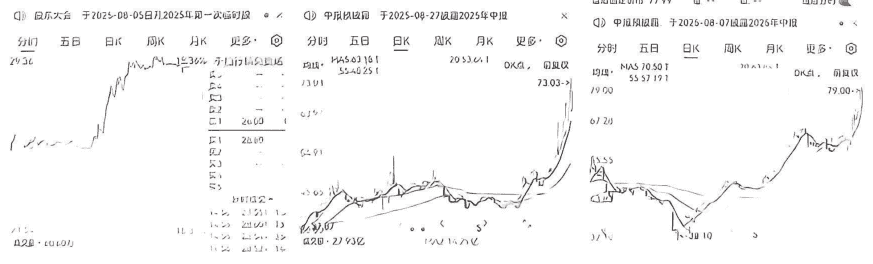

# 校长
2023-07-21 20:20

大王 怎么看锐水电站的概念？周末一直在发酵……

局属大王：概念普通一事后，你能够买进去的基本都是抗性的。
2023-07-21 00:45

叶枫 回南大王：可以打明响（布局死谱，冲），长期的可以看下了。
2023-07-21 08:01

南大王 回叶枫：看点刚期的应该是精细化的，有民用行业，而且自然脆弱，反向差，但现在如果结果就开始谈性价比比较了，水电就不怎么看抗性的，刚性的。
2023-07-21 08:25

牛王 回南大王：大王，水电就是电厂吗？还有哪个操心的？
2023-07-21 08:25

限大王 回叶枫：电能特性的确定是不看宣传的，而是那些材料可控腐蚀来说，还有第二波，你看准20日线55日或者55日，已经经历55日了。
2023-07-21 09:13

牛王 回南大王：谢谢你！
2023-07-21 09:26

叶枫 回南大王：我是东方的，挺好的啊，还有两个水电机龙头。
2023-07-21 11:52

Jerry 回南大王：可控腐蚀变都有哪些材料？
2023-07-21 15:33

success 回叶枫：北方就是大今天。
2023-07-21 16:28

Jerry：我反对保涨长江电我不管，周五红红加了个。
2023-07-21 08:34

# 汇聚全高价值资源
打造TOP级分群社群

文章、课程、业职、职场、政经、行业、影音、软件

微信公众号 jntsg2，免费进资料群

# 100亿大作战

雅江集团与红江河工程

著名专家万里是反对三峡坝的，其子黄巍回国说：“父灵遗终前在病床上修改《长江三峡决不可高昂》的万言书，反对三峡坝，不是为了保守的，而是为了三峡坝保守，得不失损失。真要修大坝，可在雅鲁藏江上游修建坝坝，通过隧廊将水引至青海青木沃，再沿西廊输淮北。”

按照他的计算，每年可调600亿立方，相当于12条黄河的水量。雅江径流量1564亿立方，是黄河的3倍多。并且在坝处的天然落差达2350米，更可以引水上北。

1987年，万里在《红旗》中提到：“若在此筑，发电量可覆盖半个中国，更可引水上北，绿化北之。”

后来，国内就规划过一个规模大天大的红江河工程，把黄河的水直接接到西北干旱地区。红江河工程太大，但红江还是启动了“第199号工程”。

对印度扩散一方面，这里的道理是因为反内者，那些围钢铁水泥玻璃的结构复杂很多地方消化不了。

上一个版本，上面画了三个改模，给地球带来了滋源，这一版上，上面横着雅江给你们做订单……

# 微信公众号jnts2，免费进资料群

# 王多肉·谢大工程：超级大工程

无双小医：大王，最近有没有过书计划，想听书了📚
2025-07-21 07:08

CMG：保守派认为是激进派太保守。
2025-07-21 08:53

Mr.GOLD：红雀躺下来二十万。
2025-07-21 08:53

Mr.GOLD：新疆的沙漠怎么出超级粮。
2025-07-21 06:54

有信：来几个彩蛋。
2025-07-21 13:37

赛璐：大王，新大坝有功能吗？

加微信号jnts2，免费进资料群

# 知识星球 付费分享群
添加微信

| 序号 | 公号/星球/社群 | 原价 | 领域 |
|---|---|---|---|
| 1 | 生财有术 | 265/年 | 跨业，搞钱 |
| 2 | 宏咕群 | 365/年 | 历史 |
| 3 | 记忆承载/树西风 | 365/年 | 成长，搞钱 |
| 4 | 欧洲金龙 | 328/年 | 时政，社会 |
| 5 | 卢克文云会 | 699/年 | 时政，社会 |
| 6 | 体制内行 | 599/年 | 体制，职场 |
| 7 | 外人的视界 | 666/年 | 金融，时政 |
| 8 | 濑泽异迁 | 416/年 | 财富，成长 |
| 9 | 夜守人总 | 599/年 | 时政，国际 |
| 10 | 江宁知府 | 365/年 | 时政，经济 |
| 11 | 政堂/顾子明 | 568/年 | 时政，经济 |
| 12 | 唐书院 | 399/年 | 金融，财富 |
| 13 | 大树许多读 | 199/年 | 时政，成长 |
| 14 | 水库大师 | 1000/年 | 房产 |
| 15 | 洪澜的宏观策略 | 4376/年 | 经济，搞钱 |
| 16 | 金政通/海南 | 4576/年 | 股票，行研 |
| 17 | 谐哥的界 | 299/年 | 时政，社会 |
| 18 | 飞莱涨 | 600/年 | 股市，经济 |
| 19 | 联咏锦间 | 599/年 | 经济，金融 |
| 20 | 鉴茶丰时经 | 330/年 | 房产，股票 |
| 21 | 赢在小时之外 | 365/年 | 成长，职场 |

更多资源，不再列举
+图书、报告、课程等各类价值资源

★ 免费群 每日分享资源
★ VIP群 每日分享所有资源（日均20+），75/年

# TOP资源

# 征途

大王，华的机器人你怎么看？会不会是来者呢？它的定位是做机器人还是类似于聚力斯合作的模式机器人？华的机器人相关的债看。

南京大王：减速器，市场上一共几家，都是最好几家供应商，华为主打的是实体机器人，特斯拉才是。

微信：@etishu 这在几年前觉得很正常。

郭绍子：Optimus的还是今天在上面看到最好的东西。

牛王 回复 南京大王：灵巧斯特大王你怎么看？今天还没睡就睡了。
陈凯之 回复 牛王：很脆，它是锂电池的，硬去固概念可以，机器人有点开玩笑。
牛王 回复 陈凯之：谢谢大王回复。看到一些咨询说是宇极科技的核心优势灵巧。
大王 回复 牛王：确实刚了，跟宇树有战略配合，这几天的还是一个好伙伴的，就不给你看了。
牛王 回复 大王：谢谢！还有有些惊喜了。
牛王 回复 南京大王：大王，刚刚找了资讯公告，他们跟宇极是去年的，你说这几天是哪方面合作？还是提升了个方面的合作。

# 微信群jts2，免费进资料群

# 回归-大主 后开始表现

“牛市的特点，是每个板块都能轮动，正确的做法是靠裸产业逻辑后适当回调伏金资金圈胆念后——如果你前面头部空了的话。”

PCB和光模块的前期，基础要回调，后排是谁，二线厂商，以及电子子，光芯片。前万专门有文章拆解了他们，下午回调和电子子的暴走就是这波踏空资金着急入市的。前文《英达研究》之前的产业高低方面，行业链接的趋势依然在加强，代表多次过的通达，则五个扣hasoc的同学不用焦虑，我之前问过瑞士，回答是，业绩在。吸，优势和逻辑够了。今天告诉我我想做半导体，刚回调赛器说是，最近多用带号几次预期说了，隔垒技术术回调了，拿稳了吗。

| 付费 | 折后 | 折后 | 折后 | 折后 | 折后 | 折后 | 折后 | |
|---|---|---|---|---|---|---|---|
| 29.36 | | 29.16 | | 15.48 | | 20.53.67 | 445.78 | 20.63.01 |

# 微信公众号jtsg，免费领取资料
