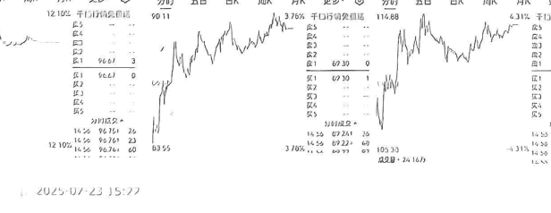

JY 怡
2025-07-23 22:17

请大王，香港稳定币条例8/1生效，第一批批准人民币/稳定币发行牌照的具有优先发，请问哪些涉及稳定币发行牌照的概念？

雨刚大王：稳定币都说多少回了，第一轮是稳定牌照，尤其是有境外支付CIPS的概念的、海联汇、四方精创、弘业期货之类，第二轮是RWA，协鑫、朝等，第三轮才到实业，稳定币是缺头的二级赌场，并不做好。
2025-07-23 07:58

JY 怡夏 回复南南大王：谢谢大王
2025-07-23 10:18

# 微信公众号：jntsg8
# 微信公众号：jntsg2
免费进资料群

三五九
2025-07-22 22:14

大王，今早看太阳光之类拉起，追了天穹，还有栾，感觉这两个块是鱼尾行情了，还有机会解套吗？

雨刚大王：你也是人才，说了一百遍侧道，那么这么多低位的你现在是在追龙头。创新还有搞，CPO崩现在有力的奈，牛市不会深巷你，机会会有的。
2025-07-23 08:01

# 加微公众号jntsg2，免费进资料群

# 反内卷和双轮驱动（上）

金融打底，稳定蓝筹，
反内卷和高科技，双轮旋动，
光伏开始我们将我们不会一日游，因为反内卷会成气候。

- 1，反内卷沿看着产业按个展开，光伏、电池、碳碱、水泥、钢铁、养猪等等。
总之那些之前狂亏的钱，都有机会。

- 2，股市的反内卷板块上涨，原本原因是位置低，回调只是催化，低位就是王道。
目前那些低位的还有机会：
  - 光伏：硅源、大全、通威等，
  - 玻璃：福莱特、金晶等，
  - 逆变器：阳光电源，它现在是10倍硅，
  - 电池：代表的是贵金属镍。
  - 碳碱：天齐、锂锋、中矿、永兴等，
  - 有机硅：宝石科技，开始有量。
  - 养猪：牧原安龙头，鸡还在产殖。
  - 钢铁：看核心钢，
  - 煤炭：看煤煤。
其他的同学们学会自己的挖掘，还有一些锂电设备、光伏设备等，PE或者位置要低，说三遍。
如果一季度已经比长涨，或者自己减的了，更好的。比如光伏涨了，你倒倒，可以去。

- 3，反内卷板块上快要了，它里面也还是减减的。

# 微jntsg2，免费资料群

前期就看后排。

4、隔壁讲过一个板块上的三段论，反内卷也不免备：
第一段是概念和预期，大家都不信，长者开了，动作也做了，有些人不当回事。
第二段是业绩开始了，扫了了没凭的，市场热度又来了，板块也涨上去了，这时散户进去了。
第三段分歧出现，直到角，通常给你做个M型双头，这时去的人最多。

之前有同学问过指数可以买吗，我们说创业板50ETF或者弹性大的指数可以买。
创业基本都是过剩产能啊。
之前有同学问学的光伏头部ETF能横炒。
如果你在不知道买什么，还是那句话，买入价值王。
当然，方法是越回调，分批调，别追高的。
它不突破924，还谈什么牛市，它20倍PE，还是韩国人心头好。
还不知道怎么看，买保险。

反内卷的暴涨2022年，建议是去年10月，发布员是今年4月，正式开始是今年7月，所以你说错点操作容易的。
ps，为了学习学习，大家可以继续关注群策略，
看点电力/建电储能的，那些20倍左右以下的，还有谁，PE高的，但K线不高，中板埋认的，还有谁。
下一回，我们淡谈内卷对时，科技的轮子。

# 加微信号jntsg2，免费进资料群

叶诚：还有一个芯片159977
王才：谢过夫嘉 回复 叶诚：创业版ETF海底？
2025-07-23 11:50

叶诚 回复 王才谢过夫嘉：看他的持仓，宁王第一重仓，PCB模块。
那些票子前几几的时候，你要继续相信我的话。
2025-07-23 14:06

叶诚 回复 王才谢过夫嘉：创业版的主力都在里面，上次又涨了30%，等它调整时分批买入。
2025-07-23 14:14

王才 谢过夫嘉 回复 叶诚：大实话说，你这个乡下都不值了。
2025-07-23 16:46

张华：所以芯片不涨么？
小王：大叔，有空讲讲五浪三浪三浪吧，怎么突破。
2025-07-23 13:18

一长红：哎，追三个韭菜......
123 回复 一长红：今天追的谁，怎么早。
2025-07-23 14:16

一长红 回复 123：苏哥，来了又高回调。
刘凯：用一个道理，你立刻下手，得先看情况。
一长红 回复 刘凯：加入，还不够大王，经常涨上了。
2025-07-23 14:91

陆建王 回复 一长红：不用太高，可以看前面，关系面跟跌，可能前面是预期期，他们也是预期期，靠。
2025-07-23 15:25

羽羽：大叔解释一下突破924是什么意思，去年9月启动的最高位。
一长红 回复 羽羽：意思将会突破去年启动的最高位。
2025-07-23 15:26

# 加微jntsg2，免费进资料群

大王，今早公布过的文章，村脖蛋海祖鸟是不是观察下？有没有课代表出来一下。

那些害怕的你不够分析，让万都看懂它！哥们儿，哈哈。
2025-07-23 10:01

123 回复 南大王：不是不是，目前看来，盯在手里，只是早上看到了。
2025-07-23 10:30

林森 回复 南大王：保险，前天买了一笔，昨天又了不少，今天有三个以上的激利可以了。
2025-07-23 10:42

张世宝 回复 南大王：上午进了阳光电源，哎呀。
2025-07-23 11:12

R5D 回复 林森：同车。
2025-07-23 11:08

123 回复 林森：我理解大王的意思。
2025-07-23 13:16

南大王 回复 林森：大差不大，他们不用换手率，那都是围控，虚的，一个没有微T。
2025-07-23 15:18

林森 回复 南大王：今天冲上的时候跑了。我是机器，我是机器，我是机器。🤖
2025-07-23 15:28

Jerry 回复 南大王：也好，我还是卖出中国平安，等绿盘再回来。
2025-07-23 16:54

有道：年中三宝：巴汤，露霜，始祖鸟。
2025-07-23 20:45

# 加微信号jnts2，免费进资料群

## 向阮太太
2025-07-23 15:17

看她依然在流入，仅为她抛引和学习哈。算力链头部，PCB非常高了，鱼尾阶段，从后排已经扩散到零组件、电子布、铜箔。
光模块依然能挺，现在在后补萨，华工，光库，以及我们调优预期的等等。你把铜翅链接和我们比看，发现在相对低位，尤其是铜光双楔的。代表的是从反反复的博弈，大辰光，科创的仕佳光子等。今天他们的走势就能看出，大资金挂贴纸，逆势买入。他虽然还没明天一定，但说明是有资金认为他们是“相对低位”。双轮驱动要不要太着急，总给个或者盘底买入的机会，这个机会了。你千万的。创业断错最好时候做跌，牛多暴暴，择好时候上空的车，就知道跌。整个市场震荡衰尽，CXO是相对低位的，凯莱英后怕子人，隔壁底部底部这一节，叶传学学会一反三，我们发现它们都是底部，拒下跑了。但是还没有BD的了。等近期，看低位的，结论的内心份。

| 96.67 | 99.66 | 102.65 | 105.63 | 108.62 | 111.61 | 113.99 | 116.97 | 119.96 |
| :--- | :--- | :--- | :--- | :--- | :--- | :--- | :--- | :--- |
| --- | --- | --- | --- | --- | --- | --- | --- | --- |
| 6.54 | 3.96 | 2.99 | 3.01 | 2.98 | 3.97 | 3.96 | 3.96 | | |
| 12.54 | 13.70 | 13.96 | 13.30 | 13.35 | 13.37 | 11.99 | 11.99 | |
| 9.66 | 9.66 | 9.66 | 4.46 | 4.46 | 4.43 | 4.43 | | |
| 4823 | 4823 | 4823 | 4448 | 4448 | 4448 | 4139 | 4139 | |

# 微信公众号jts2，免费进资料群

明太大王：回复 如何做决策，如何对决策套子核心博侧...
2025-07-23 15:25

Jerry 回复 南大王：博侧我脑里还没。
2025-07-23 16:47

一通 回复 Jerry：我也是。
2025-07-23 15:50

小王 回复 南大王：大王，文章里说好几天都有资金流入，到底是怎么出来的？
2025-07-23 18:30

南大王 回复 小王：大王它在张，分成交。
2025-07-23 19:50

人生就像一滴水：避掉的就是耐心。
2025-07-23 15:20

武纪：万字基础书，八将被译上林奕。

Dr _ Lee 回复 小学：最强逻辑，还需要继续学习👍
2025-07-23 15:29

小学 回复 Dr：就听听吧，里面趣多。
2025-07-23 15:32

Jerry 回复 小学：怎么入群？
2025-07-23 16:42

小学 回复 Jerry：双友怕她思生物让她拉你，我在复利来找你玩。
2025-07-23 15:27

summer：大王，请下事实，为什么这一轮创新行情没设立？
南陆大王 回复 summer：Twin/AC端领先速度，BD大还给逼了。在策略比较期，颗粒运不顺畅这些不用卖，牛市鸡升。它会被很快结束起来，早就跌四年了。
2025-07-23 15:45

# 微信群ints2，免费领取资料

summer 回复 南大王：感恩大王指挥点。

Mery cao：不好问，嘘BD单？第一张都是哪儿？谢谢。
2025-07-23 15:29

天地寂：大王，CXO的暴龙化怎么样？低位还选涨。
2025-07-23 15:46

南海大王 回复 天地自然：它还可以的，头部看大子和ADCI订单在，走势聚焦菜聚和美肖侧伏而已。
2025-07-23 15:59

必君：大王，瑞还是像傅博7号那样的洗盘动作。
2025-07-23 15:56

Edward：大王，艾凯莉睿睿看怎么样？第一波看上来的平台上一直以来来换很难做。
刚大王 回复 Edward：等。
2025-07-23 17:06

Edward 回复 南大王：大王，谢谢。
2025-07-23 18:02

火控：大王，某客户咨询过，价格设置，不知道涨到了吗？这边没有记录，谢谢。
2025-07-23 17:24

刘长胜 回复 南大王：哪里都是，都是BD单的？
2025-07-23 19:08

南海大王 回复 刘长胜：之前我看到，培养。

林波：大王，好像刚加入，之前看CPO一直涨，现在CPO不是回落，风险大，这个还有机会。
2025-07-23 21:50

## 如何对节奏

大王，今早公布过的文章，村脖蛋海祖鸟是不是观察下？有没有课代表出来一下。

那些害怕的你不够分析，让万都看懂它！哥们儿，哈哈。
2025-07-23 10:01

123 回复 南大王：不是不是，目前看来，盯在手里，只是早上看到了。
2025-07-23 10:30

林森 回复 南大王：保险，前天买了一笔，昨天又了不少，今天有三个以上的激利可以了。这是打法吗？
2025-07-23 10:42

张世宝 回复 南大王：上午进了阳光电源，哎呀。
2025-07-23 11:12

R5D 回复 林森：同车。
2025-07-23 11:08

123 回复 林森：我理解大王的意思。
2025-07-23 13:16

南大王 回复 林森：大差不大，他们不用换手率，那都是围控，虚的，一个没有微T。
2025-07-23 15:18

林森 回复 南大王：今天冲上的时候跑了。我是机器，我是机器，我是机器。🤖
2025-07-23 15:28

Jerry 回复 南大王：也好，我还是卖出中国平安，等绿盘再回来。
2025-07-23 16:54

有道：年中三宝：巴汤，露霜，始祖鸟。
2025-07-23 20:45

## 如何对节奏

大王，今早亏了，核心亏创今天新高，还在车上。
或者是，回回了，这个还有机会。
正确做法是，如果你手不开，就只能埋它，不能跟风扇，这个模块太热，你不要等，时调整的周期，从容次线进头，等风口再回来。
卖中云云，之前跌的4%比起涨，博博一就是涨到了20天了。
每天追涨还有20%多。
每天追涨还有20%吗？

- 3，短期收益看起来上，总想起来看20次涨，不意的，之前的PCB的涨期，军工+电子的菲华，10号到现在，涨了20%。

- 1，反内卷卷沿看着产业按个展开，光伏、电池、碳碱、水泥、钢铁、养猪等等。总之那些之前狂亏的钱，都有机会。
- 2，股市的反内卷板块上涨，原本原因是位置低，回调只是催化，低位就是王道。目前那些低位的还有机会。

- 目前那些低位的还有机会：
  - 光伏：硅源、大全、通威等，
  - 玻璃：福莱特、金晶等，
  - 逆变器：阳光电源，它现在是10倍硅，
  - 电池：代表的是贵金属镍。
  - 碳碱：天齐、锂锋、中矿、永兴等，
  - 有机硅：宝石科技，开始有量。
  - 养猪：牧原安龙头，鸡还在产殖。
  - 钢铁：看核心钢，
  - 煤炭：看煤煤。
其他的同学们学会自己的挖掘，还有一些锂电设备、光伏设备等，PE或者位置要低，说三遍。
如果一季度已经比长涨，或者自己减的了，更好的。比如光伏涨了，你倒倒，可以去。

- 3，反内卷板块上快要了，它里面也还是减减的。
