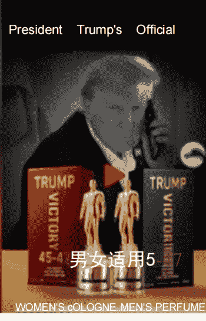

# 基本盘和管理底子

今天来谈个底层规则系列的。

前几天同学问关于“权力”的问题，今天也有人新做了领导不知怎么下手，很多同学都是管理岗位，以后迟早当大领导，将将来可以高薪跳槽去新的平台。

你要考虑一个问题，你为什么说话不好使？你的为何执行力不强？你如何拿到最大利益？

书上告诉你你什么是制度建设，什么规章，培训，激励，谈判技巧。

不是的。

一、本质上，你要有自己的政治底盘和基本盘。

陈胜吴广为什么失败了，他们没有自己的基本盘和干部底盘。

陈胜项楚去进攻河北，项楚自己当了赵；刘邦所去进攻河南，他自己私自自立了一个魏王。项楚狂怒，但没有办法，关键时刻没救人，自己也被车夫杀了。

刘项羽为了什么成了？刘邦有薛子弟，什么萧何、樊将，刘羽有8000子兵弟。韩信是军事天才也是政治家，他为刘邦赢得一个沛王，三次刘邦单枪入韩军统领了韩军。韩信手下几个大将，曹参、霍疑、周勃，都是老兵老类，关键时候不站韩信。

二、什么叫自己人？

你在他那里有规则豁免，你可以通过或者加速流程，靠打招呼就能让他们加班，赶赶进度，突破各种限制。

他们跟你有情感优先，同等物质或者稍高条件，面对冲突和矛盾，他们站你这边。

双方有政治互信，他们可以把基层有关的信息给你报告，屏蔽，说真话，你可以在一些事情上跟他们交，安排额外利益等。

绕开OA和ERP，你发微信就能办事，跟着你跳槽去不去执行的，就是你的班底。

## 三、班底从哪里？

你看着三国，曹操，拉出亲戚、袁侯、宗族、夏侯、司马懿、家人、朋友、同学、旧部，全是人马。

陈胜吴广出生太低了，没什么势力基础，叫做政治底层。

但很多人都是寒门，班底从哪里？

同学、亲戚、校友、旧部、老乡，等等。

七姓八姨家表弟，多年未见，从小听话，用。

三流大学的财务本科，但跟你是同事，挖过来，用。

做过你五年经理下，失业在家能力一般，用。

老乡会会长介绍的小老弟，给你叫了三年哥，用。

用到哪里？

能力强的，可独当一面的，去当部门经理，去做财务总监，去当地方公司总。

能力弱的，去当副总，去做副经理，去管人事，去搞企业文化，当好后军。

在这个过程中不断淘汰筛选，人才出来的。

到最后在你公司，在你部门里，

你自己自招的管培生，招的新人，培养出来，是一接；

你自己的七姑八姨，同乡旧部亲信，是一接；

你外头高薪的职业经理人和大拿，是一接。

你说陈胜吴广再寒门，有自己人吗？

## 四、你要干大事，要出大业绩，

你说好，压也好，他们愿意，被动也好，总之同意了，能干，愿干。

在中国要做大事，你得自己的人马，

有了人马，你才能做大事，把决心和意志落实下去，

比如说，你要把指数拉上去，足球和股市治理好，

比如说，你要消灭过剩产能，搞一轮供给侧改革。

免费进资料群
底层代码与游戏潜规则

Will,Jonny涛、橡楔、吴文峰、一P、静静如海、阿尔西班牙的神、大林、yxt、钰涵等29人觉得很赞

雨哦，是吗咩：无形的根据地
2025-07-02:02:18:48

杨决：想起荣昌高书记
2025-07-02:02:18:50

空聚客：准不成体真的要变成2+1个人了😅🙈🤭
2025-07-02:02:18:52

天心月圆：大王写的太好了，这几年在星球学习，进步很大，这是十年大运的收获之一——
2025-07-02:02:18:54

南汐大王回复空聚客：你要消除过剩产能，这是要割刀见血的，端人饭碗的，没执行力怎么样
2025-07-02:02:18:55
