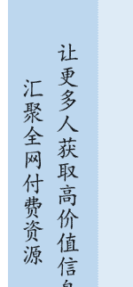

# 易21火雷噬(下):打硬仗及问答
20250705鉴茶经财经

南院大王：易21火雷噬(下):打硬仗

九四。噬干肺，得金爻。利艮贞，吉。
象曰：利艮贞吉，未光也。
干肺：这里指带骨头的干肉。金爻：指金属箭头。
嚼吃骨头，发现骨头中有金属箭头。在艰难中坚守正道，结果是吉利的。
害怕困难和追涨杀跌是人的本性，碰到的困难我们总是喜欢绕着走，或者躲避问题不愿意去直面。
但有成就者，必须经过“噬干肺”，去亲手处理棘手问题，去啃硬骨头，最终用牙齿创造了射在猎物骨头中的箭头，发现了事物本质。
伟大都是磨炼出来的，不打硬仗和不解核心问题，人是没有办法成长和成熟的。
打硬仗，才能当上铁军。

知识星球TOP资源分享社群
付费文章 | 付费社群
付费课程 | 副业&搞钱
财经&股市 | 行业报告

添加微信 免费进群
让更多人获取高价值信息
聚泉全网资讯

就像你高三，汗流浃，废寝忘食，千万马过独木桥，这是成人礼。又像你在工作中，你必须得搞定一两个那么大型核心客户，这个过程中你们团队逢山开路，遇水搭桥。
放在股市中，有时候你就是得面临压力和煎熬，别的板块大涨，你一直横盘，但横有多长，纵就有多高。
“利艰则否”，是因为“未极也”。用教员的话说，我们的同志，在困难的时候，要看到成绩，看到希望，看到光明，去排除万难，争取胜利。

六五。噬干肉，得黄金。贞吉，无咎。
象曰：贞吉无咎，得当也。
咬食干肉，获得黄金。肯守正道，有惊无险。翻过高山之后，你发现未来一马平川，这就是吃肉得黄金，这期间自然也有阻碍，但你一次次吉避凶，安全过关。
为什么得大好处没病，是因为为你“得当”，你得到了什么？在爬山越岭，克服人生事业和高原过程中，你积累来的强大精神意志与解决困难的方法论，成为你身安立命的根本。

1996年，在强烈要求下，因伤退役的邓亚萍被允许去清华大学读外语系，别人人都觉得她行吗？她的第一学历是小学，语言基础空白，怎么能跟上各地高考们的学习进度？
但邓亚萍讲什么？没关系，我有过从0开始到最终收获，从落后追赶到拿到胜利的完整经验，还不止一次，道理是相通的。
后来，邓亚萍清华毕业，再去英国留学，成为800年来剑桥第一个博士运动员。
所以各位，没事的时候，你要去仔细细细地多回多总结，自己从头到尾的一个完整成功案例，发现优点，然后总结成自己的“赢学”？
教育孩子，更是要注意多去引导她“从头到尾地做一个事情”，输赢并不重要，培养他可以独当一面的能力。同样的，你再复盘让自己赚了的股票，究竟是怎么赢的，当时，是不是大盘、热点、风向、仓位、心态，同频共振的结果，下一次依然这么复制行不行？

上九。何塞耳，凶。象曰：如塞灭耳，晦不明也。何，是“荷”，负荷，担责之意。塞，是木制刑具，指约束之。晦，遮掩住。肩上搂着大钩，都磨破了耳朵，凶险是因为耳不聪，眼不明，不听劝阻。上一爻的九五，是位置得当的“至尊”，是你内在困难困乏之后的能力圈。人赢一次就会赢很多，去不断复制提升你的赢学范围就行。

让自己赢的地方，一直获赢。不要去自己赢不了了非常别扭的地方。
比如，你喜欢和擅长的是营销带团队，一坐办公室搞局经营就难受，容易被人坑，那你就宁肯留在一线，别去爱慕课堂当做什么怂、行政总监。
比如，你在一个相处的对象那里感觉总是吃亏，物质和精神都不廉，那不要想着改变人家，甚至试图翻本，抓紧跑了事。

前几天，大王一个部下女朋友，算一下双方感情走势会如何？算到恰好是这一刻，大王就问他三个问题：她有让你感觉到关爱真诚的精神快乐吗？她有让你感觉到物质快乐吗？未来如何？

