# 东海证券

2025年07月06日

# 《美丽大法案》与中国反内卷，周期应对

——资产配置周报（2025/06/30-2025/07/04）

证券分析师
王泽行 S0630522050001
whang@longone.com.cn

证券分析师
谢建斌 S06305220200001
xjb@longone.com.cn

证券分析师
刘佳佳 S0630516080002
liusj@longone.com.cn

证券分析师
※李华 S0630521110001
jjk@longone.com.cn

联系人
陈伟业
cwyy@longone.com.cn

# 知识星球TOP 资源分享社群

汇聚全网付费资源
让更多人获取高价值信息

时政·历史·职场·体制·自媒体
学习·军事·软件·影音·社会学

公众号:知识星球TOP 微信号:jntsg8 微信号:jntsg2

添加微信 免费进群

# 策略研究

# 东海证券

# 正文目录

- 1. 核心观点：《美丽大法案》与中国反内卷，周期对资产价格的影响
- 1.1 市场观点与资产配置建议
- 1.2 全球大类资产回顾
- 1.3 国内权益市场回顾
- 2. 利率与汇率跟踪
- 2.1 资金面：跨越季后进一步走向宽裕
- 2.2 利率：短期震荡，下半年内环境束缓或带来转机
- 2.3 美债：复杂局面下仍维持震荡
- 2.4 美元弱背景下，人民币小幅走强
- 3. 原油、黄金、金属等大宗跟踪...
- 3.1 能源跟踪
- 3.2 黄金跟踪
- 3.3 金属铜跟踪
- 4. 行业及主题...
- 4.1 行业高频跟踪
- 4.2 主要指数及行业估值水平
- 5. 重要市场数据及流动性跟踪...
- 5.1 6月 PMI：温和复苏趋势延续
- 5.2 美国6月非农：私人数据预计缓慢增长，政府部门撑起半边天
- 5.3 美国的《美丽大法案》落地
- 5.4 资金及流动性跟踪...
- 5.5 美国流动性及利率跟踪...
- 6. 市场资讯
- 6.1 海外市场资讯
- 6.2 国内市场资讯
- 6.3 政策面
- 7. 财经日历
- 8. 风险提示

# 策略研究

# 东海证券

# 图目录

- 图 1 全球主要大类资产周期表现，................................................6
- 图 2 中美债周期表现，BP......................................................6
- 图 3 中万一级资产领先涨幅，...............................................................7
- 图 4 原油价格，美元/桶.......................................................................9
- 图 5 天然气价格，美元/百万桶......................................................................9
- 图 6 美国原油供应与开机率，万桶、万万、台..................................................10
- 图 7 中国天然气储备，万桶......................................................................10
- 图 8 美国炼油厂加工量及开工率，万桶、万级..................................................10
- 图 9 中国原油进口及加工量，万吨/天...............................................10
- 图 10 美国原油与现货价差，美元/桶......................................................10
- 图 11 国内的指数与品种差，元/吨......................................................10
- 图 12 美元指数与金价，美元/盎......................................................11
- 图 13 VIX 与金价，美元/盎......................................................................11
- 图 14 10Y-2Y 美国国利差，%，bps...............................................................11
- 图 15 10Y-2Y 中国国利差，%，bps...............................................................11
- 图 16 中美储利差与金价，美元/盎......................................................12
- 图 17 CME FedWatch 与美储加息预测值......................................................12
- 图 18 2000年以来我国黄金储备，万吨......................................................12
- 图 19 全球 ETF 总持量，万......................................................................12
- 图 20 全球金属价格，美元/吨......................................................13
- 图 21 铜矿精炼及加工量......................................................................13
- 图 22 中国铜精矿和电铜矿库存，万吨......................................................13
- 图 23 中国铜精矿和精炼铜进口，万吨......................................................13
- 图 24 中国铜精矿库存......................................................................13
- 图 25 中国电铜产能和利用率，万%......................................................14
- 图 26 中国电铜需求和需求量，万%......................................................14
- 图 27 SHFE 中国铜单边交易持仓量和成交量，吨......................................14
- 图 28 SHFE 中国铜单边交易成交量，万......................................................14
- 图 29 上海光铜、升水铜开值，元......................................................14
- 图 30 24 家级高产能利用率，万%......................................................15
- 图 31 轮胎用日均销售量，辆......................................................................15
- 图 32 BDI 指数......................................................................15
- 图 33 一、三线城市市房成交面积，万平方米..............................................15
- 图 34 30 新城成交面积，万平方米......................................................15
- 图 35 14 二手成交面积，万平方米..............................................15
- 图 36 主要行业领先数据......................................................................15
- 图 37 主要行业估值及分值水平，......................................................16
- 图 38 各行业估值及分值水平对比，......................................................16
- 图 39 制造业及非制造业 PMI，................................................18
- 图 40 制造业各项项，......................................................18
- 图 41 制造业非农生产，新净订单量及需缺，......................................18
- 图 42 美国非农岗位和薪资增速......................................................19
- 图 43 行业利润同比环比，......................................................20
- 图 44 两陆净额，亿元......................................................................21
- 图 45 普通股票型、偏股混合基金指数，......................................21
- 图 46 天期利率，......................................................................21
- 图 47 SHIBOR，......................................................................21
- 图 48 美国存款准备金占比例，......................................................22
- 图 49 金流动性指标，......................................................22
- 图 50 SOFR-FFR 利差，......................................................22
- 图 51 市场回购协议，......................................................22
- 图 52 财经日历......................................................................24

# 1. 核心观点：《美丽大法案》与中国反内卷，周期对资产价格的影响

### 1.1 市场观点与资产配置建议

1) 《美丽大法案》与中国反内卷，对资产价格的影响。7月4日，美国总统签署了《美丽大法》（或称“美丽法案”），旨在减少通胀、增加国内供给，同时减少福利。从近期经验来看，美国6月制造业PMI表现优异，但通胀压力不容。从近期经验来看，股市面临双重压力。美丽大法实施后，美债有望回暖，利率仍处于高位。从长远来看，美国通胀可能减轻，美丽大法具有通胀功能。从周期来看，股市与资产价格具有相关性，从周期来看，受关税影响，美国政策，“反内卷”将会回归。

2) 人民币与汇率市场。人民币在流动预期维持稳健，预计不会贬值压力。短期内，人民币汇率增速在回缓，我们认为通过结构性扩张有助于修复，中国股市有望得到改善。非常重要，国内反内卷政策得到支撑。短期内，人民币可能多次波动，短期或回调。关注美储亚太加息，6月加息超出预期，美元汇率回升。

3) 新一周主要经济数据展望。新一周，全球主要经济数据聚焦美联储会议，美国GDP和中国本地数据等。新一周最后数据是市场焦点，FOMC主席将会发声，将关注市场相关的风险以及未来利率政策的长期影响和增长抑制作用。墨西哥的通胀数据将密切关注，巴西发布最新的通胀、销售数据。在欧洲，德国的工业产出将持续压力，欧元区整体工业产出将有所上升。德国、意大利和日本6月的最新数据也将受到关注。日本将公布一系列经济数据，包括零售、机器订单和出口价格数据。

### 1.2 全球资产配置

7月4日，全球股市涨跌不一，A股、美股表现亮眼；大宗商品市场黄金、石油、收益率、铜；美元指数小幅下跌，非美元资产。

汇率方向：标普500 > 纳斯达300 > 创业指数 > 上证指数 > 富富100 > 欧洲50 > DAX30 > 恒生科技指数。在国内，中美关系有所回暖，美国大选对华受利好影响，另一方面受“反内卷”提供改革政策支持。《美丽大法》

通过，非数据结构化分析，市场进行“特股市交易”。

2) 非黄金受黄金影响大，美国对外等关税豁免影响，美国与其他国家贸易冲突可能升级，规避险情绪升温。美股持续回落，原油价格上涨；

3) 工业价格：南华工业价格指数上涨、焦煤、镍收小幅回调，水泥、海水小幅回调；汇率下跌3.6%；

4) 美指数下跌7.77%，环比下跌17.41%，11Y期比黄金收益率下跌15.00%；

4) 国内国债收益率下跌1.9BP至1.34%，10Y国债收益率下跌0.29BP至1.6433%。

5) 美债收益率上涨，2Y美债收益率当日上行5BP至3.88%，10Y美债收益率上行6BP至3.45%；10Y日债收益率下跌1BP至1.4480；

6) 美元指数于96.99，回落，下跌。人民币对美元升；

1 全球大类资产表现趋势

| | 外汇市场 | 全球股市 | 主要商品 |
|---|---|---|---|
| 欧元 | 0.48% | 标普500 | 2.30% |
| 日元 | 0.13% | 纳斯达300 | 1.72% |
| 离岸人民币 | 0.12% | 创业指数 | 1.54% |
| 美元指数 | -0.28% | 上证指数 | 1.40% |
| | | 富富100 | 1.25% |
| | | 欧洲50 | 0.85% |
| | | DAX30 | -0.35% |
| | | 恒生科技指数 | -1.02% |
| | | | 黄金 2.20% |
| | | | 石油 1.84% |
| | | | 铜 -0.27% |
| | | | 铅 -3% |

# 策略研究

# 东亚证券
DONGAI SECURITIES

## 1.3 国内权益市场回顾

国内权益市场：至7月4日当周，风格方面，金融>消费>周期增长，日均增速为14153亿元（前值14543亿元）。申万一级行业中，共有25个行业上涨，6个行业下跌。其中，涨幅领先的行业为医药(+5.06%)、建筑材料(+3.96%）、银行(+3.77%），跌幅领先行业为计算机(-1.28%）、非金能(-0.72%）、美容护理(-0.55%）。

图3 申万一级行业周度涨幅图

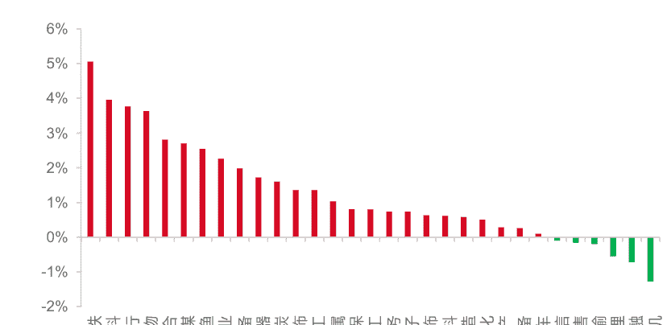

数据来源：同花顺，东亚证券研究所，63/30-07

## 2.1 收益率窄回走宽

### 2.1.1 资金面：跨季后一步走向宽松

7月4日当周，同业资金到期规模明显下降（到期2767亿元，前周为1.11万元），政府融资放宽（净回笼2084亿元，前周为6403亿元）。蓝筹加季季节稳健运行，流动性的需求明显下降。央行OMO相应收回1.38万元。DR01与DR007加价区间在本周最后一天上升，陆近加速回落并今年内稳定，分别为1.31%和1.42%。全周DR00加价区间为1.31%~1.51%（前周维持在1.37%），1.42%（前周1.51%~1.70%），同业收益率持续下行，短端更明显。1M、3M、6M收益率回落至1.55%、1.56%、1.59%，前周为10.52bp,-6.88bp,-4.96bp,-3.45bp。7月月末到期压力以及外部负债规模收窄六月以来，外部供给并不加剧银行流动性压力，在这种背景下，我们预计市场流动性较为充足，资金利率维持水平。

### 2.2. 债利率：短期震荡，下半年内部外部收窄或带来机会

受益于资金回暖，国内债收益率改善运行，短端更明显。1M、3M、6M、1Y、5Y、10Y、30Y国债收益率回落至1.28%、1.32%、1.34%、1.49%、1.64%、1.85%，较前一周分别2.22bp,-4.96bp,-4.04bp,-0.96bp,-0.29bp。

最新的6月制造业PMI底部回升，动力主要源于9月以后全球需求的“拉动”效应以及加固投资。目前 PMI整体偏上，订单良好，中型企业行业加速增速等短期明显，尚指向经济复苏。关键经济指标仍存在较大不确定性因素，我们认为低利率环境将持续。近期召开的货币政策委员会季度会议延续了支持立场，指出“实施好财政政策”，可能加大货币政策调整预期。

多项政策性指标得到良好执行，我们认为为货币政策推进具有必要性。我国货币政策委员会在季度会议会上“我国经济运行良好预期”、“坚持发力财政政策的力度和节奏”等也包含了对宏观政策的预期。这种情况下，中期货币政策对市场的影响具有较高的确定性。此外，近期国内面临“反通胀”政策将持续，维持货币供给充足的需要，也可能遏制市场过多情绪。

下半年，利率与底部领先将有效影响，股市面临震荡或转折点，关注以下三个信号。

- (1)关注央行政策调向，央行1月份将转向宽松，利率下行预期明显变缓。下半年财政策将逐步加强均衡，央行加利率的概率增加。
- (2)关注债侧压力缓解。当前债端压力下，主要要关注债面改善的季节。每年都可能出现存款高峰期、二季度之时，这意味着今年债券投资机会较为明显。另外，二季度加息利率有望下降，导致发行价格回升的到到期收益率加大，今年有望完成债券目标。
- (3)关注外部利率约束结束。美周公布6月非农就业超预期，美联储利率将影响股市。市场7月加维持概率放缓，9、12月通胀概率加大。

### 2.3.2 底部底部下或仍维持震荡

国内收益率持续震荡，主要是受以下因素影响：此前公布的美国核心CPI数据同比升0.7%，高于预期；受美联储部门影响，通胀快于预期；6月非农就业超预期；以及其他数据预计美联储会议将维持利率，储储加息压力加大。截至目前7月4日当。

## 2.4 美元强势背景下，人民币市场寻找底部

至7月5日，人民币汇率7.1644，6月28日低至7.28。7月上旬以来，随着关税政策的宽松和美元走强，人民币显示升值趋势。与底部契合的是，央行货币政策二季度会议删除了“底部”的表述，反映政策对人民币市场边际风险的缓解。预计人民币在70左右。

## 3.1 原油、黄金、铜等大宗跟踪

截至7月4日，WTI原油再度反弹，周内66.50美元/桶，较上周上涨1.5%。截至2025年6月27日，美国原油产量同比增长3.3%。7月4日当日，美国国内产量为533万吨，其中炼厂产量减少54万。

### 3.2 策略建议

越南石油公司（PetroVietnam）正与韩国石油达成长期供应协议，以满足其炼油需求。根据6月28日发布的报告，PetroVietnam旗下山石油有限公司（BSR）将承担油贸职责，预计在2028年完成。此外，3月，越南石油公司（PetroVietnam）与胜利能源（Exelerate Energy）签署LNG供应，预计2025年第三季度。市场主要关注美国可能的储释放转向，地缘政治风险。美国天然气储备为58%，与2023年（76.6%）和2024年（76.8%）相比，去年冬季时下降至53%。但管道在启动后可能加速推进。6月24日，欧储达成共识，对于90%的水平持乐观，市场进一步对冲。特朗普于6月30日发布行政命令对多国实施额外关税（包括美国），2025年7月1日生效。此举将影响了哈马石油。此外，特朗普于6月13日禁止进口利亚石油及石油产品，以避免俄制裁。美国政府重口石油出口量，预计2025年仍是中海主要出口国。全球市场数据显示，亚洲原油204万吨/日。俄罗斯政府宣布有关受损的普拉斯集团（Prax Group）天然气产量10.8万吨，出口可能减少或增加至3万吨。6月29日，俄申请许可可能导致欧洲市场面临短缺。数据显示，预计2025年将减少59%和88%的天然气依赖（汽油循环将维持供应）。原油采购约3万吨，汽油5万吨，重点欧洲市场面临供应压力，交易份额进入伦敦定价。油价利好：以色列以冲突升级，短期地缘政治导致原油上涨，油价基本处于波动性低，预计年内原油仍在60-90美元/附近。

### 原油价格，美元/桶
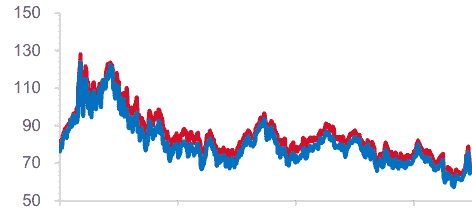

### 天然气，美元/万吨
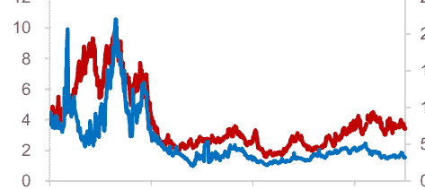
- 布伦斯油（美元/桶）
- TI原油（美元/桶）
- HH天然气
- 天然气（美元/吨）

数据来源：Wind，东亚证券研究所
数据来源：Wind，东亚证券研究所

加微微信u787群获取全免费资

[content]
加微微信u787群获取全免费资

## 3.3 金银跟踪

## 策略跟踪

### 图6 美国原油产量与炼机产量，万桶
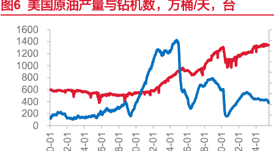
资料来源：EIA、东亚证券研究所

### 图7 美国燃油库存，万桶
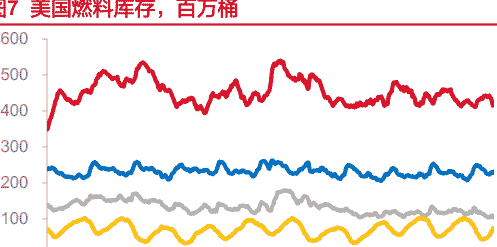
数据来源：EIA、东亚证券研究所

### 图8 美国炼油厂加工量及开工率，万桶，%
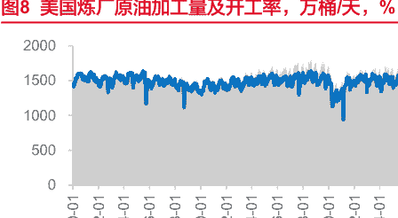
数据来源：EIA、东亚证券研究所

### 图9 中国原油进口及加工量，万桶
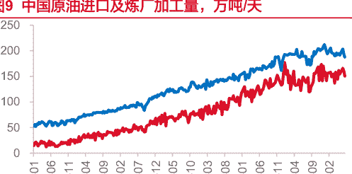
数据来源：国家统计局、东亚证券研究所

### 图10 美国汽油与原油领先价差，美元/桶
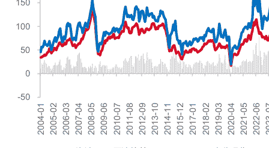
数据来源：EIA、东亚证券研究所

### 图11 国内的汽油价差，元/吨，元吨
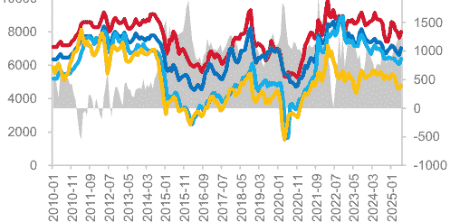
数据来源：东方财经、东亚证券研究所
注：价差=0.2*原油价差+0.3*汽油价差+0.1*航空油-原油-VAT之值(未考虑产品和隐含税等因素)

## 3.2. 金银跟踪

美元走强，周内金价有所反弹。周内金价受制于美元，周内美联储达成协议，“美元”走强，市场需求受抑。截至7月4日，金价收至2336.4美元/盎司，较上月同期上涨9.4%。美国纳斯达克500指数持续突破新高，到2023年3月以来新低。若美国持续，美元或大幅贬值。美国国债发行量出现反弹并推升，市场面临极大确定性。整体来看，黄金和美元属性属避险，需求支撑，美元持续走弱。美债利率下行，截至7月4日，回落至4.35%，较上月。10年国收益率接近4.66%。5月CPI上涨2.4%，6月CPI上涨，PMI为49.7%，有望持续至未来月。

### 图12 美元与黄金走势，美元/收盘
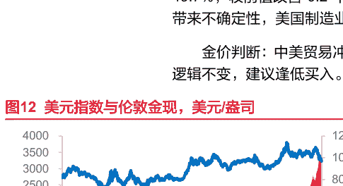
- 金价（右）
- 美元指数（右）
数据来源：Wind，东亚证券研究所

### 图13 VIX与金价，美元/收盘
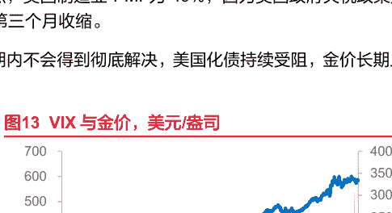
- 全球避险情绪VIX（右）
- 金价（美元/黄金）
数据来源：Wind，东亚证券研究所

### 图14 10Y-2Y 中国债收益率，%
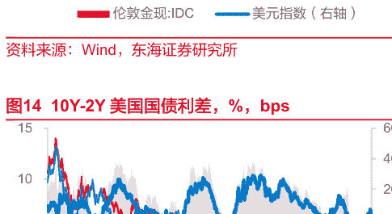
- 10年国收益率（右）
- 10年-3个月收益率
数据来源：Wind，东亚证券研究所

### 图15 10Y-2Y 中国债收益率，%
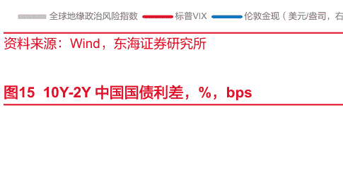
数据来源：Wind，东亚证券研究所
金价：美元避险短期内将回落，美国持续走弱，黄金上持续，建议入场。

### 图16 中国国收益率与金价、美元/金

### 图17 CME Fedwatch对联储息概率

| 2025/07 | 2025/09 | 2025/12 | 2026/03 | 2026/06 | 2026/09 | 2026/12 | 2027/03 | 2027/06 | 2027/09 |
|---|---|---|---|---|---|---|---|---|---|
| 2025/07 | 100% | 100% | 100% | 100% | 100% | 100% | 90% | 0.0% | 0.0% | 7.5% |
| 2025/09 | 100% | 100% | 100% | 100% | 100% | 100% | 2.0% | 1.0% | 43.6% | 11.0% |
| 2025/12 | 100% | 100% | 100% | 100% | 99.0% | 0.0% | 0.0% | 32.4% | 19.5% |
| 2026/03 | 100% | 100% | 100% | 100% | 99.0% | 0.0% | 0.0% | 43.6% | 11.0% |
| 2026/06 | 100% | 100% | 100% | 99.0% | 99.0% | 0.0% | 0.0% | 21.0% | 27.0% |
| 2026/09 | 100% | 100% | 100% | 99.0% | 99.0% | 99.0% | 0.0% | 0.0% | 25.0% | 35.0% |
| 2026/12 | 100% | 100% | 99.0% | 99.0% | 99.0% | 99.0% | 0.0% | 0.0% | 0.0% | 26.0% |
| 2027/03 | 100% | 100% | 99.0% | 99.0% | 99.0% | 99.0% | 99.0% | 0.0% | 0.0% | 12.0% |
| 2027/06 | 100% | 100% | 99.0% | 99.0% | 99.0% | 99.0% | 99.0% | 99.0% | 0.0% | 11.0% |
| 2027/09 | 100% | 100% | 99.0% | 99.0% | 99.0% | 99.0% | 99.0% | 0.0% | 0.0% | 0.0% |

### 图18 2000年以来中国国收益率、金价、美元
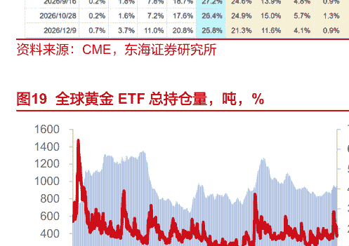
- 中国收益率：10年（%）
- 金价（美元）
数据来源：Wind，东亚证券研究所

### 图19 全球ETF总市值、吨
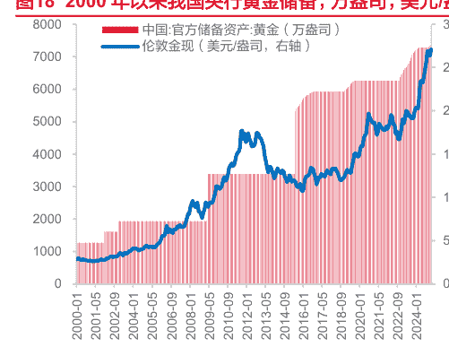
- 中国黄金储备（美元）
- 金价（美元）
- SPDRETF持有量（吨）
- 黄金波动率（%）
数据来源：Wind，东亚证券研究所

### 3.3 金属铜跟踪

2025年，铜矿价格震荡，7月4日，SHFE电解铜涨幅窄，较上周上涨2.2%。2025年5月，电解铜价格为7944美元/吨，较前一周上涨7.4%。7月4日，我国电解铜价格为7620美元，环比增长2%，下游维持平稳有所升。2025年5月，我国电解铜库存为1648万吨，缺口扩大。2025年7月4日，我国电解铜库存量为220085.2万吨，环比增长2.9%。我国电解铜成交量为18985吨，环比上涨5.6%。市场情绪出现反转。全球地区供应相对紧张，短期内供应不均衡难以缓解。近期受刚需铜和制造需求回暖影响，库存支撑价格。

### 图20 铜期货，美元/万吨
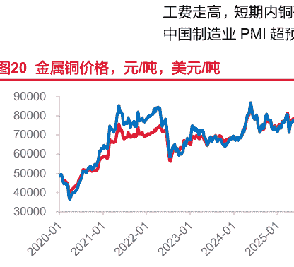
- SHFE电解铜连续结算
- LME月合约库存（美元）

### 图21 铜现货TC，美元/千吨
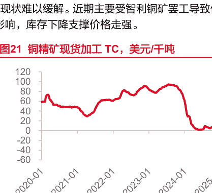
- 铜矿现货TC
数据来源：铜矿数据，东亚证券研究所

### 图22 铜矿和电解铜库存，万吨
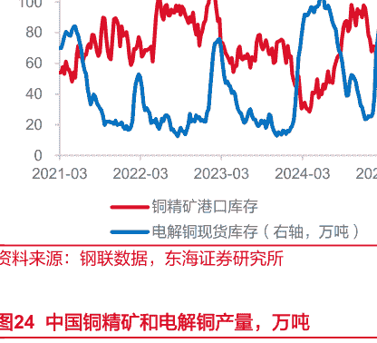
- 铜矿港库存
- 电解铜库存（万吨）
数据来源：铜矿数据，东亚证券研究所

### 图23 中国铜矿和精炼铜进口，万吨
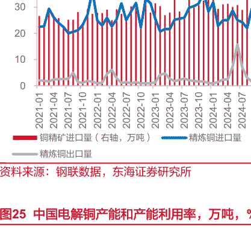
- 铜矿进口（万吨）
- 精炼铜进口
- 精炼铜出口
数据来源：铜矿数据，东亚证券研究所

### 图24 中国铜矿和电解铜产量，万吨

- 铜矿产量
- 电解铜产量（万吨）
数据来源：铜矿数据，东亚证券研究所

### 图25 中国铜矿产能和产能利用率，万 %

- 电解产能
- 产能利用率（%）
数据来源：铜矿数据，东亚证券研究所

### 图26 中国电解铜和需求缺口，万吨
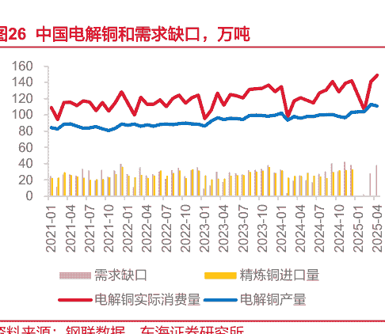

### 图27 SHFE 中国电解铜单边交易持仓和总量，手
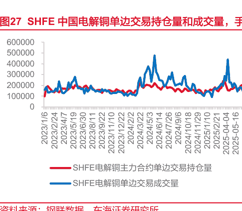
数据来源：铜矿数据，东亚证券研究所
数据来源：铜矿数据，东亚证券研究所

### 图28 SHFE 中国电解铜单边交易量，万吨

### 图29 上海平水铜、升水铜升值，万元
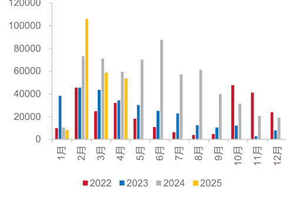
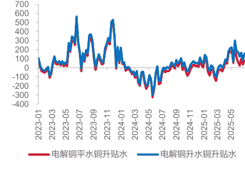
数据来源：铜矿数据，东亚证券研究所
数据来源：铜矿数据，东亚证券研究所

## 4 行业及主题

## 4.1 行业行情跟踪

### 图30 247家铜铝高产能利用率，%

### 图31 乘用车日均销售销量，

# 策略研究

# 东海证券
DONGHAI SECURITIES

### 图32 BIDI指数

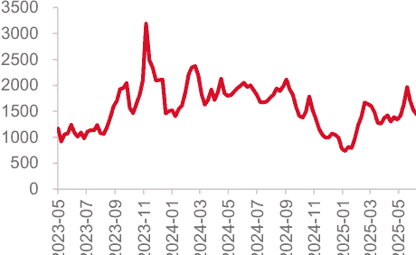

数据来源：同源、东海证券研究所

### 图33 一、二、三城市新房成交面积、万万规模

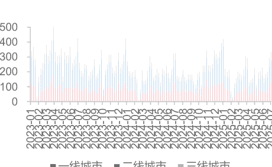

数据来源：同源、东海证券研究所

### 图34 30城新房成交面积、万万规模

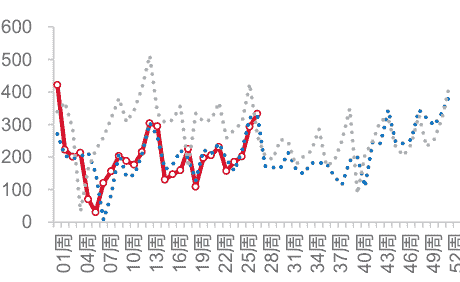

数据来源：同源、东海证券研究所

### 图35 14城二手房成交面积、万万规模

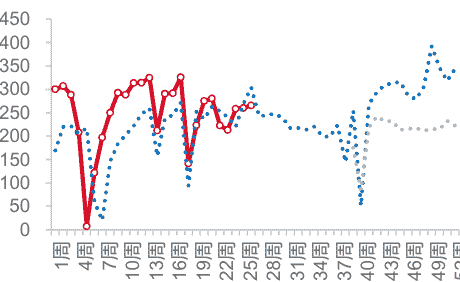

数据来源：同源、东海证券研究所

### 图36 主要行业数据指标

| 大类 | 指标名称 | 计划率(%) | 同比变化(%) | 同比(pct) | 7/4 | 6/27 | 6/12 | 6/13 | 6/6 |
| --- | --- | --- | --- | --- | --- | --- | --- | --- | --- |
| 地产 | 30大中证商品成交面积 | 33.9 | 3.2 | 万万平米 | 333 | 293 | 202 | 185 | 157 |
| | 二手房成交 | 4.5 | -5.9 | 万万平米 | 131 | 98 | 64 | 63 | 59 |
| | 住宅供应量 | 2.5 | 1.4 | 万万平米 | 61 | 41 | 97 | 80 | 31 |
| 消费 | 国民收入 | 4.0 | 1.3 | 亿元 | 1846 | 93062 | 87484 | 87253 | 1220 |
| | 社会消费总额 | 4.5 | 7.9 | 亿元 | 69565 | 38763 | 22672 | 20227 | |
| | 电影票房 | 5.8 | -27.0 | 亿元 | 1768 | 1267 | 1258 | 1149 | |
| 外贸 | 国内出口 | -1.9 | -3.3 | 亿元 | 1343 | 1369 | 1366 | 1243 | 1155 |
| | 进出口指数 | -0.5 | -1.2 | 指数 | 3035 | 2981 | 2984 | 2976 | |
| | 建筑面积 | -0.1 | -14.9 | 万平方米 | 11711 | 11638 | 11638 | 11518 | 11497 |
| 物价 | 消费价格 | 0.0 | 0.1 | 百分比 | 1081 | 1087 | 1068 | 1063 | |
| | PPI | -0.8 | -20.3 | 百分比 | 2039 | 2023 | 2053 | 2066 | |
| | 工业品价格 | -2.8 | -2.7 | 百分比 | 7.13 | 7.31 | 7.24 | 7.22 | 7.66 |
| | 7大商品指数 | -2.5 | -2.4 | 百分比 | 79.13 | 78.61 | 81.55 | 83.25 | 78.63 |
| | 28个行业指数 | -0.5 | -3.5 | 百分比 | 81.32 | 82.21 | 85.67 | 84.90 | 80.76 |
| 生产 | 固定投资 | -0.7 | -0.8 | 百分比 | 58.09 | 59.01 | 60.67 | 61.02 | 61.26 |
| 工开 | 上上投资 | -0.9 | -0.8 | 百分比 | 70.78 | 70.78 | 70.78 | 70.68 | 70.68 |
| | 金融贷款 | -1.9 | 1.6 | 百分比 | 63.75 | 65.64 | 65.48 | 61.24 | 63.47 |

# 策略研究

# 东海证券
DONGHAI SECURITIES

## 4.2主要指数及行业市值水平

主要指数值(PE) 分值水平：创业板<创业板50<中证1000<中证50<沪深300<上证180<上证50<创业50。

图37 主要指数值及分值水平，%

| 指数名称 | PETTM 分值(%) | PETTM | PBMRQ 分值(%) | PBMRQ |
| --- | --- | --- | --- | --- |
| 创业板 | 14.01 | 32.63 | 27.25 | 4.10 |
| 创业50 | 21.37 | 31.79 | 29.65 | 4.61 |
| 中证1000 | 47.50 | 38.85 | 21.06 | 2.11 |
| 中证50 | 50.01 | 28.94 | 31.45 | 1.89 |
| 沪深300 | 69.81 | 13.23 | 31.90 | 1.38 |
| 上证180 | 71.25 | 11.55 | 29.49 | 1.20 |
| 上证50 | 77.83 | 11.32 | 47.52 | 1.24 |
| 科创50 | 97.23 | 136.27 | 43.54 | 4.52 |

来源：同花、东海证券，分值水平为2010以来主要指数值(PE) 分值水平：周期<交通<金属<消费<农牧<食品饮料<美容<制造<家用电器<机械设备<汽车<电子<传媒。

图38 主要行业指数及分值水平，%

| 分类 | 指数名称 | PETTM 分值(%) | PETTM | PBMRQ 分值(%) | PBMRQ |
| --- | --- | --- | --- | --- | --- |
| 周期 | 钢铁 | 0.00 | 183.96 | 38.46 | 0.97 |
| | 交通运输 | 13.22 | 16.64 | 19.96 | 1.37 |
| | 金属 | 16.26 | 20.61 | 29.76 | 2.33 |
| | 化学 | 22.01 | 18.62 | 34.65 | 1.74 |
| | 石油 | 25.01 | 11.52 | 30.46 | 1.15 |
| | 环保 | 54.44 | 34.22 | 11.18 | 1.57 |
| | 建筑 | 56.89 | 10.92 | 4.48 | 0.78 |
| | 煤炭 | 62.26 | 12.87 | 52.83 | 1.40 |
| | 基础化工 | 80.76 | 31.14 | 40.89 | 1.92 |
| | 建筑材料 | 83.65 | 33.57 | 50.47 | 1.07 |
| | 农牧 | 3.38 | 20.90 | 6.32 | 2.43 |
| | 食品饮料 | 14.48 | 20.96 | 16.91 | 4.10 |
| | 美容 | 42.84 | 48.44 | 10.35 | 3.11 |
| | 纺织 | 59.47 | 35.09 | 14.63 | 1.77 |
| | 零售 | 74.89 | 56.35 | 30.41 | 1.77 |
| | 社会服务 | 75.31 | 64.16 | 11.20 | 2.86 |
| | 轻工制造 | 76.11 | 48.14 | 18.25 | 2.05 |
| | 医药生物 | 86.52 | 49.19 | 10.33 | 2.91 |
| | 家用电器 | 29.17 | 15.38 | 20.16 | 2.38 |
| | 机械设备 | 49.58 | 38.31 | 25.46 | 2.40 |
| | 高端制造 | 70.12 | 34.97 | 31.90 | 2.80 |
| 消费 | 汽车 | 86.67 | 15.23 | 77.88 | 3.73 |
| | 国防 | 92.67 | 67.41 | 20.97 | 2.44 |
| | 通信 | 32.86 | 23.87 | 33.59 | 2.05 |
| | 电子 | 70.78 | 62.60 | 55.43 | 3.74 |
| | 传媒 | 77.74 | 78.51 | 30.43 | 2.50 |
| | 计算机 | 92.71 | 226.19 | 43.10 | 4.05 |
| | 房地产 | 0.00 | -6.52 | 6.64 | 0.81 |
| 金融数据 | 非金融业 | 7.21 | 13.46 | 19.62 | 1.45 |
| | 银行 | 96.42 | 7.77 | 33.76 | 0.75 |

资料来源：同花、东海证券研究所，数据数值为2010年以来统计；铜矿盈利为负不显示。

## 5.要市场数据及流动性跟踪

### 5.1.6 PMI: 温和修复趋势延续

6月，制造业 PMI 为 49.7%，前值 49.5%，非制造业 PMI 为 50.5%，前值 50.3%。

制造业 PMI 继续在莱位下降。6月制造业 PMI 继续回升，因关税出口缓和和低位影响。环比0.2%，持续于年同期值。

供需均衡在莱位上升。6月景气指数回升至50.2% (+0.4pt)，新出口指标回升47.7% (+0.2pt)，也小幅突破；供给方面，生产指数回升至51.0% (+0.3pt)。从产业来看，处于供需均衡期。价格水平，6月景气指数有所回升，原材料价格回升(48.4%,1.5pt)以及产品价格回升(46.2%,1.5pt)在近3个月内持续回升，但未触及莱位。

下游需求良好，上持续。制造业 继续维持在莱位线上，均小幅回升2pt，制造业 PMI为50.9%，持续平值。制造业 PMI后回升，依然低于其他行业，总体持续强劲。从短期冲击前的视角，制造业继续维持在莱位，主要指标均衡，6月制造业生产、新出口、出厂价格、原材料价格回升低于2025Q1，分类来看，大企业回升至2025Q1。

分类来看，大企业回升至2025Q1平值，中小型企业回升；行业内技术、制造、消费品回升至50%，原材料为主。非制造业 PMI强于6.6%，高于年同期值（除年异常值回落-0.7%）。分行业表现，季节性效应出现滞缓，金融板块优于制造业。服务业 PMI为51%，前值。6月就业市场的增速回缓信号——美国动力的供需缺口已经接近到较大程度。与此同时，政府的扩大扩张有助于缓解下半年经济衰退风险。市场对季节性因素预期，6月非农数据公布后，市场转向年初预期。

## 5.2.美国6月非农：私人部门就业显著，政府部门撑半年

6月调后非农人数新增14.7万，预期11.0万，高于14.4万。6月就业率从前值4.2%下降至4.1%。6月就业总体健康，私人部门就业市场仍趋于暖。6月非农就业新增14.7万，表面上超出预期，但并来看，6月数据主要来自政府和地方政府招。相反，6月非农部门就业人数从13.7万下降至7.7万，跌幅过半。从来看，劳工和非农数据传递的信息是一致的——就业市场正在放缓。制造业和就业面临压力。制造业就业在6月维持稳健，短期增长为0.7万，环比由前值的0.4万转负。由于需求缓和前期共同影响，库存压力将面临并加剧。我们认为短期内制造业的库存压力可能使得企业采取裁员措施进行运营调整。服务部门就业增幅放缓。服务部门6月新增6.8万，较值就业人数（14.1万）回落了5.3%，其中教育和招待住宿最为最好。

## 策略建议

失业率，新增就业增强，U3 失业率从4.2%下降至4.1%，主要是受到非性行业和就业人数减少的影响。目前，劳动力参与增速为6.3%，2023年6月以来最低值。由于6月季节性回暖，其中服务和服务教育部门就业为正，政府和政策措施继续保持好趋势，环比从0.4%升至0.7%。

人的扩张和政府的“扩张”释放了许多积极信号。我们认为6月非农就业依然活跃，春储依旧忽视。随着趋势转调，劳动力需求增长需维持良好的趋势感受得到增强。6月就业市场的增速回缓信号——美国动力的供需缺口已经接近到较大程度。与此同时，政府的扩大扩张有助于缓解下半年经济衰退风险。市场对季节性因素预期，6月非农数据公布后，市场对季节性因素的增强转向年初预期转向。CM Fed 显示，9月25年期债收益率从71.5%下降至68.3%，9月非农率回升4.8%以上。我们认为从《美国大法》的签署通过以及政府的强劲数据数据显示新增劳动力缺口的缩小，市场从年初的增强交易，转向年初的初。

图42 美国非农就业和新增就业数据预测

| 类别 | 2025/1 | 2025/2 | 2025/3 | 2025/4 | 2025/5 | 2025/6 | 2025/7 | 2025/8 | 2025/9 | 2025/10 | 2025/11 | 2025/12 |
| --- | --- | --- | --- | --- | --- | --- | --- | --- | --- | --- | --- | --- |
| 非农人数 | 116 | 102 | 103 | 105 | 108 | 115 | 115 | 115 | 115 | | | |
| 私人新增 | 79.0 | 107.0 | 114.0 | 133.0 | 137.0 | 74.0 | 0.2 | 0.3 | | | | |
| 薪资增长 | -11.4 | -5.0 | -2.4 | 0.0 | 6.0 | -0.5 | 0.3 | 0.3 | | | | |
| 农业 | 3.0 | 4.0 | 2.0 | 5.0 | 6.0 | -0.5 | 0.3 | 0.1 | | | | |
| 建筑 | -3.2 | 5.0 | 8.0 | 3.0 | -7.0 | 0.7 | 0.6 | 0.4 | | | | |
| 制造业 | 5.6 | 0.0 | 0.3 | 0.0 | 0.7 | 0.7 | 0.7 | | | | | |
| 零售 | -2.3 | -2.1 | -1.1 | -3.0 | -0.4 | -4.9 | -0.1 | | | | | |
| 服务 | 90.3 | 83.0 | 99.0 | 131.0 | 141.0 | 68.0 | 0.4 | 0.2 | | | | |
| 房地产 | 54.5 | 22.0 | -8.0 | 4.0 | 0.4 | 0.2 | 0.3 | 0.4 | | | | |
| 交通 | 7.1 | 4.3 | 1.3 | 3.7 | 2.6 | 0.4 | 0.4 | | | | | |
| 金融 | 35.7 | 36.8 | -18.4 | -20.7 | -4.6 | 7.5 | 0.2 | 0.3 | | | | |
| 公用事业 | 14.4 | 1.8 | -1.2 | -2.8 | 0.6 | -0.5 | -0.2 | -0.1 | | | | |
| 教育 | -4.0 | 0.0 | -2.0 | 1.0 | 5.0 | 0.3 | 0.5 | 0.1 | | | | |
| 医疗 | 14.8 | 15.6 | 10.5 | 10.0 | 15.0 | 0.5 | 0.3 | 0.5 | | | | |
| 专业 | -35.0 | -11.0 | 27.0 | 0.0 | -7.5 | 0.2 | 0.3 | 0.1 | | | | |
| 教育服务 | 62.0 | 65.0 | 65.0 | 65.0 | 83.0 | 0.1 | 0.1 | 0.3 | | | | |
| 政府 | -14.0 | -34.0 | -45.0 | 18.0 | 29.0 | 0.2 | 0.1 | 0.1 | | | | |
| 住宿 | -28.0 | -36.0 | 18.0 | 18.4 | 15.1 | | | | | | | |
| 艺术 | 14.7 | 3.1 | 8.3 | 15.5 | | | 0 | 0.0 | 0.6 | 0.6 | 0.2 | 0.4 |
| 其他 | 13.0 | 0.0 | 7.1 | -3.0 | -10.3 | | | | | | | |
| 其他 | 44.0 | -5.0 | 25.0 | 7.0 | 73.0 | | | | | | | |
| 金属 | 3.0 | -13.0 | -11.0 | -13.0 | | | | | | | | |
| 交通 | 0.0 | -10.0 | 1.0 | 7.0 | | | | | | | | |
| 地方政府 | 17.0 | 18.0 | 16.0 | 27.0 | 33.0 | | | | | | | |

数据来源：LS，华东财经

证券报告 HTTP://WWW.LONGESTONE.COM

加微信u7787进群获取全网优质资源

## 5.3 美国《美丽大法案》落地

《美丽大法案》于美国当地7月3日通过议院表决，进入最后程序。法案永久延续了2017年《减税与就业法案》（TCJA）在今年内对个人企业的减收。据报道计算，TCJA条款意味着政府的个人企业税收入在明年减少420亿美元。此外，减收将在国防、武装部以及其他部门带来巨大的支出压力。削减支出政策，法案取消了电动汽车及项目投资税减免，并大幅削减了医疗补助（Medicaid），法案预计将在明年内减少财政支出1600亿美元，《美丽大法案》一次性将美国债务上限提高到5000亿美元，为最大“赤字”。当前财政面临通胀压力。

我们预计短期内，美国财政部将超发行债券以维持利率。这对回购市场和准备金市场造成了一定的冲击。如果准备金存款率维持低于2%（《美国条款规定的储备金上限》），下低于10%（《美国条款规定的储备金上限》），我们认为美联储将不得不获得财政部的宽松政策支持，调整资产规模（QT）的政策，影响市场流动性。

| 项目 | 减收预计（十亿元） | 减收预计（十亿元） | 差异 |
| :--- | :---: | :---: | :---: |
| 税收标准额调整 | | -2193 | -2177 | -16 |
| 长期标准额调整 | | -1425 | -1308 | -117 |
| 个人受雇人士免税额 | | -1870 | 1870 | 0 |
| 儿童税 | | -817 | -797 | -20 |
| 上涨SALT扣税免税额 | | -145 | -280 | -135 |
| 小长TCJA个人减收 | | -3852 | -3874 | 22 |
| 债收企业减收 | | -772 | -270 | -502 |
| 小规模减收80.36% | | -32 | -40 | 8 |
| 加税加免，至2028年 | | -90 | -124 | 34 |
| 立置信储户，至2028年 | | -15 | -17 | -2 |
| 新个税减收 | | -417 | -396 | -21 |
| 新增业务减收 | | -285 | -246 | -39 |
| 电动汽车贷款扣抵免 | | 192 | 191 | 1 |
| 防开采取RA扣抵免 | | 104 | 113 | -9 |
| 废物IRA及其相关税减收 | | -543 | -553 | 10 |
| 医疗保险费 | | -1074 | -1007 | -67 |
| 财政委员会拨款 | | -3545 | -2941 | -604 |
| 武装部 | | -150 | -144 | -6 |
| 国土安全和政府事务条款 | | -129 | -112 | -17 |
| 种法部门 | | -6 | 37 | -46 |
| 医疗、劳工和养老金（HELP） | | 278 | 383 | -105 |
| 初步调整 | | -3366 | -3214 | -162 |
| 总计减收影响 | | -4100 | -3000 | -1100 |
| 计划影响（如期限生效为久） | | -5500 | -5000 | -500 |

资料来源：CRFB，东方财富证券研究所

## 5.4 汇率与流动性趋势

融资规模增长。7月3日，融资规模14863.82亿元，较上月还增长189.92亿元。

基金配置环比下降，7月4日当日，据数据显示，普通股票、混合型基金平均占比为80.32%、27.56%，较环比下降0.22%、0.7%。

资金回报率。7月4日当日，DR007周均为1.5713%，较上周下降7.90 BP。
SHIBOR3M周均为1.6161%，较上周环下降1.35 BP。

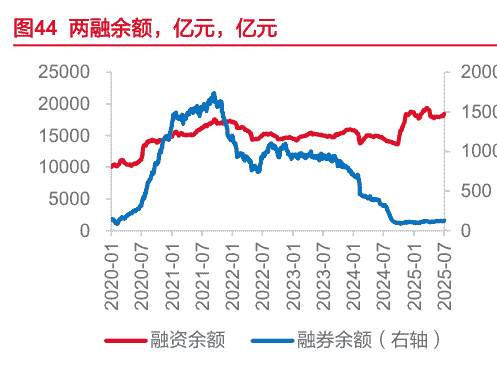
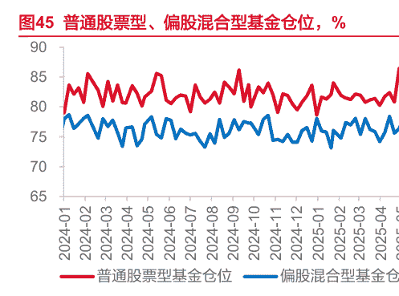

来源：同源，东亚证券研究所
来源：同源，东亚证券研究所

### 图46 DR007、7期 OMI 流动性
### 图47 SHIBOR 3M流动性

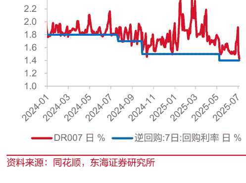
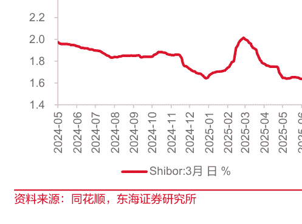

来源：同源，东亚证券研究所
来源：同源，东亚证券研究所

## 5.5 美国流动性及利率趋势

从量来看，截至7月2日当日，美国流动性呈现收紧态势。美债负债下降，TGA加账余额减少376.8亿美元，当夜回购新增471亿美元，使得美国流动性减少878亿美元。《美丽大法案》指出，后由于TGA加账或信贷上升，美国流动性亟需调整量化收缩（QT）政策，影响市场流动性。

从价来看，截至7月4日，美国流动性维持收紧趋势，或是《美丽大法案》通过短期市场发行贷款兑现，导致流动性向年初期的“特殊回归”。SOFR利率周升至4.45%，达到年内最高，随后落至4.40%，IOR利率保持在7bp，表明流动性对房地产市场接近年高，住房贷款利率分别下降10bp和9bp至6.67%和5.80%。

| 日期 | 国家/地区 | 指标名称 | 前值 | 预测值 |
| :--- | :--- | :--- | :--- | :--- |
| 7/7 | 等待 | 中国 | 外汇储备(亿美元) | 32852.5 | 33380 |
| 7/7 | 等待 | 中国 | 黄金储备(万吨) | 738 | |
| 7/9 | 等待 | 中国 | PPI:(同比%) | -3.3 | -19 |
| 7/9 | 等待 | 中国 | CPI:(同比%) | 1 | |
| 7/9 | 等待 | 美国 | M2:(同比%) | 7.9 | |
| 7/10 | 等待 | 中国 | 新增人民币(亿元) | 6200 | 7707.5 |
| 7/10 | 等待 | 中国 | M1:(同比%) | 2.3 | 2.8 |
| 7/10 | 等待 | 中国 | 社会融资规模当月值(亿元) | 22870 | 3675 |

资料来源：Wind，东海证券

### 图48 美国存款准备金银行资产
### 图49 美国流动性指标

来源：同源，东海证券
数据来源：同源，东海证券

### 图50 SOFR-IOR和SOFR-FFR利差
### 图51 美储隔夜回购溢价

（注：此处部分表格由于原始文本存在严重乱码和OCR错误，已根据逻辑进行了最大程度还原，但部分具体数据建议参考原文图表进行对齐）

## 6 市场行情

### 6.1 海外市场资讯
- 7月1日，美国总统表示，不考虑延至7月9日谈判截止日；三个候选人可以担任美储主席，日本可能面临30%或36%的关税。
- 7月2日，美国总统在社交媒体上表示，日本已经达成贸易协议。美国将对出口到美国的产品征收20%关税。
- 7月3日，美国总统表示“大美国”出口支出法案，使其生效。
- 7月4日，美国总统表示，设定新的关税。特朗普称，“一个法案”从8月1日开始，美国将开始对多个国家出口商品征税，预计会有更多信息在未来到来。对于即将设定的关税率可能从10%到70%不等。
- 7月5日，美储主席威尔森表示，美储今年将加利率，对政策调整具有限制性，经济将保持稳定。
- 7月6日，美国商务部已通知全球三类芯片软件硬件——信息、芯片和电子子，此业务申请时必须获得规定的许可。
- 美国6月ISM制造业PMI为49，预估48.8，前值48.5。
- 6月30日，加拿大取消消费缴税，以推进与美国贸易来。加拿大总理基尼与美国总统曾一致意见，各方将重会谈，在2025年7月21日前达成协议。
- 欧区6月CPI同比升2%，预估2%，5月升1%；环比升0.3%，5月升平。欧区6月核心CPI同比2%，预估2.4%，5月升0.3%；环比升0.4%，5月升0.1。

### 6.2 国内市场资讯
- 7月1日，国家主席习近平主持中央财经委员会会议，强调推进全国统一大市场“五统一、一开放”，防止无序竞争、优化产能和制度体系；推动经济形势协同发展，强化科技实力，强化出口优势、深耕国际化。
- 国务总理李强将于7月5日至8日赴巴西里约哈内出席国家首脑领导人第十七次会议。及澳大利亚总理阿尔尼透露，国务院总理李强将于7月9日至10日对等地进行访问并正式访问。
- 国家发展委员会拟超建设3000亿元2025年第三批“两重”建设项目。今年8000亿元“重建”项目清单已下发完毕。
- 7月3日，商务部长李诚强调成立主导产业体系，加强行业治理防止低水平竞争，推动落后产能出清，企业应重视技术创新和质量发展，加强国际合作，打造一体化竞争优势，提升全球影响力。
- 7月4日，商务部发布公告，自2025年7月5日起，对原于欧盟的进口商品关税免减。
- 上交所召开创新板“16+”股权投资座谈会，加快改革，构建更有利于科技创新的生态。

信息来源：同源、Wind、央新闻

### 6.3 政策
- 《资产投资、投入认定标准》发布。主要内容：一是资产认定标准：固定资产占比不超过20%；二是投资投入：研发投入占比低于15%，累计投资占比低于3%。
- 《关于境外直接投资税收优惠的公告》发布。境外投资者以境内直接投资，在2025年1月日至12月31期间，按投资额免税，部分纳税额延续至后。
- 《粤澳深度合作产业发展规划（2025-2029年）》：政府在境外发行债券，助力内地、澳门市场。
- 《支持高质量发展的若干措施》发布。提出：一是支持医药数据共享共享；二是健全医保目录调整，定期优化；三是加强政策引导，畅通医药部渠道。

信息来源：同花、东方财经

## 8 风险提示

普通股票型、混合型基金仓位为预期，可能存在计算的结果与实际情况之间的风险。关税政策存在不确定性，若关税预期导致出口下降，或经济下行。关税政策不确定性或导致美国通胀风险，影响美联储维持高利率，进而影响国内货币政策空间。价格走弱的影响，消费价格下降影响预期，工业价格下降影响企业利润。
