# 投资策略

## 一、专辑：中线趋势线的交易思路（二）

在 2024 年&2025 年上半年期间，我们对中线趋势线的交易思路进行了回顾。实证显示，“买涨卖高”可以获得超额收益，但在收益结束后，择时情形往往难以观测到普通的超额收益。然而，如果某一个行业持续高的时间比大体上长，那么此策略并不失效。因此，该策略（中线趋势线交易）与 7 月（中线趋势线表现）具有相关性，行业趋势能够比任何一个个股 alpha 获得更好的后续表现。

**作者**
杨 翰
行业报告编号：S60852410002
邮箱：yanglu@gsq.com

**分析师**
王 亘
行业报告编号：S60852307005
邮箱：wangyuhan3665@gsq.com

## 相关更新

### 1.1 基于上线趋势判断行业选股策略

- 1. 海洋专题：关注美国科技软件行业——2025 年 2 月
看到上线趋势有效，行业组合的收益日波动率显著。行业组合在 4-8 月期间的超额收益主要体现在一次调整后。从时间节点来看，在 7 月重点行业包括白酒、医药、中特、地产、金属材料。

- 2. 投资策略：周线熊与黄金策略——2025-05-02

- 3. 投资策略专栏：【吴宏开华】跟踪市场行情——2025-05-02

### 1.2 行业表现优个股带来个股收益

我们对于行业表现优个股，“买涨卖高”可以获得更好的收益。即在行业发生调整后，仅持有行业内部表现优个股。在 7 月（中线趋势线表现）与 8 月（中线趋势线表现），行业表现优个股的超额收益达到>50%，行业高达>5% 的个股选取收益，最佳情况为持有 3 天，收益 54%；而行业表现，最佳情况为持有 10 天，收益 72%。

我们需要的是，在 7 月后，行业优是一个很好的选择。个股表现优个股往往容易出现反转。相反，当行业在“买涨卖高”行情时，最近的投资逻辑主要是通过“广沪”获取 alpha。当行业表现优的个股较少时，行业表现优对个股持有者的影响反而变大。因此，当行业优个股密集时，进一步筛选具有特征的个股，则规则依然是有效的决策。

## 二、本周市场表现与策略建议

### 2.1 A股表现：趋势向上，有反弹、风险提示、重心回调

本周 A 股市场趋势上扬并有回弹，重心上移至 3472.3 点，已突破2024 年 1 月最高值 3470.6 与 2022 年最高点 3461.50 点。一方面，行情性性向上，有利于报表修复；另一方面，市场在内部运行，缺乏外部支撑。中央委员会六次会议的“内需”政策引导股市交易持续活跃，支持“活跃市场”举措通过结构化行情加大。本周股市指数冲高后回落，显示上上趋势尚未形成，依然运行在震荡中。

A 股指数表现活跃，沪和深在 300 点附近，风格尚稳，必须资金和销量进出、大盘、低市值重心为主。

万产行业多个上涨，钢铁、建筑材料和银行行业领先，周度上涨涨幅分别为 5.06%、3.96%和 3.77%。本周中央财经委员会召开六次会议后，调整仍需。

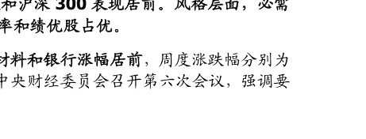

仔细阅读本报告末尾风险声明

## 知识星球TOP 资源分享社群

汇聚全网付费资源，让更多人获取高价值信息

- 付费文章
- 付费群
- 付费课程
- 副业&搞钱
- 财经报告
- 历史·体制·自媒体·学习·军事·影音·社会学

公众号：知识星球TOP 微信信号

添加微信免费群

## 国际证券

2025年07月06日

价格低位竞争，“内耗”调整、建筑材料等行业形成，行业行为“高流动”方向转向市场。三大指数回升全球，表现存在分化：一是美国参院、欧债受对“美元”和支出影响，当时7月市场对该政策进行了调整；二是美国国内非农数据，非农就业与行业表现优预期。

### 2.3 美国：中美利好扩散

权益方面，美国市场上涨20%，商品价格、铜股、LME和CRB涨幅分别为78%、84%和57%，铜、金，由于出口回归。利率方面，中长期小幅回撤，长期再度回升，中美边际扩张，汇率方面，美国指数下降23%。

### 2.4 政策事件：中央财经委员会召开会议；特朗普“美元”方案

国内环境：6月非农持续反弹，仍处于收缩区间；中央财经委员会召开会议，研究指导全国性市场建设、海洋高度发展等进展。金融市场：沪深行情、流动股份等。海外动态：美国6月非农和就业数据符合预期；美国特朗普“美元”税，美欧将拟对华出口限制；美国软件恢复增长；特朗普8月8日起实施关税，最高关税或近70%。国际关系：特朗普加转向贸易倡议，美欧将拟对华出口限制。产业动态：头部部门发布《支持高质量发展的若干措施》，支持医药储备用于研发；工信部：依法规、综合治理无序竞争，引导企业提升产品质量，预计后有所改善；全国电商增长14亿，创收新高；个主要石油产量决定8月增产。

风险提示：1、地缘政治恶化；2、经济压力；3、历史规律可能失效。

仔细阅读本报告页末声明

# 国信证券

2025年07月06日

## 内容目录

- 策略摘要：中线交易机会（二）
- 1.1 基于预测与跟踪指标进行配置
- 1.2 行业选择能否增加收益调整
- 本周市场表现与策略调整
- 2.1 A股表现：指数延续上涨、向上突破、风险回调、行情存在不确定
- 行情表现：指数延续上涨，向上突破，但周线上背离，可见成交量净流入
- 资金：市场表现活跃、情绪择极、指数处于低位
- 估值：行业估值分位多数处于低位
- 2.2 全球：全球市场估值处于低位
- 2.3 行业：行业估值处于前低
- 2.4 策略调整：中报委员会会议决定，特别新增“大而美”策略

# 风险提示

- 图表1：监测到行业跟踪组合（2016.1~2025.6）及6月30日指标的行业表现
- 图表2：监测到行业跟踪组合（2016.1~2025.6）及6月30日指标的行业表现
- 图表3：监测到跟踪（对比指数）行业月平均超额趋势
- 图表4：上调跟踪（对比指数）行业月平均超额趋势
- 图表5：2024年7月至今中行业跟踪中行业跟踪月平均表现（行业筛选）
- 图表6：2024年7月至今中行业跟踪中行业跟踪月平均表现（行业筛选）
- 图表7：2024年8月至今中行业跟踪中行业跟踪月平均表现
- 图表8：2024年8月至今中行业跟踪中行业跟踪月平均表现（行业筛选）
- 图表9：2024年9月至今中行业跟踪中行业跟踪月平均表现
- 图表10：2014年7月首次跟踪中行业跟踪平均表现（行业筛选）
- 图表11：全部A股及权益权重切换
- 图表12：指数跟踪本周涨幅（%）
- 图表13：A股风格本周涨幅（%）
- 图表14：科技/300涨幅、创业板/300涨幅
- 图表15：中证/300涨幅、港股/300涨幅
- 图表16：全球行业本周涨幅（%）
- 图表17：权益溢价（ERP）
- 图表18：A股情绪指标（高强度+上涨）
- 图表19：A股新资金、上涨情绪指标
- 图表20：融资规模（亿元）
- 图表21：A股跟踪历史分位（10年至今）
- 图表22：行业PE值历史分位（10年至今）
- 图表23：全球行业本周涨幅（%）
- 图表24：美股市场与涨幅（%）
- 图表25：港股市场与涨幅（%）
- 图表26：蓝伦与油价指数
- 图表27：铜、黄金、货币指数
- 图表28：全球资产配置
- 图表29：10年收益率及利差趋势（%）
- 图表30：本周重大事件

## 一、策略专题：业绩线的交易思路（二）

在 2024 年&2025 年一季报阶段，我们对业绩线的交易思路进行了详细回测。实证显示，“买涨卖高”行业能够取得超额收益，但在行业筛选后，大部分市场情形未观测到普遍超额收益，只有对个别行业进行中长期交易才有效。对于中报预测可能不同，其在7月中（中报披露节点）到8月初（中报密集期），业绩类在一个特定的行业中持续跟进。

### 1.1 基于预测调优指标进行预测

预测调优指标是行业研究的关键要素，我们可以构建预测调优指标。对于某一个行业，我们对内部公司进行分析，并对比公司当前预测前3个月利润是否出现调优，对比其行业占比（TTM）的水平，则行业预测调优如下：

| 预测调优指标 | TTM 占比 |
| :--- | :--- |
| 预测下调 | -1 |

在组合方面，我们对于行业筛选后每月进行组合。通过计算各行业的预测调优指标，筛选出行业排名前二十的行业，按权重进行组合，若预测调优指标小于0则剔除，并将对应仓位留为空，只交易有效的行业。我们认为预测行业可调入，在进入月末卖出。在行业领域表现优于市场。比较标准方面，我们以所有行业月度涨幅作为基准进行对比。

基于预测调优指标（对近3月构建的行业组合进行回测）。回测结果显示，行业领先在4~8月期间的超额收益，主要由于一方面，中报前的行业，另一方面指标指向，7月重点行业包括食品、汽车材料以及中药、地矿行业、非金属材料。

| 表1：预测调优指标行业组合（2016.1-2025.6）及6月30日预测的行业特征 |
| 策略 | 组合化 | 基准化 | 超额收益 | 月度收益 |
|---|---|---|---|---|
| 均衡 | 4.30% | 4.44% | -0.14% | -12.28% | 57.02% |
| 1 | 2 | 3 | 4 | 5 |
| 行业 | 食品消费 | 汽车材料 | 中药 | 地矿行业 | 非金属材料 |
| 6 | 7 | 8 | 9 | |
| 行业 | 仓务 | 出险 | 水泥 | 证券 | |
| 11 | 12 | 13 | 14 | 15 |
| 行业 | 零售烟酒 | 调味食品饮料 | 专业服务 | 房地产 | 其他电子行业 |
| 16 | 17 | 18 | 19 | 20 |
| 行业 | 成长机械 | 电池 | 广告营销 | 家电电器 | 黑色电子 |
来源：wind. 国泰证券研究所

图2：盈利预测上调行业组合回测(2016.1~2025.6)及6月30日跟踪

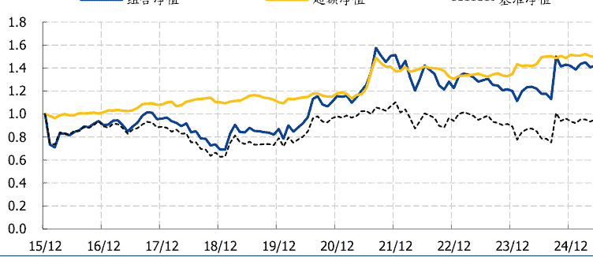
来源：wind. 国泰证券研究所

图3：盈利预测上调（后3月）组合月度超额

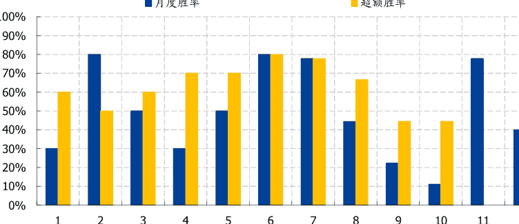
来源：wind. 国泰证券研究所

图4：盈利预测上调（后3月）组合月度收益率

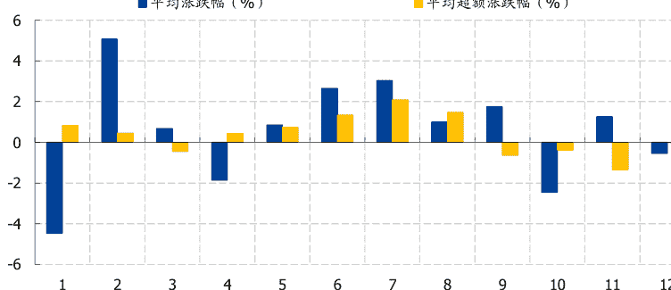
来源：wind. 国泰证券研究所

### 1.2 行业优选能否增加收益

我们对行业优选后的“正增长”行业进行回测，结果显示，仅行业优选在7月中（中报发布节点）与8月（中报披露期），行业优选能够改善组合的回测表现，最优在7月中超过50%的行业组合，最优表现为持有3天，超额收益54%。图5：2024年7月中首次中报回测行业优选平均周收益（行业优选）

| 行业领先 | 表现领先 | 超额收益 | 1日 | 2日 | 3日 | 5日 | 10日 | 平均超额收益 (%) |
| :--- | :--- | :--- | :--- | :--- | :--- | :--- | :--- | :--- |
| >0% | 106.7 | 51% | 58% | 53% | 49% | 0.19 | 0.61 | 0.76 |
| >0% | 95.3 | 51% | 58% | 53% | 51% | 0.21 | 0.64 | 0.86 |
| >0% | 77.8 | 51% | 58% | 53% | 53% | 0.17 | 0.71 | 0.90 |
| >0% | 65.8 | 52% | 53% | 53% | 52% | 0.25 | 0.68 | 0.87 |
| >0% | 50.7 | 52% | 53% | 54% | 53% | 0.18 | 0.72 | 1.11 |
| >0% | 41.8 | 52% | 53% | 53% | 54% | 0.27 | 0.76 | 1.14 |
| >0% | 26.3 | 53% | 51% | 53% | 56% | 0.55 | 1.00 | 1.11 |
| >0% | 22.2 | 53% | 51% | 56% | 58% | 0.58 | 1.19 | 1.26 |
| >0% | 20.8 | 53% | 51% | 56% | 59% | 0.62 | 1.25 | 1.28 |
| >0% | 19.8 | 53% | 51% | 53% | 64% | 0.65 | 1.28 | 1.28 |
| >0% | 19.5 | 53% | 51% | 53% | 61% | 0.70 | 1.39 | 1.46 |
| >0% | 14.5 | 53% | 51% | 53% | 51% | 0.73 | 1.39 | 1.46 |
| >0% | 14.5 | 53% | 51% | 51% | 56% | 0.76 | 1.46 | 1.53 |
> >0% | 14.0 | 53% | 51% | 53% | 58% | 0.79 | 1.57 | 1.57 |
> >0% | 13.2 | 53% | 51% | 53% | 61% | 0.82 | 1.64 | 1.64 |
> >0% | 12.8 | 53% | 51% | 53% | 64% | 0.85 | 1.77 | 1.77 |
> >0% | 12.5 | 53% | 51% | 53% | 65% | 0.88 | 1.89 | 1.89 |
> >0% | 10.0 | 53% | 51% | 53% | 68% | 0.92 | 2.09 | 2.09 |
> >0% | 9.8 | 53% | 51% | 53% | 71% | 0.94 | 2.10 | 2.10 |
> >0% | 9.6 | 53% | 51% | 53% | 75% | 0.96 | 2.28 | 2.28 |
> >0% | 9.5 | 53% | 51% | 53% | 76% | 0.99 | 2.36 | 2.36
数据来源：wind，国泰研究所

图6：2024年7月首次中报回测行业领先个股平均周收益（行业优选）

| 行业领先 | 表现领先 | 超额收益 | 1日 | 2日 | 3日 | 5日 | 10日 | 平均超额收益 (%) |
| :--- | :--- | :--- | :--- | :--- | :--- | :--- | :--- | :--- |
| >0% | 106.7 | 51% | 58% | 53% | 49% | 0.19 | 0.61 | 0.76 |
| >0% | 95.3 | 51% | 58% | 53% | 51% | 0.21 | 0.64 | 0.86 |
| >0% | 77.8 | 51% | 58% | 53% | 53% | 0.17 | 0.71 | 0.90 |
| >0% | 65.8 | 52% | 53% | 53% | 52% | 0.25 | 0.68 | 0.87 |
| >0% | 50.7 | 52% | 53% | 54% | 53% | 0.18 | 0.72 | 1.11 |
| >0% | 41.8 | 52% | 53% | 53% | 54% | 0.27 | 0.76 | 1.14 |
| >0% | 26.3 | 53% | 51% | 53% | 56% | 0.55 | 1.00 | 1.28 |
| >0% | 22.2 | 53% | 51% | 56% | 58% | 0.58 | 1.19 | 1.26 |
| >0% | 20.8 | 53% | 51% | 53% | 59% | 0.62 | 1.25 | 1.28 |
| >0% | 19.8 | 53% | 51% | 53% | 64% | 0.65 | 1.34 | 1.34 |
| >0% | 19.5 | 53% | 51% | 53% | 61% | 0.70 | 1.39 | 1.39 |
| >0% | 19.5 | 53% | 51% | 53% | 56% | 0.73 | 1.46 | 1.46 |
| >0% | 14.5 | 53% | 51% | 53% | 66% | 0.76 | 1.53 | 1.53 |
| >0% | 14.2 | 53% | 51% | 53% | 66% | 0.78 | 1.57 | 1.57 |
| >0% | 14.2 | 53% | 51% | 53% | 78% | 0.81 | 1.64 | 1.64 |
| >0% | 13.8 | 53% | 51% | 53% | 81% | 0.84 | 1.78 | 1.78 |
| >0% | 13.5 | 53% | 51% | 53% | 85% | 0.89 | 1.96 | 1.96 |
| >0% | 13.2 | 53% | 51% | 53% | 88% | 0.92 | 2.10 | 2.10 |
| >0% | 13.0 | 53% | 51% | 53% | 91% | 0.95 | 2.28 | 2.28 |
| >0% | 12.8 | 53% | 51% | 53% | 96% | 0.98 | 2.36 | 2.36 |
| >0% | 12.6 | 53% | 51% | 53% | 99% | 1.01 | 2.48 | 2.48
数据来源：Wind，国证研究所

图8：2019~2024年8月首次新股行业收益平均值（参与基金）

数据来源：6月21日~8月31日参与基金

| 行业板块 | 股票占比 | 超额收益 | | | | | | | 平均收益率 | | | | |
| :--- | :--- | :--- | :--- | :--- | :--- | :--- | :--- | :--- | :--- | :--- | :--- | :--- | :--- |
| 医药 | | | | | | | | | | | | | |
| | | | | | | | | | | | | | | |
| | | | | | | | | | | | | | | | |
| | | | | | | | | | | | | | | |
| | | | | | | | | | | | | | | |
| | | | | | | | | | | | | | | |
| | | | | | | | | | | | | | | | |
| | | | | | | | | | | | | | | | |
| | | | | | | | | | | | | | | | |
| | | | | | | | | | | | | | | | |
| | | | | | | | | | | | | | | | |
| | | | | | | | | | | | | | | | |
| | | | | | | | | | | | | | | | |
| | | | | | | | | | | | | | | | |
| | | | | | | | | | | | | | | | |
| | | | | | | | | | | | | | | | |
| | | | | | | | | | | | | | | | |
| | | | | | | | | | | | | | | | |
| | | | | | | | | | | | | | | | |
| | | | | | | | | | | | | | | |

图表9：2019~2024年7月首次新股中行业收益平均平均值

数据来源：6月21日~7月31日参与经理基金

| 行业板块 | 股票占比 | 超额收益 | | | | | | | 平均收益率 | | | | |
| :--- | :--- | :--- | :--- | :--- | :--- | :--- | :--- | :--- | :--- | :--- | :--- | :--- | :--- |
| | | | | | | | | | | | | | | |
| | | | | | | | | | | | | | | |
| | | | | | | | | | | | | | | |
| | | | | | | | | | | | | | | |
| | | | | | | | | | | | | | | |
| | | | | | | | | | | | | | | |
| | | | | | | | | | | | | | | |
| | | | | | | | | | | | | | | |
| | | | | | | | | | | | | | | | |
| | | | | | | | | | | | | | | | |
| | | | | | | | | | | | | | | | |
| | | | | | | | | | | | | | | | |
| | | | | | | | | | | | | | | | |
| | | | | | | | | | | | | | | | |
| | | | | | | | | | | | | | | | |
| | | | | | | | | | | | | | | | |
| | | | | | | | | | | | | | | | |
| | | | | | | | | | | | | | | | |
| | | | | | | | | | | | | | | | |
| | | | | | | | | | | | | | | | |
| | | | | | | | | | | | | | | | |
| | | | | | | | | | | | | | | |

图表10：2019~2024年7月首次新股行业收益平均值（参与基金）

数据来源：6月21日~7月31日参与经理基金

| 行业板块 | 股票占比 | 超额收益 | | | | | | | 平均收益率 | | | | |
| :--- | :--- | :--- | :--- | :--- | :--- | :--- | :--- | :--- | :--- | :--- | :--- | :--- | :--- |
| | | | | | | | | | | | | | | |
| | | | | | | | | | | | | | | |
| | | | | | | | | | | | | | | |
| | | | | | | | | | | | | | | |
| | | | | | | | | | | | | | | |
| | | | | | | | | | | | | | | |
| | | | | | | | | | | | | | | |
| | | | | | | | | | | | | | | |
| | | | | | | | | | | | | | | |
| | | | | | | | | | | | | | | | |
| | | | | | | | | | | | | | | | |
| | | | | | | | | | | | | | | | |
| | | | | | | | | | | | | | | | |
| | | | | | | | | | | | | | | | |
| | | | | | | | | | | | | | | | |
| | | | | | | | | | | | | | | | |
| | | | | | | | | | | | | | | | |
| | | | | | | | | | | | | | | | |
| | | | | | | | | | | | | | | | |
| | | | | | | | | | | | | | | | |

## 二、本周市场表现与政策事件

### 2.1 A股复盘:指数延续上行、向上突破、风口提升、情绪升温

行情表现:指数延续上行、向上突破、周五长线仍存在不确定性

本周A股趋势延续上行并实现向上突破，截至周五，指数于3472.32，已经过了2024年11月最高收价3470.66与2024年12月最高收价3461.50。一方面，银证方向上行，有利于指数表现；另一方面，题材利力不足，证监会第六次会议的“内需”引导市场交易活跃等给出方案，“支持创新高质量发展的若干举措”，医药行业依然活跃。本周A股指数高冲后回落，出现长线的K形态，存在不确定性。

图11：万全A股突破、换手

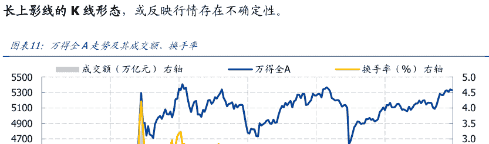

> 资料来源:wind，国证券研究所

本周A股整体偏上行，收盘和沪深300表现优，周度涨幅分别为1.75%和1.54%；创业50和科50表现较弱，周度涨幅分别为-1.71%和-0.35%。

风格来看，必需消费和金融结，大盘、市值权重化占优，风格方面，基金良好重心上移，绩指指数和权重涨幅分别为1.18%、1.09%和1.15%；行业方面，必需消费（2.13%）和金融（2.08%）权重占优，个股特征明显，大盘（1.48%），市值率（2.28%）和权重（1.55%）。

图12：A股各维度指数涨幅

| 银证指数 | 沪指 | 创业指 | A500 | 上证指 | 中证指 | 中证500 | 中证1000 | 创业50 | 科50 |
|---|---|---|---|---|---|---|---|---|---|
| 1.7 | 1.5 | 1.5 | 1.4 | 1.3 | 1.3 | 1.2 | 0.8 | 0.6 | 0.6 |

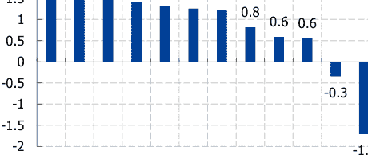

> 资料来源:wind，国证券研究所

图13：A股各维度指数涨幅

| 基金全指 | 医药指 | 科技指 | 消费指 | 大盘 | 中小盘 | 中市 | 小市 | 价值 | 红利 |
|---|---|---|---|---|---|---|---|---|---|---|
| 2.3 | 2.5 | 2.1 | 2.1 | 1.5 | 1.2 | 1.1 | 1.2 | 1.1 | 1.0 | 1.1 |

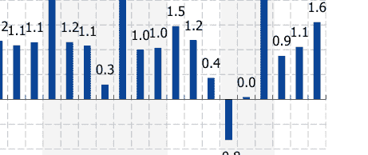

> 资料来源:wind，国证券研究所

# 国泰证券

2025年07月06日

风格相对可见，双创对价值较弱，小微盘对大盘表现明显。本周科创50/深300，创业板/深300，中创2000/深300，现脸盘/深300表现为-1.86%/-0.04%、-0.94%和2.0%。

图14:科创50/深300，创业板/深300走势

图15:中创2000/深300，现脸盘/深300走势

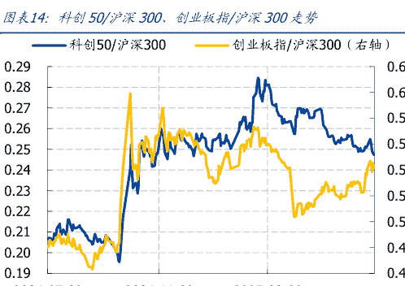

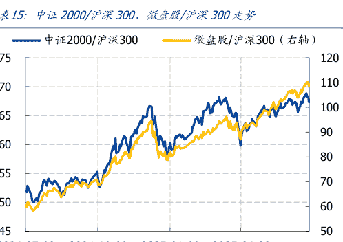

来源：wind，国泰证券研究所

来源：wind，国泰证券研究所

万华行业多数上涨，钢铁、建筑材料和银行领前涨，周涨幅分别为5.06%、3.96%和3.77%。中央委员会召开了六次会议，强调要依法治理行业低价竞争带来的，“反粘”调整钢铁、建筑材料等行业形成催化；银行行为“高股息+低波动”方可维持至市场行情。

图16:行业板块涨幅（%）

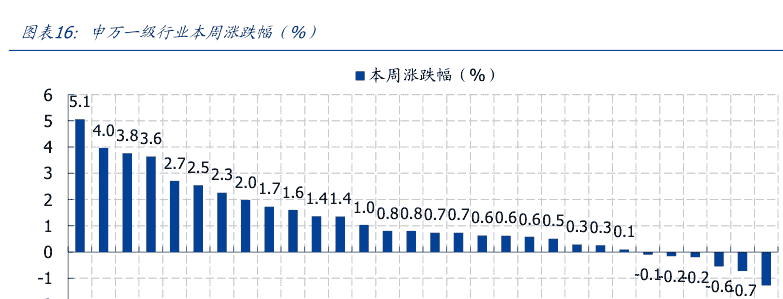

来源：wind，国泰证券研究所

## 情绪黄金：市场情绪回、情绪边界抬升，观测增量小资金流入

本周市场偏好有所提升。当前A股ERP3.96%，变动-6.03bp，反映市场风险有所释放。我们结合指数涨新高、站上均线、上次结构调整的复合情绪指标在中枢附近结束后再次回升，反映市场情绪边际抬升，具有本周涨高占比、站上20日均线回踩、20日上涨次数比相关指标均有改善。

### 图17: 万A级风险溢价(ERP)走势（%）

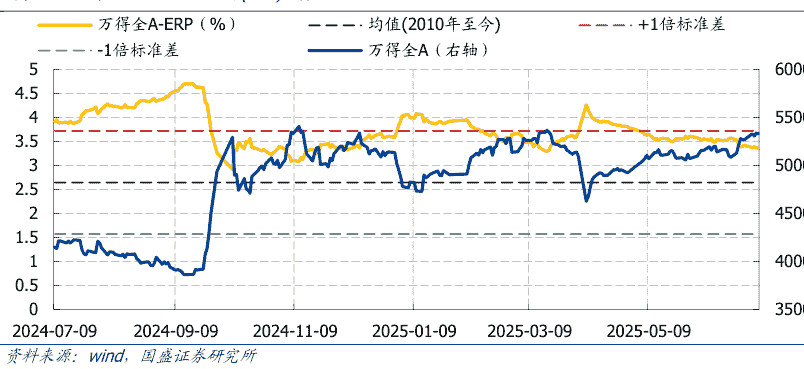

来源: wind. 国泰证券研究所

### 图18: A级复合情绪指标走势(新高频+线上频+上层级，右侧)

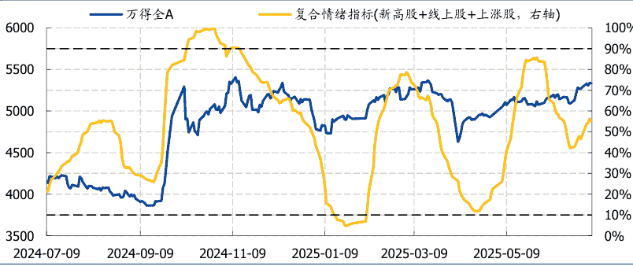

来源: wind. 国泰证券研究所

### 图19: A级高频、线上频、上层级情绪走势

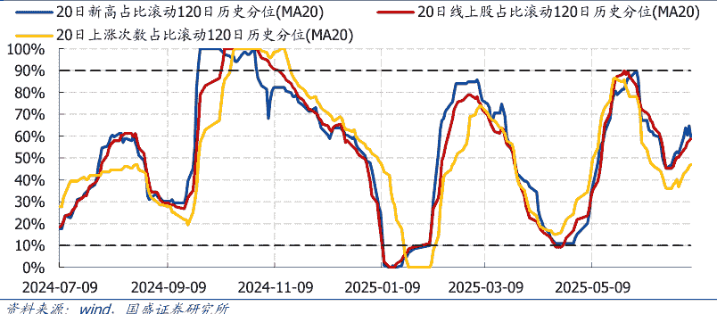

来源: wind. 国泰证券研究所

上周A股增量资金小幅净流入。从观测来看，本周A股增量资金流入38.28亿元，环比下降20.79亿元。具体来看，本周融资流入规模均减少。

### 图20: A股年度净资金流入（亿元）

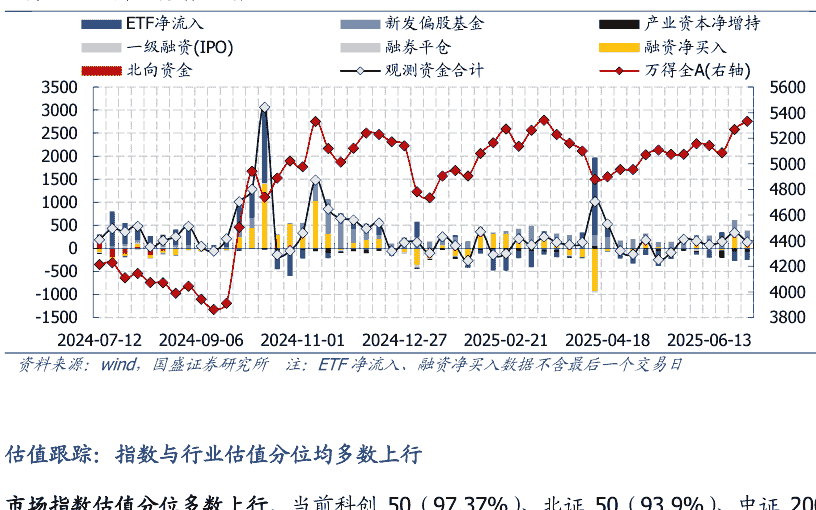

来源：wind.国泰证券研究所

### 跟踪：指数PE值分位数

市场指数PE值分位数较高，前创50（97.37%），中证500（93.9%），中证2000（92.56%）。本周沪深300、中证500、上证指数PE值回升，分别变动3.85、1.91、1.65%。

### 图21: A股市场PE值分位数（至今）

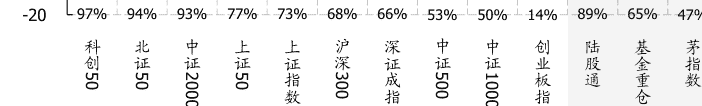

来源：wind.国泰证券研究所

当前PE值分位数多数，前三行业是房地产（98.59%），计算机（93.6%），大盘（81.6%）。本周提升前三行业是银行和医药，分别回升9.33、6.56和5.18%。

### 图22：银行PE值分位数（至今）

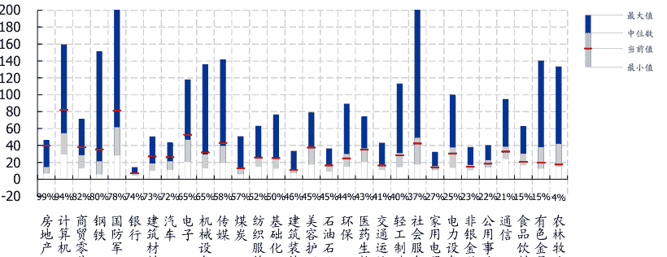

来源：wind，国信证券

### 2.2 全权益：全球市场

本周权益均衡，全球市场多数上涨、美股表现均衡，道琼、标普500领先，涨幅分别为3.21%、2.30%、1.76%。

### 图23：全球主要指数涨幅（%）

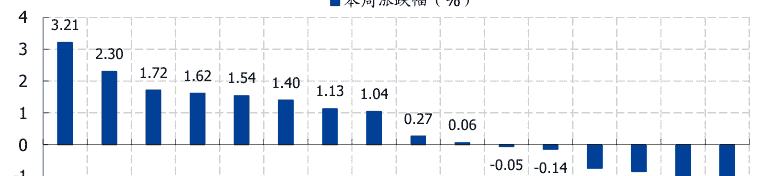

资料来源：wind，国信研究所

### 图24: 美股市场与指数涨幅 (%)

### 图25: 港股市场与指数涨幅 (%)

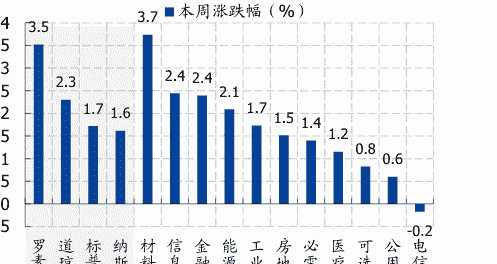

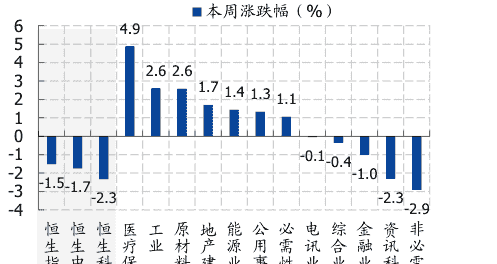

资料来源:bloomberg, 国泰证券研究所

来源:wind, 国泰证券研究所

### 2.3 大类资产：中美

权益方面，本周全球市场上涨1.20%。商品价格涨跌不一，特油、伦金、铜和CRB商品涨幅差异为0.78%、1.84% -1.57%和-0.43%，铜、油价、金价均下跌。利率方面，中债长端利率小回落，美债长端利率回升。汇率方面下降0.23%，人民币贬值0.10%。

### 图26: 布伦原油与美元金价走势

### 图27: 金矿、油金比价

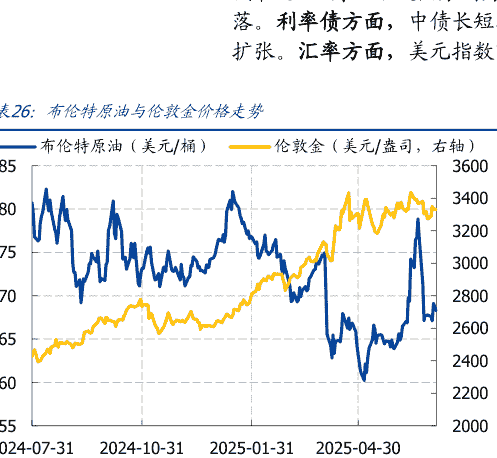

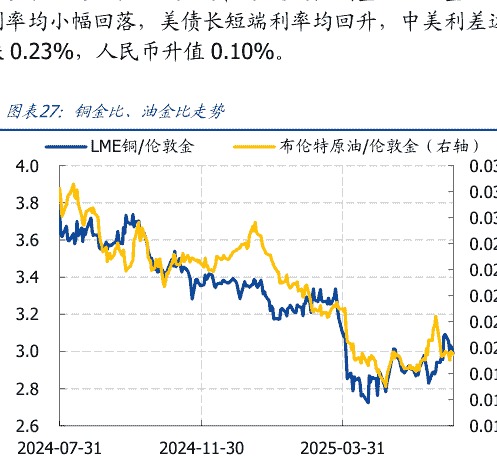

来源:bloomberg, 国泰证券研究所

来源:bloomberg, 国泰证券研究所

### 图28 全球资产类别表现表

| 权益 | 涨跌幅 | 本周价格 | 上周价格 |
|---|---|---|---|
| MSCI 全球市场 | 1.20 | 925.7 | 914.7 |
| MSCI 发达市场 | 1.31 | 4061.4 | 4009.0 |
| MSCI 新兴市场 | 0.25 | 1231.6 | 1228.5 |
| 大宗商品 | 涨跌幅 | 本周价格 | 上周价格 |
|---|---|---|---|
| 霍特原油（/桶） | 0.78 | 68.30 | 61.7 |
| 金价（/美盎） | 1.84 | 3331.0 | 3271.7 |
| LME 铜（/吨） | -1.57 | 9959.5 | 10118.6 |
| CRB 商品 | -0.48 | 566.3 | 567.9 |
| 利率 | 变动(bp) | 本周价格 | 上周价格 |
|---|---|---|---|
| 中国 1年期国债收益率 | -0.90 | 1.34 | 1.35 |
| 中国 10年期国债收益率 | -0.29 | 1.64 | 1.65 |
| 美国 1年期国债收益率 | 0.10 | 4.08 | 4.98 |
| 美国 10年期国债收益率 | 0.88 | 4.35 | 4.28 |
| 中美债 1年期 | -1.00 | -2.74 | -2.63 |
| 中美债 10年期 | -0.70 | -2.03 | -2.63 |
| 外汇 | 涨跌幅 | 本周价格 | 上周价格 |
|---|---|---|---|
| 美元指数 | -0.23 | 97.18 | 97.40 |
| 人民币 | 0.10 | 7.394 | 7.394 |
| 可信债 | 涨跌幅 | 本周价格 | 上周价格 |
|---|---|---|---|
| 中美债 3年期+债 | 0.21 | 447.60 | 429.11 |
| 中美债 5年期+债 | -3.65 | 5.30 | 5.33 |

### 图29：中美10年期国债收益率差（%）

来源：wind, bloomberg, 国信证券

### 4. 政策事件回顾

| 日期 | 政策 | 主要内容 |
|---|---|---|
| 6月30日 | 联储会议 | 鲍威尔暗示利率维持在5.25%-5.50%，下周联储继续不变，分歧市场预期鲍威尔暗示降息。 |
| 中央委员会六次会议 | 会议指出经济运行总体平稳，但面临内需不足、房地产风险、外部压力等多重挑战。会议要求坚持经济增长为主，保持货币政策灵活性、针对性，加强与国际交流。 |
| 7月30日 | 深入读全球宏观环境及中美关系。 | 本周全球市场上涨1.20%。商品涨跌不一，特油、伦金、铜和CRB商品涨幅差异为0.78%、1.84% -1.57%和-0.43%，铜、油价、金价均下跌。利率方面，中债长端利率小回落，美债长端利率回升。汇率方面下降0.23%，人民币贬值0.10%。 |
| 7月 | 统计数据 | 电力电量增长6.7%，工业产量增速5.1%，上半年增速15.2%。其中，出口额42.1万亿美元，出口同比增长21.7%。 |
| 7月1日 | 德国数据 | 德国制造业指数下降7.4%，高于预期的6.7%。6月GDP下降0.1%，同比降幅0.1%，优于预期0.3%。制造业指数下降7.4%，服务指数下降1.4%。薪资涨幅分别为0.4%和0.3%，分别此前为0.3%和0.2%。 |
| 7月5日 | 法国数据 | 法国制造业指数下降8.1%，服务指数下降1.2%。6月GDP下降0.2%，优于预期0.1%。制造业指数下降8.1%，服务指数下降1.2%。薪资涨幅分别为0.5%和0.4%。 |
| 6月 | 中国统计局 | 工业增加值增加5.2%，社会消费总额同比增加4.7%，高于预期4.5%。CPI上涨2.3%，PPI下降0.1%。出口同比增长5.4%。 |
| 6月 | 中国统计局 | 固定资产投资增长6.6%，社会零售额同比增长6.7%，高于预期6.5%。 |
| 7月 | 英国数据 | 非农人数增加6.6万，低于预期7.4万。英国通胀率降至6.7%，高于预期的6.1%。6月GDP下降0.5%，优于预期。非农人数增加6.6万，失业率升4.2%。薪资涨幅分别为4.3%和4.2%，分别此前为4.4%。 |

# 风险提示

- 1、若地缘政治恶化，将抑制全球贸易增长与跨境资本流动。
