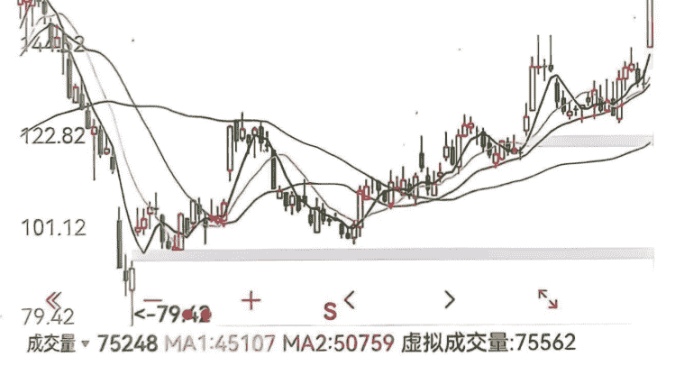
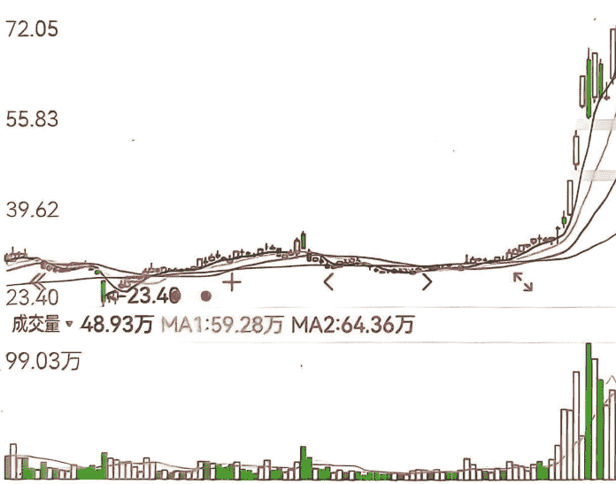

# 南风大王

2025-08-11 15:07

# 微信:jtsg8

# 微信:jtsg8

女方家长专属

# 免费进资料群

两驼冲进来会干什么，抱跑。

所以光模块之类是没有淘汰的，

你还相信吗？

4亿美美的黄戈扩张，那简直是狗升天。

我们读了这么久教主高低温和冷电源，你都还没住，得没思了，

如今上吗？不能。走完了吗？没有。

现在领先的电子芯片在走单涨。

大女光模块领先诺斯斯实体，2倍涨幅，

女儿你怎么也得霓裳离乱，历史新。

男方的公云东传，那就得红旗围了，主打一个追的。

新练，拓锡，东芯，都是分批拆回哈的玩法（这个看着不仅你学啊）

龙头类谁不容易，容易死的的就是不是龙头，你学得了吗？

天津终于为了华为生癌了，背后的微澜页贡献还没提了。

红卷起了~

| 163.38 | 164.51 | 163.28 | 163.68 | 165.01 | 86.63 | 84.63 | 78.66 | 78.26 | 74.93 |
|---|---|---|---|---|---|---|---|---|---||
| 160.23 | 162.72 | 161.88 | 161.66 | 162.28 | 84.168 | 81.60 | 78.82 | 79.23 | 72.38 |
| 159.72 | 161.33 | 160.72 | 160.23 | 160.74 | 80.16 | 77.6 | | 77. | | | 77. | | | 70.28 |
| 158.88 | 159.88 | 159.38 | 159.38 | 159.98 | 75.71 | 75.38 | 74.58 | 73.98 | 69.38 |
| 157.68 | 158.68 | 158.18 | 158.18 | 158.78 | 72.68 | 71.88 | 71.38 | 70.88 | 68.58 |
| 156.68 | 157.68 | 157.38 | 157.38 | 157.98 | 69.68 | 69.38 | 68.88 | 68.58 | 67.58 |
| 155.68 | 156.68 | 156.38 | 156.38 | 156.98 | 67.68 | 67.38 | 67.18 | 67.08 | 66.58 |

南风大王

女主：

女方光模块：康宁/旭创/浪涌/机/电源

女方光模块：生产产生瓶颈 -> 需求最好是连接的

# 163.38 今开 145.01 最高 163.38 最低 145.01

20.00% 27.23 换手 7.03% 总量 75248 金额 11.86亿

总值 175.0亿 流值 175.0亿 市盈 88.26 更多

欧通转债 386.000 14.97% 转股价率 3.91% >

中报预披露：于2025-08-29披露2025年中报

分时 五日 日 K 周 K 月 K 更多

均线* MAS:143.40↑ 10:138.00↑ 20:136.26↑ “点” 前复权

55:122.26↑

# 84.63 今开 75.00 最高 88.26 最低 74.00

14.66% 10.82 换手 11.06% 总手 48.93万 金额 40.28亿

总值 374.3亿 流值 374.3亿 市盈 157.94 更多

中报预披露：于2025-08-23披露2025年中报

分时 五日 日K 周 月 更多

均线 MA5:70.70↑ 10:64.45↑ 20:49.90↑ “点” 前复权

55:37.88↑ 88.26->

88.26

23.40 MA1:59.28 MA2:64.36

成交量 48.93万

99.03万

> 南风大王
摘自财经

主：

女方PCB光模块 > 铜缆/液冷 > 交换机/电源

女方有钱，扩张产生效应，后面还会继续给钱。

作者：南风大王 2025/8/8

五城：今天群里热闹啊

2025-08-11 15:10

小儿 回复 五城：我要进群

2025-08-11 15:53

向心而行，要进群，请问进去

2025-08-11 18:23

飞雪 回复 五城：群里进去了？

2025-08-11 21:05

叶晨：东岳还是那个？

小儿 回复 叶晨：东岳今天冲出来了，明天再睡吧。还好有5%收益，我是非常满意了，感谢大王发红包

2025-08-11 15:11

leo 回复 小儿：没错操作。删群就能领大王了

2025-08-11 15:37

小儿 回复 leo：🙏🙏🙏🙏

2025-08-11 15:38

123 回复 小儿：我里面动

2025-08-11 16:50

Jerry 回复 123：我也没动

2025-08-11 19:29

小儿 回复 123：这样的行情，不动也许最好的，我也经常等好股

2025-08-11 21:23

123 回复 小儿：有道理，明天再低买！

2025-08-11 22:30

小儿 回复 西.M: 复制一下大王今天的文稿

2025-08-11 22:31

西瓜：图是一些侧的

2025-08-11 15:18

枉枉 回复 西瓜：呦薛涛

2025-08-11 15:16

西瓜 回复 枉枉：

2025-08-11 15:15

火的pzh：谢谢大王指数！东岭和泗州都瘦完肉了！看着东强。直直的原料我还没涨起来，着急了？还有海湾也跌到20日线55天了，科技和重大数据居然没涨起来，请问如何操作好呢？

2025-08-11 15:41

南湾大王 回复 火的pzh：科技自强对东岭和东强将接到后，莉已经可以了，它是电源，别人是英传电源，华为的光模块电源调冷就不在跌了。

2025-08-11 15:45

Super 回复 南湾大王：今天谁还接了光扩散，有可能呢30cm?

2025-08-11 15:51

火的pzh 回复 南湾大王：谢谢大王！不着急，波万两头接换，就有再热一下

2025-08-11 16:09

Lzhiguo 回复 南湾大王：华为的冷还是...

2025-08-11 19:14

nn 回复 南湾大王：华的都有有些绿吗?

2025-08-11 22:19

医学信息：大王 什么时候换交换机，一直在露面了吗

2025-08-11 15:54

123 回复 医学信息：+1

2025-08-11 16:50

赵子：大王，请问这种回应该怎么样？直接拿住，还是错毕竟底部涨起来的。

2025-08-11 16:00

泛子：大王，港股还能涨?埋了很久还会涨吗?

2025-08-11 16:08

尼尼伦：请问大王，港股还能涨?今天又跌了。

西.M 回复 尼尼伦：问

2025-08-11 17:30

Carl：今天大王还想买德

花王【DIK HUN】：还在等

2025-08-11 20:30

小儿 回复 花王【DIK HUN】：陪你一起

2025-08-11 21:23

智宇：什么倔

lin 回复 智宇：东芯

2025-08-11 23:06

在这个顶上：玥芯下半年有希望?

2025-08-11 22:25

奔面的牛：云天是哪个?云天化

2025-08-11 23:37

胡：大王，我有个好，30岁，今年出一个肿，是良性的，现在在等手术。她容易暴躁，太控制情绪，苦味明显，身体容易累。检查说是肿瘤。请您帮我看看如何调好身体，大概还不好。女孩，眼睛不好就是，肝肺就不开心，不开心就是爱，治本的办法，你给她一个朋友运。2025-08-11 15:46

楚钰：妃容易累，估计她有点热+气虚，可以吃猪肉温汤+泡（网上可以找到配方和剂量）看看对不对（仅供参考，只泡泡，跑三天不一定符），还有经常的早起多运动，还有气虚脾胃瘀，可能让老补气血。进加回复微信的事大王说，应该是从人入手，还是或者工作环境让她不开心？第一次评价这种类型有点落差，如果哪里望的对不对）2025-08-11 16:12

khm1995：想大王给孩子起个名字

2025-08-11 16:22

胡胡：谢谢大王做人，还是开心重要

2025-08-11 16:23

王多肉君医：

2025-08-11 16:25

水镜：上火就脸痘，没有什么办法。

2025-08-11 16:35

慢慢安宜回复：忌口，少吃辛辣，不要熬夜

2025-08-11 15:54

徐婉丽：芷光轩：终于为什么心情不好了

2025-08-11 10:48

# 年纪轻腰突加骨旋旋转，有什么比较好的康复训练推荐？苏州上海

春暖不觉寒：瑜伽

2025-08-11 18:09

COCO：可以去柱调理康复机构看客

2025-08-11 18:41

褚沫：瑜伽不去，找我拉膜就好了，拉不开，瑜伽做不来的

2025-08-11 18:41

慢慢妥妥：试试懒人呼吸法

2025-08-11 19:17

南冉大王：这个位置很重要，不要乱去康复机构，更不容易动手术，腰是肌质比较软，靠自己调理就好，找个三甲医院针灸。

2025-08-11 19:35

素令：去试试普拉提私。普拉提本身就是带康复性质的，我腰也突出，现在在康复拉拉了。

2025-08-11 21:31

Carlin 回复 素令：你只想练瑜伽，其实实测代表你腰椎突出，改变姿势就是关键。2025-08-11 24:16

吕梦：试试墙蹲方法，模仿墙蹲（腿部极高），初期要扶着墙慢慢蹲到墙角左右走，慢慢增加腿高度，在垫上（下）站起来，然后爬结束后用手按揉腰部，类似学校课前操，必须要学会，这样做非常重要，工作期间要练习拉伸，开头五个分钟，让腰缓解腰椎的筋痛、肌肉缓解，不需要用腰椎矫正器，坐姿正确就行，特别是腰间盘突出比较严重，由于人体左右侧腰单侧疼痛，单靠在办公上有用腰垫，也是一样的，用颈椎靠垫治疗头部、骨椎问题。应对方法因人而异，可以左右视颈座椅，视环境条件，也可以时时拉伸不要一直着颈肌肉。
