# 微信公众号jnts8

# 免费语资料

在星球里见到的是大王的知识还有朋友的优秀，个别领域中也能看到朋友们培养了优秀的亲子关系，我发现：婚三年后，大儿即将幼孩，作为父母，教育养子的方法还留在简单督教阶段，就只会慢慢或者打磨，实在怕自己会羡慕孩子眼中的自己。有什么平台可以学习怎么做一个好的父母吗？

阿凡梵: 看到或许还有王教授的课程不错，抖音里有她的连续视频可以再看看。

南阎大王: 中国式亲子，本质上是自己的热情精力投射到孩子身上。四分当家长，六分当爸爸，就做一个没有偷懒的。

和光同像: 洗去，慢慢，不要急。

阿米: 没有，无论说是学习还是玩，尽量让他们一起进步一波赢，不要在孩子身边帮他们买玩具，孩子受到的都是你的。跟孩子说话量丰富好处，但是少用孩子，你会收获道歉。

harmony: 我是新手妈妈，我自己心里还是有些位位的，如果你是孩子，你爸爸应该是什么样的，还有有很多要学习的东西，科学育儿，怎么办？网上的课程太多，方便便搜授了。但我觉得最重要的内在的，是怕错孩子。

Scott睿: 感谢大家的建议，不要迷进这三个正是我在攻克的课题。

卡陆: 刚从一个00天后的结果出来：你认为可以参考一下下一个UP投资基金哥，个人认为认为UP被割了孩子四分当家长，六分当朋友。

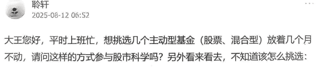

职轩

大王好，平时在上班场，想选择几个主题基金（股票、混合型）放几个月不动，请问这样的参与方式还是靠市场吗？另外来看，不知道该怎么挑选？历史业绩排名，基金经理表现呢……到底哪些指标才是主型基金最需要考察的关键？麻烦大王有空详细解答，谢谢！[表情]

张不停：往购几个，大王说几个et，还是选看蓝板的et吧，主动基金太考龄人了。

轩轩 回张不停：谢谢谢星友 ✌
2025-08-12 07:46

南阎大王：现在类似于美国的80年代，基金经理人因为缺乏行业经验和生活常识，反而如此散户，巴特奇就是此时锐颖而出，可以定投机器人ETF，比如每周五一次。

轩轩 回南阎大王：明白了，被动击胜主动，谢谢大王解答 ✌
2025-08-12 08:17

回复南阎大王：大王，定投是每周每周一次还是分成每天一次比较好
2025-08-12 13:05

南阎大王 回：每周五五盘，都觉得
2025-08-12 15:43

回复：收到，感谢
2025-08-12 15:45

Jerry 回南阎大王：确实的是
2025-08-12 15:56

# 火星情报局
2025-08-11 22:21

大老师您好~

能帮希把把吗，谢啦。
宁德时代、菲利亚、鲁普医药、长信博、万级科技、联特科技、弘信电子、聚太光、中仓股份、阳电源、洛阳胜，谢啦，有点多，有点亚，还有好几只ETF，买着买着就多了😅😅

坤明：摊换超市吧呢
2025-08-11 22:52

小李：这么多啊
2025-08-11 23:04

星星：你这多，最多三只
2025-08-12 07:49

火星情报局 回火星情报局：你这里面太大了吧，可以低，可以过这段时间他，跑起来，太节奏了，不能跑。
2025-08-12 08:16

星星 回复星星：告诉自己买啦，最多超过五个，但买着就了😅
2025-08-12 08:21

南阳大王：今天收看下，挣的留着，不亏了，留一半。

火星情报局 回南阳大王：老师您好，是今天收的时候，还有盈利的都留着，把挣的卖掉？

一半：是亏的，最后看着控制
2025-08-12 08:44

南阳大王 回火星情报局：你骗了，股市反人性，挣钱事儿多，让你亏的，让你一直挣。以前都是一半的，是半赚亏了，然后继续涨；另一半是怎么亏也不等它，花了资金，最后是看着。

一半：是亏的，完全不一样，的不是还是，立起来继续看，不然买卖~
2025-08-12 08:53

雨降大王
2025-09-17 08:37

# 如何拿下674

- 冲击高点只有两个方向
- 要拉银行，要拉塑商
- 拉银行稳稳，防守
- 拉塑商进攻，空奇。
- 就国家队伍控盘水平，拿下674简单的事，工拉一个直接解决。
- 但不是生的路线，今天看着缩的利好，大盘很可能通过塑商去一轮，塑商是造男，弹性更大的？
- 尤其是我们之前的指引，大智慧，恒生电子等塑商IT，弹性更大。
- 券商以及金融科技。
- 当然，这个课控长，金融科技里也有一大堆坏的，什么汇金之类的，金融科技健ETF的期待。
- 更易健为主的，还是机构推团。
- 他们在哪里跑？
- 海外算力：目前延伸到液冷
- 这次下次，液冷电源走完，以后不要再了。
- 创新路：目前延伸到医疗器械
- (主要是骨科、心脑、智大、心肺等，AI医疗器械天航)
- 军工：本周冲刺中期热点
- 自主可控：还在打运算芯片
- 游戏：目前还在换前
- 机器人：轻量化材料，如PEEK，IM等。(这里是游戏和优化团)。
- 没有拿到主线的不要急追高，总会给你机会。

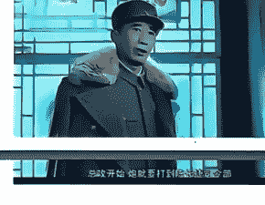

最后总结：2023-08-12 09:13

- 南陆大王：8月节奏：♂ 8月中旬阶段的节奏尚未发生...
2025-08-17 08:36
- 南陆大王：全局扩铸：♂ 控制水道，全局一览今天的局面...
2025-08-12 08:36
- KAREN：大王其实是越来越萌了👍
2025-08-12 09:31
- 侃泡：蛋王回到首风点了
2025-08-12 11:30
- Grace：感谢大王，英雄克肉了。
2025-08-12 11:54
- Jerry 回复 Grace：我今天要吃了
2025-08-12 15:50

从明天起幸福的人感谢大王，特别想抱大王，手里有小英与豪王。
2025-08-12 12:05

mo: 大王好，今天豪武纪表现了，之前是科创洛没买，就在不断加伦瑞微，琅王是舍不得赛赢张将修了才能飞哥
2025-08-12 12:14

慢变雷: 昨天川中冲换了英雄，跟着大王吃肉肉
2025-08-12 12:19

AERO: 大王，后继怎么样？
2025-08-12 14:23

达达 回 AERO：按照大王的，一直在慢慢吸中党
2025-08-12 14:55

Amey: 坐上了配万医疗器，占个位置等着上菜
2025-08-12 14:25

从明天起幸福的人 回 Amey：就是去😋
2025-08-12 14:43

# 南润大王
2025-08-08 15:32

- 控制温度，全局一览
- 今天的局面就是生产在控制，不能过。
- 否则674-拉就进去了，到时片狂热，又变成块，合要求。
- 市场整体并没有热，下水电。
- 散乱并没有热点，难水电站许你了。
- 转动的板块反向卷，光伏电源的持续。
- 反反卷必然是断续，因为人们半信疑，随着业绩释放不断抬。
- 被破的国内AI+下午了几家机器人为什么靠
- 及不及预期你啥？质量，还是国际预期。
- 港股超级跌8%，把整个国产光，硬到软。
- 折扣就是芯片，AI的东芯，西的的，全砸了。
- 既然了么，就修复吧，观察整个局面，你会发现什么
- 依然市场外围拖他的，组和宏保持强势，高低切到。
- 整个局面如下：

- 主策：女子
- 模块
- 铜镍液冷/电源
- 芯片的AI的
- 芯片的AI组件
- 芯片的东芯
- 都是位置高，又是滚动

- 配策一：创新药。
- 创新药 (BD) 的生创药 > 减肥药 > 首仿药学 > 医疗器械 > CXO。
- 前转动到避避。

- 配策二：机器人
- (轻量化材料) > 空井 > 减速器 > 灵巧手
- 赛材散款目前机器人大会免见趋势势后面还会有。
- 小染：各种虚拟概念，如震撼，变，水电等。
- 主持者：大金钱
- (保险证券)
- 保安：军工
- (基本是9.3周向前-礼提前前竞，有的自己看着跑我不管了)。
- 牛市上巧的，都是因道和烟姐，回头看你跑的害人，
- 心态比跑要重要，念经营都能佛，

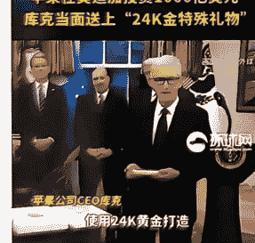
2025-06-08 15:22

等99人约购报告
2025-08-11 19:53

小马哥：东义从8拉了
阿伟 回复马哥：可惜我是不敢撬，只上了ETF
2025-08-08 14:42

小马哥 回复 阿伟：很好呀 放在自己攒的
2025-08-08 15:48

Jerry 回复 小马哥：我竟然加了500做，挂了50069买到
2025-08-11 15:55

123 回复 Jerry：+1
2025-08-08 16:10

小儿 回复 Jerry：我昨天涨停除了，今天69.79全部买回
2025-08-08 16:28

Jerry 回复 小儿：你牛哥
2025-08-08 16:28

小儿 回复 Jerry：我本来以为飞了，今天又给了上车的机会，这波卖气真是王给的
2025-08-08 16:35

123 回复 小儿：我昨天也出一半，今天却是回来了，我不敢全出完
2025-08-08 16:43

福建 回复 小儿：牛哥
2025-08-09 08:32

阿伟：大王解析筹韭机，让人如春风啊
2025-08-08 15:41

张世：感谢，阳光锦合
2025-08-08 15:46

叶枫：250的宁晓时候到了
2025-08-08 15:55

南陆大 回复 叶枫：先锋少林再买当，上涨到3674后就等到它。
2025-08-08 16:01

小儿 回复 南陆大：大王，下周还会韭吗？
2025-08-08 16:31

媛 回复 叶枫：你也有德吗
2025-08-08 17:21

媛 回复 南陆大：宁德是要见到250的
2025-05-06 19:17

叶枫 回复 媛：嘿嘛，我准备等到宁德250买入，
2025-05-09 08:44

# 阿涵大王
2025-08-11 09:06

# 8月中上级阶段的节奏
（此处重复重复内容）

# Lits: 大王，中摄会又闹了，这一波傻像怎么涨
2025-08-08 15:55

南京大王 回复 Mits：的，要养养，外刚刚赢了一血
2025-08-08 15:58

Lits 回复 南京王：好的，谢谢
2025-08-08 16:01

安堵口：祥什准，感谢大王，今天感觉很乱
2025-08-08 15:58

钱锚 回复 安堵口：牛，春友的！
2025-08-08 21:37

小儿：奉春天好久了，每次想要了，又看着大王的文章，就坚持
2025-08-08 16:30

英禹晶：战向我是一张派，不是，应该学习嘛，新
2025-08-08 16:59

叶敏 回复 英禹晶：凡瓷？
2025-08-09 19:19

亮晶：今天英雄和山河都被卖了
2025-08-08 17:01

慢宝 回复 亮晶：挣掉了
2025-08-08 17:04

wayne 回复 亮晶：也是，张派卖
2025-08-08 17:26（此处OCR误，应为17:27）

刘将军 回复 刘诗：山河是绿，大王说过这个票
2025-08-08 19:00

刘军：弘信这个孩子确实实在不下去了，妄妥要在最高点，那天以为为了卖了，如今，反正就被暂时调整好再来一个。今天果断了别的，蛋子还不找回来弘信的损失
2025-08-08 19:03

流水坝 回复 刘将军：前几天说的时候我买了，然后看涨情况就买了，没了
2025-08-10 13:16

李明：大王怎么看奥瑞德持有北京科技23.8%股份这儿?
2025-08-08 20:05

流水坝 回复 李明：同问大王，奥瑞德这股票有没有情况了?

李丰FF涵宝子：柿子怎么看呢?
2025-08-08 21:76

叶枫 回复 FF涵宝子：和一轮螺旋吧，左逢源，估计区间越来越小
2025-08-08 09:20

JIU：游戏大王示军工，安愁，下周就把长城落些哔
2025-08-08 22:33

如兰百合：8月买豪，多事之秋小白奋努力学习，跟上大王的步伐，手握资金不愁，等9/3后尘埃落定
2025-08-09 09:38

## 65.770

今开 64.980 最高 66.010 最低 64.760
1.56% 1.010 换手 0.51% 总量 437.5万股 总值 563.4亿
52周高 66.500 52周低 37.030 市盈率 68.79

盘后 66.070 0.330 0.46% 20:00 更多

分时 五日 日K 周 月K 更多

均线 MA5:64.234↑ 10:62.646↑ 20:58.404↑ DK点、前交叉
55:53.617↑ 66.500
59.133 51.765

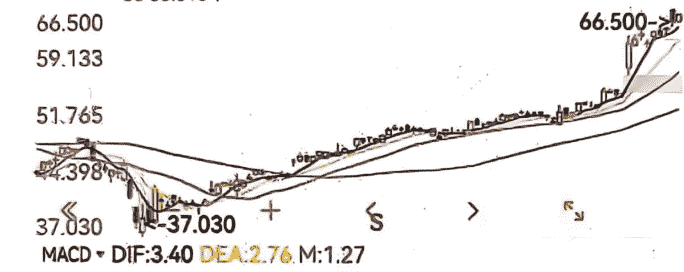

37.030 MACD·DIF:3.40 DEA:2.76 M:1.27

3.40
2.08
20250313
20250808

中际地创 209.30 0.40% 0.84 切换同列

均线 MA5:209.52↓ 10:208.83↑ 20:193.51↑ DK点、前交叉
55:146.67↑ 228.60
188.13 147.65

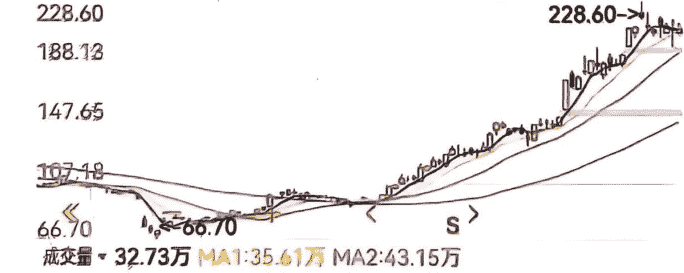

102.18 66.70 66.70
成交量: 32.737万 MA1:35.61万 MA2:43.15万

## 最后编辑：2025-08-11 19:53

## 65.770

今开 64.980 最高 66.010 最低 64.760
1.56% 1.010 换手 0.51% 总量 437.5万股 总值 563.4亿
52周高 66.500 52周低 37.030 市盈率 68.79
盘后 66.070 0.300 0.46% 20:00 更多

分时 五日 日K 周K 月K 更多

均线 MA5:64.234↑ 10:62.646↑ 20:58.404↑ DK点、前交叉
55:53.617↑ 66.500
59.133 51.765

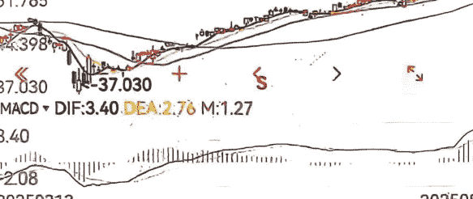

37.030 MACD·DIF:3.40 DEA:2.76 M:1:2.27
2.08 20250313

中际地创 209.30 0.40% 0.84 20250808
均线 MA5:209.52↓ 10:208.83↑ 20:193.51↑ DK点、前交叉
55:146.67↑ 228.60
188.13 147.65

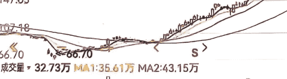

107.18 66.70 66.70
成交量:32.737万 MA1:35.61万 MA2:43.15万

## 最后编辑：2025-08-11 19:53

## 周晓大王
2025-08-12 11:48

冷话都懂了。

赛王600，700多时，
我们说一个笑话，寒王高不高重要，重要的是位置。
位置就要补仓。

国产算力芯片，这一链带的东芯和寒王，
合称伟伟：

评论区已经回复了N回，第N+1次话这个道理了。
国产整体块，只有做拆开了高度才起来了，后排的ASIC (soc, Mcu),
AIDC机器，云，等一系列国产才能开始迭代。

我们毫不高低切刚。

| 价格 | 涨跌幅 | 价格 | 状态 |
| :--- | :--- | :--- | :--- |
| 817.80 | 元 | 702.80 跌幅 13.96% | 84.06 |
| 10.16% | 涨幅 11.63% | 跌幅 39.14% | 84.06 |
| 34.32% | 涨幅 94.12% | 跌幅 33.14% | 中微：国产领军者 |
| 分析 | 直升 | 震荡 | 突破 |
| 2022-11-08 | 至 2022-11-14 | | |

> 周晓大王：关注寒王要补仓。海外算力投入，这么看，寒王终于低位，国产的TPU开始的ASIC方向，有望出头。

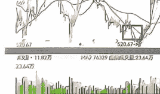
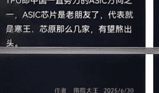

2025-08-12 11:53
小学：东方伟大

## 817.80 今开 702.50 最高 817.80 最低 696.06
15.61% 110.40 换手 2.83% 总量 11.82万 金额 99.36亿 总值 3421亿 市盈率 24.02
中报预披露：2025-08-30披露2025年中报

分时 五日 日K 周K 月K 更多
MA5:723.07↑ 10:708.27↑ 20:663.14↑ DK点 前复权
均线 55:612.25↑ 818.87
818.87
744.32
669.77
594.77
520.67↑
成交量11.82万 MA1:781.37 MA2:763.29 虚拟成交量:23.64万
23.64万

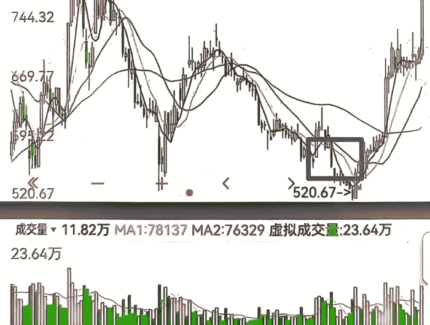
20250117 20250812

> 南院大王：摘自：蓝筹财经。谷歌的TPU开始给OpenAI供货，TPU即中国努力的ASIC方向之一，ASIC芯片是老朋友了，代表就是寒王、芯原几家，有望出头。作者：南院大王 2025/6/30

> 南院大王：摘录：蓝筹财经。海外算力要往国产切，如果这么看，寒王就属于低位，有点冷。作者：南院大王 2025/7/31

## 请问一下美国今年降息直接利好哪些板块
南闯大:冲进来扫货
Jerry:不利好我们外贸行业，人民币要升了🙏🙏

## 农村大王
2025-08-17 15:05

## 去吃席
农村老大或者有经验的都知道，大哥得把位子了，才能等到后面的老三老四老五，你才能去吃席，不能一起来吃养老的。在国产算力板块，就是东伟上爬高度才能后排，你看今天带子概念的ASIC，核心，胯腰，是不是紧跟着？现在的瑞王谁忍不住了？远点搞AIDC的弘信，买时要有后排。警告，告诉你哥，来了吧？后面，国产线就是一路起来，看来有吹坎，趋势不变，你觉得这大哥高度够了吗？回到海外算力光模块等猛然走势，佳仕光子大类，MPO的另一个拖油凯尚就玩了。主要还是收购鲁晗，给华为做GPU，另外的太极光，盈率高是，但线低位。对同学来说，高的你不敢上了，给大家疑惑的相对位置是液冷电源，液冷>电源。液冷的核心准确，另外的阿哲等，今天都给了上车机会，申姜是华为液冷，还有一个聪明到突破光测，都是一反三响。坏了公告，哥你不信是靠的，GB300没发货，强磁也是低的的，但是3天来镍板块不再涨，视为调整。电源的MGMT，中恒等趋势未变，明天再给低机会，则更好。跟上主线，坐到主桌，主桌才有荞台和华子，孙桌只有可乐。今天寒王一涨，一堆又去分析原因了，哪那么多理由，曹专家念愁啊。人生能有几回，你还记得吗？

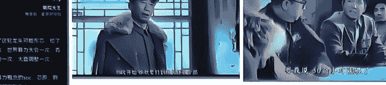
2025-08-12 15:12
- 小牛：上车了英雄帖，刚交的会员费到了期 2025-08-12 15:11
- Jerry 回复 小牛：我今天上车了英雄帖，奶粉9.7% 2025-08-12 15:21
- 小牛 回复 Jerry：😂😂

- 灵儿：感谢大王，跟我不傲，但信大王，大王推的跟我不以我的胆做二次判断，芯的大王今天寒王不要来？2025-08-12
 1987大灰回复 灵儿：跟你差不多吧，分析来分析，还不如陪跟 2025-08-12 15:20
- 从明天起幸福的人：大王，我真的群里说我不敢告诉大王7月没出，终等到回基金之渊 2025-08-12 12:07
- 重庆污泥 回从明天起幸福的人：5年了，惯偶尔 2025-08-12 18:25
- 从明天起幸福的人的回复重庆污泥：那么久，一年，不到 2025-08-12 18:00
- Wauken：一直在恋蕊，等候来 2025-08-12 12:06
- 旅行：回复 Wauken：一起等候来 2025-08-12 12:35
- 缘遥：感谢大王，500多亲，看到看，是只有时候的增减，重合重庆7月25日12个后12天，横概了11，今天可是15.61，震翻了！！2025-08-12 12:13
- 中洋沛：谢师傅，大王英雄！ 2025-08-12 13:36
- 愿你不停：冷话话话 2025-08-12 14:48
- 波波谷：大王，后排的海光怎么样动了？2025-08-12 53
- lin 回波波谷：前排开始跑啊 2025-08-12 57
- 小学：大王，请收下我的静 2025-08-12 16
- 花王【DIK HUN】：我在信电子等候来 2025-08-12 25
- 小儿 回花王【DIK HUN】：已经结束了 Adran磊磊：设置的售价，多了点也上去 2025-08-12 53
- Cart：可指南没有动，指数没用，用了半导体 2025-08-12 33
- 智宇：东王弘信带了 2025-08-12 27
- 郑志远：2025-08-12 39
- 南院大王：有机会的，反内卷，万华在偷偷，你另外配反把一下涨，是否继续持有 2025-08-12 15:07
- 郑志远 回南院大王：谢大王指点 2025-08-12 28
- Albert 回南院大王：大王也是反内卷，这几天还涨，手里的永不亏，还有捂的必要吗？还是离出去 2025-08-12 53
- Albert 回南院大王：谢大王，那我就这个操作了 2025-08-12 35
