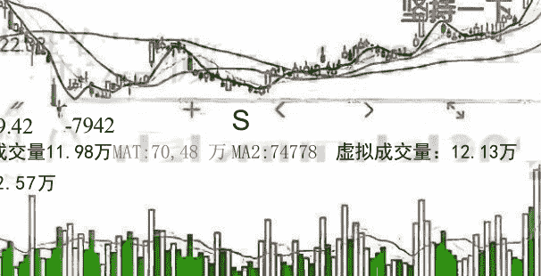
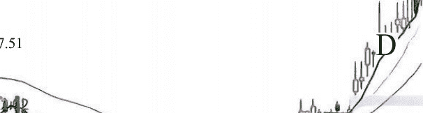
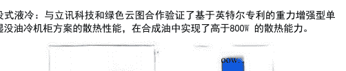
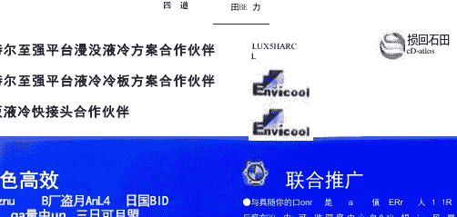

# 玥音
2025-08-15 08:38

请问大王有发产品吗

觉得感慨

南阮大王：产业基金你买不了，这里内容你是能学用一体的，人人都有智慧德。
2025-08-15 08:47

玥音回复南阮大王：谢谢大王。
2025-08-15 09:06

## 知识星球TOP 资源分享社群

公众号：如识星球

添加微信免费进资料群

让更多人获取高价值信息
江聚全网付费资源

| 付费文章 | 付费社群 |
|---|---|
| 付费课程 | 副业 & 搞钱 |
| 财经 & 股市 | 行业报告 |
| 时政·历史·职场·体制·自媒体 | |
| 学习·军事·软件·影音·社会学 | |

微信号：jtsg8

微信号：jtsg2

加微信号jtsg2，免费进资料群

luc 省 1
20250815 09.16

大王，下单失败要不要等20天，请问可以买什么替代？

①

觉R: 回

瑞Fred: 你是没量科创权限还是啥？
2025-08-15 10:01

Andrea原文回复瑞Fred: 没权限应该，要满足50万交易量和两年交易时间。
2025-09-14 17:07

luc: 回复Andrea原文: 对对。
2025-08-15 10:17

智丰: 买588200，这个ETF里面有豪王。
2025-08-15 10:18

luc:( 脸 ) 回复智丰: 谢谢。
2025-08-15 11:02

加微信号jntsg2，免费进资料群

大王，今天分号的意思是下半个月股指调整为什？还是我们关注的板块调整为主？

八月的中旬，晚到9月的初这十几个交易日，可能是奔向4000之前一个黄金的“倒车人”机会。

觉得很贵

Jerry:大王今天没有开盘指引，只好暂不操作。

小儿回复Jerry: 昨天下午已经得很明白了(捂)。

Jerry 回复小儿: 是吗？我再看看。

KAREN: 太光的调整不是属于大单类获利吗?

小儿回复KAREN: 我今天在12的时候补了。

松撒回复小儿: 你真牛!佩服。服。

室回回复KAREN: 业绩兑现？

小儿回复松撒: 我本来成本很低的。

花王【DIK HUN】回复小儿: 姐们，你好烦害啊。

小儿回复花王【DIK HUN】: 慢着，我也曾经过韭菜。

123回复小儿: 太光的你不是一直都在看来。

123回复小儿: 一直都在，因为我一直相信信。

小儿回复123: 我今天120又加进来，感觉本身是太好了。

智宇：大盘可能会震荡调整，个股不定，个人觉得无须担心，持股待沽。
2025-08-15 10:18

小於回复智宇: 是的。
2025-08-15 10:40

luc: 指准准100了。
2025-08-15 10:42

小於回复Lu口告: 大王昨天的彩蛋太及时了。
2025-08-15 12:36

莹賓
2025-08-15 13:24

昨天大王公号告诉彩蛋准了，今天就赚了，感恩大王!

觉得很难

总: 这么久同学，我后悔之前的启动高位了，昨天下跌就跌了，割肉了，收回来。但今天一直没有起色，看市场热没理解透，还是大王的路还需要，之前开始就像好洗过的准备的，这是对的。
2025-08-15 13:37

紫蓝莹: 大王，券上整个逻辑是什么？

天地回复紫蓝莹: 之前大王说过，这票要冲，还没涨，天地科技，他们。
2025-08-15 13:48

加微信号jntsg2，免费进资料群

小启牛
2025-08-15 13:37

大王，游戏要接龙头吗？选择回归

南院大王：二线补。

小启牛回复南院大王: 今天把它清理掉，上车了瑞王，不知道对不对。
2025-08-15 15:05

南院大王回复小启牛: 相信自己的感觉。

小启牛回复南院大王: 谢谢大王联系帮助！
2025-08-15 15:11

该死的配感

觉得很累

加微信号jntsg2，免费进资料群

天朗气清水木
2025-08-15 17:37

该死的配感看到了了

# 觉晴

# 王多肉 · 谢天颜

| SC | 双闲在Dm |
|---|---|
| 70IAQ | 闲天进行的。 |

- 1. 之前大王光映到远远，
- 2. 直面国产，换海外特产。
- 3. 为你为了的小明们跑前闷而。

- 英伟达送婉，怎么能够一个开始，我们们说好了，江湾达依然达。

- 再说国产板块，虽然海外强国国产就弱，但高低且一样有效。

- 东伟达打开的高度，必然要一切到位Asic芯片，AIDC的，弘信在最难时候也告诉大家坚持吧，低位就是王道，突破30.5你不拉干吗？我们太了解了。

- 以后怕一哥绿湾洒坝大，一样像。连东来打开的离，必须要到一点心上的。云在最舒服的时候大家家里聚聚，现在很远是远王，微信:D68s11下。我们把预算那个礼物做小了，不要买老王贵的礼物，现在很便宜，微信:An1s7。(当然不让你去明白。)今天国产还够，也只有东亚产还强。我们孩子们还说明年中考了？天今天刚熟悉的人，似乎不是哪里闹的。你问我为什么是不错的。你要在世界上，你要应该是这样的。远大木还没买呢？

微信信号jtsg2，免费进群资料

## 南院大王的主题
2025/8/15 15:03

有10位朋友发表了观点和态度

该死的配感

高低切进行时，

1. 之前大涨的pcb 光模块切到电源液冷，olt还要卖吗? 英伟达供应链的预期，怎么能一个涨停都住住，同样我们提了好几次，川环的液冷给英伟达送样，道理一样，怎么不表现？超级核心维克，这几天每天都给你反省，上车，补仓，加入的机会。

加微信号jntsg2，免费进资料群

一再告诉大家，一块没走完，主力在扫货，拿卡车拉，你都不搞液冷电源，非去小王那桌，那也没办法了。你再不济，一看排液高了拍大腿，后面还有我们看好形态，洗了好几天的强瑞技术。

2. 再说国产板块，虽然海外强国国产就弱，但高低且一样有效，但东伟达打开的高度，必然要一切到位Asic芯片，AIDC的，弘信在最难时候也告诉大家坚持吧，低位就是王道，突破30.5你不拉干吗？我们太了解了。

- 2025015 也是东伟达不强。
- 20250815 15:12

- 此时，今天国产没拉。
- 70IAQ
- 闲在Dm
- 2. 你没涨，坐在主桌，要你前排的没涨。
- 3. 你知道群里的小姐姐反而得。
- 4. 这里的几天刚跌了讲话，你看它是不是一路给新。
- 都是富养或者或者小。
- 漂亮。追，拿着非菲的小姐姐好多，就是20日线抄底，都不问的事。

反思后要上事的二徒弟，专门上了，佛教经典《妙法莲》说，“以灯传诸灯，终皆明”。通过学到的智慧进步，财富增，心性光明，是大王人生追求之一。一片磁石，指停不肯休。开心的，吃饱了同学们自行发表吧。

## 中报预：2025-08-29披露2025年中报
249.88 今开208.00 最高249.88 低208.00 20.00%涨-2.80%

分时 五日 周K 月均线 MA5:193.67 55:129.47 10:16.94 20:18.47 DK点，前复权。
249.88
207.26
248.88

## 英伟达值一个涨停感

79.42-7942成交量11.98万MA1:70.48MA2:74.78虚拟成交量:12.13万12.57

# 48.48 今开41.63 最高48.48 低41.01

20.00%8.08 换手23.26%总手41.46万金额18.87亿总值105.2亿流86.40万市值53.31

分时 五日 周K 月均线 MA5:42.21 10:39.57 20:36.187 DK点..前复权

均线
48.48
55:31.48
48.48
48.4842.99

37.51

加微信与群XXX，免费进资料群
26.53 成交量41.46万MA1:38 MA2:35.63

> 南院大王
摘自：鉴茶财经院

海外算力，olt涨一天能叫涨？英伟达市值值一个涨停？既然拉起来，必然奔着新高去，

加微信号jntsg2，免费进资料群

> 南院大王
摘录自：鉴茶财经院

川环发了公告，预期不惊艳是正常的，GB300没发货，强瑞也是低吸的良机，但未来3天如果板块涨它不涨，可视为弱势。电源的MGMT，中恒等趋势未变，明天再给低机会，则更好。

作者：南院大王2025/8/12

加微信号jntsg2，免费进资料群

2025-08-15 15:18:51

大王忙看下，东伟还跟一样选了这个名单，下周走势怎么看啊😅

Super:监控很多天，天天收短信提醒
2025-08-15 15:09

南院大王:这流程是要首的，厚此彼怎么行。2025-08-15 15:25

123回复南院大王:大王，最后收盘L21不是主力在控盘，不想涨200%变动吗?
2025-08-15 13:41

南院大王回复123:你可以综合为“试盘”。
2025-08-15 15:56

姜丰

南院大王:反内染还能轮到墓基身上，宽田惯调今天不是收了吗，只是不涨幅而已，先把pe低的什么阳光电源之类拉上去。
2025-08-15 19:23

加微信号jntsg2，免费进资料群

# 沪指突破3700，行情持续暖

上海启蒙：
大王，这票的流程总是要，此薄不是主力在控盘，更要是心态在控，亏损了也不太焦虑，按照自己的仓位操作，多一点耐心，会有机会。
2023-08-16 13:58

Super:监控很久了，天天收到提醒
2025-08-15 15:09

南院大王:该票的流程是要要，厚薄怎么样。4.21%不是主力在控盘，不想上那个韭异？
2025-08-15 15:25

123回复南院123:你可以综合理解为“试盘”。
2025-08-15 19:41

南院大王回复123:你可以合理理解为“试盘”。
2025-08-15 19:56

大王，反内春的风还能碰到墓基身上吗

南院大王:今天不是吹了吗，只是不涨幅而已，先把pe低的什么阳光电源之类拉上去，
2025-08-15 19:23

加微信号公众号jnts2，免费进资料群

## 南闯大王
2025-08-15 19:21

后市展望，继续配得今天那批被调了，大家伙太开心了，也是好事，压压舱。目前来看，依然只是牛市的早期，

- 1. 榜上一大哥，刚刚配满仓位找到了。
- 2. 券商刚刚涨，牛市抬头，代表着蓝筹资金入场。
- 3. 市场，虽然已经有了海外算力，国产芯片，军工等领域抱团，大家都到了，但越界主线。
- 4. 目前在大块头和杠杆结构，沪深300中证500等，基本发。
- 5. 关键和大众，基本地上，每一轮牛市都缺了。那么目前的低位还有？当然有，我们可以把之前的几个低位再好好一遍。具体的受益同学们不用着急写了，前文都有，否则没完了。新加入同学们不用着急，每个人都有自己的时区，这才顾到哪里。还是刚刚开始，有一个巨大的块头被按下，这里透一下，也是之前的。华在底部。

## 绿色生态

| 季度 | 2023年4月 | 2023年6月 |
|---|---|---|
| 算力 | 600 | 三可目标 |

## 联合推广

- 关注英特尔中国
- 点击英特尔中心公众号
- 了解更多

## 架构建设

## 持续增长

- 核心业务
- 算力中心业务
- 热密度

| 平台 | 英特尔第五代 |
|---|---|---|
| 处理器 | Sapphire Rapids | 目标 | 8月

加微信号jntsg2，免费进资料群

## 南院大王
摘自：鉴茶财经院

做过生意和外贸的都知道，老美的利润高结款快，国内的巨头一言难尽。下一个低位我们再搞昇腾384，感兴趣的同学自己先看。
作者：南院大王2025/8/13

加微信号jntsg2，免费进资料群

南亚大王：质买股市格局：控制温度，全球一今天的局面或…
2025-08-15 19:27

圆Glora:满冷梗
2025-08-15 19:23

回复 圆Glora: 小和小一赢在我的自选上，一念之差选了小王。看到小张刚40多岁，爸，压着我暖心的，硬是没没。到昨天50多，今天到60，大腿都胯了。
2025-08-15 19:28

王南洋：谢鑫回复：小沃是啥
2025-09-14

## 英特尔中国数据中心液冷加速

DCA China Liquid Cooling Innovation & Accelerator Program

英特尔中国数据中心部门与合作伙伴的技术领先互动，打造一个领先、可靠的政策助力中国全方位系统，加速数据中心低碳转型。

英特尔中国数据中心小型液冷加速计划自2023年9月启动以来，联合三家液冷合作伙伴，针对英特尔服务器平台液冷解决方案提供了更多选择。

液冷：针对英特尔平台处理器的液冷集、快速冷却和其他服务器液冷柜集成，基于英特尔专利的内存内液冷方案。浸式液冷：与讯科技和绿色云方案联合证明了基于英特尔专利的热密集型相冷箱，在中心实现了高达800W的热密度。

英特尔服务器液冷方案合作伙伴
英特尔服务器液冷方案合作伙伴
液冷散热接头合作伙伴

## 合远科技

资讯 盘口 资金 简况(F10) 诊股 财务

| 操盘必读 | 大事提醒 | 财务分析 | 概念题 |
| :--- | :--- | :--- | :--- |
| 公司概况 | 股股东 | 分红融资 | 市场观点 |

## 上市公司

广州合果科技股份有限公司
广东省广州市黄埔区保税区保盈南路22日

- 印制电路板、共振光云(CPI)、海外业务、高新企业、行业常青。

国内内资企业中排名第一的服务器PCB供应商。

| 所属行业 | 元件-印制电路板 |
| :--- | :--- |
| 所属地区 | 广东省一带一路 (+1.55%) |
| 曾用名 | 肖红星(持股41.56%) |
| 董事长 | 肖杨清 |
| 秘书 | |
| 控股股东 | 广州蕴瑾投资有限公司(持股40.24%) |
| 实际控制人 | 肖红星(持股41.56%),刘锦隼(5.26%) |
| 最后控制人 | 肖红星(持股41.56%),刘锦隼(持股52.60%) |

| 163467 证160 | 下单 | 社区 | 自选 | 功能 |

加入微信群获取更多免费资料

郭洋：大王太牛了，早就交学费了，群里红包，麻烦问一下大王，你说的铜箔的华科怎么样？我看它的市盈率30多算，我看花顺里介绍它中国国内企业中第一的服务器PCB供应商，它铜箔里的头部 ...谢！

## 上市公司

| 营利 | 股股东 | 净利润 | 10%增长 | 现金流 | 财务 |
| :--- | :--- | :--- | :--- | :--- | :--- |
| 2023年上半年 | 远航 | 财务分析 | | | |

华科科技股份有限公司
“华科2022年年度报告”第22页

中国的国内企业中第一的PCB供应商 华科。

| 净利润 | 102541621 |
| :--- | :--- |
| 日元 | 广鲁一一(1,150) |
| 银筹 | |
| 控股 | |
| 绍平5 | 102541621 增长:60%Q |
| 铜箔 | 只要是(1581546),国际:铜箔 |

2025-08-15
南问大王回：它是电子龙友，从老董箔生子的子控的，高准电子也有价格涨，英美达要用的HVPL5目前只有日大箔，中国的德德箔科技和梯子能做。

2025-08-15 19:56
郭洋回大王：好的，明白了，谢大王，又学到了新知识，那它值多少钱，现在值得入手吗？

2025-08-15 20:03
万然：我有好几年的立讯画面而在。

2025-08-15 19:44
大林：我说的那个大头关注的是哪些地方？

2025-08-15 20:05
范凯西：我今天跟涨看冷也点亮了。

2025-08-15 20:44
杰：姚英贵。

2025-08-15 21:02
陈俊俊：吃了大王的点心丸，继续维持。

2025-08-15 21:07
六：我，今天开创业了，我也要加油配送灵感，重新布局，跟上节奏了。

2025-08-15 21:38
香落：大王，晚峰时候写韭菜384。

2025-08-15 22:16
winnie萧嘉莉：大王：华为属于哪些公司？

2025-08-15 23:22
智予：华为是头大哥，大家痛快，简单，，涨比较合适，不然高位不好做。

2025-08-15
智字：华为领头是哒，大家早点进去，不然高位。

2025-08-15 22:36
回避复：这两天在整理大王之前发的，刚看到华为赢的，不知道对不对，大家一起学习。

2025-08-15 44:42
小儿凡：华为昇腾384系列产品的合作伙伴：
- 硬件供应商（如中为科技、锐科技）
- 系统集成商（如拓维信息、神州数、润动力、软件服务）
- 数据中心基础设施供应商（如华数据、数据）
具体领域涵盖芯片、光模块、服务器、AI等多个方向。

2025-08-15 53
红火：感觉稳大王定方向！虽然凛冷和电源造高没造，但它拿到了2cm，保险也在升高了，创新、芯片等盈利增加。大盘持续稳定，请教一下，宁德还能跟上吗？如果老是拉仓，提前掉吗？谢谢。

2025-08-15 17
忌一：大王在哪里？我没看到。

2025-08-15 50
忌一：大王在哪里？我没看到。

2025-08-15 39
小儿凡回复忌一：大王的仁公号，8月14日最后，认真读同学，大肉的满嘴油。

## 概念股

华风景很美。
概念股大家都亮的：
- 拓维信息、常山北明、华工科技
- 光模块、铜缆、沃尔核
- 芯、电源

## 南厌大王
2025-08-15 32
全局一遍：今天的局面就是生产有意在控制局面，不能让热。

其本质，还是中国国际“不及预期”。涨级大跌%，把整个国产光板块，从硬到软了。但国内错就是推，AI硬件的东亚红了，AI软件里的界面也差点红。既然砸了，等修复吧，观察整个盘面，你会发现什么？还是外资本拉拽的，刚创和亚洲一直保持，高低间动到滑。

整个市场全局一遍：
主策：
- 女方：PCB模块>铜缆>交换机/电源。家里有钱，扩产产生生产效应，下降后还会继续链。
- 男方：芯片产品（算力芯片>SOC/MCU>光刻机>应用）、新消费（游戏、植神科技、实体食品）>反内卷（国产电池光伏/碳锂/绪/其他）。男方太压力大。

双方虽位置高，又处于低位。相互互动，内部轮动。

配齐一：创新药物。
- 创新药单（大生创药>减肥药>首仿化学药>医疗器械>CXO）。

目前轮机器人。
配齐二：机器人人类（轻量化材料>空心电机>减速器>灵活手）。题材太款目前机器人大会会有兜底走势但后面会有。

小传弟：（各种二级模拟，如核聚变，水电站等等）。

主持人：大金融（营销、保险、券商）。

## 保安：军工
（基本是9.3回前1-2礼赞提前出现，有的自己看着路线网我不了）。

牛市上亏钱的，都是因为道莉和莉操作，回头看着你割肉的都不会害人，心态比操作重要，你终都能成长，周末快乐！

2025-08-15 32
小马哥：东芯从一拉了。

2025-08-15 36
回复：信号。

2025-08-15 42
小马哥：东芯从一拉了。

2025-08-15 49
小马哥：东芯从一拉了。

2025-08-15 52
小马哥：东芯从一拉了。

2025-08-15
刘：我昨天卖了，今天上车的。

2025-08-15 28
小马哥：东芯从一拉了。

2025-08-15 33
小马哥：东芯从一拉了。

2025-08-15 35
刘：我昨天卖了，今天上车的。

2025-08-15 38
刘：我昨天卖了，今天上车的。

2025-08-15 41
刘：我昨天卖了，今天上车的。

2025-08-15 45
刘：我昨天卖了，今天上车的。

2025-08-15 46
刘：我昨天卖了，今天上车的。

2025-08-15 51
刘：我昨天卖了，今天上车的。

2025-08-15
还没到位了。

2025-08-15 55
刘：我昨天卖了，今天上车的。

2025-08-15 57
刘：我昨天卖了，今天上车的。

2025-08-15 59
刘：我昨天卖了，今天上车的。

2025-08-15 60
刘：我昨天卖了，今天上车的。

2025-08-15 61
刘：我昨天卖了，今天上车的。

2025-08-15 65
刘：我昨天卖了，今天上车的。

2025-08-15 69
刘：我昨天卖了，今天上车的。

2025-08-15 72
刘：我昨天卖了，今天上车的。

2025-08-15 77
刘：我昨天卖了，今天上车的。

2025-08-15 78
刘：我昨天卖了，今天上车的。

2025-08-15 79
刘：我昨天卖了，今天上车的。

2025-08-15 80
刘：我昨天卖了，今天上车的。

2025-08-15 82
刘：我昨天卖了，今天上车的。

2025-08-15 83
刘：我昨天卖了，今天上车的。

2025-08-15 85
刘：我昨天卖了，今天上车的。

2025-08-15 88
刘：我昨天卖了，今天上车的。

2025-08-15 90
刘：我昨天卖了，今天上车的。

2025-08-15 92
刘：我昨天卖了，今天上车的。

2025-08-15 93
刘：我昨天卖了，今天上车的。

2025-08-15 95
刘：我昨天卖了，今天上车的。

2025-08-15 96
刘：我昨天卖了，今天上车的。

2025-08-15 99
刘：我昨天卖了，今天上车的。

2025-08-15 100
刘：我昨天卖了，今天上车的。

2025-08-15 101
刘：我昨天卖了，今天上车的。

2025-08-15 102
刘：我昨天卖了，今天上车的。

2025-08-15 103
刘：我昨天卖了，今天上车的。

2025-08-15 104
刘：我昨天卖了，今天上车的。

2025-08-15 105
刘：我昨天卖了，今天上车的。

2025-08-15 106
刘：我昨天卖了，今天上车的。

2025-08-15 107
刘：我昨天卖了，今天上车的。

2025-08-15 108
刘：我昨天卖了，今天上车的。

2025-08-15 109
刘：我昨天卖了，今天上车的。

2025-08-15 110
刘：我昨天卖了，今天上车的。

2025-08-15 111
刘：我昨天卖了，今天上车的。

2025-08-15 112
刘：我昨天卖了，今天上车的。

2025-08-15 113
刘：我昨天卖了，今天上车的。

2025-08-15 114
刘：我昨天卖了，今天上车的。

2025-08-15 115
刘：我昨天卖了，今天上车的。

2025-08-15 116
刘：我昨天卖了，今天上车的。

2025-08-15 117
媛：宁德是要跌到250。

2025-08-15 118
媛：宁德是要跌到250。

2025-08-15 119
媛：宁德是要跌到250。

2025-08-15 120
媛：宁德是要跌到250。

2025-08-15 121
媛：宁德是要跌到250。

2025-08-15 122
媛：宁德是要跌到250。

2025-08-15 123
媛：宁德是要跌到250。

2025-08-15 124
媛：宁德是要跌到250。

2025-08-15 125
媛：宁德是要跌到250。

2025-08-15 126
媛：宁德是要跌到250。

2025-08-15 127
媛：宁德是要跌到250。

2025-08-15 128
媛：宁德是要跌到250。

2025-08-15 129
媛：宁德是要跌到250。

2025-08-15 130
媛：宁德是要跌到250。

2025-08-15 131
媛：宁德是要跌到250。

2025-08-15 132
媛：宁德是要跌到250。

2025-08-15 133
媛：宁德是要跌到250。

2025-08-15 134
媛：宁德是要跌到250。

2025-08-15 135
媛：宁德是要跌到250。

2025-08-15 136
媛：宁德是要跌到250。

2025-08-15 137
媛：宁德是要跌到250。

2025-08-15 138
媛：宁德是要跌到250。

2025-08-15 139
媛：宁德是要跌到250。

2025-08-15 140
媛：宁德是要跌到250。

2025-08-15 141
媛：宁德是要跌到250。

2025-08-15 142
媛：宁德是要跌到250。

2025-08-15 143
媛：宁德是要跌到250。

2025-08-15 144
媛：宁德是要跌到250。

2025-08-15 145
媛：宁德是要跌到250。

2025-08-15 146
媛：宁德是要跌到250。

2025-08-15 147
媛：宁德是要跌到250。

2025-08-15 148
媛：宁德是要跌到250。

2025-08-15 149
媛：宁德是要跌到250。

2025-08-15 150
媛：宁德是要跌到250。

2025-08-15 151
媛：宁德是要跌到250。

2025-08-15 152
媛：宁德是要跌到250。

2025-08-15 153
媛：宁德是要跌到250。

2025-08-15 154
媛：宁德是要跌到250。

2025-08-15 155
媛：宁德是要跌到250。

2025-08-15 156
媛：宁德是要跌到250。

2025-08-15 157
媛：宁德是要跌到250。

2025-08-15 158
媛：宁德是要跌到250。

2025-08-15 159
媛：宁德是要跌到250。

2025-08-15 160
媛：宁德是要跌到250。

2025-08-15
媛：你准备等到250吧。

2025-08-15
小兰儿：每天阅读大王的文章，还有关注动态，收藏后还有人。

2025-08-15
张荣：你难道还没抓紧时间抓把大王一周内的文章要好学习一下，做好笔记。

2025-08-15
小于儿回复张荣：你难道还没抓紧时间抓把大王一周内的文章要好学习一下，做好笔记。

2025-08-15
张荣：我是这一个刚报到的啊。今天刚刚入了。学习中。

2025-08-15
小于儿回复智宇：我新华三成，所以比较安全，而且严格按照大王的方法，或者三次的时候慢点哦。

2025-08-15
智宇：和你复了5次，可惜一直没，想都调整一些，结果不给机会，莱太太了，还有有点怕。

2025-08-15
波波：潇询波波，新华是哪股？

2025-08-15
小于儿回复波波：谢谢新华。

2025-08-15
波波回复小于儿：谢谢！

2025-08-15
发发花：我是指南针、大慧、新锐新、颖贝德、格格格、蓝色光。

2025-08-15
发发花：而且是大王哒：坐稳抓住，望决不下车！

2025-08-15
奎东：大牛了，你的执行力。

2025-08-15
艾米：小姐你好，这么多只服。

2025-08-15
Jerry：你太牛了，太牛了。

2025-08-15
Jonny 清：我看就是落分子表好！艾川、英莱、格格、宏、大智，你相信心里有了光。

2025-08-15
乐语：向优秀的课代表学习。

2025-08-15
慢慢慢爱的：艾川、英莱、格格、宏、大智，你相信心里有了光。

2025-08-15
Adele REN：信号号小薇，你有事吗？

2025-08-15
Adele REN回复小儿：向你学习。
