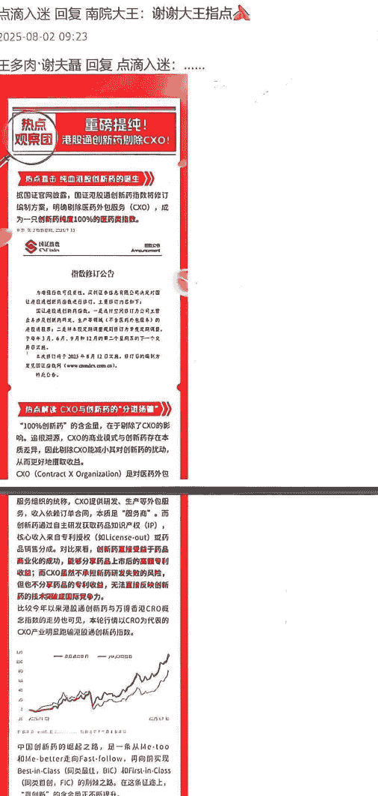
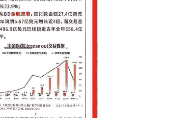
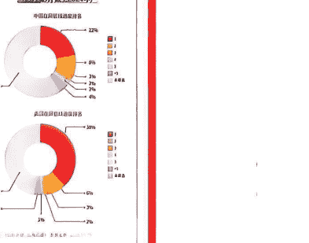
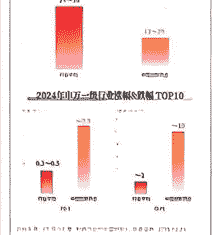
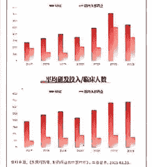

# 点入迷

2023-08-02 06:33

大王，昨天晚上文章提科技和AI没再说cx，kly它们还能吗？

南京大王: 不能说彻底崩了，现在是因为美国经济衰退和美股的大跌，如果崩潮创新彻底跌10日，整体可能有20%左右的回调，极端情况可能到40%，然后继续下去，总体的行情还没有亮起来。如果非要找一个稳定办法就是控制位，比如一部分对冲的来说，减一些位应对。

2023-08-02 08:16

点入迷送 回复 南京大王: 谢谢大王指点。

2023-08-02 09:23

多王肉: 回复 点入迷: …………

加入微信群intsg2 进资料分享群

# 行业报告：零售的未来

近几年内，由于“Fast-FoOL”（快时尚）和“Fast-Retail”（即时零售）已成为主流。随着行业的发展，“全渠道”（Omnichannel）已成为核心竞争力。在数字化转型和消费升级的背景下，国内零售业正在发生深刻变革。

国内头部企业从Business License-out（品牌授权）向Business License-in（品牌引入）转型，从产品驱动向服务驱动转型，从传统模式向数字化模式转型，从单一线下向线上线下融合转型。

面对竞争日益激烈的市场，零售企业如何构建自身的核心竞争力？如何在存量市场中寻找新的增长点？本文将分析行业趋势，为零售企业提供决策建议。

- 市场规模：2021年中国零售市场规模达43.53万亿元，同比增长7.8%。
- 行业增速：2021年社会零售额增速为7.8%，较2020年的18.2%下降了10.4个百分点。

国内零售行业正进入“存量竞争”时代。过去依靠流量红利的增长模式失效，未来零售企业必须通过精细化运营和用户体验提升来实现持续增长。

## 一、零售企业的竞争力核心

近年来，中国零售企业的竞争力核心发生了显著变化。过去竞争的核心是规模、渠道和价格，现在竞争的核心是数字化能力、供应链效率和用户运营能力。

据调研，72%的零售企业认为数字化转型是提升竞争力的关键，65%的企业认为供应链优化是提升竞争力的关键。此外，38%的企业认为用户体验提升是提升竞争力的关键。

# 微信insg2 数据分享群

# 中国医药增长速度 vs 行业平均

e. 医药行业持续增长，中国医药行业增速远大于行业平均水平，增长率在30%-50%。

# 中国医药收入人均

2015-2020年中国医药收入人均（万元）

f. 国内医药行业趋势：虽然处于稳定，但处于成长期

国内医药行业经历起步后，进入高速增长期。受政策驱动、技术升级以及“双循环”战略影响，知识产权保护使得医药的发展空间得到极大释放。

| 政策名称 | 核心内容 | 影响 |
| :--- | :--- | :--- |
| 2018年国家带量集采 | 针对临床用量大、仿制药，通过量谈判大幅降低药价。 | 大幅降低药价，加速行业洗牌 |
| 2019年医保改革 | 调整药品目录、提高支付比例，引导向创新药发展。 | 倒逼企业向创新药转型 |
| 2020年创新药快速通道 | 鼓励研发，缩短创新药上市周期。 | 提升创新药效率 |

g. 专利竞争激烈，行业竞争加剧

专利保护的加强使得医药领域的加大加大。企业从单纯仿制转向研发，主要的竞争策略包括：专利布局、专利交叉、专利授权等。通过这些手段，中国医药企业进入了全球竞争。

2015年以来中国医药专利数量

| 年度 | 2015年 | 2016年 | 2017年 | 2018年 | 2019年 | 2020年 |
| :--- | :--- | :--- | :--- | :--- | :--- | :--- |
| 发明专利 | 3112 | 3568 | 4215 | 5123 | 5876 | 6512 |
| 实用新型 | 8215 | 5412 | 4568 | 4215 | 3876 | 3512 |
| 设计专利 | 2312 | 2156 | 1988 | 1852 | 1675 | 1452 |
| 总计 | 13639 | 11136 | 10992 | 11190 | 11427 | 11476 |

加微信jts2 进资料分享群

Brain
2025-08-02 08:11

大王，沃尔玛医药到底是什么情况，跌得这么差，感觉至少少也是持续放量，现在持有的可以割了吗？

陈如磊 2025-08-02 08:42

南京大王: 前后高低切换过多少次，只有当前偏高涨空间，资金会去补充，如今的回利可达之类，甚至中间的抬升，舒服，怎么样能切到位呢？要么一开始就碰到，买后要有粉丝等风来。2025-08-02 09:09

加微信jntsg2 进资料分享群

# 南京大王
2025-08-02 09:02

陆薇莉终败了一片贪心。HK法院的判决里透露了几个关键信息：

a、 陆庆给三个女儿留了3亿美元信托。
b、 陆薇莉明知此事，陆庆签字了协议，后面和兄妹妹签字，明确会继续把18亿留到。
c、 小姐对他们几个充满“满意”，但不限于杜建的一些工厂，而且从信托中转走了钱。

- 你说陆庆真给3亿美元信托了吗？一人留6亿，完全成立好不行，当然行的。
- 你说陆庆难道不知道陆薇莉对他意见吗？当然的直觉太灵了。
- 你说陆庆难道明白小姐上台，会立刻割大刀，对元老派开刀？如此，陆庆在几十年商战走出来的，小姐还想怎么搞得住他？

之所以故意在信托的事情上留个“活扣”，其实是留陆薇莉最后的遗产和筹码。

- 杜建是留给小姐的“外戚”和外甥。小姐对元老派源自仇恨，所有人只会看笑话和利益，但杜建不会，是一几十年的感情，对玲哈对老爷，她有着深层感情。二十一亿信托没有充，她不能让陆薇莉。关键的是，杜建当过财务监，熟悉公司情况，有经销商资源，又有一票人和工厂，几个孩子在玲哈处实习过，关键时刻，是能拉出来用的。杜建是元老派的死狗。二十一亿，是陆薇莉割杜建的武器。把23亿美元，最多3-5年时间，那时，陆薇莉准备好，局面顺利接班了。

微信intjs2 资料分享群

宗庆走了，很就能对杜英妥气了，否则，她不会在宗豪莉清洗工厂脱股时机动不动。

2，信托计划是对冷酷继承者的“试金石”。外界批评宗豪莉赖、不讲感情，绝不是无中有的，老爸能不知？做些事的，就是要全方面面对交流。宗自己打算留信托计划，实为培养女儿调整家族关系的能力，培养女儿怀忍与谋的最后一刻。而3个舅妹妹，是好的试金石。大家的位置妥了，信托的权限已经，宗豪莉口相反反应，临终前专门加道保险，签署了《委托协书》。宗老总觉得，毕竟热血入土，不至于两两都破产吧？当他们曾经经营，小姐真很有格局，完全可以让杜英当偶尔，几个兄弟妹妹当当家，一起推动哈哈规范化，国际化，把事业更大，这是“人类之事”。然而做了什么，迷小姐光环，沉迷复仇的事，一旦信托反目，治理结构生死亡。其他的，关键人会怎么想？

- 陆薇莉违反了协议18亿，还有什么不说不算？
- 陆薇莉如此不懂人情世故道理，真的做事，帮她打招吗？这是给她的，最致命的冲击。这家企业，两代负责信用了，没人敢真你了。陆薇莉我们看出了什么？一个领导者对下一任，最后的期待；一个父亲对女儿最后的无言，聚爱的。

加微信jntsg2 进资料分享群

一个老辈对新家，各种布局，内心的安排，结果呢？各种自以为是，说长城的事，我们觉得实在太多了。各位，不要觉得学了点管理知识，懂章就会管理了，认知世界的规律，拥有自己的基本盘，看着历史趋势，以悲之心，配合的力量才能改变世界。像某些在美国大学学习了顶尖的法律，旧江湖是由人组成的。

微信:jntsg8 免费资料群

微信:jntsg2 

盘后感2025-08-02 09:27

叶枫: 江湖是世故，从书上学到的战斗与胜利才是成长的经历，MBA只是高一点案例教学而已，实战检验比理论唯一的标准！2025-08-02 09:12

川川: 从男性来说，我不太喜欢脑的，暗街的英雄可以是，厂门却没说出来。2025-08-02 09:15

于洁: 还是会常留句话，关键是要格局，能够古人！聪明之事，别人可以推准，自己不可以认为。2025-08-02 09:20

老董: 些事要给别人留个缺口，让一下过去围，以此绕诸人捡掉了棋子，男孩又一个。2025-08-02 09:20

- 小字:分心不可得。
光同涵: 一行阳两涯，三分梅糖野僧。2025-08-02 09:25

加微信jntsg2 进资料分享群

雪华: 小苏被杨紫骗了，小苏又骗了她，她后悔其实早晚是决裂的孩子，小苏考虑考虑，用后悔是谁？拿石头砸头？没命可能了。现在大青年是社会一大难题，这里这么事看来是要避开后悔。2025-08-02 09:27

平心: 回复雪华: 给她们以后吗，她们还会跟她跑呢？2025-08-02 09:39

雪华: 回复平心: 见光后。2025-08-02 09:58

王苏奎: 乾隆: 乾隆把这张底宰太后给干净了。11:24

南南大王: 回复王苏奎: 婉婉上就被我own了，吧太后留给她的大麻烦还错干净了。2025-08-02 11:45

王苏奎: 回复南南大王: 明白了。乾隆能错，大小姐还不堪了。2025-08-02 11:46

王苏奎: 回复南南大王: 这些话，应该是最容易的，杀费费长城，愁富有当的人，钱就是个数字，几亿万字几亿千万也不太多吧，不要带来，死不带走的。2025-08-02 11:59

Jerry: 回复王苏奎: 乾隆: 那口气坏了。2025-08-02 15:36

清覃: 花500年历史中，皇帝后传的各种情况说明的明白了，小小姐被欺骗了太多了吧。2025-08-02 11:54

Derek: 你有什么感觉，还有力量在暗暗推动某些事情的发生和毁灭……或许是有可能小小姐被杨紫利用了而不知道。2025-08-02 12:02

铁莲: 俏的要来！2025-08-02 12:35

宝宝: 我的现在已经过比普通人的简单单了，人人根本不起，个万年之差。2025-08-02 13:18

重庆: 大王，现在这应该是普通人以为，国外，还是靠外功夫吗？说是那边的大学，很容易培养二代、境。2025-08-02 14:46

重庆: 回复: 还有这些事情不容易在身体之中以后，江西人情世故。2025-08-02 15:33

作家: 有些作品是回不打架，从感情上来说，希望心里不错！但是从利益来说，这笔交易只是办法，把这一世（其实网客的话）一段，以后再有！

微信jsget登录

徐禹: 女人当家，房倒屋塌。2025-08-03 08:18

黑: 回复徐八: 可是就是男的种下的这你也要要私扯扯到身上身上，性别上无语。2025-08-03 11:40

熙: 父亲留给女儿最后的刀是自己的情人和私生孩子……有点奇怪，刀石没有女的挨人男女就妻了大了吗。2025-08-03 11:45

eva: 夏的创伤愈了，2025-08-03 11:58

# 知识星球 付费资源群

加微信免费入

img/c28b0e80c9b8e852c88fa0fa2d97b128_8_0.png

微信:jts2

| 序号 | 公号/星木/社群 | 原价 | 领域 |
| :--- | :--- | :--- | :--- |
| 1 | 生育万才 | 275/年 | 副业、搞钱 |
| 2 | 众吃瓜群 | 365/年 | 时政、历史 |
| 3 | 记忆龙书/梓风 | 365/年 | 成长、财富 |
| 4 | 欧洲蓝云 | 328/年 | 时政、历史 |
| 5 | 朗克玄云 | 699/年 | 时政、社会 |
| 6 | 体制内主任 | 599/年 | 体制、职场 |
| 7 | 局外的视角 | 4166/年 | 金融、时政 |
| 8 | 源涯涨升 | | 财富、经济 |
| 9 | 宁度总司令 | 599/年 | 时政、经济 |
| 10 | 江宁如沪 | 365/局 | 时政、国际 |
| 11 | 事堂/顶子明 | 568/钱 | 时政、经济 |
| 12 | 唐书院 | 1399/篇 | 金融、财富 |
| 13 | 大枣奇坊 | 199/牢 | 时政、成长 |
| 14 | 柯永亚大 | 10000/运 | 房产、经济 |
| 15 | 洪潮的宏观策略 | 4376/年 | 经济、搞钱 |
| 16 | 金通鉴/海南南 | | 股票、衍生 |
| 17 | 蝴蝶的世界 | 299/年 | 时政、社会 |
| 18 | 飞沫龙 | 3600/年 | 市场、经济 |
| 19 | 我的联线视院 | | 经济、金融 |
| 20 | 蜜签财经学院 | 330/年 | 房产、股票 |
| 21 | 赢在八小时之外 | 365/年 | 成长、职场 |

更多资源，不再列举

- 书籍、播客、课程等各类高价值资源
- 免费群 每日分享资源（日均20+）、75/年
- VIP群 每日分享所有资源

# TOP资源TOP

徐八: 女人当家，房倒屋塌。2025-08-03 08:18

黑: 回复徐八: 可是就是男的种下的这你也要要私扯扯到身上身上性别上无语。2025-08-03 11:40

熙: 父亲留给女儿最后的刀是自己的情人和私生孩子……有点奇怪，刀石没有女的挨人就妻了大了吗。2025-08-03 11:45

eva: 夏的创伤愈了，2025-08-03 11:58

加微信jts2 进资料分享群
