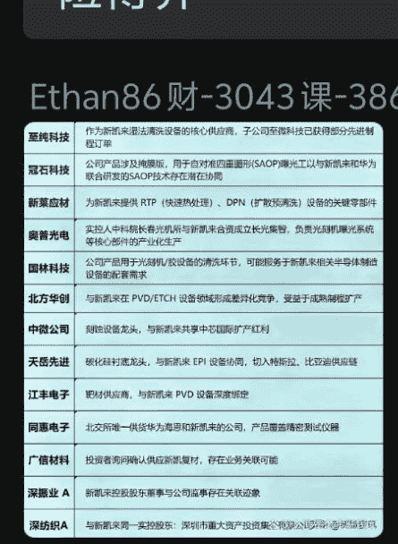
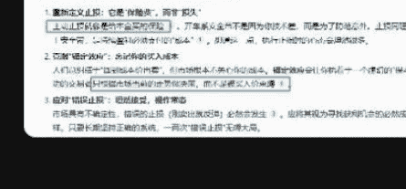
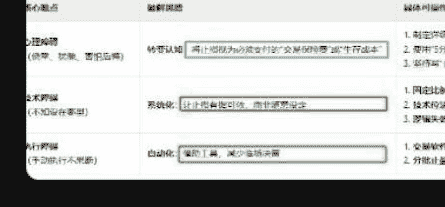

华年

经验告诉我，上周五该卖

JustDo 财3536课3735 说明经验

小字 财798课2417
目前我有三个相关的，周五凯特买了，其他的没动

小字 财798课2417
不出分就一直持，出现分支就往核心加仓位

小字 财798课2417: 就空出仓位盯盯诺米核心

圆小姐38413897
我补了一点特变，万华想买，再想等它跌点

Ethan86 3043课-3862: 万华和特变电工这两只今天有人在补吗

小字 财798课2417
这种情况下除了强势板块的强势，其他的不值得我去买黑钻鸡鹅风险博弈

Ethan86-3043课-3862

❤❤ (3214课3388)

哪个啊

小字 财798课2417: 就空出仓位盯盯诺米核心

小字 财798课2417
封板最快单量最大的

❤❤ (3214课3388)

新莱吗

小字 财798课2417
不好错也可能，真正受益还没浮出水面

好

小字 财798课2417
我就只看这一个方向了

恩

# 深度视野优质集团（链接优质社群，助你成功）

全部包含以下内容：限时年费188/年 加微信cuk255

- ① 吃瓜群众倍价流量文时光社群对话（原价 365 元/年）
- ② 子明私享汇（含）内部文章
- ③ 政事室（顾子明）付费内容再送顾子明群
- ④ 米联锦顶【作者米楼】（原价 599 元/年）
- ⑤ 欧洲金雀会员专属文章（原价 328 元/年）
- ⑥ 砖瓦斥内部文档（原价 400 元/年）
- ⑦ 卢克文青读书会专属文章（原价 699 元/年）
- ⑧ 鉴茶财经知识星球（原价 3310 元/年）
- ⑨ 猫哥的视界知识星球文章（原价 299 元/年）
- 10 财新周【独家新闻】（原价 1498 元/年）
- 11 杨世在金钱圈（原价 2200 元/年）
- 12 森淼财经知识星球（原价 1600 元/年）
- 13 激源异译付费文章（持续更新）
- 14 司马林解读求选全套音频和全套书籍收藏无删减（原价 2.3 万）
- 15 虚虚三部曲[民国梦、帝国狂亡、不被理解的MAO]（原价 599 元）
- 16 卢克知识星球文章（原价 268 元/年）
- 17 额外再送：卢户源新微爆付费专栏、三村丰老王、三花九洞文集

定期内容：——（更多资源写下去了……

- ① 守夜司令知识星球、接换魔王知识星球、成术财富圈、雪花花甲老头
- ② 创世佳人、达叔浅论星球、成术财富圈、雪花花甲老头
- ③ A视野、大树乡谈、江初序、泮咩说、上海海学等付费文集
- ④ 西凤付费文章、老端、高在八小时之外、局外的视界、升值优、老体制内等其它其它大V付费文章（每月不低于600 元付费文章）

限时年费188/年

# 低成本链接网大V优质内容

# 深度视野文集
进群微信cuk255

深度视野（付费文集）

