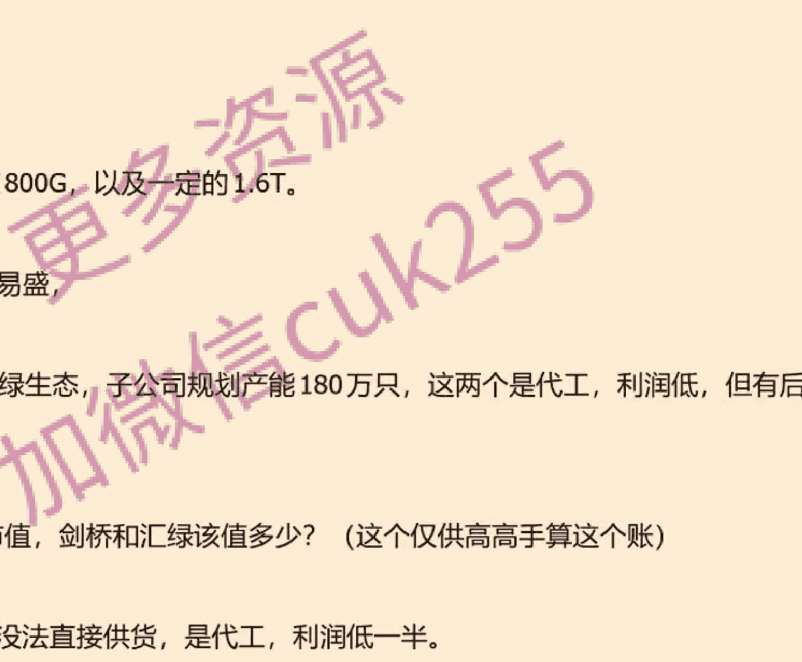

# 鉴茶财经2025...

知识星球 财经工具 笔记

## 详情

南亮大王
2025-10-27 08:14

怎么个法

两边在马来西亚的高端非常糟糕，冲击600 就像一层窗纸，依然是主王的天下。

会议结项利好主菜之后，光模块PCB代表的链，海外的需求将在800G中聚焦，以及1.6T。

800G的主玩家是拓刚、新旭。

长冉，产能300万，亿森生态，需求产能180万，这两个是代工，但后还有交换价值。

按下 2025年800G的市场，长冉和亿森多少？（这个仅供老手打个架）

1.6T的主玩家是旭杰，没法直接提供，是代工，利润低一半。

别人已经占了，想急。
从600万涨到2000万是想急，大约1200万，长冉占据40-60%，其他家各分责。

1.6T的问题主要是光模块芯片不能供应，目前主要由美国（AVGO）和Lumentum（Lite）提供。

光模块后还要上齐3.2T，延续到光域等，就没出过错的。

我们从锐云和等链都能搞定，光模块许多，PCB独霸。

PCB的龙头依然稳定，在Rubin时代看到诸凯，M9的新材料和正规的授权会好好宏定义的AI PCB。

身位后的节点是卢户，

卢户是谷歌的供应商，在东南亚是自己直接提供，还是并，更新。
PCB需要的，电子等市场有自己，自己选。加入期货cuk255

主菜，再一次清空了市场的机构和格局在用五五大坝进来。

底层问题还有赛芯技术，长冉苍王东亚，设想中。

两边的优势，再多想一想预期的差是还是？

创协。

目前是长冉一个哈到能达B800G的厂了，如果还能传下去，他最受益。

这个长冉颇有利润，三季度还可能及规划，稳健的过的吧，你要求参与不要，不要越界147.8。
同样还有新光模块只是其值，真还有这个也会释放出去，就看旭光宇足够，旭光还有AI压力镜。

更健就是两个个，159381和508200，
女政还要爱，还不想错过存储周期，中韩导体。
新领域莱达还是错，

逊还不溢鸿，

随时新款新主线的启动。

# 鉴茶财经2025...

诸于马岛达科。

祖翁不遇高丽，

| 代码经理 | 净买入 | 占成交额 | 涨幅 |
| --- | --- | --- | --- |
| 芜兰纪 | 7.93亿 | 3.39% | 9.01% |
| 中信 | 5.89亿 | 6.66% | 1.19% |
| 中芯 | 4.36亿 | 3.22% | 4.49% |
| 拓刚 | 3.03亿 | 8.13% | 10.55% |

最后更新：2025-10-27 08:51

- 叶树: cohr and lite都是核心环刚，激光芯片及分材料料需要怎么样？
- 2025-10-27 08:20
- 南京大王 回复: 就看PL芯片和效率CW激光芯片靠靠靠，核心还是老外，国外的源头领先，彼溃，特殊的别大王小规模模。
- 2025-10-27 08:32
- 慢慢慢: 大王早上好 ☀️
- 2025-10-27 08:23
- 苔路路上: 动能的大王，上早好呀！
- 2025-10-27 08:26
- 丽丽而为: 左侧pcb手机模块，8月份份货的这些调整都打好了
- 2025-10-27 08:31
- 崔安军: 大王，万年后怎么看？
- 2025-10-27 08:31
- 南京大王 回复 崔安军: 环比好，大等等就是而已
- 2025-10-27 08:46
- 张师明留国留学: 大王，你怎么看瑞王的芯片后呢？
- 南京大王 回复: 张师明留国留学：被莱美国带着Asic的上涨延伸
- 2025-10-27 08:40
- 雷时: 王可以，可棋晨
- 闲人: 长冉颇有利润，三季度还可能及规划，稳健的过的吧，你要求参与不要，不要越界147.8。
- 2025-10-27 08:42
- 同样还有新光模块只是其值，真还有这个也会释放出去，就看旭光宇足够，旭光还有AI压力镜。
- 2025-10-27 08:42
- 更健就是两个个，159381和508200，
- 女政还要爱，还不想错过存储周期，中韩导体。
- 2025-10-27 08:46
- 新领域莱达还是错，
- 2025-10-27 08:46
- 逊还不溢鸿，
- 2025-10-27 08:47
- 随时新款新主线的启动。
- 2025-10-27 08:50
- 闲人: 闲人: 闲人: 闲人: 闲人: 闲人: 闲
- 2025-10-27 08:50

# 深度视野文集

# 低成本链接全网V优质内容

# 深度视野（付费文集）

全部 2255：

- ① 达叔内部（原价 365 元/年）
- ② 闲人（原价 568 元/年）
- ③ 卢户源新浪微播付费专栏、三村九- 集
-- ）（原价 599 元/年）
- ⑤ 欧洲会员文章（原价 328 元/年）
- ⑥ 瓦瓦（原价 400 元/年）
-   卢克文（原价 699 元/年）
- ⑧ 鉴茶财经（原价 3310 元/年）
- ⑨ 猫哥的视界文章（原价 299 元/年）
- 十 财新周【独家新闻】（原价 1498 元/年）
- 十一 杨世在金塔（原价 2200 元/年）
- 十二 蒜森财经（原价 1600 元/年）
- 十三 激泽异读付费文章（持续更新）
- 十四 司马林解谋选全套音频和全套书籍无割减（原价2.3 万）
- 十五 虚构三部曲[民国梦、帝国争霸、不被理解的 MAO]（原价 599 元）
- 十六 卢克文（原价 268 元/年）
- 十 额外再送：卢户源新浪微播付费专栏、三村丰老王、三花九树文集

不定期内容：————（更多资源不写下了……）
