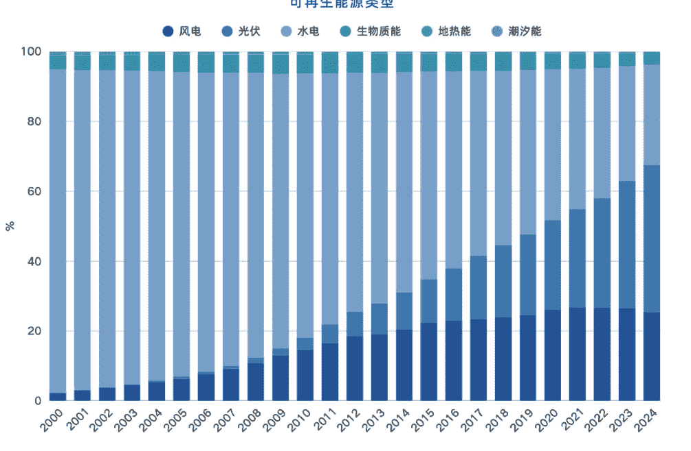
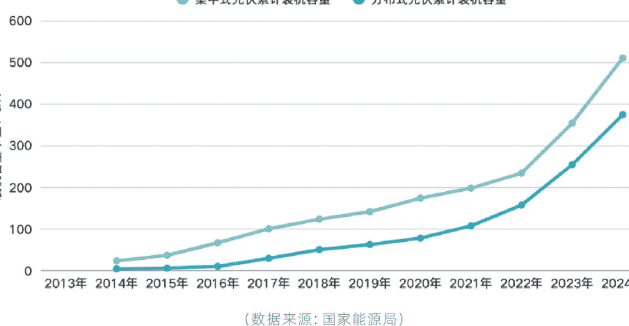
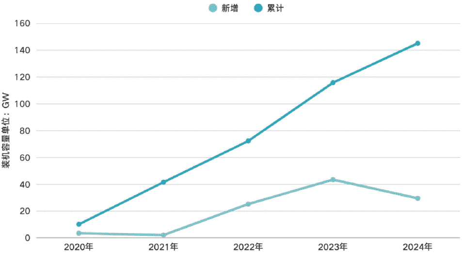
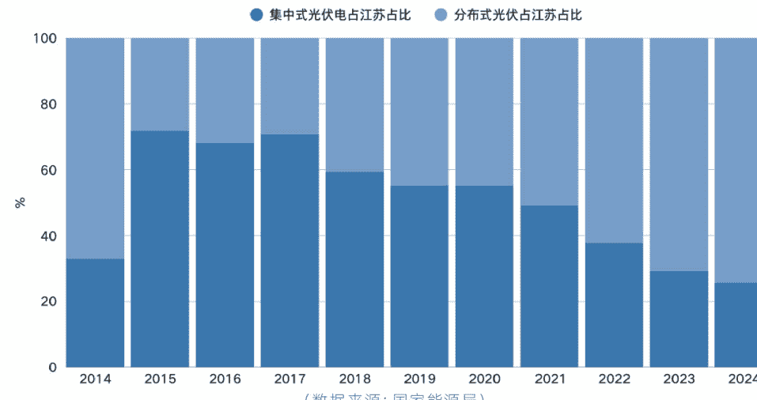
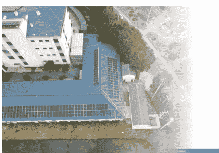
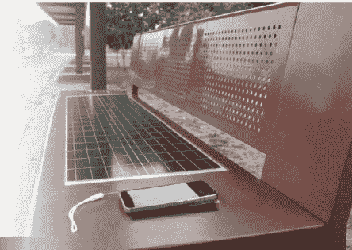
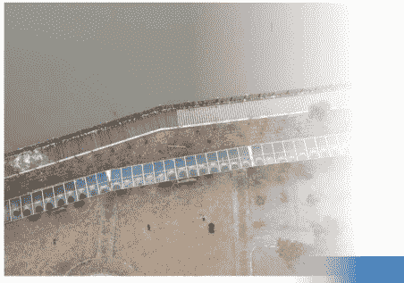
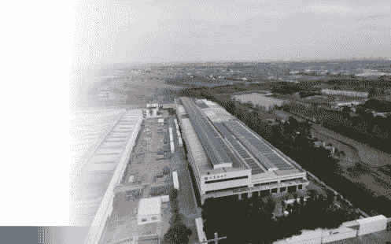

# 长三角典型城市分布式光伏应用报告

苏州样本：高消纳的分布式光伏市场化突围

2025.09

# 知识星球TOP

汇聚全网高价值资源
打造TOP级分享社群

+ ◆ 付费文章
◆ 付费社群
◆ 时政&国际
◆ 副业&搞钱
◆ 财经&骨市
◆ 行业报告

时政·历史·职场·体制·自媒体
学习·军事·软件·影音·社会学

公众号:知识星球TOP 微信信号:top28688 微信信号:top28388

添加微信免费进群

# 摘要

在全球气候治理的背景下，光伏，尤其是分布式光伏，已成为气候治理、能源转型的核心措施之一。截至2025年6月，中国分布式光伏装机将49256万kw，占比44.83%；预计2024-2030年间，

然而，中国分布式光伏发展面临创新需求：早期获用户、通过“县镇推进”试点成效有限，仅10%试点能达标目标，且存在量“市场需求”、收益堪忧、补贴黏性强等问题。2025年，国家宣布《关于完善光伏发电投资收益管理办法》（储新规（2025年）7号）与《深化新能源市场改革高质量发展的通知》（发价格（2025年）136号）两项政策（以下简称“7号文”、“136号”），推动分布式光伏市场发展，明确了自然人户、非自然人、工工业、商业和工业二类型，光伏发电取消全上网和上网电市场化，标化转型，成本下降和短期收益的下降。

本报告以江苏省作为典型对象，通过调研9个项目和多次访谈，深入分析了分布式光伏发展的经验与挑战。

苏州挑战：

1. “高消纳”行业模式是核心：苏州的关键在于固定期间用电量且稳定的工业商业、物资物流，实现80%以上的自发比例就高。通过“合同管理”提供优质的供电的企业，形成“企业-投资领先型”模式，内部收益率（IRR）9%以上，相比其他地区已摆脱补贴黏性问题。

2. 制度本身能够提升效率：通过审批流程优化，如联合审批，显著降低了光伏的不确定性和时间成本。

3. 国家资本融资特殊：国企利用低成本缓解“融资难题”，通过“主体性+项目组合”模式包融资；更重要的是，其承担主体责任、主投资收益率（IRR）4%以下但具有显著导效应的公共机构融资，如政府、大学、学校，弥补市场不足。

4. 场景拓展综合性：突破屋顶面积限制，探索光伏一体化（BIPV）、光伏声障、光伏储能、风光互补等多元应用场景，提升环保、社会和品牌价值。

深层挑战：

1. 信息不透明导致融资困境：关键数据，如装机规模、并网调度信息公开，导致金融机构评估难度，高融资成本和门槛。

2. 市场结构性：发展高度集中于工商业行业，苏州工业光伏装机规模较其他三类领域遥遥领先，且巨大的户用侧存在需求分散、补贴兑现、融资的问题，公共建筑面临回收收益率、开发滞后等问题。

3. 新政策适配：“7号文”、“136号文”要求工业企业需购全上网、市场化交易，加大抬高成本线上，短期利润空间受挤。

4. 地方政策性：基层之间存在“注册限制”，增加企业合成成本和市场分割。

建议：

+ 1. 准备备地区：做好资源筹备，优先筛选消纳>80%屋顶进行电站建设；优化审批流程，采用一站式、容缺审批等方式；由国先行投资低收益公共机构引导项目。

+ 2. 全国政府：明确提高分布式光伏自发发电利用要求；建立分布式光伏数据公开制度，定期发布机容量、并将剩余容量、电量等数据，并配套的专项金融支持政策，将分布式光伏打造优质资产；建立省级“绿电白名单”禁止地方注册限制；对历史补贴“新老计划”，稳定预期。

+ 3. 城市地区：重点开发具有高消纳潜力的城乡融合区；建立“绿色电社区”试点，引入光伏+户用技术。

+ 4. 企业/技术：组件/逆变器接口留未来有望；推广无人机+AI智能运维降低成本；建立组件回收基金。

+ 5. 电站主：确保消纳率为收益核心；对低消纳场景引入“源网储”模式，配置10-20%容量确保优化电成本；同时加强自律，做好电站质量。

苏州经验证明了以“高消纳”为核心、制度优化和多元主体的市场化布局分布式光伏可持续发展路径。然而，信息壁垒、市场失衡、政策应对挑战和壁垒一直是行业迈向更高、更均衡、更大规模发展的关键瓶颈。破解这些难题需要政府、企业、金融机构等多方协同，落实相关建议，充分释放分布式光伏在推动能源转型和实现“双碳”目标中的巨大力。

# CONTENTS

01 背景
- 全球能源转型，光伏成为能源转型措施
- 分布式光伏模式创新，市场驱动是未来趋势
- 苏州经验：产业集群、政策护航

02 苏州分布式光伏典型实践
- 工业屋顶
- 户用屋顶
- 公共建筑
- 专栏：乡村示范村

03 主要发现
- 成功经验：“高消纳”为核心
- 深层挑战：迈向高质量发展的障碍
- 多方互动：重造格局

04 建议
- 分布式光伏发展的地区：靠苏州经验把分布式光伏做成“明白”
- 政府：把户用做成“增量”
- 企业和技术：把长期项目做成“升级”
- 电站侧：自用是收益关键，引入“源网耦合”模式

01 背景

为实现《巴黎协定》目标，全球能源加速向再生能源转型。2024年，全球新增再生能源装机容量高达585 GW，其中光伏占比四分之一，装机容量增加了452GW，成为能源转型的核心力量。

(数据来源：国际能源署 IEA, IRENA)

光伏应用场景多元化，应用于集中电站和分布式场景，推动电力生产大众化，为个人及企业提供便捷方案。随着成本持续下降，2023年全球光伏项目的成本已降至0.04 元/kWh。据国际机构 IEA 分析，预计2024-2030年期间，光伏总装机规模近40%。在我国，新增光伏装机容量277.57GW，在电力装机中的占比超过26.3%。其中分布式光伏新增18GW，累计装机容量达374.78GW。从新增装机容量来看，近年来分布式光伏的新增增速没有集中式快。不过，分布式光伏在我国光伏发电结构中的占比持续增加。截至2025年6月，我国分布式光伏累计装机量492.56GW，占比达44.83%。

# 2013年-2024年我国光伏发电累计装机容量趋势

## 分布式光伏模式具有创新，市场驱动是未来趋势

1. 依赖用户光伏，聚集试点成效

在我国分布式光伏发展历程中，用户光伏的使用留下了丰富斑斓的色彩。从早期的“金太阳”工程、光伏扶持到2021年提出的，这些政策在充分发掘光伏发电带来的附加效应，让惠及乡村。

2021年，国家能源局主导开展屋顶分布式光伏开发工作，提升屋顶层开发的“五四三二”原则，鼓励利用公共建筑、工业建筑及居民房屋等楼层屋顶资源，推动分布式光伏市场布局。目前，累计备案容量约165GW。截至2025年3月，我国已有56个市（县）全面实施了试点目标。

整体获得了一定成果，在推进过程中也遇到了一些问题。目前，全面实现试点工作目标的数量仅占总数的不到10%，数据显示，截至2023年4月，整体光伏工作中，用户装机占比为50.4%。试点开展以“一企业一基地”为主，采用“屋顶租赁”+“电力上网”的分布式光伏优势和国家政策依据。

2. 提升用电、市场化、价格引导，新型发展模式

分布式光伏的经济性受到初期建设成本、上网电、投资成本（如自筹、贷款等）后期运营等因素的影响。早期，上网电的财政补贴为光伏行业注入了一剂强心剂。随着光伏规模的不断扩大，这一模式的局限逐渐显现——固定价格难以反映市场供需关系。再加上随着光伏规模的扩大，消纳矛盾也日益凸显。2024年，分布式光伏和用户光伏的需求得到了放宽，分布式光伏的发展向高质量发展。

# 2020年至2024年我国光伏增长趋势

2025年，光伏行业在政策推动下发生了所未有的变革。国家能源局和国家发改委发布了《分布式光伏发电管理办法》（国发（2025年）7号）与《深化新能源市场改革高质量发展的通知》（发改（2025年）136号）两项政策（以下简称“7号文”、“136文”）。前者对分布式光伏项目进行精细化管理，划分了不同主体。根据“7号文”政策，分布式光伏将不能全上网。

《分布式光伏发电管理办法》核心内容

| 项目类型 | 投资者 | 建设场所 | 并网模式 | 备注 |
| :--- | :--- | :--- | :--- | :--- |
| 用户光伏 | 自然人 | 住宅、庭院 | 全额上网、自发自用 | / |
| 非自然人光伏 | 企业 | 居民住宅、庭院 | 自发自用 | / |
| 工业光伏 | 一般工业用 | 公共建筑及工业建筑等附属场所 | 自发自用 | / |
| 大型工业用 | 企业 | 全部自发自用，或参与现货市场 | 接入用户侧电网 | 实际 |

## 关于深化新能源市场化改革促进高质量发展的通知核心内容

| 保障机制 | 推动新能源上网电价全面进入市场 | 建立交易结算机制：市场交易价格低于市场价格时，电网给予差价补偿；当市场价格高于市场价格时，剔除差价 |
| 项目类型 | 定义 | 规模 | 电价机制 | 执行限期 |
| :--- | :--- | :--- | :--- | :--- |
| 存量项目 | 2025年6月日前投产 | 项目在范围内确定，不得高于一级且不高于本地基准 | 继续按照现行价格执行 | 按照现行相关期限确定 |
| 增量项目 | 2025年6月1日后投产 | 依据供责任权重、以及用户承受能力等因素确定 | 自愿参与竞争，电价上限由省级主管部门制定 | 按照同类项目初始投资的平均周期确定 |

政策发布后，光伏市场掀起了一波抢装潮，企业加速项目申报和建设进度，由此催生了组件抱购、价格大涨等现象。据某业内消息，3月组件端提升至50GW以上；环比超过25%。组件需求激增，涨幅普遍为0.01-0.03元/W，组件价格冲破0.75元/W；此外，光伏逆变器胶膜等材料也涨了5%-15%。

在“7号文”、“136文”政策的合拳下，分布式光伏上网售电的收益出现下滑。这将对行业提出了更高的要求，引导行业通过提高管理水平、配置效率等方式，充分开发分布式光伏贴近用户、灵活的优势。助力碳目标实现的分布式光伏，还需要探索持续之路。

# 苏州经验：模式创新、产业集群、政策护航

在高速发展的背后，分布式光伏依然面临着消纳扩容下市场模式创新以及新政策的压力。在行业和市场的关键转型阶段，寻找优秀案例并分享其经验，具有重要意义。

近年来，江苏省分布式光伏发展迅猛，具有很强的借鉴意义。为此，我们将目光聚焦到了江苏省苏州。2024年，江苏省分布式光伏装机容量突破45GW，在江苏省光伏发电总容量的占比超过了74%。而江苏省分布式光伏以工业光伏为主，用户光伏其中的占比不到40%。

在江苏，苏州的分布式光伏并网容量全省第一。作为省经济大市，苏州用电需求巨大，却缺乏大规模水电、风电以及中小型光伏的建设条件。

为此，苏州以分布式光伏为突破口，不断创新光伏应用场景，在分布式光伏装机容量增长的同时，光伏产业也迅速发展。

2023年年底，苏州全市拥有光伏相关企业243家，其中工业企业168家，全年实现工业总产值1390亿元，已形成了光伏产业中游及配套设备。另一方面，政策也为苏州光伏的发展提供了保障，对全市、区两级实施了试点。江苏省内力度最大的分布式光伏专项政策是关于推进分布式光伏发展的若干意见》。

## 2021年-2026年苏州分布式光伏发展方案

2021年，江苏省内首个分布式光伏试点地区：针对消纳>80%屋顶进行电站建设；优化审批流程，采用一站式、容缺审批等方式；由国先行投资低收益公共机构引导项目。

2021年1月-202222222222222222222222222222222222222222222222222222222222222222022年5月，发布了《苏州市分布式光伏发展行动规划（2026年）22222222222222222《苏州市新型光伏一体化应用》。

# 苏州分布式光伏典型实践

本案例聚焦苏州典型场景——工业、户用、公共建筑、乡村村落。通过案例阐析其分布式光伏在不同场景下的应用潜力，揭示了“高消纳”模式的核心优势与差异化路径。

3. 三洋能源

该项目采用三洋能源屋顶，投资额1078.7万元。项目采用“自发电、余电上网”，建成后每年发电量264.2万kWh，相当于标准煤950吨。建成后每年减少二氧化碳排放2634吨、二氧化硫排放79吨、氮氧化物排放91吨、颗粒物排放78吨，相当于1462棵树，为城市“环保”、“环境减压”发挥了巨大的作用。项目采用合同能源管理模式，对投资者来说收益率为95%；对于业主来说，三洋能源提供免费电量。投资方表示：“业主不需要租金，只关心电价折扣、发电稳健。”

| 装机容量 | 发电量 | 并网时间 | 投资模式 | 消纳率 | 投资额 | 减排效果 |
| :--- | :--- | :--- | :--- | :--- | :--- | :--- |
| 2.74 MW | 270 万 kWh | 2022 年 | 合同能源管理 | >90% | 1078.7 万元 | 减少 CO2 2634t |

2. 格纳汽车

格纳苏州工厂0.8 MW屋顶于2023年，投资额为350万元。屋面为轻质钢瓦，采用轻质组件直接粘贴，不增加负担；发电量80 万 kWh，消纳率大于90%。合同能源管理模式下，企业受电85折；报价方介绍：“租赁组件解决了屋顶承重难题，工厂三班倒，天天所有绿电。”

| 装机容量 | 发电量 | 并网时间 | 投资模式 | 消纳率 | 投资额 |
| :--- | :--- | :--- | :--- | :--- | :--- |
| 0.8 MW | 80 万 kWh | 2023 年 | 合同能源管理 | >90% | 350 万元 |

3. 红光玻璃工业

红光1 MW光电站建于2023年，投资额约360万元。屋顶采用水泥屋面，采用常规组件支架安装，发电量100 万 kWh，企业三班倒生产，发电几乎全部自。

| 装机容量 | 发电量 | 并网时间 | 投资模式 | 消纳率 | 投资额 |
| :--- | :--- | :--- | :--- | :--- | :--- |
| 1 MW | 100 万 kWh | 2023 年 | 合同能源管理 | ≈100% | 360 万元 |

| 装机容量 | 年发电量 | 并网时间 | 投资模式 | 消纳率 | 技术形式 | 节能贡献 |
| :--- | :--- | :--- | :--- | :--- | :--- | :--- |
| 698.06 kw | 49.65万 kWh | 2024 年 6 月 | 业主投资 | 100% 自用 | BIPV（钙化+单晶硅） | 建筑可再生利用率达34.41% |

## 2. 国德智慧大厦江西江西路光伏隔屏

芜江江西路1076m隔屏2022年升级为BIPV光隔屏，装机232kw，发电量约20万kWh。将传统景观隔屏的上部隔屏拼接形成具有吸声性能的光伏元件，一物两用，既可以消除噪音，又就可以用于交通信号灯、照明等，余电上网。

| 装机容量 | 年发电量 | 长度 | 并网时间 | 技术形式 |
| :--- | :--- | :--- | :--- | :--- |
| 236kw | 20 万 kWh | 1076 m | 2022年 | BIPV 一体化 |

### 政府机关

### 1. 千于江西路1038号政府办公楼

项目位于芜州民主开发区、工商集中中心办公区，2024年并网。屋顶236kw，立面窗台BIPV及车棚储能一体化组合，发电量22.63万kWh，节约约90.52吨，减排CO230.25吨。合同能源管理模式下，行政中心零散机关提供屋顶，享受电费9折优惠。现场可见采用混凝土配支架，立面为定制单晶光伏幕屏；车辆配套60kw直流快充，白天光伏直接为车辆供电。

该项目由地方企业投资，投资方表示：“政府机关消纳水平并不高，所以收益率并不好看，很多方投资并不愿意。但政府机关是要起到示范作用的，我们的企业这次就是要起到补位示范作用，即便收益率不高，我们也投。”

| 装机容量 | 年发电量 | 并网时间 | 投资模式 | 消纳模式 | 减排效果 |
| :--- | :--- | :--- | :--- | :--- | :--- |
| 236kw | 22.63万kWh | 2024年 | 合同能源管理 | 自用+余电上网 | CO290.25 t |

## 专栏：乡村振兴示范村——蒋巷村整体项目

蒋巷村护理院屋顶的光伏板

蒋巷生态园内的光伏座椅

蒋巷生态园环湖光伏步道

蒋巷村工业厂房屋顶光伏

薛善村 2022 年建3.6MW 分布光伏聚集，覆盖公共设施、集落建筑、文旅、工厂四大场景，发电600万kWh，节标碳2000吨，减排CO₂5400吨。项目投资2000万元，采用合同能源管理模式，集落乡村租金，享受八折电价优惠，整体收益50%。村内光伏充电桩、光伏步道、风光互补路灯等多元场景投入运营，为“零碳乡村”启示。

## 亮点

- 光伏充电一体车（140 kw+100 kWh 储能）作为光伏充电桩，能源管理系统（EMS）根据峰谷电力自动调优
- 72 m²的光伏步道嵌入荒化耕地，极具科技美感，形成独特景观
- 集成有线、无线充电模块光伏座椅，无需外接电源，全部太阳能，便捷且新奇
- 风光互补路灯，接入后天气仍能良好

村民反馈：“路灯便捷、养老院电费便宜，大家都说好。”但收益率不高，政策限制，村民能够直接购买绿电，消纳水平有限。

| 场景 | 技术形式 | 亮点 |
| :--- | :--- | :--- |
| 村委会 | 常规硅组件 | 收益金、电价折扣 |
| 养老院 | 常规硅组件 | 收益金、电价折扣 |
| 少年活动 | 常规硅组件 | 收益金、电价折扣 |
| 工厂 | 轻质组件 | 瓦顶 |
| 光储充电桩 | BIPV 车桩 | 动态调度 |
| 文旅光伏步道 | 荒化地址 | 融入景观 |
| 光伏充电座椅 | 特殊应用 | 电网接入 |
| 风光互补路灯 | 光伏+风机 | 照明 |

## 主要发现

苏州分布式光伏项目调研，与政府、投资、业主互动，以及政策引导，基于市场化背景，分布式光伏面临深层挑战、规模化、高质量发展的瓶颈。这些发现超越具体的项目，揭示了分布式光伏发电规律、核心要素、后续发展。苏州光伏伏充一体化。

## 成功：“高光”商业模型

苏州的实践证明，分布式光伏在减少补贴依赖的情况下，通过精准匹配资源与需求、发挥多元作用，能够实现可持续的发展。

### 1. 消纳决定经济效益

项目经营的核心在于精准匹配白天用电且稳定的资源供应。通过提供电网对接，为企业创造直接效益，消纳量是财务可靠性的阈值。这种基于“电价差”的商业模型，形成了“企业-投资-发展-收益”的良性循环。

### 2. 准制成本有效提升效率

以老旧小区改造为代表的楼项目，面临补贴承诺及时且无直接投资回报，同步缺乏经验差异，职业质量有着同等问题。公共建筑建设主要依赖国资储备，缺乏市场化、可持续。苏州采用承诺制模式，允许在部分符合条件下，先行组织光伏项目筹备。对于行业原因导致难以通过证工程，通过灵活处理，提供了快捷解决方案。这种效率提升体现了地方政府优化营环境、降低制度性成本。

### 3. 国有的独特功能与价值

贷款赋能降低门槛：国有企业凭借其信用等级，能够获得额外资金。对比投资者，通过“主体融资+项目组合”的模式，多个项目获得了大额信贷，解决了本项目规模小、评估成本高昂的融资难题，为民企提供了借鉴。
承担社会责任吸引资金：国有项目具有收益较低的特点，容易具有社会效应，如政府办公楼、大学、学校，内部收益率仅4%。此类项目的投资策略超越了单一的经济回报，通过“推行公用功能——打造标识色彩”和“社会责任”纳入考虑，弥补了市场机制在低收益公共项目开发方面的不足，避免了资源闲置，同时也做到了引领作用。

### 4. 场景描绘整合综合效益

苏州的探索打破了层层安装模式。通过将光伏与建筑深度贴合、与城市设施与乡村振兴融合，分布式光伏被赋予了更广阔的应用、品牌价值。这不仅丰富了物理建筑空间，更重要的是提升了项目的综合效益和各方参与，有助于提升乡村形象、吸引游客，更增强了环境、社会和公司治理（ESG）表现，为产业升级提供了优化路径。

## 跃迁：迈向高质量发展的核心障碍

苏州的经验清晰暗示了行业在发展过程中面临待解决的结构性问题：

### 1. 信息不透明限制资金质

关键数据的公开不足，装修机械、行业内部、补贴发放成为普遍问题。金融机构无法准确均衡区域需求、情况和项目真实风险，只能依赖企业数据或采取保守策略。这种信息壁垒阻碍了金融资源的有效配置，推高了融资成本和门槛，不利于中小企业和新入者，成为行业规模扩张的阴影。

### 2. 市场结构性缺失与后续领域开展困难

1）工业市场及公共建筑重建困难：当前房屋发展集中于规模较大的工业房屋层，在旧区工业房屋伏伏容量占比超过一半；且巨大的压力导致户产权稀缺、落实到高开发后滞后，公共建筑也导致收益低下。这反映了现有市场模式与工业房屋需求活跃、市场复杂、单一模式、收益各异的特殊特性，缺乏对投资者的有效激励。
2）公用建筑、社区发展多元困难：以老旧小区改造为代表的楼项目，面临补贴承诺及时且无直接投资回报，同步缺乏经验差异，职业质量有着同等问题。公共建筑建设主要依赖国资储备，缺乏市场化、可持续。

### 3. 政策转型适应偏差

2025年“XX号文”、“XX号文”宣布，工业市场有望取消额上转向电力市场，原有模式无法直接对接。业内测算显示自用需求高达60%以上，且光伏曲线与用户需求超过75%，有利于维持基准。这种效率在转型期的压力增大，空间显著压缩。

### 4. 地方性壁垒不是必要

曾曾在层面令禁止，但基层仍存在“注册限制”要求，要求项目设置多个实体，增加工作量、审计等成本。这类地方壁垒阻碍了企业的增长，影响了整体效益，与国家方向不符。

## 多方互动：塑造市场的关键力量

苏州的实践展现了不同参与方的的核心诉求和模式：

- 业主：成本约优，风险低，核心动力通过显著降低运营成本。同时依赖于资产质量、运维。
- 投资者：风险低，回报高，核心动力是收益。民营企业具有明确的经济引导，使得收益反应迅速，受限于业务范围。
- 金融机构：风险控制，授信依据是投资主体的资质（优先企业）、可获取的市场数据。数据缺失会导致授信上限，反映了灵活支持的能力。
- 电网公司：平衡接入与调度，核心诉求是安全的稳定运行。在分布式光伏项目中，表现为：接入管理：对项目进行评估和评审，确保符合电网标准，避免大量电力引发电压波动、频率偏差等问题；消耗：通过智能电网技术和需求响应机制，优化光伏组件的消耗。在高峰时引导用户用电需求，减少消电；在低位时通过储能系统或需侧调度，提高利用率。政策配置：依据区域目标和地方政策引导，参与项目的规划和布局。同时，电网公司采取市场化手段，如电力市场、辅助服务市场，进一步提升经济性和竞争性。

### 5. 地方政府：目标的差异

不同层次的关注点存在差异。政府更侧重直接利益、收税落地、本地就业，对于项目可能注重注册地。而市及以上政府更关注宏观目标的实现，如能源转型、破解控制和制造公平的环境。通常对地方保护主义持否定态度。这种目标差异是在政策执行时可能产生碰撞的原因之一。苏州市分布式光伏的发展，是市场需求、制度化、各类功能开发与当地经济增长共同作用的结果。其核心价值在于早期验证了光伏具有可持续的发展路径。然而，信息不对称的约束、市场结构失衡、政策转型期的挑战、地方性壁垒以及收益机制的不完备，仍是制约行业实现更高质量、更均衡、更大规模的关键。破解这些瓶颈，将是下一阶段政策与市场发展的重点方向。

## 建议

苏州的成功经验表明，分布式光伏在不依赖补贴的情况下，完全能够可持续的商业模式。然而，将这种局部的成功经验转化为全国范围内的实践，仍需在信息透明度、增量及技术升级等关键环节补短板。基于调研，本章将指出以下对象的建议，旨在不同主体提供清晰的行动指南，推动分布式光伏的规模化发展。

### 发展分布式光伏的地区：借鉴苏州经验

1. 做好资源摸排，开展领先筹备：政府安排完成两项资源摸查：探索可装光伏的屋顶资源，尤其是复杂且巨大空间的用户资源；明确分布式光伏接入与电网消纳能力，形成“屋顶-电网”一体化数据库，为精准对接高需用光伏场景奠定基础。在项目筛选阶段，优先考虑用电量大的工厂、商业企业和物流园区等场景，确保光伏比例低于0%。通过精准筛选，避免造成余电上网，从而提升收益。
2. 审批流程优化：整合备案、电网接入等流程，设立一站式窗口，实施承诺制，允许在部分符合条件下先行启动光伏项目。对于那些因历史原因缺乏产权证明地区，通过灵活处理，提供了快捷解决方案。
3. 资源充分显示：对政府机关、学校、医院等收益偏低的地区，由地方平台投资，打造试点项目。通过引导作用，激发关注，为后续市场化奠定基础。

### 政府地区：实现“绿色效益”

1. 明确提高自用率：国家层面明确，分布式光伏的首要任务是替代本体用电。各地根据自身自用需求，纳入政策考核，实现宏观目标。
2. 数据与金融对接：定期发布区域内装机容量、发电量等数据，为金融机构提供精准评估，支持授信。
3. 建立退役组件回收通道：由省级部门牵头，组件、回收企业、保险公司三方共同建立基金，老旧设备统一拆解。通过闭环管理，避免退役组件带来的环保风险，实现产业可持续发展。
4. 新老替换：对于以前的项目，按照标准追加补贴，避免政策反复变化带来的负担，预期清晰。

### 发达城市：做“增量市场”

1. 城乡融合增长：发达城市的建筑密集、人口多且经济活动频繁，因此此地区电力需求较大且具有消纳能力，建议社区作为单位减轻电网压力。
2. 建立“绿色电区”：在集中的地区，统一安排光伏+储能系统。白天发电，晚上放电，居民用电成本大幅下降。通过试点积累经验，逐步推广，有效提升市场接受度。

### 企业技术方：做“升级系统”

1. 组件和逆变器预留接口：新建项目采用可插式逆变器和标准化接口，为后期更换高效组件预留接口。据估，技术升级将降低二次成本30%以上，延长项目生命周期。
2. 推广运维、提升精细化管理水平：运用无人巡检+AI缺陷识别，通过技术赋能，提升精细化管理水平和运维效率，降低运维成本，保障项目收益。

# START YOUR FINANCE

起点财经，网罗天下报告