# 门店运营解决方案

门店如何运营私域流量，实现线上线下一体化

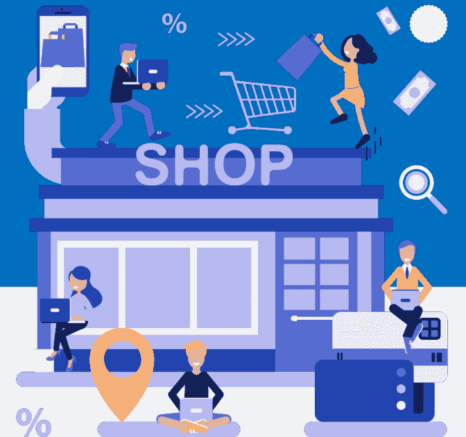

# 知识星球TOP 资源分享社群

汇聚全网付费资源让更多获取高价值信息

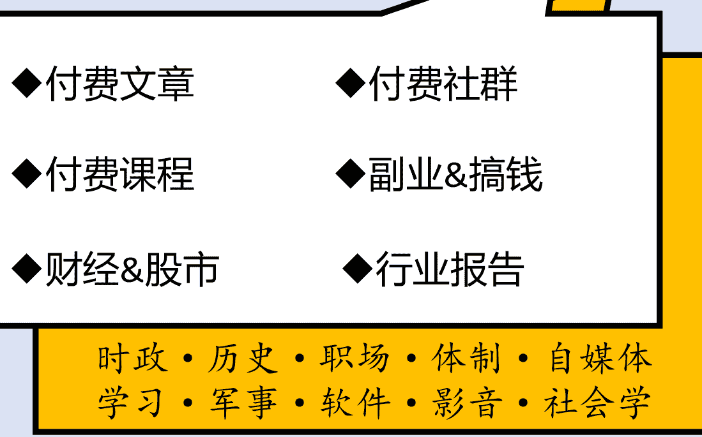

- 付费文章
- 付费社群
- 付费课程
- 副业&搞钱
- 财经&股市
- 行业报告

时政·历史·职场·体制·自媒体
学习·军事·软件·影音·社会学

公众号:知识星球TOP 微信号:jntsg8 微信号:jntsg2


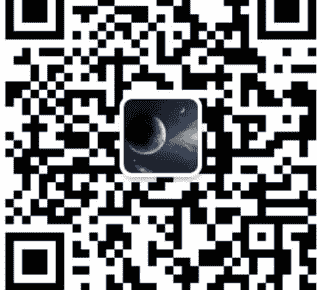

添加微信免费进群

# 目录 CONTENTS

## 1. 门店痛点篇

目前商家普遍存在进客少、促销效果差、成本越来越高等问题，其实自己的专属私域流量，以及全渠道销售是有有效的破局方式。

- 传统门店商家目前存在的痛点
- 搭建私域流量和全渠道融合突围困局
- 门店解决方案帮助商家成功

## 2. 门店玩法篇

32玩法，渠道获客/转化/留存/复购/增购/裂变全面提升门店销量。

### 2.1 渠道搭建

- 角色定位
- 形象包装
- 朋友圈高质量内容发布
- 朋友圈高频互动
- 构建粉丝群，不断开拓铁杆粉丝

### 2.2 推广获客

- 霸王餐：门店引流翻倍，引爆全城
- 试用试吃，助力获客
- 地推贴膜买一购，低价增粉
- 优惠券互换，异业合作导流
- 社群添加好友，强势增粉
- 美团点评付费推广，平台导流

### 2.3 成交转化

- 客户体验地图：找到营销提升的机会点
- 店铺主页装修从0到1，教你打造高转化的店铺
- 适用体验装，引爆单品销售
- 首单大额优惠，提升转化
- 爱达直播：带客户进入你的场景，高转化利器

### 2.4 客户留存

- 将门店客流量有效留存到线上：优惠买单
- 将门店客流量有效留存到线上：幸运大奖
- 积分商城：留住客户就靠它

### 2.5 客户复购

- 消费后送券，让客户下次再回来
- 双十一蛋糕券买一送一，提前消费
- 会员专属秒杀：让更多客户想要成为你的会员
- 会员专属群团购：让你的客户在群里帮你销售
- 不同充值方案带来更多的会员

### 2.6 客户增购

- 加N元一件，增加客单又增加了销量
- 限时满减+优惠券：让订单翻倍增长
- 优惠套餐：增加商品曝光，客单价涨涨涨
- 打包一口价：营造狂欢气氛，刺激下单

### 2.7 分享裂变

- 你邀请我奖励，拉就这么简单
- 团长免单：开团成功，商品免费拿
- 快速解决流量难题：砍价0元购
- 粉丝变赛道，轻松赚钱：销售员

## 3. 门店案例篇

6篇案例，看大咖如何用粉丝实现全渠道运营

- 3天拉群3700人，看他们如何打造“导购式店铺”微信群
- 单天流量翻6倍，线上直播（注：原文为爱达，测为直播）
- 城市水果店年入百万，看他们如何引流增长
- 老客占比50%，复购率95%，新店销量放大
- 网红蛋糕店年粉38万，提升复购
- 从0到1启动社群，粉丝活跃率超过40%，实操解析
- 附：全年营销节点

## 痛点篇

通过这个章节，你了解：

- 传统门店目前存在的痛点
- 搭建私域流量和全渠道融合突围困局
- 门店解决方案帮助商家成功

### 传统门店目前存在的痛点

门店思考：“以前是找流量，现在为什么顾客不来了？我们要想问题，一定要给他合适的理由。”

| 经营主要问题 | 占比 |
| :--- | :--- |
| 门店客少 | 46% |
| 营销方式和手段有限 | 46% |
| 线上线下没有打通 | 31% |
| 消费者需求了解 | 26% |
| 转化率低 | 24% |
| 老客户流失严重 | 22% |
| 门店管理能力弱 | 20% |

经营最大的难题：
1. 营销方式和手段有限，新店流量少。
2. 消费者需求少，到转化率低。
3. 线上线下没有打通，对于连锁店来说，管理弱。

### 搭建私域流量和全渠道融合突围

### 搭建私域流量实现持续续航

流量从“宅”变得越来越“圈”，消费从一种需求升级为身份、价值观等元素产生。

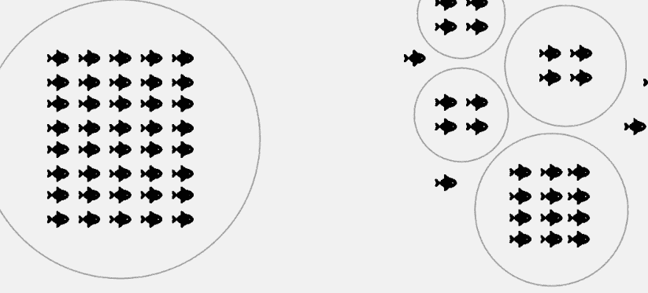

- 平台电商-公域流量
- 社交电商-私域流量
- 角色多元，参与到整个业务链中

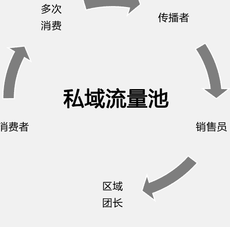

## 门店解决方案帮助商家成功成功

- 推广获客 > 成转化 > 客户留存 > 复购增长 > 分享裂变
- 线上线下加速，全渠道融合成为新零售的重要趋势

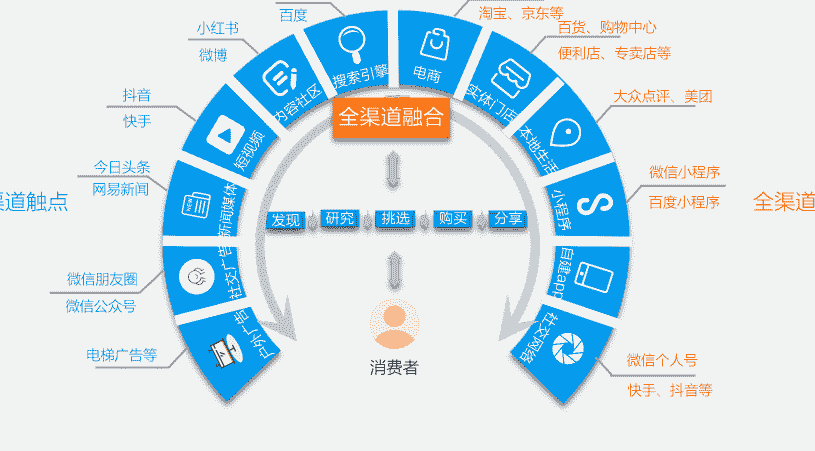

提供32套运营玩法，拆解商家案例，旨在通过这些解决方案解决流量少、经营效率低的问题。

- 结合有赞社交电商运营模型(AARRR) 匹配商家场景输出玩法
- 商家经营经营，结合有赞私域

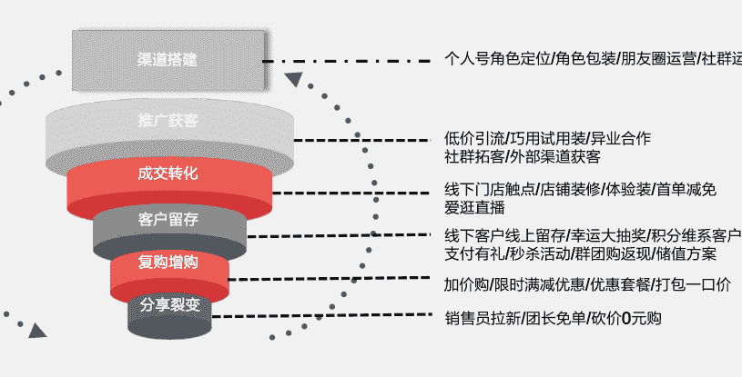

通过玩法/案例和商家进行良性循环，让赋能其他商家。

- 玩法及案例匹配商家情况，输出落地执行方案，根据实操内容优化玩法内容，生成案例，和商家形成良性循环，以此形成最佳路径，赋能门店商家。

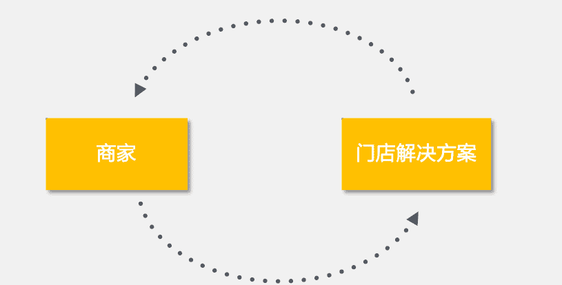

## 玩法篇 “渠道搭建”

通过这个篇章，你将了解：

- 角色定位
- 形象包装
- 朋友圈高质量内容发布
- 朋友圈高频互动
- 构建粉丝社群，不断开拓铁杆粉丝

### 微信个人号，比你想的更多

一家实体门店一个微信个人号=一个人一个微信KOL，让一个个人号实现引流、转化、复购、介绍的商业闭环，是实体门店转型零售、线上销售渠道运行的基点。如果你的微信个人号不行，你的微信商城是无法执行的。

### 第一步：角色定位

首先私域流量的主角是“人”，直接和你店铺打交道，人们更愿意和店长或者老板交朋友。推“品牌”的朋友只有产品输出，但的人应该有生活。比如“XX”下的“小助手”和她的客人不是买卖关系，而是姐妹、闺蜜，是一起分享育儿知识和生活的朋友。

其次，角色要有价值，要有“用和赢”，真正把自己打造成“业内专家”。这样你的粉丝才能在领域内遇到问题时第一时间想到你、咨询你，把你成为一个领域内最值得信赖的朋友。信赖的朋友要有价值，价值才能带来业务。同时也要保持一定性，一个完美无缺的专家朋友并不存在。

### 第二步：形象包装

**► 微信头像**
建议微信头像使用真人照片，或者其他本人、产品相关的图片，这样可以给人一种真实感，也有有利于品牌的塑造，注意照片的美观和构图。一旦确定了名称和头像就不要修改，保持固定的记忆。建议微信商城是【吃货大王】，个人号叫吃货小明。这样既可以突出店铺和品牌，还可以让人记住，给人真实的感觉。

**► 微信签名**
能够体现个人特色，避免官方的内容。

**► 朋友圈封面**
尺寸为640*640，否则不能完全呈现。

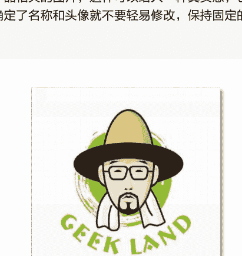
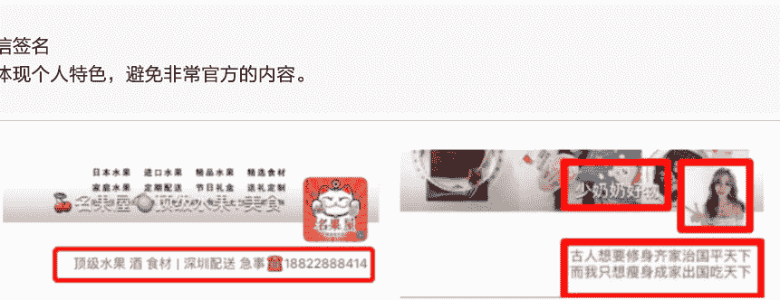

### 第三步：朋友高端内容

如何像粉丝一样展现形象，从头像、昵称、签名、背景方面，还需要考虑内容包含。私域定位就是专家，不仅是吃货，粉丝还会互动。

**内容方法：**
- 广告发布一：“精赞”或“视频”
- 广告发布二：超级吸引+老客户
- 广告发布三：专业身份+真人出镜+专业知识
- 通用发布四：自拍和个人生活聚焦
- 通用发布五：热点时刻
- 通用发布六：日常生活、工作

**注意事项：**
1. 给红包或者转账，引导线上购买，下次购买更方便。
2. 不要：负面能量信息；谣情、标题；购物链接：具有硬性的广告。

**发布时间：** 早上7:30–9:00，中午11:00–13:00，下午16:00–18:00，晚上22:00–23:00。大家手机的集中时间发布，才能让更多人注意到你的内容。

**一天发几条：** 建议每天朋友动态不要超过5条，内容要为了工作、生活、娱乐等内容，多为朋友的活跃/频率。

### 第四步：朋友圈高频互动

备注：朋友圈的内容活跃让别人容易产生共鸣，或者留言，尽量多与他人互动。好少的时候多刷别人的内容，多的之后尽量回每一次留言。总之让朋友觉得你在他们这里，并且能够回你的信息。“怎么又发我的圈”。个人号代表了你的品质标签，你说的每一句话，每一条动态，都会影响你的品质标签。

**互动动态：**
1. 点好友发布朋友圈并说明几个点的好赞（优惠&品牌&吃美食等）来求互动，还要经常给朋友发赞，培养“你来我往”的互动。这样就不会引起对方的反感，而且内容内不会冲突，这时候就要弄清楚内容。
2. 转化粉丝通过朋友圈互动和新流量添加微信，福利、集、特惠。
3. 推广新产品给老粉丝让他们添加你的微信，大家都能获得福利。
4. 在自己的朋友圈里给这条点赞或者评论的，都会引起互动动态。大家会去查看你的评论，营销效果就能获得补充和二次推广的效果。
5. 促销活动：用经营的产品来成交。

| 微信 | 朋友圈 | 动态 | 私信或朋友圈 | 运营 |
| :--- | :--- | :--- | :--- | :--- |
| 8-10点 | 晨起早点，生活中的点滴 | 个人生活的分享，早起互动，增加活跃度 | 早上发布朋友圈（图片三） | 10分钟内疯狂点赞评论10个，朋友评论要回复 | 建立早起习惯 |
| 12-13点 | 朋友圈的好赞会引起粉丝的关注，增加总活跃度 | 个性的生活展示，增加互动 | 下午发布朋友圈（图片四） | 朋友动态点赞+互动，需要对方回复 | 在朋友圈内回复，可以点赞对方，增加活跃度 |
| 15-18点 | 下午时间，工作、忙碌、休闲、聚会 | 分享工作点，增加真实感 | 晚上发布朋友圈（图片五） | 朋友点赞+互动，不需要对方回复 | 每天都要互动，用产品来推广 |
| 20-22点 | 晚上，晚餐，休息 | 总结一天的收获，分享感悟，增加信任度 | 晚上发布朋友圈（图片六） | 与朋友私信互动（图片七） | 建立互动 |
| 其他 | 周末，聚会、活动 | 记录生活点滴，要有素材，真实、有趣 | 随时发布朋友圈 | 配合互动 | 相关活动 |

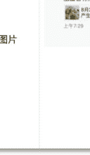
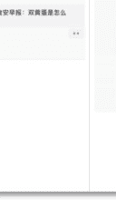


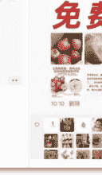
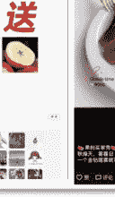

### 五步：建粉群，不断拉铁杆粉丝

首先要把已经加微信的客户拉到群里。应该是这样的，不是硬推。为什么不能硬推？因为会被拉。

- 社群搭建流程
- 社群是一个具有共同方向的人群体。好的社群的就是一个共同的产品，能够清晰生产优质内容。群的需求来自以下几点：
1. 群名称做什么？
2. 用户得到什么（或者你可以提供什么）
- 定位：已经购买过的老群。
- 产品：想要购买或体验过的客户。
- 目标：销售、留客、VIP服务，提高复购率。
- 定位：活动建立的粉丝群。
- 目标：有意购买的客户。
- 目标：提高转化率。
- 定位：为了某个目的建立的同类群。分销，目的就是为了政策容易。

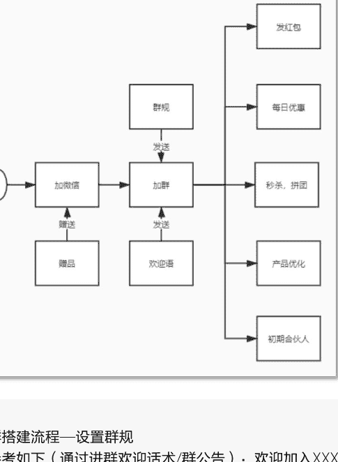

### 社群搭建流程一：建群

主人：说明群是干什么的，给大家提供什么，会有哪些福利、产品推荐；让群内活跃活动和产品的优势，引起大家讨论。
客服：处理客户的咨询，如产品属性相同问题，引导下单。
马甲：配合引导咨询，刺激粉丝团结，从客户角度维护互动。需要配合活动、咨询、下单、反馈感受等，原则上多互动。
备注：马甲可以在群里发福利，尽量少发广告。

### 社群搭建流程二：设置群规

参考步骤（通过进群欢迎/群公告）：欢迎加入！为了让你享受，进群后告知以下几点：
1. 【改名】修改群昵称为：小组/ABC/种草群/宝妈群/粉丝群；根据粉丝画像，群之后根据需要选定这些点让粉丝活跃。
2. 【服务】我们每天0点定线上活动，不举办活动。
3. 【有问题】咨询服务及售后可以找XX。
4. 【不可以】不可以发广告/晚上23点后禁言时段避免骚扰。
5. 【你可以】分享自己的生活妙招、生活小妙门、小区最新动态、积极参与各种活动，拉人群活跃。

## 社群维护与活跃

社群维护方法：

- 社群维护公式：持续的抽流量，目的是更多的人为你感动。
- 社群维护公式：要有有价值的知识分享，比如爱情知识、儿童教育知识、健康知识、美妆知识、民知识等。
- 社群维护公式：娱乐活动，励情，鼓励古语诗境，看图文、唱歌比赛等娱乐互动，能够让社群参与，提升社群活跃度。
3. 定价的实施规范，确保社群环境。

注意：

1. 产出用户可维护的内容，解决用户基本需求。
2. 引导用户发生横向交流。
3. 定价的实施规范，确保社群环境。


## 试试试吃，助力获

### 活动简介
通过在门店举办活动，拦截过路的行者或者试用商品，从而吸引人流进来，增加流量，提高转化的机会。


### 运营目标
宣传渠道
配置路径
通过试吃试用的形式吸引流量到个人号、社群、门店、小区围圈
【应用：营销活动-优惠券】 【客户-储值管理-储值规则}

### 运营实操

### 活动流程
- ▶ 预热期：提前一周上线预热造势，在门店周边主播建微信群，宣传活动：转发朋友圈积累100个点赞并线上满100元，即可在门店或地推现场抢购价值200元的榨汁机一个。
- ▶ 活动中：
  1. 进流试吃：例如榨汁机、糖精等现场制作售卖活动，免费试吃：洗衣机、电视等现场展示。同时在现场布置促销传单、介绍产品、联系方式登记。
  2. 设置转化策略：通过试吃试用的形式吸引客户，通过优惠活动积极引导关注。当客户消费时，通过引导客户关注，当客户回馈，送上相同礼物。同时为了吸引流量，在条件允许的情况下
  3. 气球装饰：在店内营造热闹的氛围，挂上彩旗、气球、贴地上，并统一销售话术。

### 参考术
各位朋友大家好，咱们商店最近在开展试吃活动，你可以来尝一下吧，我们品牌小家的榨的果汁，绝对不要造！咱们里的咖啡最近最近活动，低至八折。

### 所需物资
宣传桌、桌布、海报、展架、宣传单、宣传产品、舞台、演员道具、音响、气球、拱门。


### 注意事项
1. 各类活动都需要配合吸引人的宣传资料、展架、手册、手册等以及专业的销售团队，这样能够聚集的流量转化客户。
2. 必须要有吸引力的促销活动进行，例如：今日特价八折，当现场购买立减、充值会员积分等，尽量让吸引顾客有现场购买的冲动理由。
3. 以上活动可以配合：例如：表演与展会，效果会更好。

### 地贴膜一元购，低价增粉

### 活动简介
通过在人气流量大的地方进行推推、扫扫等活动，吸引顾客到店，达到引流效果。

| 运营目标 | 宣传渠道 | 配置流量 |
| --- | --- | --- |
| 通过推推、扫扫的宣传形式吸引顾客到店，实现引流 | 门店周边5公里人气流量密集处或周边小区 | 【应用-营销玩法-优惠券】【应用-营销玩法-满减送】 |

### 运营流程
- 活动前：
  - 1. 市场调研、策划规划、制定任务目标、目标分解、每日会议总结；
  - 2. 设置活动如，如办理会员卡提供折扣、满减、满送等。
- 活动中：
  - 1. 负责推推的人员到达指定区域通过：直播、撒援、道具假装、网红玩具展示等手段吸引人群向我们范围内咨询，销售人员向潜在客户发放优惠券、购物券、介绍产品，讲解活动规则，获取联系方式
  - 2. 扫扫：按家户门店敲门，介绍产品，介绍活动让住户线上支付，通过系统商品+满减/满送推送多种类型的优惠活动，住户凭领券直接到线下地贴膜购手机膜服务；实际操作发现顾客不愿意直接扫，那就可以在门店门口，用把扫或车窗处设置投放活动；活动如：办理会员卡享折扣、满减、满送等
  - 3. 用扫扫消费时，需出示订单并现场将订单确认后改造成多次获得；销售人员详细介绍其他产品，活动如：办理会员卡享折扣、满减、满送等权益，进一步转化流量客户。

### 参考价值
您好，我们最近喜欢开展引流，您只需支付一元钱，即可在XX店内进行手机膜，并且获得极大优惠券。

### 所需材料
各种型号的贴膜、宣传资料、购物券。

### 注意事项
1. 市场调研和策划规划非常重要，过程中要调查区域情况、小区状况、人气密集
2. 设定目标和任务分解可以增加人员积极性和适当落实
3. 每日会议分析原因，根据实际情况调整策略，避免在区域浪费人力。

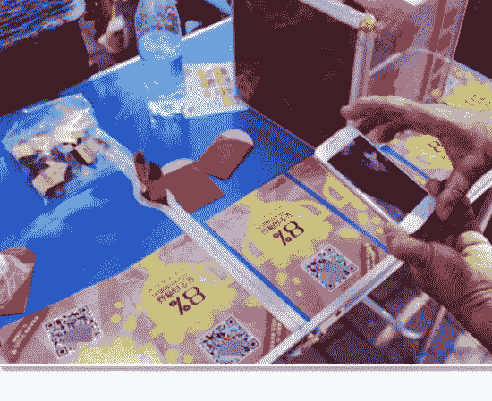

### 优惠券互推合作赢

### 活动简介
共享是行业发展的趋势，通过合作的形式交换客户，有效的增加自身客户。

### 运营目标
吸引新客
### 宣传渠道
门店、电梯、物业
### 配置路径
【应用：营销玩法-优惠券】

### 运营实操
### 具体方案
不少实体商家都需要合作推广。合作是指两个或以上的企业通过分享资源、降低成本、提高效率、增强竞争力。因此，合作涵盖两个方面，一个是主体为不同企业；二是合作的方式进行营销。

- 美食、家具：
  1. 开展活动：可以通过与美食（家具）作为突破，例如柜子、微波炉、烤箱等等，与美食行业开展活动，吸引流量的同时推自家家居，发放优惠券，实现流量效果。
  2. 店内互动：可以与合作在布置专区，同时为消费方提供优惠，例如在店内消费200元减100元。
- 装修口碑：与装修公司进行合作，推出套餐，实现装修含各类家居产品、发放优惠等工作实现流量效果。
- 房口碑：与房产合作，如亲子DIY手工、业主交流展会等，通过此类活动聚集大量客户，再通过现场活动展示、发放优惠券等引起流量。

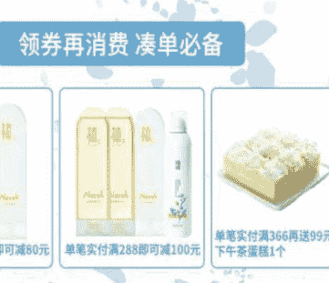

### 注意事项
1. 合作一定要慎重挑选，因为做人，一旦对方有负面行为，会影响到口碑。
2. 合作重点在于“合作”，在开展的过程中多为对方考虑，不要因为一时的蝇头小利错过了长远的机会，只有这样才能共赢。

### 联合粉丝活动

### 活动简介
通过微信、社区、搜索引擎寻找可能存在粉丝的社群，然后进入社群，添加好友，用自己的朋友圈打造和维护关系。


通过微信、微博、社区、搜索引擎寻找粉丝并添加好友

### 运营策略

### 活动流程
从社群属性找到相同的社群，精准的捞粉丝；换群、买群三种方式。换群就是通过自己的商品将自己的社群资源与别人分享，这样就会增加很多粉丝；买群就是拉进入人的社群。

- 换群：
  微信：在微信粉丝里搜数字加好友，搜到数字，就会搜很多文章，然后进入社群里反复搜二次。
- 搜群：
  搜索引擎，在搜索引擎上看到微信群，输入关键词，也会搜很多文章，筛选条件就是按发布时间来排序，点击列表查看即可。
- 社区平台：
  社区、豆瓣、知乎、贴吧等平台，有很多群存在，可以用相同的关键词搜索，有些直接可以扫描二维码，需要添加好友后按条件筛选。
- 发布：
  QQ群、回QQ群，按关键词搜索，换关键词“微信群”会有微信群，然后再进入这些微信群里，里面人都在，可以和他们互动，或者和自己的好友、同行交流。
- 公众号：
  公众号，换换粉丝，这里有很多公众号提供这种服务的。
- 买群：
  除了换群和搜群，还有很多专业人士卖群。他们的手里无数比玛、加眼、流量群、大学群等。

| 标题 | 内容 |
| --- | --- |
| 微信数据 | 微信数据加好友，搜到数字，二微发布 |
| 微信数据 | 微信数据搜微发布 |
| 流量群 | 流量群进入流量群，1000+单价 |

### 所需物
线上素材教程。

### 注意事项
1. 入群不要急着加入，看的不是人气群，要是陌生人，就不能加入。
2. 添加好友不要太频繁，否则举报或者封号。

### 美团评价推广，平台引流

### 活动简介
互联网时代逐渐打破线下经营模式，有些实体甚至偏僻，靠线上就能获取客户，而美团拥有非常多的客户。

| 运营目标 | 宣传渠道 | 配置路径 |
| --- | --- | --- |
| 美团的推广可以获取目标客户 | 美团点评 | |

### 运营实操
### 活动流程
- 推广前：
  1. 店铺需要注册美团点评。
  2. 做好装修：
    ① 店铺名称+头图
    ② 品牌及产品的图片、视频、文案。
  3. 上架活动：开业促销、新品、双十一、促销等。
  4. 活动范围：活动期间不限地区、含。
  5. 做好数据：
    ① 购买，可以通过内部员工购买，引导客户积累数据。
    ② 好评，新店通过活动快速好评——内部员工回复常见问题。
- 推广后：
  美团店铺发布一些有趣的动态来吸引客户，类似于朋友圈、抖音圈，权重越高热度越高，后面页面自然排在前，实际操作就是充值即可。

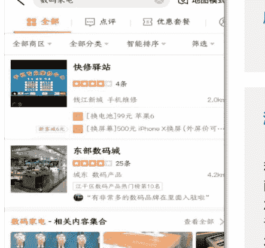

### 所需物
线上：宣传文案、宣传图片、宣传视频。

### 注意事项
1. 美团后台审核系统非常严格，并且相应的，如布置好评时一定要遵守，每个店铺都会配一个负责人。
2. 如果遇到投诉或差评应当及时处理，避免恶意的客户。
3. 店铺产品设置9.9元、19.9元。
4. 服务态度一定要好，大大增加店铺口碑。
5. 可以活动引导消费者撰写口碑。店面图片、文案一定要有吸引。

## 玩法篇“成交转化”
通过这个章节，你将了解：
- 客户体验地图：找到营销机会点
- 店铺首页装修从0到1，教你打造高转化的店铺
- 运用体验，引爆单品销售
- 首单大额优惠，提升转化
- 爱逛直播，带客户进入你的场景，高转化利器

## 客户体验地图：找到机会的机会
“客户体验地图”能把客户真实落地对的行为和体验进行分析，实现“自嗨型”营销切换到消费者视角，找到机会。具体为：1. 把需求拆解为客户角色、场景、行为等要素，并视觉表达过程中的冲突。2. 帮助团队更好交流与沟通，解决解决方案。

### 简介
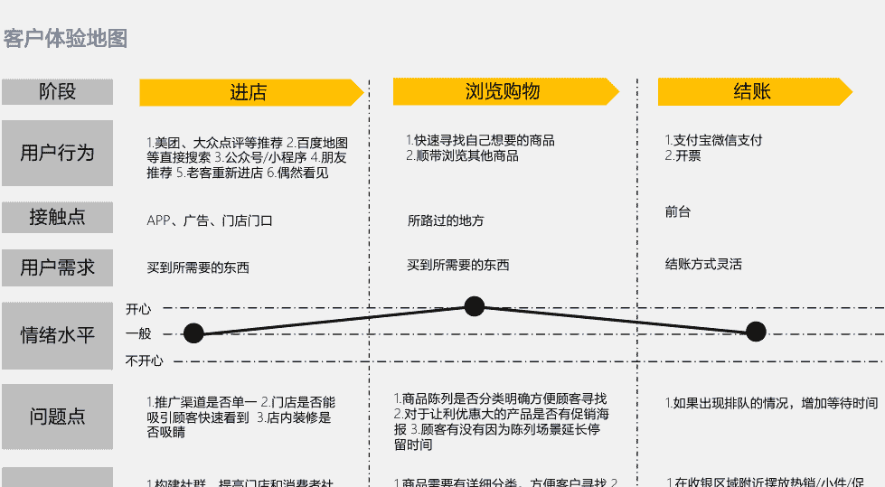

| 进店 | 购物 | 结账 |
| --- | --- | --- |
| 用户行为 | 1.快速找到自己想要的商品<br>2.快速寻找其他商品 | 1.用支付宝支付<br>2.开票 |
| | 所需买的东西 | |
| 接触点 | APP、电话、门店 | 前台 |
| 用户需求 | 买到想要的东西 | 结账方式灵活 |
| 等级 | 开心 | |
| 心情水位 | 不平 | 1.如果出卖的队伍太长，增加等待时间 |
| 问题 | 1.停车是否方便、门店和门面引流速度快慢、3.店内环境如何 | 1.在收获区域附近热闹/小<br>2.产品自动促销的效果。 | |
| 机会 | 1.社区社、提店和消费者交流点、2.店内消费点、3.门店外优惠服务 | 1.需要更详细的介绍、方便客户寻找<br>2.对新旧大产品是否有促销信息引导、3.加强联系、比价<br>4.提供需求外的额外服务，让孩子或妈妈留得 3.员工口头优惠 |

### 客户体验地图（简版）
| 正面感觉 | | | 产品组合 | 二次优惠 |
| --- | --- | --- | --- | --- |
| 愉快 | 员工服务好 | 排列清晰 | | |
| 装饰 精致 | | 价格与说明 | | |
| 舒适 | 店内位置与外部 | | | |
| 一般 | | | | |
| 差 | 停车不便 | | | |
| 糟糕 | | | | |
| 负面感觉 | | | | |

### 店铺陈列展示（版）
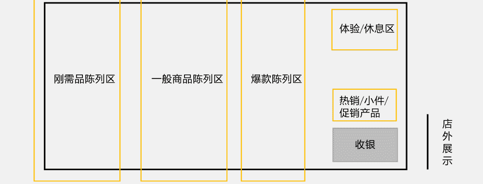

### 店主装修从0，教你打造转化

### 简介
店铺装修是门面，直接影响客户进店和购买，好的装修能增加店铺留存。

### 技巧一
店铺装修需要考虑消费者的阅读习惯，有5套不同的模板，以此为基础将内容填充到模块，快速打造专属店铺。
示例：
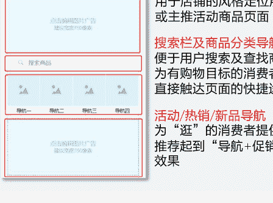

### 分类搜索
增加曝光
### 技巧二：添加导航
1. 选择合适的导航，将店内流量、主推的产品设为‘热销’，为顾客筛选，例如某类店铺分组为‘夏季清凉’，跳转至夏季家具或办公用品。
2. 多种标签设置‘HOT’、‘热销’等标签，热搜词的数量不要超过3-5个。
【搜索操作】：有店铺导航-后台-首页-店铺推荐-搜索导航。
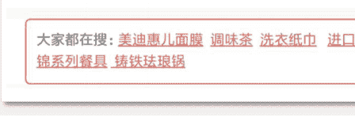

### 技巧三：页尾导航，完善购物的体验
| 产地直供 | 无忧售后 | 会员福利 |
| --- | --- | --- |
| 优质货源直接发货 | 24小时无理由退换 | 会员专属享折扣 |
| 新品正装保障 | 极速退货 | 积分兑换优惠 |

1. 前售后服务：通常包含售后服务、订单状态查询、产品质量保证、售后承诺等在一定程度增加顾客对店铺的信誉。
2. 付款方式与物流信息：给顾客提供‘不错体验’，可以消除顾客各种顾虑导致转化失败的风险。
3. 引导公众号或添加微信信号粉丝经营
4. 品牌故事：尤其是自营的品牌来说，有一个吸引力的品牌故事可以增加消费者的好感，增加店铺的信誉。


### 适用体验，单品销售
对于价格较高的情况，用过的用户就能立即决策，设置小规格的“体验”，让用户用较小的成本体验产品，是一种变相的促销。

### 活动简介


提高单品转化率，品牌宣传
个人号、门店、社区
【客户-权益管理-权益卡-限时折扣】
【应用-营销玩法-优惠券-到期提醒】

### 运营实操

### 选品建议
1. 大包装：商品为大包装型（整箱、整套、独立包装）售卖商品
2. 主推商品：店内主营商品，经过一段时间销售期，被多数消费者认可；
3. 周期性商品：商品具有刚需、周期性的使用，通过活动提升复购速度。
建议使用活动类型：日用百（洗洁、卫生用品等）、食品（类、牛奶、零食等），试用（各种适用、化妆品等）。

### 活动流程
方式一：将产品拆分售卖，可以选择免费到
方式二：将产品拆分售卖，可以选择免费到
- 活动期间：不限地区
- 做好数据：
  - 购买，可以通过内部员工购买，引导客户积累数据。
  - 好评，新店通过活动快速好评——内部员工回复常见问题。
- 推广后：
  美团店铺发布一些有趣的动态来吸引客户，类似于朋友圈、抖音圈，权重越高热度越高，后面页面自然排在前（根据权重、销量等排名），店铺无法自然流量，实际操作就是充值即可。


### 所需物
线上：宣传文案、宣传图片、宣传视频。

### 注意事项
1. 美团后台审核系统非常严格，并且相应的，如布置好评时一定要遵守，每个店铺都会配一个负责人，审核。
2. 如果遇到投诉或差评应当及时处理：避免恶意的客户可以进行审核。
3. 店铺产品设置9.9元、19.9元。
4. 服务态度一定要好，大大增加店铺口碑。
5. 可以活动引导消费者撰写口碑。店面图片、文案一定要有吸引。

### 首单大额优惠，提升转化
通过这个章节，你将了解：
- 客户体验地图：找到营销机会点
- 店铺首页装修从0到1，教你打造高转化的店铺
- 运用体验，引爆单品销售
- 首单大额优惠，提升转化
- 爱逛直播，带客户进入你的场景，高转化利器

## 客户体验地图：找到机会的机会
“客户体验地图”能把客户真实落地对的行为和体验进行分析，实现“自嗨型”营销切换到消费者视角，找到机会。具体为：1. 把需求拆解为客户角色、场景、行为等要素，并视觉表达过程中的冲突。2. 帮助团队更好交流与沟通，解决解决方案。

### 简介


| 进店 | 购物 | 结账 |
| --- | --- | --- |
| 用户行为 | 1.快速找到自己想要的商品<br>2.快速寻找其他商品 | 1.用支付宝支付<br>2.开票 |
| | 所需买的东西 | |
| 接触点 | APP、电话、门店 | 前台 |
| 用户需求 | 买到想要的东西 | 结账方式灵活 |
| 等级 | 开心 | |
| 心情水位 | 不平 | 1.如果出卖的队伍太长，增加等待时间 |
| 问题 | 1.停车是否方便、门店和门面引流速度快慢、3.店内环境如何 | 1.在收获区域附近热闹/小<br>2.产品自动促销的效果。 | |
| 机会 | 1.社区社、提店和消费者交流点、2.店内消费点、3.门店外优惠服务 | 1.需要更详细的介绍、方便客户寻找<br>2.对新旧大产品是否有促销信息引导、3.加强联系、比价<br>4.提供需求外的额外服务，让孩子或妈妈留得 3.员工口头优惠 |

### 客户体验地图（简版）
| 正面感觉 | | | 产品组合 | 二次优惠 |
| --- | --- | --- | --- | --- |
| 愉快 | 员工服务好 | 排列清晰 | | |
| 装饰 精致 | | 价格与说明 | | |
| 舒适 | 店内位置与外部 | | | |
| 一般 | | | | |
| 差 | 停车不便 | | | |
| 糟糕 | | | | |
| 负面感觉 | | | | |

### 店铺陈列展示（版）


### 店主装修从0，教你打造转化

### 简介
店铺装修是门面，直接影响客户进店和购买，好的装修能增加店铺留存。

### 技巧一
店铺装修需要考虑消费者的阅读习惯，有5套不同的模板，以此为基础将内容填充到模块，快速打造专属店铺。
示例：


### 分类搜索
增加曝光
### 技巧二：添加导航
1. 选择合适的导航，将店内流量、主推的产品设为‘热销’，为顾客筛选，例如某类店铺分组为‘夏季清凉’，跳转至夏季家具或办公用品。
2. 多种标签设置‘HOT’、‘热销’等标签，热搜词的数量不要超过3-5个。
【搜索操作】：有店铺导航-后台-首页-店铺推荐-搜索导航。


### 技巧三：页尾导航，完善购物的体验
| 产地直供 | 无忧售后 | 会员福利 |
| --- | --- | --- |
| 优质货源直接发货 | 24小时无理由退换 | 会员专属享折扣 |
| 新品正装保障 | 极速退货 | 积分兑换优惠 |

1. 前售后服务：通常包含售后服务、订单状态查询、产品质量保证、售后承诺等在一定程度增加顾客对店铺的信誉。
2. 付款方式与物流信息：给顾客提供‘不错体验’，可以消除顾客各种顾虑导致转化失败的风险。
3. 引导公众号或添加微信信号粉丝经营
4. 品牌故事：尤其是自营的品牌来说，有一个吸引力的品牌故事可以增加消费者的好感，增加店铺的信誉。


### 适用体验，单品销售
对于价格较高的情况，用过的用户就能立即决策，设置小规格的“体验”，让用户用较小的成本体验产品，是一种变相的促销。

### 活动简介


提高单品转化率，品牌宣传
个人号、门店、社区
【客户-权益管理-权益卡-限时折扣】
【应用-营销玩法-优惠券-到期提醒】

### 运营实操

### 选品建议
1. 大包装：商品为大包装型（整箱、整套、独立包装）售卖商品
2. 主推商品：店内主营商品，经过一段时间销售期，被多数消费者认可；
3. 周期性商品：商品具有刚需、周期性的使用，通过活动提升复购速度。
建议使用活动类型：日用百（洗洁、卫生用品等）、食品（类、牛奶、零食等），试用（各种适用、化妆品等）。

### 活动流程
方式一：将产品拆分售卖，可以选择免费到
方式二：将产品拆分售卖，可以选择免费到
- 活动期间：不限地区
- 做好数据：
  - 购买，可以通过内部员工购买，引导客户积累数据。
  - 好评，新店通过活动快速好评——内部员工回复常见问题。
- 推广后：
  美团店铺发布一些有趣的动态来吸引客户，类似于朋友圈、抖音圈，权重越高热度越高，后面页面自然排在前（根据权重、销量等排名），店铺无法自然流量，实际操作就是充值即可。


### 所需物
线上：宣传文案、宣传图片、宣传视频。

### 注意事项
1. 美团后台审核系统非常严格，并且相应的，如布置好评时一定要遵守，每个店铺都会配一个负责人，审核。
2. 如果遇到投诉或差评应当及时处理：避免恶意的客户可以进行审核。
3. 店铺产品设置9.9元、19.9元。
4. 服务态度一定要好，大大增加店铺口碑。
5. 可以活动引导消费者撰写口碑。店面图片、文案一定要有吸引。

### 首单大额优惠，提升转化
通过这个章节，你将了解：
- 客户体验地图：找到营销机会点
- 店铺首页装修从0到1，教你打造高转化的店铺
- 运用体验，引爆单品销售
- 首单大额优惠，提升转化
- 爱逛直播，带客户进入你的场景，高转化利器

## 客户体验地图：找到机会的机会
“客户体验地图”能把客户真实落地对的行为和体验进行分析，实现“自嗨型”营销切换到消费者视角，找到机会。具体为：1. 把需求拆解为客户角色、场景、行为等要素，并视觉表达过程中的冲突。2. 帮助团队更好交流与沟通，解决解决方案。

### 简介


| 进店 | 购物 | 结账 |
| --- | --- | --- |
| 用户行为 | 1.快速找到自己想要的商品<br>2.快速寻找其他商品 | 1.用支付宝支付<br>2.开票 |
| | 所需买的东西 | |
| 接触点 | APP、电话、门店 | 前台 |
| 用户需求 | 买到想要的东西 | 结账方式灵活 |
| 等级 | 开心 | |
| 心情水位 | 不平 | 1.如果出卖的队伍太长，增加等待时间 |
| 问题 | 1.停车是否方便、门店和门面引流速度快慢、3.店内环境如何 | 1.在收获区域附近热闹/小<br>2.产品自动促销的效果。 | |
| 机会 | 1.社区社、提店和消费者交流点、2.店内消费点、3.门店外优惠服务 | 1.需要更详细的介绍、方便客户寻找<br>2.对新旧大产品是否有促销信息引导、3.加强联系、比价<br>4.提供需求外的额外服务，让孩子或妈妈留得 3.员工口头优惠 |

### 客户体验地图（简版）
| 正面感觉 | | | 产品组合 | 二次优惠 |
| --- | --- | --- | --- | --- |
| 愉快 | 员工服务好 | 排列清晰 | | |
| 装饰 精致 | | 价格与说明 | | |
| 舒适 | 店内位置与外部 | | | |
| 一般 | | | | |
| 差 | 停车不便 | | | |
| 糟糕 | | | | |
| 负面感觉 | | | | |

### 店铺陈列展示（版）


### 店主装修从0，教你打造转化

### 简介
店铺装修是门面，直接影响客户进店和购买，好的装修能增加店铺留存。

### 技巧一
店铺装修需要考虑消费者的阅读习惯，有5套不同的模板，以此为基础将内容填充到模块，快速打造专属店铺。
示例：


### 分类搜索
增加曝光
### 技巧二：添加导航
1. 选择合适的导航，将店内流量、主推的产品设为‘热销’，为顾客筛选，例如某类店铺分组为‘夏季清凉’，跳转至夏季家具或办公用品。
2. 多种标签设置‘HOT’、‘热销’等标签，热搜词的数量不要超过3-5个。
【搜索操作】：有店铺导航-后台-首页-店铺推荐-搜索导航。


### 技巧三：页尾导航，完善购物的体验
| 产地直供 | 无忧售后 | 会员福利 |
| --- | --- | --- |
| 优质货源直接发货 | 24小时无理由退换 | 会员专属享折扣 |
| 新品正装保障 | 极速退货 | 积分兑换优惠 |

1. 前售后服务：通常包含售后服务、订单状态查询、产品质量保证、售后承诺等在一定程度增加顾客对店铺的信誉。
2. 付款方式与物流信息：给顾客提供‘不错体验’，可以消除顾客各种顾虑导致转化失败的风险。
3. 引导公众号或添加微信信号粉丝经营
4. 品牌故事：尤其是自营的品牌来说，有一个吸引力的品牌故事可以增加消费者的好感，增加店铺的信誉。


### 适用体验，单品销售
对于价格较高的情况，用过的用户就能立即决策，设置小规格的“体验”，让用户用较小的成本体验产品，是一种变相的促销。

### 活动简介


提高单品转化率，品牌宣传
个人号、门店、社区
【客户-权益管理-权益卡-限时折扣】
【应用-营销玩法-优惠券-到期提醒】

### 运营实操

### 选品建议
1. 大包装：商品为大包装型（整箱、整套、独立包装）售卖商品
2. 主推商品：店内主营商品，经过一段时间销售期，被多数消费者认可；
3. 周期性商品：商品具有刚需、周期性的使用，通过活动提升复购速度。
建议使用活动类型：日用百（洗洁、卫生用品等）、食品（类、牛奶、零食等），试用（各种适用、化妆品等）。

### 活动流程
方式一：将产品拆分售卖，可以选择免费到
方式二：将产品拆分售卖，可以选择免费到
- 活动期间：不限地区
- 做好数据：
  - 购买，可以通过内部员工购买，引导客户积累数据。
  - 好评，新店通过活动快速好评——内部员工回复常见问题。
- 推广后：
  美团店铺发布一些有趣的动态来吸引客户，类似于朋友圈、抖音圈，权重越高热度越高，后面页面自然排在前（根据权重、销量等排名），店铺无法自然流量，实际操作就是充值即可。


# 爱直播：客户进入你的场所，高转化器

直播是一种新的商品和销售方式，可以根据不同企业进行直播计划和实施：

- 1、维护和活跃客户，通过直播让老客户关注到线上；通过直播和老客户好的互动；定期直播活跃老客户；
- 2、给店铺引导，通过直播吸引更多店铺；
- 3、直接带货线上销售，如刚直播带货。

### 活动简介


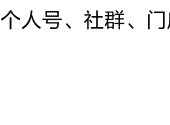

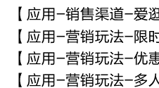

店铺引流/直播下单转化

个人号、社群、门店

[应用-营销玩法-爱直播]
[应用-营销玩法-限时折扣]
[应用-营销玩法-优惠券]
[应用-营销玩法-多人拼团]

### 运营流程

以直播引到门店为例，在前端确定目标和引导方式后，需要梳理详细的直播策划，可以进行：品牌直播、门店介绍、产品展示、现场互动等多次密集搜集直播内容，并且要鼓励客户的积极参与，直播互动维持秩序，从而保证直播效果。

- 活动前：多素材准备直播内容，吸引客户到，公众号发布和朋友圈，引导粉丝关注公众号，直播前需要查看用户互动，直播开始后，会直播后发布的内容需要注意细节。
- 活动中：直播过程中可以设置一些活动，例如抽奖，刺激粉丝再次活跃，并产生更多流量。留前需要查看用户互动，并引导客户下单，直播过程中尽量长一些为好，客户到后，在店内欢迎产品推荐【限限量XX，或 XXX福利】的互动，以季节性、高折扣吸引他们购买。
- 活动后：及时总结本次活动结果，如活动力度、产品销售情况、活动过程中是否存在问题等，可以优化方向，为下次活动做好准备。

### 参考文字

针对直播的不同，增加直播的趣味性：

- 1、刚店铺引流，吸引粉丝可以参加直播；“线上是不够的，线下装修还有，还有XXX活动，大家快！线下已经准备好了，快也来热闹一下吧！”
- 2、介绍门店和产品，与客户互动互动直播。
- 3、互动环节，线上粉丝直播互动；观看超过1000人就抽奖，大家快热闹！观看3000人，拿个大奖吧！

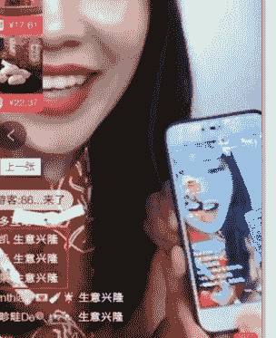

所需物

门店陈架/朋友圈海报/线下/活动介绍传单。

### 注意事项

- 1、线下直播前提前准备一份活动，告知活动内容。
- 2、提前设置直播进店优惠，提高转化率。
- 3、直播过程中活动要多准备，礼物也要提前想好。
- 4、需要一定的基础。
- 5、产品要有核心卖点；对于门店的企业来说，线上要重新明确核心卖点，因为缺少线下体验和交流，很多细节容易被弱化。

## 玩法篇 “客户留存”

通过这个篇章，你将了解:

- 将门店客流量有效留存到线上: 优惠单
- 将门店客流量有效留存到线上: 幸运大奖
- 积分商城: 留住客户就靠它

### 将门店流量有效留存到线上：优惠单

通过使用有赞小程序插件直接享受优惠的功能，吸引客户进入小程序商城，并进行加门店微信等操作。

### 活动简介


运营目标


宣传渠道


优惠路径

线下引流到线上

门店

【应用：配套工具-扫码收款】n【门店-微信页面装修-买单组件】

### 运营实操

### 活动流程

- 活动前：在门店后台设置好买单功能，并加到店铺首页头部位置。门店侧提前做好宣传海报，并且根据活动规则判定线下下单折扣。同时，提前测试买单功能，避免因参与人数多导致忙乱出现。
- 活动中：店员做好优惠信息的宣传，到消费时直接享受优惠，在收台处投放活动海报和长二维码，增强客户关注。
- 活动后：对新加粉的客户进行粉丝维护，在一些节点上也可以进行线上引流到的促销活动，引导客户在线成交。

### 参考学习

- 1、好目标：在门店加粉后，小程序扫码付款可以直接享受9.5折的优惠。
- 2、您付款后可以看到主页的商品很多都打9折，以后在小程序商城里你也可以看到我们新推出的产品和优惠活动！下次直接扫微信码即可购买！

### 所需材料

小程序微信二维码、门店海报优惠活动介绍、门店标识。

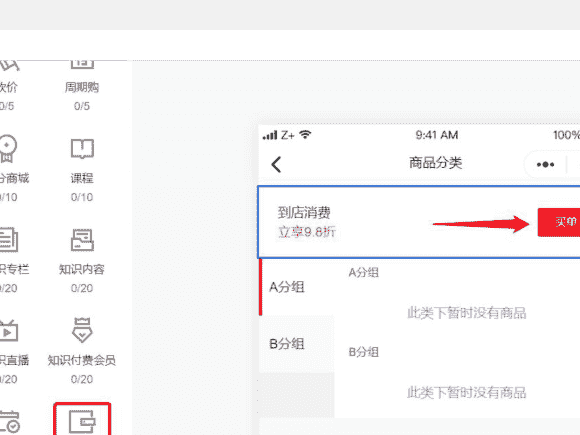

### 注意事项

- 1、首次让客户接触商城，要有引导，利用扫码优惠支付，直接扫码打开微信一扫，付款后小程序就会留在首页。
- 2、付款完成后需引导顾客点击首页—一看商城，商城可以放一件单品优惠或限时折扣活动，吸引更多顾客浏览查看下单。

### 将门店流量有效留存到线上：幸运大抽

活动简介
通过幸运大抽活动吸引顾客下单、添加店长微信、转发朋友圈等操作。设置幸运大抽奖需要设置一个吸引力大的产品，如新款iPhone，增强活动活跃度。

| 运营目标 | 宣传渠道 | 配置路径 |
| --- | --- | --- |
| 线下引流到线上 | 门店 | 【应用-营销玩法-幸运大抽】<br>【应用-营销玩法-优惠券】 |

### 运营实操

- 活动流程
- 活动前：设置幸运大抽活动台，设置好优惠券，把抽奖活动链接保存在微信收藏里，提前做好门店海报的布置，并结合活动的大小调整中奖率，需要提前测试抽奖流程及给执行人提前告知抽奖流程，避免出现由于参与人数太多导致乱情况出现。
- 活动中：门店后幸运大抽活动的启动，到店顾客都拦截，店内消费只需添加店长好友，即可收到抽奖。现场抽，在收银台播放活动相关视频，增强会员关注。
- 活动后：对新加的客户进行维护，中奖的下次尽快使用优惠券，中奖的可以给他一个小额的优惠券回馈。

参考话术
亲，现在加店长微信可以参加幸运大抽奖。本次抽奖有很多实用的礼物和大额度的优惠券。抽奖的幸运今天你就能把抽奖金额领回去。

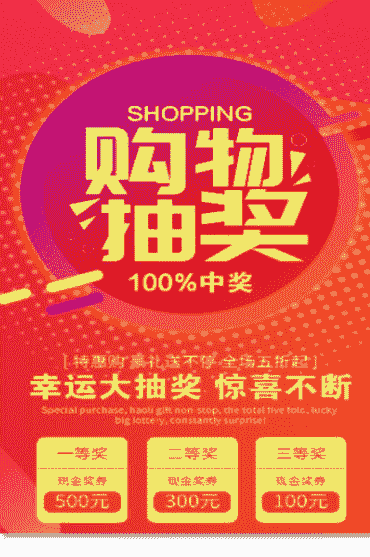

所需材料
部分奖品，门店海报。

- 注意事项
- 1、线下直播前提前准备一份活动，告知活动内容。
- 2、提前设置直播进店优惠，提高转化率。
- 3、直播过程中活动要多准备，礼物也要提前想好。
- 4、需要一定的基础。
- 5、产品要有核心卖点；对于门店的企业来说，线上要重新明确核心卖点，因为缺少线下体验和交流，很多细节容易被弱化。

## 玩法篇 “客户留存”

通过这个篇章，你将了解:

- 将门店客流量有效留存到线上: 优惠单
- 将门店客流量有效留存到线上: 幸运大奖
- 积分商城: 留住客户就靠它

### 将门店流量有效留存到线上：优惠单

通过使用有赞小程序插件直接享受优惠的功能，吸引客户进入小程序商城，并进行加门店微信等操作。

### 活动简介


运营目标


宣传渠道


优惠路径

线下引流到线上

门店

【应用：配套工具-扫码收款】n【门店-微信页面装修-买单组件】

### 运营实操

### 活动流程

- 活动前：在门店后台设置好买单功能，并加到店铺首页头部位置。门店侧提前做好宣传海报，并且根据活动规则判定线下下单折扣。同时，提前测试买单功能，避免因参与人数多导致忙乱出现。
- 活动中：店员做好优惠信息的宣传，到消费时直接享受优惠，在收台处投放活动海报和长二维码，增强客户关注。
- 活动后：对新加粉的客户进行粉丝维护，在一些节点上也可以进行线上引流到的促销活动，引导客户在线成交。

### 参考学习

- 1、好目标：在门店加粉后，小程序扫码付款可以直接享受9.5折的优惠。
- 2、您付款后可以看到主页的商品很多都打9折，以后在小程序商城里你也可以看到我们新推出的产品和优惠活动！下次直接扫微信码即可购买！

### 所需材料

小程序微信二维码、门店海报优惠活动介绍、门店标识。


### 注意事项

- 1、首次让客户接触商城，要有引导，利用扫码优惠支付，直接扫码打开微信一扫，付款后小程序就会留在首页。
- 2、付款完成后需引导顾客点击首页—一看商城，商城可以放一件单品优惠或限时折扣活动，吸引更多顾客浏览查看下单。

### 将门店流量有效留存到线上：幸运大抽

活动简介
通过幸运大抽活动吸引顾客下单、添加店长微信、转发朋友圈等操作。设置幸运大抽奖需要设置一个吸引力大的产品，如新款iPhone，增强活动活跃度。

| 运营目标 | 宣传渠道 | 配置路径 |
| --- | --- | --- |
| 线下引流到线上 | 门店 | 【应用-营销玩法-幸运大抽】<br>【应用-营销玩法-优惠券】 |

### 运营实操

- 活动流程
- 活动前：设置幸运大抽活动台，设置好优惠券，把抽奖活动链接保存在微信收藏里，提前做好门店海报的布置，并结合活动的大小调整中奖率，需要提前测试抽奖流程及给执行人提前告知抽奖流程，避免出现由于参与人数太多导致乱情况出现。
- 活动中：门店后幸运大抽活动的启动，到店顾客都拦截，店内消费只需添加店长好友，即可收到抽奖。现场抽，在收银台播放活动相关视频，增强会员关注。
- 活动后：对新加的客户进行维护，中奖的下次尽快使用优惠券，中奖的可以给他一个小额的优惠券回馈。

参考话术
亲，现在加店长微信可以参加幸运大抽奖。本次抽奖有很多实用的礼物和大额度的优惠券。抽奖的幸运今天你就能把抽奖金额领回去。


所需材料
部分奖品，门店海报。

- 注意事项
- 1、线下直播前提前准备一份活动，告知活动内容。
- 2、提前设置直播进店优惠，提高转化率。
- 3、直播过程中活动要多准备，礼物也要提前想好。
- 4、需要一定的基础。
- 5、产品要有核心卖点；对于门店的企业来说，线上要重新明确核心卖点，因为缺少线下体验和交流，很多细节容易被弱化。

## 积分商城：留住客户就靠它

活动简介
让消费者消费的时候积累积分，消费越多积分越高。设置积分消耗规则，重要节日或活动的时候体现积分价值，有利于留住客户。

### 运营目标

### 宣传渠道

### 配置路径

维持老客户

个人号、短信、朋友圈

[应用-客户维护-积分商城]
[应用-客户维护-日签]
[应用-客户管理-积分管理]

### 运营实操

### 选品建议

活动策划：选择积分兑换的时候，根据自己的客户特征来定，若你的客户是追求生活品质的女性，就能送一些礼物等。
常规标准：选择复购率高的商品，也可以挑选一些礼物、纪念款来兑换。

### 活动流程

- 预热期：提前发布公告，通过门店把商品展示在家里，上线：发布积分商城，放在导航栏，引导粉丝了解积分规则。
- 活动中：一起放在收银台，结账时引导顾客积分，开展活动并每天签到，获得更多积分。
- 后期：发布本次活动，让大家看到积分积累，避免过期，给客户发送优惠券或者商品作为回馈。

### 参考案例

亲爱的粉丝们就是吧！感谢大家一直的支持，我们专门定制了一款专属布包，大家出门的时候带上它很方便。
活动期间，限量200个，先得。
怎么获得这个布包呢？很简单，只要500积分就可以换。

### 所需材料

门店展示、定制商品、门店海报。


### 注意事项

可以把商品宣传海报，提前在门店展示，这样可以让积分不够的小伙伴通过各种方式获取积分。

## 玩法篇 “客户复购”

通过这个篇章，你将了解:

- 消费后送券，让客户下次回来
- 十一券买一送一，提前消费
- 会员专属秒杀：让更多客户成为会员
- 会员专属群购：让你的顾客在群里帮你销售
- 方案带来更多的会员

### 消费券，让客户下次回来

不同金额可以获得不同优惠，增大转化率，同时配合多人拼团、秒杀、团购活动，提高单价。

### 活动简介


运营目标

宣传渠道


吸引客户种子，短期内到店消费

个人号、社群、门店

[适用-营销玩法-优惠券]
[适用-营销活动-满减/团购]

### 运营实操

### 选品建议

利润低的商品不参与。

### 活动流程

- 活动前：店铺提前设置好额度和数量，设置全场满购送优惠券（部分不参与）。
- 消费后：消费即可领券；店铺准备好海报等宣传物，线下布置。
- 活动中：活动需要对客户同步本次活动额度，尤其是活跃区域，提醒他们达到金额就送优惠券。
- 活动后：加大优惠券有效期，持续消费，先领券贴上标签，通过功能给用户发送优惠消息。

### 参考话术

- 店铺福利：周末找我，我就送
- 本消费：30元送5元
- 50元送8元
- 80元送20元
下次消费即可自动抵扣，欢迎朋友们来到购！
- 门店活动内容：活动时间：12月7-9日
- 参与商品：本店所有食品，烟酒除外
- 30元送5元
- 50元送8元
- 80元送20元
线上购，直接核销，下次购买！

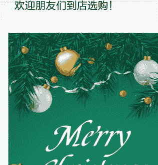

# 所需物

门店话术：朋友圈海报、策划、门店！

### 注意事项

- 1、优惠券必须设置时间，让客户在短期内再次消费，这个时间可以设置得短，促进客户更快的来到里或者线上消费。
- 2、线下下单的用户获得了优惠券后，就可以到店使用，门店收银时需要人工核销优惠券，避免用户重复使用。

### 双十一买一送一

双十一活动既有力度，还需要老客户的留存，买一送一的策略，有利于让客户下单一次，消费两次。在活动过程中与顾客互动，培养客户在线消费的习惯。

### 活动简介

### 运营目标

### 宣传渠道

### 配置路径

老客户维护，活跃群，留存老客户

个人号、社群、门店

[应用：营销券优惠优惠]
[应用：营销券-满减/限一]

### 运营实操

### 活动流程

- 活动前：微信发布信息，商城发布一个价格100元的虚拟商品，优惠券设置两张无门槛100元，通过满减送活动功能，当顾客购买虚拟商品后自动触发2张预设置的优惠券到账。并在首页设置banner提示活动；同时在个人和社群中也进行活动预热。
- 活动中：门店发布促销信息，福利，群里早晚发布活动信息，社群持续活跃氛围，也可对已经买过券的买家、用户好评刺激他们下单。部分顾客可能不会购买，需要的门店或者客服要做好销售工作。活动结束后几个小时，可以采取一次朋友圈群发，限时流量的抢购。

- 1、群活跃：双十一天天直接领100！狂欢周来了，买100元蛋糕再买你一个100，买到就是赚，没有套券，没有门槛，不限双款，参加活动预约朋友圈第一类，感谢大家参与本次活动的活动！如有疑问请
- 2、社群活跃：小可爱约晚上，本店买一送一馈用户，有大折扣券买一送一活动，11月10日开始抢购！倒计时2天，群活跃优先抢购。

# 参考文档

- 1、商品图片和活动说明。
- 2、预热活动海报（倒计时2天&倒计时1天&正式活动）。
- 3、门店海报。

### 注意事项

- 虚拟商品仅购买，不允许使用优惠券，顾客购买后可以用优惠券造成损失。之前店铺有20元可用，如果没有设置，顾客只需80元就能获得100元优惠券张。

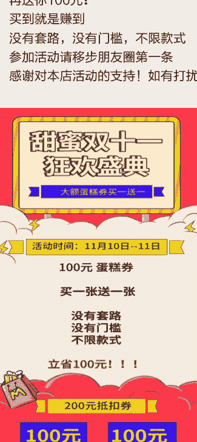

# 十五美

会员专属购：让更多想要成为会员的会员做客户留存是非常好的方法，设置会员福利可以吸引注意力，也可以维护忠实客户，提高粘性。常见的会员专属、单品折扣、会员包、24小时服务等。

### 活动简介


吸引非会员为会员，让已经会员的客户感受到

个人号、社群、门店

[客户-权益管理-会员卡]
[营销活动-满减]
[商品管理-只允许用户（会员）购买]

### 活动流程

- 活动前：在后台开启团购活动，并将商品设为会员才可以参加。团购次数可以保持，活动banner，门店海报吸引客户参与，微信号与社群在规定时间内发送预热。
- 活动中：发朋友圈后可能需要做好好的互动，同步活动进度，实时反馈给用户，根据用户参与度，同步活动活动进度。
- 活动后：整理好结束后群成员的意见，在群内回复他们，并告知下次活动。总结本次活动情况，给予所有参与的用户发送优惠券。

### 参考测试

- 专属：会员福利来！本周会员专属：9.9元抹茶蛋糕，原价19元，下午点开放注册，请大家关注。
- 活动开始时：限5个好吃的蛋糕，会员准备好了，抢购！

# 所需物

活动海报、门店、展架、收银台。

### 注意事项

- 团购数量设置少量，太大会引起活动氛围，此需要根据朋友的好友数量和预计流量，合理的设置。


# 玩法篇“客户增购”

通过这个篇章，你将了解:

- 加N元多一件，增加客单又增加了销量
- 限满减+优惠券：让订单翻倍增长
- 优惠套餐：增加商品曝光，客单价涨涨涨
- 打包一口价：营造狂欢氛围，刺激下单

## 加N元一件，增加客户又增加了销量

加购，让客户购买到一定金额后加N元可兑购指定商品1件。既可以帮你清理库存提高销量，又可以帮你提升客单价。

### 活动简介


增加客户活跃度以及客单价，库存清理提高销量。

个人、社群、门店

【应用：营销玩法·加购】

### 运营实操

### 选品建议

可以选择店铺的临期或库存，易耗产品，以及目前热门产品来活动，例如：宠物主粮、零食、玩具等。

### 活动流程

- 活动前期准备：
在线上设置好加购的活动，换购商品是精确到规格层级，可以选择某个商品的某个规格来加购，最多支持50件。加购金额必须小于换购商品的零售价。

- 活动中：
1. 门店设置一张加购活动，近期在12.12期间为期一周的爱宠抢购活动（活动时间12.12~12.18）。
2. 朋友圈、社群私域（每天一次）。
3. 活动内容：
宠物用品（零食、玩具）满100元，另加1元可兑购价值15元的驱虫药。（每日限购前10名）主粮买包，另加10元可兑购价值同价值的一包粮。（每日限购前3名）

### 参考话术

降温！圈给你的爱宠提前准备
零食宠物主粮满一元加购购驱虫药
宠物主粮满一件加1元送一件
连续一周不打烊每天都有

### 所需物资

门店海报、展架、门店贴画。

### 注意事项

1. 活动进行中或者结束后，都可以通过活动页面查看加购活动带来的效果数据，随时上线的数据，并及时增加参加活动商品的库存。
2. 注意每天的活动名。

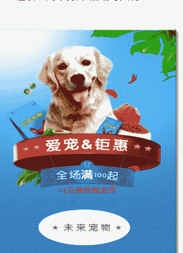

## 限时满减+优惠券：让订单倍增

### 活动简介 

针对新老客户都能享受同样的优惠，提高客单价的同时也能带来客户更多的赠购。


### 运营目标
利用满减送的活动鼓励客户多件商品消费，并在售后后发放优惠增加复购，促进成交和复购。


### 宣传渠道
个人号、社群、门店


### 转化路径
【应用-营销玩法-优惠券】
【应用-营销玩法-满减/送】
【应用-销售渠道-销售】
【客户-人群运营（发券）】

## 运营实施

### 活动流程

1. 门店海报宣传内容和优惠信息，并在商品处放置折扣信息和商品二维码。
2. 线上购物，利用客户-人群运营的功能让老客户推荐无门槛优惠券10元。
3. 公号自动回复设置优惠券领取入口，以满减活动介绍（满2件八折、满3件七折）。
4. 支付后有，领取优惠券享受单品折扣，时间设置在领取日加多少天内可以使用。

### 参考话术

门店引导线上领优惠券购物，享受折扣，并支持到门店领取及快速配送
限时折扣（12.1-12.12）
门店指定商品2件八折，买3件七折
同时赠无门槛优惠券
消费后还能获得一张单品九折券，下次消费凭立

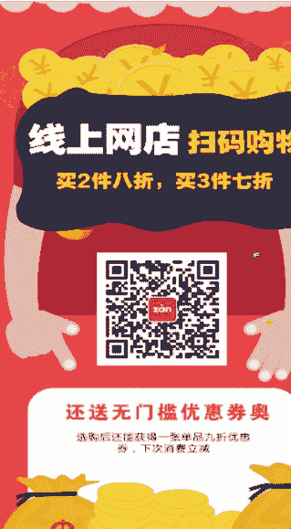

### 所需材料

门店海报、朋友圈报、展架、门店喇叭。

### 注意事项

给指定折扣商品写好活动卡，放在收银台以及货架处。

## 优惠套餐：增加商品曝光，客单价涨涨

通过优惠套餐的形式让客户一次性购买更多商品，以此提升销售业绩，提高转化率，提升销量，增加商品曝光。

### 活动简介


个人号、社群、门店

【应用-营销玩法-套餐】

### 运营实操

### 选品建议

尽量选择有关的产品，避免浪费。

### 活动流程

- 活动准备：
设置套餐的产品（如牡丹、玫瑰、康乃馨、百合等）搭配购买享受优惠。

- 活动中：
1. 店内宣传，引导客户选择商品购买。（活动时间：一周）
2. 搭配购买满39.9元的形式吸引客户持续购买，且本次活动有效。
3. 维护老客户，通过流量分享链接。
4. 二次购买满39.9元，组合只要30元。

### 参考话术

为了自己增加一些色彩，99元的优惠，行动。

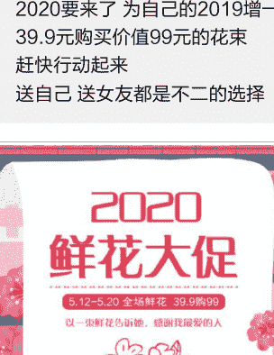

### 所需材料

门店海报、朋友圈报、展架、门店喇叭。

### 注意事项

门店（开启互动）：优惠套餐可以在门店功能进行，活动信息在商品页面上显示，需要商家直接通过链接购买。

## 打包价：营造狂欢氛围，刺激下单

打包价是一种帮助商家增加销售、提升售价的促销工具。使用该工具商家可以设置全场活动，99元3件。

### 活动简介

### 运营目标

给用户营造狂欢氛围，刺激用户下单，提高单价，清理滞销商品。

### 宣传渠道

个人号、社群、门店

### 链路路径

- 【适用：营销玩法优惠券】
- 【适用：营销玩法打包】

### 运营策略

### 选品建议

1. 选择的商品价格合适，避免引起购买的不满。
2. 选择的商品可以用组合，比如单价搭配配货，或者包含一些产品。
3. 建议活动功能能够增加优惠，特别是给刚入的新人无门优惠。
4. 不要主观判断，尽量保留，让新客户感受到“意义”才能促进销售。
5. 遵守规则，可以针对高价商品设置99元3件的活动等，让用户购买时还可以加入会员，加99元合计可以达到100元。

### 活动流程

- 预热：
1. 门店：活动前7天，带有流量的微信海报、门店展架及收银台卡布置到门店，提前告知销售活动。
2. 个人号/社群：活动前7天在个人号和朋友圈活跃发布活动海报预热。

- 活动中：
1. 门店：活动期间的3款商品要布置到顾客流量较大的地方；同时在商家收银的时候多介绍一个活动引导用户下单。
2. 个人号/社群：活动期间，每天在个人号和社群里至少发布一次活动相关的内容，可以促进促销活动增加店铺客流量。
3. 数据：查看活动商品，哪些商品合适，好的可以通过推荐给消费者，不好的可以用其他商品进行替换，提高转化率。

- 活动后：
重点针对单人客户，选品活动和活动推进进行复盘，客户群都是哪些，哪些商品以及组合合适，活动预热以及期间的推广策略如何，优化下一次活动的开展。

| 99元3 | 49元5件限款 |
| | --- |
| [图片] | [图片] |
| 连衣裙 一短袖连衣裙 碎花 92.00 | 连衣裙 一长袖连衣裙 碎花 97.00 |
| [图片] | [图片] |
| 连衣裙 一短袖连衣裙 碎花 78.00 | T恤上衣 纯棉男装 CHAN衬衫 97.00 |

### 参考记录

1. 购买用户可以加入会员，会员可省XX元。

### 所需物资

门店海报、朋友圈手册、展架、门店橱明。

### 注意事项

为了避免活动提前结束影响效果，提前规划好活动种类以及库存。

## 玩法篇“分享裂变”

通过这个篇章，你将了解：

- 你邀请我奖励，拉新就这么简单
- 团长免单：开团成功，商品免费拿
- 快速解决流量难题：砍价0元
- 分粉丝裂变，轻松赚钱

## 你邀请我奖励，拉新这么简单

### 活动简介

利用客户社群和门店的基础，通过红包和优惠券等形式刺激客户进群或者添加商家微信。

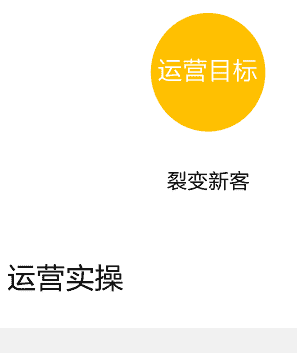


裂变新客

个人号、社群、门店

第三方管理工具：WeTool

### 运营实操

### 活动流程

1. 社群&朋友圈宣传活动，每人拉群获得1元现金+无门槛优惠，奖励上限，活动结束后统一发。
2. 新人加入同步活动。
3. 群内人数达到后红包奖励。
4. 若客户群满以后需要新建群，拉新人入群没有奖励。
5. 活动后：做好转化承接，避免拉新浪费。

### 参考话术

1. 活动开始：每人拉群获得1元现金+无门槛优惠，奖励上限，活动结束后统一发！快行动起来！
2. 新人加入：告诉新人这个群在做什么活动，同时告知现在拉了多少人。

### 所需物资

社群/朋友圈宣传报。

### 注意事项

1. 奖励可以根据实际情况调整，比如水果蔬菜每人拉群奖励一个鸡蛋，日常所需是非常好的福利。
2. 要拉人员需要筛选，比如明显是社群广告的客户（名字带A开头或者数字、符号为主的，然后签名是动态的这种这种不是目标客户，直接删除）。依旧拉群有效人数。

## 团长单：开团成功，商品免费拿

### 活动简介

通过带单+团长优惠的拼团活动，刺激团长带来更多客户，同时快速选择吸引客户到门店流量。

### 获取新客

个人号、社群、门店

【应用：营销玩法-多人拼团】
【订单：配送服务-上门自提】

### 运营实操

团购指南

选择单价较低的引流产品，更有助于团长吸引参团。

### 活动流程

- 活动购：
1. 选择多个低价商品，商品快速选择为仅上门自提。
2. 设置拼团活动，选择带单开启团长优惠，参团人数设置4人，拼价在99.2-29.9元等，团长客户优惠价0.1元。

- 活动中：
1. 在个人朋友圈+社群+门店宣传突出活动，同时还需要设置好利润产品的引流活动。
2. 门店需要将今日团单的产品放在门店展示的位置，让客户加购。

- 活动后：
重点对客户人群、团组合、活动推进效率进行复盘，比如客户人群都是哪些、哪些商品以及组合喜好、活动预热以及期间的推广是否合理，方便下一次活动。

```
# 所有老铁！今日团单活动来！
点击链接，请邀请好友（没有在商城下下单的新朋友）参团，即可免费拿商品！
（附上门店商品专属的图片）
```


### 所需材料

门店展示/朋友圈宣传海报。

### 注意事项

1. 设置多款商品参与拼团，让活动覆盖更多不同需求的客户。
2. 门店员工做好培训，对于到店的客户要热情接待，进行二次销售的转化。

## 快速解决流量难题：0元

女生非常喜欢“畅单”，不喜欢别人自己穿同款衣服，所以女装产品并不适合拼团活动，而邀请朋友自己砍价和参与，很好地解决了这个问题。非常适合女装裂变活动。通过0元吸引客户，带动其他产品的转化。

### 活动简介


活跃老客带来流量。

个人号、社群、门店

【运营-营销玩法-0元】

### 运营实操

### 选品清单

选择季节性产品，比例控制在5:3左右。

### 活动流程

- 前期活动准备：
1. 产品准备：设置0元和5折。对单价低于100元的产品可以设置0元，对于单价较高的200-300元的产品，可以设置5折，主要是为了清理库存。

- 报名设置：
1. 低价单设置：0元，拉群人数在50人左右。对于一些连衣裙、裙子等，可以设置5折，拉群人数在30人左右。
2. 好友拉群：利用功能进行社群，适用商品范围。
3. 拉群时间：由于拉群人数较多，设置24小时，让客户产生焦虑感。

- 节奏控制：
1. 持续几天，每天开启一次选择5-10款不同的产品，给予保持新鲜。
2. 每天早上出来参与活动，朋友圈+社群+门店。
3. 第二天早上，拉人分享活动，提前24小时有效。

- 参考文档

1. 活动首页：哎，哥！你们的店可以送货吗？不是免费的，这次活动免费的！持续3天，每天早上来送货怎么样，不错你有这款优惠！快来下方进入专区！
2. 活动运营：昨天的活动已经有位客户领取了！其他客户也要继续努力，有效期是24小时，流量准备翻倍！今天早上还会发出一批产品，等你来！先做个小号预告（可以防止以后商品链接和介绍，最好是在一起来，不要刷屏）。

### 注意事项


## 粉丝渠道，轻松挣钱：销售员

商家发展客户、成为自己的销售员，利用他们的社交发展更多的客户，使商家获得更多订单，获客成本也会降低。对于销售员来说，可以充分自己的闲暇时间，赚取佣金，从而实现双赢。

### 活动简介


招募第一批销售员，从员工和老客户中挖掘。

个人、社群、门户

【应用-销售渠道-销售员】

## 运营运营

### 运营玩法

1. 对内销售：针对内部员工，需要进行培训、设置激励机制，销售员首先要认可，能够进一步引导客户成为销售员。
2. 对外销售：针对老客户，购买奖励即可成为销售员，设置礼包门槛首先是要求客户认可并消费，对产品有一一定了解。同时礼包也是客户的好利，礼包包含折扣或优惠。

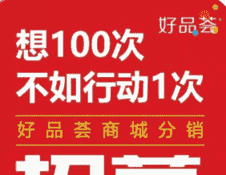

### 参考学习

想改变生活你行动了吗？靠工资买房你努力了吗？动手就能搞定！少伸手你就行了！双赢加入我们！

1. 先内进行会，让员工清楚地了解到活动的目的、销售策略，虽然员工只需执行工作，但必须让员工知道活动的目的以及自己带来的好处，才能更好地让他们配合来开展活动。

【宣传内容】
1. 活动目的：可以让员工带来更多收益作为切入，比如帮助员工更好地利用闲暇时间取得收益。让他们拿到收入越高，越需要寻找新的方式来拓展业务的客户，需要大家一起来线下介绍客户。
2. 销售策略：成为销售员-推广活动-提供佣金-邀请客户成为我们的下游销售员。每个步骤都需要让员工实测一遍。

2. 活动运营：
- 门店功能：妈妈妈妈妈妈妈妈妈妈妈妈妈妈妈妈妈妈妈妈妈妈妈妈妈妈妈妈妈妈妈妈的优惠。
- 粉丝营销：妈妈妈妈妈妈妈妈妈妈妈妈妈妈的优惠。
- 流量准备：妈妈妈妈妈妈妈妈增加流量。


# 良匠·研壶

【普茶系列大全】

## 引导客户在群内消费

- 对不同的客户提供不同的服务，推荐不同的商品，他们的策略是，80%的精力投入20%的核心客户，一个可以减少几千单！
- 打造“文化”当素材的购物。文化类主题群，用内容留住客户，用互动去建立信任，这个社群的流量很高，可以让顾客像真人一样买来。

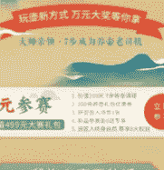

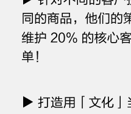
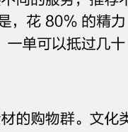

## 新人研壶活动(M1)

## 新人研壶活动(M2)

## 开展营销活动

在营销活动中，把客户的抢购平均分布到每天的每个时段。用十一活动为例：

利用会员后台现有的粉丝功能预测，预判未来的销售额，如果数据不准则进行调整。

秒杀，用秒杀的流量来建立专门的卖面，选择热门单品秒杀。每6个时间点，秒杀3次产品，预热每隔10元换100元秒杀产品，10-11天每天都有1元秒杀产品。

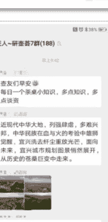
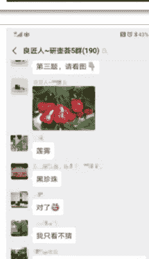
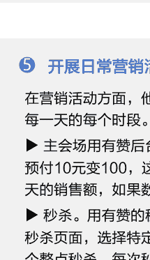

欢迎参加研壶分享会，参与抽奖：

遇到中奖的客户，多进行互动，通过这种方式建立信任，通过分享茶道、茶具知识，引导客户购买茶具，从卖家的优惠中受益，从而成交。

## 使用优惠券送“捞宝大战”、1价2宝

活动中设置一个宝藏池，在宝藏池里，客户用优惠价可以买2把。

这个页面的目的是，一是为了让客户关注，二是作为爆点来确保转化率，三是选品的问题，这个页面的选品基本上90%都是库存清理产品，这样卖起来就能把库存清掉了，一举永逸。

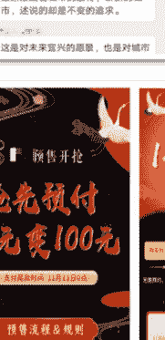
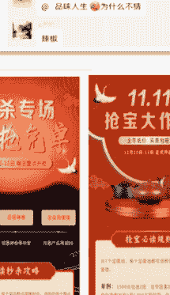
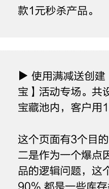

## 商家声音

整个活动跑起来，最大的问题在于执行过程中的信息传递和沟通的问题。很多老客户都遇到过这样的困境，在活动开始跑起来的时候，我自己就是一个专门救火的，哪里哪里了去了哪里，马上解决一些突发的问题，1天和团队的沟通到了5个小时，这还不算慢，是为了确保每个执行的完整落地。

## 商家简介

祥梓锦有四家线下店，集中在天南市商业街；有一定品种，有一定粉丝基础，一批口碑品牌和品质的高粘性产品；有核心卖点，祥梓锦在线运营，却口碑卖点转化为了两个“标准”：一个是百年老字号，“非物质文化遗产”，这个更是面向相对的食客的；一个是2018年《舌尖上的中国》第三季，这个卖点有利于祥梓锦出品。

## 商家动态

## 经营策略

祥梓锦的门店直播9:30开始，到12:30结束，时长共3个小时，当天可达929人，相比白天的110人，足足了6倍！销售订单463件；最高同时观看3132人，销售9028元。活动结束后，各项商品都卖了大涨，短短7天就创造了60万的高额。如今，门店总客户数达920人，每周销售额在100万左右。

## 运营玩法

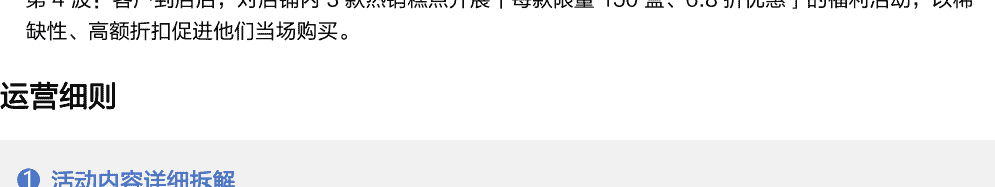

第1步：发布公告文章，以前200名到店的人获得优惠券作为引点，提前规定要留客户到店。
第2步：将直播推送到公众号文章、微信和群眼里，引导粉丝关注公众号，提前预约直播，直接开始后。
第3步：在直播中通过抽奖，刺激粉丝，产生更多互动。同时，方便看直播，将粉丝引导线下，直播时间合适。
第4步：客户到店后，对店内热销产品开展限量150、8折优惠的活动，以销量、高转化到店内。

## 运营模型

| 时间 | 环节 | 主要内容 | 互动 | 反馈及问题 |
| :--- | :--- | :--- | :--- | :--- |
| 9:30-10:00 | 进场 | 介绍、现场互动、门店介绍、产品卖点、直播和互动等环节，要注意到店客户积极参与，维护现场秩序，保证直播效果。 | | 哪种类的？ |
| 10:00-15:30 | 直播 | 1. 开场、2. 介绍、产品介绍、3. 观众反馈、4. 互动“福利”、五元换一个新款、5折、5. 到店领取、6. 门店引流、介绍产品、7. 粉丝提问回复、8. 发送优惠 | | |
| 10:30-11:15 | 留货 | 1. 祥梓锦小美、2. 8折新款、3. 粉丝互动、“粉丝送粉”、五元换一个新款、4. 抽奖互动... | | |
| 11:15-11:30 | 转化 | 1. 门店引流互动、介绍产品、2. 粉丝提问回复、3. 抽奖互动、“粉丝送粉”、五元换一个新款、4. 发送优惠 | | |

## 外部环境

要考虑活动当天的天气，以及周边环境是否有人聚集。维持店铺活动最好在月底，门店正好有明显的人流量，加上做了充足的茶水等准备，到店的客户后续口碑很好。

## 外部环境（持续）

- 刚开始直播，吸引尽可能多的人数：
- 在线看是不愁的，店铺装修是有风格，还有小姐在表演，大家快来直播！
- 店铺已经够热闹了，快点来感受一下！
- 介绍门店和现在的点，与客户互动：
- 卖不同的品种，不同的口味，请问是什么口味？
- 我们这个古风蛋糕，是六形的。
- 抽环节，让线上粉丝传播直播看超过1000人就抽，观看3000人抽，聚热闹！


## 设置快速购买、添加订单转化

用“裹购”直接直播线上到店，在直播中增加多个玩法折扣、秒杀、多人拼团等链接，粉丝可以轻松购买。由于食品类商品的客单价不高，很容易产生冲动购买，直播的氛围，引导犹豫的效果就会非常好。

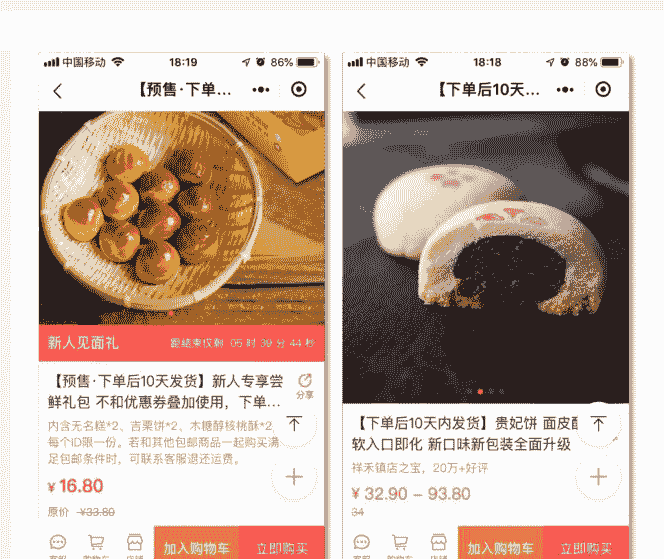

## 商家心声

希望今天结束后需要优化和改进的流程：

- 存在问题：这里有很多潜在、有兴趣的路人，他们不清楚活动详情，店内的人很少，很难用一个机会告诉他们。优化方法：赶快准备一份初稿，介绍当天的活动以及活动活动的详细介绍，同时附带公众号二维码，引导大家关注公众号，把这些落实到位。
- 对于刚进入直播间的商家，由于没有设置优惠策略，对订单转化可能会有些波折的。直播过程中计划设置了3个抽奖环节，由于粉丝持续热烈，已经抽了5-7抽，抽环节要多准备，物要提前想好。

对于有的商家，复播直播可以满足这些条件：

- 1、优化维护老客户，通过直播让老客户关注到线上。通过直播的方式可以和客户维护互动，可以定期直播老客户；
- 2、给店铺引导，通过直播直引更多人到店；
- 3、直接线上销售，如网红直接直播。

## 4线城市水果小店入百万

## 商家简介

“同源水果”是四线城市一家经营水果的品牌，畅销水果，店铺规模小，一天卖出600斤水果，销售额近百万。

## 商家痛点

- 1. 客户流量少，获客困难。
- 2. 开业初期生存压力大。

## 经营策略

通过精准获流的方式，合适的经营功能，店铺不打折，凭借340平方米的小店，一天卖出600斤水果，销售额近百万。

## 运营玩法

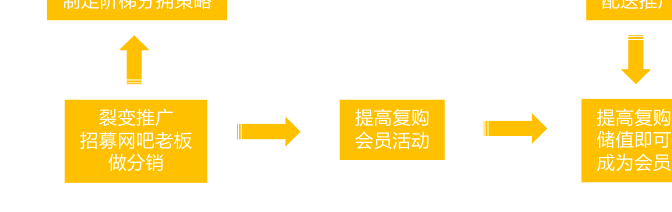

## 运营细节

新型水果选择是关键。一个四线城市大部分地区对“新奇”并不接受，所以选择为优。第一家店选在了城市中心，这里流量最大、年轻人密集，且高端接受度较高。第二家店选在了中高端小区，附近有充足的居民，瞄准高端群体。

## 微信引流

在商场内密集投放，让过往顾客试吃。为了尽可能多挖掘客户，尝试了微信的所有方式：

- 1. 发朋友圈、群活动、调动粉丝转发；
- 2. 公众号推广，触达精准顾客；
- 3. 微信摇、附近的好友，推广产品和活动。

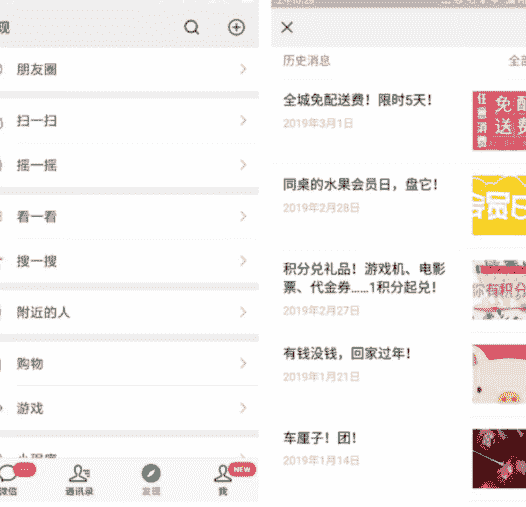

## 会员信息

- 普通会员
- 您的会员等级将根据消费自动提升
- 享受会员专属折扣
- 享受会员专属服务

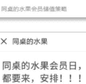

- 300满减20
- 600满减50
- 1500满减150
- 3000满减300
- 6000满减600

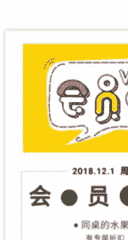

夏季的果汁，长好看的都要安排好！！夏季果汁2021-11-30。

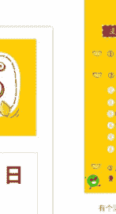


## 会员88

- 满88减8
- 满188减18
- 满388减38
- 满500减50
- 满800减80
- 满1000减100


加入会员即可领5元现金券

## VIP DAY

2018.121 周六

## 会员·日

- 老会员可享8折优惠
- 新会员可领专属赠品


新鲜榨果汁8折起
新鲜榨果汁8折起
2019-6-15 周六

199元积分

- 5元券满立减
- 5元券满立减
- 10元券满立减


新鲜榨果汁8折起
新鲜榨果汁8折起
199元积分

## 会员储值留存，会员活动进行转化

储值是用户的法宝，用户有了储存后，自然来再次消费。通过此类活动增加频率、购买需求。

## 储值策略

让用户深度感受到“会员”身份。储值金额从300元到3000元不等，折扣从9.5折至7.5折。

## 会员活动

每月一次开展“会员日”回馈活动：

- 活动当天，会员享9折。
- 充值赠积分，比平时多。
- 生日当天，均可到店领一份定制蛋糕。
- 充值赠品，不仅能激活老客户。
- 新客户看到会员多少福利，也会成为会员。

## 销售奖励

针对已有销售，制定了阶梯式的策略，越卖越高：

- 普通销售，获得6%佣金。
- 累计销售15万元，获得8%佣金。
- 累计销售40万，获得10%佣金。

## 商家简介

“念悦娇”是一家深耕电商领域的服饰企业，旗下拥有念娇、念悦两个女装品牌，主要面向30岁以上女性。线下有100家门店，覆盖华东、山东等地，积累了不少优质客户。

## 商家痛点

- 1. 线下下载很多顾客来一次就不再购，复购率问题存在。
- 2. 传统店铺地域受限，销售范围有限。

## 经营效果

念悦娇集团通过小程序功能，将线下店铺引导至小程序销售并帮助店铺增。目前，“念悦娇商城”的老客户比例在50%左右。


## 运营细则

- 激励机制：公司给销售员按月设置百分比的激励，直接按销售员真实话术。管理员可以比较直观地转化为动态激励销售员。日常为销售员的积极性，公司设置红包作为奖励，同时在月度评审给优秀的销售员额外奖励。
- 设置规则：销售员活跃的前期，其实有很多导购没有做小程序的意识，养成运营微信的老习惯。因此某些规则是必要的，但规定不能有太大的限制，打压销售员的积极性。根据产品，念悦娇设置了积极性，设置了较低的门槛。
- 提供素材：为销售员组建社群，每天在群里发布当日商品和文案，销售员只需要一键即可发布。内容形式为带程序的海报。
- 定期培训：制定销售员手册，详细列清每个操作方法，发放销售员随时查询。同时按照季度、月度发放销售员培训。销售员最遇到的问题大集中在发货、退换、邮费等操作上。


## 小程序店铺：内容与优势

- 产品设置：基于小程序店铺的老客户运营，店铺内的商品与其他店铺保持同步。但是会去掉太便宜的促销品，因为大部分店铺带来的老客户视觉拉低线下门店的格调。如果线上店铺的太便宜，会损害品牌带给老客户的形象。另外高价的产品只有线下专售，一方面产品要线上线下划分，另一方面新款的接受度倾向于线下试穿后再购买。
- 程序首页，可以开展丰富的内容，包括人气单品和穿搭推荐。同时开展活动，筛选高值的买家并展示给用户。

## 优惠策略

- 定期开展优惠，可以让老客户养成定期的购物习惯，从而提高店铺的转化率。
- 店铺开展两种不同活动，3阶的满减活动（满799减100、满1999减200、满3999减400；件8折、满7.5折）。在新价格，两种优惠门槛可以应对。
- 在店内时，每周都会挑选一些产品进行单杀活动。为了保护会员，优惠不设的太低。单杀活动可以选择一些旧，用新旧的订单进行反馈，避免引起冬季的新款更加棘手。目前单杀产品可以下单到2000元后。
- 店铺针对一些在门店但没有成交的客户发放优惠券，刺激其在活跃时间内活跃。用户购买获得额外福利。

## 店运系统：仓库商品共同发

目前运营一方面有自己的仓库，负责电商商品的发货，专款产品则门店发货。对此，公司通过了付费店铺系统与线下门店管理系统，并在门店建立发货模块。头部可以直接查看各个店铺库存，并据此向店铺发单，单务系统收到订单后，员工可以直接接收订单发货，并入发货信息。

## ⭐ 特别


# 网红蛋糕店2年圈粉30万！提升复购这样做！

## 商家简介
“网红蛋不错”创立于2017年12月，位于二三线城市的蛋糕市场，依靠蛋糕的配套服务为网红IP：身穿服装的配送员把蛋糕上门，在2分钟的时间里，与客户进行包括复购抽奖、魔术、跳舞等互动活动。

## 商介绍
1. 蛋糕的复购率。
2. 市场差异，如何留住客户？

## 经营效果
活动第一天就到店铺迎来了34万流量，成交了3000+订单。
收获5000个会员卡用户，客户成交金额较前月提高15%。

## 运营玩法


## 运营细则


- 9.9元秒付费会员卡
开通熊猫猫吃货卡后可享受6大特权：
1. 获得参加8月27日-9月29日“熊猫猫吃货节”所有专属活动；
2. 立即获得一张9.9元无门立减优惠券
3. 特惠蛋糕
4. 免费蛋糕
5. 特惠蛋
6. 充值礼包
只有购买了这张卡，顾客才能参与到的一系列活动。商家相当于多个活动的参加门槛，设定9.9元付费会员卡。

### 电子会员5折抢购
半价购2张198元优惠券，388元获赠金666元的多重优惠，以高额的优惠金额、指定的优惠产品，针对性提高某商品的订单单数，快速制造爆单。一次购买多次消费，直接促成客户下次复购。

# 会员专区限半秒抢
88元现购888元蛋糕等商品，每天直卖100份，仅限稀缺性引发客户抢购。半价的蛋糕限购9.9元会员卡的客户方可抢购，这样做可以对蛋糕价格有一定保障，突出会员的特权。


- 198元购2张198元无门槛优惠
198元=小仙女/2 + 汽车总动员/2
平时198元只能买一个，在198元内可以买两个！！

- ④参与大转盘抽奖活动免费机会
倍率大转盘，用1000积分免单、免费2500块蛋糕增加客户每天访问次数和时长，从而提高客单价。

- ⑤阶梯式会员福利，调动充值的积极性:
  ① 充值599元赠3个大蛋糕、2*50元券
  ② 充值799元赠3个大蛋糕、4*50元券
  ③ 充值1699元赠3个大蛋糕、6*50元券、1张钻石会员卡，外场加送一份层蛋糕


# 从0到1社群，粉丝平均活跃率超过40%，运营解析

## 商家简介
有的粉丝属于餐饮门店，主营菜、中式产品等，在该项目启动前，商家线上的粉丝活跃率和活动频率都较低。杭州运营团队通过有效的社群激励体系以及签到券方式，激活粉丝客户，粉丝接近500人社群，粉丝活跃率超过40%。

## 商家痛点
1. 粉丝活跃率低，社群整体活跃和留存率高。
2. 客户对社群的兴趣较多但为低价值活动，客户终端价值低。

## 运营效果
通过自动化工具运营和引导，社群人数从100多人发展到463人，累计营销成本投入约400元余（该营销成本未产生实际消费，等粉丝积分兑换），平均成本在1元以下，社群至目前累计产生订单91单，实付金额2400元。

## 运营玩法


## 运营准则
- 打造【粉丝日常手册】：相信社群的粉丝都会有一个痛点，比如打造粉丝活跃，在社群激励上确定一个明确的利益点引导用户互动，每天签到后转化，用户可获得。
- 目前最大的社群，有很多用户喜欢，可以设置活跃社群，是一个很好的做法，通过完成任务来提升粉丝活跃度。


# 小餐午茶专享会员卡
加入“小餐”家族的福利


- 订餐特价预订。每天放出部分特价午餐，用户需要在特定的时间（粉丝群）来抢午餐，每天都可以领，长期在粉丝群会遇到。
- 打造成午茶饮。在上班族众多的门店，来说比较高产品之一，新品做购买，也可以通过细节给客户争取。


- 每周会员日：不定时红包，会员专属券，专属积分日，累计加倍！


- 新品体验营：抢先拥有新品体验权！每日享福利让选择更多！

# 分群运营，精准寻找用户
- 种子用户群：社群冷启动阶段，通常需要比较活跃的客户以及配合粉丝群。一方面可以快速激活社群，另一方面可以逐步化社群，为后续的用户准备。
- 特价活动：在社群里活动，随着群的不断活跃，商家可以以新品或低价产品策划一份特价活动，通过接龙的方式快速连购抢购。
- 超羊粉：相信社群的商家都懂得薅毛很难，因此通过低价权益包装超出期待的权益，来分层管理核心会员。


# 附：全年营销节点活动

## 春节大促：99元3件，新人专属优惠价

### 情人节
1. 满100减20元大基数券
2. 购满55直减5元券

### 女士节
1. 女王节专享券：满65+减5元券
2. 直立减10元，满单立减

父亲节大促：99元2件，包含父亲节专属优惠活动

### 618
1. 满100减29元，加大力度券
2. 满200减50元，叠加力度券

暑期大促：99元2件，包含暑期专属优惠活动

### 旺季
1. 旺者低价：“加价”工具，主页设置满减券XX元
2. 满199减30元活动

开学大促：99元2件，包含开学专属优惠活动

### 七夕节
1. 七力券全场通用-10，满99-30
2. 万力券-2，可直减大力度

中秋大促：99元3件，包含中秋专属优惠活动

### 国庆节
1. 满100减10，满101减包+惊喜玩法券
2. 满200减15，立减，满100购物券券内减，后10元

双11大促：99元3件，包含新人专属优惠活动

### 双11
1. 一元一大促，99元任3件，新人专属优惠
2. 满200减元，每天还有出金红包，设置抽奖机会

双12大促：99元2件，包含双12专属优惠活动
