# 电动汽车用户联盟 EV USERS UNION

# 问界M8
战役用户洞察报告

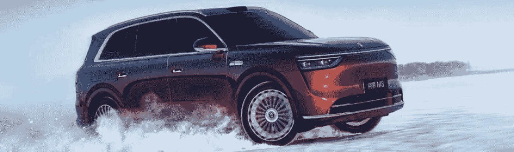

- 他们为什么退订问界M8？
- 退订问界M8后，他们的意向车型有哪些？
- 怎样才能让他们重新下单？

2025.09.03

## 知识星球TOP

汇聚全网高价值资源
打造TOP级分享社群

◆ 付费文章
◆ 付费社群
◆ 时政&国际
◆ 副业&搞钱
◆ 财经&市场
◆ 行业报告

时政·历史·职场·体制·自媒体学习·军事·软件·影音·社会学

公众号: 知识星球TOP 微信信号:top28688 微信信号:top28388

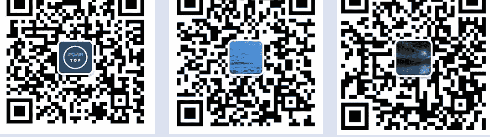

添加微信 免费进群

## 问界M8战役用户报告

### 调研目的

- 了解问界M8战役用户是一群什么样的人，他们为何预订M8，意向车型又是哪些，问界M8战役用户与大定/提车用户存在哪些差异？

### 调研方法

- 定量研究（问卷调研）和定性研究（一对一深访）结合

### 质量控制

- 线上回86份卷，经过车主身份验证（需核以下资料）：实时时间问界M8退订订单截图和问卷作答情况（内容逻辑、填答时间）审核去除35份无效问卷

### 样本情况

- 样本量：定量问卷51份，深访2人，短访若干人
- 样本来源：问界M8退订订单车主群
- 调研时间：2025年5月6日-2025年5月16日

### 退订型分布

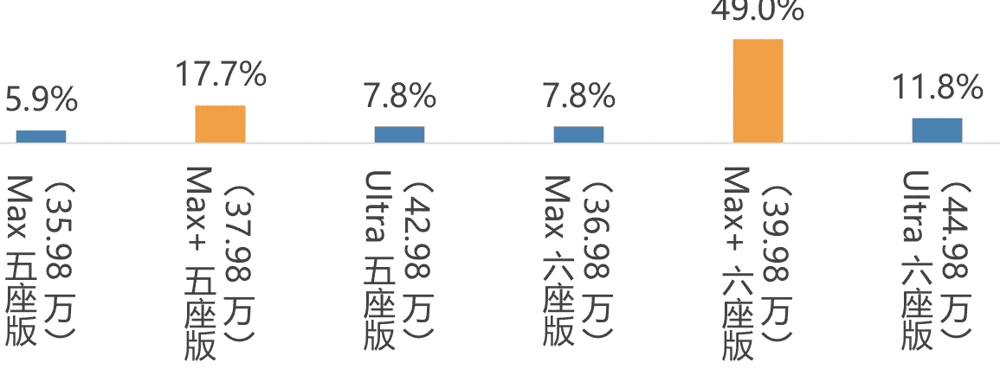

## 核心发现：

一、问界M8战役用户与大定/提车用户都有哪些相同点？

他们对于华为品牌的认可度都很高，都把辅助驾驶作为重要的购车因素。他们都认为问界品牌的高端化已做成，愿意为支付高于友商的品牌溢价。

二、问界M8战役用户与大定/提车用户有些不同点？

1. 战役用户更年轻，均年龄36岁，31-35岁占41.2%；大定/提车用户均年龄38岁，31-35岁占22.2%，一家庭占比52.8%；二孩子以上家庭占比55.2%。
2. 购车预算集中在35-40万，但战役用户对价格更敏感。仅有13.7%的战役用户购车预算在40-50万，而30.7%的大定提车用户预算在40-50万。

三、问界M8战役用户退订问界M8的原因是什么？

主要是因为价格和权益。58.8%的战役用户认为价格超出预期/性价比比不足，47.1%的用户认为权益/政策不符合预期（47.1%）。有47.1%的用户流失于报价阶段，主要原因是发现权益政策（占比69.9%）。有用户认为问界M8光谈情怀，实际优惠比，相比对比M7的丰厚权益，问界选择了错购。

四、品牌侧需要要做什么样的调整，才能挽回战役用户？

若官方提供金补贴/购车折扣，有72.6%的用户考虑重新购买；免费升级系统、智驾驶系统、延长质保至8年、提供车辆换购额补贴，也能重新吸引40%以上的战役用户。

五、问界M8战役用户退订后，可能想购买哪些车型？

退订问界M8后，12.2%的战役用户想买理想L，10.2%想买L8，8.2%想买智8（本次调研还未上）；8.2%的战役用户想买问界M9，8.2%想买享S9；8.2%想买界900。

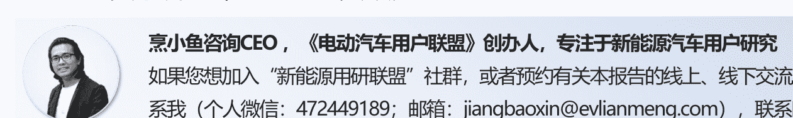

《问界M8数据用户报告》
电动汽车用户联盟·出品

# 目录

Part 1 是谁退订了问界M8 5
- 用户画像
- 购车动力
- 购置类型
- 关注因素
- 比选车型&核心竞争力战胜
- 典型用户画像

Part 2 他们为什么退订问界M8 16
- 退订原因
- 退订链接
- 认知渠道

Part 3 他们偏好什么样的车 22
- 购车偏好
- 购车预算
- 续航态度

Part 4 他们对华为品牌、智能化的看法 27
- 欢迎加入“新能源产品经理联盟”
- 进群方式：扫码添加“小盟同学”微信（备注公司名+职位）

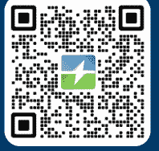

《问界M8用户洞察报告》
电动汽车用户联盟·出品

# Part 1

# 是谁退订了问界M8

- 用户特征
- 购车动机
- 购置类型
- 关注因素
- 比选车型&核心竞争力战败
- 典型用户画像

- 欢迎加入“各车型车主联盟”
- 进群方式：扫码添加“车大师”微信（备注具体车型）

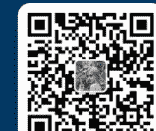

## 问界M8战役用户比大定更年轻

- 男性82%，女性18%，均龄36岁，31-35岁占41.2%，70.6%已婚。
- 本科及以上占比88.3%，家庭平均收入48.9万，主要集中在20-30万、40-50万区间。
- 与大定/提车用户相比，战役用户31-35岁年龄段占比更高（41.2%）。

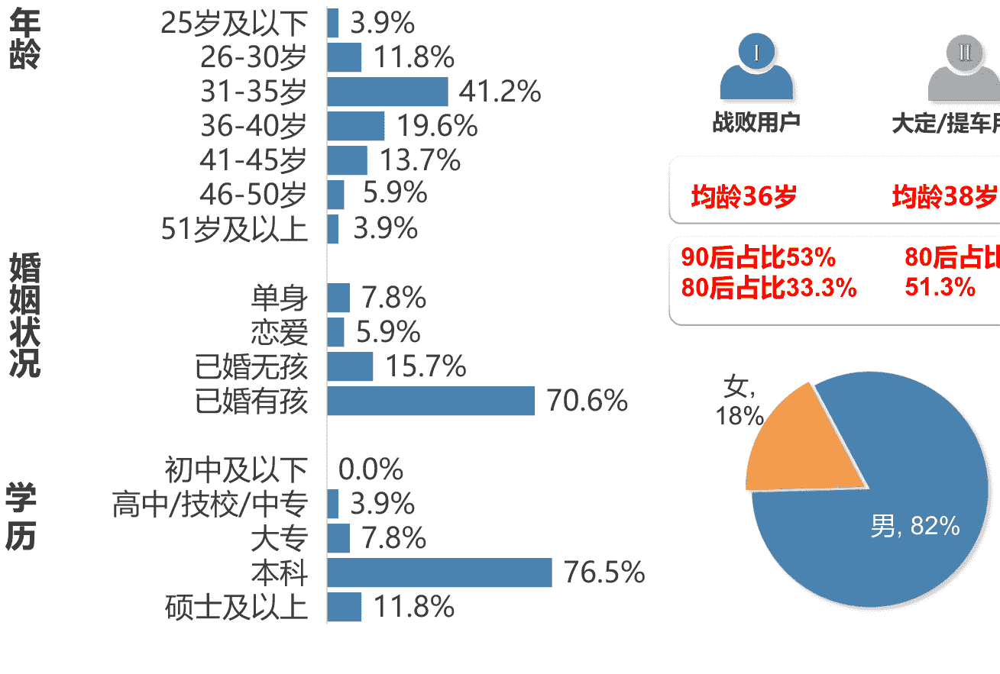

## 问界M8战役用户家庭比大定更多

- 家庭口数集中在口以上（86.3%），4口及以上58.8%。
- 52.8%为1家庭，47.2%为2家庭，且比大定，战役用户家里有2个孩子的占比更（38.8%）。

| 孩子个数 (N=51) | 配偶 | 儿子 | 女儿 |
| :--- | :--- | :--- | :--- |
| 1口 | 0.0% | 88.2% | |
| 2口 | 13.7% | 45.1% | 39.2% |
| 3口 | 27.5% | | 35.3% |
| 4口 | 25.5% | | 35.3% |
| 5口 | 25.5% | | |
| 6口及以上 | 7.8% | | 3.9% |

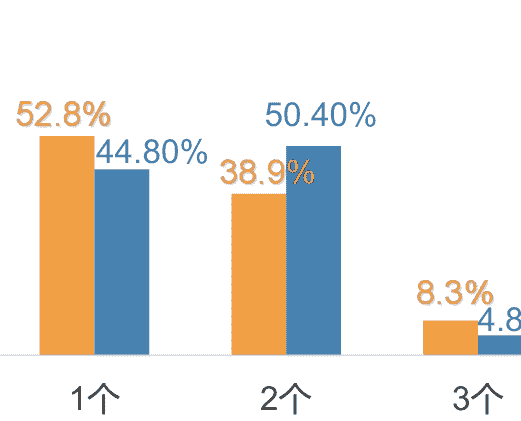
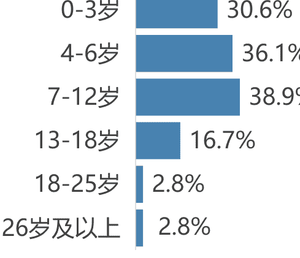

## 问界M8战役用户主要为国有单位、私营企业

- 主要在国有单位、私营企业工作，多从事教育、金融等行业，平均工作11.2年。
- 84.8%为管理者人员，基层中级人员占71.8%。

| 单位性质 | 占比 |
| :--- | :--- |
| 事业单位 | 29.4% |
| 私营/民营企业 | 25.5% |
| 国有/集体企业 | 17.7% |
| 外资/合资企业 | 9.8% |
| 国家政机关 | 7.8% |
| 个体工商户 | 5.9% |
| 自由职业者 | 3.9% |

| 行业 | 占比 |
| :--- | :--- |
| 教育 | 17.7% |
| 信息传输、计算 | 13.7% |
| 交通运输、仓储 | 13.7% |
| 科学研究、技术 | 9.8% |
| 批发和零售 | 5.9% |

| 职级 | 占比 |
| :--- | :--- |
| 一般职工 | 15.2% |
| 基层管理人员 | 37.0% |
| 中级管理人员 | 34.8% |
| 高级管理人员 | 13.0% |

| 工作年 | 占比 |
| :--- | :--- |
| 0-1年 (含) | 2.0% |
| 1-2年 (含) | 0.0% |
| 2-3年 (含) | 2.0% |
| 3-4年 (含) | 5.9% |
| 4-5年 (含) | 3.9% |
| 5-10年 (含) | 29.4% |
| 10-15年 (含) | 7.8% |
| 15-20年 (含) | |
| 20年以上 | |

## 问界M8战役用户调研报告

## 问界M8战役用户购车动力

- 车辆升级 (43.1%)、出现喜欢的车型 (43.1%)、具备购车经济条件 (41.2%) 是主要的购车动机。

| 购车动机 TOP 10 | |
| :--- | :--- |
| 车辆升级 旧车型淘汰 出现喜欢的车型 |
| 具备购车经济条件 家庭结构变化 |
| 购车有补贴/优惠 国资支持倾向 |
| 家庭需要 周末假期出行 上班进步 |
| 个人出差/外勤业务 |

> 体验新能源车的智能化、舒适性：我有一辆XC60，用了挺久。我试过纯能源之后，觉得辅助驾驶、冰箱、彩电、大沙发比传统燃油车的好太多了，我会倾向于换一个车型，提升我的用车体验。

> 问界M8靠华为，我是喜欢的车型：问界M8是我喜欢的车型，我一直是华粉，家里的手机、电视、电脑等都是华为的，它又是华为深度参与与定制的车，我天然会有太多的信心。

## 问界M8战役用户购置类型&购车情况

88.3%为家庭增购用户，购前多保有比亚迪、大众、问界等同品牌的车

- 个人层面，37.2%首购，35.3%增购，27.5%增购
- 家庭层面，11.7%首购，47.1%增购，41.2%增购
- 增购用户主要来自比亚迪、大众等品牌，还有部分问界本品牌用户

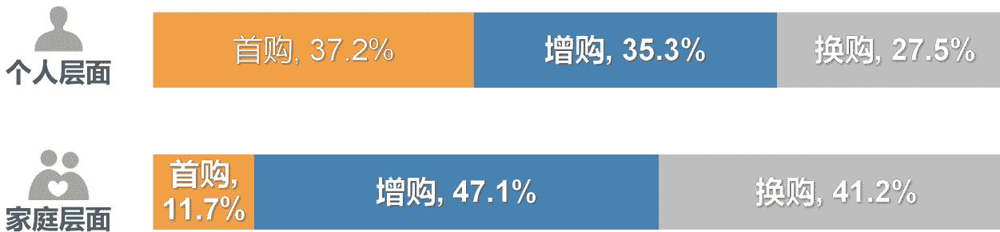

| 当时准备替换的车型品牌 TOP 6 (N=21) | 家庭目前保有其他车型品牌 TOP 6 (N=61) | 代表车型 |
| :--- | :--- | :--- |
| 本田 | 14.3% | 比亚迪 | 18.3% | 宋、元 |
| 大众 | 14.3% | 大众 | 10.8% | 帕萨特 |
| 奥迪 | 9.5% | 问界 | 9.2% | M5 |
| 奔驰 | 9.5% | 本田 | 7.5% | |
| 东风 | 9.5% | 奔驰 | 6.7% | |
| 问界 | 9.5% | 丰田 | 6.6% | |

## 问界M8战役用户关注因素

- TOP5关注：安全性(62.8%)、辅助驾驶(58.8%)、电池和续航(54.9%)、舒适性(52.9%)、空间(51.0%)
- 在TOP5关注中，战役用户共同关注安全性、辅助驾驶、电池和续航，战役用户更关注舒适性和空间，大定用户更关注智能座舱和质量

| 战役用户关注因素 TOP 10 | 比例 |
| :--- | :--- |
| 安全性 | 62.8% |
| 辅助驾驶 | 58.8% |
| 电池和续航 | 54.9% |
| 舒适性 | 52.9% |
| 空间 | 51.0% |
| 售后服务 | 47.1% |
| 质量 | 47.1% |
| 智能座舱 | 45.1% |
| 价格与权益 | 43.1% |

- 家用，车身结构要安全，配置要，首先要考虑安全，主动预警系统有用。
- 战役用户关注辅助驾驶，以后辅助功能是。
- 增程或增程纯电要在200公里以上，插混和增程实际实际续航不到200，电池就不靠谱。
- 要有重力座椅，必须在，休息。

| 大定用户关注因素 TOP 10 | 比例 |
| :--- | :--- |
| 辅助驾驶 | 68.0% |
| 安全性 | 64.0% |
| 智能座舱 | 54.7% |
| 电池和续航 | 54.0% |
| 质量 | 44.0% |
| 品牌 | 43.3% |
| 舒适性 | 43.3% |
| 空间 | 36.7% |
| 售后服务 | 36.0% |
| 外观 | 29.3% |

## 问界M8战役用户购买报告

## 问界M8战役用户最有可能购买

- 用户退订问界M8后，最有可能购买L9 (12.2%)、L8 (10.2%)、i8 (8.2%)（本次调研还未上），如问界M9 (8.2%)、享界S9 (8.2%)，还有界900 (8.2%)。

| 主要对比品牌(N=51) | 主要对比车型(N=49) | 意向车型(N=49) |
| :--- | :--- | :--- |
| 理想 | 68.6% | 理想L9 46.9% | | 理想L9 12.2% |
| 鸿界 | 45.1% | 理想L8 30.6% | | 理想L8 10.2% |
| 凌界 | 29.4% | 智界R7 22.5% | | 问界M9 8.2% |
| 腾势 | 19.6% | 问界M9 22.5% | | 凌界900 20.4% |
| 极氪 | 19.6% | 凌界900 20.4% | | 理想i8 8.2% |
| 蔚来 | 19.6% | 腾势N9 DM 18.4% | | 问界900 8.2% |
| 小米汽车 | 19.6% | 理想i8 16.3% | | 享界S9 8.2% |
| 奔驰 | 19.6% | 问界M7 14.3% | | 问界M7 6.1% |
| 特斯拉 | 17.7% | 享界S9 14.3% | | |
| 阿维塔 | 13.7% | Model Y 12.2% | | Model Y 4.1% |
| 奥迪 | 13.7% | 蔚来ES8 12.2% | | 小米SU7 4.1% |
| 岚图 | 13.7% | 小米SU7 12.2% | | |

## 意向车型对比问界M8的原因

| 车型 | 竞胜线 | 用户原创 |
| :--- | :--- | :--- |
| L9 | 理想的旗舰车型，有市场认可 - 同级9系车，中价格便宜甚至比M8便宜 - L9购买时优惠力度大 - 语音交互灵敏，细节设计完美 - 定价可能会惊喜 - 用料比较扎实 - 建不少超长 | 理想L9是理想的旗舰车型，市场上认可较高。 同级9系里，除了竞领900，它便宜，比赛N9。问界M8便宜，我看的终端优越也很大。 语音识别灵敏，很多人细化细节设计得很好。 理想是一个非常懂意的车型，像靠内饰视频，有专门儿童阅读的，而且免费，对我带孩子来说可太好了了。 听网上说8的毛利很高，会是个打听的闲话。理想想含给力，我觉得定价会有惊喜，再加上理想今年增加了非常超长，在高速上还能补电。 |
| 理想L8 | 内饰做工更精致 - 比M更有品牌价值，有社交属性，是身份的象征 | |
| 理想i8 | M9比M8内饰更精致，M8子的的一些细节豪华并没有这么高，M9看着都是好看的。大家觉得这就是9哥，它是当下50万左右的最好的，而且精致，我觉得更多体现的是品牌溢价 | |

意向车型：退订问界M8后最有可能购买或已购买的车型，未对比其他品牌：3.9%

# 问界M8战役用户画像报告

电动汽车用户·出品

## 问界M8战役用户画像——退订版本：问界M8 Max+六座版

## 问界M8无退金，配置卖无意，辅助驾驶未达预期就退订了

## 退订问界M8的原因

- 无退金，相比S9，毫无诚意：它没有选配权益；同样是鸿蒙智行旗下的享界，它的选配权益和其他诚意是满意的，但问界M8几乎没有任何诚意。问界觉得自己的销量数据这么猛，它没有保持车企创业者的初心。作为车企，卖100辆也行，卖15辆也罢，你得对待如初恋，不能说你车好了就跑了。
- 阉割了侧面的两个激光雷达：它的激光雷达被阉割了2个。正常应该是4个激光雷达，来说就只有，但正式上市时总共就2个，感觉阉割太严重了。
- 试驾后觉得问界M8的车位泊领领先辅助没有视频里那里那么。试驾后我才退订的。试驾后发现问界M8没有想象中那么。它宣传的车位泊领领先辅助，从车位直接输入，你不用，它自己开到车位，或者它自己接你后，来发现只是局限的区域、在局限的停车场不能，和宣传的差别巨大。

## 对汽车品牌的口碑及品牌溢价接受度

- 华为是辅助驾驶的代词，能够接受它带来的品牌溢价：我认为华为就是辅助驾驶的代词，如果它的辅助驾驶不好，我认为华为就没有意义了。我感觉华为品牌的高端现象已经成功了，能够接受它的品牌溢价。
- 理想是奶爸车，领军体系是性价比比较，腾势是机械男/理工，但不能接受他们的品牌溢价：我认为理想就是奶爸车；腾界在这里没有定义，我觉得就是性价比，它是国产的，现在在异突起，做得挺好；腾势在这里就是机械硬内核，腾势N9就是机械男、理工，但是抓不住国民、抓不住少女的心。我只能接受华为的品牌溢价，其他品牌的都不接受。

《问界M8用户洞察报告》电动汽车用户联盟·出品

# Part 2 他们为什么退订

- 问界M8战败用户的退订原因、流失环节、流失时间、认知渠道等
- 《电车萌主》微博
  - 公司媒体矩阵全网粉丝150万+，并拥有200+新能源汽车用户社群

## 《问界M8用户洞察报告》

## 价格超出预期/性价比不足是最大的退订因素

 用户退订问界M8最大原因是价格超出预期/性价比不足，占58.8%，其次是权益/政策不符合预期（47.1%）、新能源竞代较快（31.4%）。

## 退订问界M8的原因

### 用户原声

| 原因项 | 占比 |
| :--- | :--- |
| 价格超出预期/性价比不足 | 58.8% |
| 权益/政策不符合预期 | 47.1% |
| 新能源竞代较快，再观望 | 31.4% |
| 订单量多，担心交付周期太长 | 25.5% |
| 经历市场验证才会考虑是否再买 | 23.5% |
| 竞品车型优势更突出 | 17.7% |
| 车型配置或功能不符合需求 | 13.7% |
| 售后保障不足 | 9.8% |
| 家人不允许/不支持购买 | 9.8% |
| 冲动/从消费，冷静后退订 | 9.8% |
| 售前体验不佳 | 5.9% |
| 家里有车，不用再买 | 3.9% |
| 排斥余承东/鸿智行的营销活动 | 3.9% |
| 车主口差距较大 | 2.0% |

- 价格高且性价比不足，无选配权益，不如S9。
- 问界M8我是看完上市发布会就会退订了，真的是诚意没有。
- 低配没买，中配落地近三十四万，而且都要花钱选配，无语。
- 当放弃M8还有一个原因就是它的激光雷达调，正常应该有四个激光雷达，可现在只有两个，双侧的给错调了，如果没有这些调，可能不退订了。而且同样是华为，为什么差别就这么大呢？问界M8和享界S9的发布会后，间隔一天，差别就差了好万的权益。

## 报价定价阶段流失47.1%的用户

- 流失环节上，在报价定价阶段流失的用户最多，占47.1%，其次是线上对比阶段(25.5%）、试乘试驾阶段(15.7%）、静态体验阶段(11.7%)。
- 流失时间上，在2-4周周围流失用户最多，占39.2%，其次是4周以上(29.4%）。

| 流失阶段 | 占比 |
| :--- | :--- |
| 线上对比 | 25.5% |
| 静态体验 | 11.7% |
| 试乘试驾 | 15.7% |
| 报价定价 | 47.1% |

| 流失时间 | 占比 |
| :--- | :--- |
| 24小时 | 2.0% |
| 1-3天 | 5.9% |
| 1-2周 | 13.7% |
| 2-4周 | 39.2% |
| 4周以上 | 29.4% |

- 试驾后决定订，辅助驾驶和期望有落差。
- 试驾的时候发现没有想象中那么。它宣传的车位泊领，从车位直接输入，你不用，它自己开到车位，或者后来发现只是局限的区域，有很多停车场不能。
- 流失时间：指问界M8选订的时间。
- 咨询：专注于新能源用户研究（微信：DDY）。

## 问界M8用户洞察报告

## 权益政策少是议价阶段流失的主要原因

- 议价阶段退订的主要原因是权益政策少，占比69.6%，且大幅超过其他维度，用户认为“接地气”。
- 37.9%的用户价格才符合预期。

| 议价阶段原因 | 期望优惠 |
| :--- | :--- | :--- |
| 报价时发现权益政策少 | 69.6% | 优惠1-2万（含） | 10.3% |
| 初次销售报价高于预期 | 8.7% | 优惠2-3万（含） | 37.9% |
| 报价时发现价格透明 | 8.7% | 优惠3-4万（含） | 20.7% |
| 报价时发现竞品性价比更高 | 8.7% | 优惠4-5万（含） | 24.1% |
| 多次议价后销售不让，空间小 | 4.4% | 优惠5-7万（含） | 3.5% |
| | | 优惠7-9万（含） | 0.0% |
| | | 优惠9万以上 | 3.5% |

>> 报价时M8权益政策少，不接地气。赛力发布给的权益少，我想造的，这没。选择权益都不给，充电桩送，别家全款都不给，真是简直无语。我是喜欢你的车的，但是不是你的车，不愿意当。你家硬着，光说情怀，实际优惠的很少。格局，情怀，让人觉得尴尬，太接地气。

## 如提供现金补贴/购车折扣，72.6%的用户会重新下单

- 现金补贴/购车折扣是最主要的转化条件，占72.6%，其次是免费升级智驾系统（47.1%）、延长整车质保至8年（47.1%）。

| 提供补偿 | 占比 |
| :--- | :--- |
| 直接现金补贴或购车折扣 | 72.6% |
| 免费升级智驾系统 | 47.1% |
| 延长整车质保至8年 | 47.1% |
| 提供车辆换高额补贴 | 43.1% |
| 赠送终身基础保养 | 39.2% |
| 补偿等值充电权益 | 25.5% |
| 无兴趣，已确定其他品牌 | 3.9% |
| 需等待长时间再次决定 | 2.0% |

- 提供选配权益能够流失用户重新下单。
- 如果它提供选配权益，我还有可能。有一个原因就是总感觉M8这个名字起起来不像，理想9是旗舰，M8总感觉比低一头，总感觉买问界的应该买M9。而且不是车企的初心，作为车企，不赢100辆也好，卖15辆也好，你得用户初心，不能说你成了就“瘸”。当时，问界M5、M7不错的时候，选配权益还够你掏三万价。

## 问界M8用户通过社交媒体首次认识，辅助驾驶测评最影响其购车决策

- 用户首次认识问界M8的渠道主要是社交媒体（35.3%）、其次是短视频/直播网站/APP（25.5%）、汽车专业网站（15.7%）。
- 辅助驾驶测评最能影响用户的购车决策，其次是车主口碑（45.1%）、碰撞测试、拆解（37.3%）。

| 首次认识渠道 | 占比 | 影响决策的内容 | 占比 |
| :--- | :--- | :--- | :--- |
| 社交媒体 | 35.3% | 辅助驾驶测评 | 51.0% |
| 短视频/直播网站/APP | 25.5% | 车主口碑 | 45.1% |
| 汽车专业网站 | 15.7% | 续航测试 | 37.3% |
| 亲友告知或推荐 | 7.8% | 参数对比 | 25.5% |
| 汽车品牌官网/发布 | 7.8% | 新车试驾 | 23.5% |
| 门户网站/新闻板块 | 3.9% | 优惠信息 | 23.5% |
| 4S店/交易市场 | 2.0% | 碰撞测试、拆解 | 21.6% |
| 论坛类网站 | | 对比测评 | 19.6% |
| | | 智能舱测评 | 17.7% |
| | | 车主说 | 13.7% |
| | | 数据榜单 | 13.7% |

注：占比为0的不呈现。

# Part 3 他们偏好什么样的车？

- 购车预算：欢迎加入“电动汽车车主联盟”。
- 进群方式：扫码添加微信。
- 车型名称：问界M8。
- 续航看法。

## 问界M8战败用户洞察报告

- 64.7%的战败用户偏好SUV，92.2%的战败用户想买。
- 60.8%的问界M8用户偏好能源类型，64.7%的纯电车。
- 54.9%的问界M8用户偏好车身形式，92.2%的用户想买SUV。
- 68.6%的问界M8用户高于插混，47.1%对插混了解。

## 购车条件 (N=51)

| 能源类型 | 占比 |
| :--- | :--- |
| 油电混 | 2.0% |
| 插电混 | 5.9% |
| 纯油车 | 2.0% |
| 电动车 | 25.4% |
| 纯电车 | 64.7% |

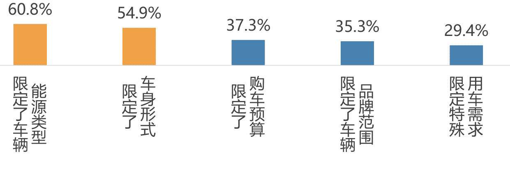

| 了解程度 (N=51) | 占比 |
| :--- | :--- |
| 非常了解 | 35.3% |
| 很了解 | 33.3% |
| 一般 | 29.4% |
| 不太了解 | 0.0% |
| 非常不了解 | 2.0% |

| 车身形式偏好 (N=51) | 占比 |
| :--- | :--- |
| SUV | 92.2% |
| 轿车 | 7.8% |
| MPV | 0% |

| 了解程度 (N=51) | 占比 |
| :--- | :--- |
| 非常了解 | 25.5% |
| 很了解 | 21.6% |
| 一般 | 47.1% |
| 不太了解 | 3.8% |
| 非常不了解 | 2.0% |

## 问界M8战役用户洞察报告

## 定价偏高，40万是战役用户预算的显著界线

- 购车预算上，主要存在两类用户：第一类用户预算集中在30-40万（58.8%），在40万存在断层，对价格更敏感。第二类用户预算主要在40万以上，占23.5%。
- 47.1%的用户认为是问界M8的定价偏高，但值得购买；39.2%的用户认为价格有待考量，需要更多的优惠，相比大定用户（24%），占比也更高。

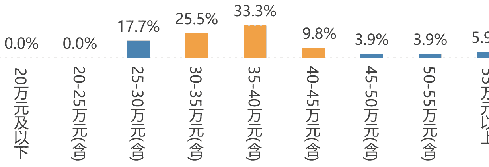
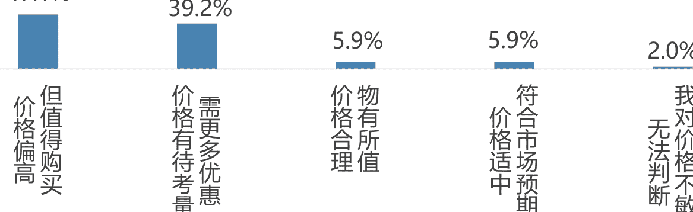

- 产品本身没有问题，定价偏高、无选装基金，感觉被套路了：定价偏高有些问题，问界M8的定价偏高了，至少需要选装而且没有选装基金。其实我觉得这辆车完全没有问题，但是大家对于配置来说，感觉会被套路了，然后还不接受。

## 战败用户最具吸引力的配置是电动吸合门

- 最吸引用户的TOP 4配置：电动吸合门、HUAWEI XHUD专属AR影院、手势隔空开启、座椅按摩、动态光毯。
- 最吸引大定/提车用户的TOP 5配置：座椅按摩、电动吸合门、手势隔空开启、场景灯、头枕扬声器。

## 战败用户的配置 TOP 10 吸引大定

| 配置项 | 占比 | 配置项 | 占比 |
| :--- | :--- | :--- | :--- |
| 电动吸合门 | 45.1% | 座椅按摩 | 37.3% |
| 专属AR影院 | 41.2% | 电动吸合门 | 32.7% |
| 手势隔空开启 | 35.3% | 手势隔空开启 | 28.7% |
| 座椅按摩 | 33.3% | 场景灯 | 28.0% |
| 动态光毯 | 27.5% | 头枕扬声器 | 25.3% |
| 感应后尾门 | 27.5% | 感应后尾门 | 24.7% |
| 电动踏板 | 25.5% | 链箱 | 24.0% |
| 座椅电动调节 | 23.5% | 动态光毯 | 20.0% |
| 场景灯 | 23.5% | 座椅通风 | 20.0% |
| 头枕扬声器 | 21.6% | 座椅电动调节 | 16.7% |
| | | 放电 | 16.7% |

## 56.8%的战败用户认为纯电未充分需求

- 问界M8 Max版纯电里程为210km，37.3%的用户期望纯电里程突破450km，在250-350km。
- 52.9%的用户认为当前续航满足日常需求，能够有更长的续航，减少充电次数。

| 续航里程 | 占比 |
| :--- | :--- |
| 150km及以内 | 0.0% |
| 150-200km (含) | 2.0% |
| 200-250km (含) | 2.0% |
| 250-300km (含) | 31.4% |
| 300-350km (含) | 52.9% |
| 350-400km (含) | 5.9% |
| 400-450km (含) | 3.9% |
| 450km以上 | 37.3% (注：此处数据误)

注：此处纯电续航里程均采用中国整车行驶标准（CLTC）的测试方法

## 专题

### 他们对品牌、智能化的看法

- 包含华为品牌对战败用户的心智占领、破圈程度
- 智能座舱、华为辅助驾驶的吸引力
- 战败用户选择问界M8六座的原因

《电车萌主》公众号
公司媒体矩阵全网粉丝150万+，并拥有200+新能源汽车用户社群

## 21.6%忠粉、27.5%生态粉、45.1%理性支持型

- 70.6%的战败用户目前使用华为手机，41.2%使用苹果手机
- 41.2%的战败用户家中有1-5个华为电子产品，35.3%有6-10个。
- 战败用户对华为品牌的了解程度高，84.3%的战败用户对华为品牌很了解&非常了解；21.6%是华为品牌的忠粉，27.5%生态粉，45.1%理性支持型。

## 用户目前使用手机品牌

| 品牌 | 占比 |
| :--- | :--- |
| 华为 (含荣耀) | 70.6% |
| 苹果 | 41.2% |
| 小米 (含红米等) | 5.9% |
| OPPO (含一加、realme等) | 2.0% |
| vivo (含iQOO) | 2.0% |

| 用户中华电子产品数 | 占比 |
| :--- | :--- |
| 1-5个 | 41.2% |
| 6-10个 | 35.3% |
| 11-20个 | 19.6% |
| 21-50个 | 3.9% |

魅族、三星手机占比为0

## 小定前用户对华为品牌的了解程度

## 是否为余承东的粉丝

| 了解程度 | 占比 |
| :--- | :--- |
| 非常了解 | 52.9% |
| 很了解 | 31.4% |
| 一般 | 15.7% |
| 不太了解 | 0.0% |
| 非常不了解 | 0.0% |

# 问界领先用户洞察报告

## 领先用户对友商品牌溢价的接受度

- 除了问界、理想，超6成的领先用户不接受以下友商的品牌溢价，尤其其乐道、岚雅、问仰、长城、别克等品牌，不接受品牌溢价的用户近8成。

### 领先用户对友商品牌溢价的接受度

| 问界 | 不接受品牌溢价 | 理想 | 不接受品牌溢价 | 极氪 | 不接受品牌溢价 |
| :--- | :--- | :--- | :--- | :--- | :--- |
| 0-5万（含） | 39.2% | 0-5万（含） | 54.9% | 0-5万（含） | 66.7% |
| 5-1万（含） | 13.7% | 5-1万（含） | 13.7% | 5-1万（含） | 13.7% |
| 1-2万（含） | 21.6% | 1-2万（含） | 7.8% | 1-2万（含） | 2.0% |
| 2-3万（含） | 7.8% | 2-3万（含） | 2.0% | 2-3万（含） | 7.8% |
| 3-4万（含） | 5.9% | 3-4万（含） | 2.0% | 3-4万（含） | 2.0% |
| 4万以上 | 3.9% | 4万以上 | 2.0% | 4万以上 | |

| 蔚来 | 不接受品牌溢价 | 比亚迪 | 不接受品牌溢价 | 理想氪 | 不接受品牌溢价 |
| :--- | :--- | :--- | :--- | :--- | :--- |
| 0-5万（含） | 66.7% | 0-5万（含） | 19.6% | 0-5万（含） | 13.7% |
| 5-1万（含） | 7.8% | 5-1万（含） | 0.0% | 5-1万（含） | 2.0% |
| 1-2万（含） | 2.0% | 1-2万（含） | 7.8% | 1-2万（含） | 7.8% |
| 2-3万（含） | 2.0% | 2-3万（含） | 0.0% | 2-3万（含） | 3.9% |
| 3-4万（含） | 2.0% | 3-4万（含） | 3.9% | 3-4万（含） | 0.0% |
| 4万以上 | | 4万以上 | 2.0% | 4万以上 | |

- 极氪：我能接受极氪一些品牌溢价，它本质上开始打高端，做了很多关联，它的009和光辉系列，高级一些。

- 比亚迪：一点不能接受比亚迪的品牌溢价，甚至觉得它的车，价格要更低。比亚迪没办法把自己和“网车”弄得清楚；比亚迪技术很好，但忽视了用户体验。比起比亚迪的L，蔚很懂，我也认为很好，但汉L的梗没有什么区域，非常老气，车不好用。车和内对我来说是我日常绝对绝对知道的东西，是不靠谱的。

## 《跨界MS用户洞察报告》

## 战略用户对友品牌溢价的接受度

### 优势

| 不接受品牌溢价 | 70.6% | 不接受品牌溢价 | 74.5% |
| :--- | :--- | :--- | :--- |
| 0-5万（含） | 9.8% | 0-5万（含） | 13.7% |
| 5-1万（含） | 7.8% | 5-1万（含） | 2.0% |
| 1-2万（含） | 3.9% | 1-2万（含） | 2.0% |
| 2-3万（含） | 3.9% | 2-3万（含） | 2.0% |
| 3-4万（含） | 2.0% | 3-4万（含） | 2.0% |
| 4万以上 | 2.0% | 4万以上 | 3.9% |

### 劣势

| 不接受品牌溢价 | 76.5% | 不接受品牌溢价 | 76.5% |
| :--- | :--- | :--- | :--- |
| 0-5万（含） | 9.8% | 0-5万（含） | 5.9% |
| 5-1万（含） | 3.9% | 5-1万（含） | 5.9% |
| 1-2万（含） | 5.9% | 1-2万（含） | 5.9% |
| 2-3万（含） | 0.0% | 2-3万（含） | 2.0% |
| 3-4万（含） | 2.0% | 3-4万（含） | 0.0% |
| 4万以上 | 2.0% | 4万以上 | 3.9% |

## 乐道

## 劣图

## 长城

## 别克

| 不接受品牌溢价 | 78.4% | 不接受品牌溢价 | 80.4% | 不接受品牌溢价 | 80.4% |
| :--- | :--- | :--- | :--- | :--- | :--- |
| 0-5万（含） | 9.8% | 0-5万（含） | 7.8% | 0-5万（含） | 3.9% |
| 5-1万（含） | 0.0% | 5-1万（含） | 0.0% | 5-1万（含） | 2.0% |
| 1-2万（含） | 2.0% | 1-2万（含） | 7.8% | 1-2万（含） | 3.9% |
| 2-3万（含） | 7.8% | 2-3万（含） | 0.0% | 2-3万（含） | 2.0% |
| 3-4万（含） | 0.0% | 3-4万（含） | 2.0% | 3-4万（含） | 5.9% |
| 4万以上 | 2.0% | 4万以上 | 2.0% | 4万以上 | |

> **优势**：腾势的品牌溢价不能接受，腾势买的D9在年初就能看到很多腾势的老车主说，高端没法控制价格。

> **劣势**：如果不是深蓝，合作了一款深蓝，我不知道这个觉得买车2万以内的人更多，2万到3万的人有些会看深蓝蓝。

## 理想MS用户洞察报告

## 领先用户对友品牌溢价的接受度

- 52.9%的领先用户认为鸿蒙座舱对购买意愿较大
- 领先用户关注度比较高：64.7%的领先用户对鸿蒙座舱很了解，74.5%的领先用户对鸿蒙座舱非常关注
- 52.9%的领先用户认为搭载鸿蒙座舱会提升购买意愿，7.8%的领先用户未搭载鸿蒙座舱将不会买车
- 最吸引领先用户的鸿蒙功能是OTA升级(56.9%)，其次是车机系统(41.2%)

| 了解程度 | 关注程度 | 对购车的影响 |
| :--- | :--- | :--- | :--- |
| 非常了解 | 33.3% | 非常关注 | 39.2% | 决定性影响 | 7.8% |
| 很了解 | 31.4% | 很关注 | 35.5% | 影响较大 | 52.9% |
| 一般了解 | 35.3% | 一般关注 | 25.5% | 一般影响 | 29.4% |
| 很不了解 | 0.0% | 很关注 | 0.0% | 影响较小 | 9.8% |
| 非常不 | 0.0% | 非常关注 | 0.0% | 完全没影响 | 0.0% |

## 华为辅助驾驶功能TOP

- 27.5%的领先用户因华为辅助驾驶下单
- 领先用户对华为辅助驾驶的关注度高，84.3%的领先用户对华为辅助驾驶很关注
- 52.9%的领先用户认为华为辅助驾驶会提升购买意愿，27.5%的领先用户未搭载华为辅助驾驶将不会购买
- 74.6%的领先用户愿意支付1万元以下的金额购买更高阶辅助驾驶功能

| 关注程度 | 对购车的影响 | 决定性影响 |
| :--- | :--- | :--- |
| 一般关注, 不关注 | 27.5% | 15.7% |
| 非常关注 | 影响较大 | 52.9% | 0.0% |
| 很关注 | 17.7% | 影响较小 | 2.0% |
| 非常关注 | 56.9% | 完全没影响 | 0.0% |

## 华为更高阶辅助驾驶支付意愿

# MS领先用户洞察报告

## 92.2%的领先用户更信激光雷达方案，为了主动安全配置

- 辅助驾驶方案方面，92.2%的领先用户更信激光雷达方案
- 辅助驾驶硬件方面，领先用户最看芯片（80.4%），其次是雷达数量（64.7%）
- 基础辅助驾驶功能方面，领先用户最在意主动安全配置，如预警类功能（78.4%）、主动刹车（62.8%）
- 高阶辅助驾驶功能方面，领先用户最看高速、城区道路驾驶（均为58.8%），其次是车位到车位领航辅助（49.0%）、智能泊车/代泊车辅助（均为47.1%）

## 辅助驾驶基础功能 TOP5

| 预警类功能 | 78.4% |
| :--- | :--- |
| 主动刹车 | 62.8% |
| 全速自适应巡航 | 45.1% |
| 360°全景影像/透明底盘 | 43.1% |
| 鸣响模式 | 41.2% |

## 辅助驾驶高阶功能 TOP5

| 高速道路辅助驾驶 | 58.8% |
| 城区道路辅助驾驶 | 58.8% |
| 车位到车位领航辅助 | 49.0% |
| 智能泊车辅助 | 47.1% |
| 代泊车辅助 | 47.1% |

> 注：预警类功能包含前方/后方防撞、开门、车道偏离

# 理想MS领先用户报告

## 领先用户选择六座更灵活的空间布局、重力座椅

- 领先用户选择六座的原因主要是需要灵活的空间布局、看重重力座椅功能（均为47.1%），其次是家庭或者商务需求需要更多座位（44.1%）、未来家庭结构可能扩展（41.2%）

领先用户选择问M8 六座版原因

| 47.1% | 47.1% | 44.1% | 41.2% | 38.2% | 11.8% | 11.8% |
| :--- | :--- | :--- | :--- | :--- | :--- | :--- |
| 需要灵活的空间布局 | 看重重力座椅功能 | 家庭需求或商务 | 多座位更灵活 | 未来可能家庭扩展 | 追求舒适第三性 | 商务接待多界 | 隐储储物密设计空私

> > 空间布局灵活，既能当四座使用，还能满足家庭多人入境
> 我家最常用的使用场景是4个人，年底的时候家里会到6人，多了6座车能装下，出门就不用再开辆车或者打车了。

注：因5座人数较，故选择因不妥望
