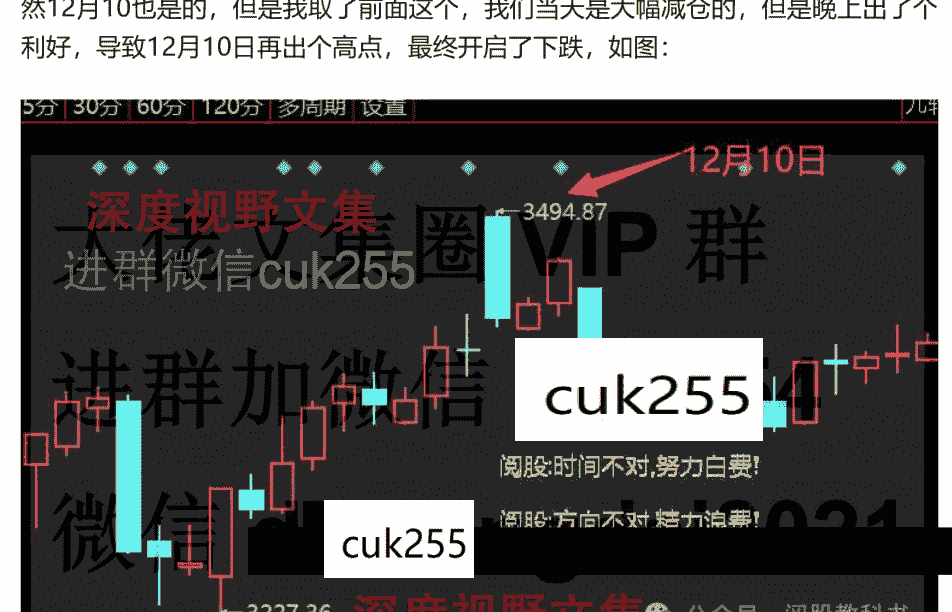
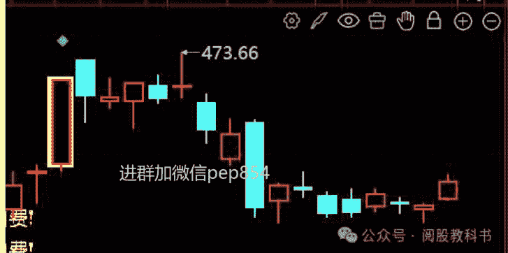

# 【阅】2025.10.24---哀民之多艰! 已付费

原创 阅股教授 阅股教科书2025年10月24日21:17 河南

## 前言

本文主要是以下几个方面的内容：

- 1. 当下行情的特征
- 2. 历史上四季度行的经验总结
- 3. 当下行的操作建议
- 4. 后续的两个时间窗口（节奏受理）
- 5. 后续存在机会的方向
- 6. 筑二波的结构建议。
- 7. 涨年必须满足的技术模型！！

在10月18日的文中，我们公布了本月中间的两个时间窗口，即10月20和23日！本月总共有4个时间窗口，除了大家知道的10月9，有两个都是在本周的。

之前简提了，直接进入正文。

下一个时间窗口在10月20日和10月23日，10月份有四个时间窗口，除了10月9日外，中间的两个都在下周。10月18日文章完整 公众·阅股教科书。

现在，我们就趁着时间窗口，来聊最近的行情，以及历年来四季度的行情，还有最重要的跨年妖！同时我们也重视11月的行情。

直接开启正文。

先说时间窗口，10月20日主力进攻了，你看又是时间窗口的进攻，这样的巧合已经好几次了吧？？那还是巧吗？

就是说，如果你在9月或者10月空仓了，这算是买入的节点！由于我们对大主线之后的K线走势还有一定的要求，大家可以在我给的文档《阅股买入信号浅析》中关于阴反转的部分看到，其中一个条件是不满足的，因此我本人没有入场买涨趋势。

加上本来我的计划中，10-12月我们是不玩涨趋势的，所以并没有用VIP做买入，主要就是因为不符合我的交易系统。但是主力确实是进攻了，所以你买了也是没问题的！跟主力的逻辑是最终的！

## 深度视文集cuk255 * 有温度高质量社群cuk255

而来到23日，本该是变盘日，早上确实如此，指数震一下-0.8%，估计已经看到了，在下午，资金通过拉升证券指数，直接将指数拉红了。考虑到2日在开会，会议期间维稳，非常正常的，这没多说的。只能说，本该变盘的时间窗口变成了上涨，类似于9月24日的9月29！！当时大家应该记得，924买出的，却是929选择的。

而后续还有两个时间窗口，只其中中间一个不是太重要，所以我一直是忽略它的，而是等到23日为涨中继时间窗口之后，它就有用了，在我们指数之间都肯定公布大盘，万一卖出指数，你起码也有个安全的不是吗？

后续的时间窗口分别是：10月25日和10月31日。由于前者是在周末，所以顺延之后，你需要注意的是10月27日和10月31日。注意请结合信号来最终认。（相同时间窗口前者是用旬逻辑处理的，如果那个方法可以自己验证的话，那么高点是去年10月3日，低是去年7月）。

好久没见，再见面了，我们这次给大家说一点。关于指数，我个人认为这波上涨还是一轮多涨，和去年的表现类似，当时我们大家的窗口是12月9日，重新12月10日也是，是我取了前面的这个，我们当天是大缩减仓的，但是晚上出了个利好，导致12月10日再出现高点，最后开启了下垫，如下:

而且，我之前的文章也说过，一旦最终高点是10月份涨出来的，那么后面3个月都没有大行情了！！

另外一方面，我也说过，历史上十年时间，当四季度几乎是没有趋势行情的的老股们你回这十年的10-12月，新股你就看2024年！！尤其是2021-12月，尤其是19日之后，指数都不涨，是个股赢赢，这种增长是经历过的！！

## 深度视野集cuk255 有温度高质量群cuk255

而来到23日，本该是变盘日，早上确实如此，指数震一下-0.8%，估计已经看到了，在下午，资金通过拉升证券指数，直接将指数拉红了。考虑到2日在开会，会议期间维稳，非常正常的，这没多说的。只能说，本该变盘的时间窗口变成了上涨，类似于9月24日的9月29！！当时大家应该记得，924买出的，却是929选择的。

而后续还有两个时间窗口，只其中中间一个不是太重要，所以我一直是忽略它的，而是等到23日为涨中继时间窗口之后，它就有用了，在我们指数之间都肯定公布大盘，万一卖出指数，你起码也有个安全的不是吗？

后续的时间窗口分别是：10月25日和10月31日。由于前者是在周末，所以顺延之后，你需要注意的是10月27日和10月31日。注意请结合信号来最终认。（相同时间窗口前者是用旬逻辑处理的，如果那个方法可以自己验证的话，那么高点是去年10月3日，低是去年7月）。

好久没见，再见面了，我们这次给大家说一点。关于指数，我个人认为这波上涨还是一轮多涨，和去年的表现类似，当时我们大家的窗口是12月9日，重新12月10日也是，是我取了前面的这个，我们当天是大缩减仓的，但是晚上出了个利好，导致12月10日再出现高点，最后开启了下垫，如下:

而且，我之前的文章也说过，一旦最终高点是10月份涨出来的，那么后面3个月都没有大行情了！！

另外一方面，我也说过，历史上十年时间，当四季度几乎是没有趋势行情的的老股们你回这十年的10-12月，新股你就看2024年！！尤其是2021-12月，尤其是19日之后，指数都不涨，是个股赢赢，这种增长是经历过的！！

（此处省略重复内容）

通过这两个数据分析，你应该明白现在的行情了吧，可以说大个股已经开始调整了，甚至调整两个月了还没恢复底部。你不能光看指数涨涨，你觉得应该参与，或者是能够参与的！历经A股这么多年，A控制你还懂不懂？数据已经说明了一切，我们再看财经，可以说这段时间毫无主线，几乎都是一日游，哪里是会议引发的题材不过几日游，我个人还打了一个开头，就吃一个脚。。个股没有赚钱效应，而题材每天切换，这样的行情，就有专业人士用词在做电风扇行情了，今天这几个题材，明天那几个题材，涨一两个点，跌起来都是四五个点！你还是芯片是主线，还不错，但是板块内切换的，比如一个著名的芯片股，它走势这样的，类似的还有很多了！

你说赚钱效应吗？没有！！

那说到这里，我们再说说下历史10-12月行情如何呢？在我的记忆中，好像就像2015年，是连续几次之间涨，哪年10-12月行情，后1月出现了著名的横断！！其他年，2020年还可以，在其他月份就没涨行情了，如果你还记得2024年，你还想当时股市行情吗？是不是不是妖股行情？

在此，我们回溯历史，站在概率的方向，也用数据分析当下的情况，得出结论，趋势股的参与难度很大，不是说这类没有。

深度视觉文集集cuk255 有温度高质量社群cuk255

（后续内容合并处理...）

## 深度视野优质集群（链接优质社群，助你成功）

全部包含以下内容：限时优惠188/年 加微信cuk255

- ① 吃瓜群众帝圈加时群对话（原价365 元/年）
- ② 子明私享汇（内部）文章
- ③ 政治室（顾子明）付费内容内返子明群聊
- ④ 米联储闲间【作者米栖】（原价599 元/年）
- ⑤ 欧洲金雀会员专属文章（原价328 元/年）
- ⑥ 砖瓦仁内部圈（原价400 元/年）
- ⑦ 卢克青云读书会专属文章（原价699 元/年）
- ⑧ 鉴茶财经知识星球（原价3310 元/年）
- ⑨ most哥的视野知识星球文章（原价299 元/年）
- ⑩ 财经周刊【独家】（原价1498 元/年）
- ⑪ 杨世光在金钱树（原价2200 元/年）
- ⑫ 森淼跃财经知识星球（原价1600 元/年）
- ⑬ 激游译付费文章（持续更新）
- ⑭ 司马林解读末选全套音频和全书珍藏版无割减（原价2.3 万）
- ⑮ 虚虚三部曲[民国梦、帝国扩张、不被理解的MAO]（原价599 元）
- �十六 卢克知识星球文章（原价268 元/年）
- 十七 额外再送：卢旷新浪微博付费专栏、三村西丰老王、三花九洞树文集

不定期内容：（更多资源下去……）

- ① 守护夜司令知识星球、接换魔王知识星球、成败财富圈、雪花花甲老头等
- ② 创始笔记、达叔谈论星球、成败财富圈
- ③ A视野、大树乡谈、江诺付同学、咩咩说、上海海家学等付费文集
