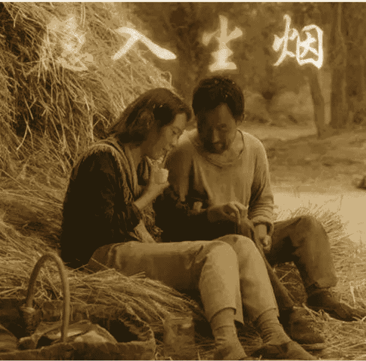

# 阶层固化，以及如何打破阶层固化？（含两种打破阶层固化方案）

扫码加入 知识星球TOP 免费资源群
公号：知识星球TOP

免费
- 每日免费获取高价值资源
- 可提供各类资源搜索服务

价值
- 热门付费文章
- 各行业报告
- 精选书资源
- 副业赚钱方法
- 职场实用资源
- AI财经自媒体

及时

专注

资料仅供个人学习，请及时删除，请勿用于传播。

# 精华文章

精英必读！8次阶层跃迁，及最后一次阶层跃迁详解！

房产税何时落地？及未来八大预测！（含投资方向）

↑↑关注我，国际，国内，社会，财经最深度的第一手资料。

本期聊的主题是阶层，其中也包括这个系统的运行规则。阶层是全球每个国家和地区千年来都会面临的课题。以往来说，阶层的发展转折点很多时候是因为阶层矛盾，往往一说，你知道那些比你穷的人是怎么生活的吗？你又知道那些富贵富豪们在面对问题的时候是怎么思考的吗？这些人又是怎么升爬的？我们以为想不到在现在的世界上还会有人再隐入尘烟，也不知道环境的变化已经让富贵富豪阶层出现了非常大的波动，这就是阶层带来的隔阂，而这些隔阂会造成人与人之间巨大的认知差距。

加微信jntsg2，进阶分享群。

加微信jntsg2，进资料分享群。

社会阶层是指具有相同或相似社会地位的成员组成的群体，同一群体之间态度、行为、生活模式、价值观都具有高度的相似性。阶层这个词其实是一个不等的词，是根据各种不平等的现象把人们划分为若干社会等级。

可说是千百万年来每个地方都会有一种社会现象。

我们往往把占据资源很多的人称为资本家或者权贵阶层，次之叫中产阶级，再就是小资产阶级或者无产阶级。

而阶层这一点其实在古代的中国和当代的印度更是体现淋漓尽致。古代中国有士农工商，今日印度有深根蒂固的种姓制度，所以一部分人的命运也曾挂钩，只要出生，就会自动进入这个等级，社会也抛到了对应的阶层。也是因为这一点，可能今后的命运遭遇就离不了。这就是一个阶层固化的社会带来的东西。

即便到了今天，无论哪里仍然有着权贵、中产和无产之间的差距，而且差异越来越大。尤其是2020年经历一轮动荡之后，有人生困难，有人身价翻倍。

加微信jntsg2，进资料分享群。

阶层分化是一种必然形成的社会现象。在社会形成的最初，人和人类是完全平等，就像猎人时代，人们组成部落，一部分人打猎，一部分人守家，打猎回来的食物大家一起吃，人们互相帮助，这就维持生活。

后来说，真的有人在工作之余打下了一头牛，这头牛让他个人吃半年的伙食，而且是在工作时间之外多出来的，所以他只需要上交给部落一部分，剩下的都是他私人的。有了这些储备牛肉之后，他短期内就不需要再出去工作了，而且他甚至还可以用一部分牛肉来雇其他猎人来自己打工。

所以，他主动拿出一部分牛肉分给几个猎人，不管他们今天是否打到猎物，都可以得到这些食物，但是也约定如果打到猎物，要给自己分30%。很多猎人为了规避风险，便选择接受这样的约定。他雇佣了十个人，每个猎人平均每个每周能达到20斤猎物，这样他从每个人身上就能获得六斤肉，而每个猎人一个星期从这里拿走的固定薪水只有五斤肉，所以相当于通过雇佣这些人人每个星期就可以净赚十斤肉。于是从之后开始有人在不需要工作的情况下，每个星期也能获得一定的收入了。

后来随着时间的发展，我们就称这部分人的资本。

到这里我们能看到，一开始人和人还是平等的，但是随着时间发展，人们对于资源的获取方式和量慢慢就出现了一些变化，起初劳动创造资源，也会很好的让你温饱，但是当有人的食物开始积累的时候，他就可以用食物来雇佣人力，从而创造更多食物，这就是资源创造资源。

再者，权力人脉也可以创造资源。

就这样，社会演化的过程中，资源在不同群体之间越权越化，阶层就开始慢慢变形形成了。不同阶层掌握的资源差异是巨大的，由此带来的认知也是差异巨大的。

同样的问题，不同类型的人会给出不同的解决方法，比如赚钱更多钱这件事儿，无产和中产会努力勤佣工作。

加微信jntsg2，进资料分享群。

拥有资源的资本愿意选择一些靠谱的项目，或者通过资本运作获得资金，而无产和中产并不是想不到这些，而是没有参与的能力，因为还要吃饱，所以没有足够的资金，即使遇到好的项目也只能错过的，因为没有资格，就连入行的基础岗位都拿不到。这就是阶层之间的差距，门槛限制了很多东西，但权贵阶层拥有的资源和人脉信息多，所以即使今天财富归零，他们也能积累起来。

即使今天的世界财富归零，你觉得会吗？其实在三十年前，我们就有这样的机会。刚开放那会儿，人与人之间的差距很小，但是随着几十年的发展，我们看到财富分化越来越明显。在这个过程中我们看到一些现象，就是勤劳的农民在挣钱的时候愿意选择中产，工人在获取财富的时候愿意选择工厂。

加微信jntsg2，进资料分享群。

不同的技能决定了今后的发展是不同的。哪怕是同样打工，也有人效率更大，这就是能力差异。在认知当中还有一点，越是做生意的人，越敢于创业，因为他对机会有具体的认知；常年打工的人由于对商业、法律都不知道，一旦开了公司之后会有什么问题，所以想要跳出这一步其实困难。

如今高科技是机会，你知道能更赚钱，但是你参与进去，这是门槛。每年都有机会，但你不知道领域，即使不知道该怎样开始，这是信息和认知。所以参与机会的门槛是社会发展主要的差距之一。这也是阶层分化之后，阶层流动越来越小的原因之一。

加微信jnts2，进资料分享群。

几十年的时间里，由于我们身处不同的领域，不同的阶层，所以受到的影响是不一样的。大多数人都是底层，所以在往后的日子里，我们作为底层，你会深刻感受到社会变化，福利待遇越来越多。在这样的环境下，想要吃饱越来越容易。比如很多农村老人以前种地一辈子靠子女接济，但是现在很多老人也有最低生活保障。2014-2018年，走遍半个中国，尤其2018年，当地确实贫穷，有些老人几乎陷入尘烟，处于同一个水平。但是同样的，你会发现你想吃饱变得困难，上升的阶梯变得拥挤，创业投资变得越来越困难，打工想要财务自由概率越来越小。这就是以后，我相信往后的15-20年里，你会对刚才这种状态有深刻体会。

加微信jnts2，进资料分享群。

这个世界每个人都在做正确的事：打工人要挣钱，资本家要投资获利，无产阶级要找到工作，执政者要保障一切稳定。所有人组成了这个社会系统，社会系统在运转中产生了资本主义、农民、工人、无产者，而其中中产的话语权极大，违反规则。

所以随着发展，阶层的改变就会越来越难。并不是每天工作从八小时变成了十小时就能改变命运，也不是从主管晋升了经理就能跨越阶层。所以想要改变自己，先看看环境。有时候只需要换个行业，收入就会升高很多；或许只需要换个城市地区，生活就会改善很多；或许也需要了解一些知识或者考取几个证书才能拿到一些领域的入场券。金字塔越往越挤，水泄不通，这就是现在的市场情况。

这句话有一命二运三风水四积德五读书。这也许说明在阶级上升的过程中，出生起点、后天运气、事实环境、朋友脉络和知识努力都可以改变现状，同样的，难度也会增加一倍。所以很多人抱怨自己就是没有那个命，一辈子都要操劳，而且赚不到，他是对的。也有人说，自己的成就都是靠自己打来的，面对任何困难都不放弃，只要不断向前走，就会成就，他是对的。还有人说，自己有今天的成就完全就是自己的运气，如果不是在那天买了某某资产，今天还会过得很苦，这也是对的。但这个社会的上升阶梯从来不是单一的，而且这个社会的上升方式有很多价值观，甚至是不值得被推崇的。我们鼓励努力和知识，但是运气和环境又是怎样的呢？

以下内容过于硬核，请多看一遍。不要愁，如果你超过了 35 岁还不明白这些，那你可能老了。

首先，其实从来就没有中产阶层。
古代：
奴隶社会，只有奴隶主和奴隶；
封建社会，只有权贵阶层和平民；
资本社会，只有资本家和贫民。

现在所谓的中产，其实真的很好，就好比地主家的长说自己是中产一样好。

其实从来就没有中产阶层，我们可以分为两类：

| 类别 | 身份 | 运作方式 | 收益 |
| :--- | :--- | :--- | :--- |
| 1 | 资本家 | 拥有资源/房产 | 资本运作、投资 | 收租金/利息 |
| 2 | 贫民/工人 | 出卖劳动时间 | 勤劳工作 | 薪水 |

无论你是哪一类，我们都可以尝试转型：
- 掌握资源：拥有几套房，收租。
- 出卖劳动时间：拿工资。
- 掌握生产：建立自己的产业，创业。

- 掌握资源：出卖劳动时间，
- 卖劳动时间，躺的。
- 掌握资源：出卖劳动时间，拿工资。
- 卖劳动时间，躺的。
- 掌握资源：拥有几套房，收租。
- 出卖劳动时间：拿工资。

原理给大家说明白了，下面是打破固化的两种解决方案：

### 第一种：成为某个领域的头部。
- 如果你计算机得好，成为头部的人才，年薪不会低于80w，至少年入百万起。
- 如果你设计水平可以，成为头部的设计师，年入100w以上的。
- 只要对这个行业感兴趣，进步就慢，成就就有限。
这靠的是努力。

### 第二种：打造自己的产业。
- 自己开一个火锅店、面馆、包子铺、小超市、网店、短视频账号、小平台等。
- 最早从一家火锅店开始，后来开了5、6个连锁店，一直到上市。
- 门店大概率亏损的，你要看店附近流量、客户口味、成本管控等因素。
- 建议问你身边年入千万的做什么，学习一下经历。比如：跨境电商、开美容院、玩游戏、包工头、网红主播、直播带货、开十家连锁店等等。

当然，我的建议多听多看多学。同时想想门槛，比如房地产开发，门槛需要几千万，你那不够。开连锁店，前期投入150w，利润模型怎么样？多久收回成本？亏损的概率有多大？除非你有经验的老司机，否则不建议资产投入型的，因为你亏不起。尽量做投入低成本的领域，比如短视频、新媒体。这里有新媒体的扶持，一年阶梯。不过提前声明，是收费的，教你成为超级个体，包括但不限于短视频和公众号等，全套包括但不限于文案、剪视频、变现规划。

# 第三种：资产配置。
其实第三种不算打破阶层固化，其实是帮助阶层稳固。很多人说乱投资才会变穷，不投资就不会变穷，其实是错的。如果2010年北京房价100万一套的时候不买，现在一套700万的房产就和你无关。当初买房暴富的人，其实就是在资产配置。只是过去20年，房地产是几乎最好的资产之一。当然还有比特币，几十年前、2020年高峰时了三十万一个，是错误的资产配置，会让你变穷，比如P2P暴富，比如你投资了烂尾楼。

一个高端社群，会长更新有价值的资产配置，包含房产、债券、基金等。现在不做资产配置，就好比十年以前。
