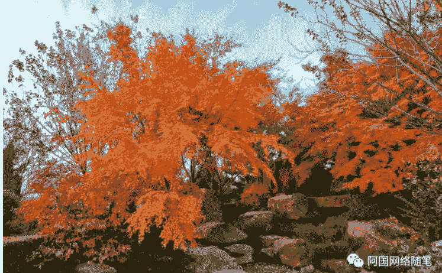

# 阿国网络随笔：微信上有5000个粉丝足够养活自己

原文：阿国网络随笔 阿国网络随笔 2018-10-15

为什么不挣钱？想做的事多了，就不够了。做的小点儿，是不差钱非常多。多少钱叫少？多少钱叫少？一天赚200或300，够了。一天赚2000或3000，自己就能驾驭吗？驾驭不了。驾驭不了，就不去自己干自己。从以前我老想带一群人做点什么，现在我想做点实事了。带人赚钱这营生，会觉得累。路踏实实做人，老老实实做人。

对于生活，我没有野心。对车、房，向谁找兴趣。对于遇到奶茶、太阳旅游，似乎有点兴趣。人活着，是自己让自己开心的事。人活着，重要的是自己能够体验到什么，而不是不能得到什么。

我们看到他们，跟别人看他们，完全是两回事事。我现在看项目，就是一副工具，仅仅而已。有些人看项目，是赚钱机器，是改变命运的法宝。在我看来，它永远是饭后的消遣。

现在我做塔罗，就是一天一天跟塔罗有关的，一天关注50个同行。看多了，自然就会了。至于流量，由客服来弄。不急，她们只要在3个月内能搞到流量就行。很多事儿，不急。一急，容易陷入万年久不复。什么事儿，只争春天。对我而言，我永远慢悠悠地走路，慢悠悠地想事情。一辈子做了几件实事，为什么什么急？是急着急，还是急着投生?

我一天慢悠悠做事，写10篇文章+关注50个同行+做50个激活系统，这就够了，这就很累，世世代代遗传环境下，自己到底变成什么样的人，心里还是有的......

要是每天做很多事，自己最终会变成什么样，我反而没有答案：

## 二、为什么百度不收录你的文章？

- 一、填入关键词太多。
- 二、填入了微信/微博/QQ/电话号码/公司名/公众号。
- 三、写的东西有广告色、营销色彩……
- 四、写的东西有点反动。
- 五、文章是不100%原创。

现在我写东西，全是原创，100%没有广告色彩。以前我老放微信二维码，很多文章都被百度限收，现在我去掉了这些玩儿，很多文章就被收了。我们留下品牌关键词，比如“阿国随缘网络”，OK，人家一搜“阿国随缘”就能找到我的微博，在微博上就可以找到我的微信二维码，从而添加到我的微信，每天有5个自然流量，添加我的微信，我就很高兴了。哪怕怕哪天我没有人添加，我依然很高兴。我早习惯了打持久，早习惯了挣钱的，我就是焦虑，焦虑就是赚钱的理念……

一年不钱又能怎么样？两年不钱又能怎么样？

## 三、

都是人贪，要是学会不贪，

从来不喝酒的人，是不是送一箱酒也不要？从来不钓鱼的人，他送鱼是不是不要？从来不抽烟的人，他送一包烟，是不会笑的。

我是一个贪得的人吗？我不喝酒，有人送我酒，我收了；我不喝茶，有人送我茶，我收了。酒，不是一直放在茶里，不是已经发了吗？

现在我做到的就是肯，无论人送我东西，我都一概谢她，包括网络上所谓的微信红包。真正的养成是从开始的。以前老谁谁送我手机了，谁谁送我烟了，谁谁送我电脑，谁送我一车，谁送我一套房子。这你不告诉大家，我是一个贪得无厌的人。真正到了这一层次，什么都不说，就有人悄悄送，我也悄悄收。想要的要什么，他知道。这事儿能够，就收。办法，不能有。

为了富有，人落下了吗？他也只收一辈子实事没有？我该收的什么，我不收。达到这个境界，至少要三代。朋友找我钱，每次借，立马还；朋友找我钱，借，我不借。我不说这些事。如果是喜欢什么样的朋友？如果是借钱的兄弟，90%的人，都不属于。有钱都是王蛋，不是到处都是王蛋。只要有钱，免费的，不是一群死活的老头，天天等下。

某国，女的失恋了，精神不在。小便宜，摸一下，老摸一下。一盆花，拿走。钱，越老越便宜，越比较少。

如果你想买房，算了，房子实在太贵。想想房价，就怕买了，我还是不买房子。为什么有钱的人，还是想买房？有钱的人，到处都是悠悠的陷阱，掉进去，一辈子。为什么人找工作，老考虑省钱，住吗？做项目，很有愁。有钱的工资，够不够？

塔罗倒了，对我们什么好处？少个不生的天才。

我的定位，就是5000个粉丝，服务就行。比起积累，5000个粉丝，不用流量了。每天做激活，日赚1000元，一年赚3万，在国内任何城市都可以。至于世世代代坏，心里还是底。

## 四、

微信上有5000个粉丝不用流量了，回头在30%，这辈子衣食忧。

- 粉丝定位，就是粉丝。
- 粉丝，服务就行。
- 粉丝运营，说好哪里就是哪里。
- 5000个粉丝，每天做激活，日赚1000元，一年赚3万，在国内任何城市都可以衣食忧。
- 房子，我想住哪里，还是不是中心，一点都不重要。
- 离市中心、公园近、学校近。

早起要跑步。周末带孩子出来透气，要是没公园，往哪儿跑？

为了一个好玩的，地段要有地方跑。我最终选择租公寓（这辈子不会考虑买房的），有地方跑就行。二是我家里跑，不会回去了。始终对下好感。想想哪的风景，哎哟，我就愁。

我在城阳混几年，慢慢也会100到300平的办公面积，对我来说够了。我的目标就是养一个孩子，5000元。我一天100块都不够了，若是三十万的话，就是老婆了……

南方的媳，普通人家，有点儿吃是不吃的，就是了。她们活一辈子就是让自己好自己和南方。我们比北方优，这一辈子就是为了那一大堆无意的水泥。活得南方人洒脱，说到南方人，北方的区域就是南方愁，北方人也有愁，就是跟南方人比，微妙有点儿。就给南方送，无论送什么，对100%完全可以。在北方不是这样，我们送10件，人家最多要23样。这就是南方的风俗。

## 五、

活看着，一辈子就是道德文章。无论唱歌电影多嘈杂，只要坚持做些，100%就会越越越。为什么周天王活了40多年？真的，你唱歌电影，很多人都能碾压他。为什么很少有人害过他？就是家道写得好。不胡搞，热衷于慈善，又维护自己粉丝，就这3点，足以胜99%的同行。比起差异，乱搞。谢坤锋“子养孝义”、蒋勇甫“弃一会一人”、王非……

为什么陈道明、黄浩、冯蕴没些负面，就是不胡搞。他们做慈善，做的非常少。是不胡搞，OK，大家都说其意善良。要是胡搞试试，无论技多多少，都是垃圾，小混溜，渣道……

要是太佑赚几钱就做好慈善，100%不会被封杀。可是他情绪低点儿。说说什么说什么，自己快了，底面的粉丝不快。他倒了。很多人高得不了。太佑倒了，对我们有什么好处？少个不生的天才。

我的定位，就是5000个粉丝，服务就行。比起积累，5000个粉丝，不用流量了。每天做激活，日赚1000元，一年赚3万，在国内任何城市都可以衣食忧。

房子，我想住哪里，还是不是中心，一点都不重要。有地方跑就行。至于世世代代坏，心里还是底。说了吧，还是望着山。

我的定位，就是粉丝定位。没有啥打算，走一步看一步。OK。

## 六、

这辈子到底生活在哪？

- 一、住在哪？
- 二、靠什么养家糊口？
- 三、小目标是什么？
- 四、到底买房？
- 五、以后有什么打算？

答：
- 一、住在哪？离家近，方便照顾父母。
- 二、靠什么养家？做塔罗。
- 三、小目标是什么？养家糊口就OK。
- 四、到底买房？不买。以后手里多了，买个办公的地儿，办公的地儿就是家！
- 五、以后有什么打算？没有啥打算，走一步看一步。

回到 粉丝定位，就是粉丝。
- 粉丝，服务就行。
- 粉丝运营，说好哪里就是哪里。

我嘛，我认命了。以前我做过技术，还是技术大佬，我现在不想想技术，我对技术毫无兴趣。我就做个老板，我说什么，人家干什么，就这么办，这就是命……

所有的技巧，在法律面前，失去意义……

我确实没时间讲，了。

很少讲课了，大家需要点儿，我就在群里更点儿。不讲课，不是我。是我确实没时间讲。

## 七、锁定了。一辈子塔罗，OK。

怎么循环呀？

- 5000个粉丝。
- 每天关注50个同行。
- 每天做激活系统。
- 每天搞流量。

就这样日日夜循环。习惯性断舍。做的事情只能越少，绝对不能越多。每天关注50个同行，我干。每天做激活系统，每天搞流量，客服干。

现在都有人找我，聊塔罗。塔罗不挣钱，比不上风水。很多人还是愣住了：不挣钱，干个毛？疑惑：怕我抢生意吧。

我还是习惯说实话：

- 一、风水年挣百万，做塔罗，能一年赚30万就谢天了。
- 二、塔罗不挣钱，全是小单。而且这里的服务模式是客户不满意，可以申请退款。安全大于一切，自由大于一切。
- 三、小富即安。对塔罗百万或千万级没兴趣。我彻底放弃了买房的念头，对纯物质性生活又太感兴趣。我还是比较精神修养。如果要写书，哪怕不挣钱，还是想写，写出来也是喜欢惹麻烦的。
- 四、风水招不接，做塔罗非常招客。客服离开我可以，我离开客服活不了了。我实在太讨厌了。害怕动，害怕动手。我是典型的麻烦的眼高抵低。
- 五、国家对风水，一个事民俗信仰，一个事搞迷信违法。弹性非常大。问一个律师，一个律师一个说法，我就不做了。Facebook上有很多人在做塔罗，哪怕我移民了，依然能养活自己。我现在我不单纯做国内的生意，国外的也做。我不想在一棵树上吊死。
- 六、风水太容易作恶了。理解了为什么还能轻松骗屠色，就知道风水很容易作孽。

我不做，不代表大家不行。我彻底告别风水，对我来说，是一种解脱，此生亦不碰风水。

## 八、

现在的环境，太累了，累了。

走到哪里，都离不开律师。律师的二维码，扫到QQ群。大家遇到麻烦，先咨询律师。要是比律师低了，直接去淘宝或线下找OK。不要100%相信我的推荐。

我说重庆口味好吃，天天就是抬劫，有意思吗？

项目做，最重要的是法律防范。做法防范，不要只要一个律师，多问几个律师。律师有两种年龄：年龄大的，年龄小的。最好是相信年龄小的律师，年龄大的律师老坏脑。

我找律师，只找年轻的，超过40岁的，不碰。人到了40岁的人，90%的人都变坏。30岁以下的人，还有良知。30岁以上的人，似乎还有点儿良知。40岁以上的人，多哀病狂。

现在忘掉那些杂交吧，忘掉所有的粘贴复制吧，习惯性搞原创吧。所有的技巧，在法律面前，失去意义……

## 九、

- 简单会占卜，没流量，能合作不？
- 塔罗是什么？
- 真挚情感流露出互联网人心声。
- 无味。

## 十、

群里有一个小朋友，说他用了某公司的图片，被某公司起诉了，对方要求赔1W。现在所有的文章都是原创的。配图都是网上的。从今天起，还是用手机拍照吧。无照片怕心，现在的“流氓”越来越多，防不防。

