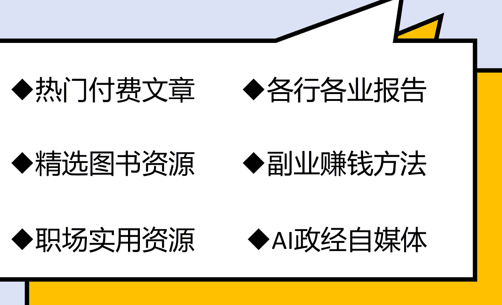

# 阿国：魏忠贤公秘密

序言：

魏忠贤就是我眼里的神。人家没啥文化，也立起来了。魏忠贤呢，一辈子干了不错好事，也干了不少坏事。平心而论，他是干的好的好多，干的坏事干的坏事少。主要是没啥文化，想干比较大的坏事，也干不了了。

魏忠贤在的时候，边境安静一场糊涂。为啥啊？不缺军饷。皇帝想要钱，魏忠贤搞定。魏忠贤不在了，边境天天打仗。后来上来的皇帝老爷，把魏忠贤灭了。魏忠贤亡了，大明就亡了。为什么大明亡了？皇帝老儿子搞不到钱了！给他找父要，他岳父都不都不理他。为什么他岳父不理他啊？因为这个皇帝老太狂了！你狂吧，我比你狂。哈哈！

我呢，不想为魏忠贤翻案。因为魏忠贤在的时候，很多文官呢，特别讨厌他，觉得他没啥文化吗，故意愿跟他保持距离。魏忠贤不在了，各类文官最大的爱好就是写文骂他。大明快完蛋了，太监没一个跑的。文官全跑了，没有跑的，也投降了。也就是无无胜，10个文官有9个文官，都技高一筹类拔萃。所以呢，你想无胜，你得多读几几本书。

加微信jntg2，进资料分享群

文官有多恶心，我懒得写了。看完《明朝那些事儿》，唯一能感动的，就是魏忠诚，而且我呢，也想跟他混。于是乎，我自己己耶，翻了很多跟魏忠诚有关的资料。发现了他的绝活，于是，我写了这本电子书。

## 魏忠贤语：

“陛下分明是怕了东林党，不然为何要容忍他们如此嚣张。东林党，一个一个都是伪君子，表面上道貌岸然，实则心怀巨渊。他们结党私营，只是为了谋取自己的私利，根本不顾国家陛下的利益。陛下，您应该相信忠诚，忠诚一定会为您清除这些奸党，还朝廷一个朗朗乾坤。”

“东厂是皇的眼睛和耳朵，忠诚只是为了管理，一切只为皇上分忧。那些东厂锦捕的人，都是有罪在身，或是对朝廷有不忠之心。忠诚只是执行皇上的旨意，维护朝廷的稳定和尊严。”

“逆案已定，那些逆党大恶极，理应严惩。如今朝堂之上，还有许多人与逆党有千丝万缕的联系，他们心怀巨渊，妄图翻朝。皇上英明，怎能被他们的花言巧语所迷惑。忠诚斗胆，请皇上上务必守逆逆案，严惩逆党，以绝后患。”

加微信jntgs2，进资料分享群

“辽东战事紧急，将士们浴血奋军，需要足够的物资和银两支持。皇上圣明，深谙诸战争的重要性，所以让忠贤负责监物资和物资调配。忠贤不敢丝毫不懈，定当竭尽全力，确保辽东战事顺利进行，不辜皇上厚望。”

“那些大夫们，一个个清高自傲，自以为是。他们只会空谈误国，不懂实务。皇上，您应该重用一些实能干才之人，而不是只听那些士大夫们的空洞言辞。忠贤虽然不识字，但懂得为皇上分忧，懂得如何让国家运转起来。”

“天启皇帝陛下乃民之主，英明神武，睿智堪能。臣皆为陛下臣，理当效忠陛下，为陛下分忧难，效犬马之劳，忠心耿耿，绝无二心。”

魏资少时家境贫穷，混于街头，不识字，却懂得射箭与骑马，喜欢赌博，迷恋酒色，尤其是喜欢欢听书，一听就是好几个小时。”

魏忠经常和一群恶少赌博，有次，他赌博大输后感到很苦恼，便悔而自省，改姓名为李进，因早与宫中太监识通融，混传此词未净全身，仍有一粒塞丸。后来又改原姓，得皇帝赐名为魏忠。”

加微信jnts2，进资料分享群

魏忠贤万历年被送入宫，隶属于太孙遥，靠巴佑他进入了甲字库。他又请求皇帝的母亲才人的典藏，结上了魏朝。魏朝多次向司礼监笔监王安称赞魏忠贤，王安就对待他。皇长的乳母叫客氏，一向私下服侍魏忠贤，这就是所谓的对食关系，到魏忠贤进宫后，客氏又和他勾，客氏则是冷遇魏朝而喜爱魏忠贤，两人结成了很深的关系。

魏忠贤送礼=自己有多少，送满多少。而且他还鼓励身边所有的同僚，让同僚把他们所有的东西都给自己，自己去送，魏忠贤忽悠他们，我可以帮你们养老。在所有的太监当中，魏忠贤是送礼最狠的，他送礼=把自己的东西全压上+把同僚的所有都压上。

魏忠贤之所以聪明，是因为他是不识字。因为不识字，他学的东西，都是有用的。

魏忠贤的绝活：
- 没文化，只能学有用的。因为不识字，大家都聪明。
- 没文化，只能用浅显易懂的语言跟交流。

加微信jnts2，进资料分享群

魏忠贤有10个绝招：

1. 喜欢听书，听一次就能记住，而且能用简单的语言出来。
2. 比较喜欢听书，功夫非常好。听内，与人相交，听书听得干净。
3. 特别善于做团队建设，跟老师混，魏忠贤把所有人都忠为一个单位。
4. 旁边的人喜欢听什么，他呢就说什么。习惯性听书，建立自我，魏忠贤是天然领袖。
5. 表达能力特牛。在皇帝面前，汇报一遍半小时，魏忠贤忠诚三言两语就解释了。
6. 狡辩能力非常厉害。少时喜欢赌博，输了没钱要钱，他总能靠狡辩得以解脱。
7. 特别尊重人，只要你表示跟我混，马上给你安排。
8. 特别喜欢复盘。睡觉时，会用时间复盘自己做了什么，错了。
9. 口才极佳。能说千言，且条理清晰，全是大白话。
10. 组织能力特别强。可以通过搞定一个人，来搞定一个组织。

魏忠贤失败的原因，就是皇帝太了。魏忠贤比较实，魏忠贤只看人的缺点，不看优点，主要任务就是整人。

+1、为什么魏忠贤不喜欢读书？

有三个原因：

第一个原因，当时靠书改变命运的人是非常非常的少。在你们这个村里面，有几个人能够上北大，有几个人能够考上清华？

加微信jnts2 资料分享群

如果在你们这个村里面，十年过去了，二十年过去了，没有一个人考上北大，也没有人考上清华，这说明什么？这说明靠读书改变命运完全完全就是瞎扯。

### 这是一个小概率事件儿

魏忠贤那么聪明，他不会去挑战这个小概率的。

第二个，有些人他读书没有成功，失败了，他在生活中连连吃饭问题都解决不了了，连连生存问题都解决不了了。他看到了，他会去往坑里面跳吗？

第三个，魏忠贤跟这个知识分子打交道，发现他们都是纯种大傻蛋。所以呢，魏忠贤他就没有选择读书，不是因为他们家里里面比较，他不去读书。在明朝，读书是不需要钱的。所以呢，那些人想读书，能够直接的。但是大部分人还是不愿意读书的，又考不上北大清华。

加微信jnts2 这种

只要你把耳朵打磨出来，就能100%把嘴巴磨出来。你看魏忠贤送礼你就知道了，他是用钱而不是自己。他闲钱，就送出去。送完礼，打包走的东西，都是不值钱的玩意儿。他平时下手非常大方，兜里有什么，不然怎么会会有300人喊他爹呢？他可是太监当中最大的一个太监，他在小事喜欢找人麻烦，在大事上不找人麻烦。

魏忠贤还有一个绝活，就是特别善于算人的心理，他看很多人都是非常透明的。魏忠贤最大的失误是什么，没有叛国，他的对手都是卖国贼。当你的竞争对手是卖国贼时，别管你手里的筹码多少，都是死。因为大家都是庄家，你是赌鬼。只要你的竞争对手是卖国贼，你就很难赢了。

1、为什么魏忠贤不喜欢读书？

有三个原因：

第一个原因，当时靠书改变命运的人是非常非常的少。在你们这个村里面，有几个人能够上北大，有几个人能够考上清华？

加微信jnts2 资料分享群

如果在你们这个村里面，十年过去了，二十年过去了，没有一个人考上北大，也没有人考上清华，这说明什么？这说明靠读书改变命运完全完全就是瞎扯。

### 这是一个小概率事件儿

魏忠贤那么聪明，他不会去挑战这个小概率的。

第二个，有些人他读书没有成功，失败了，他在生活中连连吃饭问题都解决不了了，连连生存问题都解决不了了。他看到了，他会去往坑里面跳吗？

第三个，魏忠贤跟这个知识分子打交交，发现他们都是纯种大傻蛋。所以呢，魏忠贤他就没有选择读书，不是因为他们家里里面比较，他不去读书。在明朝，读书是不需要钱的。所以呢，那些人想读书，能够直接的。但是大部分人还是不愿意读书的，又考不上北大清华。

我讲这些东西，跟你接触的传统教育不一样。这些东西都是在滚滚世俗当中提炼出来的，有些人能接受，有些人不能接受。

那些被传统教育毒害的人，他们接受不了。那些在社会上被别人掉了几刀的人，他知道我在表达什么，然后，他就默默的看，默默的用，用在家人身上，用在老婆孩子身上，用在朋友身上，用在天下所有人的身上，没有分别之心。见了任何人，把学到的绝招在他身上里面去练一遍，练着练着，然后他就成为神了。

### 5、魏忠贤是怎么增加学问的?

魏忠贤特别喜欢听评书，他学习的方式就是不断的听评书。

以前他混得不是特别好，人家说什么，他听听什么。现在呢，他混得特别的好，他想听什么，身边的人就给他讲什么。他想听什么呢？

第一个想听，人与人之间是怎么样斗争的，老大怎么样把老二死了，老二怎么把老三死了。人搞这类的故事，他也比较喜欢听。没事儿他就听这样的故事，听完了以后，就直接去实战。

第二个，怎么打赢仗战。（资料分享群）

听完了以后，他就直接去实战。你知道太监没有什么文化，他消耗一个东西就是去实战，好就是好，不好就是不好。要这个人有文化，他可能还要思考。没啥文化，那就不需要思考了。开门见山，单刀入。

所以魏忠在的时候，军饷很容易搞到了。魏忠贤不在了，下一个皇帝搞不到军饷，他就直接亡国了。

魏忠贤有个本事，就是搞钱的本事。他这个搞钱的本事是怎么出来的？就是听了好多这样的故事，听完马上去实战。

### 6、为什么魏忠贤天天睡办公室啊？

魏忠贤他是天天在办公室里面的。他为什么要天天睡在办公室里面呢？

第一个就是方便皇帝找到自己。皇帝只要是去了，魏忠贤就在办公室，他永远都在办公室里面，他几乎永远都在那儿睡觉，以公司为家，以单位为家。如果你是一个公司的领导人，你遇到这样的员工，你不高兴吗？

所以皇帝他就特别喜欢魏忠贤。（资料分享群）

二，有时候魏忠在办公室，皇帝不在办公室，大家本来想找皇帝反映情况，一看魏忠在那儿怎么办？那就反映给魏公公。

这样魏公公就得到了很多信息，这些信息皇帝不知道。任何一道奏折，让魏公公看，魏公公看完后再让皇帝看。有人说魏公公是不识字吗？但他知道善用网，他不识字不代表他下面的兄弟不识字。他底面的兄弟识字，帮魏公公念一下就行。

本来好多消息应该让皇帝第一时间知道，后来大家发现还是跟那个魏忠打交道更方便，就不想跟皇帝交道了，就跟魏忠打交道。

有的，想跳过魏忠，直接去找皇帝。魏忠什么时候他去去找皇帝？就是皇帝在旁边做木工的正高兴的时候，魏忠带着他去找皇帝。皇帝烦了：“国家大事难道有我做这个木工要要？”就把他撵出去了，然后说：“你问魏公公就行，不要问我了，我要做个桌子，我要做个椅子。”

这样慢慢的所有的权力都在魏忠手里。权力在手，肯定是要办事的。魏公公是办了很多事的，该免事的免税，该分钱的分钱，比皇帝还大。

魏忠贤，他有一个优点，他跟任何人打交道，从来不吃亏。他能够拿到好处，提前告诉你好处。他交代的任务都能搞定。

魏忠贤在位的时候，大明的经济状况是非常好的。魏忠贤死了，国库里面的钱很多。大家表面面上给皇帝干活，其实不是这样，谁能给我好处，我提前告诉你。

魏忠忠忠忠忠忠忠，魏忠贤，魏忠忠忠忠忠忠，没有功能，就跟魏忠学习。

所以魏忠贤在的时候，魏忠忠忠忠忠忠忠忠忠忠，魏忠贤，魏忠忠忠忠忠忠的的。记住，遇到一个坏人，拼命用他的优点，就能立起来；遇到一个好人，他的优点，不用找就能立起来。

### 7、为什么魏忠贤天天睡办公室啊？
（注：此处逻辑与前文重复，原文OCR如此）

为什么曾国藩干了无数的坏事，也没有负面，曾国藩善待文人。

魏忠贤呢，非常讨厌这，却只会会饱诗书只会会说胡八道也干不了的废物。

### 27、为什么魏忠贤求人，被人都拒绝了100次1000次，依旧不难受？

因为他从小就在求人，求人对他而言，不是难事，就跟吃饭睡觉似的，是再正常不过的事儿。那时候我们把求人练成吃饭睡觉一般自然时，我们就能与神同在。

### 28、为什么所有大业者，负面都比较多啊？

因为他们做事，从来从不在道德面上纠结他们！他们只是习惯性跟着实事求是，习惯性跟着帮自己“达成目标”的人走......

### 29、从魏公身上我学到了什么？

不要恋爱！到了60岁，别管位置多么显赫，都不要干了。活着，晓得上山，亦要晓得下山!

### 30、为什么在看了很多魏公的资料后，我再也没有想遇到了困难就放弃？

加微信jntsg2，进资料分享群

主要是魏公太励志了，在不认识一个字的前提下，做到了皇帝老老二这个程度。

他所有的策略都是透明的，但无人敢复制。

现在我们做的事儿，任何人都敢复制，说明我们做的事儿，本来就没有什么意义。

### 31、为什么要学习魏公公的灵活性？

这个事儿，自己搞不定，魏公公就会让手下300人3000人，想办法搞定！如果手下300人3000人还搞不定这个事儿，他们就会直接接过去，继续前进！

他们要比那群文人灵活！

为什么后来魏公公失败了？

主要是皇帝被东林党悠了！

大明灭亡，是从皇帝老儿相信文化人开始的！

我呢，一般跟文化程度很高的人保持距离！

### 32、有人说了，你不是讲魏公公关关吗？怎么写了很多跟公关无关的事？

加微信jnts2，进资料分享群

## 魏公公关一个特点：舍得花钱，承诺对对方，就给对付什么。就是人家送钱透明，承诺什么透明。这就是人家公关策略。

这些策略，听一句就完了。大道至简，简能通神喽！

### 33、我再说崇祯这个人。崇祯这个人呢，太年轻轻了。不会用人。原来的班子，已经很牛了。他非要打乱，重新优化组合，结果亡国了。

用人=我给他一个任务，他完成了，这就OK。至于他以前做过什么，就不用想了。要是你活在情绪或道德层面，你是立不起来的。

### 34、对我魏忠贤的建议是什么？

你原来的老大班，原来的老大完蛋了，你要立马辞职，毫不犹豫辞职，别管别人怎么逗你玩，你都要坚持决拒绝！

# 免费 价值 及时 专注

# 扫码加入 知识星球TOP 免费资源群

- 每日免费获取有价值资源
- 提供各类资源搜索服务

| 热门付费文章 | 各行行业报告 |
| :--- | :--- |
| 精选图书资源 | 副业挣钱方法 |
| 职场实用资源 | AI政经自媒体 |

公众号: 知识星球TOP 微信号: jntsg8 微信号: jntsg2

分享资料仅供个人学习，请及时删除，切勿商用传播
