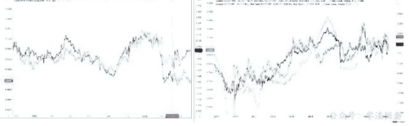
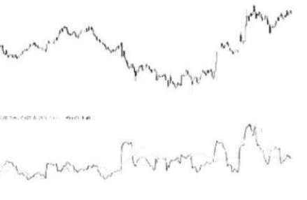

# 从欧洲行的“天平”看美元汇率

答案

20250608金融炼妖师

来自位V+用户的提问，都涉及美元汇率的问题，就综合在一起回答。

以下内容仅V+ 会员可见

自关税政策实施以来，我们注意到欧洲与美国之间的利率差异和汇率出现脱钩现象。随着通胀压力的缓解，欧洲央行（ECB）对经济衰退的担忧加剧，因此不断采取降息措施；与此同时，美国联邦储备系统（FED）则采取了相反的策略，其主要关注的是关税可能引发的二次通胀风险。特别是美国经济数据（如就业和薪资）显示出强劲的韧性，这导致了双方利率差异的持续扩大（欧洲央行降息，而美联储保持利率不变）。

加微信jtsg2 免费资料分享群

理论上，利率差异会驱动资本按照效益原则流动，进而影响汇率变动。

然而，这一理论仅在没有其他因素或成本影响的情况下成立。但在关税政策实施后，“其他”成本的增加导致资本在欧美利率差异扩大的情况下，大量资本回流到欧区。

最近，欧洲中央银行总裁拉加德的讲话证实了这一点：自四月关税问题爆发以来，欧区确实吸引了更多的外来投资。当然，作为官员，她自然会反映了投资者对欧州经济前景的信心。

拉加德希望看到欧元能够重新在欧债危机后兴起，甚至是欧元能否进一步扩大其在全球的储备地位，所以她相当希望欧元是因为大家对于欧洲前景和信心的因素带来的升值，但你可能不会认为这是因为欧洲经济增长更为强劲，或者欧洲的利率更具吸引力吧。

那，真实情况是什么？我是认为用短期“避险”来描述更为贴切。传统的全球避险策略是投资于美元资产，然而关税政策和美国信用评级的下调对美元资产的信用产生了影响。结果大西洋两岸资本流向的逆转向，资金的避险行为反而反转向避开美元资产，导致大部分资金转向欧洲和瑞士等地。

地。这导致了欧洲货币的升值，尽管如此，欧洲中央银行（ECB）仍在不断降息。如果这不是“短期”避险，真的是长期的资本的再调整（所谓的离开美元），投身欧洲，那美国原本的“成本”就会转移到欧元身上——受资本流入推动债务可以扩张的同时，而得承担汇率长期被高的“成本”，低利率债务和军事高估，这种角色的好处是明显的，但是也会伴随巨大的痛苦；而当前欧元的升值会对欧洲区增长形成明显的“缩”的风险，美元的相对贬值则会对美国的增长和通胀预期形成明显的“胀”的风险；同时原本就疲软的欧洲经济，再加上这样的汇率变动（欧元升值）又进一步地加剧了欧洲经济的压力和物价下行的压力，估计欧洲央行还要下降经济增长和通胀预期。这时候的强势欧元对欧洲来说可能来得不是时候，连拉加德自己都说“资本能持续流在欧洲的前景存在着巨大的不确定性”。欧洲肯定不希望出现它的瑞士那样的结局，瑞士央行不得面对通胀和利率重新接近负值，但是瑞士为了避港而不断升值（过去五年升值了20%），我们可能还得不得不采取措施来对抗长期且具有破坏性的瑞士法郎的走强：瑞欧强势上涨将瑞士重新拉入通货紧缩的旋涡，瑞士央行将再次竭尽全力摆脱这一困境，并可能引发全球新轮资金流动（用尽自己能够的力量驱动资金离开避风港），当然自己能够做到，这一点欧洲央行应该也进入了临界点了。

欧洲央行自己能做的选择应该是尽快传递放缓进一步降息的预期来阻止欧美差的进一步扩大，拖缓欧元升值的步骤，虽然经济和通胀依旧有风险，但是上述的这种循环必须在某一环切断。

所以可不是很多人拍脑子想的：“欧洲降息结束了，那下一步是美国了”，这看起来在未来3-6月的概率都是小的；利率期限暗示欧洲央行的存款利率2%的情况下，到九月份美国利率可能仍保持不变。

这周我们看到了加扣开始行动了，虽然再次的降息，但是更为重要的是加扣之之后的讲话内容，其中谈到了：“今天的降息，在当前的利率水平上，我们相信我们处于一个良好的位置”，这意味着欧洲央行的降息结束了，做了第一步阻止欧美差的进一步扩大：

加微信int52，免费进资分享群

除面临更大的经济衰退和通缩风险，否则欧洲央行可能会选择保持观望。
这种表述实际上提供了很大的灵活性。
根据我对西方各国央行多年来的言辞解读，这通常意味着在大多数情况下，我可能会选择“以不变万变”。
本周拉加德和欧洲央行的举措实际上直接回应了天平两端的考量：大西洋彼岸的资金流入，我们应该是为资金流入而高兴，还是担心流入过快导致货币升值而破坏了平衡？显然，欧洲央行的态度开始略微倾向于后者。

美国和欧盟的双边谈判将在7月的期限来取得怎样的结果，目前仍是未知的。如果双方的谈判有一个很好的平衡点，那欧洲或许能够找回这样的天平，大西洋两边的资金可以避免过于单边的流动，这样也会缓解欧洲央行对于货币升值的担忧：

现在美国市场从关税的高波动回归表现良好，其实就是缺谈判落地，这就可以打消美资本的担忧；

加微信int5，免费资料资料

虽然很多投机者还在极度看涨欧元，但是一些对冲基金看到了卖出欧元的机会，如果美国这一侧从信用风险推动收益率上行转为FED担心的二次通胀的担忧明显的话，那么欧洲央行现在的态度意味着利差依然会被美债拉动进一步扩大，这将对欧元的进一步上涨产生巨大且增长的抑制作用：

如果欧元美元的波动能够进一步下降，这些条件都适合有利于欧元空头的利差交易，那些做空欧元获得利率回报的人将在汇率波动风险下降之下获得更高的回报。

# 免费 价值 及时 专注

# 扫码加入 知识星球TOP 免费资源群

- 每日免费获取价值资源
- 可提供各类资源搜索服务

| 热门付费文章 | 各行行业报告 |
| 精选图书资源 | 副业赚钱方法 |
| 职场实用资源 | AI政经自媒体 |

公众号：知识星球TOP | 微信号：jntsg8 | 微信信号：jntsg2

分享资料仅供个人学习，请及时删除，切勿商用传递
