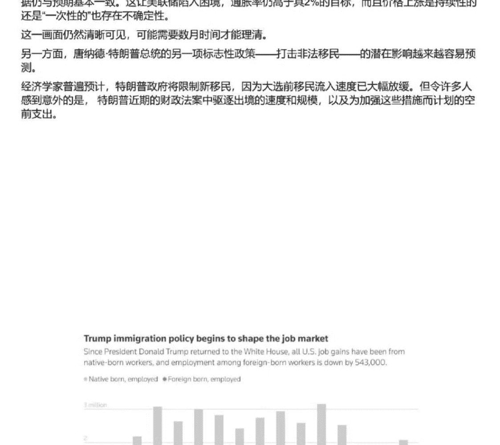
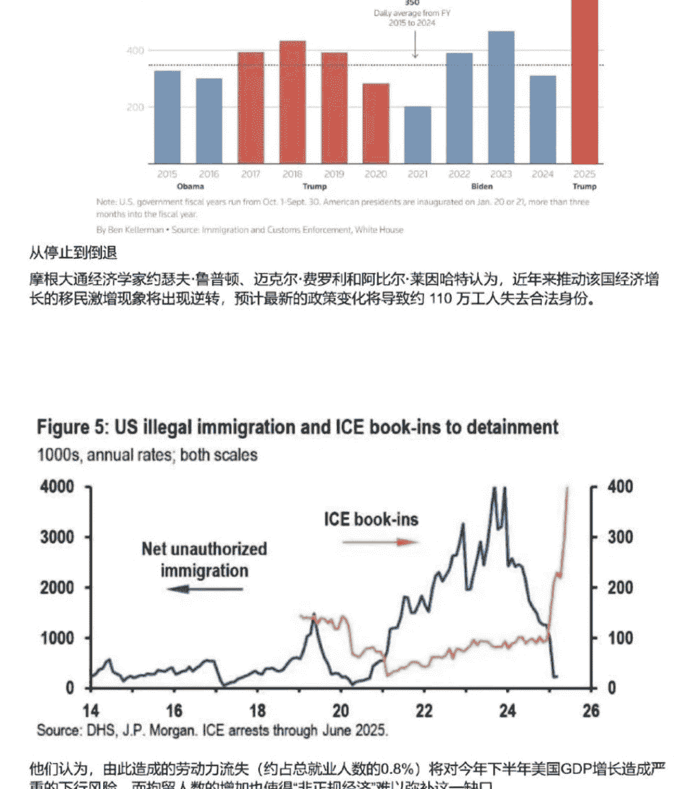
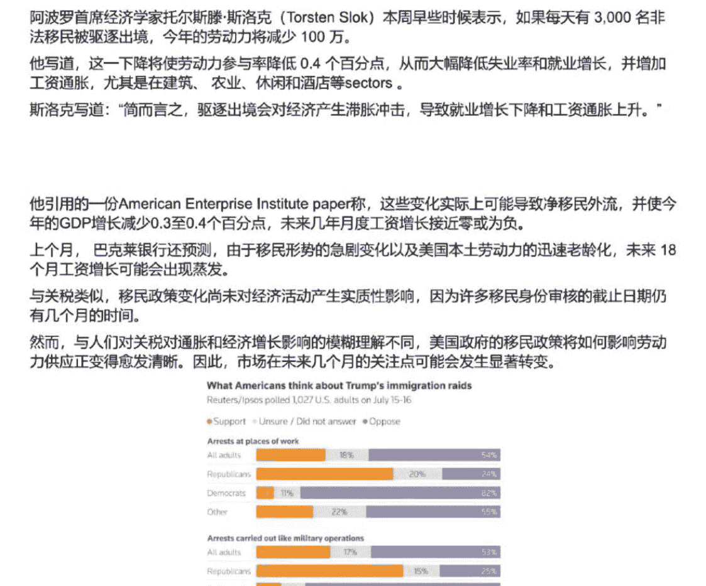
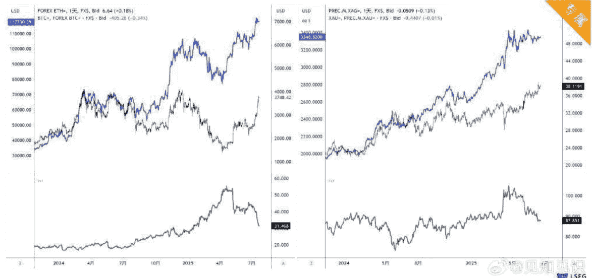
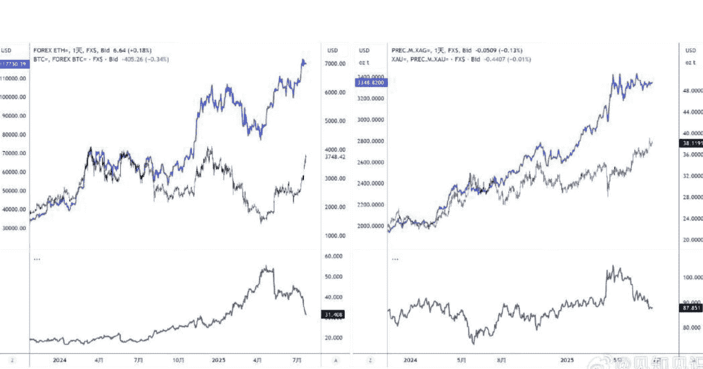

# 微正文

IVTA的V+会员可见

见闻财经
25-7-21 10:23 发布于上海

# 【V+】美国移民对美国劳动力市场的影响

## 政策的调整引起市场关注

7月7日（周一）以来，一系列美国移民政策调整将市场推入一个动荡期。市场表现出巨大的波动，投资者正密切关注移民对美国劳动力市场的影响。

移民政策的变动引起了市场关注。分析人士认为，投资者正在评估这些政策对长期增长的影响。

本报告将探讨特朗普的移民政策对美国新劳动力以及美国人的影响。此文将分析移民政策对72.0万名新劳动力的影响，以及1999年以来一系列移民政策如何影响34.8万至521.0万名移民的就业情况。

## Daily arrests are more than double

Daily arrests are more than double Trump

Figure 2: Employment Index, Feb 2020-103

从长期，由于移民（尤其是劳动力人口）的减少，今年下半年GDP增长率可能低于预期。分析人士认为，特朗普的移民政策可能会限制劳动力进入，从而减少就业机会。

奥斯汀大学经济学家鲍斯克指出，特朗普的移民政策可能会减少劳动力供给。预计未来几年移民数量的变化将导致美国经济减少110万个劳动力岗位。

他指出，尽管在过去的一年里，我们看到移民数量有所减少，但如果这种趋势持续，美国劳动力市场将面临更加紧张。

# 微博正文

仅限TA的V+会员可见

见见识 25-7-21 10:22 发布于 上海

[V+微博] 左图比特币与以太坊关系，右侧金银，一个数字时代，一个实物时代，从五月份开始都在修正下方的两者之间的比较关系，这意味着一种风险偏好的扩散；

$ 以太坊美元 3771.47 ·+0.39%

# 评论

lileo_lee 粉丝粉

龙二补涨，行情尾声
7-21 13:02 来自自阿联酌

