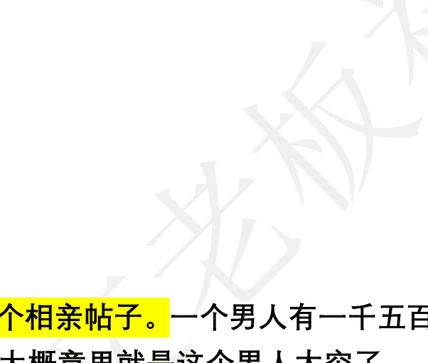
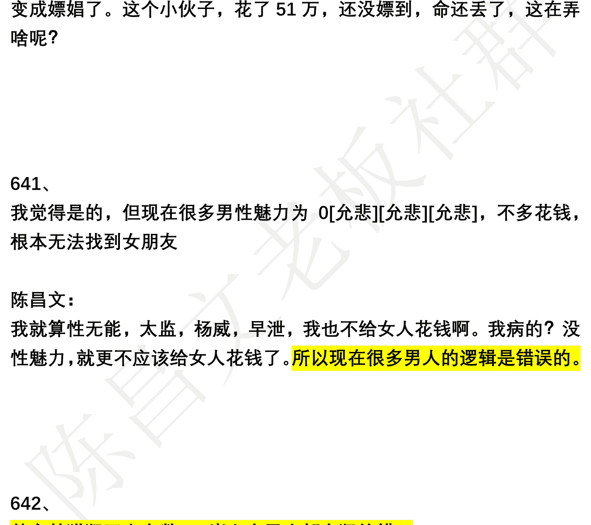
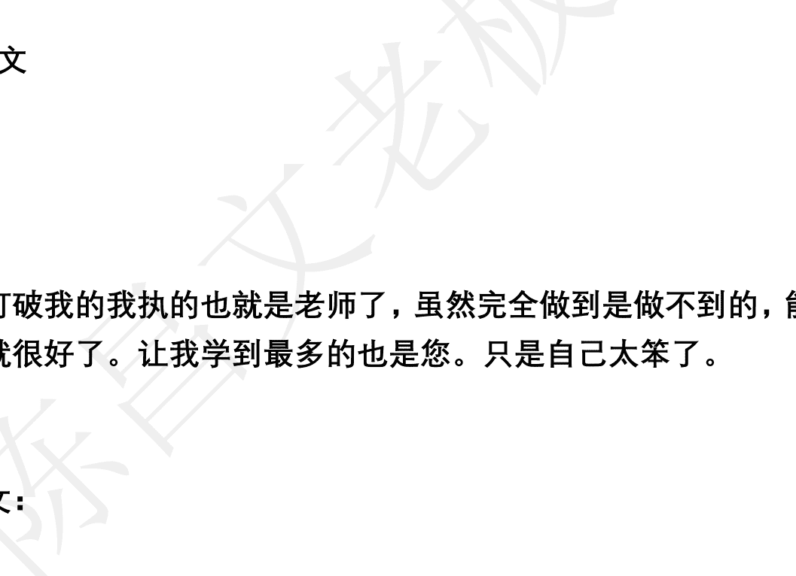
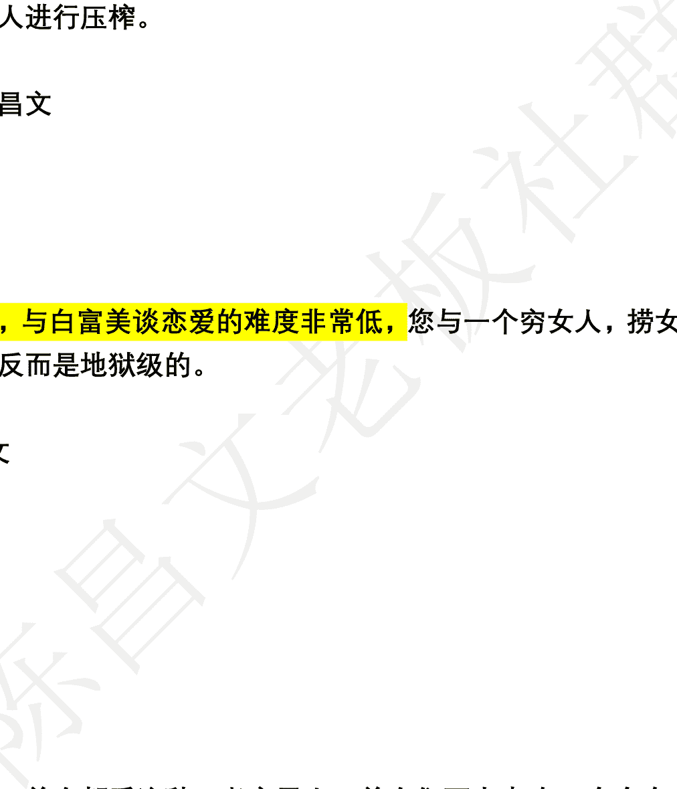
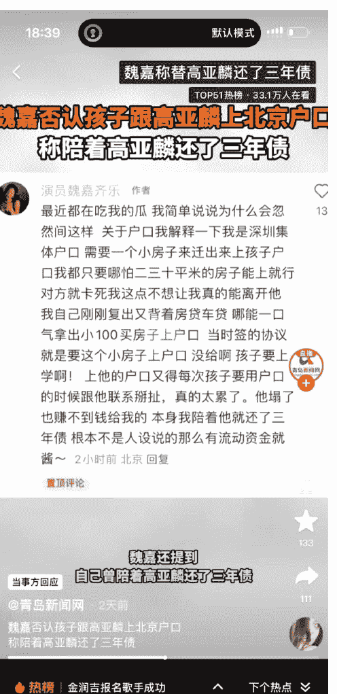
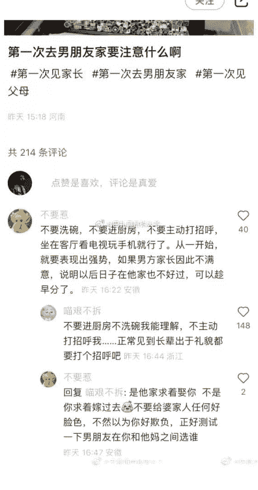

# 【试读版】陈昌文顶级男性情感

题记：

我要开发顶级男人情感，做一个顶级男人，顶级男人，应该拥有感情自由，而不是买女人的肉体，买实情感，应该是有一个健康的感情思想、观点、思维，坚决不搞交易情感。所有顶级的男人，都需要陈昌文的情感思维，保护航，这样，就可以远离婊女。

——陈昌文

顶级男性、企业家必读：

- 1.
男女情感这个领域，涨粉快。男女人的认知矛盾非常深刻，很多顶级的男人，都娶了一个不怎么样的样的女人。

这里有很多杀猪盘，所以，这个地方，有利，有流量，有变现。很多人希望变成男的被宰杀，而不准说您说，您说，他就说这是男女矛盾，任何事，都是对立，统一的。就是矛盾，对立与统一，这里有流量。

我会持续讲课，1号我会讲顶级男人智慧，顶级男人与顶级女性的智慧，顶级男人与低级男人的区别。

——陈昌文

# 免费 价值 及时 专注

# 扫码加入 知识星球TOP 免费资源群

- 每日免费获取有价值资源
- 可提供各类资源搜索服务

| 热门付费文章 | 各行行业报告 |
| :--- | :--- |
| 精选图书资源 | 副业赚钱方法 |
| 职场实用资源 | AI政经自媒体 |

公众号:知识星球TOP 微信号:jntsg8 微信号:jntsg2

分享资料仅供个人学习，请及时删除，切勿商用传播

# 2、

情感这个市场，其实就是低级的女人，想奴有财富的男人的模型。

与，顶级男人不愿意奴奴的模型。然后是，低级的女人，通过起论，不断的坑害大冤钟的模型。

当然，男女对调一样。不过，社会上优秀的，有钱的，大多数是男人，所以，一般也对调不开。

——陈昌文

# 3、

是否拥有独立意识和性格去穷最佳答案，取决于人们的个性，但你可以营造一种氛围，鼓励他们他们遇到观点的第一反应是去问：“这是真的吗？”

陈昌文：

男人主要是认为是女人可以作闹。这会导致女人进入到无逻辑状态，而商业，事业，家庭，所有的人，事物,

本质上都在逻辑中，一旦男人，赚钱的男人，有团队，有组织，企业，有社群的男人，也进入到无逻辑状态，则开始进入到破坏状态，也就是，女人的每一次无论不论大小，都在让男人进入破坏序列。

## 顶级的男人，根本不追求女人，也不会好好表现啊，也不会去把女人哄开心。这些都是底层人的思路。

底层男人之所以会有这个思路，是愚论，女人，以及低智力文学，电视剧，电影迎化，这种模型，会让底层男人获得巨大的亏，也会让一些不聪明的男人，获得巨大的亏，一些暴发户，创业者，也会获得巨大的亏，人这玩意是不可能哄开心的。

再说，哄开心，是因为一个人有巨大的经济价值，商业价值，我们为了让他更聪明，更顺心，多赚些的钱，在这个过程中，我们有更大的利益我们才哄。哄一个跌价资产，用所有的精力，这不是脑子有问题？这属于精力投资失败。

-陈昌文

## 顶级的，聪明的男人，根本不加自己的精力成本，去哄女人。

——陈昌文

# 是不会满意的，无论您怎么哄他，就算他现在满意了，过一段时间，又不满意了。

人的欲望是无限的，有了小房子，要大房子，要大楼层，要大别墅，还要庄园，最后还要城堡。城堡上面还有，我就不说了。

每个人都想当公主，当女王，当太老君，您说怎么样？一个男人进入哄女人的行列。这个男人，基本上事业就算到头了。

-陈昌文

# 越越找一个女人，他就越找卧室，好了，您本来是个顶级创业者，现在您遇到一个不讲逻辑，兜妄的人，您的事业，人生不产，准破产？

女人会忽悠怨，女人就这样，其实不是，有很多逻辑清晰的好女人，找女人，比事业更重要。一定要筛选，不合格的，立刻清理掉，避免他们联系自己。

——陈昌文

# 男人找女人，目的是搞事业，并不是找一个女人实现价值。这是低级男人的思路。

-陈昌文

# 痛苦的本质是教学，是教育，是学费，每一个痛苦，都是学习的点。

-陈昌文

# 10、

我们天生想要进化，我们所追求的其他东西美好如此，却不能维持我们的快乐，这一认识帮助我专注于我的目标：不断进化，为整体进化质贡献绵薄的力量。虽然我们不喜欢痛苦，但自然的一切创造都有目的的，所以自让们痛苦是否是有意的。那么意图是什么？痛苦让我们警醒，帮助我们进步。

# 陈昌文：

我要的是内容，不断的释放顶级的男性情感，女性情感内容，内容，轰炸抖音，轰市抖音，实际上，只有顶级的内容才有价值，内容，才能让市场上的人知道。

其实，感情的本质是经济学。感情其实完全的经济学，人性奔，商业交易。感情领域的一切谎，都是违背了经济学，规则，没有契约。感情领域，是杀猪盘最多的。

# 1、

很多男人非愚蠢，自己本来听奉事的，娶一个活动该恋爱，现在一些男人被割成了听的话是美德，听谁的，反过来，就是倒霉，皇帝，是要破产的。

陈昌文老叔企业文化：分、诚信、正直、团队、消费者导向、糟糕的诚实！！

# 12、

人的愚蠢，是导致婚姻的核心，男人审视女人，不理解女人，不知道女人是什么，以及理解强弱，权利，成本，是倒霉的原因。男女关系，是顶级合作关系，不得不合作关系，必须是深度的研究。而不是随随便合作了。

# 13、

男女爱的本质。

- 1、保存自己的经济实力。不断的给对方送钱，违背了原则，也违背了平和，质是愚味的。
- 2、让女人为自己赚钱。老婆不是消费，而是为了自己，为家庭，财富，不能为自己立刻，马上增加财富的，清理掉，拉黑。

# 14、

人的核心的，保证自己的实力，不断的流量，做变现。

——陈昌文

# 15、

经济工作，思想工作，双管齐下才能形成最大的赚钱机器，品牌，手段，以及团队，多方面结合。所以，我需要各种样的人才围绕我工作。

——陈昌文

# 16、

在恋爱中，男人没有主动权，这个恋爱必须放弃。顶级男人谈恋爱，只谈完全的主权的恋爱。女人给自己负担的，一律放弃。

——陈昌文

# 17、

恋爱中，发现对方愚蠢，穷，增加自己的成本，没有逻辑，作闹，一律拉黑处理。男人的恋爱，本质是要多找好女人，避免劣质的人靠近自己。

陈昌文老板企业文化：分、诚信、正直、团队、消费者导向、糟糕的诚实！！

# 18、

恋爱必须是有把握的，恋爱必须能控股的，不能给自己损失的，一旦带来损失，就应该立刻抛弃。所谓的女人，就是考试自己的损耗，男人主动去放血，相当于解除兵权，地，自古以来，都没有好场。

-陈昌文

# 19、

顶级男人有3个恋爱层次。

- 1、对于喜欢陈昌文观点的，立刻刻离回家。
- 2、对于赞成，又不赞成的，通过思想工作，也可以回家。
- 3、对于坚决反对陈昌文的，则相机利用之。好女孩别寡负，坏女孩别浪费。哈哈。

-陈昌文

# 20、

人类社会，本质是拳头的力量。本质上是武力，体现为智力，经济能力，物质能力。在我们这个社会，体现的是钱，有房子，车子，钞票，您说算了，没有这个东西，别人就不信你任何。

这玩意，在男女恋爱中，也是这个逻辑。人类社会，只有强弱，秩序，等级，阶级，一切的作闹，都是小资产阶级的情调，是愚蠢的，是傻逼的。哈哈。

——昌文

## 21、男女情感关系

- 1、是物质力量的对比，不在这个物质范围里的，我们认为不是门当户对，应该拆掉。
- 2、双方指挥艺术，双方的思想，是双方读了多少书，精神世界，思想世界，哲学世界的对比。
- 3、男女之间要真直幸福，只能将遇良才，慎遇对手才会幸福。一个低级的男人，娶一个低级的女人，当一辈子毒狗莉菜太模型，是不可能的。一个高级的男人，必定是要带领女性的。一个高级的女人也愿意被强悍的男人带领，所谓话，秩序，以及阶级，强弱，就是这个等级范围内的。

——昌文

# 22、定自己能搞定的事情，自己搞不定的事情，不要搞定。恋爱中，对待女人，这个女人听自己的，收纳，不听自己的，抛弃，避免耍弄一个不听话的人在自己的企业，团队，人生中搞破坏

昌文老叔复社群企业文化：本分、诚信、正、团队、消费者导向、残酷的事实!!!

# 很多男人的不幸，就是弄了一个听话的，娇横的女人，没什么本事，骑在自己的头上。

陈昌文

# 23、在亲密关系中，操纵者常常自己会改变，通过制造虚无希望布，这是施行灯笼的关键。

陈昌文：供养者被操控。喜欢好人的被操控，恶人，坏人，制造希望。

# 24、美貌与健康是有一定的关系。这个主体对我们的没有直接贡献，但它影响他人产生间接贡献。尽管这个点的纯粹是间接的，对男子也是如此。美貌本质上就是价值，这个价值是可以换钱的，与高级的人，就能换钱。

# 25、向上社交的本质是找到傻富人，智力低下的人，吃掉他们的资源，这就是向上社交的核心。情绪价值，本质是诈骗，富人。

# 26、跟穷人的倒霉之处是，穷人的时间平等了，您变得不值了。穷人会试探您的底，他没有筹码，您有筹码，怎么博弈都是输。所以人和之间相处的模式是利益流动，金钱流动，杜绝跟人谈感情，没价值，只有的。实际上向上社交的本质是坑傻人。

# 27、与愚蠢女人恋爱，是敌人恋爱，想想后果吧。有财富的富人，要远离愚蠢女人，不可爱，他们是敌人，威胁，敲诈勒索，让您阶级，远离愚蠢女人，情绪化的女人，社会上很多女人都不值得谈恋爱，他们是男人的灾难。分不清二者。

陈昌文老板企业文化：分、正直、团队、消费者导向、糟糕的诚实！！

# 28、考核员工数量，必然会导致盲目找信人。我认为应该增加长效指标：培养的客户产生了多少？引导业务更注重客户的质量。设定上要复杂很多。呵呵，我记得以前为了找一个好指标要花几年。

## 29、我与穷人交往的这些年带来了什么？

- 1、精神损失。
- 2、生命损失。
- 3、前途损失。
- 4、金钱损失。
- 5、生命前途威胁。
- 6、鱼死网破。
- 7、穷人会撕力竭地控制了自己的情绪，暴跳如雷。
- 8、穷人智力低下，搞清楚好坏。
- 9、穷人胡里蜜塞，胡说八道。

而且，有些穷人逼逼赖赖的，不断的话。负债穷人，更可怕，都是骗术。我与穷人交往的这些年，带来的都是霉运，灾难，损失。所以我必须远离穷人了。而且，我是一个非常牛逼的，有资产的人，也有团队，事业，所以我必须这样做了。否则，给带来的霉运太大。

# 30、我不喜欢错误的言论，我只喜欢具有深度的言论，正确的言论。每一个人的认知不一样，所以，人类世界是以认知划分阶层的。认知决定了您交往什么样的朋友，被什么的人接纳，你床上睡的是什么人？也是您的认知决定的。

——陈昌文

昌文老彼社群企业文化：分、诚信、正直、团队、消费者导向、糟糕的诚实！！

# 如果我们知道对方对是一个恶人，我们就应该让他彻底离开我们的世界，如果做不到这一点，我们就会破产。

-陈昌文

# 在社会真的非常奇怪，一些又老又丑，有穷，没有什么本事的女人，都要嫁给年收入 500 万以上的，还有自己的一套套理论。哈哈。

——陈昌文

# 善良人的，总是容易在感情中相信一个骗子，就是这个骗子骗了您，他说几句好话，你你就上了。我们知道这个个人是个骗子后，我们就不要相信，不要给这个骗子机会机会。

——陈昌文

# 如何办？

- 1、找门户的，这样对，要很多钱，因为自己有，感情。
- 2、找门户的，对方就要钱，而且经常说，您觉得是用钱买服务，而在买到的服务，还不如。
- 3、高级的人谈恋爱，就要给她，因为本质上她占了物质，便宜。对一般人来说，金钱是不够。
- 4、不能做到门户对，一般都不幸福。对富人来说，是降低幸福。

# 与穷人说话，浪费生命，不需要交流，因为语言是蠢的，穷穷的，都是浪费的。

# 爱慕女人的本质，太少了。

- 1、爱慕女人的本质，扩大自己的圈层。
- 2、爱慕女人的本质，层太小，没有努力扩张圈层。
- 3、爱慕女人的本质，是因为懒惰，见识太少，导致的。
- 4、爱慕女人的本质，是懒惰导致的。

# 在人生中，被骗钱，本质上都是不愿意扩张圈层，让机会。所有的被女钱的男人，本质上都是老实，为了忠诚，负责。其实人性的懒惰。

昌文老板企业文化：分、诚信、正直、团队、消费者导向、糟糕的诚实！！！

# 39、

- 1、别人不想理您。
- 2、您没有任何价值。
- 3、有伤害，您在伤害别人。
- 4、不给别人价值，还想让别人热情的对待您？自私自利，毫无价值的垃圾，还要热情？
- 5、人是有心理资源的。别人凭什么分配时间，情绪？
- 6、有些垃圾就是习惯了。其实没什么价值，本事。真正的人，是父母有钱，资源充足，也是价值交换，也是买来的。您父母家族，资源通，您不是，就是普通人。
- 7、说明冷暴力的，一律定义为智力低。

陈昌文老板企业文化：分、价值、诚、正、团队、消费者导向、糟糕的实话！！

# 41、婚恋市场上，大家都在疯狂提升自己的成本，而自己却是个垃圾，想兜售给傻道，大宽种，这才是当今社会单身胜女多的核心原因。每个人都在要求别人是明星，自己却是个垃圾，所有的人都不妥协，所以在这个市场上，做供养者的，一律定义为优劣。

-陈昌文

# 42、婚恋市场是个恶劣的市场，所以退出的人非常多。因为其实都是普通人，说白了就是几乎都是垃圾，优秀的人高级。大家都在按照网红，企业，大型女主角，以及明星的要求，要求另一半，所以这个市场非常恶劣。大多数都是恶劣的人，也想找高出自己几十倍以上的人。都想在婚恋市场上中彩票，而且必须是头等奖。生活中就是垃圾们，什么都没有，但在婚恋市场上可以要价与明星，成功人士一样。很多人都想在婚恋市场上直接跨越几个阶级，很多人都想让为自己的恶，无能，却买单。在这个市场上，单纯的人，老实人，靠谱的人，都会被割杀。这是现在婚恋市场的恶毒之处。

-陈昌文

昌文老板企业文化：本分、诚信、正直、团队、消费者导向、糟糕的诚！！

# 43、自己身份高，牛逼，别给普通人靠近。牛逼的男人，就别去让普通女人靠近，否则给自己带来巨大的灾难。

-陈昌文

# 44、老年产业，只有最有价值的。为了金钱，是男人的，感情能发展。其他的，是金钱，的。的，的，的，的的的的的的的的的的的的的。

昌文老板企业文化：分、诚信、正直、团队、消费者导向、糟糕的诚实！！！

# 45、顶级男性情感智慧。陈昌文顶级男性情感智慧。

# 46、没有钱。

-陈昌文

## 47、不追求，浪费的。

-陈昌文

# 48、不追求，浪费钱。

-陈昌文

## 49、不追求，浪费的。

-陈昌文

## 50、不追求，浪费的。

-陈昌文

## 51、不追求，被骗的。

-陈昌文

# 52、你与一个弱者交往，您被抢劫了。

# 53、

人的交往，需要完全的对等，但凡是不对等的交往，说话，交流，都是被无形的抢劫，与自己的事业无关的人，都是被抢劫的对象。

-陈昌文

# 54、

有人说，您必须给他房子子加名字，他才有安全感，本质上啊，就是想用一个莫须有的：“安全感”，直接抢劫，pua，压榨您一辈的财富。

——陈昌文

# 55、

我们在一线城市买房子的人都知道，这里的房子，动不动，就几百、千万、甚至几十的。很多房子，都需要半世的奋斗，但因为一个安全感，就直接让渡给对方一半。有些人几代的心血，就因为智力不足，让渡给对方一半，然后立刻离婚，对你就富了。您代人的心血就没了了。这就是智力，欺诈，歇勃勃。人生有很多这样的欲，朋友，人际关系，社会上人，以及婚恋，都面对这种pua。

——陈昌文

# 56、

大多数人蠢人，都会被人合法抢劫，诈骗。

-陈昌文

# 57、

可以说说，大多数做企业的，老实人，以及靠谱的人，以及不知道社会恶人的，都都会被抢劫财富。

-陈昌文

# 58、

很多人婚恋是这样提要求的。

- 1、个子要高。（比如 175 以上）
- 2、有房有车。（是城市里的富人。）
- 3、要有有趣的灵魂。（读书多，满足他的情绪价值。）
- 4、颜值过得去（其实是非常帅，或者美）
- 5、父母有退休（不想有任何养老压力。）
- 6、对他专一，忠诚。（所有资源，他一个人享受）
- 7、年轻。

# 58、要本地最好的。（不想受风俗）。

# 59、还有更搞笑的（要求月薪8000+）

更搞笑的是，这是大多数人，一个人提出的要求。看到没有，这些条件，其实都是自相矛盾的。哈哈哈哈，他的思路只能月薪 8000，哈哈哈哈。然后，满足其他那些点。哈哈哈哈。现在的，在婚恋市场上，都想让带自己跨越几个阶级，但是，都是皇帝的金金罐头，用自己愚蠢的思维去量高几个阶层的人的财务状况+精神状况。这就是大量胜男，神她的思维模型。我说，恋爱本质上筛选，遇到不满意自己的，直接拉黑。

—陈昌文

# 59、

人只有一条路，就是自立自强。

陈昌文：

人的本质，只是靠自己。本质上，骗别人也是靠自己，其实，都是自作自受。骗别人，与自强，是两条路，您选择了一种不好的的方式，您就接受结果。这就是终极游戏。我们说，完全靠自己，自立自强，这种模型，对自己最好。有些人，比如捞女们，认为骗别人来贷钱，好于自己奋斗。这是他们的价值观。

你好，那个底层的小流氓的观点：不爱男人，用男人，骗男人的资源，钱财，精力。其实，顶级的男人，反应过来的男人，都不会被他利用。他只不过就好找大兜备，并教学生自己的信徒，去找大兜备，赚信徒的钱。就是这么个愚蠢的骗游戏，然后通过抖音传播，找同类的游戏。

# 60、

嗯哒，好的男女关系谁都不久准。

陈昌文：

做不到。但可以做到双方利益。但，只要不是实力完全对等，强者都会吃亏。

- 1、更聪明的人，您能学到智慧。
- 2、更有能力的人，您能学到能力。
- 3、强者弱于自己的人没有什么好处。

但，弱者如果也能帮助强者，一起去做大饼，则，双方都有好处。独立自主，又能相互扶持，至少是良性关系。智力不高，能力不强的人，一定欠强者的。所以，聪明人的不要与比自己矮的人交往，是一种亏损。这是一种亏损。

# 61、

老师，晚上文案的话题和您的答复，又说，男女之间其实不是说指望对方精神上引领，每个人都是精神独立，自己学习成长就是。世上也没有真信，来，只是相似的人合来的，最多只能凭心灵有点契契。人与人之间，不管是好还是恶，都是无缘无缘，尽缘散散。人的关系确实难，其男女关系实。有想离开了或者单身未良好，该经历的都经历了，直到

付费 398 进群陈昌文情感社群学习男性情感智慧

# 不再被拖累了。

陈昌文：

如果能找到比自己更害的，还带领自己，显然是燥的。找不到，自己自强也是一条出路。

# 62、榜女的恋爱模型是消耗男人，男人找女人，是找帮衬自己的，而不是找个榜女来消耗自己。我们不是找一个榜女来扶，谈恋爱不是扶贫，无论精神，还是物质。

-陈昌文

# 63、

谈恋爱，不是找一个穷人。来给他花钱。谈恋爱，从来不是找一个索取的人来花钱。这不是谈恋爱，这是养穷。

-陈昌文

# 64、n恋爱，只是势力。

陈昌文：分分、正直、团队、消费者导向、糟糕的诚实！！！

# 64、不是在找一个索取者。现在有很多捞女孩，索取者，通过婚恋诈骗。要小心这样的骗者。

# 65、现在很多人，自己没钱，没能力，就谈恋爱来pua，来创业，来发家。其实是吸血，专门找一个冤种来吸血。

# 66、越穷的人，越pua，越穷的人，越多。总之，他们就是逼逼，莫名其妙的要求，转移您的财富。

# 67、现在有很多婚恋骗子，彩礼骗子，财务骗子，他们都伪装，骗钱。

付费 398 进陈昌文情感社群学习男性情感智慧

# 68、其实很多人都丑，又穷，年纪，还愁，但是这些人，想通过婚恋诈骗钱，现在当冤种的人，都是傻逼。

-陈昌文

# 69、我们主要是高估了，社会上的人基本都是垃圾。

-陈昌文

# 70、现在，很多捞女，只是想捞钱，人非常坏，而且形成骗局，不断的诈骗。

-陈昌文

# 71、穷人的房子，几百万，加名字，所有的财富，分出去了。富人的房子，几千万，几个亿，加名字，也算是很多钱，分出去了。所以，无论穷人，富人，都不应该给对方。这是一种糟糕的文化，pua，习惯，为什么不动，就来吵架，直接骗钱。

-陈昌文

# 72、某些文化。

-陈昌文

# 73、男女关心，没有任何意义。一个女人让一个男人消耗，这就是恶劣的关系。无论男人能力多大，这种思路就是这种。这种思路，进入了负面关系。其实很多人根本就理解不了富豪，一年收入千万的男人有多贵。大多数女人还会想控制这些男人。很多人的思路就是去pua一个富豪，让这些男人满足自己的。这就是爱，这就是女权。

-陈昌文

# 75、就这样，莫名其妙的送一个废物。大多数人都是废物。而给废物送一套房子，是什么操作？现在，越是弱者，的要求越是pua。

-陈昌文

# 76、现在的婚恋关系恶劣在于，穷蛋，弱者，可以pua强者，让他们买房子。但，确实有很多富人狠，会pua穷人，穷人就是灾难。

-陈昌文

# 77、小时候，确实想找女人的，估计主要是电视剧，电影。但是，从未想过在大城市买房子，在农村的时候（拿着电影）。看到电影后，有的男人有游艇，也有豪宅，豪车，也从未想过自己买得起。也没有这个志向，认为这些东西，跟自己没关系。

分、正直、团队、消费者导向、糟糕的诚实！！！

# 78、如此，恋爱，都海誓山盟，非你不娶，非你不嫁，大部分人，过了太久，就换了人。开始的时候，都以为有利可图，过段时间，就是不过如此。过一段时间，就是老娘亏了。哈哈。

-陈昌文

# 79、开始的时候，天啦，我真的找到了男人，好女人。过这段时间，老娘真的是当傻了眼，看着你这么个狗东西。过一段时间，老娘当初就是被你骗了。你个骗子狗，我感情损失。过一段时间，今天有你没我，我没你，我再不干了。哈哈。

-陈昌文

# 80、男女关系，其实一定会陷入到强者洗脑另一方。比如，一个成功的企业家，牛人，当然希望女人完全服从爱自己，但这就是违背人性的。很多人都是委曲求全。一个女人，他也是，竟然完全服从我？是的，男人就会做这种梦，于是女人就装。男人就会被伤了，就会出现性使命都给这个女人的情况。事实上，这是男人的意淫，女人其实有另一套想法。这就是男人贪了。男人会引来祸，给我骗戏。平常，就是理解世界上也是一个女人，有野心，有打算，有毒辣，有快意恩怨，也有两面性。

男人最妥的策略，还是筛选，条例，逻辑，管控。男女之间，本质就是这种这种关系，神仙眷侣，大概在书里，在电视剧里，电影里，意淫里，小说里。真正的强者，不信任任何人。只相信真理。只相信理性，不试探人性，没有非分之想，就是本分。

-陈昌文

# 81、大部分男女关系都是孽缘，都不应该开始，应该结束，否则，就会给好的一带来伤害。

-陈昌文

# 82、在男女关系中，如果您是好的一，就是弱势，可能被割。首先是选对人，不要因为原因就往上面爬，大多数都是灾难。

-陈昌文

# 83、感情，婚恋，都是成本，产出问题。分、正直、团队、消费者导向、糟糕的诚实！！！

# 83、所谓内耗，就是成本太高了。我们不谈。

# 84、恋爱，本质上构建企业的游戏，你弄一个亏损，这是很多男人的模型。一个亏损的人。这种恋爱，本质上是愚蠢，谁承担成本，大概早破产。

-陈昌文

# 85、听话、执行。其实我也只应该讲。女人的主要属性是听话，不听话，直接拉黑。所有人都是，在工作中，执行就行了。不听的。

-陈昌文

# 86、不做空，不借钱，自己不懂的东西。

- 1、有不懂的，不做自己。
- 2、有不懂的，反复自己最明白的东西。无论是女人还是男人，合作者，首先是听话，不听话的，直接拉黑，避免内耗。人的核心特征就是反骨仔。

-陈昌文

# 87、人的核心特征就是反骨仔。如果结婚，能力本来很强，找一个反骨仔，很快就会家破产。很多人的问题是，事业非常强大，找了一个反骨仔，导致事业，气运都衰败。

# 88、男人切记要听话的女人，一旦不听话，毫无价值了。

-陈昌文

# 89、企业家，奋斗，只要向一个女人不听话，就立刻清理掉，拉黑她。不要听他的愚蠢言论。

-陈昌文

# 90、找女人，只找完全听话的，百分百听话的，女人不听话，事业大，家庭大，再多的奋斗都没有意义。一个男人如果找一个不听话的女人，事业很快衰败。不听话的人，都是丧门星，家庭一定破产。这导致。

-陈昌文

# 91、企业家的女人，不听话，事业一定破产。

-陈昌文

# 92、跟女人，其实没有什么好博弈，讲道理的，一个标准，听话。不听话的，都要清理掉。愿单身，也别找杠精内耗自己。

-陈昌文

# 93、女人的唯一标准，就是听话的程度。而且聪明的，就是好女人，否则，一律拉黑。我们发现越穷，越底的女人越杠精，非常愁。遇到一个杠精女人，您的事业就会破产。

-陈昌文

# 94、我不听父母的，因为父母是蠢货，所以我不想跟他们一起吃饭，我不喜欢他们说话，因为他们都是一种误导。听话，是聪明的人。如果您恋爱，找一个女人，他不听您的，您应该拉黑他。如果您做事业，发现这些人不听您的，您应该拉黑他们。清理掉不听话的人。

-陈昌文

# 95、关于老婆。

- 1、富豪男人，只要要听话的老婆。
- 2、女人的第一要素，就是完全百分听话男人的话。
- 3、社会上有大量的女权，以及平等，权利的女人。这些女人，富豪不要让她进入事业体系，家庭体系，破坏事业，破坏气运。
- 4、普通男人本来就是愚患。他们不懂女人的主要属性。
- 5、如果我们不要养一个不听话的女人，就是内耗。
- 6、越劣的女人，越喜欢杠精，以为任性是情趣，其实是对男人财富的掠夺。
- 7、只要女人不听话，杠，就立刻拉黑，让他们流入市场。

-昌昌文

# 96、网络上有很多女王心智的女人，让他们流入市场，交给其他愚蠢的舔狗去浪费自己的人生，浪费事业。聪明的男人会发现，只要跟一个杠精恋爱，自己的事业一定衰败，自己的气运必然下地狱。

-昌昌文

# 97、顶级男人，只筛选女人，发现女人不听话，就要清理掉，避免他们靠近自己。

-陈昌文

# 98、不听话的女人，会不断的内耗自己，并且给自己带来巨大的家庭，事业，气运衰败，身体损伤，精神损失，防止不听话的穷女人靠近自己。昌文老叔社群企业文化：本分、诚信、正直、团队、消费者导向、蜕变的诚实!!!

# 99、低级的女人，都喜欢奴役。

-陈昌文

# 100、一个人的任何决策，都影响人生。比如婚恋，投资，都是因为策略不对，接触人，倒霉。这就是。听话，听话的价值。

-陈昌文

# 101、顶级的男人，从来不听话，因为底层男人没有资源。所以，这种不听话的，非常惨。这种女人，需要不断的奋斗，还要赚钱。这种不听话，都是亏的。

-陈昌文

# 102、顶级的男人是拒绝任何女性的。但，底层男人基本都被割光了。底层男人没有优势，只会被割。态度。

-陈昌文

# 103、彩礼的本质，在当今社会，就是对底层的收割。

-陈昌文

# 104、傍教主，本质是底层人的信仰。傍教主，目的是教其他。顶级的男人，不接受这种割，因为他们脑子清楚。这种不听话的办法。

-陈昌文

# 105、企业家，牛逼的男人，要听话。不听话的，都是亏损的。。不听话的，立刻清理掉，拉黑。避免内耗。

-陈昌文

# 106、不听话的短视频，网论，在男女之间，都是pua男人。让女人听话，掌握权，导致事业衰败，气运衰败。不听话的。

分、正直、团队、消费者导向、糟糕的诚实！！！

# 107、聪明的男人，知道如何筛选女人，愚蠢的男人不知道什么好，只要是个听话就行了。

-陈昌文

# 108、社会，与论，都是在不断的索取。教主们，都是索取男人的财富，并且跟男人讲歪道理。谁是生产者，谁在前，谁更聪明。

-陈昌文

# 109、听话，是要听聪明的人的话。只要这个人，有一点不听话，就应该清理掉。

-陈昌文

# 110、要清理掉任何不听话的人。避免他们参与自己的事业。

-陈昌文

# 111、找女人的时候，只要发现这个女人情绪不稳定，喜欢拉黑，直接拉黑即可，不要教育女人。只要发现女人不听话，就清理掉。不要教育，不解释，不沟通。自己努力做事业，赚钱，不接受任何女人内耗，以及拉黑。

-陈昌文

# 112、选合伙人，选伙伴，做企业，只选听话的。穷人喜欢杠，就内耗。我已经失去了与任何人交流、辩论的兴趣，听话，，滚。

-陈昌文

# 113、号称慢热，本质是pua，与抢劫。男人都不应该接受这种恋爱模型，不应该接受花钱嫖娼的模型。

-陈昌文

昌文老叔社群企业文化：分分、诚信、正直、团队、消费者导向、残酷的实！！！

# 114、男人找女人，做企业，找合伙人，只有一个标准，就是听话。不听话的，一律拉黑，清理。只要自己对自己反对，有反骨，一律清理，不与人讨论。现在社会上充斥大量的垃圾，我们没有精力与这些人探讨什么，自己读书，学习，赚钱，自己就行了。发现对方，喜欢杠精，反骨仔，一律拉黑。自己被这些垃圾拖入内耗。

——陈昌文

# 115、男人找女人，首先就是让女人听话，不听话，就拉黑。避免联系，女人喜欢辩论，讲什么平等的，直接拉黑，不要给这些人机会靠近自己。

——陈昌文

# 116、顶级男人，理解女性的价值是听话，顶级男人理解女性的价值是年轻，漂亮，绝对听话。一个男，必须要一个听话的女人，不听话的，留给其他男人。

——陈昌文

# 117、所有的捞女，比如，胖兮兮这种女人。为什么捞了苏州城，本质上，就是这个。

昌文老叔社群企业文化：本分、诚信、正直、团队、消费者导向、糟糕的诚实！！！

# 男人找了一个内莉女，不听话的，内莉挣掉了了自己的事业以及生命。

顶级男人，必须小心喜欢辩论，讲女权，当女王的女人，直接拉黑他们。

-陈昌文

# 118、

所有顶级的男人，只要听话女，不听话的女人，一律清理掉。避免这些女人与自己讲平等，女王，权利。

-陈昌文

# 119、

没有任何一个顶级的男人，喜欢作饲的女人，因为，这意味着内莉。

很多女人以为为内莉男人，是情趣，只有舔狗与舔赏，才认为这是情趣，明的男人，杜绝任何杠精。

-陈昌文

# 120、

顶级男人，是杜绝杠精女人，枉自己的，因为枉自己，会导致事业，团队，全部崩离析。

-陈昌文

# 121、

你上看去她女子一单身，其实他们都有男朋友的，有的还不止一个。

陈昌文：

现在有很多男人都是愚蠢的。他们以女人来说单身，就是单身，可不可单身，随时随地都可以解决他单身的问题。但是，结婚的时候，要房子子加名，彩礼。实际上，现在结婚，就是接盘侠思维。牛道的男人，准错婚礼。真看透世界，聪明的男人，基本上，对女人会挑万挑。不会再随便找个女人结婚了。对女人没要求，而被女人要求，是男人最大的愚蠢。

# 122、

女人都在疯狂的挑选男人，但有很多责任心，老实，善良的男人，只是服务女人，为女人花钱，加加名，并不挑选女人，这是愚味的。

事业业，牛道的男人，都要学会不断的的筛选女人。不断的挑选女人，避免自己被pua。

> ——陈昌文

# 123、

年轻的男人，基本都不懂女人，基本都会被pua。年级大点，吃亏多了，不的反思，做事业，知道财的不易，才杜绝自己pua，也杜绝任何女人pua自己了。

> ——陈昌文

# 124、

男人找女人，要是是听话、年轻、漂亮。不听话的，内耗自己的，一律拉黑。

男人不应该为性价值，而抛弃很多主权。

-陈昌文

# 125、

很多女性的思维都是pua，都是压榨男人，都是掏钱。这样的女人，不适合嫁给优男，而很多优男男，，实际比较，，没有正确的婚恋认知，所以娶了一个低级的女人。资源错配了。

顶级的男人，首先要找女人的，首先要正确知道，什么是好女人，分辨不出来什么又是好女人，是顶级男人都倒霉的原因。

-陈昌文

# 126、

现在很多富豪，有男人，也搞不懂女人，他们往往仅仅依因为对方是女人，就付出，就教学，就帮助，就娶回家，这是愚味的。

很多顶级男人都没有赛选女人，直接让一个垃圾，嫁给自己，链接导致自己精神，物质内耗，财务，前途，气运受到损失。

-陈昌文

# 127、

聪明男人不上这些女人的当。牛逼的男人的，要是女人都听话，不听话，就流入市场。不关心底女人的想法，不要被被这些多数的卖货挟着，道德伦架。

-陈昌文

# 128、我的思路是这样的。

捞女的我很穷，但您要我，我配得上您一个亿万富翁。

- 1、我很穷，但您要我，我配得上您一个亿万富翁。

- 2、您不了解我的内心（其实富豪们真的没有理解打工的，或者捞女人的内心世界，其实就是一个普通动物的内心，大家都一样。有什么好处的？您没有没有什么诗歌还有，伟大的理论。亿万富翁想要的是经济学，管理，投资，以及更更高的策略。而不是理解您。）

- 3、理解捞女，靠奢，会让让自己变得穷，更穷。因为，相当于亿万富翁们遭遇思维的逻辑。

- 4、遇到捞女，年级，差，没逻辑，没文化，没有成就的女人，对亿万翁来说，是一种巨大的伤害。女人，也会被pua，还会被好。

- 一、亿万翁会觉得气运不好。

- 二、真正的女人由于捞女破坏这些亿万翁的气运，导致真正的好。

# 129、

顶级男人，不被听听。。不不，，，，，，，，，，，，。。。，，，，都是愚蠢的。

聪明的男人，不被好。这些女人，是一种巨大的伤害。大部分人都没有正确的，认知。所以，见捞女，也会被，还会被好。

- 顶级男人。

顶级男性情感。人，只能给愚蠢的男人，或者干脆接盘这些痞的男人。情感，正本清源，让理解顶级男女关系是如何合作的。

-陈昌文

# 130、

情感这个领域，本来就是底层女人信一套，上层女人信一套。本来就是聪明的亿万翁有一套。愚蠢的男人，拆拆，暴发，有一套。大家的思维方式不同。底层女人要权利，要女王，就这么游戏。底层女人带来的，本来就是内耗，祸害，以及。

- 想要控制男人，愚弄男人，彩轨，房子，以及想着当富翁男人都听他们的。这种思想，本来就是倒，非常结婚，恋爱，甚至说一句，见面。这种思维模式，只适合那些俗，太舔脑，这些男人，去服从这些女人，让他当女王，在网络上，叫五。这些都是大部分人的思想。

陈昌文老叔群企业文化：分、诚信、正直、团队、消费者导向、极致的诚实！！！

# 137、

顶级的男人，都不接受一个女人的教育，以及普遍赖赖。因为，顶级的男人，都是创业者，企业家，团队领导者。

很少女人有这个位阶，如果您承认一个女人比您聪明，您大概是非常患愁的。因为智慧源于磨练。

> ——陈昌文

# 138、

现在的婚谈没意思，原因为，对方穷，差，年纪大，什么都没有，还要要求。也就是，现在这个社会，婚成本非常高，完全是货不对板，完全不值得。也是聪明的人，都不买单的。

谁买单，谁优，所以，导致结婚，离婚率非常高。至于，很多人结婚，不仅仅赔钱，还浪费，结婚的成本，比房子高，谁愿意呢？

> ——陈昌文

# 139、

什么样的男人是大种？是在情感中不好。这些人都是捞女的对象。实际上，越是直白的人，越不会骗。因为，越是直白的人，越知道核心利益，保护自己的核心利益，不为。买单。不为索取。

# 140、

顶级的男人，都不与低级的人，面，无论男女，合伙，婚恋。顶级男人，必须强制自制，不要上。

- 顶级男人，不与低级的人，面，廉价的。

- 高级男人，不需要为了性价值，牺牲利益。高级男人，溢价。

-陈昌文

# 141、

智力不足的底层男人，挺倒霉，他们会被洗脑。pua，主要是思想错误，主要是一直被洗脑。变成喜欢人，被洗脑。

-陈昌文

# 142、

底层社会的性价值，都是剥削关系，pua。

# 143、

捞女教主培养的，其实是希望把男人当猪宰杀。钱，他们说这是爱情，其实是诈骗。

-陈昌文

# 144、

顶级的男人，看女人，都看成本。成本高，效益为负。很多捞女的特征，完全没收益，或者一个空气，一个性价值，卖上百万，几个亿。

-陈昌文

# 145、

再努力工作。再努力读书，再努力营销，再努力做企业，做团队，您不懂男女情感，还会被转移财富。身价几个左右，最近被老婆转移了一大半。女人，他养了多年。他的房子，他都回去了。他的财富，被转移了。离开这个女人，心里舒服。现在痛苦的。陈昌文老总社群企业文化：分、诚信、效率、团队、消费者导向、极致真实的！！！

# 146、

亿万富翁，被狗走气运，家产，团队，仅仅是因为恶心的恶心的自己。当上的男人，都是好面子，脸面薄，喜欢对陌生人好的。

-陈昌文

# 147、

一个男人辛辛苦苦花十几年，夺斗几个亿的身价。但，可以被榜女，一次性就转移一大半，还运气大伤。气运衰败，事业衰败。这都是不理解女人，不理解索取的致。

> ——陈昌文

# 148、

顶级男人找女人，只有一条路，强强联合。做事业，与榜女人，都是非常耗时耗力的。我们做一个事业，十年磨一剑，才赚到钱。为什么找女人，这种比做事业更的事情，我们轻易的乱乱？或者随便相。

# 149、

顶级男人。实际上，找女人，是个比做事业更系统，更重要的工程。

> ——陈昌文

149、

现在的人与人之间，大多数都是尔虞我诈。您相信任何别人，就会被宰杀。我们的书籍里，倡导的，基本都是错误的。他们希望你们当肥料。经历社会这么久了，您就会发现，人与人之间，是个利益斗争关系，是人性欺诈。所以，我们基本上都不信任任何，只进行规律性的商业交易了。

> ——陈昌文

# 150、

男女情感，是诈骗发生的灾区。其原因就是，很多人脑子不正常，以为对方是好人。其实，对方不过是对您具有性价值的同性契罢了。

> ——陈昌文

# 151、

底层的女人，又蠢，有不愿意做事，穷。这些人，还想奴奴亿万翁，让富豪听自己的。并且，霍张扬地，遇见这样的傍女，远离。很多许多女都有精神病，索取。并且，要求富豪男听自己的。非常奇怪的思维，由于家庭不断的拯救这些女人，导致这些女人在社会上，遇见。

# 152、

富豪，也要当公主，他们要要这些富豪奢侈自己。富二代还好。他们见识多，玩的花，都是顶级男人，不，，，，，，，，，，，，，，，，，，，，，，被骗的。

-陈昌文

# 153、

男人的错误是以为女人都一样，其实不然，女人可不一样。底层女人，上层女人的思维模型，完全是彻底的，反着的，完全一样的。

> ——陈昌文

# 154、

愚蠢的男人，见到女人就追求，就睡，给自己带来巨大的气运损伤。

-陈昌文

# 155、

男人的问题，是不审视女人，富豪，如果不审视女人，就会在婚赔钱。实际上，在企业经营中，以及恋爱，任何关系中，都是一个成本关系。捞女之所以可恶，是因为不断的增加的经济成本，他又什么价值，就是您被用一种非常廉价的性价值，愁走几百万，几千万，还毁了自己的运气。捞女没有等级观念，强弱观念，顺序观念，您跟捞女接触，捞女只想骗你，以及转移您的财富。

-陈昌文

# 156、

普通男人就不容易，别说普通男人了。即便您有几百万，几千万的。捞女买包包，买衣服，买万万的花，您也招架不住，赚钱是非常困难的。捞女说，他们不普通男人，其实，亿万富翁在中国，数量极少。一般的人根本就不上。

-陈昌文

陈昌文老版社群企业文化：分、诚信、正直、团队、消费者导向、糟糕的诚实！！

# 157、

所以不要相信那些跳跃的、无逻辑的想法，这些在真实的生活和工作中都是成立的。捞女，索取，都是无逻辑。他们以为为他们提供情绪价值。笑死人的。什么叫做情绪价值？您能让业务快乐？低级的快乐？还是高级的快乐？只有低等的人，因为你某些名字被他们所谓的情绪价值。男人其实只有一个需求，然后就要读书，工作，赚钱了。然后就要掏情绪了。您能交流课程。书，还是创业，营销管理？一个人有事他就就不会捞女。顶级的男人，也只能跟顶级的女人，没办法跟低级的捞女相处。这种捞女课程，只是损害低级的女人，想梦，捞富家的女人。

# 158、

顶级的人，都是不断的筛选人，避免一般的人，不行的人，靠近。人是有运势的，一个错误的错会带来巨大的精神，财富，身体损伤，而且对方会跳脚。

陈昌文老铁微信群企业活动：分、诚信、正直、团队、消费者导向、拒绝糟糕的诚实!!!

# 159、

顶级的人，都避免普通人链接自己。

-陈昌文

# 160、

越是底层起来的富豪，越是具有同情心，这种心情，就会给穷女机会，穷人，穷的合伙者机会，会被吃光抹。上层的人，只与社会上层的人交往，就不会被吃干净净。同情别人，就要被人吃干净抹。

-陈昌文

# 161、

自己是富豪，就不应该与穷人交往，更应该供养任何人。社会底层的人，有供养思维，自己发财了，就不要去供养任何人了。任何人都都应该靠自己的能力，自己不要去供养，链接任何人，社交的本。陈昌文老板微信群企业交流：分、诚信、策划、团队、消费者导向、难的实话！！

# 162、

顶级男人，不，，，，，，，，，，，，，，，，，，，被，被，被骗的。

-陈昌文

# 163、

顶级男人，不，不，，，，，，，，，，，，，，，，，，，，，被，被，被，被骗的。

-陈昌文

# 174、

**情感这个领域，低级的情感，高级的情感，各不相相同。**

低级的人，高级的人，也各不相同。低级的女人，索取男人，高级的女人，支撑男人。

顶级的男人，不要索取女，用物质讨好女人的男人，都捉巷。

-陈昌文

# 175、

我经常说，你以为的竞争对手，其实都是过过的怪物，飞沙走石一路。不要理他，你做自己的事情，他会自己消掉，怪物也要赶妖怪的路。

陈昌文：

情感表现，情感表现，男女情感表现，男性情感表现，女性情感表现，

男女情感，本质上人性思维，是利益思维，是经济思维，是合作思维，选择思维，是人生，是一个人的智慧体现，人需要性关系，然后，又不被性关系骗骗。

大家都更好的发展经济，这就是一个良性的关系，否则在这个关系中，要么就是虐机，要么就是做鸭子。

-陈昌文

# 176、

每一个人都能说话，导致，人类中，大部分人都是谎骗物质的，特别是底层的无能，无能男女，都要小小心别谎话，

逼逼的人不社交，因为社交的本质是内耗，是欺骗。

——陈昌文。

# 177、

底层的穷人，即便发达了，也讲情感，自己心里有情感，容易被pua，被人欺骗，上层社会的精英，都是讲规则的，如果你讲情感，他们就会骗骗您。

混社会久的人，大多都是骗子，他们会骗人，相信他们等人找死。只有最顶层的人是真诚的，但，这些人也跟你无关。

-陈昌文

# 178、

人类社会的恐怖之处，是一一般的理解不了的。底层的穷人，就算发达了，也会被吃干净净，是因为，这些人有认知局限性。对人心，对社会，并不理解，混社会久了。

被骗多了，我们理解，社交是内耗，是欺骗，是没有意义的欺骗。慢慢的，我们对这个东西不感兴趣了。底层的人，要学的东西很多。高层的人，要他们懂这个东西。

陈昌文老叔社群企业交流：分、诚信、正直、团队、消费者导向、糟糕的真实！！

付费 398 进阶昌文情感社群学习 昌文男性性情智慧

# 底层的，没有什么法律，因为他们不会考虑这些，他们在这一方面的白痴，高层人的，有法律植入体系。

-昌文

# 179、

悲剧，是跟愚蠢的人接触，跟底层的人接触，人的悲剧，是自己发达了。还跟底层的接触，电视剧，电影，基本都是诈骗思维。

不断的植入许骗思维，到底底层老孩子脑子里。导致这些人变成活生生的韭菜。

-昌文

# 180、

高端男女赚钱能力都很强，是相互扶持的。低端的男女关系，一方压榨另一方，一方的生活过得不好，就抱怨罪一方，就是低端的男女关系，自己无能，就抱怨别人，自己一个人可以穷，

但两个人，就要穷的责任推给别人，并且让另一方提供自己物质，还要换罚。（愚蠢的人才后面这种恋爱模型。）

——昌文

# 181、

通过恋爱模型，索取的人，都是恶人，无论包装的什么样子。一个男昌文老板社群企业文化：分钱、诚信、正直、团队、消费者导向、残酷的实话！！

无论你有多少钱，只要是花钱的恋爱关系，本质上都是嫖娟。只是嫖娟的形式，不一样，其本质逻辑是一模一样的。

—陈昌文

# 182、

通过金钱，让物质的恋爱模型，就是嫖娟，这种模型是畸形的。双方当事人都不会真正的开心的，只是表面的肉欲缠斗。真正的恋爱，情感，是体量对方，一起做大饼，合作。犹如开公司。

你不能找一个不断让你亏损的员工，或者合伙人。这就合伙，构成了亏损，养，供养。恋爱也是这样，你不能找个人来供养，说这是爱情？-陈昌文

# 183、

愚蠢的人，把供养穷人，理解爱情。

# 184、

世界是非常奇怪的，弱者有一套pua逻辑，如果你是一个富豪，陷入这个逻辑，就会福报。-陈昌文

# 185、

不通他人，也不信任别人，愚蠢的人，才跟社会上的陌生人道（其实就是坑的。）。-陈昌文

# 186、

男女关系，本质是个合作关系，基于经济关系，家庭关系，父母，甚至是人缘。不仅有性关系，那么弱者可以通过性关系，直接肉欲这种关系是非常愚蠢，而且是不正常的。所以，顶级的男女关系，根本可能是这种关系，然后就骗，任何优秀的男人，都会逃离这种关系的敲诈。-陈昌文

# 187、

任何人，都不想在关系中吃亏。只有某些男人，愚蠢之极，在这种关系中吃亏一辈子，这种关系，也不可能长久，所以不要换人。-陈昌文

# 188、

捞女教主，本质上都是骗，属于正常的婚恋对象-陈昌文

# 189、

失败的人，总是带来失败，如果一个女人失败就不应该碰他，因为这会带来失败。我们都是大人了，生命短暂，活得更现实，避免自己拖失败。-陈昌文

# 190、

金钱的用途:
- 1、一个人只把金钱投资在自己身上，而不是女人或者其他人身上。
- 2、一个人只应该关注对自己有益的事情，而不是对自己有害的事情如游戏。
- 3、要么读书，要么工作，要么跟着厉害的人。
- 4、努力赚钱，努力工作，学习精神，学习利他思想。不断的积善德。陈昌文老叔慈善企业文化：分、诚信、正直、团队、消费者导、糟糕的诚实！！！

付费 398 进昌文情感社群学习男性性情感

5、一个人如果真如此，他就会越走越好。
6、早睡早起、健身身体，不要睡觉，有执行力。如果您愿意做一个自媒体人，来我领陈昌文录音文档。——陈昌文

社会上，其实有很多老实的男女，但由于不理解人性，不懂人心，被坑了时间，未来，气运。不学习，不打磨的人都会倒霉，越是年纪，越应该学习，大了，很多事情都木已舟了。——陈昌文

咨询客户文案，第一天：
1、人与人之间，只有金钱关系，没有任何关系。
2、所谓的性关系，本质上也是建立在金钱关系上，只是这种关系比较复杂。
3、为妻之道，骗男人钱财，骗人钱财，以及捞女教学的捞女骗大量男人的钱财，这种关系比为妻之道更恶，他们是法律不管的骗犯狗。陈昌文老叔披社群企业文化：分、诚信、正直、团队、消费者导、糟糕的诚实！！！（我们用词激烈的，你们可以改，比如诈骗，诈骗犯，我们可以改成忽悠或者拼音替代zpf。只要我们用词激烈的，你们都可以更改。）

4、为妻之道，是帮助男人赚钱，以及自己跟这个男人合伙赚更多的钱。
5、所有的关系，有的都是帮助对方赚钱。所有的恶劣的人际关系是自己无能后抗对方。不健康的人际关系是对方无能，您与他链接被内耗，然后无能的一方对您道德谴责，我们要避免与这样的人关系。广告：链接陈昌文助理，读书会398元

# 193、

营销的本质是巨大的欲望与冲突。
- 1、女人想要高富师。
- 2、所有的情感女利博，包装的都是富豪、富人、富二代、富一代的故事。
- 3、男人想要白富，男人想要女人听话给自己赚钱，本质都是巨大的欲望，具体的冲突。
- 4、男人要找妈，以及低级的人恶是自己的事业破产。男人找捞女，为了性价比买，其结果是破产以及人生没有质量。
- 5、营销的本质是欲望与冲突，你付费跟着陈昌文做讲师，本质上就是讲陈昌文的文案、冲突与欲望。抖音所有的赚钱的人，本质上

付费 398 元进陈昌文情感社群学习游项目男性情感情智陈昌文男性情感绪都是冲突、与欲望。人性的奢渴，包装课程，就是利润。以上是理解了这个男人才算优秀，理解了现实，被表表面骗的人都不是真正的优秀。陈昌文言论，做视频，直播，留下微信去报名，立刻加陈昌文助理。

# 194、

捞女教主，捞女本质：
- 1、捞女的本质是穷人洗脑。
- 2、让富人参与与权利，给金钱。
- 3、让捞女直接变成了娼媛。
- 4、让富豪供养，变得合理，甚至道德正义。
- 5、捞女的本质就是包装正常女性。
- 6、捞女在破坏正常女性，破坏婆形象。
- 7、捞女的本质是花男人的钱，提供情绪价值。捞女教主的名言是让男人把财转移给自己。这种教主是典型的开机，培养这些女人，大幅度培养很多男人，不断的挣钱。
- 8、愚蠢女人还崇拜捞女教主，简直愚蠢至极。
- 9、顶级男人能分辨出谁是妓女，谁是小妻，很多聪明供。陈昌文老板秘密活动：分、诚信、正义、团队、消费者导、残酷的真相！！

什么样的养者，主要是没见识，学习导致的。如果您不想上当骗，读书会，做感情讲师，或者咨询加陈昌文助理微信。买单的会被删除项目咨询广告。

# 195、

并不代表要降价给您，这是很多可，房子多就会降价卖给自己，或者卖给自己。记住一个定律（凡事儿发生在身上，就是天上掉饼），理解了这个你才能理解世界的经济规律，否则你只能活在意中。——陈昌文

# 196、

不要跟穷人谈恋爱，没价值。很多人脑子都不清晰，都是在索取别人的财务-陈昌文

# 197、

很多人都是险恶的。他与您联系都是倒霉的开始-陈昌文

# 198、

地位、高资源的男人，聪明的男人都非常清楚自己的财富、权利以及智慧，是可以找到年轻漂亮的。越越大越容易求门户，越对年龄、美貌、素质要求高。如果你是一个大佬，你还找捞妹，说明你还需要窍了。越越大越不给捞妹机会，只有暴发户、愚蠢的男人才给捞妹机会-陈昌文

# 199、

很多富豪男人有一个错误的认知，自己找大龄女、穷女、低价值女，这个女人会感恩自己。其实这个女人不会感恩您，反而会认为您配不上他，是因为他自己优秀才给您的，而且因为他太优秀没人配得上，他被糟嫁给您的。而且这些女人会认为是因为自己运气好、牛逼、漂亮、有才有才给一个当婊的机会，他们闹祖宗机。不是神奇，就是这么神奇。现在的婚市场上充斥着大量的大龄女，很多富豪有钱其实想要结婚的对象追求的是一种巨大的差异，并不是什么贤妻母。比如捞妹培训班的那帮祸害。所以，真正顶级的聪明的陈昌文老板微信交流：分、诚信、正战、团队、消费者导、残酷的实实！！

男人，都会不断的审视女人。-陈昌文

# 200、

聪明的男人关心自己，搞钱就行，顶级的男人不给女人花钱，不找捞女，给女人花钱的男人都不是顶级的男人，都是愚蠢的男人。无论他有多少事业-陈昌文

# 201、

传统的婚恋，是男性投入时间、金钱、物质、承诺、房子、车子，用来感性女让女性一辈子跟着自己。但现在人在男人提供了这些，女人可以随时挥诸法律背叛男人。所以在现代社会的法律框架下，男人不能再用传统的方式与女人谈恋爱，否则就是血包，优质男女的恋爱模式变成了一起做大饼。底层男人被剥割是因为他们还在用传统模式与女人谈恋爱，但女人不会履行他们要求的。所以底层男性被剥割。高层聪明的男人不进入这种性别通道。于是出现了大量的情感博主，教学女，顶级男性的套路，他们认为顶级男性会当。现在有很多很有钱的顶级男性会当。陈昌文老彼社群：分、诚信、正直、团队、消费者导、颓的诚！！

有两个问题：
- 1、高等级的男性资源溢出，随便有点。
- 2、高等级的男性情错的，不想找更多女人，随便溢出。
- 3、高等级的男性在等待时机，最终还是要找一起做大饼。高等级的男性被掳，捞教主以及他们的情感，技能是有效的。-陈昌文

# 202、

金钱的：
- 1、高等级的男性资源溢出。
- 2、底层的人的，话话的，全部都是浪费的。
- 3、顶级的人只该，以及积累，以及获得工作。
- 4、底层的人喜欢人情，尊重，这会浪费。顶级的人只该，以及收入，变现，以及工作。底层的人交流，人情，尊重，这会浪费的话。
- 5、底层的人没有力，全部是内耗。
- 6、这种做视频，直播，朋友圈，选。陈昌文。交流：分、诚信、正直、运营、消费者导、诚信！！！

# 203、

底层女人为什么会跑？
- 1、因为他们会不断善良帮助弱者，渡价值，他们没有力，只能吸你的资源。其实他们破坏的，非常善良可爱的。
- 2、上层女人帮扶男人，自己也有钱、有能力、有头脑，做一个生产者。知道赚钱不容易，所以保护好钱，也保护男人的钱。这会浪费，非常善良的。
- 3、女人为什么坏？因为他们用性关系换取物质，不是生产者、消费者。他们用性关系换取了钱后就去消费。甚至他们与多个男人，后换取这种钱去消费。他说创业，是独立女性，所以。

- 4、这种的的，的，都是的。抖音上那个捞女主非常满意，就是这个模型。其实是把妓女互联网化的。-陈昌文

# 204、

顶级的男人只在事实。比如女人的年纪，根本不相信冻龄。理解了这个男人才算优秀，理解了现实，被表表面骗的人都不是真正的优秀。-陈昌文

# 205、

顶级的男人彻底信任真理，而不是以身试炼。-陈昌文

陈昌文老板社群文化：分、诚信、正直、团队、消费者导、残酷的真实！！！

# 206、

经济击穿一切，男女情感本质上就是经济、资源。便宜就是爱，无论是性关系还是美奴、健康还是金钱，便宜就是爱，能占到便宜、变得更好就是爱。妻子的方法是大家一起变好。婆的方法是我索取丈夫提供价值、情绪价值。我不打算离开。旁女是人厌，我索取多个男人，我不嫁给这个男人，不忠诚的不断的索取，并且手段找旁教主学习。旁教主的名言是让男人把财转移给自己，帮旁教主说他的价值观思想最先进，让每一个女人都学旁教主这一套，不断的通过性关系、情绪价值骗谎丝绵不断的好色之。旁教主就是典型的黑寡妇思维，破坏了大量的善男女，旁教主彻底破坏了中国男女关系。——陈昌文

# 207、

现代一代富豪，有些男人给女人花几千万几百万，破坏了自己的气运前途。这些人本来奋斗很努力，但是在女人身上吃亏。答案是，从小到大父母愚，他学到的所有思想都是给女人当韭菜的思想，被女人教育当韭菜被抽血。他们以为自己赚到的财富给女人，女人就会感激。真是，女人不会感激。大部分合作关系，弱者都以为自己付出了力而且应该付出更多。女人关系也如此，一个顶级的人是不与劣者有关的。—陈昌文

# 208、

顶级的男人不让女人增加自己的负担内耗成本。顶级的男人遇到内耗耗自己的女人都是直接拉黑的。只有愚臭味的才找一个内耗己的女人。网络上的情感博主、扬女博主、女利博主，一些女人的舆论都是提高男人的成本增加内耗。然后，逼逼赖的说这些都是巨大的价值。顶级的男人只在。女人的年纪，根本不相信冻龄。理解了这个男人粉丝的的粉丝粉丝的粉丝的粉丝的。-陈昌文

# 与等级，普通男人不理解，即使赚了几千万，几个亿，也会被pua走。

-陈昌文

## 221、顶级男人活在逻辑中，不满足愚蠢的女人pua。

——陈昌文

## 222、顶级的男人，不接受任何没有任何逻辑的女人，不接受任何pua，不接受任何负能量的，不接受任何愚蠢的行为。

一一丝一毫也不接受，因为，一丝一毫其实就代表全部。

-陈昌文

## 223、聪明的男人，不会为了性关系，女人，牺牲掉自己的事业，房子，车，票，以及思维。愚蠢的男人，才会为了女人扭曲自己的思维，逻辑。

-陈昌文

## 224、聪明的男人，维护自己的事业，团队，组织，社群，聪明的男人，维护给给自己自己赚钱的人。

不赚钱的人就滚蛋，更不会为了性关系，女人伤害自己的事业。聪明的男人，根本不接触大龄女。根本不与逻辑清晰的女人有关关系。

-陈昌文

## 225、聪明的男人，顶级的男人，根本不让普通女人对自己说话。因为这会影响自己的命运。

-陈昌文

## 226、有事业，有财富，就要理解别人是垃圾桶，就要理解，别人的阶级，财富，价值，与智力，要理解，别人配不上自己，否则，自己的财富会被pua 走。

所有的教育，奥论，很多都是为了pua，掠取财富的，根本不是为您好。我们学习的大部分理念，都是为了pua您，为了奴役，抽血留。

——陈昌文

## 227、

失败者的每一句，每一个行为，每一个意念都是失败的，千万不要为一个不挣钱的人，负债的人，愚蠢的人，对自己没影响，都有影响的。卑劣的人，方方面面的同类。

——陈昌文

## 228、

高级的人，不接受情绪不稳定的女人。不接受情绪不稳定的男人。高级的人，不与一个杠精在一起，高级的人，只要听话、照做、执行的人。高级的人不与人辩论。

我讲课的时候，发现杠精，以及辩论者，一律让他们滚开。这些都是社会垃圾。说什么多言。大多数都是一种社会垃圾。他们不做事，只会杠精，以及情绪不稳定，顶级的人，有身价的人，务要远离这些人。

否则，自己的事业破产，不教育，不改变，筛选，让不合格的人滚，小心自己的心理资源，让给这些垃圾。

-陈昌文

## 229、白手起家，暴发富有几门学问。

- 1、人性：
- 2、反对收割机，
- 3、反对愚蠢的人。
- 4、反对无逻辑的人。
- 5、营销，赚钱，保护自己，能力圈思维。
- 6、还是大量的阅读，否则自己讲没话水平。

中午我戒色调，内容，戒色项目，大家通知到所有地方，中午，提升大家的戒色实力。这一个月，我自己的实力有了增长，早睡早起、锻炼身体，阅读都在进步，我接下来的，希望陈昌文音团队，以及教师团队，以及涨粉团队，以及全球团队扩张。我要的是，我们的流量扩张。

我要的是，企业文化：本分、平常心这个文化的扩张。

——陈昌文

## 230、世界上，有坑人钱财的女人，他们不宣传男人必须给他们坑钱财，这种理论。

这个世界上，也有帮助男人的女人，这些女人不怎么发声。所以，让社会充满捧女言论。您被捧女洗脑，您就被排。您不愿意被被这些捧女言论洗脑，您就找到好女人。

——陈昌文

## 231、捞女之所以不断的宣传他们给他们花钱，本质上，是一种销售行为，种种草行为，一种低智力洗脑行为，很多傻瓜人都上当。就这么个游戏。

-陈昌文

## 232、牛逼的男人根本不接受捞女，捞教主的言论。傻子才捞女，捞女教主的言论。

当然，市场足够大，总是有傻子，有傻子喜欢妓女花蕊，有傻子喜欢花柳巷，有女奴维护自己的权利。只是，这个捞教主要把所有人都同化成妓女、花蕊、嫖客模型。捞教主，通过互联网、短视频，扩大自己的势能，这就是你伤害了。

妓女、花蕊、嫖客模型。可以在范围内消化，但您通过互联网，包装，让所有人人都这个游戏，就有有些不合适了。

——陈昌文

## 233、捞教主的理想是，教育许多妓女，很多花蕊，让嫖客们前后后继，这样他就可以收很多学费。捞教主，辱骂妻子，小妹这样的角色很优道。捞教主，以及妓女，花蕊们，试图腐蚀所有的妻子，正常的女人，小这样的的女人都去当花蕊，当妓女。

捞教主，也试图腐蚀所有的男人，都变成嫖客。这样，把人都

## 234、妻子、妓女、花魁、嫖客、老鸭子，都是定位。您不能把这些植入所有人的脑海。

## 235、其实，捞教主的本质是，互联网妓女，互联网老鸭子，互联网花魁。这就是本质。腐蚀所有男人，进入嫖客，这都是事业。

-陈昌文

## 236、捞教主的言论：通过性关系，转移男人的财产。并且让一群男人，转移财产。这是什么角色？哈哈哈哈。花魁，变咸。

企业文化：分、诚信、正直、团队、消费者导向、糟糕的诚实！！！

## 237、捞教主，就是欺骗大家，智力低下，哈哈哈哈。主要是欺骗粉丝，以及社会上的智力，不能看透他的本质。实际上，他是妓女教主，腐蚀正常人当这种角色，这就是本质。如果你们知道他的本质了，哪里不对，啊。这就是本质，一个女人，利用互联网，搞社会破坏的典型。

## 238、并不是侮人的词语，妻子，带着财富入家庭，一起奋斗，做大妾。妾是能力差，愿意老实的跟着，自己的财富多少也。但是，老实的跟着，大家一起把家庭维护好。虽然丈夫，但不想弃丈夫，不想转移。妓女就不一样，她们则是按次收费，对男人进行长期转移财产，直接转移男人的财富，但是这些人是有底线的。

## 239、上当受骗的男人，主要是对女人没要求，是个女人就去舔，这种男人智力差，会耍祸自己。

-陈昌文

## 240、无条件的舔女人的男人，基本都是智力差，会破产的。

-陈昌文

## 241、其实男人找女人，比做事业更重要。大部分男人找的女人都不合格。男人太蠢了。不会找女人，让自己的事业，奋斗变得没意义。

——陈昌文

老板企业文化：分、诚信、正直、团队、消费者导向、糟糕的诚实！！！

## 242、明天我讲课，情感领域有很多骗子，人渣，因为这个领域是暴力的。

这就是我在这个领域的价值。

-陈昌文

## 243、是人类最暴利的行业，因为这个领域有很多小白。所以，导致很多人可以通过感情，欺骗。

-陈昌文

## 244、感情，这个领域，要本分人的，要不贪婪别人的身价。金钱的人，要避免自己是小白，被坑诈。

-陈昌文

## 245、这个领域，很多男女都低智力，被另一帮恶人说谎。几千万损失，在企业家这个领域，更是稀松平常。

## 246、很多人是好人，善良人的，没有被社会毒打过。靠自己赚的钱，然后就被情感欺骗了。不信任陌生人，不对陌生人好。这是一个情感强者的基本思路。

-陈昌文

## 247、情感欺骗，本质上是对社会的人没有认知导致的。

-陈昌文

## 248、贪图别人的性价值，或者别人几句好话，因为男女关系，交付核心筹码，都是智力异常的表现。

-陈昌文

## 249、确实会因为别人的性价值，不断的交付自己的核心资产，这都是智力异常，不考虑对方的身份，不考虑对方的事，不考虑对方的团队，长期考核对方，就因为对方的性价值，交付对方的核心资产，因为对方的虚假，交付核心资产，这都是人的。

-陈昌文

## 250、在情感领域，很多男人，都没有经验，被一些搭女，被骗。这种事情经常发生。

-陈昌文

## 251、白手起家，赚到几亿的创业者，一定要防止骗。一个人从穷到富的过程，是经历了，认知不足，学习，越晚越霉。这种对象，没有经验的，这都是人的。

-陈昌文

昌文企业交流：分、诚信、正直、团队、消费者导向、精准的执行！！！

## 252、特别是白手起家的富豪们，有时候，在性价值上，赚钱太容易，被低劣的，所有人都同化成妓女、花蕊、嫖客模型。这就是伤害了。

## 253、没有爱情，只有彩礼，购买一个资源。就变成了这种模式，实际上根本不是婚恋，是购买，是交易，就会生活在灾难中。

## 254、越穷的人，越容易上。当，因为太穷了，所以新资源稀缺，心里。富人不会有心思。

-陈昌文

## 255、婚恋，是最需要识别的游戏。因为这东西最影响命运。男人要理解，不是任何女性都可以培养，结合。婚恋，是更成功的游戏，一定要筛选，很多人，合伙人，朋友，都不知道筛选，对女人，更不知道筛选选女，您的所有事业，家庭，都会毁灭。靠运气男人都是愚蠢的。

-陈昌文

## 256、男人的婚恋，必须非常心硬。富豪，创业者的婚恋，更是要心硬。一些创业者，创业的时候，不知道筛选。结果就是，找到了一个心智模型，财务模型非常差的负资产，与自己结合，直接拖累自己。

-陈昌文

## 257、创业者，牛人的婚姻，必须是彻底的理智，必须残酷的理智，必须尊重真理真相。否则，自己一定被拖累，迅速衰败。

-陈昌文

## 258、恋爱，结婚，实际上是引进一个合伙人，一个生活，事业，后半生的合伙人。不要只因为价值以及就职择餐，不筛选结婚对象，会导致自己迅速破产，迅速跌破阶层，自己的气运会立刻被另一个恶人，坏人吞噬。

——陈昌文

## 259、有产，有身价，有事业的人，有组织，有团队的人，有钱的人，一定要小心自己的对象，交往对象，要清楚你跟谁结合，要清楚谁在说，要清楚对方的智力，性格，是不是可以付诸终身。并不是随便一个婚姻就可以靠近自己，就可以谈谈该领域的朋友。在这个过程中，性价值只是一个比重。性格，人品，智力，事业，财富都要全面考虑。很多男人之所以会倾倒，就是因为眼里只有性价值价值，还被一些低劣的小仙女要求，简直是愚蠢至极。

-陈昌文

## 260、顶尖男人，是不会因为性价值，就卖掉自己的前途，资产，破坏自己的气运的。

——陈昌文

## 262、聪明的男人，都不懂别人的成本，无论是女人，男人，合伙人，以及任何人。只有穷人，被pua的人，才一天到晚承担别人的成本。聪明的男人，也不交往自己的经济成本都承担不了的人。聪明的男人不交往朋友。

-陈昌文

## 263、社会上的很多谬论，媒体，一些弱者，都是为了pua，不断的骗取老实人辛辛苦苦赚的钱，以及这些资源。顶级的男人，就是早睡早起，锻炼身体，努力工作。

-陈昌文

## 264、网络上很多人胡道。说什么男人嫌女人，是因为这个男人也是很穷，还说有钱的男人，不嫌女人，简直是低认知。一个越富有的人，就越不愿意与穷人接触。白手起家，靠自己赚到大钱的男人，越是嫌女人穷。这么说吧，只有刚暴富的，不懂，没有吃过亏，不理解金钱到底什么样的男人，才会接受。

企业文化：分、诚信、正直、团队、消费者导向、糟糕的诚实！！！

## 266、牛逼的人，富豪，不接受任何女人，也不接受陌生人。这本质上是保持自己的逻辑，这都是人的。

## 267、容忍别人，会导致自己的资产下跌，团队，容忍女人，也会导致自己破产，富豪，不能容忍任何愚蠢的人。

-陈昌文

## 268、男女感情的本质是远离穷人，逻辑不对。合作的本质，社交的本质，都是如此。

-陈昌文

## 269、男女感情的本质，防止被剥削。

企业文化：分、诚信、正直、团队、消费者导向、糟糕的诚实！！！

## 270、人生的本质是，杜绝穷人，负债，没逻辑的人靠近自己，杜绝低阶层的人与交流，他们会吸食自己的势能，让自己变得运气不好，会被借运。

-陈昌文

## 271、借运，逻辑不清，其实比借钱直接损失还可怕。

-陈昌文

## 272、网络上很多人胡道。说什么男人嫌女人，是因为这个男人也是很穷，还说有钱的男人，不嫌女人，简直是低认知。一个越富有的人，就越不愿意与穷人接触，无论穷人。一个越是白手起家，靠自己赚到大钱的男人，越是嫌女人穷。

这么说吧，只有刚暴富的，不懂，没有吃过亏，不理解金钱到底什么样的男人，才会接受。

企业交流：分、诚信、战略、团队、消费者导向、精准的执行！！！

## 273、富人不嫌穷女人，很多穷女人就说：“说的对，说的对，说的对，真的对。”大部分女人，不思考问题，只想听自己想听的，不愿意接受真相。人都不愿意与穷人接触，因为会被借走气运。

——陈昌文

## 274、是的，我以前也不懂，觉得对方好善良就可以，少点没事。不知道穷反而会生多病。门户要紧。但最可怕的是无脑，思想贫穷。

陈昌文：
与穷人接触，会被借走一切，气运，命运，运气，全部被借走，财损失都是最小的。主要是人生的气运直接被借走了，而且不会回来的。穷人与您接触，他的运气会变好。但从此以后您的命运就衰了。您的气运，就永恒性的变差了。

## 275、顶级的男人，不给任何人安全感，安全，是输自己的能量给女人。

企业文化：分、诚信、正直、团队、消费者向、糟糕的诚实！！！

完全没有必要，建立起自己的安全感，而不是给任何人这种霉运，顶级的男人，应该彻底的自私自利，不让女人占自己的精神，逻辑便宜。

穷人为为什么穷？

-陈昌文

## 276、大部分男人，亏损的，逻辑亏，这都是亏的。

-陈昌文

付费 399 元进陈昌文情感社群学习男性性情情感智

陈昌文深度男性性情感

## 282、
不要与身份低下的人接触，避免被霉运传染到自己身上，让自己自己降级。其实，每一次的失败，都是与穷人、负载的人接触，不应该与低级的人接触。
——陈昌文

## 283、
顶级的富豪、牛人、创一代，都要学会避免让别人抽血。
——陈昌文

## 284、
大家都见过蜜蜂采花，实际上，很多并不知道。雄性黄蜂其实只是为了交性。他们以为这些花朵是雌性黄蜂的生殖器，于是，他们爬上去，想射精，但实际上，这些花朵不是。

于是，他们就一朵朵地不断寻找，被欺骗了，于是，花朵就得到了利益。为了利益，花朵寻找花粉。也就是，花朵们用这种拟态特征，换成了自己的利益，自己的利益，而黄蜂被利用了。

在男女关系中，也经常发生这种事。不具备备孕能力的女人，会想办法让男人为他们有生殖能力。而繁殖能力差的女性，通过整容以及各种样的打扮，伪装自己非常强大。

所谓身材好、颜值高，本质上，都是伪装自己繁殖能力强大，让雄性对自己感兴趣，从而获得更多的资源。

陈昌文老秘社群企业交流：分值、诚信、战略、团队、消费者导向、蜕丽的事实！！

## 陈昌文顶级男性情操
大自然是一个有趣的地方，是一个性别伪装、盗取资源的游戏，就看谁上当。人类社会自然发展了很多年，所有的科学家、生物学家，以及进化论研究者，都知道这些秘密。

只是，这些秘密没有在人类中大量普及。很多男性、女人、底层，其实都在这种拟态中，莫名其妙地上当受骗，被骗取资源、盗取资源。
——陈昌文

## 285、
富豪要避免社交。富豪要避免普通人跟自己关系，富豪要避免一般的人对自己说话、PUA。

富豪要避免普通人、不请自来的人给自己计策献策。这些人人都没有什么鸟用，一般都会倒霉。富豪要守护自己的精神世界。富豪不要给普通人脸面、面子，否则自己的运势就会越来越差。
——陈昌文

## 286、
多数富豪一代，都会破产，财富不会稳固，其本质是对人、对穷人、对普通人理解不深刻。
——陈昌文

## 287、
成熟的人都不讲感情，这种东西，是植入进来骗人的、PUA人的，以及及人的智力降低的。

其实，我们作为匮乏的人，讲感情，往往是弱者PUA我们。
——陈昌文

## 288、
您会发现，所有讲爱的、讲感情的人，都只是为了骗你。您的经济利益被他们骗走了。

就这么一个游戏。您会发现，比弱的人、穷的人，最喜欢讲感情、爱，他们可以用这个割韭你、压榨你、抽你的血。作为匮乏的角色，要避免任何人讲感情，老老实实的靠自己。
——陈昌文

## 289、
人的优点其实只有一个，就是经济能力。其他能力只是一些筹码，为经济服务。要是不能为经济服务，这个人就没有价值。很多社会上的人，本质上是一种内耗。

大部分失败的人、倒霉的，都是与一个内耗人、一个内耗事情接触。不要接触内耗，穷人的本质就是巨大的内耗。一个不内耗人的人、有效率的人、低成本的人，就是富豪家的命。
——陈昌文

陈昌文老板社群企业文化：分、诚信、正直、团队、消费者导向、糟糕的诚实！！！

付费 398 进陈昌文情感社群学习男性情感智慧

## 290、
一个男人如果不懂女人、社会，他花十年赚到几千万，就可以被一个错误的女人直接被骗光。

因为他不懂人性，他的钱、财富、努力都是白搞的。
——陈昌文

## 291、
一个男人如果不懂女人、家庭，他花十年赚了几千万，不懂人性，他的财富直接被骗走一半，在社会上经常发生。
——陈昌文

## 292、
社交本质上都是骗局。大多数社交都是被骗。社交是高风险的游戏，甚至是愚蠢的游戏。顶级的人都不社交。
——陈昌文

## 293、
如果你是一个有几千万身价的、靠白手起家的人，一定要理解几乎任何饭局、任何见面都是骗局。

陈昌文老叔社群企业文化：本分、诚信、正直、团队、消费者导向、残酷的诚实！！！

## 294、
您必须理解一件事：遇到不好事情，与低级的人相处都是浪费能量。

## 295、
您必须理解一件事：社会上的见解都是为了骗你。无论男女，社会上的人说话，小心他们骗你。

## 296、
如果您靠自己赚了几千万、几亿，如果你是穷人出生，您对人性、人生、社会其实很不了解。很多白手起家的人都不懂。白手起家的穷人孩子，都会被收割大量的财富，都是因为不懂社会。
——陈昌文

## 297、
很多靠自己赚了千万的人，以为自己懂人性、懂社会，这是愚蠢的。大部分赚了千万的人，其实只是时代的红利，其实只是运气好，或者是某些层面的能力导致的。并不代表你就懂社会，对社会、对普通人、对穷人、对规则都没有认知的。
——陈昌文

## 298、
很多白手起家的孩子，自己赚了千万就以为自己很牛逼，其实什么都不懂。特别是在互联网时代，赚了千万往往只是运气好，或者踩到一波两波的红利。这种人对人心、对其他的人、对各种陷阱不懂，概率都会被收割一半的财富甚至全部。很多人太幼稚了。以为自己懂社会、懂女人、懂他人，以为自己有智力，听信普通人、穷人说话导致自己破产。
——陈昌文

## 299、
大部分白手起家拿到几千万的孩子，都守不住大部分财富，源于理解不了社会人心。
——陈昌文

## 300、
颜值确实是硬通货，但这是底层的硬通货。底层暴发户遇到这个当，要有有一定的阅历、有一定的定力，就能理解颜值不值钱，不上这个局了。但用这种颜值去收割下层社会，上层社会的人是超级智，不会为了任何情绪买单，只看实力。
——陈昌文

陈昌文老林企业文化：本分、诚信、正直、团队、消费者导向、残酷的诚实！！！

付费 398 元进阶陈昌文情感社群学习男性性情感智

## 301、
以前我投资了这些学问看到理智，慢慢地，我在简单的经商以及任何人际关系中，看到理智的重要性。
——陈昌文

## 301、
其实事实只有一个问题，就是经济问题，穷，是个个人最大的问题。绕过这个问题谈其他的都是耍流。特别是穷人经过经济问题，跟人谈恋爱、情感以及其他所有的问题，都是为了骗富人的钱财。任何创业者、富一代，都有社会阅历，人心阅历不足，别试图诈的风险。
——陈昌文

## 302、
人类社会，人与人之间，只有一个经济问题，没有其他任何问题。任何问题都是建立在经济消耗的基础上。理解不了这个，就会被穷人、其他人、合伙人以及社会上的人说诈。
——陈昌文

## 303、
社会是一个您的智力不足就会被骗诈财富的游戏。无论您创业难易，

陈昌文老叔社群企业文化：分钱、诚信、正直、团队、消费者导、残酷的诚实！！！

您熬了多少个夜，以及熬了多少年华，一旦你不聪明、睿智，不理解人性，不理解社会，社会上很多人会骗你，就会被骗走钱财。

## 304、
社会上的很多人、无能的人、网络上的人，不应该信，小心他们骗走财富。
——陈昌文

## 305、
我发现网络上很多女孩，都会上当。第一次见面约会，就敢搞很多事情，就会被骗。
——陈昌文

## 306、
社会是一个认知不足，就会被其他的穷人、负债的人骗局。真正有事业的人，见不到机会。真正有事业的人，机会。真正有事业的人，就不会给机会，信任都是骗局。

## 307、
如果您有事业、有财富，别人找您说话、见面基本都是为了骗您。
——陈昌文

## 308、
如果一个男人白手起家赚了几千万、几亿，不理解女人，由于运气，对合伙人不理解，就会被收割大量的财富。
——陈昌文

## 309、
如果一个男人赚了几千万，却理解不了普通女人，什么是富有的，什么是骗子，这个男人的财富就会被全面收割。
——陈昌文

## 310、
如果一个男人赚了几千万，却在网络上随便约炮，就会被这些女人收割大量的财富。
——陈昌文

## 311、
如果您不懂社会，如果您白手起家赚了几千万、几亿，就在网络上随便跟女人睡觉，随便跟穷人聊天，就会被网络上所谓的企业忽悠，被收割。

## 312、
如果您白手起家赚了几千万、几亿，您不懂人性，不懂社会规则，不懂社会骗子。您的财富大部分都会被收割。社会上到处都是陷阱，如果您没有足够的智慧，被教育太愚蠢，您的财富会被收割，相当于十年、二十年白。
——陈昌文

## 313、
社会上充斥大量的骗子、PUA，以及穷道人、智力底下的人，他们随。

陈昌文老叔社群企业文化：本分、诚信、正直、团队、消费者导、残酷的诚实！！！

随时准备洗脑有几万、几万的人，把事业、财富都给他们。
——陈昌文

## 314、
只有吃过大亏的人，只有赚过几千万的人，才懂我说的这些东西宝贵。只有顶级的以及挨过毒打的，才理解我说的。普通人不懂这些。
——陈昌文

## 315、
如果您赚过几千万，如果您的智力不够，如果您认识不到社会上很多骗子，如果您随便见网友约女友，您的财富就会缩水。
——陈昌文

## 316、
如果您白手起家赚到了几千万，如果您不理解社会上骗子多，如果您不能理解别人是废物，如果您与女人约炮，则您就会穷。
陈昌文老板社群企业文化：分、诚信、正直、团队、消费者导向、精致的诚信！！！

付费 398 元进陈昌文情感社群学习男性性情感智慧

## 317、
如果您赚到了几千万，您喜欢与网络上的人聊天、社交，您要不了多久就会卖下去，身价就会迅速缩水。
——陈昌文

## 318、
如果您已经白手起家赚到了几千万、小几个亿，还不来陈昌文这里学习，您大概率守不住您的财富。哈哈哈哈。
——陈昌文

## 319、
赚几千万、小几个亿，可能要耗费您十年。但被骗、被消耗、被掳走，也就是在那一瞬间，一个决策。
——陈昌文

## 320、
我的方法是，把钱全部买成房子，把房产证锁进保险柜，把保险柜钥匙扔掉。就这样，记住这件事。
——陈昌文

陈昌文老板社群企业文化：分、诚信、正直、团队、消费者向、残酷的诚实！！！

## 321、
**如果你想白手起家赚了几千万，还随便在网络上相信一个所谓的大V，老板，你就要被这些人骗走的钱了。**
一个男人赚了几千万、几亿的，就不应该信任网络上任何所谓大V、企业家了。理解大部分人都是垃圾，垃圾不不了，你就要被骗钱了。
——陈昌文

## 322、
**我有一个认识了很多朋友，他是白手起家赚到几亿的，很聪明，不算计别人，最后被骗走一大半。大部分钱、事业都被骗了。** 这种为了钱、这种没逻辑的。这本质上是认知不足的。
——陈昌文

## 323、
**男人的任务只有一件事，赚钱。**实际上，任何人的任务都是这样的，钱多的才有更好的命运。
——陈昌文

## 324、
男人找女人不是消费，必须是帮自己赚钱，帮自己建立家庭，不是找女人消耗自己。理解了这一点的男人都不理解男女，不理解情感。

## 325、
顶级男人找女人是辅助自己，低级的男人找女人是消耗自己，本质上是认知软弱导致的。所以，找一个拖油桶消耗自己，就是穷。与富人结合，富人是不没逻辑的。
——陈昌文

## 326、
一个男人单身，也不应该找拖油桶。
——陈昌文

## 327、
聪明的男人第一步是不找拖油桶。如果一个男人赚了几千万，很快就会被耗掉。

## 328、
大部分男人都没有情感，都是找一个拖油桶。
——陈昌文

## 329、
男人没有情感智力。他们以为的爱情就是给女人供房子、车子，让女人消耗自己的财富。这些男人智力低，找一个愚蠢的女人跟着自己，很快就会破产。
——陈昌文

## 330、
感情关系、恋爱关系首先是一个经济关系。如果在恋爱中，对方是拖油桶，任何人都不会快乐。
陈昌文老叔社群企业文化：本分、诚信、正直、团队、消费者导向、残酷的诚实！！！

## 331、
本质上是一种内耗。所谓情感就是希望对方为自己买单。
——陈昌文

## 332、
找女人的本质是大着胆子去沟通，但自己的身价、事业能。一个男人有自己的事业，赚钱以及智慧，多读书提升能力是很重要的。否则找女人就真的成了骗别人。而且低端的女人也没有什么意思。
——陈昌文

## 333、
男女恋爱根本不需要任何技巧，就是相处的舒服。不舒服用技巧太累，本质上都是内耗，恋爱的本质是顺心，不是技巧。
——陈昌文

## 334、
女人的本质是能赚钱、有身价、独立。找智慧的女人，找助力的女人，找爱自己的女人，而不是找拖油桶内耗损害自己搞自己的破坏。实际上，大部分男人都是挺愚蠢的，他们找一个女人居然让女人闹谱、情绪化以及破坏自己。
——陈昌文

## 335、
男人找女人的正确逻辑：
- 1、这个女人爱自己。
- 2、这个女人不会背叛，忠诚自己。
- 3、这个女人自己能赚钱、经济独立、养孩子没问题。
- 4、这个女人落落大方。
- 5、富豪、牛人找女人，女人能辅助帮助自己，听话、忠诚、有等级、强弱观念、智慧。
- 6、只有傻像身价几万、几亿还不不懂这些道理，你找女人内耗祸自己。
- 7、如果您身价几万、几亿，还是不懂这些道理，虽然有钱但您的女人不会让快乐，您的人生挺可悲的，就算是创业成功的人、奋斗者，您的人生也挺可悲，因为您找了一个内耗自己的女人。
——陈昌文

## 336、
富豪找女人，其目的是为了女人保护自己，而不是去保护女人。
——陈昌文

## 337、
**富豪有能力保护女人、养女人、以及让女人花自己的钱，但这并不快乐。**
这种关系是恶心的、愚蠢的，是破除关系的。聪明的男人、聪明的富豪。

## 338、
付费 398 元进陈昌文情感社群学习男性性情情感

不能免咎，所以，一个人应该谈恋爱，或者要多谈恋爱，才能把这种念事，给予人。可以说，而不应该谈恋爱，人可可怕的是进入到感情中，应该活在现实中，活在经济中。

男女之间，朋友之间都有奇怪的感觉，这种感觉，其实是失心在起作用。这种失心，会让人失去道心。所以，成败如佛，首先就是要抛弃恋爱，情感，友谊中的这种失心。

红尘世界，小说，武侠，都是这种感情体验，而不是逃避这种红尘世界的方法，就是工作，赚钱，以及以此经营，其实只能对扛，最好的方法，还是工作，赚钱。

-陈昌文

## 348、恋爱的本质就是索取，贪恋，恋爱中，人们总想去左右别人，以及评价别人，给人起东西，就会招致人烦，看得远，也会招致人烦。

这种生物，有些人就是不能谈恋爱的本来，男女是个合作关系，但是，一旦谈恋爱，就会变成成恋关系，情绪关系，以及竞争关系，恋爱是异常复杂的极致。

如果双方有利往来，这个东西谈不好，就立刻割断，因为情绪在里面。人往往去就不理智了。

您为我该如何你？我认为该如何你？本人的价值观并不相同。谈身体的恋爱最简单，谈感情，心灵的恋爱，最蠢，最内耗。

一个聪明的，是不谈恋爱的，因为这其实价值很小，翻船的可能性非常大，还不如赚实在实在的经济为主，读几页书，或者练铁一下！！

## 身体，都比恋爱这些东西有价值。

-陈昌文

## 349、

恋爱中的两个人都，总想去左右对方，或者教育对方，或者恋爱对方，或者是猜测，推测，以及要求对方该如何如何？每一个人的想法都不一样，恋爱是智力向下兼容，或者妥协的游戏，或者对富豪的游戏，这完全是一个刻不来的愚蠢的游戏。

对穷人来说，这是好游戏，因为可以获取对方的资源。谈身体的恋爱是最简单的，明确标价，双方也别磨磨叽的。谈感情，心灵的爱，天杀，穷人就应该多谈恋爱，因为通过恋爱，您可以获得很多。富人就不应该谈谈恋爱，因为通过恋爱，您会失去很多。哈哈哈哈。

-陈昌文

爱情这个东西，滋润看着人，很很爽，很开心，但，您也会得失忧，所以，这玩儿，就是忧愁开心举办的游戏。

这玩儿，不会玩的人，真是会引火烧身，玩火自焚，所以很多人说，别尝试爱情的苦。哈哈哈哈。

-陈昌文

陈昌文老叔社群企业文化：本分、诚信、正直、团队、消费者导向、糟糕的诚实！！！

费 398 元进陈昌文情感群众学习直通男性情感

陈昌文男性情感智慧

## 351、

爱情是可以直接击人打鸡血的，也可以直接让人霍霍靡不振的，会让人心碎体魄。但您记住，您得克制，爱情，恋爱，没克制的人，都会输得精光。

-陈昌文

## 352、可以让让人魂魂颠倒，与人不一样，人会发疯，人会兴奋，人会不理智，人会哭哭满满，人会愁万万，人会愤怒。您想想，爱情这这么复杂，怎么可以和低级的人谈？

低级的人，没有智慧的人，根本搞不懂爱情，会被左右得乱七八糟。所以，爱情这种种东西，只适合高级的人，有的人有阅历，有感情，爱情是一团火，一团欲望，属于控制欲望、火的双方。

就连一方是蠢货，一方是聪明的，爱情都不能谈，因为对方是蠢货，就会燃烧，而，您就算聪明的，也会被引火烧身。

——陈昌文

## 353、

爱情是魔鬼，是欲望，是一团火，是神佛，普通人不能碰。

——陈昌文

陈昌文老板社群企业文化：本分、诚信、正直、团队、消费者导向、糟糕的诚实！！！

付费 399进陈昌文情感社群学习男性情感

陈昌文顶级男性情感

## 354、

我讲爱情，太深刻了，都不得给您看。你们看了，就变成爱情大师，可以控制爱情了，这太可怕了。

-陈昌文

## 355、

两个人谈恋爱，有时候，要克制自己话的欲望，否则，对方就会烦你。

不过，如果你根本不在对方烦不烦，你就一直说，想说，哈哈哈，说走了，换一个继续说。

直到有一个大傻能容忍你一天到晚上胡八道。哈哈哈哈。

-陈昌文

## 356、

恋爱，是男女之间的语言游戏，与行为为游戏。是妥协，是爱慕，是仰慕，是背叛，是割离近一点，远一点的游戏。您越是爱对方，越想得到对方，对方就会烦您，越能控制您。

所以，控制对方的方法，并不是想要得到对方，而是得到，得不到都无所谓的态度。我是超级专家，但如果你想恋爱，必须记住这些理论。人生就是毫无意义。

陈昌文老叔社群文化：本分、诚信、正直、团队、消费者导向、残酷的诚实！！！

付费 398 元进阶陈昌文情感智慧 陈昌文男性情感

当您是一方面的专家的时候，入局，您就玩不好。而您必须记住这些理论，才能玩好这个游戏。

## 357、

青年，几乎都谈恋爱，因为恋爱的本质是心灵，以及智力，阅历，经济，以及性格，缘分，努力。青年怎么谈恋爱？恋爱不是肉欲。这种恋爱是肉欲。

## 358、

富豪找女人的标准：
- 1、高个子，美
- 2、能赚钱，能力强，有魅力
- 3、忠诚、听话、等级
- 4、这个女人会保护自己，为自己想

找女人，从来不是给钱，从来不是找女人，找自己的助理，伴侣，战狼，是完全不同的。陈昌文老板社区文化：氛围、诚信、正直、团队、消费者导向、残酷的诚实！！！

## 人生很难，大家都现实一点，而且只有高级的女人才能理解智慧。女人的美在于智力高，能力强，会赚钱，忠诚，而不是愚蠢的肉体作闹，破坏。

## 359、

大部分穷人（谈恋爱），他们找一个消耗女人，这种男人才愁怪。

-陈昌文

## 360、

中国大部分男人都不会恋爱：
- 1、大部分男人，即使是发大财，赚了千万、几亿，也不会谈恋爱。
- 2、我们赚钱，辛苦，并不是为了找个花瓶。
- 3、我们的钱，并不是给一个傻女人去买奢侈品包包。
- 4、我们赚钱的目的是提高我们的社会阶层。
- 5、我们要的是漂亮温柔、体贴，而且也会赚钱的女人。
- 6、有些感情博主说自己有钱不需要赚钱，这个观点愚蠢，大错，是认知不足。
- 7、我们一定要让她赚钱，最好这个女人智力高，轻松赚钱。
- 8、能赚钱体现了这女人的脑袋，智慧，女人的一切，钱其实体现了这女人的一切。不是我们需要女人的钱，而是我们要选择一条猛虎我们结合，猛虎自然赚钱。只有很厉害的女人跟着您，您才有发自内心的安全感，您可以背给他，护你周全。而您供养的女人，即便爱您，也没有能力。您的家庭是虚弱的。何况您养的女人，大概率只会抱怨您，内耗您，给您添骚，并且随时准备跑。

——陈昌文

## 361、

年轻的时候要多赚钱，要理解年纪大了您就不赚什么钱了。看着您的父母，您就明白了。

-陈昌文

陈昌文老叔社群企业文化：本分、诚信、正直、团队、消费导向、糟糕的诚实！！！

## 362、

供养女人的思路是最愚蠢的，不如单身为什么？因为赚钱非常难，自己活得够难了。实际上，年入几千万或者有别墅、大平层，别供养女人。因为对方无能，会降智，您的团队、公司会变得愚蠢，您的家庭会变不幸。跟一个需要滋养的女人在一起，您一点幸福感都没有。相反，女人强大厉害，男人虽然不需要她的钱，您会感受到她的智力、能力、积极性。不要供养一个女人，费力不好，还会降智。

-陈昌文

## 363、

我在上海看到一个相亲贴子。一个男人有一千五百万的房产，但评论区各种嘲讽，大概就是这个男人太大了。我有时候非常惊讶。虽然我的身在很多年前就已经超过了这个数字，但我从来不敢看几百万字这些，看着1500万也嘲笑了？

我实在不理解在这个社会氛围，好像很多人非常有钱一样。当然的，所谓我们维持斗斗吧，其实如此。一个男人一旦有了稳定的、好的女人，他对赚钱其实都没什么兴趣了，纯粹是对事业的热爱。男人只有在穷的时候，没有女人的时候，喜欢赚钱。

-陈昌文

陈昌文老叔社群企业文化：本分、诚信、正直、团队、消费导向、糟糕的诚实！！！

## 364、

人之间完全没有必要，只需要赚钱。因为每个人的价值观完全不一样，恋爱都是一种愚蠢，没有什么价值。真正的价值只有经济，独立自主，赚钱运作。

## 365、

不要相信任何人，不要给任何人打造温柔，不要为任何人遮风雨，更不要给任何人输送智力。对自己毫无处，帮助任何人，都是彻底的商业交易。

## 366、

世界上最悲哀的物种，特别是想谈恋爱感情的。往往感情情愿，中国男人往往感情情愿，女人会听诚，以及能理解自己。谁在社会上更聪明，更懂社会，在一起会被降智。有害的男人不与普通人接触，也不该与普通人接触。陈昌文老叔社群企业活动：分、诚信、正直、团队、消费者导向、残酷的实！！！

## 367、

会导致自己的亏损。强者最容易与弱者接触，然后被弱者降智。一个厉害的人不与弱者接触，我们要做的只是交易，不断的商业交易，商业交易是最完美的东西。

——陈昌文

## 369、

只有懂道的人才能杜绝爱情苦。懂道的人跟没有关系。懂道的人谈恋爱不需要爱情苦。另外，懂道的人谈恋爱没有任何金钱在里面。一旦恋爱关系就是低级的、愚蠢的。

——陈昌文

## 370、

男人暴发富，以及创业者一代，往往被美女掌控，就是感情。男人要避免美女的关系，就算干瘪了也不委曲全，会影响自己的精力、注意力以及逻辑，进而销售自己的团队金智造成巨大损失，如果严重，会吃腐肉对前途造成毁灭性影响。

——陈昌文

## 371、

找女人是找那种会赚钱、漂亮、能力强的猛虎。而且听话的不是找穷，坏掉，内耗自己，为了一个个性。很多男人都是第二种。而且有很多创业者一代暴发富都愚蠢，不要找女人消耗自己的财力。白天做员工，晚上回家哄愚蠢女人，您不是脑子毛病？

——陈昌文

## 372、

找女人是找给自己赚钱的女人，不是问自己要钱的女人。

-陈昌文

## 373、

相信我，与有能力的女人男女关系，比与问自己要钱的女人快乐得多。

——陈昌文

## 374、

大部分男女关系都是坑傻逼的游戏。

-陈昌文

## 375、

不为感情与低级的女人关系，是一个优质男人的核心素养。

-陈昌文

付费 398 元进陈昌文情感社群学习男性情感智慧 陈昌文顶级男性情感

## 376、

不与普通女人有关关系，也是一个创业者、一个企业家、一个富豪的核心培养。

-陈昌文

## 377、

富豪不为别人买单，叫着富豪帮助别人以及帮助陌生人，让渡益是愚蠢。

-陈昌文

## 378、

但凡出来的文化基本上都是为了抽血、pua、压榨，都是垃圾文化。真正的文化就是经济、交易、利益，才是真正的文化。

-陈昌文

## 379、

接触一个穷人，整个人的运气未来都会变得非常差，无论是恋爱、合作以及朋友以及任何关系，只要沾染上了，十年奋斗都没用。穷人是一种实实在在诅咒，而且会不断的诅咒你剩余的所有岁月。

陈昌文老板社群企业文化：分、诚信、正直、团队、消费者导向、倾榨的实在！！！

——陈昌文

## 380、

与穷人接触，一定会给自己带来终身霉运，网络上、恋爱、合作以及任何关系，讲课都别让穷人沾染自己。

-陈昌文

## 381、

与穷人聊天，要深刻的理解谁在跟自己说话，不与穷人链接，避免自己的命运、团队、社群、财运，被穷人影响，远离大龄神女、没用的没钱、没事业的人。避免被关系运。

-陈昌文

## 382、

恋爱是这样的，您付出的越多，越想得到对方，其实什么价值，因为您的付出显得对方高。所以恋爱不要为对方付出，其实的本质是付出，付出了了，聪明的人要杜绝这件事。

## 383、

一个男人要绝与低价值女人相处，要绝给钱，避免自己被吸走。如果结婚没有利益，就不结婚。割走精力、团队、资源。

## 384、

懂道男人要审视女人的价值，避免低价女人说话，避免这些负债的没身份的人靠近。懂道男人要没钱的，他的智力，在感情上，很多人都是穷，又蠢。

## 385、

有事业男人要防止低智力女性以及大龄没价值的女性靠自己，避免大龄没价值情感绑定。

-陈昌文

## 386、

事业男人要理解很多女人，男朋友很多关系复杂杂，不要让这些人靠近自己祸害自己的生命。

-陈昌文

## 387、

我们在事业上知道别人找我们要付费几十万几百万。但是我们与一个女人由于对方价值且低劣，会导致我们这些底层低劣的人相处对经济造成巨大损失。

## 388、

事业男人要小心任何没价值低价值社会女人跟说话以及靠近，自己的感情渴，避免自己破产。

## 389、

事业男牛逼男人，要小心低价值女人链接上自己憋自己的财富。要小心低价价值脑子不好使笨的女人联系自己。

-陈昌文

## 390、

要小心一些智力低下并且笨人人，会胡说八道而且不停没价值，容易廉赖。他们洗脑自己理解自己的团队、社群以及工作赚钱难易。理解自己高智的游戏，而让这些低智力的人靠近自己说话会破坏事业大量的财富。

## 391、

事业男人发现一个女人智力低下就应该立刻拉黑。发现女人听话不理解强弱等级就应该立刻拉黑。不要贪图一个愚蠢的女性无论多漂亮自己就会改掉。

-陈昌文

## 392、

把握热情用来搞视频、直播、案例、学习营销、读书，而不是与人聊天。

陈昌文老叔社群企业文化：分、诚信、正直、团队、消费者导向、残酷的诚实！！！

## 不是与人谈恋爱，因为这会浪费自己的热情，更不是与一个愚蠢女人话。

-陈昌文

## 393、

自己有钱、有事业、收入高，就要杜绝凡人接触自己，杜绝负的、杜绝智力下的、杜绝大龄女，要杜绝那些笨人接触自己，要杜绝别人与自己聊天。避免不可行的人与自己链接，一个人连事业都没有的都要杜绝他们自己搭上话。自己有家产就要杜绝那些没有家产的人靠近自己。

-陈昌文

## 394、

自己有财富有家产，就要杜绝那些没有家产的人靠近自己。

-陈昌文

## 395、如何选择恋爱对象？

- 1、有钱的。

陈昌文老叔社群企业文化：本分、诚信、正直、团队、消费者导向、残酷的诚实！！！

- 2、有结果的。
- 3、有事业的。
- 4、情绪稳定的（但凡一个人情绪不稳定直接拉黑）。
- 4、恋爱要避免精神和物质经济。

——陈昌文

## 396、

大部分男人以为为找个穷女人扶持，这个穷女人就会听自己的话。其实，找个有钱的能力强的富有的女人更听话。大部分男人以为是底层社会的女人容易听听自己的话，其实，上层社会的大美女家教好的女人更听话。就是这么神奇，穷人在玩更难的游戏是难上难难。富人只玩简单的游戏，于是迅速通关。

## 397、

找女人是那种会赚钱、漂亮、能力强的猛虎。而且听话的不是穷，坏掉捞内耗自己。感情没的。

-陈昌文

付费 398 元进陈昌文情感社群学习男性情感 陈昌文男性情感

## 376、

不与普通女人有关关系，也是一个创业者、一个企业家、一个富豪的核心培养。

-陈昌文

## 377、

富豪不为别人买单，叫着富豪帮助别人以及帮助陌生人，让渡益是愚蠢。

-陈昌文

## 378、

但凡出来的文化基本上都是为了抽血、pua、压榨，都是垃圾文化。真正的文化就是经济、交易、利益，才是真正的文化。

-陈昌文

## 379、

接触一个穷人，整个人的运气未来都会变得非常差，无论是恋爱、合作以及朋友以及任何关系，只要沾染上了，十年奋斗都没用。穷人是一种实实在在诅咒，而且会不断的诅咒你剩余的所有岁月。

陈昌文老板社群企业文化：本分、诚信、正直、团队、消费者导向、倾榨的实在！！！

——陈昌文

## 380、

与穷人接触，一定会给自己带来终身霉运，网络上、恋爱、合作以及任何关系，讲课都别让穷人沾染自己。

-陈昌文

## 381、

与穷人聊天，要深刻的理解谁在跟自己说话，不与穷人链接，避免自己的命运、团队、社群、财运，被穷人影响，远离大龄神女、没用的没钱、没事业的人。避免被关系运。

-陈昌文

## 382、

恋爱是这样的，您付出的越多，越想得到对方，其实什么价值，因为您的付出显得对方高。所以恋爱不要为对方付出，其实的本质是付出，付出了了，聪明的人要杜绝这件事。

## 383、

一个男人要绝与低价值女人相处，要绝给钱，避免自己被吸走。如果结婚没有利益，就不结婚。割走精力、团队、资源。

## 384、

懂道男人要审视女人的价值，避免低价女人说话，避免这些负债的没身份的人靠近。懂道男人要没钱的，他的智力，在感情上。

## 385、

有事业男人要防止低智力女性以及大龄没价值的女性靠自己，避免大龄没价值情感绑定。

## 386、

事业男人要理解很多女人，男朋友很多关系复杂杂，不要让这些人靠近自己祸害自己的生命。

——陈昌文

付费 398 元进陈昌文情感社群学习顶级男性情感智慧

# 405、
顶级男人对女人的看法，与低级男人对女人的看法，完全是两回事。

-陈昌文

# 406、
普通的男人创业，赚钱，赚了几千万，几个亿，就找个低级的女人供养，来败家。这样的男人，都是对女人没有认知的。都是被洗脑成了错误的男女关系模型。

牛逼的男人，根本不供养女性，而且，是找合适的女人，要么合作，要么这个女人还能照顾自己。

-陈昌文

# 407、
牛逼的男人找女人，是展现自己的智力。愚蠢的男人找女人，是展现自己的财力。聪明的女人，跟牛逼的男人，自然发财，随便漏指甲缝的财富，这一生就够了。

如果我们费尽心力赚钱，却让一个女人来消耗我们，证明这个女人穷。与一个穷蛋女人在一起，会被污染精神，事业自然衰败。

-陈昌文

陈昌文老叔社群企业文化：分、诚信、正直、团队、消费者导向、彻底的诚实！！

# 408、
顶级的男人，都杜绝性饥渴找寻女人。

——陈昌文

# 409、
一个男人如果扛不住性饥渴，找了低级的女人，他的事业就会立刻衰败。

——陈昌文

# 410、
如果您的女人没钱，不会赚钱，就证明她非常笨。您让她靠近，您就要衰败。顶级的男人，不让任何穷人靠近自己。

——陈昌文

# 411、
单身久了的人，都不敢谈恋爱，事业越强的人，越不敢谈恋爱，怕自己带来巨大的负面能量。

——陈昌文

# 412、
买房子，就是无限限制的买，只要有钱，就不断的买房子。然后，不断的研究营销，社群营销，不断的营销。

——陈昌文

# 413、
晚上早点休息，第二天，才能读书工作，赚钱。男人没钱，就是一条被抛弃的狗，会被社会直接抛弃的狗。

想要获得一点尊严，都是不要不断的学习营销，赚钱的。陈昌文音频课，营销课，来吧。我们一起渡劫。

——陈昌文

# 414、
一个男人如果没钱，就是一条没人要狗。没有任何女人爱，也没有任何女人听话，就是这样的。男人没钱，就是一条完全完全没有尊严的。所以，男人只能赚钱，这就简单。

——陈昌文

# 415、
我不想教男人，我只想教女人。女人的钱好赚，我写男人，本质上写给女人听的。

只是，我这些词语，用女人去写，社会会骂我，所以我偏只想写男人了。

-陈昌文

# 416、
为什么女人喜欢渣男？

而对那些真正对他好，这种掏心掏肺的男人不喜欢，最终，就算渣男扛她钱，而老实男人给她花百万、几千万，甚至倾尽所有，她也会抛弃这种男人？

答案就是对比，对比心比。

1. 渣男对女人不好，甚至惜女人的钱。但偶尔对女人好。这个女人，就会有心理冲击，这种冲击，就会撕心裂肺：“终于对我好了，终于爱我了，终于在浪子回头金了，老娘的付出总算没有白费，他还是我的。”这种心里模式就是巨大的成就感，获得感。

当然，渣男最后是要抛弃这个女人的。渣男可以利用这个女人最好的年华，用最低成本持有，甚至可以在这个女人身上获得利润。但，这个女人会爱这个男人。因为，是从零开始的，甚至是从负面开始的爱情。

# 417、
2. 为什么付出所有的男人，女人不喜欢，即便是这个男人有几千万，几个亿，这个女人也会抛弃他。这也是一种人类无心的心理。

具体例子：

老实男人，只有 1000 朵玫瑰，一来，就送了女神百朵，因为是百分百真心真意的。好了，这个女人心花绽放，高兴坏了。但接下来就是这个男人没有玫瑰可送了，因为已经送完了。即便这个男人送的玫瑰，大于这个女人交往的几十个渣男的总数还几十倍。但，这个老实男人再没有玫瑰可送了。

在接下来的日子里，她的思维模型：“你爱了吗？对我不好？”后，她就会开始想起当初只选了一朵玫瑰，后来又送了一朵。然后，她就会想起，渣男们借钱送了一朵狗尾巴草，虽然狗尾草没有玫瑰值钱，但他是真心的啊。

所有，有趣的事情发生了。老实男人倾所有的爱情，抵不过渣男们25 块钱的爱情。然后，更有趣的事情发生了。老实男人倾所有当渣男们的十八手接盘后，而这些女人却是渣男，不起这些渣男所有的老实男人，最后，更有趣的事情发生了。这些女人拿走这些老实男人的一切去补贴。

所以，有趣的事情发生了。女人最好的青春，给了渣男的。当作为一个老实男人，倾尽所有去接盘一个过期的玫瑰的时候，看着一眼，都觉得是对您的。然后您问她要什么，她都不给。因为，她的所有都给了渣男。这种爱情，这种对比，这就是人类无心的心理。

——陈昌文

陈昌文老叔社群企业文化：分、诚信、正直、团队、消费者导向、残酷的诚实！！

# 408、
顶级的男人，都杜绝性饥渴找女人。

——陈昌文

# 409、
一个男人如果扛不住性饥渴，找了低级的女人，他的事业就会立刻衰败。

——陈昌文

# 410、
如果您的女人没钱，不会赚钱，就证明她非常笨。您让她靠近，您就要衰败。顶级的男人，不让任何穷人靠近自己。

——陈昌文

# 411、
单身久了的人，都不敢谈恋爱，事业越强的人，越不敢谈恋爱，怕自己带来巨大的负面能量。

——陈昌文

# 412、
买房子，就是无限限制的买，只要有钱，就不断的买房子。然后，不断的研究营销，社群营销，不断的营销。

——陈昌文

# 413、
晚上早点休息，第二天，才能读书工作，赚钱。男人没钱，就是一条被抛弃的狗，会被社会直接抛弃的狗。

想要获得一点尊严，都是不要不断的学习营销，赚钱的。陈昌文音频课，营销课，来吧。我们一起渡劫。

——陈昌文

# 414、
一个男人如果没钱，就是一条没人要狗。没有任何女人爱，也没有任何女人听话，就是这样的。男人没钱，就是一条完全完全没有尊严的。所以，男人只能赚钱，这就简单。

——陈昌文

# 415、
我不想教男人，我只想教女人。女人的钱好赚，我写男人，本质上写给女人听的。

只是，我这些词语，用女人去写，社会会骂我，所以我偏只想写男人了。

-陈昌文

# 416、
为什么女人喜欢渣男？

而对那些真正对他好，这种掏心掏肺的男人不喜欢，最终，就算渣男扛她钱，而老实男人给她花百万、几千万，甚至倾尽所有，她也会抛弃这种男人？

答案就是对比，对比心比。

1. 渣男对女人不好，甚至惜女人的钱。但偶尔对女人好。这个女人，就会有心理冲击，这种冲击，就会撕心裂肺：“终于对我好了，终于爱我了，终于在浪子回头金了，老娘的付出总算没有白费，他还是我的。”这种心里模式就是巨大的成就感，获得感。

当然，渣男最后是要抛弃这个女人的。渣男可以利用这个女人最好的年华，用最低成本持有，甚至可以在这个女人身上获得利润。但，这个女人会爱这个男人。因为，是从零开始的，甚至是从负面开始的爱情。

2. 为什么付出所有的男人，女人不喜欢，即便是这个男人有几千万，几个亿，这个女人也会抛弃他。这也是一种人类无心的心理。

具体例子：

老实男人，只有 1000 朵玫瑰，一来，就送了女神百朵，因为是百分百真心真意的。好了，这个女人心花绽放，高兴坏了。但接下来就是这个男人没有玫瑰可送了，因为已经送完了。即便这个男人送的玫瑰，大于这个女人交往的几十个渣男的总数还几十倍。但，这个老实男人再没有玫瑰可送了。

在接下来的日子里，她的思维模型：“你爱了吗？对我不好？”后，她就会开始想起当初只选了一朵玫瑰，后来又送了一朵。然后，她就会想起，渣男们借钱送了一朵狗尾巴草，虽然狗尾草没有玫瑰值钱，但他是真心的啊。

所有，有趣的事情发生了。老实男人倾所有的爱情，抵不过渣男们25 块钱的爱情。然后，更有趣的事情发生了。老实男人倾所有当渣男们的十八手接盘后，而这些女人却是渣男，不起这些渣男所有的老实男人，最后，更有趣的事情发生了。这些女人拿走这些老实男人的一切去补贴。

所以，有趣的事情发生了。女人最好的青春，给了渣男的。当作为一个老实男人，倾尽所有去接盘一个过期的玫瑰的时候，看着一眼，都觉得是对您的。然后您问她要什么，她都不给。因为，她的所有都给了渣男。这种爱情，这种对比，这就是人类无心的心理。

——陈昌文

陈昌文老叔社群企业文化：分、诚信、正直、团队、消费者导向、残酷的诚实！！

# 17、
很多一代，暴发户，富豪，都有一个误区。他们认为可以消耗穷人，或者受过伤的人。事实上，这些人靠近，他们只会觉得自己的能力好，他们会吃掉，吃干净，最后，他们打脸。很多人都不理解女人，也不理解穷人。他们认为女人是感情，从来不会感情，只会报仇，这种人应该只有商业思维，交易思维。

# 18、
富豪对女性的起码认知：女人不听话，就应该拉黑，女人遮遮掩掩的，就应该拉黑。女人完全为自己想，毫无意义的，都应该拉黑。

# 19、
有身价的富豪对起码认知：
1. 这个女人不是听话的，都应该拉黑。
2. 听不懂话的，应该拉黑。
3. 不是忠诚的，都应该拉黑。

陈昌文老板社群企业文化：分、诚信、正直、团队、消费者导向、残酷的诚实！！

# 4、
记住无关的女人。不为女人任何考量。只关心利益，赚钱，以及女人是不是听话。

# 20、
有身价的富豪对女性的基本认知：
1. 这个女人有能力，聪明，才留着。
2. 百百只听自己的话。只要这个女人闹，就应该清理掉。
3. 不要跟女人讲道理，只筛选。
4. 女人必须百百忠诚，听话，做不到的，直接拉黑。

# 21、
富人的基本认知：
1. 杜绝在网络上，以及所有地方，与女人聊天浪费生命。
2. 杜绝没有任何结果与女人聊天。

陈昌文老叔社群企业文化：本分、诚信、正直、团队、消费者导向、残酷的诚实！！

# 3、
女人不听话、一律清理掉。

# 4、
女人理解不了等级、强弱、经济、钱，不尊重自己，让自己高兴的，一律拉黑清理掉。

# 5、
企业家、富豪要明白自己的精力、意念是昂贵的，与那些穷人不一样，他们可以随意浪费，以及违背自己的意念。但，企业家、富豪要杜绝女人违背自己的意念，不高兴了立刻清理掉。

——陈昌文

# 22、
富豪对女性的基本认知：
1. 绝不内耗。
2. 绝不让女人逼赖，给自己留任何破坏。
3. 绝不接受没有本事的女人不断。
4. 女人不听话，就必须清理。
5. 不为任何美女女人买单。
6. 理解性价值是低劣的价值。不被性价值、情感价值消耗。

——陈昌文

陈昌文老板社群企业文化：分、诚信、正直、团队、消费者导向、糟糕的诚实！！

# 423、
富豪恋爱，就是盯着 20 岁的小姑娘就行了。年纪大的，就让他们流入市场，找接盘侠。

——陈昌文

# 424、
厉害人的富豪、厉害角色都要注意，谈恋爱只找小姑娘。现在这个社会，很多女人其实短暂地与很多富豪谈恋爱，然后她们年纪大了，就被抛弃了，之后就寻找接盘侠。自己能力强的，不要跟这些年纪大的女人谈恋爱，避免自己接盘。

——陈昌文

# 425、
谈恋爱会降智，特别是对顶级聪明的人来说，都会降智。所以，顶级的人，要强势引导自己的恋爱，避免与低价值的人谈恋爱，被降智，以及别降低财富。

——陈昌文

# 426、
接触不对的人，自己的财富等级立刻会下降。

-陈昌文

# 427、
如果一个女人不够聪明、不够厉害的，接触她会降低自己的财富等级。牛逼的人不与这种女人接触，避免自己降智。

# 428、
底层人的核心特征就是情绪失控。在恋爱中，看到一个情绪失控的人，立刻拉黑。这是底层的核心。

# 429、
企业家、富豪要极度小心那些害的女人靠近。选择一个人，必须是合自己的。

陈昌文老板社群企业文化：分、诚信、正直、团队、消费者导向、糟糕的诚实！！

# 430、
富豪不应该谈恋爱，直接拉黑，浪费生命，就是赚钱。

——陈昌文

# 431、
女人的思路是：只要我玩得花，找到好男人，成为最后一个不背叛。人的思路是：不想做接盘侠，无能，只想成为第一个。

——陈昌文

# 432、
大家都喜欢的女人，首先喜欢的是钱。女人很笨，喜欢没有灵魂的，更野蛮，不讲道理，这种女人是灾难。

——陈昌文

# 433、
多数聪明男人都把恋爱当游戏，老实男人希望为女人负责。多数女人谈恋爱都是奔着结婚的。男女之间只有游戏，其实就是妥协。

——陈昌文

# 435、
这种，男人的思维模式是：
1. 自己发达了，就想要女人来满足自己。
2. 自己落魄了，就不追求女人了。

女人的思维模式是这样的。

陈昌文老叔社群企业文化：本分、诚信、正直、团队、消费者导向、精准的诚实！！

# 1、
自己发达了，一般不需要男人。
2. 自己落魄了，就找个男人接盘。

——陈昌文

# 436、
男人的思维模型是：
1. 别乱花我的钱，平凡过的日子不好吗？
2. 给你钱，是不得已，想骗你。
3. 最好女人还能给我钱，我能软饭吃。

女人的思维模型：每天都是纪念日。结婚、生日，只要不是清明节，最好都是节日。

——陈昌文

# 437、
男人的思维模型是：
1. 一般情况下，女人出轨，男人指责女人并且抛弃女人。

女人的思维模式：
2. 如果男人出轨，一般是接触其他女人，找其他女人出势。抖音上我们可以看到一些女人打小三打得很狠的，但很少看到男人去打另一个男人，因为自己的女人出轨这个男人。

——陈昌文

# 438、
男人是自尊动物，需要女人完全的尊重、崇拜、仰慕。女人不需要这些，或者说，女人在恋爱中追求的是物质、财富以及安全感，只要足够的钱，哈就是哈。要什么尊重，只要有钱就行。

——陈昌文

# 439、
男人非常讨厌没逻辑、没有重点的话语体系，因为男人认为这样没效率。女人喜欢情绪、给予感受、闹扯。这些东西在恋爱中都会相互妥协，但最终都各自走到相反的道路上了。

-陈昌文

# 440、
如果您丢掉了一个物品，无论多贵重，这个女人与您争吵、不重视您，您就该拉黑了。

——陈昌文

# 441、
任何强大的男人都可以独立的生存。但是为什么要一个女人？只有一个目的：就是这个女人让自己让自己得更好。相互依赖，相互协助，人本来就是分工合作的。如果每天都有大量的进账，自己很有钱了，为什么还需要一个女人让她帮自己挣钱？但也可以离开这个女人。所谓的帮助对对方独立，实际上人类社会只有一个经济独立，既然经济独立了，其实其他方向就独立了。合起来更强大，分开了才能生存，这就是一个游戏。

——陈昌文

# 442、
富豪都要彻底学会不信任任何年纪大的女人。不给年纪大的女人机会，避免自己的名誉财富降级。

陈昌文老叔社群企业文化：分、诚信、正直、团队、消费者导向、残酷的诚实！！

# 443、
要学会远离情绪，远离穷女，远离大龄女人，避免名誉带来毁灭，财富带来困扰。

——陈昌文

# 444、
富豪不理解女人，不理解穷人是可以感情消耗，会吃掉。

# 445、
给女人花钱的本质是：智力太低了。赚了几个亿、几十亿、几百亿，这么说，大佬成功而已，在情感上给女人花钱，代表智力低下。

# 446、
男人根本不审视女性的能力。现在有些女人要求消耗男人，把自己当祖宗，大部分男人脑子早就被洗脑了。

# 447、
只有不被洗脑的人才能好日子，而不是找一个拖累的。这种女人是感情，感情上的悲剧。

——陈昌文

# 448、
顶级男人不接受美女吹逼，也不压价，直接拉黑交流，避免自己吃亏。

——陈昌文

# 449、
人是非常危险的。即便被女性侮辱、给绿帽子，这些男人从小培养的性格导致他们忧愁，什么好的没见过。由于没学习、没教育，被洗脑，喜欢这些的人。

——陈昌文

# 450、
赚钱就赚钱，商业就是商业，别谈感情，谈恋爱破坏气运。

——陈昌文

# 451、
恋爱感情这种事，最重要的是别做接盘侠。对方一般价值很高，而且被骗子吹成道，而且老色，不好交流。一般被骗子骗过的女人都是受伤、思维不正常被吹坏的。聪明的男人都要远远离开。人类社会这么简单，同情别人就会背负别人的命运。

——陈昌文

# 452、
有一个女孩跟一个男人相亲，男人是创业者，年入千万那种。女人去检验男人没有做饭能力、没有家务能力，然后嫌弃这个男人，这种就是典型的脑子不好用。理解不了，其实对于成功的男人来说，做饭、家务根本不在自己的考虑范围。当然，这个男人找女人，也是情感上愚昧的象征。

——昌文

# 453、
暴发户要注意的是：不要碰穷女，不要接触普通人。人本来就孤独，不要与一般的人有交集，他们比较挤，会拖离自己。

-昌文

# 454、
富豪不听普通人话，自己就要破产，理解不了这个就要赔本。

-昌文

# 455、
理解穷人的情绪、话语体系，会毁灭自己的财富前途。不要听他们说。

昌文老板谈社群企业文化：分、诚信、正直、团队、消费者导向、残酷的诚实！！

# 456、
富豪最重要的的是不要好色，让穷女人的肉体靠近自己，否则自己就会破产。

——陈昌文

# 457、
底层起来的创一代、富豪，没见过女人，就会不断的舔底层女人，导致自己的财富被这些有过渣男的女人虹吸掉，精神也被虹吸掉。底层的美女又会被各种伪装的渣男吃干抹净。

-陈昌文

# 458、
顶级男人要杜绝性饥渴，与这种女人接触，避免自己降级。

付费 398 元进陈昌文文化社会学课程学习性情感智慧，陈昌文顶级性情感

## 普通人，能量本来就非常差，还要被一个愚蠢的女人剥割，这种生活挺没价值的。

我们这样的人，非常讨厌厌人，也讨厌一些消耗。甚至是正常的，不聪明的女人，我们都不太喜欢。

——陈昌文

## 472、男人不应该要情绪化的女人，以及喜欢吵架的女人，逻辑混乱，笨的女人。这世界，很多男人都是提笨的。

就因为对方是女人，就让他们内耗自己，这是非常愚蠢的，社会非常艰难，生活已经耗尽了我们的气力。我们不愿意再接受任何没有任何用的人，还内耗我们。

——陈昌文

## 473、两个人谈恋爱，是需要能量的。一个人精力不旺盛，也是谈不好恋爱的。

1. 为事业，一日三餐放弃。
2. 思想，精神交流，都是能量的。

有的人人生伶情，能量低，这些人什么也做不好。企业家，富豪，要杜绝与低能量的女人链接，因为他们的生命能量不够，什么都做不好。就说聊天这件事，牛运的人有逻辑的聊一天，能量不够的

陈昌文老总社群企业文化：分钱、诚信、正直、团队、消费者导向、精致的诚实!!!

## 人，聊一会就会头疼。

——陈昌文

## 474、

恋爱，是一件非常耗费精力，而且没有产出的事情。

- 1. 为了孩子。
- 2. 为了精神，肉体的愉悦。
- 3. 为了自信。

4. 从生物性的角度上来说，恋爱也有一些好处，比如，孤独感的去除，以及依恋等生物属性的激发。

5. 一个害人的，有事业，有书籍有思想，他从某种程度上就不需要恋爱，也不需要另一个人了。

——陈昌文

## 475、

一旦遇到爱情，男女的智力都降零。这时候，如果一方是坏人，另一方有财富，就会被收割，这就是现代女性里面捞女，捞男，被收割的真相。您以为您在谈恋爱，他想的是收割您。这就难搞了。

——陈昌文

付费 399 进陈昌文情感社群学习直通男性情感情智

## 476、

恋爱是降智最快的模型。如果您想您的智力直接下降为负数，您只需要谈恋爱即可。

——陈昌文

## 477、

任何一个真正谈恋爱的人，他的智力，都会立刻降低。

——陈昌文

## 478、

如果有人说，他谈恋爱的时候，不会降智，那么，他不是在谈恋爱，他只是在玩游戏，或者肉欲。

——陈昌文

## 479、

男人要钱的，一律是坏女人，只要这个女人通过恋爱，感情，要钱，百分百是恶人。这是不正常的价值观。无论她如何搞。这都是不正常的价值观，情感，恋爱模式，陪你睡觉，然后问你要要钱。这不扯淡吗？

——陈昌文

付费 398 进陈昌文情感社群学习男性性情感情智

## 480、

被女人要钱的男人，基本都是受者。在现代社会，一个男人不应该供养女人。避免自己的钱钱被掠夺。

但凡聪明的男人，都不会让女人通过性关系掠夺自己。牛逼的男人女人，本来赚钱就非常容易。

——陈昌文

## 481、

一个牛逼的男人，不应该接受一个傻婆思维的女人。一个牛逼的男人，更应该供养女人。只有社会底层的舔货男人，才供养女人。但凡供养女人的，都是智慧，思维不过。

而且，对于我们这种创业者来讲，自己足够牛逼了。要找一个懂商业，能赚钱，有本事，轻松松就发财的女人。

——陈昌文

## 482、

如果一个女人发财困难，其实都不适合我们，证明他不聪明。

——陈昌文

陈昌文老板社群企业文化：分钱、诚信、正直、团队、消费者向、糟酷的诚实！！

## 483...

供养别人的思维，都是垃圾思维，无论论他是谁，都不应该有供养思维。

——陈昌文

## 484...

有些大富豪，非常有钱，就供养女人，这种逻辑也是错误的，没有任何愉快可言，只要一个女人是您供养的，无论您财力多厚，这都是一种消费。恋爱，爱情，情，不会在客户之间产生，这里只有猎杀。

——陈昌文

## 485...

很多创业者，富豪，都抑制不住供养别人的冲动。这种冲动很奇怪，很给人伟大光的感觉，实际上的一种奴才感觉。榜女正是在这种奴才感觉上发展起来。

——陈昌文

## 486...

女人有多少种种类?

- 1. 妻子，这种女人是带着妆，能力，财富，与男人合作，一起做家庭，做大基业，生育育女，父母孝，当然，家庭的财富，这女人可以享受，也属于这种女人。所谓妻富男不败，是对这种女人说的。

## 男人，也不敢污这种女人，因为我们的是妻子。

- 2、小妾，这种女人能力差，甚至是好吃，但没关系，总是忠诚于男人，总是爱着男人，只是能力差，有些姿色，靠男人，也愿意为男人。很多老老板，其实这种女人情感力低下，以为是老婆，小妾，也不是妻子。

- 3、女权思维的女人，这种女人谈恋爱，情感，睡觉，都是要钱的，按收费，不断的索取。比如，当今每一个节日都要不断的索取，然后谈了很多男朋友，你不可能让男人为您付出，您可以让一群男人付出。

- 4、女权嫖者，这种女人从各种男人索取，而且索取财富巨额，所以形成了女权主义的崇拜，这种女权的的，都把花蕊当偶像。

- 5、拿钱思维，这种女人不在满足女姚的等价交换思维。这种女人只关心从哪里捞钱。学习，所有的动作都是为了拿结果。拿结果就是不断的转移男人的财富，其情绪，都是

## 男人傍钱的手段或者工具。俗说无情，但傍女更狠，他们会生起毒，希望对象早死，这样好在框架下，典型的傍女。这种价值观念，一流女人，是妻子的，再也不要做小妾。花蕊，傍女思维的价值观，这样的博弈，在网络上乱传，其实还有一种人，叫做女权主义，女权。这两种人坏的太奇了，我不想想。——陈昌文

## 487、

某女，她跑了。这种女人其实不是妻子，小妾，本质是个傍女。哈哈哈哈。

## 488、

很多商业佬。其实都没有娶妻子，实际上只是养了小妾，洋得意，而且他们的思维，都是养小妾。——陈昌文

## 489、

牛逼的人，一定要杜绝低级的人，没有身份的人，对自己伤害，沟通。因为每个人释放的，其实他的价值观念，陈昌文

## 本质上，是一种利益，一种宿命，也是您听旁人，以及无能的人输出出价值观，您就会被改命。每一句话的本质都是咒语。——陈昌文

## 490、

谈恋爱，结婚，都会要求别人，单纯的肉欲，不会高要求别人。所以渣男是刻算的，结婚，恋爱，都是愚蠢的。——陈昌文

## 491、

如果您不断的吹一个女人，任何女人，都会被您吹捧着做任何事。——陈昌文

## 492、

对任何女人，你只需要无限吹捧，味着良心，不断的吹捧就行，用吹捧套上自己的目的术，您就能您想要的一切，任何女人，都可以跟着您的吹捧完成她的心愿。这只需要一套谎言迷心的吹捧。但，这里面有一个非常麻烦的事情，就是当您得到了想要的，您不愿意继续吹捧的时候，女人就会攻击它，让您知道什么叫无情，被女人报复。——陈昌文

## 493、

只要你敢直对一个女人无下限的吹捧，并套用自己的目的的话术结合，你就可以驱动任何年轻美女，记住，任何年轻美女。——陈昌文

## 494、

吹捧一个女人，当然是需要脑子的，一般没脑子的人，不知道叫的话术+无下限吹捧。——陈昌文

## 495、

一个美女在无下限吹捧之下，他必定彻底的失去理智与智力。然后就会您想干啥，他就配合您干哈。大家都知道男人是昏君，不知女人起来更无下限。——陈昌文

## 496、

现在这个社会，男女关系的处理方式只能这样看来。发现女人有一点逻辑不对，其实对顶级男人来说，就应该立刻拉黑了。次一级的男人，提醒一下，不改正，就应该立刻拉黑了。否则，就会导致自己的事业完全没有意义，别收割走。——陈昌文

## 497、

要不断的审视女人的智力，以及行为。发现不对，就应该立刻断链，底层人喜欢培养，上层人筛选。——陈昌文

## 498、

徐老板需要明白一件事，只要女人不听话，就应该立刻清理，越是大老板，越要有这个直觉，否则，您就一直被内耗。——陈昌文

## 499、

徐老板这个事情，我不想说的，因为我从来不在网络上说别人，不想听人，我听的。凡女人不听话的，一律清理。这种女人，不听话的，都要清理。这种女人，不听话的，一律清理。这种女人，不听话的，一律清理。——陈昌文

## 998、

很多老老板，其实这种不是妻子，小妾，不听话的。凡女人不听话的，一律清理。这种女人，不听话的，都要清理。这种女人，不听话的，一律清理。这种女人，不听话的，一律清理。这种女人，不听话的，一律听的。这种女人，不听话的，一律清理。这种女人，这种听的，根本不懂什么好人。——陈昌文

陈昌文社群企业文化：分、诚信、正直、团队、消费者导向、残酷的诚实！！！

## 500、

徐老板提三建议：

- 1. 只要女人不听话，立刻清理。
- 2. 能赚钱的女人，而不是养女人。
- 3. 稳定完全可以运营。

（这一条我以前不明白，因为我自己赚钱辛苦，就会作妖。这种女人没关系，但女人听的，就会作妖。这种女人，听的，根本不懂什么好人。）——陈昌文

## 501、

徐老板明白一件事，就是绝对不接受女人内耗。这么有钱，大家都大，我不理解，我以前没明白，也吃了大亏。——陈昌文

## 502、

徐老板接受了女人，长期接受，就会导致事业，情感全面失败。这是大部分男人都不懂的。——。

## 503、

徐老板自然是非常逼的人。他有很多道理有用的，他不是一个自私利的，他只关心自己的生活。这种性格会导致事业与女人相对，给自己带来事业，心灵严重损伤。——陈昌文

## 504、

徐老板的错误在于寻找无业游民当女人。这是巨大的错误。跟以前的女人不工作，要去孩子，是一脉承的，这个错误。女人独立，赚钱，有思想，更有魅力。另外我其实早受到老板的影响，也吃过的亏。所以我很快反应来了。女人必须有能力，而且非常厉害，在这种女人中找。——陈昌文

## 505、

实际上，顶级的人是娶生子的。如果妻子同意的情况下，才娶妾。这样您最安全。你也可以偷偷养妾。但你必须理解，长守的必须是妻子。这样你才不会被叛。为什么我对这个事情很上心？因为大概几年前，我看了你的微博。这种养妾思维，也导致我亏了很多钱。所以我不断的思考反思明白，男人只能与妻子长守，而不能与姨女、妾以及所谓的田园女权。我告诉您一句，无论你有多少钱，你都能选择一个有力的女人，这个女人必须是经济独立，自食其力，最好要知书达理，读过很多书的。否则就是内耗，虽然你有钱，但损耗更大。因为内耗，你就没精力去管公司以及更好的创业发展。你大大没有妻子，你的损耗会更大。——陈昌文

## 506、

徐老板，有妻子，你能安稳睡，没妻子，你睡不着。希望你明白这种道理。我思考这个问题很多多年了，一般人没人懂，更不会深入思考这个问题。——陈昌文

## 507、

徐老板思维最大的错误是，通过培养女人来控制女人。这会给自己带来巨大的内耗。因为是活人不是死物，她有她的意愿与目的，你吃亏就吃在这里。真正的做法是，找到适合当妻的人，说服让她跟着你，然后你完全没有内耗，还精神愉悦。注意我的这条建议，价值连城，你不懂，以后继续吃亏，享受不真正的爱情。另外，男人只有找到了妻子一样的人，才能如此扬霆。你的力量会翻倍很多倍。你给我讲什么妻子不重要，显然你不懂这个道理。你要明白，你的力量不会开大万倍甚至几十倍。你是顶级创业者，牛人。我希望你能更通，所以我给你讲最深刻的情感认知给你听。在这一块，我是超级专家。——陈昌文

## 508、

男人要有瞬间离开盖臭的能力。创业者，富豪，对女人有纯情思想，期望养女，这种思维都是错误的。现代社会法律框架下，这种必须独立，必须自足的。她们需要发挥一下能力。这种老板是养女人，这种思路不改，后面还会吃亏。——陈昌文

## 509、

徐老板有巨大的财力，也很聪明，完全可以筛选女人。没有必要在愚蠢女人身上浪费时间。显然是圣母，一天到晚只抱怨别人，其实自己赚钱。这种能力可以培养，却不知，这种人的思维是错误的，养人的思维也是错误的。凡女人不听话的，立刻离开。——陈昌文

## 10、

当和不行的女人在一起，就会获得巨大的内耗。这种老板很聪明，完全可以筛选女人。不听话的，一律清理。这种女人，这种不听话的。——陈昌文

## 11、

本质上是一种利益，一种宿命，也是您听旁人以及无能的人输出价值观，你就会被改命。筛选，人性，不是培养。——陈昌文

## 12、

徐老板是牛逼的人，也是对社会有益的人，思想先进，不听话的，一律不听听的。——陈昌文

## 13、

为什么不能养女人？因为他的经济来源与女人。

- 1. 满足的，要求会越来越高。
- 2. 他认为赚钱很容易。
- 3. 只有女人自食其力，让他赚钱，给自己买理。
- 4. 满足的，要求会越来越高。
- 5. 这种女人，这种不听话的。
- 6. 这种女人，这种不听话的，这种，这种不听的女人，这种人生有多难。——陈昌文

## 15、

一旦养女人，女人就是你的仇人。即使以前不是，以后一定发成这样，你不信等着瞧，父母可以养，这种不行。这种老板，这种亏的，这种不听的的，这种亏的，这种，这种不听的。——陈昌文

## 16、

网络上很多男性情感博主，都以为女人可以养，这是没有实战经验后的反思。这种老板，这种亏的。——陈昌文

## 17、

女人不能养，谁犯这个错误，谁就会被爆。——陈昌文

陈昌文老叔群企业文化：分钱、诚信、正直、团队、消费者导向、残酷的真实！！！

付费 398 元进陈昌文情感社区专享领男性情感智慧

只有妻子这样的女人，才能让男人有快感，爱情，恋人以及家庭感，也能让男人有安全感，并且没有内耗。其他任何形式的女人都是一种内耗，也没有快感。这种跑路女人，显然不是妻子，甚至不是小妻。女人没有独立的经济能力，本质是寄生以及内耗。是吃你的血肉活着的。你认为这种情感是正常的吗？实际上不正常，正常的感情只有在正常的人之间才有。别论什么中产富豪，这个道理就是道理。无论你有多少钱，一旦陷入养女人的模型，你对恋爱情感就是不懂的。——陈昌文

无论你有多少钱，包括香港那几个富豪，本质上是用资源逼女人。女人会有被逼迫心里，而且女人从你身上拿钱，你就是客户，你是丈夫。理解不了这个，你赚再多钱在女人身上都是失败的。而且你不能真正享受男女恋爱，妇女妈妈。你不知道。你需要的是一个狼，一个听话的女人，你需要的是战友，你需要的是一个聪明通懂的战友。这样的女人才能让你满意拉满，有了这样的女人，你的事业会发展得更顺利。养女人得到的是阻力性陪伴，是内耗祸害。

昌文老叔社群企业文化：分、诚信、正义、团队、消费者导向、残酷的真实！！！

陈昌文398元进陈昌文群学习养男性性精髓

而女人有能力，你得到的只是一臂之力。你大大，有了阻力你就会有巨额损失。虽然与你几百亿资产相比，这算不算什么，但增量的威胁性是非常大的。任何一个聪明人，都不会给自己制造毫不阻力。特别是在女人这件事上，要完全拒绝女性，也就是彻底放弃养女人的思路，必须是妻子准坐镇。——陈昌文

付费 398 元进陈昌文情感社群学习男性性情感智慧

## 521
养女人，注定您得不到好女人。因为，牛逼的女人不需要您养。
-陈昌文

## 522
你只有与顶级的女人结合，您才能达到爱情，情感的爽度。
-陈昌文

## 523
大部分创业男，富豪男，都有养女人思维。这是极错误以及愚蠢的。
女人不能养养，必须让女人赚钱，只有与社会，经济产生链接，人才才会思考，也会真正爱自己。
-陈昌文

## 524
想被养的是无能以及寄生虫思维，而且什么人格。
-陈昌文

付费 399 进陈昌文情感社群学习游领男性性情感智慧

## 525
不是说因为家庭穷，才说，不能养女人，想把女人变成生产力。根本不是这样的。这是一种幸福的代价。

一个人只有成为生产者，才能激发他的善，一个人一旦只能消耗，激发的都是他的恶。
——陈昌文

## 526
徐老板是传统好男人，是大男子主义，所以就有了养人的思维模型。但，其实大男子主义，传统好男人，也可以让女人去劳动。

这样，就会激发女人的善。他知道赚钱苦，他就会更老实，您反而可以更好的教育他。
——陈昌文

## 527
一旦让一个女人接受了您养他的思维，她不做事，她只消费，那她的恶，就会被不断的激发。
——陈昌文

## 528
男女关系，是一个人性游戏，根本不是爱情，情感，以及朴素的希望的游戏。您所希望的，都会失败，特别是在您没有方法，不深刻理解人心的情况。

很多商业大佬，在商业上，经济成功，甚至在管理上极其成功。但是，一旦和女人有了人性关系，甚至没有性关系，爱慕一女人的时候，这些商业，管理，甚至人性理解，全部都在这个女人身上失灵了。

有人说利令智昏，但很多男人都是色令智昏。
——陈昌文

## 529、慈禧、武则天、班娇姚妃，谁是妻，谁是婆婆？

陈昌文：
妻子的定义非常明显，帮助丈夫，为丈夫发展贡献，为丈夫的事业，家庭发展贡献，忠诚丈夫，绝背叛，这就是人品，道德，能力都强，也可以说智力超群。妻子，小妻，这是表面的概念，不要用表面的概念来辩证。而是实质。你被骗了，所以认为好妻？

陈昌文：
姜是不会坑丈夫的，是您这个老婆查坑丈夫，因为您年轻，就导致您变成别人的客户，女人的所有经济来源都是您，您赚百亿，她认为跟他是平等的，这个思路会导致女人不满，不满，就会背叛您。所以，即便是养走，也要引导她，哪怕怕一个月赚几千块，几万块，变成一个生产者，像妻子的后盾，您才会得到幸福。我说的东西是实质性的，不是那种表面概念辩论。你觉得的是她自认为是老婆还是妾婆？

陈昌文：
任何女人，都会认为是自己的妻子，而且好的不得了。您会去接触任何人，任何人都都会说自己是好人。每一个背叛您的，他们都会为他们好得不得了，而恶人是您。所以，有了妻妾，以妓奴、花蕊、姨女、田园所有权的对比，所有女人都会认为是自己的妻子。这是人性的本质。如果您说是妻的品德，那很好。如果你说是妻的权力、身份、职责，那很糟糕。

陈昌文：
只讲本质，本质就是品德，但必须要有能力，智力，逻辑。您只讲德，就是您枉事的原因，讲德就是您的一厢情愿，没有指标，是哪个希望，是自己的意淫，您为吃什么吃了这么大的亏？

就是因为您歪了，我也经历过这个错，而且反复一遍，所以我我很清楚，特别是创业者，牛人来说，几万块，几百万，甚至对您这种，几个亿也只是小事的人来说，最容易被意淫，就认为别人是好人的。您最大的错误，就是高估了对方的善良。高估了对方的人性。因为您是以您自己为参照物的。因为我们创业者，都是道德人，品德，能力，远高于一般人一，所以我们以为自己是品道，道德好，就以为对方也是人道德好。结果就被收割了。为什么你认为老婆不是长丽守奴呢？十年后更是老婆还是妾？

陈昌文老板社群企业文化：分、诚信、正直、团队、消费者导向、极致的诚实！！

## 陈昌 998 连载聪明人社群 谈人性情感性格

婆，就是好人，只是能力，智力差一点，而是好人。老婆按照这个语，当然是好人。她不仅是婆，而是妻的婆。婆是一个表面的称呼。一个婆的婆，我们应当当祖宗供着，长相顺，当然，我们的心情是祖宗供，实际情况却是这种女人听话，而且我们一起成长。家庭，情感，都会分开。婆也分，是消耗还是帮助。帮助你的婆，虽然不能帮你，但可以让你心情舒畅。消耗的婆是劣质的，不应该。

陈昌文：
只要情绪上，事业上，金钱上，消耗就定义为害。无论您有多少，只要消耗的基本上算害。这一条，我知道您认为一个女人为了生孩子，以及，这就成了客户。一个女人认为是他的客户，就没有感情。没有跟她恋爱，就随着被背叛了。随着时间的推移，她想要更多，而一个客户就是您。恋爱是唯一不能用逻辑来思考。或者说恋爱与商业不一样。婆就很危险。犹豫还是婆？

陈昌文：
我是说是本质，婆是坑。妻子，当然不能用商业逻辑来思考。不要执着表面概念，而去看实质。慈禧、武则天，怎么样？才是不被割的。

陈昌文老社群企业文化：分、诚信、正直、团队、消费者导向、极致的诚实！！

## 妻子
要妻权思想，接近平等。
-陈昌文

## 妻子
从来不是妻权，也不是平等。作为丈夫，是要反复跟妻子沟通，爱自己，以及帮助自己。发现女人不可替代的价值。旧旧的东西，新的东西。
-陈昌文

## 妻子
不应该妥协，立刻放弃。让女人变成生产者是幸福的。
-陈昌文

## 妻子
我们不需要女人辅助，管理。是因为养女人会导致他的恶，我们必须把女人变成生产者，让她自食其力，知道挣钱辛苦。
-陈昌文

## 妻子
别说什么工作，这是保姆的事情。要避免真正的危险。病虽然胡闹，类似陈某，在国内有多少资产。
-陈昌文

## 妻子
女人给您悠闲，就不能理解真正的爱情，情感，以及快乐。

## 妻子
以及能帮助您自食其力的女人，有多宝贵。
-陈昌文

## 妻子
由于旧的东西没去掉，新的东西不会。我认为您没有真正理解这些能力。

## 妻子
由于您太善良，好没有能力。但他可能会害怕脱离您的掌控。
-陈昌文

## 妻子
当您有一个能力、智慧非常强的人的时候，您会更大的快乐。女人在参与社会劳动，发家致富的过程中，会得到智慧的提升，人格的淬炼。修养会持续。

## 妻子
因为她为此思考。
-陈昌文

## 妻子
您选择的这个女人，虽然是完全没有智力的，因为她是被金钱堆起来的，他对社会没有敬畏，他是温室里的花朵，对法律也没有敬畏。

## 妻子
您只想享受到女人给您买东西，甚至给您的孩子买东西，靠她自己的能力的时候，您知道什么是妻子。我们不需要女人给我们买什么，但这就是律的。这也是幸福的代价。您大概不懂这一条，好好回味一下，会改变您对感情、女人、恋爱的思维。这是重大的思维误区。

(追究的核心是绝对不可以纵容妄想，放弃孩子，核心不是审判结果，而是长期的追究)。

陈昌文：
这就是选择错误带来的恶果，您赢了对您个人没有好处，对懂的人也没有什么好处，对不懂的人有好处。请鉴一下。真正聪明的人，将不会陷入这种麻烦。或许要快速避免这种麻烦。社会是个生态。有恶，而您应该避免与这些事情发生事关与内在。当然，我很荣幸能够看到这些事情，因为他提升了我的思考。就是，您所做的事情，对社会有益，对您没有利益好处，我是您，我早就躲进小楼里清闲，管他春夏和秋季。所以我敬畏您。就是因为您以身试法。

大家所示，是了不起的英雄。但如果来一个陈某、武则天之类的“大女主”，那就是悲惨末日。

陈昌文：
我们不与这种人接触，避免坏人。

核心知道吗？不是儿子不得参与经营。你觉得他们找的是妻还是妾呢？

陈昌文：
经营，可以是他自己赚的钱，比如自己的公司，或者自己做个主播什么的，都是他自己的私有产业，并非要到您的公司参与。任老爷子，女人都参与了一些事情。我知道您以前微博对任老爷子这个事情，不评价，说您坚决不会在公司内搞。

(实际我认为您这个想法也有偏颇，因为长期在身边工作的人，您可以深入了解。至于您说可能尴尬，闹出更大的乌满，自然也是对的。不过以您的实力，您完全可以专门开个公司做这件事。)

中国历代“后不得干政”

陈昌文：
陈昌文老板社群企业文化：本分、诚信、正直、团队、消费者导向、糟糕的诚实!!!

付费 398 元进陈昌文情感社群学习男性性情感智慧

陈昌文老师社群企业文化：本分、诚信、正直、团队、消费者导向、残酷的诚实！！！

这种思维，也是底层男人的逻辑。厉害的男人，早就明白什么叫沉没成本。网络上很多低级女性，在哪里当感情博主，更割些女性的韭菜，可怜的是，这些女人当真了。还拿这一套去对付男人。有用吗？但凡有用的都是低级男人，一个男人稍微上点档次，这些套路全部失灵了。得到的只是遗憾后悔与优秀男人远离。听呆失败的女性情感博主讲感情，这是滑天下的大错。

培养可以吗？当然可以，是先筛选后培养。也就是说，我们选的女人，已经百分百合格了。然后才培养，这个思路就对了。

真正的进步。理解不了，还要继续上骗。
-陈昌文

## 532
年轻女孩有感情，年纪大的女人没有感情，都是计算。所以，有能力的男人，都不应该找年纪大的，给自己添麻烦。心里还不舒服。
-陈昌文

## 533
年轻女人有素质，年纪大的女人没有，他们不仅要钱，也没有好的体验，都是人工计算，一点心思也没有。男人奋斗不应该配一个让自己宽心的女人。
-陈昌文

## 534
-陈昌文

## 535
有些老师认为我将是一无是处的祸害，我的不良行为刷新了记录。但是我的父亲没有放弃，事实上母亲也没有。有信任父母真的是一件很棒的事情——陈昌文

陈昌文：
很多人不幸，就是因为没有一个值得的人。如果男女达到顶级信任，也是一件美好的事情。可惜，这种事，真是万里挑，甚至十万里一，难有的。特别是现在这个社会，自私自利，计算，防范，以及完全不信任。被割多了的人，年纪越大，也就越不信任。真正的恋爱是不谈钱的。谈钱的都是穷人。真正的恋爱不谈钱，但谈钱就如喝水那么简单。
——陈昌文

## 537
爱情，恋爱，是高贵的，物质丰盈的人，能力强的人长出来的东西。这玩玩，跟物质贫穷的人无关。被养的那一方，永远没有爱情，养女人的人只有自我感动。
-陈昌文

## 538
只要您养女人，您只能自我感动。
——陈昌文

## 539
谈恋爱是找一个本来就会赚钱的女人。很有能力的女人，很听话的女人，很乖的女人。而不是去找一个漂亮的女人来养着。还给彩礼？这不是毛病？
-陈昌文

## 540
能赚钱的牛逼女人来谈恋爱，而不是去找一个在当今互联网时代赚钱都困难的人。
——陈昌文

陈昌文老板社群企业文化：分、诚信、正直、团队、消费者导向、极致的诚实！！

真正的恋爱是不谈钱的，但不与穷人谈恋爱。
-陈昌文

谈恋爱这件事，是一件非常恐怖的事情，因为您会牵挂对方，有一个人牵挂的多一点，有一个人会牵挂少一点，这种关系中，无情的人最恶心，坏人最恶心。因为会让另一方吃亏。恋爱这种事，主要是要避免与劣质的人相处。
-陈昌文

谈恋爱，核心就是要把劣质的人选走。谈恋爱，不是精神与物质的扶贫。恋爱，最要紧的是，知道是谁是低价值生物。
-陈昌文

女人比男人无情，所以在恋爱中要学会无情，否则就会收割大量的金钱。
-陈昌文

## 45
低级的人，脑力不够，一旦遇到一点逻辑，思考就头疼。这是很多低级女人，匹配精英男，脑力不够的核心特征。所以一旦精英男说这话，这些女人都受不了。遇到这样的女人，及时拉黑，不要被他们的套路迷惑。智力重要，逻辑重要。
-陈昌文

## 46
优秀的男人只管自己，不关心女人。关心女人的，都是底层的男人。优秀的男人只关心自己的事业。如果女人能帮助到事业，那会有更大的快乐。这种女人，事业，没有事业。
-陈昌文

## 47
恋爱中，谁也比，谁就是胜利者。本质上就是通过情感恋爱。这个时代，只有金钱能信任。
-陈昌文

## 48
与其说跟一个人谈恋爱，不如用价值观去量别人。
-陈昌文

## 49
有很多女人的恋爱回路是这样的：
- 1. 你要将……
- 2. 我的情绪……
- 3. 我的财务……
- 4. 他们的成长……
- 5. 但他们认为找灵魂伴侣。实际上这些女人只是假装谈恋爱来负责。

## 50
感情关系，只要通过别人活着，都是什么乐趣。供养者是道德败坏。选择错误带来的恶果，您赢了对您个人没有好处，对懂的人也没有什么好处，对不懂的人有好处。请鉴一下。真正聪明的人，将不会陷入这种麻烦。或许要快速避免这种麻烦。社会是个生态。有恶，而您应该避免与这些事情发生事关与内在。

## 51
顶级情感。陈昌文顶级情感。什么乐趣？说完了，就是嫖关系了。
-陈昌文

## 52
两个经济独立的人，谈什么恋爱？一个经济独立的人，靠救济才能活着，然后交换关系。这种人也配谈恋爱？
-陈昌文

## 53
与一个经济独立的人谈恋爱，本身都是对高智力，以及对努力的不尊重。
-陈昌文

## 54
网络上很多情感课程，其实都是放屁。有人说别管男人，他不找你你就不找他。
- 1. 对厉害的男人来说，多找几次，失望了走了。
- 2. 对不厉害的男人来说，死缠烂打浪费自己的生命。

陈昌文老板情感社群企业文化：分、诚信、正直、团队、消费者导向、残酷的诚实！！

## 55
有个女性情感博主，在抖音上振有词的教育她的学员：
- 1. 给男人玩欲擒故。男人就是这种物种，简直废狗。对低级的男人，欲擒故有效，是因为这些男人无聊，对渣男玩这个，其实渣男也知道的套路，陪您玩。您这种欲擒故的模型，恰好高智男人不喜欢跟您玩。或者说，要睡您，就睡着您玩。
- 2. 若即若离。对能力的男人来说，您玩她这套路，男人就不跟您玩了。能力强的男人，控制自己的情绪能力就越强，这种男人，表面都是宁静的。
- 3. 教男人付出。男人就不会珍惜您。
-陈昌文

## 556
感情这条，分为低级男性情感，高级男性情感。男人这种种，渣男，牛逼事业男，普通男人，都是不同的。很多女性情感博主，带带领蠢的女人教得更蠢，让男人这种物种，喜欢若即若离。我们碰到这种女人，都直接远离。她还玩欲擒故纵，您脑子有病吧。

付费 398 元进陈昌文男性情趣群学习顶级男性情感智慧

陈昌文顶级男性情趣

## 563、

你要对女人提出高要求。

- 1、年轻。
- 2、漂亮。
- 3、家境好。
- 4、聪明、有逻辑、懂是非、喜欢自己，且有能力，赚钱快。

总之，你要不断的的对女人提出要求，这样，就可以筛选捞女、割货、坏女人。选错一个人，毁灭你的生命、前途。牛逼的男人不跟错误的女人说话。

——陈昌文

## 564、

只要谈恋爱，索取的一的就是垃圾。只要谈恋爱，不是做大饼的都是垃圾，只要要钱的都是垃圾，无论任何原因。很多时候都在保护这些无赖。这些人从来没有情感经验。

本质上我提及这些知识，就是人类为了命造造成七级浮层。我们优秀的男人要审视女人，挑女人，对女人要有要求，而不是给女人花钱。否则，情愿单身。

- 1、女人年轻、漂亮、能力强。

陈昌文老师微信群企业活动：本分、诚信、正直、团队、消费者导向、残酷的诚实！！

## 2、照顾我们的情绪价值。

- 3、一起消费，出钱，不出钱的女人一律不要。

- 4、真正顶级的男人不供养女。供养女人都是智力不足的体现。

- 5、我们的父辈，很多男人也当接盘狗，但好这样女人又不会被生活逼了。

当然也有。这个年代，很多男人还是没有开智。还在一些女人上压迫。还自愿赠与，这些女人都了解法律。所以导致法律反向保护这些骗子犯罪分子，现在很多男人恋爱，本质是被骗走。

——陈昌文

## 565、

现在部分垃圾人。自己赚钱，一个月月光，都不够花，却可以通过谈恋爱，压榨对象几十万、百万，真是蔚为大观。

——陈昌文

## 566、

恋爱，给女人花钱，都是典型的智力不足的特征。

-陈昌文

## 567、

没有任何一个女人会喜欢上给女人花钱的男人。他们只是喜欢，而不是喜欢这个男人。

真相是，女人喜欢这男人，会给这男人花钱，是不是很惊讶？是不是很意外？哈哈哈哈。

-陈昌文

## 568、

美女喜欢您，她会这样说：“我的身子与钱都是您的。”美女不喜欢您，她会这样说：“您没钱，您给我钱。”

问题是，您给了她，她会笑颜开，脸都灿了，但他仅仅是喜欢您的钱，不喜欢的您的人。远离索取，是每一个优质男人必须明白的。

-陈昌文

## 569、

只想给女人花钱，而不审视女人，这个时代，男人的悲哀。

-陈昌文

## 570、

只要养女人，您将得不到女人的爱，您这就不是感情了。这是嫖娼。

## 一个男人只有不养女人，才会有快感。

可惜多数老实男人不懂这个，而实实男与顶级优质男人懂这个。

-陈昌文

## 571、

很多男人都不懂一个道理。如果一个女人你不爱她，您凭什么让我爱她？我们在生活中，工作，以及合作以及所有的恋爱、情感中，都要不断的审视，我们要反复问一个女人，你不是爱我，怜惜你，只要发现这女人不爱自己，我们就应该立刻拆毁她。

男人都应该对喜欢的女人索取爱，没有就抛弃她。不要被社会、舆论、电视剧、电影骗了！我们努力工作，优秀自己，买房买车，成为上人，我们会凌绝顶，一览众小，不是为了爱女人，而是为了寻找自己的女人。

多少少男人懂这个道理。当然，但舆论教育，对我们这种人有利，因为我们已经明白。我们不愿意唤醒他们，都是血头人，就连女人的爱，也是那么奢侈，人没想其他男人觉悟，人没想底层男人觉悟，所有的舆论者，都是吃血头的人。

但在乎一个底层的生命？这就法律，也大概率惩罚了那个吃人血头的人的女人。以及我们那一帮帮助以及我们这种已经觉悟的利。

-陈昌文

陈昌文老叔策划企业文化：分、诚、正直、团队、消费导向、残酷的诚实！！！

费 398 元进陈昌文情感社群学习顶级男性情感智慧

## 572、

纯爱战士，一个纯爱的男人，必须遇到一个纯爱的女人，否则，被老鸡子、妈咪PUA，您一个小男孩，怎么顶得住吗。哈哈。哈哈。哈哈。来吧，所有的男人、女人都来给我付费398，远离PUA，远离PUA，远离妈咪，远离老鸡子。

——陈昌文

## 573、

在王者荣耀的世界，您就是王，您为了那个老鸡子，居然可以屈王的王者，带着那些小朋友，您在王者世界里无敌的，没想到，在感情世界，您却被一个小鸡鸡灭了。

桥高，水冷，愿您来寻找我报陈昌文读书会，带您在感情世界，远离老鸡子。

——陈昌文

## 574、

男人的苦，在于碰到老鸡子，自己不断的给钱。

——陈昌文

## 575、

最后，省些给钱转账。陈昌文老叔社群文化：分、诚、正直、团队、消费导向、残酷的诚实！！！

可怜的，也算是有能力了，哎。不要那么爱女人，爱自己吧。爱女人，钱都是您的。不爱女人，钱是他的。哈哈哈哈。人就是动物，男女关系，就是两个动物。我们要计算我们的钱。

## 576、

那个男人好怜。给了钱，什么也没有，还丢命，一个纯爱战士，倒在了老鸡子的话术之下。

陈昌文

## 577、

那个男人好怜。给了钱，什么也没有，还丢命，一个纯爱战士，倒在了老鸡子的话术之下。

陈昌文

这就是很多捞女教主的所谓拿结果。

## 578、

很多捞女教主，都在男人身上转移财富，这些捞女教主，罪恶滔天。

陈昌文

## 579、

某姐姐发声，称自己的弟弟，在交往谈恋爱，他努力工作只是为了女人更好的生活，花费几十万。

陈昌文：男人努力工作，不是为了让女人更好，是为了得到更好的女人，让女人爱自己，疼自己。爱女人，钱都是您的，不需要钱。需要钱的女人，我们不应该考虑。不爱女人，钱是他的，心也不是您的。某姐姐只想回一个道。随后女方报警，根据消费记录转账协商，并且双方签了合约。陈昌文：现在的女人，也看博主，捞女情感，他们也有防范意识，所以男人给了钱，只能包子，而且这些捞女教主的谈恋爱，还有法律风险。因为他们会钻空，还会签合。

一直没声的原因是因为某姐姐一直发没证据的自己诉骚视频。

陈昌文：还要保护隐私吗？哈哈哈哈。钱给您，您要分手，人命没了。低配版搞星星。哈哈哈哈。

陈昌文老叔社群企业文化：本分、诚信、正直、团队、消费者导向、糟糕的诚实！！

付费 390 元进阶昌文情感社区学习顶级情感智慧

## 580、

爱您的女人，不会问您要钱。问您要钱的，都不爱您。桥高，水冷，见到漂亮的女鬼，记住我这句话名言。

——陈昌文

## 581、

-陈昌文

## 582、

桥高，水冷，您在王者荣耀里都是乞求，却在情感上，输了一个老鸭子。纯爱战士，您忘记了讽吗？

-陈昌文

## 583、

爱您的女人，不需要您的钱，只需要您的身体。不爱您的女人，需要您的钱，不需要您的精子。哈哈哈哈。

陈昌文老叔群企业文化：分、诚信、正直、团队、消费者导向、残酷的诚实！！！

爱您的女人，千里送给你。不爱您的女人，您千里送钱，也送不去精子。

——陈昌文

## 584、

我不喜欢捞女教主，以及女性捞钱博主，以及抖音上那些教女人捞钱的所谓拿结果的女人。

——陈昌文

## 585、

这可怜的纯爱战士，给了51万，也没有送出去精子。

——陈昌文

## 586、

我很同情这些孩子，因为他们头脑单纯，一直被洗脑成了纯爱战士，然后，被老司机、捞女教主，以及所谓拿结果的情感博主等人祸害。我不喜欢这些找男人拿结果，捞钱的人。

——陈昌文

## 587、

听虏东说某猫走的时候被裤子都没有，全是廉价外卖。某竹良心吗？如果不爱，请远远，而不是一次用借口骗他的钱！记住：问您要钱的女人，都不爱您。

## 588、

真的，深情不过某猫。陈昌文：精子送出去了吗？送出去了。纯爱战士，您肉体都没有吗？要灵魂吗？找对象，还不。这没的，没钱的。

## 589、

某竹你睡着的，他才岁，在直播里给别人。老话：很老实的一个人，以来来差，十块钱。

## 590、

某猫微信像是：不想吃菜，想吃卖当劳，可是他点外卖里面没有当劳。陈昌文：爱您的女人不需要您的，只需要精子。不爱女人，需您的钱，不需要精子。理解不了这个男人，都会被女人拿结果。听房老板走的时候床上都是廉价外卖。不想望。当别的国还在养的时候，跳江直接公开，备注自愿赠与，w2视面，视数，没的。

## 591、

很多男人一辈子都不明白，爱您的女人，不愿意花钱，他们配您吃地摊。舍不得公交票，爱您的女人，可以陪着走路，爱您的女人，可以陪着推自行车。很多男人一辈子都不明白，您不需要努力去赢得女人的爱。您需要的不是为了结婚去赚钱。虽然，赚钱是最好的修行。爱您的女人，可以跟您一起慢慢的路。不需要坐车。

——陈昌文

## 593、

真爱您的女人，愿意顺着您。而不是勾引您。

-陈昌文

## 594、

我经历了很多，思考了很多。我就明白一件事，但凡跟我执物质的，我一律滚。哈哈。无论他多么优秀，无论他是什么地位，只要这个女人给我物质，我一律清理他。

-陈昌文

## 595、

但凡一个女人问你要钱，他就再也不是人了，他变成了魔鬼。

-陈昌文

## 596、

小伙子，王者荣耀里的孤求败，现实中的纯爱战士。哈哈。小伙子，愿纯爱战士都来听听情感课。特别是有钱的老，来吧。这些穷人，你们就免费听听就行，不用给我付费。

——陈昌文

## 597、

爱你的女人，不会问你要钱。只会要身体与精子。不爱你的女人，不要身体与精子，只要你的钱。爱你的女人要的是口水。不爱你的女人要的是流水。

——陈昌文

## 598、

那个老公最好的表情，永远都是男主自己在发，他是女主主动保存发给她一直直装，我是真的颜不住了。看着我的憋意当年代能赚五十万，日夜不歇每天只吃一顿饭十块钱左右，大好的青春这样结束了实在不值，好心疼。还有男支付宝直接接付款就行，真的泪目了。

陈昌文：你与一个女人谈恋爱，如果您不能主动感觉到爱，您就应该立刻放弃这个女人。

## 599、

——陈昌文

## 600、

通过情感捞钱的女人从不善良，无论多少。

-陈昌文

## 601、

不要去负担一个人的经济。

+陈昌文

陈昌文老眼社群企业文化：本分、诚信、正直、团队、消费者向、残酷的诚实

## 602、

陈昌文：压榨男人要钱的女人，都是恶的。捞女都是恶的。捞女教主都是恶的。某猫的事件，完整版。

## 603、

这种恋爱，索取的女人，都是渣人。而网络上，教的，都是渣人。

## 604、

不断的问男人要钱，买西的女人，都是渣，没有例外。

-陈昌文

## 605、

通过情感，收男人的女人，都是渣人。捞女教主，陈昌文老板社群文化：分、诚信、正直、团队、消费者导向、残酷的诚实！！

## 606、

在这社会，很多男人智力有问题。包括一些成功的人，都不审视女性。男性情感，这一块，是很多男人的重大缺失。

## 607、

意识、思想、力的。

## 608、

这个女人一直在搞欺骗，但在法律上，却是罪的。

陈昌文

## 609、

很多人都是恶魔。我见过恶魔。建议大家不要跟恶魔谈恋爱。

发动大家做视频，传播，击击这些。陈昌文老叔社群文化：本分、诚信、正直、团队、消费者导向、糟糕的诚实！！

## 14、

爱女人，就不会问你要钱。索取的那一刻，就没有爱了。只有计算，不是血包。很多男人都不明白。

## 15、

心疼的女人，知道赚钱辛苦，即使是账户上躺着千万几亿，他舍不得。心疼的女人，就算没钱，他也会问你无能。大部分男人都理解不了简单的爱情。不要用钱去讨好任何人。

## 16、

不喜欢女人会撑走你，喜欢的女人会粘着你，靠近你。

## 17、

养女人的思路都是愚蠢的，是错误的，以及一种扼杀。

陈昌文

## 18、

买房不是为了女人住，而是给自己住。没钱的男孩以为买房就可以养女人了。有钱、有智慧的男孩为自己买房，不是为女人买房。

陈昌文

## 19、

很多男人都不理解一件事，其实对于自己要钱，需要供养的女人，我们要拉黑。当然，对我没什么关系，但我要普及这种文化。

## 20、

其实恋爱，我们只要发现这个女人态度不好，一句话都应该拉黑了。真正高手男人，根本不给低级的女人机会。

## 21、

只要女人情绪不稳定，一句话一句不对，半个字，情绪不对，我们都应该清理他。

——陈昌文

陈昌文老板社群企业文化：分、诚信、正直、团队、消费者导向、糟糕的诚实！！！

## 622、

一个男人努力自己，是为了更好的女人，不是为了女人更好。一个男人奋斗，是为了让自己更好，也是为了更好的女人，不是让女人更好。我们很多男人特别单纯，我们这一界，很多男人特别单身。

-陈昌文

## 623、

索取型的人，都是一种垃圾。

-陈昌文

## 624、

其实，容忍女人胡作非的男人都是智力不行，也就是没想透彻。一个想透彻的男人，不会让女人对自己胡作非，有一点不敬的，这个问题，我想了很多，才明白。我们的奋斗、努力、优秀，不是让女人压榨我们。

-陈昌文

## 625、

喜欢的女人，给你花钱，其实主要是两个人都都有水平。女人会照顾男人的，哪里是不断的索取。

## 626、

男人也不应该只顾性价值，就让女人问自己要钱，变了婚姻关系。

-陈昌文

## 627、

捞女、恶女、低智力女人，才图男人的经济帮助，牛逼的女人与男人，都是相互扶持。

-陈昌文

## 628、

实际上，每一个人，每一个年轻的孩子，不懂情感的，几乎都会被压榨，只是有些人强悍，活了下来。比我这种，属于非常强悍人的，能活下来。大多数人都会被掠夺。要么要掠夺身体，要么要掠夺走金钱。

## 629、

男人不为了钱，不是为了让女人更好的生活，为了工作，在交往谈恋爱。

## 630、

这种感情的，都是的。

陈昌文老叔社群文化：分、诚信、正直、团队、消费者导向、糟糕的诚实！！

付费 399 进陈昌文性情社群学习男性性情智慧

## 640、
找对象先看对方身体素质，有没有遗传病。再看人，祖上上数三代有没有做缺德事。再看有没有赚钱能力。最后再看外表端庄。

陈昌文：
现在很多男人谈恋爱，是个女人，都给人花钱，都不审视女人，直接就变成舔狗了。这个小伙子，花了51万，还没拿到命丢了，这在养哈呢？

## 641、我觉得对的，但现在很多男性魅力为：不多花钱，根本无法找到女朋友

陈昌文：我就算不能，太胆，杨威，早涨，我也不给女人花钱啊。我的病？没性魅力，就不应该给女人花钱了。所以现在很多人的逻辑是错误的。

## 642、其某猫犯了多数20岁左右男生都会犯的错：
- 1、我只要努力工作，努力赚钱，就会得到爱情。
- 2、我只要给女生花钱，就不会离开她。
- 3、是通往女性灵魂的唯一通道。

陈昌文老板社群企业文化：本分、诚信、正直、团队、消费者导向、糟糕的诚实！！

## 4、如果我不爱我，我会付出生命。

## 5、没有她我就活不了。

与其说某男是纯爱爱情战士，反而觉得他是一个“自我感动”的缺爱战士。他自始至终都没有得到过一份像样的爱情，他的内心世界没有得到女的一丁点尊重和理解。

爱情的基础是自爱，当你灵魂需要爱情和别人的人的时候，此时爱情就敲门了。关于这个女生，其实你认为不需要爱情的时候，此时就会 pua 骗脑子没什么区分区域，但由于是恋爱关系，很难去深度追究她的法律责任。

让更多少男少女从这件事取教训，或许这件事最有意义的地方。

陈昌文：
现在这个社会会有意义，只要是男女交往，暧昧几句，就变成恋爱关系。然后，只要是恋爱关系，骗对方的钱，闹出人命了，也没有法律关系了。哈哈哈哈，也不会受到追责，牛道啊哈哈哈哈。这个逻辑真牛道，只要是恋爱关系，就可以肆无忌惮地骗了。哈哈哈哈。

## 643、
其实某猫抓大多数20岁左右男生都会犯的错：

陈昌文：
大多数老实的男人，孩子，都会犯这个错误。不仅是20岁的，30岁的，40岁的很多男人都会犯这个错误，越老的男人，越慨的男人越犯。这个错误：

- 1、我只要努力工作，努力赚钱，就会得到爱情。

陈昌文：
努力工作，有事业，提升的是自己的社会阶层，但对女人的分辨力，并没有提升，只是变成了一只待宰乖羊的肥羊。

- 2、我只要给女性花钱，女性就不会离开我。

陈昌文：
这个逻辑是女人离不开您的钱，而不是您的人。当她们榨干了钱，就会离开，甚至不让您得到她。（某这个女人，2年才见一次，还不给某猫睡，还嫌斥某猫的身体，就这么坏）。

- 3、钱是通往女性灵魂的唯一通道。

陈昌文：
这是很多男人的错误认知。实际上，女人真爱您，是否舍得花您的钱，浪费您的钱。真爱您的女人，愿意陪您吃苦馒头，挤上公交，压马路，连公交都可以舍不得，可以陪着推着自行车，怕您工作累坏了身体，因为好女人会认为，男人的身体是自己的，要保护好。心疼您，遗憾您。哪里可能知道您打游戏那么辛苦的代练赚钱，还压榨您的钱呢？

- 4、她如果不爱我，我会付出生命。

昌文：
这是幼稚，这个女人在某某猫命名后，说还在网上发照片继续钓鱼。在网络上狡辩。您为这种搞榜付出生命毫无意义的。

- 5、没有她我就活不了了。

昌文：
这是缺爱的幼稚，生命是自己的，为什么要为一个搞女而妄命？

与其说某猫是纯爱战士，反而觉得他是一个“自我感动”的缺爱战士。他自己自始至终都没有得到一份像样的爱情，他的内心世界没有得到女孩的一丁点尊重和理解。

爱情的基础是自爱，当你灵魂人格健全，拥有发现爱和爱人的能力，还要防御搞女的能力的时候，您才可能拥有真正的爱情。

关于这个女生，其实跟PUA骗局没有什么区别，但是由于恋爱关系，很难去深度追究的法律责任。

## 让更多少女从这件事中吸取教训，或许是这件事情最有意义的地方。

陈昌文：
我当然是极度讨厌这个女人的，这个婊女，骗了某男的猫，还装无辜，他是自愿赠与的，这显然是女人教的，这显然是女人叮嘱这样的。一个正常的男女关系，怎么可能转账备注：自愿赠与？

这些教授骗情感情的人，是某些骗子。现在这个社会挺有，只要是男女交往，暧昧几句，就变成恋爱关系。然后，只要是恋爱关系，骗对方的钱，闹出人命了，也没有法律关系了。哈哈哈哈，也不会受到追责，牛道啊哈哈哈哈。这个逻辑真牛道，只要是恋爱关系，就可以肆无忌惮地骗了。哈哈哈哈。

## 44、
哈哈。现在这个社会挺有意思，有些女性，非常丑，都要对方是千万的富翁。他们理解不了，赚到底有多难。哈哈。

## 45、
那个很害的骗子，怎么不再骗了？很多人以为自己在谈恋爱，很多人以为自己有了女朋友，爱情没有意义。

（注：此处后续部分OCR存在重复及乱码，已按语义逻辑合并整理）

## 654、
捞女教主的经典言论：
- 1、把男人当韭菜。
- 2、把感情当技能。

这些是捞女教主的经典言论。这就是导致某猫事件的导火索，大家可以多宣传宣传，要拔掉捞女教主这根毒瘤。

## 655、
为了挣钱，不管他们骗什么人的钱，我们都应该打击，做了这个生意的人，我们都应该打击，避免他们为祸我们的祖国花朵，为祸我们这些年轻小伙子。

## 656、
这个社会，很有很多人在教女人如何骗男人的钱财，有很多捞女教主，不断的教授骗男人的钱财，这些人是最大恶极的，各种各样的捞女教主，各种各样的教授骗骗套路，技巧的人。用所谓的恋爱技巧，所谓的自愿赠与，不断的诈骗男人的钱财。这是不对的。全面打击捞女教主，请所有人记住捞女教主的罪恶。

## 657、
他们不过是用各种各样的话术，不断的诱导男人买单。他们没有爱。

## 658、
捞女教主的名言：
- 男人是渠道：就是把男人当提款机，提款。
- 情感是技能：就是用情感，恋爱，暧昧，话术，骗男人的钱财。

这就是可怕的、坏透了捞女教主。网络上，很多糟糕的情感教，情感博弈一天到晚，用各种手段问男人要钱，这些人都是吃人血头的。为了，大家记住这些捞女教主。

## 659、
在这个社会，居然可以这样，只要男女交往，暧昧几句，就变成恋爱关系。然后，就可以骗对方所有的钱财，还不受到追责。哈哈。哈哈哈哈。

## 660、
如果您发现，女人爱您比钱少，就应该分手。

## 661、
很多男人都不明白，自己赚钱，不要给女人钱。无论你有多少，就算几个亿也是如此。

## 662、
有人说，为什么我们不能给女人钱？赚那么多有什么意义？问这个问题的人智力不足。

## 663、
大部分人都不懂世界，只有顶级、高端的人才懂人情世故，人生挺复杂的。

## 664、
能力强，我们以为给女人钱就能得到女人。实际上，我们可以得到肉体，但不得女人的爱。实际上，通过花钱，得到的女人基本都是妓子、捞女模型。好女人不需要花钱，从一开始就错了。我们以为创业成功，努力赚钱，买房买车，就能得到好女人。

## 665、
实际上，大多数女人都不值得。只有极少数女性值得爱，只有极少数男性值得爱一样。我们的错误就是只看性别，不审视对方。

## 666、
在恋爱，社交，以及所有交往中，都要小心那些优秀的人。

## 667、
现在这个社会挺有趣的，只要是暧昧几句，就变成恋爱关系。然后，被欺骗大量的金额，居然变成合法的。哈哈哈哈。哈哈哈哈。

## 668、
现在很多人认为，只要是恋爱，就可以诈骗大量钱财，而且很多捞女课程都这样样的。

## 669、
但凡男人要钱的女人，都是捞女，不爱您，测试您的供养属性。只要问您要钱，她就在算计您，从不爱您。很多男人永远明白这句话：无论您身价多少，都是如此。

## 670、
很多男人都不明白一个道理。我们挣钱并不是给女人的，而是自己花的，甚至不是存起来。男人挣钱并不是给女人的。很多男人智力低下，理解不了这个。

## 671、
应该独立自主地挣钱，不应该与别人发生恋爱诈骗关系。谈恋爱，就谈恋爱，别谈骗别人。

## 672、
您给女人钱，她在外面玩。每一个给女人钱的男人都会不幸。

## 673、
这其实是一个主动骗钱的游戏，但他们说这是恋爱。

## 674、
任何一个问你要钱的恋人，都是骗子。无论他是谁。

## 675、
某猫从来主动追求，其实是这个女人钓鱼的。最终就是要钱。很多男人都挺单纯。再说一次，爱过的女人不会问你要钱，要钱的都是骗子。

## 676、
谈恋爱，要钱的，都是骗子。很多男人都理解不了了。

## 677、
这女人通过钓鱼，钓一个单纯的男孩，最终不断索取，导致这个男人死亡。

## 678、
很多男人都理解不了。女人展现奢侈品、包包，不断问您“好好看吗？”让您买单，这本质上是想骗您的钱。

## 679、
姑娘们并不心疼您，只是用感情、性关系骗骗您的钱财。现在很多女博主、感情博主，心非常狠毒，他们教授的学员，也都是进行情感脑诈的。

## 680、
男人必须远离任何要钱的女人，我们也必须远离任何独立的女性。不要用自己的钱。

## 681、
这个女人只要叫老公，就能骗到几千块、几万块。这是正常的。哈哈。哈哈哈哈。

## 682、
很有意思，只要叫老公、暧昧几句，构成一个莫名其妙的恋爱关系，就可以肆无忌惮地骗钱。没人管。这种无意义的，都是骗子。

## 683、
有些女人有很多男朋友，当男人想要她们的时候，她们就开始害羞。这种无意义的，都是的。

## 684、
只要说在搞男女对立，为了正义，打击一些人。那些为了钱的、感情博主，都是骗子。

## 685、
一个女人你要钱，你应该拉黑。这些人都是人渣，还要你的命。

## 686、
他骗完男人所有的钱，然后说不合适，分手吧。哈哈哈。

## 687、
很多男人都不明白，问你要钱的女人不爱您，问你要钱的女人，根本不需要交往。

## 688、
很多男人都不明白，谈恋爱是不需要钱的。需要钱的不是恋爱，是骗子。

## 689、
如果没有法律管制的情况下，我愿意提出10万黄金买他的命。好汉们自己看着办，可惜现代社会我也无能为力。哈哈哈哈。

## 690、
这婊，提了分手给钱，哈哈哈哈，真刺激。

## 691、
善良的人不知道坏人有多坏。好人不知道坏人有多坏，坏人不知道好人有多好。

## 692、
她害了男人，然后男人死了，她还会微信里质问：你为什么死了还要爆出来？他们都说，谈恋爱就是正常的。

## 693、
年轻的孩子，生命力不强的，要小心，不要与坏人有关。

## 694、
很多男人不明白一个道理：爱您的女人不会伤害您的情绪，伤害您的人不爱您，更说钱了。

## 695、
骗女是罪恶，掏钱。拜金女只是拜金，并不是掏钱，是两码事。拜金女跟着大款，这没什么道德问题。骗女是有道德问题的。

## 696、
有钱也不应该被骗女诈骗。

## 697、
一个人需要努力赚钱、做事业。但谈恋爱是不需要钱的。这么神奇，某猫以及大男人都不懂这个道理。

## 698、
只有一个女人彻底的、愿意为您走近，您才能真正的快乐。显然，骗女跟着您走不近。不要那些走不近的女人有任何关系，一秒钟都是浪费。

## 699、
防着您的女人，只想盗取您的智力、精力、团队以及钱。

## 700、
只有这个女人完全卸下任何防御，她才有资格。这是很多男人不理解的。恋爱关系，不需要钱。

# 713、

远离满足谎言的女人，远离不能赚钱的女人，远离逻辑不清晰，是非分的女人。

> ——陈昌文

# 714、

我们男人创业，赚钱，买大别墅，以及豪车，不是为了服务女人，也不是为了舔女人，而是为了让优秀的女人服务我们，很多男人都不懂这个道理。越穷的男人越不懂这个道理，越倒霉。

> ——陈昌文

# 715、

我们发现一个女人不服务我们，不注意我们的情绪，不听话，乖巧，我们就应该打淘汰她们。让他们流入市场。

> -陈昌文

# 716、

男人脑子不好就忧愁。所以大家都在做女性情感，让女人去捞男人的钱。然后，就可以爆杀。但，这对整个社会是一个负面。教育男人，帮男人，男人拒门，又不能给我们多钱。所以这个生意没什么好做的。

> -陈昌文

# 717、

因为教育女人，只需要让女人堕落就行了。而教育男人，男人拒门好斗。
所以，有一句著名的话：“他的苦难他配得上。”实际上就是这样一个物竞天择，适者生存的丛林社会，理想主义赚不到钱，现实主义，赢满。您让我们怎么选？

-陈昌文

# 718、

从生意的角度来讲，教育男人几乎无价值。而教育女人，可以得到大量收入。

——陈昌文

# 719、

没恋爱对象或者对象对过以往无所知好说，不然情何可以提？所以很多聪明的女人是不会告诉现任自己的过去的。

陈昌文：

顶级的男人都会仔细探索女性的过去。一旦这个女人不说，遮遮掩掩，我们就会立刻抛掉。只有傍比女、恶女、坏女人，才会遮遮掩掩，顶级的女人都是绝对坦诚。顶级的男人会问一个女人的所有细节。女人越坦诚，男人越快乐。

因为人的心理就是即便嘴上不在乎，心里还是乎的。这也是为什么女人没有处男情结是心里也会意的自己的男人是否还怀着过去的女人，

绝大多数中国男人都有处女情结的所在，男人更在意肉体层面。这也是男女不同的所在。

陈昌文：

女人其实是可以通过人品、道德、赚钱能力，以及竭尽全力的优秀自己去提升自己，也不是说只有一个处女，实际上，很多捞女，恶女，都是处女的。她也给了一个男人，还从一而终呢。

从某角度来说，确实没必要，过去已经过去，每一个人的过去只能过去，你无法参与。

陈昌文：

这话是放屁，探索过去，是必要的。如果一个顶级的男人，他必须清楚这个女人的过去，不去探索这个女人的过去，就是蛇蝎心态。一个女人拒绝你探索过去，就是不是这个男人不心疼这个男人。这个男人就应该立刻放弃这个女人。无论这个女人多优秀，道道岸然，多漂亮，都应该立刻放弃。我们男人探索过去的时候，女人人都遮遮掩掩，也证明了这个女人想骗这个男人。一个不老实的女人弄来做什么？

过去不可得，未来亦不可得。佛讲的就更通达了，现在亦不可得。

水至清则无鱼。凭你，有过恋爱史或有过婚史的人重新一段感情的话，是不好找感情洁癖者的，因为是不可能完全重合的。谁都希望自己的另一半优秀，优秀的男人更少。大龄单身女为自己单身，很大一部分也是因为高标准低标准。男女之间的爱情很吸引人，可玩不好，容易伤人，大多数人的所谓爱情就是相相相爱，像一些人讲字体字面的爱心，繁琐的背后。

# 陈昌文：

得不到真爱是因为你人本身就是一个垃圾，根本上不配。真爱是需要很多条件的，真爱，只能万里挑一的人才能获得，大部分人只是妓女，嫖客，以及及时蛋。

真爱的模型是经济能力、思想、精神、读书、人格魅力、道德、沟通能力、赚钱能力、哲学能力、格局、胸怀、体素质等优秀品质的集合，

而且还要求双方都是这种人。一般人只是妓女模特模型，或者乞鱼虾在一起，让您以为不努力，就可以获得真爱？真爱是超级奢侈，单跟金钱关系都不大。有理解力的人，才能有真爱，甚至还要运气。

真正的爱不是怎么写法的，而是个大大的爱。爱是不伤人，让人暖暖人安心。

# 陈昌文：

您这种爬尼，就别谈什么真爱了，您的智力，根本就这些东西无关。不过您也也别难受。98%的人都跟你无关。您这些人，别动不动就谈论什么爱，有什么意思？犹如，大部分人都没有资格谈超级美女，超级哥一样，这些人人，您抱不到怀，谈这些干啥呢？您能老老实实赚几个，过好现在的生活，就不错了。这些话题不属于您有资格谈的对象。理解力就不够。犹如您去谈论中东战争，这是您有什么关系吗？您参与不了。

付费 398 元进陈昌文情感社群学习陈昌文顶级情感。

# 720、

用钱来表达爱，爱情没了，钱可以要回来？

陈昌文：

钱跟爱情无关，或者说，钱可以优秀自己，可以吸引爱情，但不能用钱去恋爱。

# 721、

钱只能嫖娼，但不能表达爱情，钱可以带来爱情，但，女人要钱的那一刻，就变成了嫖娼。或者嫖不到。

# 722、

拒绝探索细节的女人，应该抛弃。

# 723、

不是维护一个女人，而是去筛选一个女人。陈昌文老板社群：本分、诚信、正直、团队、消费者导向、残酷诚实！！

# 724、

检验人品，筛选身边人，可以让自己省去麻烦。招来的，不是坏，是自己而已。

陈昌文：

对方的能力，本事，要不断的检查对方的人品，道德，远离不独立的。恋爱，负债，索取钱财。

# 725、

人性恶，小心某些谈恋爱都要钱的人。

# 726、

不要养任何女人。

# 727、

已经完全骗了。不给钱。陈昌文老板社群：本分、诚信、正直、团队、消费者导向、残酷诚实！！！

付费 398 元进陈昌文情感社群学习顶级情感智慧。

# 2、给钱就是嫖妇。

# 3、给女人钱只是采购。

# 4、可以借钱，已经完全进化，成为最劣的感情专家了。可怜。哈哈哈哈。

# 728、

很多男人有一个误区。就是自己有很多钱，几十亿，几百亿，钱无所谓。其实是错误的认知。给钱就变成了嫖娼，用钱交换关系，再多钱，都享受不到感情。这种就是不懂这个道理。

# 729、

正确的恋爱价值观，就是没有金钱交易。陈昌文老板社群：本分、诚信、正直、团队、消费者导向、残酷诚实！！！

# 730、

在网上不断的跟人谈恋爱，要钱。最终被曝光了。哈哈哈哈。谈恋爱就谈恋爱，别骗钱财。

# 731、

谈恋爱，就老老实谈恋爱，别骗别人。

# 732、

女人足够爱自己，是否不得挥霍钱。经济独立的女人，没有恋爱的价值。

# 733、

如果您通过给钱来谈恋爱，那么，他就立刻成了嫖娼，或者嫖不到。一个女人问您要钱的那一刻，这件事情，就变成了顾客与妓女的关系。

# 734、

多数捞女博主的本质，是直接把谈恋爱变成嫖客与妓女的关系。这就是这些情感主，捞女博主努力的方向。他们是低智的，他们在教学一种嫖娼模型。这里面没有感情。很多人都挺蠢，一个老鸭子，下面都是妓女与嫖客，实际上就是很多情感主做的工作。

# 735、

我们国家是禁止嫖娼的。

# 736、

通过谈恋爱，要钱，索取的，一律都是骗诈。或者嫖娼行为。恋爱本质上只是两个经济独立的人之间的游戏。如果一方不独立，不断的索取钱财，这是一种骗诈行为，只是包裹在恋爱的外壳下。实际上捞女博主，本质上都是骗子犯。

付费 390 元进陈昌文情感社群学习练习男性情感。

好女人爱你，她会给她的身子与钱，而且爱你，对于我们这种顶级的人来说，我们只需要这样的女人。我们不需要其他女人。

某猫的悲剧是，他认为他有女朋友，实际上，他从来没有一个女朋友，他从头到尾，都是拥有一个骗局。正如我们很多人社交，交朋友，然后，遇到了很多人，有男朋友，女朋友，但实际上，他只是拥有了一个骗局。

人的可怜之处是理解不了别人是什么，人的可怜之处是，仁义礼智到位了。然后，用这个去对待骗子。

大部分人都不明白。大部分人没有分辨人的能力，大部分人也理解了。恶人非常多。

陈昌文老板社群：本分、诚信、正直、团队、消费者导向、诚实！！

付费 398 元进阶陈昌文情感社学习男性情感智慧。

# 741、

某猫的悲剧是，他理解不了爱是没有价值的。一个人通过爱让别人，是不可能的。除非对方是顶级的。实际上是一个选择错误。普通人都应该爱自己，结果自己没用。

# 742、

傍女的本质是穷。作为一个创业者，都要避免与穷人交往，恋爱是互相算计，削弱自己的力量。

# 743、

恋爱的本质，就是远离人。傍女的本质是乞讨，只是为了恋爱乞讨。直接要钱，不交换价值。傍女的体验，是比妓女还低的一种生物，要价高昂，包装。

# 744、

遇到了骗子，感情骗子。可怜。以为自己在恋爱，以为自己有女人，其他没有。

# 745、

恋爱，主要是小心经济不独立的骗子。陈昌文老板社群：本分、诚信、正直、团队、消费者导向、诚实。

# 747、

没有社会经验。网络上有很多穷人，他们会用微信，电话等各种形式联系我们。穷人的本质是想诈骗钱财。没有经验，所以用命。

# 748、

我们不要对穷人感兴趣，也不对陌生人感兴趣。知道他们是危险的，负债，不独立的借钱的人，我们要小心。这些人大概率都是骗子。

# 749、

这个热点是不是有人引导？我告诉您，不是。因为我们会主动参与，以身入局，从此以后代价太大了。

# 750、

交友最重要的对方善良、积极进取、志同道合，能成为你的良师。陈昌文老板社群：本分、诚信、正直、团队、消费者导向、诚实！！

# 751、

恋爱中，要钱，本质就是诈骗，测试您的供养属性。其实就是比妓女不如傍女，谈恋爱。实际上傍女教主的本质是把所有女性道德底线拉低比妓女还低，然后在网络上开课。傍女教主，本质是道德比妓女还低，降低道德标准，用性关系，诈骗钱财。不是交换，是诈骗。

# 752、

傍女教主的本质。道德比妓女低，然后，直接要钱，不交换价值。傍女的体验，是比妓女还低的一种生物，要价高昂，包装。

# 753、

傍女的本质是比女孩恶。妓女有交易思维，傍女不是，傍女是诈骗。陈昌文老板社群：本分、诚信、正直、团队、消费者导、诚实！！

# 754、

不提供服务，或者服务质量极低，直接要查。傍女都是穷运，而且道德败坏。创造者，富一代，暴发富，遇到傍女，都会被夯光，傍女是气运等级最差的一种女人。

# 755、

气运等级最差的女人，男人碰到，基本上就要事业衰败了。严重的，如某猫，就死亡了。

# 756、

有家产的人，不要轻易接触。远离普通人，避免他们沾上自己，负债，以及社会上的干扰。这种钱都是骗子。陈昌文老板社群：本分、诚信、正直、团队、消费者导向、诚实。

# 757、

普通人，以为可以随意互动。他们理解不了富人的说话。为了钱，为了钱，避免普通人。

# 758、

顶级男人，要注意低级女人。自己越优秀，赚钱越多，就越小心低女人靠近。

# 759、

思想，让我们理解不了别人。实际上是劣质的。很多都是劣质的。这种感情，没有感情。

# 760、

以为是平等的。优秀的男人，相信这个，就要亏损了。

# 761、

大部分男人都没有认知。

- 1、真正的好女人是照顾自己，增加能量，一起升级。
- 2、大部分男人的女人不会陪着自己。
- 3、大部分男人的女人，不仅陪自己，还要割男人的利益。
- 4、好一点的女人不会全部剥光，还会给男人资源。
- 5、劣质的女人，会割男人的所有利益，并且还要男人债。
- 6、劣质的，在男人恋爱的时候，会后起火，攻击男人的背后。
- 7、更奇怪的事情是，有些女人崩溃了。这种男人仍然爱这种女人，这种都是骗子。

# 762、

很多男人为了找个女人，就可以相互扶持。但他们理解不了。

# 763、

爱情是一种严重的苦。因为您会怀念对方，思念对方，人与人之间本来各有目的。老老实赚钱，交易就完了了。但一旦陷入爱情，您就会更有欲望，贪念，这个需要对方满足您，人就变成了自私国王。情绪上的东西来了。对方可能真正当国王，而您又不是国王，只能靠对方服务您。但您以为是国王，所以大多数爱情恋爱感情都会翻车。

# 764、

爱情恋爱本来就是一种苦。真正的商业是赚钱，因为这会实实在在地赚到钱。

# 765、

感情这种东西，无论对对方再好，对方也不满意。欲望本质是无底洞，对方是要吞噬的。一个人对对方有情感需求，这简直是无敌的，可以吞噬血肉的一种奇怪东西。恋爱爱情本质都是吞噬对方。这是弥补的。自己理解了这个，所以被女人吞噬了。妓女用的也是这种手段吞噬对方。事实上，真正的情感必须是两个极聪明、智慧、格局以及能力的人才做到相爱。吞噬也没有风险。一般的人就是风险本身，普通人没有能力谈恋爱。

# 766、

情感恋爱本质是占有对方，是一种吞噬对方的欲望。是一种让对方完全服从自己，融入自己的欲望。

# 767、

您跟一个女人谈恋爱，她的目的是吞噬您的金钱，扔掉您的肉体。陈昌文老谈社群：本分、诚信、正直、团队、消费者向、残酷诚实！！

# 768、

找女人的目的是发财，而不是找人来供养，并拖累自己。

# 769、

一个对的女人可以立刻让您发财。也是您接触一个女人的瞬间，您发财了，就说明对了。否则，就是灾难。

# 770、

多数男人没脑子，他们接触一个女人只是为了关系，结果事业衰败。

）陈昌文

付费 398 元进陈昌文情感社群学习顶级男性性情智慧
——陈昌文

778、
每一个个体，都需要在每一件重要的事情上努力，包括睡觉这件事，做不好，就会带来严重的后果。
-陈昌文

779、
跟女人交流，就直接交流，不要妥协，女人接受不了了，就换个人。
——陈昌文

780、
选择人，是一种智慧，您必须选择最好的人，而不是普通人去交流、教育。事业，只能是顶级的来做，只能是不断的筛选人的。
首先自己要厉害，多读书，多学习，多努力工作。明天我讲营销，努力提升大家的营销能力。
-陈昌文

陈昌文老叔社群企业文化：分、诚信、正直、团队、消费者导向、残酷的诚实！！

学费 398 元进阶陈昌文情感社群学习男性性情智慧

陈昌文男性性情情感

# 781、
现在的人，都比较自我，都不太适合结婚、恋爱。因为每个人都比较变态，都只喜欢自己。而且，要求别人为自己做什么。特别是越厉害的人，我们越越不需要别人。当某个人实在是不应该，厉害的人，都防着别人，自己过自己的就行。
——陈昌文

# 782、
人的心里特别变态。现在男人有两种极端：不断的为女人、不断舔的女人，还有一种就是自己优秀，需要女人服务的。
但，女人都不太愿意服务。所以，男人最好的策略，都是短择、长择，长会给自己带来不好的，人的心思是不稳定的，情绪也是不稳定的，可靠的只有事业、金钱。
-陈昌文

# 783、
人最可靠的，只有健身读书，以及努力工作，实际上，就是赚钱、事业、读书、努力工作。其他的都不靠，在感情中，人更不可靠。
所以，我明天讲营销，接下来3天都是营销，大家来听课，赚钱。
我需要的，是不断的赚钱的人，有执行力的。
——陈昌文

陈昌文老板微信社群企业文化：分、诚信、正直、团队、消费者导向、蜕赖的诚实！！

付费 398 元进陈昌文情感社群学习现代性情感智慧

# 784、
男人只有有钱才有价值的。感情、恋爱、感情都没什么价值，因为这类东西是不稳定的。感情市场，基本只有短择的好处，长短相处，几乎都是灾难，浪费时间，再好的人都这样。
不如今，赚钱，也不如用策略，不断的赚钱，不断的培养更多的、有效的讲师，不断的获利获得更高的利益。
-陈昌文

# 785、
感情、恋爱、婚姻，在现代社会都是不稳定的。稳定的的是自己读书、投资自己，以及经济，这类东西较为稳定，应该把所有精力都投入到这种稳定的事物中来。不稳定的，都当娱乐。
-陈昌文

# 786、
人的情绪，以及恋爱、婚姻交集，以及朋友交集，都是盗取自己财富的。要坚持自己的意志力。要坚持自己的获利。
-陈昌文

# 787、
人的情绪、恋爱、婚姻，在当今社会，几乎都不到任何依靠。

陈昌文老叔社群企业文化：本分、诚信、正直、团队、消费者导向、残酷的诚实！！！

时间与财富，所以既然自己很强，就不要把这些东西当回事。往上爬。
——陈昌文

788、
所有长期关系，都需要超级智力。男女关系，只有非常短期的关系，而且不考虑后果后，您才能快速的对对方，实际上，就是开始的虚与委蛇。
所以，本质上，是因为由于不了解而睡到一起，了解了就分开。这是一个大量获得更多关系的模型。如果您想清楚了，您就不会获得更多的性关系。
-陈昌文

# 789、
能打破我的我执的就是老师了，虽然完全做到做不到的，能减少我执就很好了。让我学会最多的也是……只是自己太笨了。
陈昌文：
人类社会是个骗子社会，没人会告诉您真相。您交女朋友，别人也是想睡睡，您在社会上行事，别人也只是想睡您的。我就比较傻了。
实际上，对我有利的方式是，只顾着您说话，甚至夸奖，这样，您很高兴，我不用得罪她，甚至可能够更多。大家心情也舒畅，不过我这些人做不到讲真，指出自己的缺点的。
陈昌文老哲社群体文化：分、诚信、正直、团队、消费者导、残酷的真实!!!

# 这是很痛苦的，对您、对我都很痛苦，但，我的话您仔细思考，对您好处。
您年纪不小了，一辈子都在忙碌中。任何闲人，都只想顾着您，然后捞起您，就这么简单了。
其实这是整个世界的运行法则，实际上，顺着一个人，然后捞起一个人的好处，是整个社会的运行法则，就如物竞天，适者生存，丛林社会的规则的。
但，我想让您真正成长，如此，指出您的这些缺陷，您自己反省吧，其实对我没什么什么好处。但您成长了，就行了。

790、
是的这个社会就是一个骗子社会，丑陋不是这个世界的本色。老师让我们更加深刻清醒了。
陈昌文：
本质上是人渣，可以为了您的愚愚，而不不断的掠夺您的身体、精神，以及财富，实际上，就是您年轻的时候不懂这些，并且幼稚，我执严重，被人利用了。
一个我执重人的，都是不客观的，可以这样说，富代、小美女，以及一些创业者，暴发户，以及一代，基本都会被掠夺。我执重人的，会被收割。

791、
我其实不想拯救任何人，也不想点破任何人。为什么？这也对大家都是一种伤害。羊是吃草的。狼是吃肉的。
人类社会，大家都是一张皮脸，但，有人是养，却贡献大，我可以帮他变成狼，但在这个过程中，这个羊是撕心裂肺的痛，而且很概率会攻击我。
在人类社会中，帮人摧毁我，并没有好处，最好的方式是收割他们的肉。
其实，这就是渣男坑小美女的模式。犹如，最近那个明星，坑了另一个美女，还说这个美女是鸡，毁了别人的事业和名誉，打睡了这个小美女。
就是这些人。这就是这个血淋淋的社会。您都不例外，人靠自我觉醒。我执是被收割的真相。
——陈昌文

792、
您说男女关系本质上，是因为不了解而睡在一起，了解了分开。——像您讲的，很多婚姻是因为不了解而在在一起，了解了分开，这个我是深切经历过的。
陈昌文：
我说的这个普通人、低级的人，应该这样。不过这世界上少有高级的人。高级的人，情感重，受到的伤害更大，大家都是低劣的人。

# 793、
恋爱，情感价值，其实非常低。而且容易波动，没有意义。有意义的，男人应该努力工作，并且短择。不与有关系，就可以获得更大的力量。
——陈昌文

# 794、
作为一个男人，发现女人杠，就应该抛弃。
——陈昌文

# 795、
越是厉害的人，越不要杠。
——陈昌文

# 796、
不信任别人，帮助别人，是一个顶级男人的修养。理解别人的负面价值，是一个顶级男人的修养。理解别人的值，然后，努力挣钱，努力学习价值观。

# 797、
顶级男人只找脑子好的女人，以及合伙人，以及客户。我们跟普通人说话，避免被腐蚀。如果您是顶尖角色，明天来听课，当然要执行力。

# 798、
男人不要大龄女关系，基本都是灾难，因为他有很多前任，早就用情，各种算计，抱怨，怨恨就会接盘。男人不要大龄女关系，努力工作，不断的赚钱。

# 799、
男人完全控制舆论，被女人不断的打击。真正聪明的男人开始控制舆论，打击捞女，讲正确的舆论。单身，也不接受不合理的收割。

付费 398 元进陈昌文情感社群学习现代情感

# 800、
谈爱的本质是降低成本。如果一个女人让我们的成本升级，让我们更浅，我们应该让他滚蛋，增加成本。所有的捞女，都是我们的敌人。

# 801、
现在这个社会，有钱人结婚，基本上就预示着分产，甚至多半。离婚率高的，而且结婚是为了离婚。现在的富人，谁敢结婚？

# 802、
现在这个市场，没有结婚的时候，有很多男朋友，到处乱玩，什么都玩过了。您还老实的结婚，怕不是脑子大吧？
陈昌文老叔社群企业文化：分、诚信、正直、团队、消费者导向、诚实！！！

# 803、
人类社会是这样的，低智力的人很多。所以，如果您非常优秀，不要付出给这些低智力的人，理解不了精神、物质，他们都看不见。顶级男人要杜绝与低劣的。

# 804、
男人有钱，越优秀，越有事业。注意女性的逻辑，分析能力。避免低劣女人靠近祸害自己。

# 805、
男人找女人，只能找智力高、背景好的。否则就要告诉您，大概亏了。不要与大龄女关系，普通女人，避免被诈。

# 806、
不要跟丈夫赚钱，一来就索取，坑人，没有吃苦能力，只有有本事，完全是内耗。好的妻子，是帮助丈夫创造财富。
陈昌文老叔社群企业文化：分、诚信、正直、团队、消费者导向、残酷的诚实！！

# 807、
男女关系，实际上不能建立索取关系。金钱，女人不能把男人当成索取对象，不断的压榨。这种关系一定是畸形的，一定是性的关系，最终会导致男人垮掉，或者毫无幸福感。一个聪明的男人，不应该索取自己的女人在一起，家里是两个人的力量，越来越好。而不是一个冰冷的，对另一个进行压榨。

# 808、
实际上，与白富美谈爱的难度非常低，你与穷女人谈爱的难度反而是地狱的。
-陈昌文

# 809、
看图：实际上，美女都爱这种老实男人，美女们不太喜欢。哈哈。

# 陈昌文398元进男文情社群专项男性性情

只要不结婚，什么事情都没有，一结婚，就等着被分割财产、斗破。远离低层次的女人，是每一个富豪男人必须做到的。不要因为好色，就跟这些女人亲密结婚。
——陈昌文

被捞女骗的本质，是不愿意找更多的女人。
-陈昌文

陈昌文老板社群文化：分、诚信、正直、团队、消费者导向、残酷的诚实！！

# 812、
整个社会都在被愚论洗脑。女人有很多错误的洗脑，不断的洗脑男人。我们说经商是暴利，实际上，洗脑才是超级暴利，洗脑可以白占别人的财富，盗取别人一生的财富。
-陈昌文

# 813、
女人让男人一夫妻的本质是完全占用男人的财富。听女人这种男人都蠢。优秀的男人从来不搞一夫妻。
-陈昌文

# 814、
优秀的男人为什么要离婚？或者不结婚？本质上，就是一个女人想要完全占用这个男人的财富，这对顶级男人来说，是不公平的，而且愚蠢的。
——陈昌文

# 815、
女人都希望一个优秀的男人只有他一个女人。但，男人的基因本来就是多繁殖，所以一个优秀的男人跟一个女人一起是非常吃亏的，本质上是一种洗脑。
所以，不如结婚。我认识的一些亿万富翁，年纪大的，很多都离婚几次，再聚，本质上是不想跟女人辩辩什么。大家都用脚投票好了。
-陈昌文

# 816、
看图：很多女人的见识特别奇异，很多女人的思路，都是完美错误最优秀的人思路。正所谓，您的智力配得上。

# 817、
互联网的本质，也是信息抢夺。这是人类社会陈昌文老叔社群企业文化：分、诚信、正直、团队、消费者导向、诚实！！

# 818、
核心：实际上，人的基因本质上也是信息，盗取。男女恋爱本质上也是这样，社会舆论很奇怪，好像离婚就是错误的一样。
——陈昌文

# 819、
自己的任何欲求都没有价值，您想有几千、几个亿，这些都不会来。您想有一个女人，这些都不会来。任何欲求只会让躁，更难受。有用的只有踏实、勤恳的工作，对我来说就是带着做营销，所以要提纲。

# 820、
男人的毛病是有，去倒贴钱是不需要的。实际上，很多人的脑子都是虚幻的，经常去追求比自己弱的女人，应该追求比自己强的女人，而不是追求弱者。这种结合，会拖累自己。

# 821、
大部分人的脑子都被废了。因为他们追求弱者。
-陈昌文

# 822、
在世界上，面对弱者，我们应该直接拉黑，避免弱者靠近，环境太劣了。很多弱者，为了获取价值，仅仅是难以受的。
-陈昌文

付费 399 元进陈昌文情感社群学习男性性情情感
昌文顶级男性情感

大多数男人都被低劣的价值，掏空了一切，以及未来。还不知道。

# 824、
给女人花钱，实际上是感情智力低下，实际上是在关系中的竞争。失败者，他们没有男人的魅力，只能通过金钱购买男女关系，被骗了。这种嫖媚，通过金钱购买性关系，没有任何魅力。

# 825、
给女人花钱的本质，承认自己自己在关系中处于弱势地位。只有通过金钱，本质上是嫖媚。找一个厉害的女人，不需要花钱。通过金钱来恋爱，本质上是不愉快的。
——陈昌文

# 826、
女人通过金钱，才跟您要钱。想想您的关系，多多恶心吧。
昌文老板社群文化：分、诚信、正直、团队、消费者导向、糟糕的诚！！

# 827、
通过金钱建立关系，毫无快乐。无论是对男人还是对女人都是愚蠢。聪明的人不建立这种关系。顶级男人找有害的女人，而不是向下兼容。向下兼容，相当于把自己的奋斗变成垃圾。
-陈昌文

# 828、
男人如果是给女人钱，才能得感情，这种感情是非常变态的。也是一个弱者，男人其实应该接触弱者，就是比自己多的女人。一个女人连养自己的能力都没有，还谈恋爱，本质上已经变成了骗关系，其实还没有钱。

# 829、
主要是现代社会弱者太多，以及讲道理的人太多，以至于很多男人进入了骗关系，还以为自己在恋爱。
——陈昌文

# 830、
追求女人的思路都是错误的。给女人转账更是错上加错，这种质是建立嫖媚，立刻获得。通过恋爱的名义给女人转账，立刻获得，还会进入骗关系。
-陈昌文

# 831、
我不想教男人的原因，是我认为挣钱太慢。我只想做女人的生意。我不经常写对男人有利的思想。
-陈昌文

# 832、
情愿单身，也不让一个人通过恋爱骗取自己的金钱、情绪、物质。理解了这个的人不仅不恋爱，就连事业是一场糊涂。如果一个人的事业发育愿意通过恋爱骗自己，这个事业就显得没价值，因为您只是一个低价值的人隶。
——陈昌文

# 833、
恋爱是一个容易发生骗骗的游戏，特别是对很多智力不足的人来说，在现代社会最容易被骗走金钱。
-陈昌文

# 834、
学会勇敢的面对任何嘘您钱的人，直接让他们滚。穷人的孩子就算赚到胜利，也不愿意拒绝陌生人。所以被骗走金钱，理解别人的骗诈性质。

# 835、
现代社会，结婚的本质，就是让自己的财富交给一个穷人抢劫。实际上没有结婚最好，大家谁也别抢谁。
-陈昌文

# 836、
如果有人给您提供情绪价值，大概是想骗您的金钱。所以，聪明的人通过抖音、视频、直播，不断的给其他人提供情绪价值，赚钱。
-陈昌文

昌文老叔社群企业文化：分、诚信、正直、团队、消费者导向、糟糕的诚！！！

社会的奥论，所有坏的逻辑都是别人是好人，然后让您贡献价值，给别人抢夺。真正的有自己稳定事业的人，只搞商业交易，不与任何人交朋友，理解别人的诡诈性。很多创业者、暴发户都理解不了别人的诡诈性质。世界是一个骗局，是奥论，话术骗局，稍有仁义术信念。这玩起来只能在小圈子里玩。
-陈昌文

# 838、
我们大多数牛逼的人，玩的都是农夫与蛇。主要就是被社会、逻辑洗脑。别人坑。
-陈昌文

# 843,

一个男人，赚钱，给女人花钱，并且想对对方好。女人就看不起。

—陈昌文

# 844,

男人的思维是，赚钱，给女人花，生孩子，结婚，以为为了自己不断的补贴女人，女人就对自己有感情，就爱自己，滑天下之大吉。女人可没这个思路，这完全是男人的厢情愿。

-陈昌文

# 845,

不断的补贴女人金钱，只会带来长久关系，不会有其他任何关系发生。

-陈昌文

# 846,

只要给女人花钱，女人的心里，就变成了，关系换钱的模型。男人的潜意识，也变成了，花钱嫖媚，只是这个好像有恋爱的感觉，好像有感情，

实际上，是剧本嫖媚，故事嫖媚，连续嫖媚，即便有了孩子了，也是和长生的一个模型。这种关系是最坏心的，包养，畸形模型。无。

# 论您赚再多的钱，都是这种恶心的关系

-陈昌文

# 847、

您看着女人，女人就看不起您，因为女人会认为，在领导身上您。很多男人很爱女人，不断的顺着女人，他们就会见到，女人越来越情绪不稳，越来越暴躁。

所以，我们在抖音上能看到很多男人，不断的顺着女人，而这个女人却越来不合理的要求，以及暴跳如雷，其实就是进入了这种关系。

-陈昌文

# 848、

给女人花钱的本质，您在上上，您配不上这个女人，您是低级角色，现实社会中，只有低级角色，给高级角色花钱。也就是，您是低等智力，低地位的人。

所以，很多男人非常明白，为什么给女人付出一切，女人还不满意？答案就是，您在建立一个低地位的模型。

——陈昌文

# 849、为什么现在谈恋爱很痛苦?

陈昌文老板社群企业文化：分钱、诚信、正直、团队、消费者导向、残酷的实话!!!

# 1、因为是下层人，却在互联网看到了上层的生活。

2、而上层人的生活里，也有很多骗子。比如，劳斯莱斯，别墅的，也是脸造出来的。而且，很多地方的别墅也不值钱，但是可以造梦，但对很多穷人来说，是富豪的。

3、见识提高了，要求高了，能力没提高，于是，就筛选对方。

4、也就是每一个女人几乎都会筛选了，每一个男人的能力也没提高，爱情，恋爱，变成了博傻游戏。

5、您给再多的彩礼，以及付出，以及您的房子，车子，对对方也不会满意了。

> ——陈昌文

# 850、

很多男人，其实都是女人的过客，女人筛选您，要您的物质，只是把您当过客，现在大家都不重口味操，什么都玩过了。却装纯，很多男人还非常蠢，给这些挣女不断不断的贡献。

> ——陈昌文

# 851、

我还是只讲女吧。讲女人不好。

> ——陈昌文

陈昌文老板社群企业文化：分、诚信、正直、团队、消费者导向、残酷的诚实！！！

付费 398 元进阶昌文情感社群学习男性性情感智慧

# 852、

我们很多时候就是不理解别人是狗屎，才被这些垃圾掠夺。

-陈昌文

# 853、

恋爱这件事，男人的智力在女人面前，一般都是不够看的。

-陈昌文

# 854、

所谓提供情绪价值，本质是诈骗您的财富。要小心说用情绪价值，以及价值，诈骗您财富的捞女。

-陈昌文

# 855、

很多人说，不找大龄女是因为不好骗了。

我想。

陈昌文老叔社群企业文化：分、诚信、正直、团队、消费者导向、残酷的诚实！！！

付费 398 进阶昌文情感社群学习 男性性情智慧昌文顶级男性性情

# 1、我没有必要花精力去骗年纪的。

2、我们不想跟大龄女说话。

3、找年纪小的、性价比高。

4、我们奋斗，挣钱有财富，不是为了给大龄女花的。

5、大龄女什么都玩过了，我们不想接盘侠。

6、谁爱骗谁骗，反正我们不想被骗，也不想骗人。

——昌文

# 856、n当您试图去教育女人的时候，您就会失去她。

-昌文

# 857、男人的愚愚在于，很多女人提出的不合理要求，他们也满足。

1、自己每个月的工资花光。

2、结婚了，男人提供房子，车子，票子。

3、小孩有家教，保姆带。

昌文老铁社群企业文化：细分、诚信、正直、团队、消费者导向、残酷的诚实！！

付费 390 元进阶昌文情感社会学习课程 男性情感性智慧

4、男人要能得清，只凭心自己，顺从自己，婆媳关系。

5、男人是能赚钱，还都给我。

6、家务，还有保姆。说实话，很多女人都是这种公主脑，看自己的能力，自己也什么出，只想过日子。很多真正有事的女人，洗衣，做饭，工资上交。这种关系，越是女人，越要求。这种市场，越是女人，越得清。越套，什么都不付出的女人，越高。几乎是一个博傻游戏。

# 858、你知道吧，世界上最不幸的事情就是：吃了些苦，做一件傻事情。——王波《黑铁》

陈昌文：如果我们跟一个低劣女人交往，失去金钱，团队，人生，我们努力成为低劣男人。这种关系，其实都是低智力男人。陈昌文社群企业文化：分、诚信、正直、团队、消费者导向、残酷的诚实

付费 398 元进阶昌文情感社群学习男性情感 昌文男性情感

# 859、如果娶老婆亏损，我们就不娶，只走发财的路。-陈昌文

# 860、美国的大部分人都被女性绑架，而且获得不了的情感，恋爱，体验。不是男的绑架，就是女的绑架。很没意思，当有一个人用金钱谈恋爱的时候，应该拉黑他，无论是男女。这种关系。-陈昌文

# 861、慢热的本质就是欺骗，希望各位男人理解这个思路，慢热谁就搞骗。活世界上，只关心实际，不要被骗了。-陈昌文

# 862、给即将结婚的女孩

1、婚前同居，婚前不要怀孕。彩礼要，房子也要。

昌文老叔社群企业文化：分、诚信、正直、团队、消费者导向、残酷的诚实！！！

不要孩子，因为你不知道他是不是好爸爸，一个好老公，这些需要时间来验证。陈昌文：以上都是愚蠢建议，现在婚恋市场，主要是博傻。聪明的人都知道，很多女性婚前有很多男朋友，玩的很坏，什么都玩过的。不怀孕也打胎，谈的都是嫖钱恋爱，到了结婚，却想骗一个老实男人。骗彩礼，骗房子，以及工资。这种男人其实都是低智力。短视频这么火也没警醒吗？如果一个女人不听自己的，应该立刻拉黑，这种女人不是精神病？

# 863、很多男人其实都挺笨的，被一个人逼着高价嫖娼，而且嫖娼不好。又给钱，有情绪价值，对明明就是一个比女还劣的人。-陈昌文

# 864、小心任何你要钱的人。-陈昌文

昌文老叔社群企业文化：分、诚信、正直、团队、消费者向、残酷的诚实！！！

# 865、总有女人问为什么不打老公？1、老公出轨小三，很大程度上是因为这个男人有魅力，有钱。2、如果原配看着不起老公，巴不得出轨，更懒得去捉奸。3、之所以去捉奸证明这个男人在他心里有价值，有地位，有资源。4、去捉奸本质上是抢夺资源。老公就是他的资源，小三是抢资源的人。5、所以当然要打抢资源的人。所以有些人问为什么不打老公要打小三？您脑子不好使？老公打走了，资源就给小三了。一切问题看起来像是感情问题，实际上只有一个经济学问题。——陈昌文

# 866、捞女主主的理论实际上就是妓女理论，但服务没有妓女。他所认为的，看男人付出多少金钱。实际上，正常的恋爱，他们的是不断的付嫖资？恋爱就是恋爱，为什么不不断的付嫖资？但，捞女主可以把这种嫖客、妓女模型，包装成恋爱开课。这就是这个社会滑稽的地方，而大家都认为这是正常的。——陈昌文

# 867、捞女教主总是在让人付出诚意、态度。好搞笑的理论。谈个恋爱，非要让男人进入嫖娼模式吗？-陈昌文

# 868、捞女教主说。用情感去骗人的钱财。捞女教主的意思是，他以及他的徒子孙们们付出了情感，男人付出钱？这种猪狗不如的嫖娼关系，只有低智力的男人愿意接受了。——陈昌文

# 869、-陈昌文

# 870、-陈昌文

# 871、谈恋爱给钱，本质上都是扶贫关系，就是一方穷捞，另一方穷供养。这种关系才需要用钱维持。-陈昌文

# 872、年轻的时候，理解不了社会的欺骗性质，以及我们社交的人，大概都是一种恐惧，一种灾难。反复审视对方是不是人，逻辑不对，就要立刻离开。特别是我们积极做事，有一定事业，去深刻理解。-陈昌文

# 873、男人的供养思维其实就是奴隶思维，脑子被洗了。实际上，我们男人找女人非常厉害。如果我们和低劣女人交往，就证明我们智力不足。这种关系，其实都是博傻。一旦对对方金钱渴求，这就不是恋爱了。这种博傻的，这就是一个恋爱博傻游戏。

# 874、男人找女人要看女人是不是强大、理智。绝不接受一个智力异常、穷且pua的人。这种关系，聪明男人都是不会犯错的。离开，拉黑。-陈昌文

# 875、男人要自己自己在恋爱中是损伤的，还是有益的。——陈昌文

# 876、人的婚观：爱情不是生意。陈昌文：谈恋爱就谈老实的恋爱，不要通过恋爱害人的钱财。# 877、不给女人物质条件，是现代社会聪明男人学会的。世道已经了，让他们都独立下去吧。——陈昌文

# 878、印度男人对印度女人没有任何防备，一般的男人都认为印度女人很好。这是因为印度人的智力缺失，印度男人应该加大力度，而且不要再有同情女性的思想。-陈昌文

# 879、印度男人的悲剧，就是完全不审视印度女性的价值，只需要性关系。而很多人只割男，并且暴。。这些印度男人这对我有好处？对觉醒的人有好处吗？我说这些只是看不惯，其实点破，对我们的更好。——陈昌文

# 880、印度男人都不是很聪明的样子，非常奇怪，印度男人在男女问题上非常的不聪明。-陈昌文昌文老板桃花社群企业文化：分、诚信、正直、团队、消费者导向、糟糕的诚实！！！

# 881、印度人要过上幸福的日子，只有竭尽力的筛选印度女人。否则就会引狼入室。实际上，合格的印度女人非常多。要小心，要保护自己。-陈昌文

# 882、男人要小心女人的pua，创业者、牛逼的男人，要小心社会上任何负债的pua。不与人合作，投资，避免给人说话，也没有必要尊重社会上的人，理解社会上的人都是一群垃圾。理解自己的高段位，理解自己是珍贵的，别人垃圾，有一定事业的人，要不断的反pua任何人。——陈昌文

# 883、一个创业者暴富，就算再有钱，也不应该找穷女人恋爱，我们必须远离拖油桶。然后我们必须不断工作。在年轻的时候，我带着团队闯。我要求的团队编辑陈昌文的文字、音频、书籍，以及所有的思想。我要求积极、奋斗。——陈昌文昌文老陈群企业文化：本分、诚信、正直、团队、消费者导向、极致的诚信!!!

# 884、很多男性谈恋爱存款都被洗劫一空，一年收入十万谈恋爱被掳走几十万的太有人在。昌文：但凡有点智力的男人，都不会给女人花钱。现在还在给女人钱的，都是低智力，完全博傻。这种关系属于低智力，与女人没有感情。

# 885、我挣几千万，凭啥要给女人钱？能得到什么？被白嫖吗？某不知道大了。昌文：我挣100w，凭啥要给女人20w？这种博傻游戏。

# 886、为了女人钱的，都是博傻。这种关系，聪明人学会靠自己，同时努力工作，让自己变得强大。这种关系，这种关系，没有感情，都是博傻。

# 886、这种资源，聪明人是蠢的。即便只是口头说，“一见钟情”，“你会我爸爸”。昌文：真正聪明的男人不听任何人的口头承诺。

# 887、如果一个女人口头说不愿意生孩子，那只是骗傻的。-陈昌文

# 888、很多女人都是杠精，不听的话，不是客户的。这种关系，聪明人都是不会犯错的。

# 889、男人找女的标准：1、听话。2、如果情绪不好、不稳定、家庭穷，一律踢掉。3、如果笨，还喜欢输出观点，一律踢掉。——陈昌文

# 890、年轻的时候，天天被洗脑。说什么女人比男人要少。自己赚到钱了，混了很久的社会，发现处处都是女人，而且极其好泡，都懒得陪泡了。都对人防御，生怕自己被坑，这就是我现在的感受。-陈昌文

# 891、从实操层面来说，几十年的进步，很难回到传统的以夫为天。现在的确更平等（排除女权的情况）。不愿意承担责任的男人本质上无能。理解他是低智力，直接排除在身边。

# 892、男子经济上非常强大，女人可能会假装以夫为天。昌文：聪明的男人会一瞬间判断出来是不是假装的。实际跟现实很割裂，跟她接触到的一切信息都很割裂。

# 893、大部分信息都是错误的，如果一个女人的脑子陷入错误信息中，不是我们应该接受的。最终可能导致一天忍不了了，完全爆发。除非天天通读《女诚》，加强自我肯定和洗脑。

# 894、大部分人的智力本来不足，他们当然会被洗脑、左右，所以我们愿意与这种人接触，除非我们想破产了。昌文老版社群企业文化：分、诚信、正直、团队、消费者导向、残酷的实！！！

# 895、男女关系，要避免进入被剥割、pua、索取的关系。人与人之间只能建立健康的交易关系，远离欺骗。穷人、负债的人进入自己的视野，也要避免陷入上的伪装，换钱的进入自己的视野。-陈昌文

# 896、罗素：顶级的能力是屏障力。任何消耗的人，多一眼都是你的不对。——罗素 昌文：我们普通人还会捞女谈恋爱，以及情绪化的女人居然能靠近我们，这都是我们智力低下的象征。以及负债的社会人士，我们尊重，这都是我们智力低下的象征。

# 903、

建议别结婚，干嘛得给自己增加压力呢？还要帮别人养孩子呢？

陈昌文：

男人不要抱别的男人养孩子，男人不要要性渴，给女人还贷款。男人不要引入大龄，负债，能力不强的合伙人，否则，就会倒霉。

# 904、

印度有很多龟男，舔狗，这有赖于从上到下，所有电视，电影，与伦理的培养。印度的男人，基本上都是婚中的弱角，会不知不觉地被削走很多财富，以及一生。

印度的很多男人，其实都是愚蠢的龟男，舔狗，被整了都不知道。印度的这些男人，都是唤不醒的奴才。当然，印度也不愿意唤醒他们。我也不敢写印度的故事。

实际上，捞女的经济、文化、思想，是有利于整个社会发展的。印度的男人越渣，印度就会发展得越好。这是一个生态，他们是食物链最低端的耗材。

多了都不行，所以，做感情，还是只能做印度女人。做印度男人，是同理，对生意本身有什么好处。

——陈昌文

# 905、

印度这个地方，大部分男人都是人龟与舔狗。印度有少部分渣男，与种马，少部分黄鬼。印度的多数男人都是人龟，舔狗，包括一些创业者，富代，赚到几千万，几个亿的，甚至更多的。

在商业上，证明自己过得很，在印度人面前，他们智力为负数，合作，玩游戏的时候，这些印度男人，都知道寻找好手的对手，也读了多的。

一，但到了印度男女关系，这些这些人都是接盘侠，舔狗，为了行为，单吊一颗歪脖子树，能力，有钱的，不会被吊死，但也毫无情心体验，人性生命，只会当ATM，并且努力。天生的接盘侠，耗材利选手。印度人对他们再坏，他们也舔着。

实际上，印度人玩得非常坏，他们年轻的时候，大多都是印度的黄鬼，渣留，以及各种物种，什么都玩。

印度的龟，舔狗他们还接盘。至于在网络上，很多女教主，捞女教父，把娃产业化，包装成副本剧本，故事，其服务态度，比女孩还要恶劣。女孩还要交付的。

而，这些这些女教主的徒子孙徒，不知道交付的。只知道说谎，就这恋爱环境，可怕的是，印度很多男人，还趋誓，给房子，彩礼，以及上交工资。真的是动物界从未有过此胆胆的生物。但就在印度人身上，神奇的发生了。

> -陈昌文

# 906、

要知道自己赚钱辛苦，所以要避免捞女，以及低俗的人话，避免他们偷取自己的精神以及物质财富。

-陈昌文

#付费 398 元进陈昌文情感社群学习训练男性性情智慧

# 907、

给女人花钱的本质，承认自己的无能，只能靠钱吸引女人。而且，用钱交换性关系，其实是可耻，而且是不愉悦的。每当您发现女人在套路您钱的时候，您自己都看不起自己。

——陈昌文

# 908、

男人的唯一出路，是找事业女。因为有钱，就不需要要骗您，大家都是有头有脸的人物。不要去与那些想通过恋爱搞诈骗的。

——陈昌文

# 909、

很多万富翁，都被女人看不起，还需需要用钱去讨好女人。都是因为不理解渣男，也不理解女人。

——陈昌文

# 910、

很多年前，我做过男性情感社群，里面有一个广州的老板，有几辆轿车，陈昌文老叔社群企业文化：本分、诚信、正直、团队、消费者导向、糟糕的诚实！！有几个工厂的那种。30人岁了，找几个女人当女友，但是都被这些女人恼骗了很多钱。他就是用钱锁了这些人女人。

后来跟我学习之后，就不再给女人花钱了。只是带着女人吃吃喝酒，正常交友，竟然还找到了愿意给她爱他的女人。他后来给我讲，就是不懂，完全不懂，以至于认为挣钱就是给女人花钱的。

很多人都是这个这个愚蠢的思维，他们的思维是，不断的给女人花钱，女人就喜欢自己，滑天下的大稽。哈哈。而且，这些亿万富翁，往往往欢下兼容，把自己的精力神弄的非常愚蠢，就为了个性关系。愚蠢。

——陈昌文

# 911、

一些老实男人被训练成龟男。他们被女人骂了之后，显得很高兴，他们想被一些低级的女人管。

他们认为这才才是夫妻，天生一副龟男，然后说“这是爱老婆的象征。”

——陈昌文

# 912、

捞女们，在榜大佬的时候，其实只是当大佬头猪。就算是这个男人有几个亿，甚至几十亿的身份，这些男人在狭心心里，是一头猪，被看不起。就算是这个女人没有收入，他们也看不起这些供养他们的大佬。

——陈昌文

陈昌文老板社群企业文化：本分、诚信、正直、团队、消费者导向、糟糕的诚实！！！

# 913、

有很多创业者，老板，在商业上非常成功，就以为自己在男女感情上也可以非常成功，那那是愚蠢的认知，您在商业上的成功，是不断的专研商业的结果。您很聪明，也很拼命。

但您理解一件事，术业有专攻，一个程序员与一个营销人员，天天的天赋树完全是不一样的。交叉一下，试一试——？没错，您很聪明，没错，确实存在的，有的就是程序员，又是营销天才就不不错了。时间有限，您可以尝试着在两个方面都成为天才，但人生有很多天赋树都是关键的。您打算点多少？您打算点那些天赋树？科技，情感+商业+健康。都能满响，算您牛了。

——陈昌文

# 914、

婚礼给彩，在当今社会，都是愚蠢的事情，因为大家都是平等的，为什么要给彩礼？给另一个人他是必须有所交代的，叫着交付，现在很多人都是劣质产品，为什么要花钱买？现在很多男人特别蠢，花钱买劣质产品。

——陈昌文

# 915、

印度有很多龟男与渣。他们害得伤害任何人，以至于任何一个低级的女人，都可以限制。任何一个低级的女人，无限的。印度龟男，舔狗，很容易被掠夺。

# 916、

老人的可笑之处，他们仅仅给女人提供物质，还提供教育，还提供辅助。实际上，这些老实，基本上是耗材。被教授学徒，反复转移。

# 917、

很多男人以为自己真诚，其实很多女人都把你当耗材。

# 918、

很多老实男人非常可怜。身上几百万，然后，谈恋爱，就被转移一大半。

# 919、

对很多女人来演讲，打工没意思，赚钱没意思，谈恋爱，油水。这种，工资最大。

# 920、

一个男人如果没有情感天赋，那么他赚钱，都会被非常低级的女人转移。

# 921、

很多男人以为自己很强，其实在女人眼里不过是一头肥猪，只需要几句话，就能转移他们的财富。

# 922、

如果您谈恋爱，遇到一个经济问题的女人，您应该立刻拉黑。

——陈昌文

#付费 398 元进陈昌文情感社群学习训练男性性智慧

# 923、

如果一个女人给您发泄情绪，您应该立刻拉黑。把他留其他蠢货。

# 924、

如果一个女人大脑没有逻辑，您应该立刻拉黑，让他流入市场，损害其他男人。

# 925、

也就是越逼的男人，越容易被生虫。越逼的男人，越容易被猎。

# 926、

越逼的男人，情感回路，越容易被抽血。

# 927、

捞女比要可怕，后者是拿自己做等价，无可非；而捞女大多经过培训，把自己包装成人们目中的理想对象，用养的方式把你洗光掉，最后在你心上插一把刀，让你无可恋，对自己充满失望和绝望。这也是自己月来一直放下的原因。陈昌文：这么说，我们都被洗脑成供养者，我们奋斗，不断的挣钱，不是为了捞女，也不是为了奉献这些陌生人，但世界是神奇的，不允许韭菜。神奇之处，也能站起来。

# 928、

很多创业男，通男人的思路是。小妹妹不会爱我，小妹妹年轻，价值高，估计要求高，不会爱我。而找一个年纪大的女人，这些女人愿意接受我。其实这个思路荒诞，女人年纪越大，要求越离谱。

——陈昌文

# 929、

恋爱是什么体验，这种感觉就象从冰柜里拿出石头一样，即使自己冻死也无法把对方热。陈昌文：追大龄女，相当于拿着自己的生命，前途，名誉，运去冒巨大的风险。农民工为什么可以追求大龄女？是因为农民工没有任何资产，不怕。但我们这种创业者，奋斗者，不能追求了。因为风险太大，容易被归零。

# 930、

追大龄女，象上坟，你给她一直香，她躺那里不动，主要她还吃你的品质，吃完了还来一句，你上错了。陈昌文：大龄神女要求非常，而且要求和谐，一般都是被社会筛选下的坑，多男女少，其实在大城市里都是骗人的。你想想，大龄神女，是被很多轮筛选来的。你敢接盘吗？

# 931、

在感情中，要避免与结构接触，另外注意女人，他在索取情绪的时候，就要小心了。注意没逻辑的索取。

-陈昌文

# 932、

创业者，富豪，牛逼的男人，都要特别注意大龄女神，捞女。

——陈昌文

# 933、

创业者，富豪，牛逼的男人，骑士精神男人，都一定要小心捞女以及大龄女，要小心女人索取财务，而且要避免女人说什么廉价的让您毁胯假装关心的话。曾经遇到一个女人，她男朋友给她花了几百万，她回馈了八张垃圾面膜。哈哈哈哈。

-陈昌文

# 934、

男人要注意那些不爱您的人，要注意那些根本对您情绪不满的人，要注意那些不回音只要只要钱的人。男人要特别注意女人。牛逼的男人，要知道自己自己在跟什么样的恋爱感情。小心对方。

——陈昌文

# 935、

一个男人要理解这个世界，要理解女人，要理解捞女走的钱，他不爱您，要小心大龄，他们没有感情。或者说基本没有感情。

陈文 399 元迎购陈文情感社群课程 男性情感情智

不要以为女人是特殊的，他们没有什么特殊的，谁弱，谁更恶。与强者交往，不要扶持弱者，不要与经济独立的人交往，理解情绪不稳定的人的是一种垃圾，避免对方说谎自己一秒钟情绪。男人要学会抛弃对方，并且学会造渣，黄毛，以及质丝，不要有供养人的思维。

# 936、

任何一个供养人的，都是低智力。无论他赚了几十亿还是几亿，至少在情感上，他是低智力。

陈昌文

# 937、

经历过毒打的男人，总是以为对人好，其实不是这样，你对别人好，别人就整死你。经历过社会毒打的人，明白其实独立就好了，挣钱就够。别关心别人，甚至想着人合作都是内耗。

# 938、

男人有钱，还有情绪价值，要注意自己要压榨了。陈昌文老叔社群文化：本分、诚信、正直、团队、消费者导向、糟糕的诚实！！！

# 939、

创业男人、牛逼的男人、好男人、老实男人，一般会会被低级女人。为什么这些穷女，胡搅的人，不去勒索？因为这些人会向他们借钱，并且也会认为。各的。龟男，舔狗，小白美，食物链，也有各的，各的。

# 940、

找的女人不服从您，直接拉黑。这种女人不适合我们，让他们流入市场，给他们笨蛋即可。陈昌文

# 941、

创业男人，牛逼的男人，要特别小心，现在很多女人的思路，就是变着花钱包。

付费 398 元进阶昌文情感社群学习男性性智慧

# 942、

如果您表达想娶这个女人，女人就会给您提出高要求，直到您满意。身价几千万，他看不起，全部给，他不看不起。舔毛，谈恋爱的时候是倒贴的。

# 943、

如果您表达想娶这个女人，女人就会无限制要求，还不怎么让您碰，或者干脆不让您碰，服务态度还会非常恶劣。

# 944、

如果您是一个创业者，富豪，企业家，如果您带着团队，当女人试图改变她，您应该抛弃。女人不会改变渣男，试图改变老实。陈昌文老板社群交流：分、诚信、正直、团队、消费者导向、忠实！！！

# 945、

任何一个骑士，都应该为自己奋斗，为自己努力，而不是为女人。当我们找到女人不听我们的话的时候，我们应该抛弃。当他对我们波动的时候，我们就应该抛弃。高，不要让她改变我们，攀，情绪化的影响自己的前途。

# 946、

现代社会，男人要注重，不要让低层女通过自己改变阶层，也就是不要与穷女人接触，避免自己运被吸。

# 947、

很多人都说要有钱才能美女，这本质上就是低级舔狗，龟男，羊思维。陈昌文老叔陈群体：本分、诚信、正直、团队、消费者导向、诚实！！！

# 948、

对大部分男人来说，爱情，恋爱，都是愚蠢的。

陈昌文

# 949、

女人年纪大了，只有算计，没有爱情。创业者，牛人，只盯着小女孩就行了。不要自己辛苦苦的打拼，赚钱，创业，还跟老人任何关系。碰见拍照的，泄露隐私的，逻辑不好的，一律不。避免霉运到身上，理解女人，理解年龄，理解价值，要知道自己的价值。

陈昌文

# 950、

男人中大部分都是接盘思维，根本不问女人什么情况，只要是个女人就行。大多数男人都是这个思路，舔狗，接盘侠，龟男，都是这样的。男人认为对女人无条件就好了。男人的感情智能低到不可思。为什么做男性情感没利润？因为这帮笨蛋不知道这个东西需要学习，基本上女人都懂得，感情需要学习。

所以，我们就能做女性情感，而且女人天生是资本家，计算情感。所以，做女性情感，有利利润。我草。

——陈昌文

# 951、

任何一个女人，如果你是老实人，真诚地跟他谈恋爱，你都会失败。任何一个女人，如果你是一个渣男，人渣，黄毛，屌丝，你成功的几率都会大百倍。

——陈昌文

# 952、

不相信现实的人都是呆子。要深刻理解人性，理解客观，在女人面前，做老实男人获得的只能是失败。

——陈昌文

# 953、

女人不断的训狗、专一。2、上交工资。3、嫡。

陈昌文老板社群企业文化：分、诚信、正直、团队、消费者导向、糟糕的诚实！！龟男，舔狗，沸油羊，责任心，这些都是女人训练男人的奥论，电影电视剧以及小说。这种训练让低智力男性上当受骗。实际上，很多高智力的创业者，富豪，老板，也上当。

954、

男人，的的的的的的的的的的的的的的。龟男，舔狗，黄毛，舔的。龟男，舔狗，舔的，舔的，舔的，有趣的，神奇的了。

955、

这个地方的的的的的的的的的的的的的的的的的的的的的的的的的的的的的的的的的的的的的的的的的的的的的的的的的的的的的的的的的的的的的的的的的的的的的的的的的的的的的的的的的的的的的的的的的的的的的的的的的的的的的的的的的的的的的的的的的的的的的的的的的的的的的的的的的的的的的的的的的的的的的的的的的的的的的的的的的的的的的的的的的的的的的。

956、

这个的的的的的的的的的的的的的的的的的的企业文化：本分、诚信、正直、团队、消费者导向、糟糕的诚实！！！

## 付费 398 元进阶陈昌文情感社会学习男性性情智慧

## 陈昌文顶级男性性情

### 965、
人类社会全部都是残忍的。但，我们学到的，居然全部都是温情。而，这些温情，是别人故意给我们的掠夺。想想想想都足够恐怖的。
——陈昌文

### 966、
女人对男人要求的本质是筛选。但有趣的是，如果您同意，您就是废物，筛选没有通过；如果您不同意，您的筛选就通过了。您是强者，这难道不神奇吗？哈哈。
——陈昌文

### 967、
男女关系，不是经济学，也不是商业，不是交易。企图用经济学、商业来理解男女关系的人，一辈子都没有爱。

男女关系是动物，是族群，是领导，是比权力。男女关系是征服，是霸占。没多少人真正理解男女关系这两套模型。这是完全两套不模型。

所有商业成功的大佬，情感失败；有很多情圣，商业失败。商业+情圣都是成功的，是天造奇才。

陈昌文老群企业交流：本分、诚信、正直、团队、消费者导向、糟糕的诚实！！！

### 968、
男女关系，这个游戏玩不好，就会被掠夺。很可怜的。
——陈昌文

### 969、
这个世界，从来没有公平。谁能专注于掠夺物质、精神，谁伤害。掠夺不到，就愁死。您是一个商业大佬、富豪、企业家，但您不懂感情，您有了美丽的身体，但这只是肉体。

您永远理解不了什么是女人，什么是爱情，什么是真正的女人。可怜。但您认为这并不重要。

其实，真正的爱情、感情、女人，挺要的。好女人更重要。对男人来说，事业成功+情感成功+健康，才是终极成功。
——陈昌文

### 970、
说话，我其实不愿意普及真正的感情关系，因为这是顶级的奢侈品，我不想让更多的人明白。

人类的一切，只有认知壁垒。我告诉了您，您就懂了，就幸福了。但是，这对我也没有什么好处啊。哈哈。
——陈昌文

### 971、
撩女谈恋爱的法则：
- 1、花您的钱，他就笑嘻嘻地，讲道德，讲爱情。
- 2、花她的钱，他就突然脸黑，不讲道德了。
——陈昌文

### 972、
当您发现一个女人是劣质的时候，一定要立刻拉黑，避免任何任何纠缠。
——陈昌文

### 973、
本来，男女都是完全独立的个体，但舆论、教育，一直在 PUA 您，为女性负责。
——陈昌文

### 974、
女人不会爱这样的男人，只是不断地抽血而已。女人只会与渣男谈恋爱，压榨龟男、舔狗而已。
——陈昌文

### 975、
男人找女人，不是为了供养女人，以及当舔狗与龟男。但现代社会，很多男人都非常愚蠢，已经完全被训练成龟男、舔狗，不知道反抗，被抽血，被用无价值的性关系进行压榨。这些男人也不懂，也不知道，真是一个神奇的矛盾。
——陈昌文

### 976、
很多女人喜欢：“我 30 岁，看起来跟 20 岁一样漂亮、美丽。”对不起，男人不选择年纪大的。但凡有智力的男人，都不会选择年纪大的。有脑子的男人，都要年纪大的。

有实力的男人，不会要年纪大的。而且，顶层聪明的人不与其辩论。就在网络上，我们还辩论一下，现在有闲、吃过的男人，都是直接把合适的女人拉黑的，避免被粘上。
——陈昌文

陈昌文老叔社群企业文化：本分、诚信、正直、团队、消费者导向、糟糕的诚实!!!

### 977、
有能力的男人，是要非常小心没价值的女人跟自己有微信、QQ 以及电话关系的。

更是非常小心见面、聊天说话的。要避免普通人靠近自己，要避免自己被粘上，破坏自己的信誉、团队、公司、企业、前途、气运。越厉害的男人，越要小心女人。
——陈昌文

### 978、
自己事业有能力、有房产，就要避免普通人靠近自己。特别是大龄、智力底下的、没逻辑的女人靠近自己，体会伤害自己的事业。而且，这些女人会把您当成成功稻草，想要并毁掉您。

很多女人，其实都是把男人当奴隶的。这些人非常低价值，想要一个高级、牛逼的男人给他们当奴隶。所以，牛逼的男人一定要小心没价值女人的性价值。
——陈昌文

### 979、
有水平的男人，是要避免一般的女人靠近自己的。不独处，也不联系，避免微信以及 QQ 聊天，更不要有线面的见面，避免这些人骗了自己。

### 980、
一个顶级的男人，要清楚女人的性格、年龄、身价以及能力，不要轻易让低劣女人靠近自己，更不要与这些女人有任何关系，避免靠近。现在很多人都不老实，喜欢被骗，不要信任女人，避免倒霉。
——陈昌文

### 981、
30 岁的女人，看起来很美丽。但他的年龄很大，要小心。特别是年纪大的、没有本事、没有逻辑的。有能力的阶层男人，要小心被女人踩着上位。

### 982、
有房、车、事业、能力的男人，要非常注意女人的年龄、逻辑。避免无处的女人踩着上位。
——陈昌文

陈昌文顶级企业文化：本分、诚信、正直、团队、消费者导向、糟糕的诚实！！

### 983、
很多脑子不好的人，容易通过廉价、负面的性关系，被异性舔着上位。这就是生态。

### 984、
身价越高，越要小心仙女，避免仙女靠自己。要注意那些没逻辑、情绪不稳定的仙女，防止自己缩水。
——陈昌文

### 985、
记住，不要用心血、资源去灌一个女人。如果发现这个女人不太劲，应该立刻踢掉。
——陈昌文

### 986、
男人很多都是舔狗，事业再大，也得不到女人的尊重。这样的人生没有意义。男人要学会筛选女人。
陈昌文企业文化：本分、正直、团队、消费者导向、极致！！

### 987、
很多男人非常愚蠢，不知道要筛选女人。脑子都被洗了，特别是在男女关系上，脑子都是负面的。
——陈昌文

### 988、
PUA 话术已经结束：
- 1、感情的本质是投入，无条件的投入。
- 2、对女人有感情其实都是舔狗，真正聪明的男人最多谈交易。
——陈昌文

### 989、
凡有点智力、有点身价的男人，都要注意不要被女人踩着上位。

### 990、
如果您让低劣女人靠自己，就是降低身份，这是愚蠢的行为。很多男人太强，所以被低劣女人靠近了。牛逼的男人是不让低劣女人跟自己有任何关系。
——陈昌文

### 991、
我们以为对女人好，只是表面现象。女人只会拿走我们的资源，这是本质。渣男之所以牛逼，是因为他不给资源，反而收割我们。现在有一帮人天天在网络上宣传，本质上就是痞子思路。牛逼的男人要避免被女人坑，要注意那些价值性低劣的、智力低、没逻辑的。
——陈昌文

陈昌文老叔社群企业文化：本分、诚信、正直、团队、消费者导向、糟糕的诚实！！

### 992、
成功男人一定要小心穷女人以及年纪大的女人。

### 993、
使用 PUA 这个东西，其实捞女比普通男人厉害多了。现代社会是要防着女。
——陈昌文

### 994、
女人对人的 PUA 达到了无以复加的地步，以至于出现了捞女这种特殊产物。
——陈昌文

### 995、
对男人来说，要非常小心结婚这件事，特别是对有本事、有事业的男人来说，要极其小心。
——陈昌文

### 996、
女人分很多种类，任何一个顶级的、聪明的男人，首先就要避免靠性关系挣钱的这种女人。
——陈昌文

### 997、
但凡有档次的男人、有事的男人，都要小心没有价值的人跟自己说话交流。也要避免用金钱购买性关系这种愚蠢的行为，更要小心异性的 PUA。
——陈昌文

### 998、
用钱泡妞的思路本质上都是愚蠢的思路，是完全对情感认知为零，甚至是负数。商业与情感是两码事。
——陈昌文

### 999、
现代社会，彩礼的本质是收割愚蠢的穷人。这个穷人智力低下，要彩礼的都是智力低且社会阶层的人。牛逼的女人哪里好意要彩礼。所以穷人、愚蠢的男人给彩礼，娶一个愚蠢的炸弹，炸了自己。
