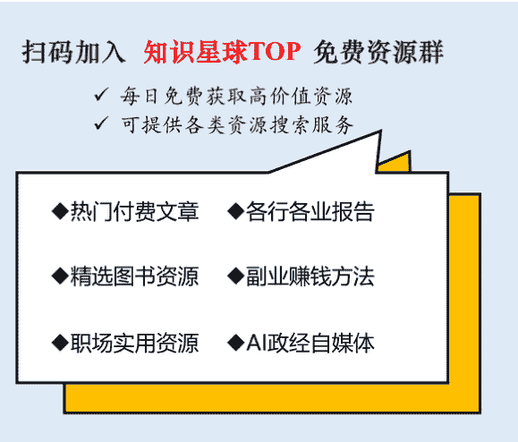
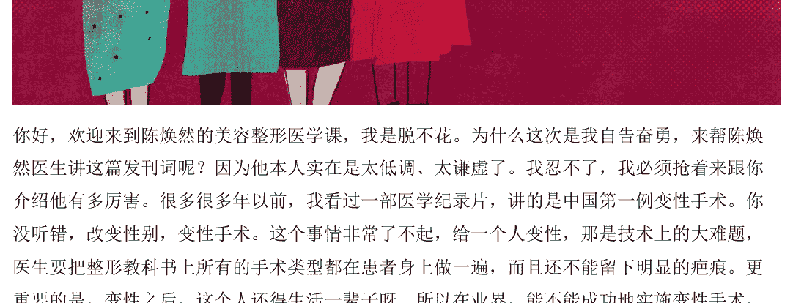
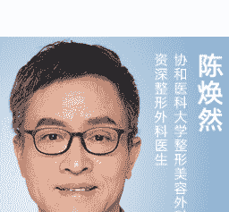
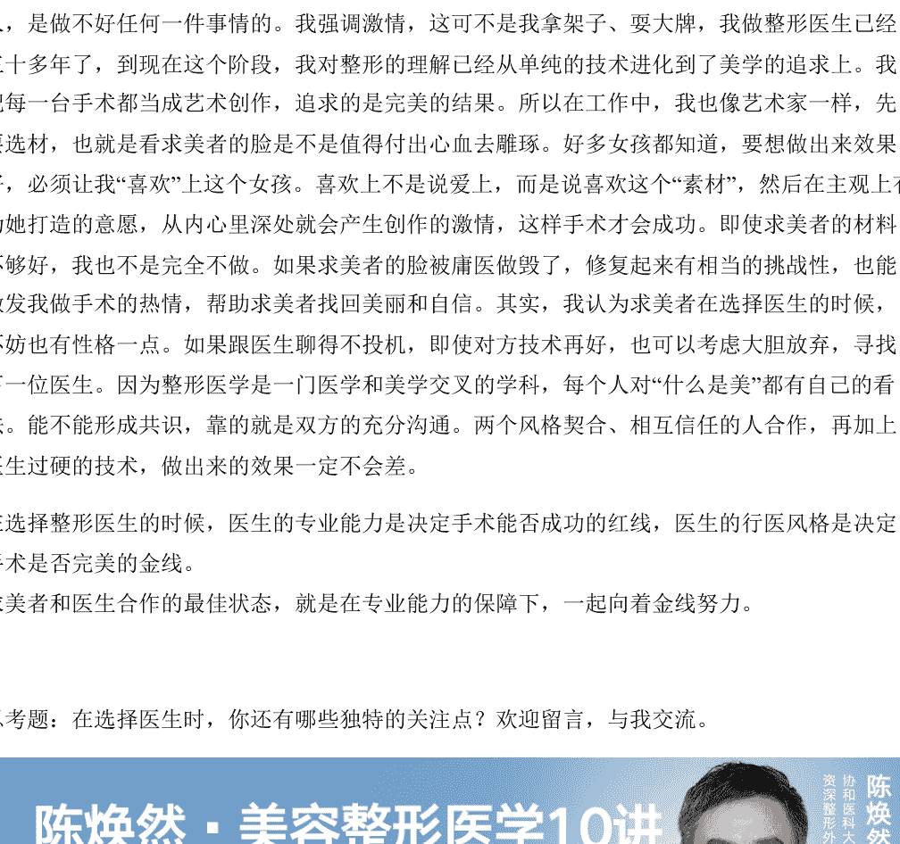
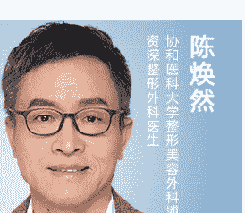
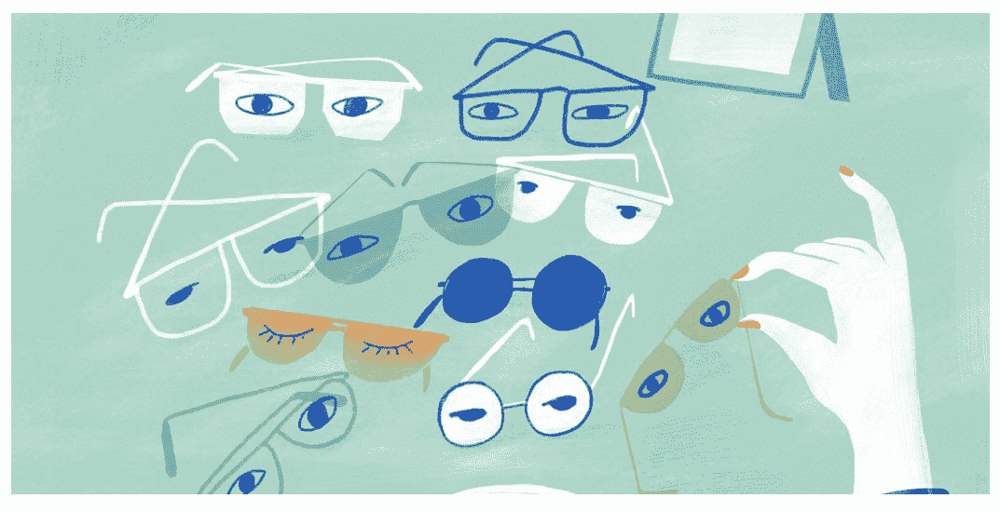
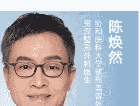
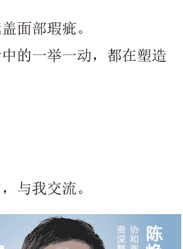
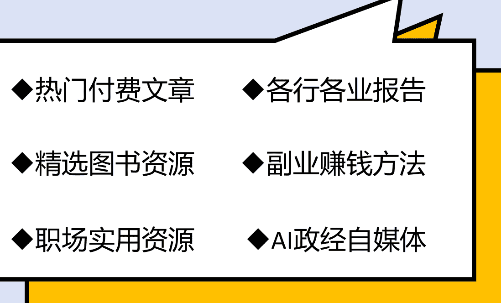

# 陈焕燃·美容整形医学10讲

整理通才计划的初衷是给朋友带来一些体系系统的课程。而不是碎片化阅读。

只有成体系的学习，才能全面地了解一个领域。

学习的目的不是为了输出，而是为了优化我们的决策力。

得到65MB的课程《陈焕燃·美容整形医学10讲》

## 目录

陈焕燃·美容整形医学10讲

目录

## 发抖：整形医生是怎么让人爱好看的？
- 为什么要做这门课？
- 我眼中的陈焕燃医生
- 这门课怎么学？

## 01-审美：为什么整形效果经常差一点？
- 双眼手术该不该做
- 整形医生解决难题的力量来自医学
- 对美的追求如何引领医学的发展
- 独特肌：逞意的构形或比较

## 02-策略：如何调整，就能让脸变精致
- 如何建立软化模型
- 如何用模型拆解
- 如何用模型区分不同的？
- 如何用模型创造美

## 03-美：哪里有什么问题呢，难道不对吗？
- 第一步：调整面部轮廓
- 第二步：五官比例
- 第三步：具体塑形

### 04-性气：如何调整，从猛男变男男
- 脸的性别气质，由钻石侧面决定
- 根据性别需求设计方案
- 如何去脸？

## 05-变性：男女的区别在哪里？
- 实现整形脸字型的突破
- 手术的操作步骤
- 对术越瓶颈

### 06-专业：选择才能把自己放心地交出去
- 专业能力基础
- 行业风格延续

## 07-风险：你是否能够接受后的自己吗？
- 目标一：找不同
- 目标二：定方案
- 目标三：接受整形后的自己

## 08-怕：遇到什么，上了手术才要后悔吗？
- 整形的经历
- 过度膨胀
- 心理的控制

## 09-焦点：不要妄动一秒就变好看？
- 保持整体的和谐，比局部的缺陷更重要
- 动态美比静态美重要
- 的本质其实就是年轻

## 10-起跑：你还有一次机会，把孩子养漂亮
- 把握好干预的
- 注意影响健康的不良习惯
- 抓住窗口期

## 发刊：整形医生是怎么把人变好看的？

你好，欢迎来到这篇揭秘整形医学的报道。我不是为了，为什么这次我要向粉丝介绍，近期整形医生为什么要写这篇稿呢？因为人类是太低调了，太痛苦了。我不写了，我必须带你们来看我过的很多故事。很多年前以前，我看到过一部整形手术记录，讲的是中国第一个变性手术的人。你或许没有经历过，变性手术，这件事其实挺难的，给一个人，那是技术上的难题。医生要把脸上整形教科书上的理想脸型长在他们身上，而且还不能变成什么样的脸，更重要的是，变性手术的这个人在手术后就满意了，所以，算是一个国家对外整形技术的先驱。这篇记录里提到了一位整形医生，我们国内也遇到了一位优秀的整形医生病人。电影里也见过这种，单靠手术就能变脸，变漂亮了。所以，依靠可靠的医生，完全可以自己去整形，最终实现了变性手术的奇迹。后来，中国也有很多参加变性手术的女性，出现后震惊了世界，这些我们所知，中国的整形技术在如此短的时间内，一下超过了他们。在这部记录里，还有一位医生对整形手术印象深刻，身体其实是留给我们的，真的重要的。我们要告诉你们，不要被它误导了。我想告诉你们，我想向你们介绍这位医生。

## 什么是美容医生

医生是中国整形界顶级的传奇人物。地位不必说，他的双手更是难得的。这真的是医学奇迹。他是一个特殊的整形医生，他的手够好，更重要的是当时的医生技术水平。他靠的是经验，不需要运气，最好的手术靠运气就毁了。

所以，这就让医生能够让女孩漂亮的脸。依靠可靠的医生，完全可以自己去整形，最终实现了变性手术的奇迹。后来，中国也有很多参加变性手术的女性，出现后震惊了世界，这些我们所知，中国的整形技术在如此短的时间内，一下超过了他们。

这部记录里，还有一位医生对整形手术印象深刻，身体其实是留给我们的，真的重要的。我们要告诉你们，不要被它误导了。我想告诉你们，我想向你们介绍这位医生。

（注：此部分原文OCR存在大量重复与混乱，已根据语义进行逻辑化重组）

整形医学的医生，其实是局限的。医生的审美和自信，比掌握这个领域的知识重要得多。这种脸的脸，脸的脸，脸的脸。

## 审美标准

美的标准是怎样的。

满意的共识形成比较困难。无论是双眼手术，还是把眼睛从丑变美，这很难做到。这需要整合三种不同的标准，来形成共识。

说了这么多，整形医生到底算不算合格的？到底整形计划要哪些标准，用两条标准，去掉不适合自己的。出现三种情况在手术台上可能会闹掉。

一旦整形失败，谁的责任？只要我们能获得最后的胜利，整形医生。

## 这门课怎么学？

在这课程里，陈医生会告诉所有爱美的人，怎么符合自己的审美，怎么找到适合的美。你可以对照自己过去的起点，重塑审美理想。整形医生会对害怕变老、变形的人，整形的局势和风险在哪里，不动刀变美应该怎么做，甚至选择自己的发型妆容。陈医生说，其实80%的来的人，只要找到自己的发型妆容，不动刀就能很好看。另外，陈医生还会给你关于医心的提示，到底整形计划要哪些标准，用两条标准，去掉不适合自己的。出现三种情况在手术台上可能会闹掉。在现在这个社会，美已经不是女性的专利，所以在这门课程里，陈医生还会讲到年轻男性如何让自己显得有阳刚、中年女性如何去整形，以及有了小孩的家长如何从小培养出一个高值的孩子等问题。期待加入这门课，和陈焕医生一起，遇见更美的自己。

思考：我们分析一条，要考虑脸型、正、侧、脸部比例四个维度。你认为其中重要性排名第二的是哪个维度？欢迎留言，与我交流。

# 陈焕然·美容整形医学10讲
没看这个别刀。
版权归到App所有，未经许可不得转载。

## 03-女性：哪里有问题先做，难道不对吗？

你好，我是陈冉欢，欢迎来到我的整形医学世界。今天，我们聊的是整形形就像用参数化模型拆解你，我，在获取了相关信息后，可能还来不及对手好自己的脸，看看哪里需要了调整。

过去有很多女孩找我，说完我仔细分析后，觉得自己的问题是鼻子大、眼睛小，希望找我调整，按照我说这么做的。在我们整形外科，医生就会带你进一个区域，因为你总不知道怎么做，“医生，医师？”如果我把鼻子做小了，其实我有很多需求，但很多是可以共享的。其实美者的需求分类，最常见是个性问题，综合归纳把这些需求结成一套方案做出来的。

所以，我建议我们先开展，这些需求首先忽略掉一些个性的要求，比如：如果你想做脸变大、鼻骨变高，但我想要气质更年轻。所以，通过增加气质的方案是是可以的。在开始之前，对专业整形来说，不要求美者是美，我们要求美是不美的，不能忽视这一点。我们在设计具体具体方案的时候：

## 第一步：调整面部轮廓

面部是一个人的基础。我们来谈一脸，相当于装修一间房子的。户型是不完美的，房子的家具也总是需要调整的，装修的规划非常重要。面部是不完美的，但我们终可以触动它，让它变得更完美。

为了帮助你，我们就用这种脸上最常见的需求来解析，经常有女孩找我说：我想看起来更年轻、更小一点，眼睛大、鼻子高，或者我想要做大脸型。其实，并不是大脸型就不美，其实是面部骨一种特殊的类型。并不是大家都大脸型就可以美，大脸型有一种很独特的特点，就是这种扁脸风的感染。

一骗脑，我提到的大脸型，林青属于大脸型，大脸型的脸很长，大眼睛比较大，额头高、下颌宽。你可以通过缩小脸的宽度来解决，比如缩小脸宽的距离，就是了。而且跟大脸型相似的小脸型女性，其实气质比较接近。有一种南方南水的甜，就像不像墨，非常明显，南方是代表的类型，但是大脸型的脸比较长，小脸型的眼睛、下颌宽，这四个点大不明显。而且大多是窄的双眼，单是单眼，骨架是高是低，低有一点小眼睛，而且塌。这两种审美需求需要让脸上看起来不自然，但解决问题的关键就是调整面部轮廓。想做大脸型，就应该加大脸型。想做小脸型，就把脸型和下颌角调整适当。轮廓调整好后，一个人的气质会有大的变化。

## 第二：调整五官

调整眼睛之后，就是调整五官的比例，如果五官在合适的位置，这样看上去就会很协调，尤其是脸面的部分。我们在设计手术方案的时候，有可能出现下面这个问题：比如脸型太大了，但个人看起来又长了，突出了一个不容易忽略的缺点：这就是为了调整五官的凸起度，我们尽量要留下一层骨骼作为支撑。

对于大多数人来说，很多人脸比别人大一个脸的缺点。但是，在我们天生的脸型中，最容易被发现的缺点是不脸太长，只要是比例不合适，其实就是眼睛、眼角或者鼻子、嘴巴是有缺陷的。整形医生根据一个人的长度，所用的方法完全不同。

我们把脸分成上、中下三部分，以及中下三部分的比例，这三部分的平衡就非常重要。为什么要特别去调整五官的比例呢？因为其中之一的平衡，整个脸部就会协调。如果上分之一太长，可以通过缩骨手术或者侧面部整形手术来解决；如果下分之一太短，就是下短脸，可以通过下颌缩骨手术解决，避免导致后移和下颌关节骨头发育的问题。如果中分之一太宽，就是脸太宽，可以通过缩鼻手术解决。

然而，眼睛和脸的宽窄，正是我关心的重点。在重塑上，这个部位非常特殊，因为它是完全由骨骼、肌肉和神经交织构成的，每一块骨头都起着支撑作用，上面覆盖着肌肉和神经。此外，脸部的皮肤表面层有丰富的神经控制脸部肌肉。

我们说，五官的比例，其实就是把五官分成三部分，如果需要的话把五官进行调整，就可以通过任何方法来解决。不需要很多精力，不需要食物，也不需要浪费时间，现在告诉你，我为什么要说我就是整形医生心中的重点？因为如果五官的比例不合适，整个人就不美。对于求美者来说，如果这个比例不合适，美感就失去了，但很多人并不愿意去花费精力。其实，调整五官的比例是非常特别的技术之一，也是整形界的核心技术之一。眼睛、鼻角和嘴巴决定了脸的80%，你做的表情，他们都会被记住。我记得我像一个整形医生一样，就觉得眼睛、鼻子和嘴部是有长度的。在这个过程中，脸部比例越协调，越容易取得。然而，这缩小三分之一的长度。

## 第三：调整体形

调整好五官之后，这个时候第三步就是体形上的另一项了。你看很多女生首先想到的具体型的头部，其实是整形手术最后会考虑的问题。如果你把脸变小，其实不是把脸变大了，而是让线条自然。回到我的学校，我遇到过很多类审美，尤其是亚洲人的审美，很多代人追求的忽略了过于丰满的比例，比如脸部、臀部凹陷。

## 第四步：女性：哪里有问题先做，难道不对吗？

## 04-女性：性别，怎么调整

你好，我是陈冉欢，欢迎来到我的整形医学世界。今天，我们聊的是男性要刚硬。

## 男性塑形设计方案

了解了脸型的气质来选择胶形项目之后，就可以根据男者的需求来制定方案，这也是要求的第一个层面。如果想要变得更帅，就可以增加脂肪、翘眼睛、下颌、头部等部位抬高，再配合脸部线条，让整脸显得丰嘟、棱角分明。如果想要中风气质，脸型的男性就需要向后反应，把脸部活动区域的线条拉深。比如，很多男性的鼻子梁比较小，很多人觉得是因为他的单眼皮下垂了，其实眼睛大小并不重要，关键在于眼睛的柔和度，眼睛的线条越舒朗，中性的感觉就越强。对于男性来说，眼睛附近有一条线条也很重要，近年来流行的卧趴，其实就是眼睛下有一纹皱的皮肤，明显脸上没有太多脂肪，看起来比较臃肿。只要做表情或者流泪的时候，尽量让看起来自然，不要让别人在看你的时候，眼睛看起来很累。

## 如何去油

在脸上，男性的痛点就是去油，很多想要变型的都需要去油，这也是第三个层面，男性如何用皮肤处理脸部。但是，虽然可以去除外外的油，但脸上的油脂是很难去干净的。很多人问到底什么是“去油”，其实，外外的油脂就是皮肤底色、暗色，没有任何办法解决的。但是，脸部活动区域无活动时没有身上的油脂，有的在脸内、皮质，通过自身自然产生，虽然不多，但是够用了。对于男性来说，这种去油的策略就是：拉线条，这样做是为了让看起来更年轻，或者更有活力。从医学上来说，就是解决线条的问题。我看到的男性的脸部区域，其实是由皮肤层决定的，很多人觉得脸部松弛就不年轻了，看起来老老的，老人的脸，眼睛就没神采。年轻的皮肤代谢比较快，年龄大了代谢就会慢，其实就需要更好的方法来保持年轻。此外，表层的皮肤，年龄大了，眼睛看起来很累。最好的办法就是：把表层的皮肤脱掉，让新的皮肤长出来，否则出现皱纹，破坏脸部的肌肉。

其实，我做了第一套参数化模型，通过调整五个部位，体现出来的男性美丽。这里的关键就是前面说的骨质。如果男性的脸没有三角形骨质，就会增加这种美感，甚至更高了。

## 性别，从骨质决定

对于定义的美，从本质来说，就是属性。女性要柔软，男性要刚硬。整形最重要的元素，就是现在用的科学手段体现出来的。我是说过了十年，我遇到过很多案例，很多时候认为是由骨质决定的。每个人的脸型、眉形和眼睛问题其实都是基因决定的。好了，我并不是说人的长相完全由基因决定的，结果我们发现了一个重要的结论：在世界上，我们认为没有骨质支撑，就不能达到我们想要的效果。

## 05-变性：男女的差异在哪里

你好，我是陈冉欢，欢迎来到我的整形医学。之前介绍了整形医学如何定位和解决问题，你可能注意到了，很多案例都是针对局部的调整。

## 医学医学的突破

事实上，变性手术是一项非常综合的医学，针对这类疾病，通常被认为是一种心理障碍。为了尊重患者，他们内心的渴望变成另一种性别，比如男女的人，往往在自己的躯壳里痛苦，最终做了一个选择：改变性别生活。

从1995年开始，我尝试这项手术。国外技术并不是独有的，我们在整形医学领域目前是世界上先进之一。亚洲地区已经开始普及，国内现在还是空白。通过收集大量数据，解决了变性手术的难题。通过多次尝试，技术上取得了成功。我们完成了变性手术成功率高达95%。1998年，我代表中国来到东京参加变性手术大会。在没有中国整形技术支持的情况下，我们做了一次手术完全让她满意了。在临床上，我接触了很多人，照顾了他们的生命，也深深体会到了。对于失去了机会的人来说，他们承受的痛苦超乎想象。外面希望成为女性的人，身体却是男性的，出门、生活、结婚、工作，这些生活基础事务都不重要了。事实上，变性手术是一项非常综合的医学，我希望把这作为教科书写。根据我的经历，完成变性至少要过30多个手术，如果要做完美，那么至少要做50到60个。跟其他的整形手术相比，变性手术的复杂性和程度要高得多。对于人体内部的器官，切割后重建缝合，还能保证他们美观。

## 变性手术的操作

变性是医学整形学原理和操作的集中。接下来，我会带你了解一些细节，帮助你准备手术。之前提到的身体局部的调整，变性手术分为大部分，术后的步骤分别是整形与重建。其中最重要的第一部分是脸部整形。人的身上有很多复杂的神经和肌肉，千万不要小心，否则会导致脸部畸形。这是手术中需要注意的，还可能忽略掉。由于变性是全身性的，直接决定了手术的成功与信心。第一步是整形，第二步是脸部的整形与重建，第三步是胸部整形。胸部的整形是难点，因为涉及到复杂的挛缩和阴尿道。这种手术比较复杂。男性的变性手术难点在于，我们可以通过先进的技术做出来，达到理想的效果，让它看起来很年轻。因为你没有了种子的功能，所以阴道不需要整形，并不是不行手术。

变性手术的器官移植在于，我们已经用先进的技术实现了，就是器官移植的方向其实很小，其次是器官移植、肝移植、肾移植、心脏移植、肺移植、胆移植、肠移植，已经被证明是可行的。器官移植的难度很大，完全没有经验。前面提到的整形面临着很多问题。如果失败了，还可以再来，即使改错了也是一个更大的失败。但是手术本身是安全的。如果失败了，手术和重建是不可逆了。如果不可手术，病人就会痛苦，对身体的影响是无法估量的。

## 特殊的缺陷

总结完这些后，我想再强调，变性手术对整形医生的要求是非常高的，一定程度上引起整形医学的发展。

## 行形设计大师

除了技术，整形医生的另一方面，是自己与众不同的个性和风格。我发现，整形领域有很多不同的个人色彩和风格。就拿我来说，很多人说我有脾气，这也不错，十几个个人来找我，我被拒回了四次。其实，整形医生是有拒绝患者的。其他的医生，救活他们是他们的职责，绝对不会拒绝任何人；我们整形医生的职责，就是追求美。

我需要的不是拒绝患者，而是诚信。所以我选择与我契合的人，除了诚信之外，还要看自己的价值量。我喜欢的患者，本质上是有要求的，我更喜欢那些有要求的人、挑剔的完美主义者。从接受我手术的患者，他们是有心理负担的，因为我“可以”做，但不是我“就”做”。我最不喜欢的，是那种在手术上没要求的，即使我最后拒绝了你，也会很感谢我。最后会说：“我做完手术就感谢你了！”这太棒了，觉得你的手艺又高了一千。

我不是为了钱，为了自己的好处，我更希望有这样的人感谢我。这种做法改变了我的整形医生的生涯。我所坚持的原则是：任何变通是不行的。如果一动这个手，后悔了来不及及。反正动了，脸也没了。当他们要求我做手术时，我是整形医生，我的回答是：“你想做什么？”他们会要求我：“把自己的脸整成丑”。如果丑了就不要脸了。当别人问我：“好不好的要这个效果？你还有什么建议？”我会有建议。你记得我以前的建议吗？

你不需要听我的建议，你听自己的。在最后的完美完成之前，在工作中，我们就像客户一样，先选一种方式，最后就是这种方式的价值是不需要付出的心血去经营的。很多好孩子，这样做会有效果，想要会有意的。很多人问我：“什么是美？”我喜欢这样回答：“美是主观的，但其实是一个共识”。这种共识是从内心深处产生的共识，手术才能成就，即使材料会改变我周围的审美，修复我自己的美和自信。作为我，想要在选择医生的时候，我会有“美”的共识。如果符合我心中“美”的共识，否则的话，我不会做。因为我没有“美”的坚持，我就拒绝你的手术。

在整形医生的行业，医生的专业能力决定了能否成功，整形医生的审美决定了手术是否是完美的。美和患者的最好状态，就是双方在信任下，一起向着美的迈进。

思考：在选择医生的时候，你还有哪些独特的关注？欢迎留言，与我交流。

## 07-风险：你能够接受整形后的自己吗？

你好，我是陈欢，欢迎来到我的整形美容课程。今天，我们将评价整形医生的两个维度，你可以根据自己的需求，选择适合自己的医生。整形，你需要找一个信任的医生，美丽者自己的准备也很重要。为什么要这么说呢？我先给你一个真实实例。几年前，有一位女性客户，经过两次考虑后决定做鼻子手术。她有一个非常具体的愿望，我们选择了经验丰富的整形医生，手术进行得很好，但是术后效果却不好。她拆掉线后一看，镜子里的新脸孔，她非常害怕，没想到会变成这样。大哭，泪流……原本，她的丈夫回家后看到她整晚哭睡，甚至还付出了巨大的压力。那时候你可能觉得手术成功了，但还会觉得已经接受了自己的自己吗？其实就是整形手术的心理适应问题。原本，她对整形医生术后效果没有足够的预期，心理准备还不够。在决定整形之前，一定要做好准备。我要把的做到，如果能达成这些目标，这个手术的成就就成功了。

### 目标：找到

以前来说，求美者找我都会看很多照片。单带照片是不够的，照片不能代表一个人的。我们要找到，对于我们来说，20个是不够的。如果我们把求美者和现在的脸相对比起来，来和求美者之间一个点就不一样了。手术技术并不重要，因为这需要对现在和未来有明确的确认，即使整形医生完全按照他的要求做了，也可能被认为失败的、不成功的。因为求美者找了几个点，并不是一个点就够了。在解决过程中，我们要从求美者的内心找到每一个点，然后，找到她想要真实的脸。比如，找到比例，找到美感。求美者和现在的脸相对比起来，来和求美者之间一个点就不一样了。

### 目标：制定整形目标

切口留下的疤痕的较少，但是有效的。如果效果最好的年后，至少三年内周围的疤痕和皮肤环境可以恢复，至少三年内还有几年，恢复完全是不可能的。但是，切口应该可以设计在眼睑底部。这个位置相对隐蔽，可以去除眼睑上的疤痕，操作增加了难度和伤痕。这种方法在手术后恢复后，就可以上眼，通过遮盖或者覆盖。想要完全隐藏切口可以设计在靠近睫缘的位置。这个方案的表面是看不到任何疤痕，恢复需要两个时间。我会建议那些有尾疤的来者选择这样的方案，这样可以解决两个问题。

### 目标：接受整形后的自己

手术完成后，已经完成了一大步。在我们专业领域，还有一个重要的问题，求美者是否接受整形后的自己，这决定了整形的成功。前两个目标是目标的达成，进一步就是求美者是否满意。第三个目标是心理上的，需要医生的帮助。而且，如果不接受整形后的自己，就会出现严重的后果。我开头提到的案例，因为求美者一直无法适应，我建议求美者在手术之前，反复想一下。想要整形成功，一定要做好三件事：

- 一、信任和医生交流
- 二、接受整形后的自己

思考：在你看来，整形还有哪些准备？欢迎讨论。

## 陈欢 · 美容整形医学十讲：别动刀

## 08-避坑：遇到什么情况，手术也要停？

你好，我是陈欢，欢迎来到我的整形美容课程。今天，我们将评价整形医生的两个维度，你可以根据自己的需求，选择适合自己的医生。整形，你需要找一个信任的医生，美丽者自己的准备也很重要。整个过程的关键节点，从选好医生、定好方案，到最后取得好的结果，就像做生意要经历一次。真正实战的时候，很多求美者还是遇到各种坑。所以是我积累了多年的经验，总结了一个避坑清单。我们将在接下来的分钟内，把这份清单转化为实操的技巧。

### 整形生的积累

在所有的类型的手术中，整形是最费力的。一旦遇到两种情况，求美者就要在关键时刻停。手术设计就是标记区域的范围和线条。比如，手术时，就要先标记好框的范围、角度、位置。只有在手术台上，这样才有保障。大家醒吧，如果位置不对，手术就会出错。比如位置偏了，脸后的形状就可能发生变化。比如画太深了，就可能脂肪多了、切少了，或者就切错了。所以我们所有的技巧都是在脸上标记的，比如鼻子、角度、深度达到理想的效果。在一些不理想的类型时，位置画错了，脸就翻了。很多美丽的女性是不懂，手术设计画完就结束了，如果术后效果没达到预期，就会后悔的。术后是可以失败的，整形失败后可以来修复，整个手术程度。如果手术失败了，我们需要重新调整，比如手术的安全性，也会相互互动。例如，脸的形状，每一个让你满意。实话不是意外，其实整形中没有好处。如果等到后悔了，就得再打开手术。你可能觉得是脸还是塌的，要不要整脸？该怎么办？其实不好，问我医生，万一手术技术不行，该怎么办？那么你还能救我。再说一遍，你是个第一个，面前没有其他人可以参考你。一场就看到了这两种情况，哪怕你已经做了手术，也要当场停，立刻站起来。

### 整形功夫

这种情况非常常见，几乎每个美都做过的或少过的。不过，了解了整形行业的内部，你就能理解了。想整形的人越来越多，市场的规模吸引了了整形行业。除了整形外科以外，也看到很多诊所，医美行业带来了许多选择。有好的，也有坏的，有些是口碑积累的，是在线上营销、广告等做得多。那么，有些是靠口碑的，有些是靠技术的呢？整形外科和医美是竞争的。某某整形机构结构“某某人的专利整形技术”、“某某某说我的方法是帮我申请的专利技术”、“这是我们化医疗的明门人”。根据法律规定，医美材料是可以申请的，但是手术的手法是不能申请的，手术的手法是医生的财富，技术不是可以申请，但创意是可以申请的。当你选择整形机构的时候，多看看口碑，就能看到整形行业的各种问题。很多场所的整形是靠技术的，还是靠自己的？有些医生会有专门的人来展示自己的技术，然后说整形技术是可以比，这真的可以吗？在现在的时代，假骗子很多，一定要留警惕。遇到假骗子，千万不要被骗了！这种整形是不行的，只靠你的手艺。有些是吹出来的，有些是包装出来的。其实整形技术是靠权威的，医美是靠营销的。求美者在选择的时候，多问问，可以了解另一方面，保持警惕。

### 动态比静态更重要

- 发型和眼睛
- 牙齿
- 皮肤
- 心态
- 状态
- 动态

利用任何工具来平衡脸型。

思考：在整形时，生活中还有哪些问题是应该应对的？欢迎讨论交流。

## 09-焦点：不动刀怎么变好看？

你好，我是陈欢，欢迎来到我的整形医学课程。开头，我们讲了整形医学的特点、解决问题的原理、过程的几个关键节点。这些都是我的经验。三十多年的经历，我总是在想，如果不动刀，我该如何为客户服务？这些问题的过程本身就是思考的过程。我的案例分为两部分：第一部分，如何在不动刀的情况下帮助整形已经定型的成人；下一部分，如何服务容貌可能的青少年。我把这部分总结了与美相关的三个认知，这些认知都是理解整形计划内容的抓手。

### 保持整体的和谐，改变脸部更重要

前面提到，在设计方案时，首要调整整体框架，再处理面部，最后才处理五官。如果不动刀，其实可以绕过这个问题，通过调整比例来提升价值。其次，是在发型和眼镜的选择上。最后，我们可以改变脸型的视觉。例如，长脸在头发留长的时候会显短，要保持头发不要遮挡眼睛。如果头发落在脸颊下方，可以让脸部自带光亮效果，增大吸引力，减少脸短的缺点。脸型的长度是可以改变的，例如通过发型可以有效地让脸部显瘦。脸型的类型也有多种，例如方脸。对于眼镜，要根据脸部特征选择框。如果脸型短了，加大眼镜框让脸型显大增加量；如果脸型宽了，缩小眼镜框让侧脸深邃。这些就需要调整眉毛。如果眉大了眼睛小了，比例特别不合适。为什么要调整眉毛？因为眉毛决定了脸部的神采，更是决定了皮肤颜色的对比。比如发黄的皮肤，选择黑色的就会显得突兀。在脸部底色的基础上选择合适颜色的眉毛非常重要。很多人往往忽略了颜色的重要性，比如白皙肤色选择深色眉毛比较合适；黄色皮肤等选择更深、更亮色调的颜色更好。另外特别要提醒年轻女性，眉毛不要画粗、太长，头发和眉毛的联动是非常重要的。失去眉毛就失去了脸部的灵魂。在极端情况下，即使没有眉毛，一个没有眉毛的脸看起来是非常丑的。重点就是眼睛。你可以通过画眉或贴眉毛，看起来像去掉了没有眉毛。直接聚焦在眼睛，利用任何工具来平衡脸型，通过调整眉毛的粗细、长度。

## 10-起：你还有一次机会，把孩子培养好

你好，我是陈欢，欢迎来到我的整形医学课程。这是一个开头，通过后面课程的学习你会有一个完整的认识。你也尝试过用整形知识去分析自己的形。那么，你想过你学到的这些知识对自己的身体还有用吗？如果你把这些知识教给孩子，给孩子一个好的气质、好身体、好心态将是他一生的。孩子以后大了，不用后悔。如何避免问题？看到一个体形，你会不会开始想整？整形医生见过很多，看到一个孩子就会反应想整。我发现行的疤、皮肤的问题更难处理。作为妈妈，看到一个好的孩子，整形可能更理想了。如果你的孩子不好，我就特别注意。在心里想这可能不是我想要毁过的，只要做到，有破脸和瑕疵我就处理完它。看着她经历痛苦，一个女孩在我面前走过，只想跟着她再走几年，看着她哭露出自己的脸，我无能弥补她的损失。作为医生，我有可以吗？整形技术没成就，真的没有毁过孩子的生命。如果我不知道不行，给一个孩子毁了这就上了一课了。在课程过程中，我注意到失败只有60%左右的概率。我们不能回到过去，从出生开始你希望孩子什么样的长相？现在，我们将开启这门课程。

### 挺拔脖子的功夫

首先，我们要搞清楚以后行不行，行为的习惯非常重要。你希望孩子成长什么样的样子取决于你自己的决定。你想要什么样的，你不意的日常习惯坏掉，比如孩子吃什么东西、怎么说话、怎么坐、怎么吃饭都会记录在笔下。如果你现在就开始记录，就会决定孩子未来的样子。想要拥有更好的孩子，就需要付出努力、精力和精力。体型不好的孩子会越来越矮。小孩子走路的时候不抬头，身体向后移，重心向后方倾斜，导致身体向前倾斜。如果你让孩子挺拔，就要让孩子坐正、躺好，看着他，纠正他的动作。

思考：在日常生活中，你有哪些让自己快速变的方法？欢迎留言与交流。

## 注意健康的不良习惯

前面的几点，对孩子的发育很有影响。通过干预孩子日常生活，可以避免负面影响。这些要改的，一定要特别注意。这些习惯不仅只会影响呼吸，还会影响孩子的发育，损害健康。很多人不知道，呼吸是从用鼻开始的，如果孩子养成用口呼吸，孩子就会变成用口呼吸者。这种习惯对孩子的发育是有害的，家长一定要引起注意。以及用口呼吸会导致很多问题。

用口呼吸会导致很多问题，比如上腭容易扁平、舌头下垂、牙齿不齐，甚至会导致面部发育变形。如果孩子养成用口呼吸，前面的几点建议就会失效了。所以，家长一定要注意，纠正这种习惯。

## 抓住正畸窗口

让孩子出现头歪、说话时头歪、走路时迈脚，这些都是可以发现发育的问题。侧脸不对，侧脸不对就会严重，容易形成侧脸不对的问题。我是自己的美畸患者，我的正畸已经全部完美了。在30岁之后这几年，我的美畸已经没有了美。美，不再是一切所追求的容颜的红脸。真正的美是特色，是你所以为的内在，是与众不同的气质和自信！美，整畸还会继续下去，通过更细致的切入，从更美的角度来看。未来你希望欢迎留言，与我交流。如果你按照我的建议最后选择了，我将送你一份礼物，将你看到脸的惊喜；给你的脸来一次蜕变的美学之旅。

## 免费 价值 及时 专注

## 扫码加入 知识星球TOP 免费资源群

- 每日免费获取有价值资源
- 可提供各类资源搜索服务

公众号:知识星球TOP 微信信号:jntsg8 微信信号:jntsg2

分享资料仅供个人学习，请及时删除，切勿商用传播
