# 陕西科技成果转化
年度报告·2025

陕西控创业投资基金管理有限责任公司
西安安财金投资管理有限公司 编著
陕西省创业投资协会

## 知识星球TOP

添加微信
资源分享群
免费入群

微信:top28688

| 序号 | 公号/星球/社群 | 原价 | 领域 |
| --- | --- | --- | --- |
| 1 | 生财有木 | 2765/年 | 副业，钱线 |
| 2 | 怂宗众吃瓜群 | 365/年 | 时政，历史 |
| 3 | 记忆Legacy/땡树西风 | 365/年 | 成长 |
| 4 | 欧洲金轨 | 328/年 | 时政，历史 |
| 5 | 卢克文青云会 | 699/年 | 时政，社会 |
| 6 | 体制内主任 | 599/年 | 体制，职场 |
| 7 | 局外人的视 | 669/年 | 金融，时政 |
| 8 | 溯泽异贷 | 4166/年 | 财富，成长 |
| 9 | 守夜人总司令 | 599/年 | 时政，经济 |
| 10 | 江宁知府 | 365/篇 | 时政，国际 |
| 11 | 政堂/顾子明 | 568/年 | 时政，经济 |
| 12 | 唐书 | 1399/年 | 金融，财富 |
| 13 | 大树乡谈 | 199/年 | 时政，成长 |
| 14 | 水库联大 | 10000/年 | 房产，经济 |
| 15 | 洪灏宏观策略 | 4376/年 | 经济，钱线 |
| 16 | 金政通鉴/北海南山 | 4576/年 | 股票，行研 |
| 17 | 猫哥的世界 | 299/年 | 时政，社会 |
| 18 | 飞龙谈 | 3600/年 | 股市，经济 |
| 19 | 米联诸见闻 | 599/年 | 经济，金融 |
| 20 | 茶茶财经 | 330/年 | 房产，股票 |
| 21 | 赢在八小时之外 | 365/年 | 成长，职场 |

......
更多资源，不再列举

+ 图书、报告、课程等各类高价值资源
- 免费群 每日分享所有优质资源
- VIP群 每日分享所有资源（日均20+），75/年赠送付费资源合集，市场价数万元

## 指导单位

陕西省科学技术厅
西安市科学技术局

## 编委会

主任：那小红
副主任：任纪刚 卢道真
编委：余 齐少波 范 勇 吴红超 曹 鹏 王海栋 廖 阳 陈怡君
董 云 刘 超 周灵峰

## 编写组

总编：夏 婧
主编：唐国桥
编写成员：苏 奕 翟卫华 杨 雪 王皓琳 邓 岩 沈一然 杨绪丹 窦佳伟 罗婧敏 王子帅 韩远鹏 赵 鹏 张冰洁

## 前言
PREFACE

科技成果转化是从科学到应用的关键环节，也将科学技术转化为现实生产力的必由之路。党的十八大以来，习近平总书记多次来陕西并作出重要讲话指示，要求陕西在创新驱动发展方面走在前，迈出更大一步，加强科技创新、建设现代化产业体系上取得突破，努力打造国家重要科研与文中心、高新技术产业和制造业基地。为深入贯彻习近平总书记关于科技创新的重要要求和来陕西考察重要讲话指示，全省要坚持创新驱动平台建设为主引擎，以科技成果转化“三项改革”为点火器，坚持企业主体、人才科学、市场主导、政府主，着力打通科技资源优势与经济融合的痛点，进一步重塑科技体系、人才模式、研发模式、转化模式、服务模式的升级，有力推动了创新要素聚集、功能集成、主体融合、效率提升，全省创新驱动发展由“稳”向“快”。

2024年初，省科技厅委托陕西创业协会与校、院所、医等多种科研主体调研与研究，编制科技成果转化报告，全方位反映不同类型的科技成果转化进展、取得的成效、主要经验和存在的问题，旨在掌握科技成果化的全貌。在此背景下，陕西创业协会联合西安财经投资有限责任公司等机构，共同开展本报告的编制工作。本报告分为总体情况、高等院校篇、科研所篇、医疗机构篇、科技金融篇和问题篇。通过数据调查、专家访谈、实地调查等对62所高校、13所科研所、66所医疗机构的科技成果转化进行分析，通过转让、许可、合作方式转化成果等，为提升科技成果转化提出针对性以及操作性的政策建议。本报告得到了创业投资委员会的具体指导，得到了省高校、院所、医疗机构的大力支持。诚感谢各界对报告的研究和支持，希望对报告的不足在后续工作中不断完善。

## 目录
CONTENTS

## 总体情况篇
- 第一章 概况 1
- 第二章 转化方式 7
- 第三章 技术转移与人才建设 18
- 第四章 成果化的定价方式 20
- 第五章 成果化的流向 22
- 第六章 转化收入的奖励分配 34

# 高等院校篇
- 第一章 概况 37
- 第二章 转化方式 43
- 第三章 技术转移与人才建设 50
- 第四章 成果化的定价方式 51
- 第五章 成果化的流向 52
- 第六章 转化收入的奖励分配 57
- 七章 工作案例 59

# 科研院所篇
- 第一章 概况 67
- 第二章 转化方式 71
- 第三章 技术转移与人才建设 77
- 第四章 成果化的定价方式 79
- 第五章 成果化的流向 80
- 第六章 转化收入的奖励分配 82
- 七章 工作案例 84

### 医疗卫生机构篇
- 第一章 概况 89
- 第二章 转化方式 96
- 第三章 技术转移与人才建设 102
- 第四章 成果化的定价方式 103
- 第五章 成果化的流向 104
- 第六章 转化收入的奖励分配 105
- 七章 工作案例 108

# 科技金融篇
- 科技金融促进成果化的经验 111

### 问题与建议篇
- 第一章 存在的问题 115
- 第二章 政策建议 122

# 附录
- 附录 1 2024陕西省科技转化合同排名 128
- 附录 2 2024陕西省科技成果合同数量排名 134

## 总体情况篇

## 第一章 概况

为了进一步研究陕西科技成果转化的效果和经验，本报告对陕西141家具有代表性的科研单位的科技转化情况进行了数据统计和分析，其中，62所高校、13所科研院、66所医疗卫生机构覆盖了近70%，以“三项改革”试点单位形成科技成果转化的成效、经验和问题建议，为推动陕西科技转化工作持续提供参考和依据。

本报告统计的高校、医疗卫生机构的转让、许可、合作及技术开发、咨询、服务等方式转化科技成果的总合同数量为23,542项，总金额为100.95亿元，平均金额为42.88万元。在所有科技成果转化的合同中，获得资金补助项目的数量为14,239项，占合同总数的60.48%，总金额为73.64亿元，占合同总金额的72.95%；其中，获得资金财政补助项目的数量为4,461项，占合同总数的18.95%，资金补助项目的转化方式为转让、许可、合作，从某种意义上来说，资金补助是科技成果转化过程中最重要的资源来源，也是科技成果转化过程中最不可缺的助推手。

科技成果的产出方面，本报告调查的141家科研单位累计专利总数254,063项，授权166,473项，有效发明62,521项。对于科研单位，高校创造了绝大多数专利。各单位累计专利实施14,113项，实施率17.55%；其中发明专利实施11,482项，实施率18.37%。从全国范围内来看，陕西（高校、科研所、医疗卫生机构）17.55%的专利实施率和18.37%的发明专利实施率处于全国较高水平，显示2022年陕西高校专利转化率为13.3%。在转化方式方面，技术开发、咨询、服务方式转化的成果数量最多、金额最大，合同数为21,642项，占合同总数的91.93%，金额为937.8亿元，占合同金额的92%。

#### 表 1-1 成果转化专利的产出及产出情况

| 项目 | 总计 | 其中 高校 | 科研所 | 医疗机构 |
| :--- | --- | --- | --- | --- |
| 专利总数(个) | 254,063 | 238,351 | 6,269 | 9,443 |
| 授权专利总数(个) | 166,473 | 155,439 | 4,499 | 6,537 |
| 有效专利总数(个) | 80,396 | 74,423 | 2,569 | 3,404 |
| 有效发明专利总数(个) | 62,521 | 59,579 | 1,954 | 988 |
| 当新增授权专利(个) | 14,413 | 13,140 | 578 | 695 |
| 当年新增发明专利总数(个) | 10,496 | 9,709 | 527 | 260 |
| 累计专利实施数(个) | 14,113 | 13,648 | 305 | 160 |
| 当新增专利实施数(个) | 3,006 | 2,957 | 26 | 23 |
| 累计发明专利实施数(个) | 11,482 | 11,145 | 237 | 100 |
| 当年新增发明专利实施数(个) | 2,774 | 2,737 | 25 | 12 |
| 当年新增软件著作数(个) | 5,829 | 5,723 | 63 | 43 |
| 当年发表论文(个) | 74,614 | 67,181 | 1,075 | 6,358 |
| 当年获得奖励(个) | 1,067 | 1,026 | 11 | 30 |
| 专利实施率(%) | 17.55% | 18.34% | 11.87% | 4.70% |
| 发明专利实施率(%) | 18.37% | 18.71% | 12.13% | 1.12% |

#### 表 1-2 陕西省科技转化整体数据

| 序号 | 分类 | 项目 | 2024年度总计 | 其中:财政补助 | 中央财政补助 |
| --- | --- | --- | --- | --- | --- |
| 三 | 以转让、许可、作价方式转化科技成果 | 合同项(项) | 1,529 | 146 | 90 |
| | | 合同金额（万元） | 47,453 | 4,120 | 2,450 |
| | | 当到账金额（万元） | 20,527 | 1,826 | 1,290 |
| 四 | 技术开发项目 | 合同项(项) | 339 | 61 | 46 |
| | | 合同金额（万元） | 9,954 | 3,264 | 2,499 |
| | | 当到账金额（万元） | 9,201 | 2,320 | 1,762 |
| 五 | 技术咨询项目 | 合同项(项) | 1,778 | | |
| | | 合同金额（万元） | 36,967 | | |
| | | 当到账金额（万元） | 32,017 | | |
| 六 | 技术服务项目 | 合同项(项) | 11,972 | | |
| | | 合同金额（万元） | 414,952 | | |
| | | 当到账金额（万元） | 337,920 | | |
| 合计 | 以上一、二、三、四、五、六合计 | 科技成果转化、许可、作价项目和技术开发、咨询、服务项目项(项) | 23,542 | | |
| | | 科技成果转化、许可、作价项目和技术开发、咨询、服务项目总金额（万元） | 1,009,457 | | |
| | | 以上一、二、三、四、五、六项合计(除作价投资) | 科技成果转化、许可项目和技术开发、服务项目当年到账总金额（万元） | 706,754 | |
| | | | 14,239 | 4,461 |
| 七 | 获得财政资金补助的科技项目 | 立项批复的科技项目(项) | 736,422 | 723,371 | 463,049 |
| | | 立项批复的科技项目(课题)金额(万元） | | | |
| | | 项目(课题)资金当年到账金额(万元） | 869,924 | 823,029 | 583,346 |

## 概览 第一章

| 序号 | 分类 | 项目 | 2024 年度总计 | 其中:财政补助 | 中央财政补助 |
| --- | --- | --- | --- | --- | --- |
| 八 | 其他指标 | 设立（联合设立）科技成果转化相关基金数量(支) | 0 | - | - |
| | | 基金累计规模(万元) | 0 | - | - |
| | | 自建概念认证中心数量(个) | 9 | - | - |
| | | 自建概念认证中心当年新增项目数量(个) | 76 | - | - |
| | | 自建中试平台数量(个) | 3 | - | - |
| | | 自建中试平台当年新增服务项目数量(个) | 3 | - | - |
| | | （市级及以上）认定的科学仪器设备共享平台数量(个) | 28 | - | - |
| | | （市级及以上）认定的科学仪器设备共享平台金额（万元） | 14,201 | 6,118 | 5,745 |
| | | 自建概念认证中心形成的股权总值（万元） | | | |
| | | 技术开发项目 | 合同项(项) | 7,892 | | |
| | | 合同金额（万元） | 485,930 | | |
| | | 当年账金额（万元） | 307,089 | | |
| | | 技术咨询项目 | 合同项(项) | 1,778 | | |
| | | 合同金额（万元） | 36,967 | | |
| | | 当年账金额（万元） | 32,017 | | |
| | | 技术服务项目 | 合同项(项) | 11,972 | | |
| | | 合同金额（万元） | 414,952 | | |
| | | 当年账金额（万元） | 337,920 | | |

## 总体情况

| 合同金额（万元） | 转化方式 | 合同金额 | 占比 |
| :--- | :--- | :--- | :--- |
| 以转许、许可、作价投资方式转化 | 科技成果 | 71608 | 7.009% |
| 以技术开发、咨询、服务转化 | 成果 | 937849 | 92.291% |

- 以转许、许可、作价投资方式转化科技成果
- 以技术开发、咨询、服务转化科技成果

图 2-2 转化后合同金额分布

成果转化方式中，以技术开发、技术服务转化的方式在陕西科技成果转化中占据绝对主导地位，其合同项占比91.93%，金额占比92.9%。转许、许可、作价投资方式转化的项目数量虽不足，但平均合同金额较大，显示相关科技成果的水平和高值。

从上述数据反映的结果不可忽视，陕西高校和科研所侧向于横向转向，而非自发形成成果进行市场化转化。同时作价投资应用较少，说明高校、医疗、卫生机构在管理过程中形成的科研成果方面有制度限制，科研人员（团队）对于其产出的资本化运作能力不足。未来需要陕西在相关方面采取更加加强的政策措施，持续鼓励高校通过合作投资、激励措施等推动成果转化，建立“成果+投资基金”联动机制，提升陕西科技的转化能力。

各类科技成果转化的方式中，以合同转向，陕西高校仍是科技转化的核心力量，尤其是在转向方式中，高校占比高达98.76%，科研所和医疗机构在此类转化中程度极低。在许可方式中，医疗机构和科研所的总体占比高于转向，表明其更倾向于通过许可方式进行输出。

在作价投资方式中，几乎所有的作价投资来源都来自高校，医疗机构尚未参与，科研仅有个别案例。在技术开发、技术咨询和技术服务转化方式中，陕西高校仍是部署灵活的主力，科研所和医疗机构在此类项目中也有一定参与，是陕西部分科研实在技术服务和咨询方面的表现优于其他转化方式。

## 第二章 转化方式

### 2.2 以转让、许可、作价投资方式转化科技成果

陕西不同科研单位的科技成果转化呈现出不同的特点，其中高校合同项数 1,861 项，合同金额 69,288 万元，2024年到账金额 26,721 万元。科研院所合同项数 14 项，合同金额 1,760 万元，2024年到账金额 415 万元。医疗机构合同项数 25 项，合同金额 561 万元，到账金额 292 万元。在具体转化方式中，技术开发和润占比最高，这也体现了大多数科研人员（团队）更倾向于横向课题或者技术研发性质的转化模式，一方面可以发挥其科技创新的优势，同时也规避了职务边界和归属等制度层面的风险。

表 2-2 以转让、许可、作价投资方式转化科技成果总体情况

| 项目 | 高校 | 科研院所 | 医疗机构 | 总计 |
| :--- | :--- | :--- | :--- | :--- |
| 合同项数（个） | 1,861 | 14 | 25 | 1,900 |
| 合同金额（万元） | 69,288 | 1,760 | 561 | 71,608 |
| 当年到账金额（万元） | 26,721 | 415 | 2,592 | 29,728 |

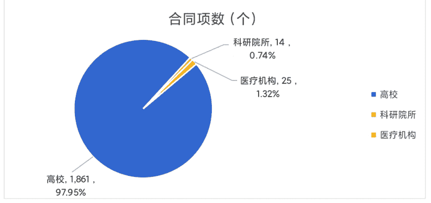

图 2-3 以转让、许可、作价投资方式转化的合同项数分布

## 总体情况回顾

#### 合同金额（万元）

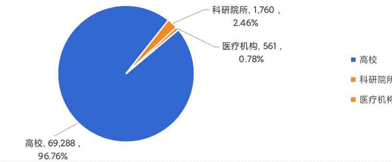

图 2-4 以转让、许可、作价投资转化的合同金额分布

通过统计结果可以看出，高校依然是陕西转化的主力军，科研所和医疗机构通过转让、许可、作价三种方式转化的成果较少，到账金额高于合同金额，存在验收延的情况。总体而言，科研所和医疗机构转化不及预期，体制不灵活，科研人员创新动力不够。未来应加强对科研所和医疗机构的政策引导，建立激励机制，建立专项计划，加速市场化驱动与临床转化。

## 按单位性质转让、许可、价投资方式合同金额分布

图 2-5 按单位性质转让、许可、价投资合同金额分布

按单位性质转让、许可、价投资方式合同金额情况，本报告调研的 141 家单位，总金额在 1 亿元以上的仅有 3 项，且全部由高校完成。在 1000 万元至1 亿元间的合同，高校完成了 6 项；在 10 万至1000 万元合同间的，高校完成了 12 项。

### 2.2.1 转让方式

在本报告调研的样本范围内，以转让方式达成的科技成果合同共 1,529 项，总金额 47,453 万元。从资金到位来看，当年到账金额为 20,527 万元。上述数据反映出转让作为科技成果转化的关键路径在本地区具有较高的市场活跃度和规模。然而，43.3%的到账率源于多种因素，如产业化过程中的生效周期、双方在合同后期产生的分歧。低到账率影响科研团队的内部收益与研发投入，也侧面反映出本地区技术市场的信用体系与合同执行保障待加强。

表 2-3 转让方式

| 项目 | 合计 |
| :--- | :--- |
| 转让方式合同（个） | 1,529 |
| 转让方式合同金额（万元） | 47,453 |
| 转让方式当年到账金额（万元） | 20,527 |

### 2.2.2 许可方式

许可方式通常不涉及所有权，更符合技术成熟度较高、市场风险控的成果。在本报告的 141 家单位中，以许可方式进行成果转化的合同为 339 个，金额 9,954 万元，当年到账金额 9,201 万元。这种方式的成果转化虽然数量较少，但当年到账率为92.4%，反映出许可方式的灵活，收取不存在障碍。但其平均每项合同金额约为29.36 万元，可见我省科研单位主要以小规模或阶段性成果为主。

表 2-4 许可方式

| 项目 | 合计 |
| :--- | :--- |
| 许可方式合同数（个） | 339 |
| 许可方式合同金额（万元） | 9,954 |
| 许可方式当年到账金额（万元） | 9,201 |

### 2.2.3 价投资方式

以价入股式转化是科技成果转化的一种重要形式，在本报告调研的科研单位中，价投资转化的案例较少，价投资的合同数仅为 32 个，金额 14,201 万元，显示目前在科技成果转化过程中股权的管理仍面临挑战。“在实现价入股的 32 家科技企业中，几乎都来自高校，通过学校的资产管理公司实现了对科技企业的持股。”

表 2-5 价投资方式

| 项目 | 合计 |
| :--- | :--- |
| 价投资合同数（个） | 32 |
| 价投资合同金额（万元） | 14,201 |
| 价投资当年到账金额（万元） | |

> * 注：价投资的项目数量少单笔金额小，平均每项价投资合同金额为443.78 万元

价投资的项目数量少单笔金额小，平均每项价投资合同金额为 443.78 万元，显示这种方式更适合重大科技成果或高价值项目，体现出陕西科研单位科技成果产出的较高性比。未来陕西省将继续加强对价投资项目的筛选和评估，确保科技成果具备高性性和市场潜力，同时构建价投资的评估体系和国有退出机制。

### 2.3.1 技术开发

在科研单位面向市场提供的各类科技成果转化方式中，技术开发是核心环节。其中，技术开发在合同数量上不占优势，但其总金额高达 48.6 亿元，位居各类合同之首，且平均合同金额达到61.6 万元/项，显著领先。这充分表明，技术开发是创造经济效益价值为关键和核心的途径。

| 项目 | 合计 |
| :--- | :--- |
| 技术开发合同数（个） | 7,892 |
| 技术开发合同金额（万元） | 485,930 |
| 技术开发当年到账金额（万元） | 307,089 |

### 2.3.2 技术咨询

技术咨询在科技成果转化体系中，扮演着“精准诊断的专家医生”和“传递隐性知识的桥梁”角色。与其他方式相比，其核心优势体现在灵活性、低风险、知识传递和高性比上。本调研数据显示，技术咨询合同平均金额为 20.79 万元/项，开展技术咨询（如方案论证、可行性研究、技术预测等）的项目和金额都偏低，表明技术咨询用于解决特定问题、成为合作的“探路石”的功能仍待加强。

表 2-8 技术咨询

| 项目 | 合计 |
| :--- | :--- |
| 技术咨询合同数（个） | 1,778 |
| 技术咨询合同金额（万元） | 36,967 |
| 技术咨询当年到账金额（万元） | 32,017 |

### 2.3.3 技术服务

技术服务在转化的方式上，更注重利用现有技术资源完成特定任务（如检测、化验等）。本报告技术服务合同平均金额为 34.66 万元，反映出技术服务在利用现有技术方面具有明显优势，到账占比达到81.4%。

表 2-9 技术服务

| 项目 | 合计 |
| :--- | :--- |
| 技术服务合同数（个） | 11,972 |
| 技术服务合同金额（万元） | 414,952 |
| 技术服务当年到账金额（万元） | 337,920 |

## 2.4 财政资助

财政资助对科技成果转化具有重要的作用，从本次数据来看，财政资助项目集中在高校，科研所和医疗机构相对较少。具体来说，经调研统计的全部成果中，财政资助项目占比31.3%，金额占比62.9%。与全国情况类似，高校是财政经费的主要承担者，无论是项目数量还是资金规模，高校占据了绝大部分。对比地方财政投入，支持力度加大，可见陕西省在支持本地特色成果转化方面存在资金缺位。

| 项目 | 高校 | 科研院所 | 医疗机构 | 总计 |
| :--- | :--- | :--- | :--- | :--- |
| 合同项数（个） | 1,054 | 367 | 221 | 1,642 |
| 合同金额（万元） | 902,376 | 29,301 | 6,172 | 937,849 |
| 当年到账金额（万元） | 592,343 | 28,447 | 4,245 | 625,035 |

表 2-10 按单位性质财政资助项目金额和项分布

| 项目 | 高校 | 科研院所 | 医疗机构 | 总计 |
| :--- | :--- | :--- | :--- | :--- |
| 财政资助合同数（项） | 1,239 | 361 | 151 | 1,751 |
| 财政资助合同金额（万元） | 736,422 | 66,891 | 25,859 | 829,172 |
| 财政资助当年到账金额（万元） | 623,371 | 52,029 | 46,949 | 723,346 |

表 2-12 按不同形式财政资助项目分布

| 项目 | 合计 |
| :--- | :--- |
| 转让方式财政资助合同数（项） | 146 |
| 转让方式中央资助合同数（项） | 90 |
| 转让方式财政资助金额（万元） | 4,120 |
| 转让方式中央资助金额（万元） | 2,450 |
| 许可方式财政资助合同数（项） | 61 |
| 许可方式中央资助合同数（项） | 46 |
| 许可方式财政资助金额（万元） | 3,264 |
| 许可方式中央资助金额（万元） | 2,499 |
| 价投资方式财政资助合同数（项） | 16 |
| 价投资方式中央资助合同数（项） | 15 |
| 价投资方式财政资助金额（万元） | 6,118 |
| 价投资方式中央资助金额（万元） | 5,745 |

## 第四章成果转化的定价方式

《中华人民共和国促进科技成果转化法》第十八条规定，国家设立的研究开发机构、高校对其持有的科技成果，可以自主决定转让、许可或者作投资，但应当通过协议定价、在技术交易市场挂牌交易、拍卖等方式确定价格。通过协议定价的，应当在本单位公示科技成果名称和拟议成交价格。

协议定价是指交易双方经过反复协商并在形成共识的基础上确定科技成果的成交价格。在成果转化定价方式上，本报告样本中以协议定价的成交数为2,036项（占比99.2%），其中过价的702项（占比34.5%），未过价的1,334项（占比65.5%）。

### 表 4-1 成果转化的定价方式及评估情况

| 合同数量（项） | 总计 | 是 | 否 |
| --- | --- | --- | --- |
| 挂牌交易 | | 17 | 0 |
| 协议定价 | | 2,036 | 702 | 1,334 |
| 总计 | | 2,053 | 719 | 1,334 |

由此可见，协议定价是陕西科技成果转化最重要的定价方式，超过99%的项目通过双方协商确定价格，这种方式灵活、高效，是市场的主流选择。此外成果评估率整体偏低，有719个项目（35.0%）在定价前进行了评估，65.5%的项目在未经过协议价值评估的情况下达成了协议。

定价过程缺乏价值发现机制、缺乏专业的科技成果评估，可能导致科技成果的价值偏低或高，既可能造成国有资产流失，也可能定价不合理而阻碍交易达成。在技术交易市场上挂牌交易的项目仅有17个，不利于发现成果公允价格和规范交易

为了持续推动陕西科技成果的价值发现，2024年底，陕西科技成果“先使用后付费”平台正式上线，平台以科技业务综合服务信息系统为基础，形成“先使用后付费”成果发布、成果筛选、成果匹配、成果支撑的全流程体系，为科研人员与中小微企业搭建了便捷、一站式的“先使用后付费”对接平台，有效促进科技成果与产业需求密切融合。

陕西省高校、科研所、医疗卫生机构可将科技成果在陕西科技成果“先使用后付费”平台进行发布展示，中小微企业根据实际需求进行接，与成果所有权通过“零门费+阶段性支付+收入换成”或“延期支付”等方式许可，并明确许可范围、许可类型、许可时间等事项，加速成果转化进程，降低中小微企业技术门槛，促进产学研深度融合，将科技创新成果应用到具体产业和产业链。

相关政策的探索和落地，为破解陕西科技成果“转化难、定价难”问题提供了创新路径，实现了科研机构成果收益价值和企业需求的匹配。

## 第五章 成果转化的流向

### 5.1 科技成果承接单位

在本报告的调研中，通过问卷调查等形式，收集到科技成果转化合同共计 4,090 项，转让合同金额共计 522,295 万元。对该样本分析，得到陕西省科技成果转化流向的基本情况。

### 表 5-1 按照合同项统计转化方式的主要流向

| 项目 | 以转让、许可、投资方式转化科技成果合同数量（项） | 以技术开发、咨询、服务转化科技成果合同数量（项） | 总计合同数量（项） |
| --- | --- | --- | --- |
| 境内（大型企业、国有企业） | 30 | 541 | 571 |
| 境内（大型企业、其他企业） | 17 | 157 | 174 |
| 境内（中小企业、国有企业） | 75 | 286 | 361 |
| 境内（中小企业、其他企业） | 1,875 | 683 | 2,558 |
| 境内（非企业单位） | 54 | 369 | 423 |
| 境外 | 2 | 1 | 3 |
| 总计 | 2,053 | 2,037 | 4,090 |
* 数据依据调查问卷获得。

### 表 5-2 按照合同金额统计转化方式的主要流向

| 项目 | 以转让、许可、作价方式转化科技成果金额（万元） | 以技术开发、咨询、服务转化科技成果金额（万元） | 总计合同金额（万元） |
| --- | --- | --- | --- |
| 境内（大型企业、国有企业） | 2,347 | 103,558 | 105,905 |
| 境内（大型企业、其他企业） | 484 | 28,083 | 28,567 |
| 境内（中小企业、国有企业） | 3,994 | 69,532 | 73,526 |
| 境内（中小企业、其他企业） | 66,266 | 174,219 | 240,485 |
| 境内（非企业单位） | 4,284 | 68,971 | 73,255 |
| 境外 | 7 | 550 | 557 |
| 总计 | 77,382 | 444,913 | 522,295 |
* 根据调查问卷获得。

从流向性质来看，陕西科技成果转化流向“境内中小企业”最多，数量为2,558项，金额为240,485万元，其次是“境内（大型企业、国有企业）”，金额为105,905万元。按性质来看，流向国有企业的金额为79,431万元，流向中小企业的金额为269,052万元，中小企业是陕西科技成果转化主要单位。

从转化方式来看，以转让/许可/作价方式为主，流向“境内中小企业及其他企业”的合同为1,875项，总计金额66,266万元。技术开发/咨询/服务为主的流向“境内大型企业”合同为541项，金额103,558万元，流向“境内中小企业及其他企业”的合同为683项，金额174,219万元。可见科技成果转化对于陕西省中小企业，尤其是中小企业的创新驱动发展至关重要。

### 5.1.1 转让、许可、作价方式转化的流向

根据样本统计，陕西科技成果转化呈现出显著的区域与主体集中特征，具体体现在以下方面：

以转让、许可、作价方式转化的成果合同数量（项）

图 5-1 按合同数量统计的区域流向

从合同数量看，以转让、许可、作价方式转化的科技成果中，境内中小企业及其他企业是主要的承接主体，共1,875项，占比91.33%；境内国有企业（75项，3.65%）及其他类型（98项，4.77%）占比较低，境外转化仅2项（0.10%）。

以转让、许可、作价方式转化的科技成果金额（万元）

图 5-2 按合同金额统计的区域流向

从合同金额分布来看，境内中小企业及其他企业同样是最主要的承接主体，合同总额66,266万，占比85.63%；值得注意的是，境内非企业单位仅占合同数量的0.15%（3项），但金额占比5.54%4,284万元）。境外转化金额为339万元，占比0.44%，成果转化的对外程度不够。

陕西的科技转化高度依赖境内企业（尤其是中小企业）；境外转化无论规模或金额均存在明显短板，作为国家科技创新重要载地，我国未来仍需进一步探索科技的国际化合作。

## 5.2 技术开发、咨询、服务方式转化的流向

在技术开发、咨询、服务类合同中，中小企业、大型国企、非企业单位均为接受的主体。从合同金额分布来看，以技术开发、咨询、服务方式转化的成果合同中，境内中小企业及其他企业占比最高（33.53%，683项），其次为境内大型企业及国有企业（26.56%，541项）和境内非企业单位（18.16%，369项）。境内中小企业与国有企业合作占比14.04%(286项），境内大型企业及其他企业境外转化仅0.05%(1项）。

图 5-3 按合同数量统计的区域流向

从合同金额分布来看，境内中小企业及其他企业贡献大部分份额（39.16%，174,219万元），境内大型企业及国有企业次之（23.28%，103,558万元），境内中小企业与国有企业占比15.63%69,598万元），境内非企业单位占比15.50%68,971万元）。境内大型企业及其他企业占6.31%(28,083万元），境外转化仅0.12%(550万元）。

以技术开发、咨询、服务方式转化的金额（万元）

图 5-4 按合同金额统计的区域流向

不同转化方式的流向也存在显著差异。由于转让/许可/投资的机制更受小型企业青睐，技术开发服务方式更为灵活，大型企业承接了相当数量的（698项）和金额（131,640万元），高校和科研所合作频繁，彼此在学术领域存在一定的共性。

### 5.2 本地化与区域化

### 表 5-3 成果区域分布总体情况

| 项目 | 以技术开发、咨询、服务方式转化成果（项） | 以转让、许可、投资投资方式转化成果（项） | 总计（项） |
| --- | --- | --- | --- |
| 本地 | 762 | 1,074 | 1,836 |
| 外地 | 1,230 | 888 | 2,118 |
| 总计 | 1,992 | 1,962 | 3,954 |

图 5-5 成果区域分布总体情况

外地2,118（53.57%），本地1,836（46.43%）。从本次调研各单位的科技成果区域流向来看，本地转化1,836项，外地转化2,118项，外地明显多于本地。从省内来看，西安依然是成果占比最大的区域（1,407项，占省内76.6%），与陕西本地资源的分布有直接关系，进一步显示了西安作为国家科技创新中心的定位和地位。

### 表 5-4 陕西省内成果流向的主要分布

| 项目 | 以技术开发、咨询、服务方式转化成果（项） | 以转让、许可、作价方式转化成果（项） | 总计（项） |
| --- | --- | --- | --- |
| 安康市 | 2 | 3 | 15 |
| 宜凉市 | 10 | 14 | 24 |
| 汉中市 | 18 | 21 | 39 |
| 渭洛市 | 5 | 16 | 21 |

### 整体概览

| 项目 | 以技术开发、咨询、服务方式转化成果（项） | 以转让、许可、作价方式转化成果（项） | 总计（项） |
| --- | --- | --- | --- |
| 铜川市 | 18 | 4 | 22 |
| 陕南市 | 25 | 16 | 41 |
| 西安市 | 539 | 868 | 1,407 |
| 成阳市 | 40 | 120 | 160 |
| 延安市 | 32 | 8 | 40 |
| 榆林市 | 63 | 4 | 67 |
| 总计 | 762 | 1,074 | 1,836 |

除西安外，其他市承接的成果数为429项，占全省的23.4%，清晰揭示了陕西省创新的发展不均衡，通过大力扶持小型企业，优化全省生态，增强其区域创新的内部动力。

图 5-7 陕西省内成果流向的主要分布

### 表 5-5 陕西省外流向的主要分布

| 项目 | 以技术开发、咨询、服务方式转化成果（项） | 以转让、许可、作价方式转化成果（项） | 总计（项） |
| --- | --- | --- | --- |
| 安徽省 | 26 | 84 | 110 |
| 北京市 | 210 | 54 | 264 |
| 福建省 | 16 | 8 | 24 |
| 甘肃省 | 23 | 12 | 35 |
| 广东省 | 180 | 260 | 440 |
| 广西壮族自治区 | 9 | 4 | 13 |
| 贵州省 | 15 | 0 | 15 |
| 海南省 | 8 | 3 | 11 |
| 河北省 | 25 | 11 | 36 |
| 河南省 | 36 | 40 | 76 |
| 黑龙江省 | 2 | 17 | 19 |
| 湖北省 | 45 | 24 | 69 |
| 湖南省 | 29 | 4 | 33 |
| 吉林省 | 8 | 1 | 9 |
| 江苏省 | 98 | 80 | 178 |
| 江西省 | 13 | 7 | 20 |
| 辽宁省 | 58 | 1 | 59 |
| 内蒙古自治区 | 15 | 4 | 19 |
| 宁夏族自治区 | 9 | 6 | 15 |
| 青海省 | 13 | 4 | 17 |

### 转化去向

| 地区 | 数值 |
| --- | --- |
| 境外 | 2 |
| 重庆市 | 14 |
| 浙江省 | 55 |
| 云南省 | 3 |
| 新疆自治区 | 7 |
| 西藏自治区 | 6 |
| 天津市 | 19 |
| 四川省 | 80 |
| 山东省 | 46 |
| 山西省 | 30 |
| 上海市 | 82 |
| 天津市 | 19 |
| 西藏自治区 | 6 |
| 新维尔自治区 | 26 |
| 云南省 | 10 |
| 浙江省 | 78 |
| 重庆市 | 14 |
| 境外 | 1 |
| 总计 | 1,230 | 888 | 2,118

从外流分布来看，陕西科技成果流高度集中在经济发达和科研资源丰富的地区，深度且广泛服务全国的经济高质量，特别是流向长三角、京津等创新高地，实现了陕西成果对经济发达区域的吸引、竞争力和高价值。

具体流向区域包括广东省（440项）、北京市（264项）、江苏省（178项）、山东省（145项）、浙江省（133项）、四川省（107项）、上海市（107项）、安徽省（110项），可见科技成果的转化与所在区域的经济发展存在强关联。同时也说明，陕西的科技仍然存在“墙内花墙外”的困局，有超过一半的成果（53.6%）流了省外，说明西部的产业生态和承接能力与科技成果的产出不匹配，未能将科技优势充分转化为本土优势。

# 转化去向分布

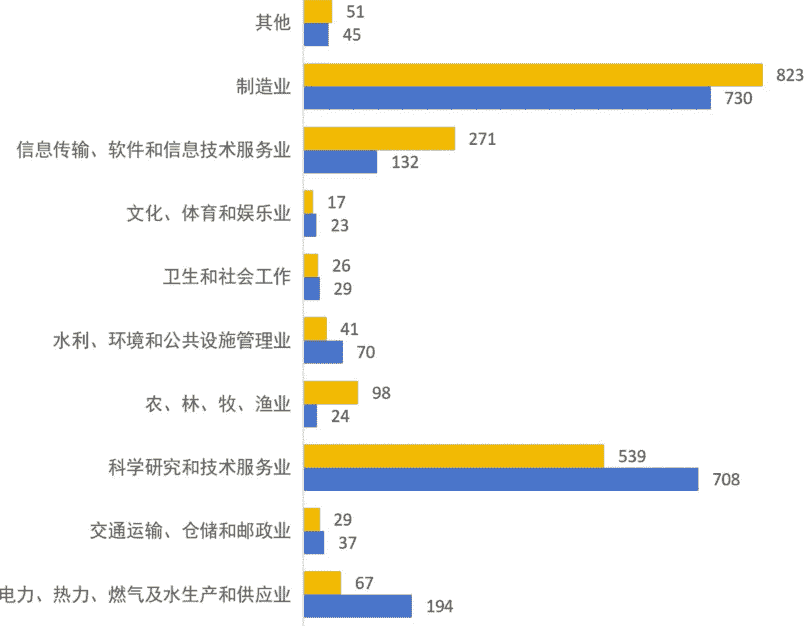

- 以转化、许可、合作投资方式转化成果（项）
- 以技术开发、咨询、项目服务转化成果（项）

图 5-9 按转化成果主要流向整体情况

这一分布结构与我的基础产业高度契合。制造业作为陕西的支柱产业，展现出对技术的强吸引能力。同时，信息技术的活跃转型反映了我省在相关领域的技术积累与人才优势，能够资源化工相关行业的较高占比符合我既有的产业布局。此外，科学研究和技术服务业的活跃，在一定程度上体现了陕西现代服务业的快速发展以及经济结构转型升级的积极成效。

但也注意到，农业与医药等相关领域的成果转化依然不足。尽管陕西作为农业大省与科技资源丰富的双重优势，并拥有雄厚的医疗资源，但其科技成果未能充分转化于领先的创新发展，转化效能尚未完全释放，未来仍很大提升空间。

## 第六章 成果转化收入的奖励分配情况

本报告调研单位成果转化实现的收入共计奖励19,920人次，其中，现金奖励19,860人次，股权奖励60人次。单位获得的总收入为10.38亿元，留比例为24.57%；个人获得的3.15亿元，奖励个人比例为75.43%。对完成团队的个人奖励比例虽高于《促进改进科技成果转化条例》所规定的50%，但离《陕西省促进改进科技成果转化条例》（2018年2月1日起实施）所倡导的低于90%，仍有较大距离，仍需进一步提升奖励幅度，激励科研人员的转化能力。

表6-1 成果转化收入奖励分配情况

| 序号 | 项目 | 2024年度 |
| --- | --- | --- |
| 现金收入 | 转让、许可的科技成果转化当年留归单位（万元） | 5,242 |
| | 分配的现金奖励总收入（万元） | 奖励个人（万元） | 14,508 |
| 及奖励 | 转让、许可的科技成果获得的现金收入奖励个人（次） | 1,903 |
| | 技术开发、咨询、服务项目当年实现留归单位（万元） | 94,937 |
| | 分配的现金奖励总收入（万元） | 奖励个人（万元） | 294,186 |
| 股权收入 | 技术开发、咨询、服务项目获得的现金收入奖励个人（次） | 17,957 |
| 及奖励 | 作价投资的科技成果转化当年实现留归单位（万元） | 3,591 |
| | 分配的股份金额（万元） | 奖励个人（万元） | 9,802 |
| | 股权奖励个人（次） | 60 |

| 序号 | 奖励情况汇总 | 2024 年度 |
| --- | --- | --- |
| | 以上一、二对单位获得现金和股权收入总额（万元） | 103,770 |
| | 以上一、二对个人现金、股权奖励总额（万元） | 318,497 |
| 三 | 以转许、许可、股份投资方式转化科研成果单位获得现金、股权收入总额（万元） | 8,833 |
| | 以转许、许可、股份投资方式转化科研成果个人获得现金、股权收入总额（万元） | 24,311 |

* 剔除了研发与转化主要贡献人员，原因因素与奖励个人奖项值一致。

从具体细节来看，成果转化方式中转许/许可获得收益奖励给个人14,508 万元（高校13,465 万元），相比人均奖励高（约 7.62 万元/人）。技术开发/咨询/服务方式中奖励个人294,186 万元（高校294,031 万元），占比大但人均奖励低（约 16.38 万元/人）。股权创造价值中值3,591 万元，奖励个人9,802 万元，奖励60 次（人均 163.4 万元）。

### 6.1 资金分配

科技成果转化奖励呈现“技术开发为主、高校核心为承、个人收益优先”的特征。从现金奖励情况来看，总额为308,694 万元，覆盖科研人员19,860 人。其中：技术开发、咨询、服务项目类贡献核心份额，个人均奖励294,816 万元（占总金额95.3%），覆盖17,957 人（占总人数90.4%）。转许，许可转化中个人奖励14,508 万元（占总金额4.7%），覆盖1,903 人（占9.6%）。单位留资金合计100,179 万元，技术开发留94,937 万元（94.8%），转许、许可材料留5,242 万元（5.2%）。个人奖励总额为单位留资金的3.08 倍，收益分配向科研人员倾斜的政策。

表 6-2 成果转化资金奖励情况

| 转许、许可的成果转化 | 技术开发、咨询、服务项目 | 合计 |
| --- | --- | --- |
| 现金留单位（万元） | 5,242 | 94,937 | 100,179 |
| 现金奖励（万元） | 14,508 | 294,186 | 308,694 |
| 现金奖励（次） | 1,903 | 17,957 | 19,860 |

按机构分布来看，技术开发项目中，高校获得奖励294,031 万元（占总金额99.6%），覆盖17,889 次（99.4%）；转许、许可项目中，高校奖励13,465 万元（占92.8%），覆盖1,733 次（91.1%）。单位留资金集中于技术开发94,365 万元。

表 6-3 按转化方式划分成果转化现金奖励分布

| 项目 | 总计 | 其中 | 高校 | 其它机构 |
| --- | --- | --- | --- | --- |
| 转许、许可的科技成果现金留单位（万元） | 5,242 | 3,128 | 102 | 2,012 |
| 转许、许可的科技成果现金奖励（万元） | 14,508 | 13,465 | 414 | 630 |
| 转许、许可的科技成果现金奖励（次） | 1,903 | 1,733 | 135 | |
| 技术开发、咨询、服务项目现金留单位（万元） | 94,937 | 94,365 | 445 | 128 |
| 技术开发、咨询、服务项目现金奖励（万元） | 294,186 | 294,031 | 118 | 37 |
| 技术开发、咨询、服务项目现金奖励（次） | 17,957 | 17,889 | 63 | 5 |

### 6.2 股权收益

股权奖励的激励强度最为明显，虽然奖励人数少（60人），但均奖励金额（163.4 万元）远高于现金奖励，这体现出股权奖励是激励科研人员进行高价值、长期创业的重要手段。此外，高校科研人员仍是奖励的主体，几乎奖励都发生在高校。而科研院所和其他机构尚未转化收益分配上突破，未来需要完善转化收益的分配办法，确保大部分科研人员都能享受到红利。

表 6-4 成果转化收益总体情况

| 项目 | 总计 | 其中 | 高校 | 科研所 | 机构 |
| --- | --- | --- | --- | --- | --- |
| 股权留单位（万元） | 3,591 | 3,591 | 0 | 0 |
| 股权奖励个人（万元） | 9,802 | 9,789 | 13 | 0 |
| 股权奖励人次（万） | 60 | 57 | 3 | 0 |

# 高等院校篇

## 第一章 概况

陕西省拥有高等学校11所，其中，普通本科高校55所（含独立学院10所），本科层次职业学校2所，高职（专科）学校40所，成人高等学校14所。在校学生201.81万人，专任教师8.36万。核心竞争力居全国前列。

样本62高校占陕西高等学校比例55.86%，覆盖所有普通本科高校，能够较为全面地代表陕西省高校的研究水平。从科技转化成效上看，2024年，陕西省62所高等院校签订科技成果合同22,915份，合同金额总计971,663.51万元，科技转化方式主要有转让、许可、作价投资以及技术开发、技术咨询、技术服务等六种。

表 1—1 高高等学校科技转化成果整体情况表

| 序号 | 大学名称 | 单位性质 | 主管部门 |
| --- | --- | --- | --- |
| 1 | 西安交通大学 | | 教育部 |
| 2 | 西安电子科技大学 | | 教育部 |
| 3 | 长安大学 | 央属院校 | 教育部 |
| 4 | 西北工业大学 | | 工业和信息化部 |
| 5 | 陕西师范大学 | | 教育部 |
| 6 | 西北农林科技大学 | | 教育部 |
| 7 | 陕西科技大学 | | 陕西省教育厅 |
| 8 | 西安理工大学 | | 陕西省教育厅 |
| 9 | 陕西理工大学 | 省省属院校 | 陕西省教育厅 |
| 10 | 西安工程大学 | | 陕西省教育厅 |
| 11 | 西安建筑大学 | | 陕西省教育厅 |

| 序号 | 大学名称 | 单位性质 | 主管部门 |
| --- | --- | --- | --- |
| 12 | 西安石油大学 | | 陕西省教育厅 |
| 13 | 杨职业技术学院 | | 陕西省教育厅 |
| 14 | 西安科技大学 | | 陕西省教育厅 |
| 15 | 北北大学 | | 陕西省教育厅 |
| 16 | 西安航空职业技术学院 | | 陕西省教育厅 |
| 17 | 宝鸡理工学院 | | 陕西省教育厅 |
| 18 | 西安铁路职业技术学院 | | 陕西省教育厅 |
| 19 | 商洛学院 | | 陕西省教育厅 |
| 20 | 西安航空学院 | | 陕西省教育厅 |
| 21 | 西安邮电大学 | | 陕西省教育厅 |
| 22 | 西安理学院 | | 陕西省教育厅 |
| 23 | 西安医学院 | | 陕西省教育厅 |
| 24 | 西安工业大学 | | 陕西省教育厅 |
| 25 | 陕西工业职业技术学院 | 省属院校 | 陕西省教育厅 |
| 26 | 延安大学 | 省属院校 | 陕西省教育厅 |
| 27 | 陕西国防职业技术学院 | 省属院校 | 陕西省教育厅 |
| 28 | 陕西铁路职业技术学院 | 省属院校 | 陕西省教育厅 |
| 29 | 成阳师范学院 | 省属院校 | 陕西省教育厅 |
| 30 | 安康学院 | 省属院校 | 陕西省教育厅 |
| 31 | 渭南师范学院 | 省属院校 | 陕西省教育厅 |
| 32 | 陕西能源职业技术学院 | 省属院校 | 陕西省教育厅 |
| 33 | 西安外国大学 | 省属院校 | 陕西省教育厅 |
| 34 | 陕西工商职业学院 | 省属院校 | 陕西省教育厅 |
| 35 | 咸业职业技术学院 | 省属院校 | 陕西省教育厅 |
| 36 | 西安财经大学 | 省属院校 | 陕西省教育厅 |
| 37 | 陕西中医药大学 | 省属院校 | 陕西省教育厅 |
| 38 | 商洛职业技术学院 | 省属院校 | 陕西省教育厅 |
| 39 | 安康职业技术学院 | 省属院校 | 陕西省教育厅 |

| 序号 | 单位名称 | 单位性质 | 主管部门 |
| --- | --- | --- | --- |
| 40 | 宝鸡职业技术学院 | | 陕西省教育厅 |
| 41 | 延安职业技术学院 | | 陕西省教育厅 |
| 42 | 榆林学院 | | 陕西省教育厅 |
| 43 | 榆林职业技术学院 | | 陕西省教育厅 |
| 44 | 汉中职业技术学院 | | 陕西省教育厅 |
| 45 | 渭南职业技术学院 | | 陕西省教育厅 |
| 46 | 西北政法大学 | | 陕西省教育厅 |
| 47 | 西安体育学院 | | 陕西省教育厅 |
| 48 | 西安电力高专学校 | | 陕西省教育厅 |
| 49 | 西安美术学院 | | 陕西省教育厅 |
| 50 | 西安职业技术学院 | | 陕西省教育厅 |
| 51 | 西安音乐学院 | 陕西属院校 | 陕西省教育厅 |
| 52 | 铜川职业技术学院 | | 陕西省教育厅 |
| 53 | 陕西交通职业技术学院 | | 陕西省教育厅 |
| 54 | 陕西师范学院 | | 陕西省教育厅 |
| 55 | 陕西机电职业技术学院 | | 陕西省教育厅 |
| 56 | 陕西职业技术学院 | | 陕西省教育厅 |
| 57 | 陕西航空职业技术学院 | | 陕西省教育厅 |
| 58 | 陕西艺术职业学院 | | 陕西省教育厅 |
| 59 | 陕西警察学院 | | 陕西省教育厅 |
| 60 | 陕西财经职业技术学院 | | 陕西省教育厅 |
| 61 | 陕西邮政职业技术学院 | | 陕西省教育厅 |
| 62 | 陕西青年职业技术学院 | | 陕西省教育厅 |

表 1-2 高等院校科技转化整体情况汇总表

| 序号 | 分类 | 项目 | 总计 | 其中:财政财助 | 中央财政财助 |
| --- | --- | --- | --- | --- | --- |
| | | | 2024 年度 | | |
| 一 | 以转让方式化科技成果 | 合同项数（项） | 1,510 | 144 | |
| | | 合同金额（万元） | 46,940.08 | 3,996.42 | 2,325.69 |
| | | 当年到账金额（万元） | 20,101.77 | 1,805.09 | 1,269.50 |
| 二 | 以许可方式化科技成果 | 合同项数（项） | 320 | 61 | 46 |
| | | 合同金额（万元） | 8,159.31 | 3,263.85 | 2,499.25 |
| | | 当年到账金额（万元） | 6,618.87 | 2,320.24 | 1,762.19 |
| 三 | 以价投资科技成果 | 合同项数（项） | 31 | 16 | 15 |
| | | 作价金额（万元） | 14,188.36 | 6,105.16 | 5,745.16 |
| | | 单位以股形成的股权值（万元） | 144,879.59 | 28,022.56 | 27,429.56 |
| 四 | 技术开发项目 | 合同项数（项） | 7,730 | 0 | 0 |
| | | 合同金额（万元） | 459,309.44 | 0 | 0 |
| | | 当年到账金额（万元） | 281,189.24 | 0 | 0 |
| 五 | 技术咨询项目 | 合同项数（项） | 1,650 | 0 | 0 |
| | | 合同金额（万元） | 33,986.35 | 0 | 0 |
| | | 当年到账金额（万元） | 29,790.04 | 0 | 0 |
| 六 | 技术服务项目 | 合同项数（项） | 1,674 | 0 | 0 |
| | | 合同金额（万元） | 409,079.97 | 0 | 0 |
| | | 当年到账金额（万元） | 331,715.90 | 0 | 0 |
| 合计 | 以上一、二、三、四、五、六项 | 成果转让、许可、作价投资项目和技术开发、咨询、服务项目总（项） | 971,661.53 | 13,365.43 | 10,570.10 |
| | 以上一、二、四、五、六项 | 成果转让、许可项目和技术开发、咨询、服务项目 | 669,415.42 | 4,125.33 | 3,031.69 |
| | | 当年到账金额（万元） | | | |

| 序号 | 分类 | 项目 | 2024 年度 总计 | 其中:财政资助 | 中央财政资助 |
| --- | --- | --- | --- | --- | --- |
| | | 立项批复的科技项目数（项） | 12,297 | | 4,123 |
| 七 | 获得财政资金的科技项目 | 立项批复的科技项目（课题）总金额（万元） | 666,891.41 | 661,018.97 | 418,250.27 |
| | | 项目（课题）资金当年到账金额（万元） | 700,702.36 | 700,399.06 | 539,989.59 |
| | | 设置（联合设立）科技转化相关基金数（支） | 0 | 0 | 0 |
| | | 基金累计规模（万元） | 0 | 0 | 0 |
| | | 自建概念认证中心数（个） | 9 | 0 | 0 |
| | | 自建概念认证中心当年新增项目数（个） | 76 | 0 | 0 |
| | | 自建中试平台数（个） | 3 | 0 | 0 |
| | | 自建中试平台当年新增服务项目数（个） | 3 | 0 | 0 |
| | | （市级及以上）认定的科学仪器设备平台数（个） | 28 | 0 | 0 |
| 八 | 其他相关指标 | （市级及以上）认定的科学仪器设备平台固定资产原值（万元） | 94,420.29 | 0 | 0 |
| | | 与企业共研发机构、转移机器、转化服务平台数（个） | 641 | 170 | 48 |
| | | 自建技术转移项目数（个） | 57 | 0 | 0 |
| | | 专职从事科技成果转化工作人数（个） | 468 | 0 | 0 |
| | | 与本单位合作开展科技成果市场化转移机构数（个） | 148 | 0 | 0 |
| | | 在外职从事成果转化人员和离创业人员（人） | | | |
| | | 创设公司和参股数（个） | 298 | 0 | 0 |
| | | 单位研究与试验（R&D）经费总金额（万元） | 1,256.23 | | |

## 第二章 转化方式

### 2.1 转化方式总体情况

表 2-1 科技成果转化方式总体情况

| 项目 | 以转让、许可、作价投资方式转化科技成果 | 以技术开发、咨询、服务转化科技成果 | 总计 |
|---|---|---|---|
| 合同项数（个） | 1,861 | 21,054 |  |
| 合同金额（万元） | 69,287.75 | 902,375.76 | 971,663.51 |
| 当年到账金额（万元） | 26,720.64 | 592,342.99 | 619,063.63 |

2024年，陕西省高等院校科技成果转化总计22,915项，合同金额总计97.17亿元，当年到账金额61.91亿元。其中，以转让、许可、作价投资方式转化科技成果的合同数量为1,861项，合同金额为6.93亿元，当年到账金额为2.67亿元；以技术开发、咨询、服务转化科技成果的合同数量为21,054项，合同金额为90.24亿元，当年到账金额为59.23亿元。

### 2.2 转让、许可、作价投资方式转化科技成果

2024年，陕西省高等院校以转让、许可、作价投资方式转化科技成果的合同数量为1,861项，合同金额为6.93亿元，当年到账金额为2.67亿元。其中，中央院校合同数量为533项，合同金额为3.41亿元，当年到账金额为1.19亿元；省属院校合同数量为1,328项，合同金额为3.52亿元，当年到账金额为1.48亿元。

表 2-2 以转让、许可、价投资方式转化科技成果总体情况

| 项目 | 头部高校 | 省高校 | 总计 |
| --- | --- | --- | --- |
| 合同项（个） | 533 | 1,328 | 1,861 |
| 合同金额（万元） | 34,062.85 | 35,224.90 | 69,287.75 |
| 当年到账金额（万元） | 11,938.60 | 14,782.04 | 26,720.64 |

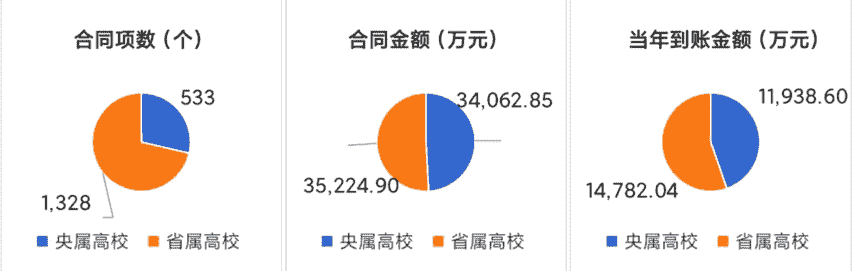

### 2.2.1 转让方式

2024年，陕西省高等高校以转让方式转化科技成果的合同数量为1,510个，合同金额为4.69亿元，当年到账金额为2.01亿元。其中，头部高校合同数量为349项，合同金额为1.60亿元，当年到账金额为0.65亿元；省高校合同数量为1,161项，合同金额为3.09亿元，当年到账金额为1.36亿元。

表 2-3 以转让方式转化科技成果总体情况

| 项目 | 头部高校 | 省高校 | 总计 |
| --- | --- | --- | --- |
| 合同项（个） | 349 | 1,161 | 1,510 |
| 合同金额（万元） | 16,006.78 | 30,933.30 | 46,940.08 |
| 当年到账金额（万元） | 6,536.17 | 13,565.60 | 20,101.77 |

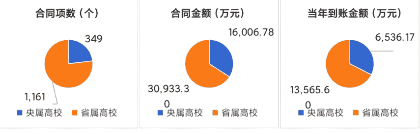

### 2.2.2 许可方式

2024年，陕西高等院校以许可方式转化科技成果的合同数量为320项，合同金额为8,159.31万元，当年到账金额为6,618.87万元。其中，中央属高校合同数量为166项，合同金额为6,831.91万元，当年到账金额为5,402.43万元；省属高校合同数量为154项，合同金额为1,327.40万元，当年到账金额为1,216.44万元。

表 2—4 以许可方式转化科技成果总体情况

| 项目 | 中央属高校 | 省属高校 | 总计 |
|---|---|---|---|
| 合同项数（个） | 166 | 154 | 320 |
| 合同金额（万元） | 6,831.91 | 1,327.40 | 8,159.31 |
| 当年到账金额（万元） | 5,402.43 | 1,216.44 | 6,618.87 |

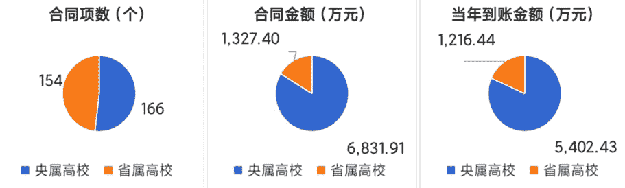

### 2.2.3 作价投资

2024年，陕西高等院校以价投资转化科技成果的合同数量为31项，合同金额为1.42亿元。其中，中央属高校合同数量为18项，合同金额为1.12亿元；省属高校合同数量为13项，合同金额为2,964.20万元。

表 2—5 以价投资转化科技成果总体情况

| 项目 | 中央属高校 | 省属高校 | 总计 |
|---|---|---|---|
| 合同项数（个） | 18 | 13 | 31 |
| 合同金额（万元） | 11,224.16 | 2,964.20 | 14,188.36 |

### 2.3 技术开发、咨询、服务转化

2024年，陕西省高等院校以技术开发、咨询、服务转化科技成果的合同数量为21,054项，合同金额为90.22亿元，当年到账金额为59.23亿元。其中，中央属高校合同数量为9,176项，合同金额为52.58亿元，当年到账金额为31.22亿元；省属高校合同数量为11,878项，合同金额为37.66亿元，当年到账金额为28.02亿元。

表 2-6 以技术开发、咨询、服务转化科技成果总体情况

| 项目 | 中央属高校 | 省高校 | 总计 |
|---|---|---|---|
| 合同项数（个） | 9,176 | 11,878 | 21,054 |
| 合同金额（万元） | 525,775.37 | 376,600.39 | 902,375.76 |
| 当年到账金额（万元） | 312,168.11 | 280,174.88 | 592,342.99 |

### 2.3.1 技术开发

2024年，陕西高等院校以技术转化科技成果的合同数量为7,730项，合同金额为45.95亿元，当年到账金额为28.12亿元。其中，中央直属高校合同数量为4,413项，合同金额为32亿元，当年到账金额为18.82亿元；省属高校合同数量为3,317项，合同金额为13.72亿元，当年到账金额为9.30亿元。

表 2-7 以技术转化科技成果总体情况

| 项目 | 中央属高校 | 省属高校 | 总计 |
|---|---|---|---|
| 合同项数（个） | 4,413 | 3,317 | 7,730 |
| 合同金额（万元） | 322,127.32 | 137,182.12 | 459,309.44 |
| 当年到账金额（万元） | 188,166.64 | 93,022.60 | 281,189.24 |

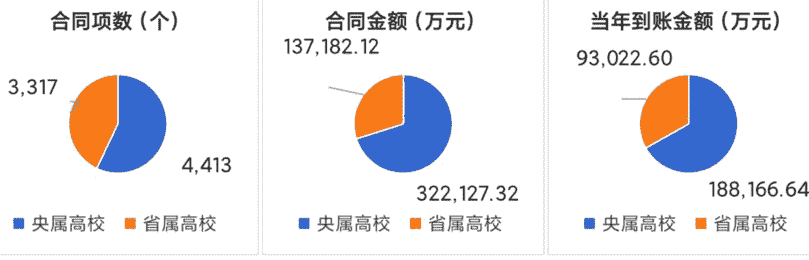

### 2.3.2 技术咨询

2024年，陕西高等院校以技术咨询科技成果的合同数量为1,650项，合同金额为40亿元，当年到账金额为2.98亿元。其中，中央属高校合同数量为663项，合同金额为1.78亿元，当年到账金额为1.56亿元；省属高校合同数量为987项，合同金额为1.62亿元，当年到账金额为1.42亿元。

表 2-8 以技术咨询转化科技成果总体情况

| 项目 | 中央属高校 | 省属高校 | 总计 |
|---|---|---|---|
| 合同项数（个） | 663 | 987 | 1,650 |
| 合同金额（万元） | 17,833.48 | 16,152.87 | 33,986.35 |
| 当年到账金额（万元） | 15,551.37 | 14,238.67 | 29,790.04 |

### 2.3.3 技术服务

2024年，陕西高等院校以技术服务转化科技成果的合同数量为11,674项，合同金额为40.91亿元，当年到账金额为33.17亿元。其中，中央属高校合同数量为4,100项，合同金额为18.58亿元，当年到账金额为10.85亿元；省属高校合同数量为7,574项，合同金额为22.33亿元，当年到账金额为22.33亿元。

表 2-9 以技术服务科技成果总体情况

| 项目 | 中央属高校 | 省属高校 | 总计 |
|---|---|---|---|
| 合同项数（个） | 4,100 | 7,574 | 11,674 |
| 合同金额（万元） | 185,814.57 | 223,265.40 | 409,079.97 |
| 当年到账金额（万元） | 108,450.10 | 223,265.40 | 331,715.50 |

### 2.4 财政资助项目的科技转化

头部高校在财政资助科技成果转化的合同数（181项）和合同金额（1.25亿元）占主导，但资金到位率仅29.6%，而省属高校规模较小（合同数40项、金额817.85万元），资金到位率高达49.8%，反映出头部高校项目规模大但执行效率低，省属高校资金获取能力不足。

表 2—11 财政资助科技成果转化整体情况

| 项目 | 头部高校 | 省属高校 | 总计 |
|---|---|---|---|
| 财政资助合同项数（个） | 181 | 40 | 221 |
| 财政资助合同金额（万元） | 12,547.58 | 817.85 | 13,365.43 |
| 财政资助当年到账金额（万元） | 3,718.48 | 406.85 | 4,125.33 |

表 2—11 以转让、许可、作投资方式转化科技成果的财政资金支持情况

| 项目 | 转让方式 | 许可方式 | 作价投资方式 | 总计 |
|---|---|---|---|---|
| 财政资助合同项数（个） | 144 | 61 | 16 | 221 |
| 财政资助合同金额（万元） | 3,996.42 | 3,263.85 | 6,105.16 | 13,365.43 |
| 财政资助当年到账金额（万元） | 1,805.09 | 2,320.24 | / | 4,125.33 |

## 第三章 技术转移与人才建设

### 3.1 技术转移机构

陕西省高等院校中，均建概念证中心9个，均为中央属校。2024年新服务项目数量76个；自建中试平台3台，均为中央属校。2024年新服务项目数量7个（市级及以上），认定共享平台28个，固定资产94,429万元；开展市场化转移机构148个，其中中央属高校60个、省属高校88个，分别为40.54%、59.50%。

### 3.2 人才建设

陕西省高等院校中，专职从事科技成果工作468人，其中中央属高校219人、省属高校249人，分别为46.79%、53.21%。兼职从事科技成果转化人员854人，其中中央属高校725人、省属高校129人，分别为84.89%、15.11%。创业人员298人，其中中央属高校100人、省属高校198人，分别为33.56%、66.44%。

## 第五章 成果转化的流向

### 5.1 科技成果承接单位

从本次调研的数据来看，陕西高等院校科技成果主要转化至境内中小微企业。2024年陕西省高等院校科技成果转化至境内、境外数量分别为4,000项、3项，合同金额分别为502,822.20万元、557.14万元。

在境内转化的科技成果中，转化至中小微企业、大型企业、非企业单位的科技成果数量分别为2,847项、738项、415项，占科技成果合同总数的比例分别为71.12%、18.44%、10%，合同金额分别为298,454.46万元、134,188.10万元、70,179.64万元，占合同总金额的比重59.29%、26.66%、13.94%。

### 5.2 本地转化和跨区域转化

2024年，陕西省高等院校46.67%的科技成果在本地实现转化，服务本地，本地转化的合同数量为1,864项，合同金额为219,786.47万元，跨区域转化的合同数量为2,139项，合同金额为283,591.88万元。

本地转化的合同中，转化至西安的合同数量为1,425项，合同金额为171,698万元。

表 4-1 成果转化定价方式分布

| 合同数（个） | 合同金额（万元） |
|---|---|
| 704 / 1,297 | 15,037.26 / 57,801.87 |

表 4-2 成果转化定价方式评估

科技成果转化过程中，经过评估的成果为704项，占总数的35.18%，合同金额为57,801.87万元，占总金额的79.36%，平均合同金额82.10万元；未经过评估的成果为1,297项，占总数的64.82%，合同金额为15,037.26万元，占总金额的20.64%，平均合同金额11.59万元。

表 5-3 科技成果本地转化分布

| 合同数（个） | 合同金额（万元） |
|---|---|
| 1,864 / 2,139 | 219,786.47 / 283,591.88 |

表 5-4 科技成果跨区域转化

| 合同数（个） | 合同金额（万元） |
|---|---|
| 1,425 | 171,698 |

表 5-5 科技成果跨区域转化合同项数地区

| 地区 | 合同数 |
|---|---|
| 阿拉伯酋长国 | 1 |
| 日本 | 2 |
| 重庆市 | 24 |
| 浙江省 | 134 |
| 云南省 | 134 |
| 新疆自治区 | 6 |
| 西藏自治区 | 21 |
| 天津市 | 134 |
| 四川省 | 107 |
| 上海市 | 39 |
| 山西省 | 146 |
| 山东省 | 146 |
| 青海省 | 17 |
| 宁夏回族 | 16 |
| 内蒙古自治区 | 20 |
| 辽宁省 | 60 |
| 江西省 | 20 |
| 江苏省 | 178 |
| 吉林省 | 9 |
| 湖南省 | 33 |
| 湖北省 | 69 |
| 黑龙江省 | 19 |
| 河南省 | 77 |
| 河北省 | 36 |
| 海南省 | 11 |
| 贵州省 | 15 |
| 广西壮族自治区 | 13 |
| 广东 | 448 |
| 甘肃省 | 36 |
| 福建省 | 24 |
| 北京市 | 266 |
| 安徽省 | 112 |

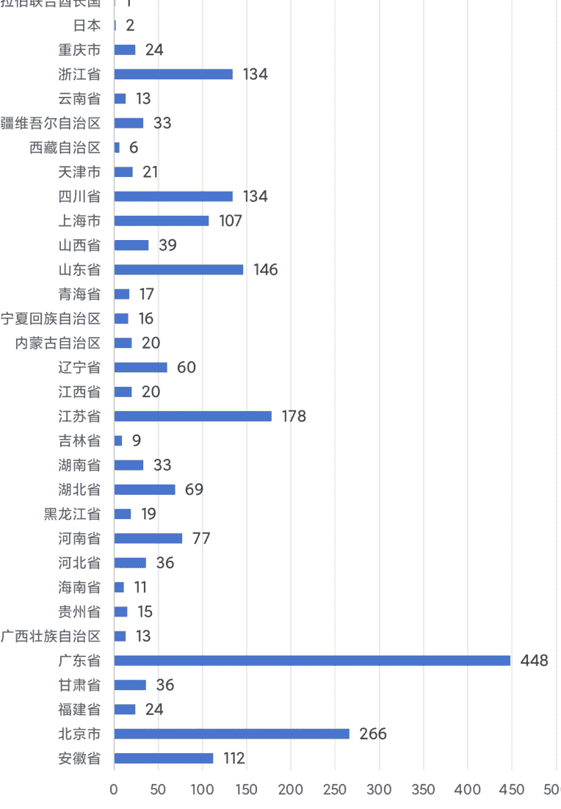

## 成果转化的流向 第五章

#### 合同金额（万元）

| | | | 合同金额（万元） |
| :--- | :--- | :--- |
| 阿拉伯联合国 | | 550.49 |
| 日本 | | 6.65 |
| 重庆市 | | 4,512.8 |
| 浙江省 | | 15,141.15 |
| 云南省 | | 4,443.91 |
| 新疆自治区 | | 2,723.66 |
| 西藏自治区 | | 2,822.71 |
| 天津市 | | 16,081.53 |
| 四川省 | | 14,799.67 |
| 上海市 | | 11,456.56 |
| 山东省 | | 10,935.16 |
| 青海省 | | 2,244.08 |
| 宁夏回族自治区 | | 950.24 |
| 内蒙古自治区 | | 3,269.33 |
| 辽宁省 | | 11,907.86 |
| 江西省 | | 1,330.88 |
| 江苏省 | | 23,663.88 |
| 吉林省 | | 1,266.97 |
| 湖南省 | | 9,704.08 |
| 湖北省 | | 12,206.06 |
| 黑江省 | | 485.95 |
| 河南省 | | 8,396.95 |
| 河北省 | | 5,809.85 |
| 海南省 | | 1,808.1 |
| 贵州省 | | 2,681.3 |
| 广西壮族自治区 | | 1,355.17 |
| 广东省 | | 48,218.03 |
| 甘肃省 | | 3,891.14 |
| 福建省 | | 3,499.36 |
| 北京市 | | 49,535.16 |

图 5-6 科技成果跨区域合同金额地区分布

### 5.3 科技成果行业领域去向

2024 年，陕西省高等高校科技成果转化至制造业的合同数量最多，且合同金额最高。按高等院校科技成果应用的领域统计，2024年陕西省高等院校以转让、许可、投资以及技术开发、咨询、服务方式转化合同数量前3位的位依次为“制造业”“科学研究和技术服务业”“信息传输、软件和信息技术服务业”，其合同数量分别为1,553项、1,288项、411项，占合同数量的比重分别为38.80%、31.27%、10.27%；合同金额前3位的依次为“制造业”“科学研究和技术服务业”“电力、热力、燃气及水生产供应业”，其合同金额分别为19.73亿元、19.53亿元、8.11亿元，合同总金额的比分别为39.20%、31.64%、11.53%。

#### 合同数量（个）

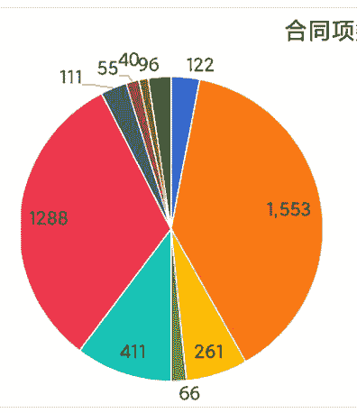

- 农、林、牧、渔业
- 制造业
- 电力、热力、燃气及水生产供应业
- 交通运输、仓储和邮政
- 信息传输、软件和信息技术服务业
- 科学研究和技术服务业
- 水利、环境和公共设施管理
- 卫生和社会工作
- 文化、体育和娱乐
- 其他

图5-7 科技成果跨行业领域合同数量分布

#### 合同金额（万元）

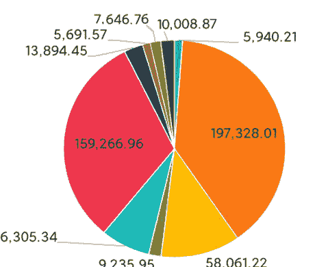

- 农、林、牧、渔业
- 制造业
- 电力、热力、燃气及水生产供应业
- 交通运输、仓储和邮政
- 信息传输、软件和信息技术服务业
- 科学研究和技术服务业
- 水利、环境和公共设施管理
- 卫生和社会工作
- 文化、体育和娱乐
- 其他

图5-8 科技成果跨行业领域合同金额

## 第六章 成果转化收入的分配

2024年，陕西省高等院校科研成果转化奖励总额为40.50亿元。从分配对象看，单位获得的现金奖励金额为8.11亿元，个人获得的现金奖励金额为31.73亿元（占分配总额的75.84%），研发与转化主要贡献人员获得的现金奖励金额为31.58亿元（占奖励金额的99.53%）。从奖励形式看，现金奖励总额为40.50亿元，股权奖励总额为1.34亿元。

整体收益分配呈现“个人为主、股权为辅”的格局，其背后是政策设计。一方面，高比例的收益分配旨在激发科研人员创新活力；另一方面，股权比例低的一个关键原因在于国资管理对持有股权的实现困难，面临严格的审批、审计与退出流程、成本高昂。在此，倾向于采取现金形式，有效规避了国资管理的风险。

### 6.1 现金分配

2024年，陕西省高等院校科研成果转化奖励总额为40.50亿元。单位获得的现金奖励金额为8.11亿元，个人获得的现金奖励金额为31.73亿元，占比分别为24.07%、75.93%，奖励人次为19,622次，人均现金奖励为20.66万元。其中，转让、许可的科技成果转化现金奖励为1.66亿元，单位与个人分别为18.85%，奖励人次为733次，人均现金奖励为9.75万元；技术开发、咨询、服务项目获得的现金奖励为38.84亿元，单位与个人分别为24.30%、75.70%，奖励人次为17,889次，人均现金奖励为21.71万元。

表 6-1 科技成果转化现金分配情况

| 项目 | 单位 | 个人 | 总计 | 人次 |
| :--- | :--- | :--- | :--- | :--- |
| 转让、许可的科技成果获得的现金奖励（万元） | 3,127.69 | 13,464.54 | 16,592.23 | 1,733 |
| 技术开发、咨询、服务项目获得的现金奖励（万元） | 94,364.53 | 294,030.99 | 388,395.52 | 17,889 |
| 总计（万元） | 97,492.22 | 307,495.53 | 404,987.75 | 19,622 |

### 6.2 股权收益分配

2024年，陕西省高等院校科研成果获得股权奖励总额为1.34亿元，单位获得的股权奖励金额为0.36亿元，个人获得的股权奖励金额为0.98亿元，且均为研发与转化主要贡献人员所获得。其中，个人获得的股权奖励占分配总额的73.13%，奖励人次为57次，人均股权奖励金额为234.74万元。

## 第七章

作为科技成果的重要来源，陕西的高校科技成果转化已形成多种模式并行发展的格局，包括专利转让、技术许可、知识产权投入、“技术服务+转让”、职务科技成果赋权等转化方式，以及校企联合研发平台、概念验证中心、产学协同创新共同体等深度合作模式。越来越多的高校通过建立专业化的技术转移平台和基金，正积极探索“成果转化+资本助力+产业化”的全链条路径，不断提升转化效能。

表 7-1 陕西高校科技成果转化模式

| 转化模式 | 核心逻辑 | 高校典型案例 |
| :--- | :--- | :--- |
| 转让 | 高校将专利或知识产权的所有权直接转给企业，企业获得完整技术产权，快速实现技术落地 | 陕西中医药大学 |
| 许可 | 高校保留专利或知识产权的所有权，仅用授权转给企业，企业在授权范围内使用技术 | 西安电子科技大学 |
| 技术服务+转让的混合模式 | 以技术输出同步有利于产权转让，直接解决企业问题 | 榆林学院 |
| 职务科技成果赋权 | 高校转让部分科技成果所有权给团队，由团队联合成立创业公司，推动技术市场化运营 | 西安大学 |
| 知识产权入股 | 高校将专利、专有技术等知识产权进行专业评价，以股权形式与企业合作 | 西安理工、西北工业大学 |
| 校企分工协同转化 | 高校聚焦技术研发与优化，企业承担中试、规模化生产 | 陕西职业学院 |

### 7.1 转化——陕西中医药大学

针对传统胶囊剂不足、成本高、耐热性、稳定性低等痛点，陕西中医药大学研发团队以改性胶囊材料，形成核心专利，通过转让实现技术落地，达到国内领先水平，推动用药品绿色化。

表 7-2 陕西中医药大学措施

| 转化方式 | 转化成效 |
| :--- | :--- |
| 以专利转让为核心，将专利转给企业，精准匹配企业对新型药品的需求，从实验室走向生产线。 |
| 联动政府政策基金（500万）、安全基金（200万）及激励中心（1000万），解决外进口、“成本高”痛点，加速技术孵化周期。 |
| 按管理规定转化效益（85%奖励6人、50项项目），充分激发团队积极性，同时为学校后续成果储备。 |

【经验启示】
一是研发锁定产业“真痛点”。围绕用领域核心材料开展技术攻关，确保具备市场需求，避免研发与应用脱节。
二是中小技术转化依托政府扶持。借助政府平台、社会资本（专项经费）解决等地难题，降低转化门槛。
三是清晰的收益机制是关键。明确奖励绩效有效动力科研人员参与转化的主动性，破解僵局。

### 7.2 许可——西安电子科技大学

针对信号处理领域“小型化、依赖进口”痛点，西安电子科技大学联合企业研发性能优于国外的国产雷达芯片，团队具有自主知识产权的信息系统。

### 7-3 西安理工大学的主要方法及成效

| 特化能 | 转换效率 |
| :--- | :--- |
| 以专利许可为路径、分“精研攻关-小试点-规模化应用”三阶段推进，发展军用技术可控性与民用领域（无人系统、图像处理）渗透，突破国家芯片自主控。 |
| 历时4年开展技术迭代、结合企业试用反馈，持续化性能。确保产品适配科研院所、企业的实际市场需求，提升竞争力。 |
| 组建30人跨领域团队（信号处理、集成电路），按40%经费发放奖励绩效。保障团队稳定性与研发效率，为反复复杂技术攻关提供人才。 |

【启示】
一是高端端“卡脖子”技术坚持“迭代式转化”。通过“研发-试用-优化”的循环，缩小与国外差距，实现国产替代。
二是军民融合突破交叉边界。通过专利许可协议规范高校与企业的分工，既发挥高校技术优势，又依托企业生产能力，提升协同效率。
三是跨领域团队是复杂技术攻关的核心。整合多学科专家资源，突破单一领域瓶颈，适配多场景的复合产品。

### 技术服务+转让的混合模式——林学院

针对林檎地药种种植不标准、采矮沉淀区生态修复与产业增效痛点，林学院研发标准化栽培基地，建立6个1.2万亩示范基地，推广“酸果+养”模式，通过技术服务与转让涵盖沉淀区，实现农村净收益1万元，既能复生生态、服务河流保护，又带动村振兴。

表 7-4 林学院的主要成效及成果 | 转化成效 |
| :--- | :--- |
| 结合技术服务（提供植种引导）与专利转让，建立“研发—转化—推广”闭环。 | 动50万全到位国内高端芯片填空白，助力国家实现自主控战略。 |
| 推广技术培养新型品种，创造机会。 | |
| 在土壤沉淀区推广“酸果+复合”模式，每年带来100万元收益，实现生态修复+增效。 | |

### 7.5 西北大学

对于航天、航空装备领域高性能材料和高温热材料长期被国外断供，国产材料性能不足“卡脖子”痛点，西北大学通过碳纤维无损处理、微结构调控等核心技术，开发系数可调控（0.05-0.55）、耐酸高温（>1000°C）且超导热的新型复合材料，成功突破了国外在高性能材料和隔热材料的技术封锁，国际领先，已获60余件专利。

通过后续股权设立西安新材料科技有限公司，以学校科研团队的知识产权入股。项目打破了国外长期垄断，实现了高性能材料的完全自主可控，为国家装备制造提供了坚实保障。全面运营后，展现出卓越的市场潜力和盈利能力，显著提升人才汇聚效应，并通过产业协同发展，实现科技创新与社会发展的良性互动。

表 7-7 西北大学的主要做法及成效

| 转化化彻 | 转化成效 |
| :--- | :--- |
| 依托科研成果改革政策，交部分所有权（70%股份），形成核心引领，推动从实验室走向产业化。 | 经济显著。 |
| 联合企业参与激励，构建动力，满足市场需求。 | 安全、新能源领域提供支持。 |
| 依托政府基金（500万）、安全基金（200万）及激励中心（1000万），解决外进口痛点。 | |

### 7.5.1 西安理工大学

针对大规模集成电路领域，西安理工大学团队攻克核心技术，以24项专利+7项专有技术，研制国内首台硅晶炉。

【启示后续】
一是“院士领衔+国家平台”支撑核心技术攻。依托国家重点实验室和院士团队，汇聚多领域顶尖人才，获国家研发计划、科技支撑计划、国家自然科学基金等20余项科研课题支持，为原始创新和突破“卡脖子”技术提供坚实保障。
二是专业化技术转移构成转化的“加速器”。通过专业化的技术平台，解决高校资金问题，同时保障技术长期价值。
三是知识产权入股灵活。对于半导体设备等大规模领域的，依托研究中心获取先进设备，缩短研发周期，提升成果成熟度。
四是技术转化领先兼“自主可控”与“产业链协同”。在国外断的同时，推动技术与国内市场合作，快速形成产业配套能力，提升竞争力。

# 科研院所篇

| 序号 | 分类 | 项目 | 总计 | 其中:财政政助 | 中央财政政助 |
| :--- | :--- | :--- | :--- | :--- | :--- |
| 三 | 以作价投资形成的转化科技成果 | 合同项数（项） | 1 | 0 | 0 |
| | | 作价金额（万元） | 13 | 13 | 0 |
| | | 单位以作价投入形成的股权总估值（万元） | 430,542.00 | 430,542.00 | 430,542.00 |
| 四 | 技术开发项目 | 合同项数（项） | 128 | 0 | 0 |
| | | 合同金额（万元） | 24,602.35 | 0 | 0 |
| | | 当年到金额（万元） | 24,626.77 | 0 | 0 |
| 五 | 技术咨询项目 | 合同项数（项） | 119 | 0 | 0 |
| | | 合同金额（万元） | 2,915.80 | 0 | 0 |
| | | 当年到金额（万元） | 2,180.00 | 0 | 0 |
| 六 | 技术服务项目 | 合同项数（项） | 120 | 0 | 0 |
| | | 合同金额（万元） | 1,783.32 | 0 | 0 |
| | | 当年到金额（万元） | 2,115.85 | 0 | 0 |
| 合计 | 以上一、二、三、四、五、六项合计 | 科技成果转许、许可、作价投资项目和技术开发、咨询、服务合同项目（项） | 381 | 0 | 0 |
| | | 科技成果转许、许可、作价投资项目和技术开发、咨询、服务项目合同金额（万元） | 31,060.97 | 13 | 0 |
| | | 以上一、二、四、五、六项合计 | 科技成果转许、许可、作价投资项目和技术开发、咨询、服务项目当年到金额（万元） | 28,862.49 | 0 | 0 |
| 七 | 获得财政资金补助的科技项目情况 | 立项批复的科技项目（项） | 361 | | 146 |
| | | 立项批复的科技项目（课题）总金额（万元） | 43,671.98 | 40,855.95 | 35,817.15 |
| | | 项目（课题）资金当年到金额（万元） | 146,153.73 | 102,629.35 | 34,572.70 |

# 概况 第一章

| 序号 | 分类 | 项目 | 总计 | 其中:财政政助 | 中央财政政助 |
|---|---|---|---|---|---|
| | | 2024 年度 | | | |
| | | 设立(联合设立)科技成果转化关系基金数量(个) | 0 | 0 | 0 |
| | | 基金累计认缴规模(万元) | 0 | 0 | 0 |
| | | 自建模拟验证中心数量(个) | 0 | 0 | 0 |
| | | 自建模拟验证中心当年新增验证项目数量(个) | 0 | 0 | 0 |
| | | 自建中试平台数量(个) | 0 | 0 | 0 |
| | | 自建中试平台当年新增服务项目共享平台数量(个) | 0 | 0 | 0 |
| 八 | 转化基础 | (市级及以上)认定的科学仪器设备共享平台数量(个) | 0 | 0 | 0 |
| | | (市级及以上)认定的科学仪器设备共享固定资产原值(万元) | 0 | 0 | 0 |
| | | 与企业共建机构、转移机构、服务平台数量(个) | 4 | 1 | 0 |
| | | 自建技术机构数量(个) | 0 | 0 | 0 |
| | | 专职从事科技转化工作(人) | 0 | 0 | 0 |
| | | 与单位开展科技成果市场转移机构(个) | 0 | 0 | 0 |
| | | 在外聘从事转化人员(个) | 93 | 0 | 0 |
| | | 创业公司数量(个) | 7 | 0 | 0 |

科研院科技成果转化方面呈现显著差异。技术开发、咨询等占据科技成果转化的绝对优势，共367项，但单项金额较低。许可方式虽有8个，但合同总金额为1,615万元，单个合同平均金额为201.8万元。相比之下，转让和作价投入两种方式数量和金额均有限，特别是作价方式仅1项，表明这类转化模式尚未形成效应。

陕西省科研院全年立项批复的科技项目（课题）总金额43.37亿元，其中获得财政资助金额4.09亿元；与企业共建机构、转移机构、服务平台数量1个。陕西省科研院全年立项批复的科技项目（课题）总金额42.27亿元，其中获得财政资助金额3.99亿元；与企业共建机构、转移机构、服务平台数量1个。

# 第二章 2.1 转化方式总体情况

表 2-1 转化方式整体概况

| 项目 | 以转让、许可、作价投资方式转化的成果 | 以技术开发、咨询、服务转化的成果 | 总计 |
|---|---|---|---|
| 合同项数（个） | 14 | 367 | 381 |
| 合同金额（万元） | 1,759.50 | 29,301.47 | 31,060.97 |
| 当年到金额（万元） | 415.40 | 28,862.49 | 29,277.88 |

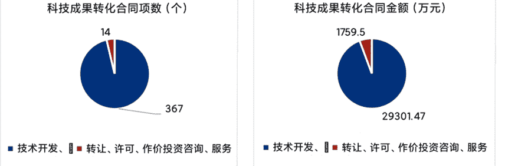

图 2-1 2024年陕西省科研成果转化项及金额

### 2.2 以转让、许可、作价投资方式转化的成果

2024年陕西省科研院以转让、许可、作价投资方式转化的成果共14项，合同金额1,759.50万元，当年到账415.4万元。其中，转让方式转化的成果5项，合同金额131万元，当年到账126.5万元；许可方式转化的成果8项，合同金额1,615.00万元，当年到账288.9万元；定价投资方式转化的成果1项，合同金额13万元，当年到账0万元。

表 2-2 转让、许可、定价投资方式合同项和金额分布

| 合同金额区间 | 合同项数 | 合同金额占比 | 合同金额/万元 | 合同金额占比 |
|---|---|---|---|---|
| 100万-1000万 | 7 | 50.00% | 1,600 | 90.93% |
| 10万-100万 | 5 | 35.71% | 153.00 | 8.70% |
| 10万以下 | 2 | 14.29% | 6.50 | 0.37% |
| 总计 | 14 | 100.00% | 1,759.50 | 100.00% |

陕西省科研院以转让、许可、定价投资方式转化的科技成果，合同金额分布高度集中。大部分转化收益来自100万至1000万间的合同；该区间的合同数量占总数的50%，巨大贡献了高达1600万元的金额，占金额的90.93%。同时，10万以下的小额合同和10万至100万的中额合同在数量上占比高达50%，但金额有限。此外，2022年度缺乏单个1000.0万以上的重大科技成果项目，这表明高值、能产生重大影响的突破性成果仍需要未来重点突破。

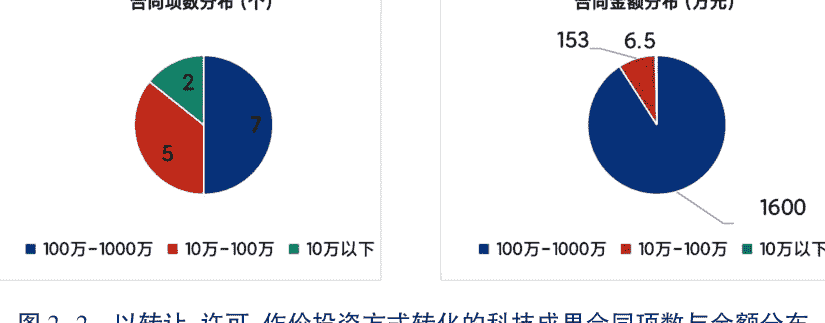

### 2.2.1 转让方式

2024年，陕西省科研院转让方式转化的成果合同数量为5项，合同金额131万元，当年到账126.5万元。其中，附属科研院合同数量为3项，合同金额94.5万元，当年到账94.5万元；省属科研合同数量为2项，合同金额37万元，当年到账32万元。

表 2-3 转让方式转化成果总体情况

| 项目 | 附属院所 | 省属研究所 | 总计 |
|---|---|---|---|
| 合同项数（个） | 3 | 2 | 5 |
| 合同金额（万元） | 94.5 | 37 | 131.5 |
| 当年到金额（万元） | 94.5 | 32 | 126.5 |

### 2.2.2 许可方式

2024年，陕西省科研院许可方式转化的成果合同数量为8项，合同金额1,615万元，当年到账288.9万元。其中，附属科研所合同数量为2项，合同金额115万元，当年到账65万元；省属科研合同数量为6项，合同金额1500万元，当年到账223.9万元。

表 2-4 许可方式转化成果总体情况

| 项目 | 附属院所 | 省属研究所 | 总计 |
|---|---|---|---|
| 合同项数（个） | 2 | 6 | 8 |
| 合同金额（万元） | 115 | 1500 | 1615 |
| 当年到金额（万元） | 65 | 223.9 | 288.9 |

图 2-4 许可方式转化成果分布

### 2.2.3 作价方式

2024年，陕西省科研院作价方式转化的成果合同数量为1项，合同金额13万元。

### 2.3 技术开发、咨询、服务方式

2024年度陕西省科研院以技术开发、咨询、服务方式转化的科技成果共367项，合同金额29,301.47万元，当年到账28,447.09万元。其中，技术开发转化的成果128项，合同金额24,602.35万元，当年到账24,626.77万元；技术咨询转化的成果119项，合同金额2,915.80万元；技术服务转化的成果120项，合同金额1,783.32万元，当年到账2,115.85万元。

表 2-5 技术开发、咨询、服务方式转化成果总计情况

| 项目 | 陕西院所 | 省属研究所 | 总计 |
|---|---|---|---|
| 合同数量（个） | 109 | 258 | 367 |
| 合同金额（万元） | 24750.39 | 4551.08 | 29301.47 |
| 当年到金额（万元） | 25140.34 | 3306.75 | 28447.09 |

| 合同数量（个） | 合同金额（万元） | 当年到金额（万元） |
|---|---|---|
| 258 | 4551.08 | 3306.75 |

图 2-5 技术开发、咨询、服务方式转化的科技成果合同项、金额及当年到账金额

### 2.3.1 技术开发

2024年，陕西省科研所以技术开发方式转化科技成果的合同数量为128项，合同金额为24,602.35万元，当年到账金额为24,626.77万元。其中，附属科研院所合同数量为99项，合同金额为24,320.60万元，当年到账金额为24,378.02万元；省属科研院所合同数量为29项，合同金额为281.75万元，当年到账金额为248.75万元。

表 2-6 技术开发转化科技成果总体情况

| 项目 | 附属科研所 | 省属科研所 | 总计 |
|---|---|---|---|
| 合同项数（个） | 99 | 29 | |
| 合同金额（万元） | 24,320.60 | 281.75 | 24,602.35 |
| 当年到账金额（万元） | 24,378.02 | 248.75 | 24,626.77 |

### 2.3.2 技术咨询

2024年，陕西省科研所以技术咨询方式转化成果的合同数量为19项，合同金额为2915万元，当年到账金额280万元，全部属于省属科研所。

### 2.3.3 技术服务

2024年，陕西省科研所以技术服务方式转化成果的合同数量为120项，合同金额为1,783.32万元，当年到账金额2115.85万元。其中，附属科研院所合同数量为10项，合同金额为429.79万元，当年到账金额762.32万元；省属科研所合同数量为110项，合同金额为1353.53万元，当年到账金额1353.53万元。

表 2-7 技术服务转化成果总体情况

| 项目 | 央院所 | 省属所 | 总计 |
|---|---|---|---|
| 合同数量（个） | 10 | 110 | 120 |
| 合同金额（万元） | 429.79 | 1353.53 | 1783.32 |
| 当年到账金额（万元） | 762.32 | 1353.53 | 2115.85 |

图 2-7 技术服务转化成果分布

### 2.4 财政资助项目的科技转化

表 2-8 财政资助整体概况

| 分类 | 项目 | 总计 | 2024 年度 其中：财政政助 | 中央财政资助 |
|---|---|---|---|---|
| 立项批复的科技项目（项） | 361 | | 146 |
| 获得财政资金补助的科技项目情况 | 立项批复的科技项目（课题）总金额（万元） | 43,671.98 | 40,855.95 | 35,817.15 |
| | 项目（课题）资金当年到金额（万元） | 146,153.73 | 102,629.35 | 34,572.70 |

其中，陕西2024年科技成果转化中，科研院所有146项得到财政资助，中央资助金额35817万元。

# 技术转移与人才建设

### 3.1 技术转移

陕西省科研院的技术转移与专业服务体系仍初步发展阶段。在13家科研院中，有个别单位设立了自建转移机构，少数单位与市场化机构建立了合作关系。大多数大多数科研单位建立专专的技术转移成果，成果成果专业有服务完善。当前，在概念验证、试点转化等具有共性技术平台资源供给有限，科学仪器设备开放共享机制待健全。在此背景下，成果转化工作主要依托部分单位与企业共建的研发平台开展，整体上呈现对外部资源的一定依赖。值得关注的是，部分单位通过同时布局自建机构与市场化运作，形成了内外的转化服务架构，这些实践为探索具有成果转化路径提供了参考。总体而言，科研院内的专业化能力建设需进一步加强，以适应技术转化的现实需求。

### 3.2 设立基金

2024年度，陕西省科研院在科技转化基金的设立方面仍处于初步探索阶段，目前尚未独立设立或联合设立专门用于科技成果转化的相关基金。这一现象反映出通过基金模式引导社会资本共同支持转化机制尚未在科研层面实现有效运行，财政资金在此领域的投入机制尚未形成系统性布局。在当前阶段，由于缺乏专门的科技转化基金作为支撑，科研项目从实验室走向产业化过程中，往往面临支持等环节的问题，特别是在概念验证、试点放大等关键环节。在一定程度上制约了高水平科技成果的本地化效率和规模，也反映出当前科技成果转化的金融支持体系是一个需要培养和发展的方向。值得注意的是，基金设立作为科技金融体系的重要组成部分，其价值也影响了科研与市场资源的深度对接。未来，如何在政策引导下构建多元化的科技转化投入机制，包括财政资金、社会资本共同参与的基金支持体系，将成为提升科技成果转化效能的关键。

### 3.3 人才建设

2024年，陕西省科研所科研人员通过市场化方式参与成果转化的实践已初步出现。在13家科研院所中，现有93科研人员通过外兼职或离岗创业方式参与成果转化活动，期间共同创设或参与了7家企业。从参与机制来看，陕西省科研院成果转化的特点。

## 5.3 科技成果领域去向

2024 年度数据显示，陕西省科研所科技转化的行业分布呈现显著特征。在全部 14 项转化成果中，农、林、牧、渔领域共 9 项，占比 64.3%；科学研究和技术服务领域共 5 项，占比 35.7%。

这一分布特征与调研单位的专业领域直接对应。被调研的 13 家科研所中，陕西省杂交油菜研究中心、陕西省动物研究所等 8 家单位主要从事农业和生物技术研究，其 9 项转化均为农业新品和生物技术；中院西安西安精密机械研究所等光学机构研究则贡献了全部 5 项光学技术成果。

这种分布布局客观反映了不同专业领域科研所的成果产出特点，为把握科技成果转化方向提供了数据依据。

# 第六章

# 成果转化收入的奖励分配情况

### 6.1 总体情况

2024 年度科技成果转化收入呈现差异化特点。具体表现为：现金奖励总额 545.45 万元中，转让许可方式的个人奖励达到 414.09 万元，远高于技术开发服务的 118.35 万元。股权奖励规模较小，涉及 13 万元，涉及 3 人次。从分配结构看，单位留存收入与个人奖励总额基本持平，分别为 547.48 万元和 545.44 万元。细分发现，转让许可奖励明显向个人倾斜，个人奖励金额是单位留存的 4 倍；而技术开发服务金额则相反。这种差异反映了不同类型成果采取了不同的利益分配机制。同时，股权激励方式仍然较少，表明成果转化的金融手段和长期激励方式还需要进一步丰富。

表 6-1 成果收入的奖励分配情况

| 序号 | 项目 | 2024 年度 |
| :--- | :--- | :--- |
| 现金收入及奖励 | 转让许可的科技成果当年实现的现金总额投入（万元） | 留存单位（万元） | 102.42 |
| | | 奖励个人（万元） | 414.09 |
| | | 研发与转化主要人员（万元） | 294.52 |
| | 转让许可的科技成果获得的现金收入奖励人次（次） | 135 |
| | 技术开发、咨询、服务项目当年实现的分配现金总额投入（万元） | 留存单位（万元） | 445.06 |
| | | 奖励个人（万元） | 118.35 |
| | | 研发与转化主要人员（万元） | 99.8 |
| | 技术开发、咨询、服务项目获得的现金收入奖励人次（次） | 63 |

| 序号 | 项目 | 2024 年度 |
| :--- | :--- | :--- |
| | 股权收入及奖励 | 作价投资的科技成果转化当年实现的股份金额（万元） | 留存单位（万元） | 0 |
| | | 奖励个人（万元） | 13 |
| | | 研发与转化主要核心贡献人（万元） | 13 |
| | | 股权奖励人次（次） | 3 |
| 奖励情况 | 小计 | 以一、二项单位获得现金和股权奖励总额（万元） | 1092.92 545.44 |
| | | 以转让、许可、作价投资方式转化科技成果单位获得现金奖励总额（万元） | 547.48 |

### 6.2 现金和股权收益分配情况

2024 年、陕西以转让、许可方式转化的科技成果现金留存 102.42 万元、奖励个人 414.09 万元、奖励人次 13 次；技术开发、咨询、服务项目现金留存 445.06 万元、奖励个人 118.35 万元、奖励人次 63。

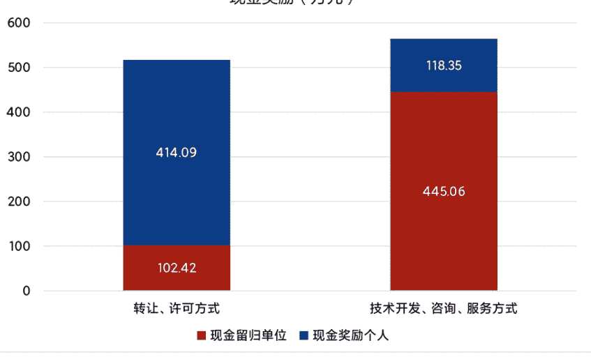

2024 年、陕西以作价投资方式转化的科技成果 13 万元、股权全部奖励个人。

## 第七章 工作案例

科研所在科技成果转化中具有以基础研究为核心、知识产权储备丰富、技术积累深厚等优势，但面临成果与市场需求匹配、亟提高转化效率等迫切需求。2024 年，陕西省科研所积极探索新型科技成果转化模式，以下列典型案例共计 4 项。

### 7.1 植物新品种产权入股——陕西西安植物园

生物育种具有周期长、人力消耗大等特点，陕西西安植物园花卉 5-8 年期植物新品种，并将成果作入股合作注册公司，对园林产业和植物资源开发利用产生了积极作用。

表 7-1 陕西西安植物园的主要方法与成效

| 转化方法 | 转化成效 |
| :--- | :--- |
| 植物新品种产权的许可使用与作价入股 | 将研发成果协议作价 13 万元入，合作注册公司 100 万 |
| 研发成果的 90% 股权，由项目负责人进行 | 提高项目团队积极性 |
| 二次收益分配 | |

**【启示】**
- 一是研发过程中需要攻克困难，针对研发周期投入等领域开展解决难题。
- 二是利用新型成果转化方式，综合利用技术成果许可使用、作价入股等方式，推动成果效益。
- 三是建立收益分配机制，重视项目团队的奖励与收益。

### 7.2 首次付费+技术提成模式——陕西杂交研究中心

陕西杂交研究中心科研团队历经于 2024 年育成新品种“秦优”，是技术突破，通过“首次付费+技术提成”方式实现技术成果的转化和应用，有利于企业增长、助力推广，保障粮食安全。

图-1 2024 年育成新品种“秦优”

表 7-2 陕西杂交研究中心的主要做法与成效

| 转化方法 | 转化成效 |
| :--- | :--- |
| 采用首次付费+技术提成方式进行转化成果全部收入（扣除本金后） | 当年奖励 23 万元 |
| 签订关键技术设备委托开发合同 | 奖励 80 人次 |

**【经验启示】**
- 一是技术成果的转化需要依托地方政府引导和支持。借助地方政府平台作为科技成果窗口，可以带来更多机会。
- 二是明确收益机制。科学、合理的分配机制有利于研发人员及相关团队，提高科研转化效率。
- 三是要重视研发中的持续性，特定领域的技术突破需要克服困难。

### 7.3 委托开发——中国科学院国家授时中心

低频时同步信号由中国科学院国家授时中心专家团队共同编制，采用加密发表。

接收终端必须使用国家授时中心研发的解码芯片或模块才能接收精准时间，芯片和模块产品由指定公司统一销售。低频时同步系统和综合服务，还将实现带接收码功能、时间信号同步、相关终端应用以及产品标准化、测试与认证等，连接于数百万终端产品，并提供相关技术的售前、售中、售后在全产业链的服务，具有巨大的产业规模和效益。

表 7-3 中国科学院国家授时中心的主要做法和成效

| 转化方法 | 转化成效 |
| :--- | :--- |
| 国家级低频时同步与传递精度高，签订关键技术设备委托开发合同 | 实现时间与 UTC(UTC)的源输出，输出与 UTC(UTC)信号保持同步，产生所需的多样频率信号 |
| 集聚技术研发、成果转化和产业化发展于一体 | 在解决难题、创造效益的同时，还将进一步聚集高尖人才、打破旧文化、积累创新源、促进科技交流与合作 |

低频时台发送的同步信号的接收终端必须使用国家授时中心研发的解码芯片或模块才能接收到精准时间，一步辐射和同步接收解码芯片功能模块、时间信号系统、相关终端产品以及标准化、检测、测试及认证等环节

## 【结语启示】

- 一是发挥“科研所+政府+企业”的联动作用，实现成果转化的放大效应。技术在研发过程中离开地方政府的支持，转化过程中需要合适的企业作为承接，多方联动才能实现技术成果的顺利转化。
- 二是对相关产业的带动作用。技术突破及产业化不是孤立的领域，应当考虑对其上下相关产业的带动作用。
- 三是构建核心技术壁垒与产业生态系统。国家授时中心自主研发解码芯片与模块，以核心知识产权为基础的技术闭，有效保护技术成果。

### 7.4 设备+资金入股——西安光学精密机械研究所

激光技术主要从量子产业链的高功率半导体激光元件和原材料、激光光学器件、量子产业链中的应用模块、子系统的研发。2007 年西安光所首引入的高端人才才允许创作了激光技术，西安光所以出资方式持有了激光技术部分股份。在西安光所平台和产业生态系统支持下，企业走过了困难的初期，加速了科技成果转化应用。

图-3 2024 年西安光所成果转化

表 7-4 西安光学精密机械研究所做法及成效

| 转化方法 | 转化成效 |
| :--- | :--- |
| 高端人才引进+现金及设备持股 | 获得了部分投资收益 |
| 逐步退出等方式 | 获得了新的资金支持 |

**【经验启示】**
- 一是解放思想。长期以来，我国科研与企业融合不够，科研人员将精力放在论文、申请专利和项目上。
- 二是明确分配机制。科学、合理的分配机制有利于研发人员及相关团队，提高科研转化效率。
- 三是坚持长期主义。针对金融市场，长期以来我们更加重视研发周期，持续呼吁政策支持。

# 医疗卫生篇

# 第一章

## 概况

2024 年底，陕西省卫生机构共有 35426 个。其中医院共计 2888 个，公立医院 446 个，民营医院 842 个。基层卫生机构共 36662 个，其中社区卫生中心（站）7692 个；乡镇卫生院 4892 个；诊疗卫生室 3044 个；村卫生中心 2995 个。专业公共卫生机构 355 个，其中医疗预防控制中心 121 个，卫生监督机构 74 个，婴幼保健机构 18 个。

2024 年，本报告调研样本陕西 66 家医疗卫生机构涵盖了卫生机构的大多数试点单位，能够代表陕西卫生机构的研究水平。本报告医疗机构样本本次签订科技转化合同 246 个，金额总计 732.44 万元，转化方式有签署、许可、作价投资以及技术开发、咨询、服务等六种方式。样本 66 家医疗卫生机构具体情况如下：

表 1-1 医疗卫生机构科技转化一体化情况

| 序号 | 单位名称 | 主管部门 |
| :--- | :--- | :--- |
| 1 | 三二一联医院 | 汉中市科技局 |
| 2 | 重医工业总医院 | 省卫生健康委员会 |
| 3 | 成都市中心医院 | 成都市卫生健康委 |
| 4 | 成都市妇幼保健医院 | 成都市卫生健康委员会 |
| 5 | 成都市第一人民医院 | 成都市卫健 |
| 6 | 成阳彩虹医院 | 成都市卫生健康委 |
| 7 | 洛昌市中医药医院 | 洛昌市卫生委员会 |
| 8 | 洛昌市中医药医院 | 省卫生健康委员会 |
| 9 | 洛洛市幼保医院 | 洛洛市卫健 |
| 10 | 安康市中医医院 | 安康健康委员会 |
| 11 | 安康市中心医院 | 安康健康委员会 |
| 12 | 安康市医院 | 安康卫健 |
| 13 | 安康市幼保医院 | 安康健康委员会 |
| 14 | 宝鸿市中医医院 | 宝鸿市卫健 |
| 15 | 宝鸿市中心医院 | 宝鸿市卫健 |
| 16 | 宝鸿市人民医院（急诊中心） | 宝鸿市卫生委员会 |
| 17 | 宝鸿市幼保医院 | 宝鸿市卫健 |
| 18 | 延安大学附属医院 | 陕西卫健 |
| 19 | 延安中医医院 | 延安市卫生委员会 |
| 20 | 延安市人民医院 | 卫市卫生健康委员会 |
| 21 | 杨溢范区医院 | 杨溢范区卫生健康局 |
| 22 | 榆林市中医医院 | 陕西省卫生委员会 |
| 23 | 榆林市星元医院 | 榆阳市卫生局 |
| 24 | 榆林市第一医院 | 榆林市卫生委员会 |
| 25 | 汉中中医医院 | 汉市卫生委员会 |
| 26 | 汉中中心医院 | 汉市卫生委员会 |
| 27 | 汉中人民医院 | 汉市团结街 |
| 28 | 南湖市中医医院 | 南湖市卫生委员会 |
| 29 | 南湖市幼保医院 | 南湖市卫生委员会 |
| 30 | 神木市医院（西北大学附属医院） | 神木市局 |
| 31 | 蒲诚县医院 | 陕西省卫生委员会 |
| 32 | 西北第一医院 | 陕西省卫生委员会 |
| 33 | 西北儿童医院（陕西省幼保医院） | 陕西省卫生委员会 |
| 34 | 西安交通口腔医院 | 中华人民共和国卫生委员会 |
| 35 | 西安交通第一附属医院 | 陕西省科技厅 |
| 36 | 西安交通第一附属医院榆林医院 | 榆林市卫生委员会 |
| 37 | 西安交通第二附属医院 | 陕西卫健 |
| 38 | 西安医学学院第一医院 | 西安医学学院 |
| 39 | 西安医学学院第三附医院 | 陕西省卫生委员会 |
| 40 | 西安医学学院第二附医院 | 陕西省卫生委员会 |
| 41 | 西安医学医院 | 陕西科技厅 |
| 42 | 西安市中心医院 | 西安健康委员会 |
| 43 | 西安市人民医院（西安市第四医院） | 西安健康委员会 |
| 44 | 西安市儿童医院 | 西安健康委员会 |
| 45 | 西安市公共卫生中心（西安市应急中心） | 西安健康委员会 |
| 46 | 西安市第一医院（西安市第一医院） | 西安健康委员会 |
| 47 | 西安市第三医院 | 西安健康委员会 |
| 48 | 西安市九挛医院 | 西安健康委员会 |
| 49 | 西安市第五医院 | 西安健康委员会 |
| 50 | 西安市第八医院 | 陕西科技厅 |
| 51 | 西安市精神卫生中心 | 西安健康委员会 |
| 52 | 西安市红会医院 | 陕西科技厅 |
| 53 | 西安市胸科医院 | 西安健康委员会 |
| 54 | 西集医院 | 通用环球有限公司 |
| 55 | 川市中医学医院 | 川市科技局 |
| 56 | 渭市人民医院 | 渭市卫生委员会 |
| 57 | 渭市幼保医院 | 渭市健康委员会 |
| 58 | 陕州政务医学医院 | 陕西省健康管理局 |
| 59 | 陕西省中医药大学二附医院 | 陕西省健康管理局 |
| 60 | 陕西省中医药大学附属附医院 | 陕西省健康管理局 |
| 61 | 陕西省中医学医院 | 陕西省卫生委员会 |
| 62 | 陕西省人民医院（含西咸城区） | 陕西省人民医院转化器部 |
| 63 | 陕西省残康医院 | 陕西省残人联合会 |
| 64 | 陕西省工业第二一院医院 | 成阳市卫生委员会 |
| 65 | 陕西省第二人民医院 | 陕西健康委员会 |
| 66 | 陕西省结核病防治医院（陕西省第五人民医院） | 陕西健康委员会 |

表 1-2 医疗卫生机构科技转化整体情况一览表

| 序号 | 分类 | 项目 | 总计 | 财政扶助 | 中央财政扶助 |
| :--- | :--- | :--- | :--- | :--- | :--- |
| | | | 2024 年度 | | |
| 一 | 以转让方式转化成果 | 合同项数（项） | 14 | 2 | 2 |
| | | 合同金额（万元） | 381.7 | 124 | 124 |
| | | 当年到账金额（万元） | 298.5 | 20.8 | 20.8 |
| 二 | 以许可可转化成果 | 合同项数（项） | 11 | 0 | 0 |
| | | 合同金额（万元） | 179.2 | 0 | 0 |
| | | 当年到账金额（万元） | 2,293.7 | 0 | 0 |
| 三 | 以作价方式转化成果 | 合同项数（项） | 0 | 0 | 0 |
| | | 作价金额（万元） | 0 | 0 | 0 |
| | | 单位以作入股形成的股权价值值 | 0 | 0 | 0 |
| 四 | 技术开发项目 | 合同项数（项） | 34 | - | - |
| | | 合同金额（万元） | 2,018.35 | - | - |
| | | 当年到账金额（万元） | 1,273.15 | - | - |
| 五 | 技术咨询项目 | 合同项数（项） | 9 | - | - |
| | | 合同金额（万元） | 64.6 | - | - |
| | | 当年到账金额（万元） | 46.76 | - | - |
| 六 | 技术服务项目 | 合同项数（项） | 178 | - | - |
| | | 合同金额（万元） | 4,088.59 | - | - |
| | | 当年到账金额（万元） | 4,088.59 | - | - |
| 合计 | 以上一、二、四、五、六项合计 | 科技成果转让、许可、作价投资项目和技术开发、咨询、服务项目合同总金额（万元） | 6,732.44 | 124 | 124 |
| | | 以上一、二、四、五、六项合计 | 科技成果转让、许可项目和技术开发、咨询、服务项目当年到账金额（万元） | 6,836.86 | 20.8 | 20.8 |

# 概况 第一章

| 序号 | 分类 | 项目 | 总计 | 财政支助 | 中央财政支助 |
| :--- | :--- | :--- | :--- | :--- | :--- |
| | | | 2024 年度 | | |
| | | 立项批复的科技项目数（项） | 1,581 | - | - |
| 七 | 获得财政资助的科技项目情况 | 立项批复复的科技项目（课题）总金额（万元） | 25,859.07 | 21,495.82 | 8,981.79 |
| | | 项目（课题）资金当年到账金额（万元） | 23,068.38 | - | 8,873.45 |
| | | 设立（联合设立）科技成果转化相关基金数（支） | 0 | - | - |
| | | 基金累计绩效规模（万元） | 0 | - | - |
| | | 自建建模认证中心项目数（个） | 0 | - | - |
| | | 自建认证中心当年新增认证项目数（个） | 0 | - | - |
| | | 自建中试平台台数（个） | 0 | - | - |
| | | 自建中试平台当年新增服务项目数（个） | 0 | - | - |
| | | （市级及以上）认定的科学仪器设备共享台数（个） | 0 | - | - |
| 八 | 转化基础 | （市级及以上）认定的科学仪器设备共享固定资产价值（万元） | 0 | - | - |
| | | 与企业共建研发机构、转移机构、转化服务平台台数（个） | 4 | 0 | 0 |
| | | 自建技术转移转化项目数（个） | 1 | - | - |
| | | 专职从事科学技术转化工作人员（个） | 39 | - | - |
| | | 与本单位合作开展科技成果市场化转移机构数量（个） | 4 | - | - |
| | | 在外聚职从事成果转化人员和离岗创业人员（个） | 1 | - | - |
| | | 创设公司和参股公司数（个） | 0 | - | - |

## 医疗卫生机构

2024 年：陕西省医疗卫生机构科技成果转化数量 246 个，合同金额 6,732.44 万。医疗卫生机构在科技成果转化方面呈现出显著差异。通过技术开发、咨询和服务等方式转化的科技成果转化数量最多，共 221 项。通过成果转让方式转化的合同有 14 个，但合同金额为381.70 万元，单个合同平均金额为27.26 万元。许可和作价投资两种方式无项目数量是规模相对相对，目前主要无价投资方式，表明此类转化模式的应用规模仍显不足。目前科研成果转化工作主要依靠技术开发与服务项目支撑总体规模，且具有高价值的许可转化、作价投资等创新模式尚未形成规模效益。

2024 年度陕西省医疗卫生机构以转让方式转化科技成果的合同数量为14项，其中2项为中央财政支持。合同金额方面总为381.70 万元，其中124 万为中央财政支持。当年到账金额总计298.5 万元，其中20.8 万为中央财政支持。

2024 年度陕西省医疗卫生机构以许可转化科技成果所签订的合同数量为11项。合同金额方面总计为179.2 万元，当年到账金额总计为2,293.7 万。以上方面均无财政支持情况。

2024 年度陕西省医疗卫生机构以技术开发项目的形式化转化科技成果所签订的合同数量为34项。合同金额方面总计为2,018.35 万元，当年到账金额总计为1,273.15 万。以上方面均无财政支持情况。

2024 年度陕西省医疗卫生机构以技术咨询项目的形式化转化科技成果所签订的合同数量为9项。合同金额方面总计为64 万元，当年到账金额总计为76 万元。以上方面均无财政支持。

2024 年度陕西省医疗卫生机构以技术服务项目的形式化转化科技成果所签订的合同数量为18项。合同金额方面总计为4,088.59 万元，当年到账金额总计为4,088.59 万元，以上方面均无财政支持。

以转化方式分类省医疗卫生机构科技成果转化如下：2024年度陕西省医疗卫生机构转让、许可、作价投资方式转化的成果共25项，合同金额共计560.9 万元，以技术开发、咨询、服务方式转化的成果共221项，合同金额共计6171.5 万元。

## 第二章 转化方式

### 2.1 转化方式概况

表 2-1 科技成果转化方式总体情况

| 项目 | 以转让、许可、作价投资 | 以技术开发、咨询、服务转化成果 | 总计 |
| :--- | :--- | :--- | :--- |
| 合同项数（个） | 25 | 221 | 246 |
| 合同金额（万元） | 560.9 | 6,171.54 | 6,732.44 |
| 当年到账金额（万元） | 2,592.2 | 4,244.66 | 6,836.86 |

2024年度陕西省医疗卫生机构转让、许可、作价投资转化方式科技成果签订合同共计25项，所签订金额为560.9 万元，当年到账金额为2,592.2 万元。以技术开发、咨询、服务方式转化科技成果签订合同共计221项，所签订金额为6,171.54 万元，当年到账金额为4,244.66 万元。以上两部分所签订合同共计246项，所签订金额总计6,732.44 万元，当年到账金额为6,836.86 万元。

### 2.2 转让、许可、作价投资转化科技成果

2024年度陕西省医疗卫生机构转让、许可、作价投资转化方式科技成果签订合同共计25项，所签订金额为560.9 万元，当年到账金额为2,592.2 万元。

表 2-2 以转让、许可、作价投资转化方式科技成果总体情况

| 项目 | 医疗机构 | 总计 |
| :--- | :--- | :--- |
| 合同项数（万） | 25 | 25 |
| 合同金额（万元） | 560.9 | 560.9 |
| 当年到账金额（万元） | 2,592.2 | 2,592.2 |

图 2-1 以转让、许可、价投资方式转化的科技成果合同项数与金额分布

| 合同项数（个） | 合同金额（万元） |
| :--- | :--- |
| 9.36% 7.28% | 11.20, 1.99% |
| 9.36% | 278.70 49.69% |
| 100万-1000万 10万-100万 | 271.00 48.32% |
| 10万以下 | |

2024年陕西医疗卫生机构转许、许可、价投资方式转化科技成果签订合同合计25项，所签订金额为560.9 万元。其中签订合同的金额在100万-1000万的计7项，合同项占比28%，合同金额合计278.70万元，合同金额占比49.69%；所签订的金额在10万-100万的共9项，合同项占比36%，合同金额合计271.00万元，合同金额占比48.32%；所签订的金额在10万以下共9项，合同项占比36%。

表 2-3 以转许、许可、价投资转化科技成果签订的金额分布

| 合同区间 | 合同项数 | 合同项占比 | 合同金额/万元 | 合同金额占比 |
| :--- | :--- | :--- | :--- | :--- |
| 100万-1000万 | 7 | 28% | 278.70 | 49.69% |
| 10万-100万 | 9 | 36% | 271.00 | 48.32% |
| 10万以下 | 9 | 36% | 11.20 | 1.99% |
| 总计 | 25 | 100% | 560.9 | 100% |

### 2.2.1 转让方式

表 2-4 转许方式转化成果总体情况

| 项目 | 医疗机构 | 总计 |
| :--- | :--- | :--- |
| 合同项数（个） | 14 | 14 |
| 合同金额（万元） | 381.70 | 381.70 |
| 当年到账金额（万元） | 298.50 | 298.50 |

2024年度陕西省医疗卫生机构转让方式转化科技成果签订合同共计14项，合同金额为381.70万元，当年到账金额为298.50万元。

### 2.2.2 许可方式

表 2-5 许可方式转化成果总体情况

| 项目 | 医疗机构 | 总计 |
| :--- | :--- | :--- |
| 合同项数（个） | 11 | 11 |
| 合同金额（万元） | 179.20 | 179.20 |
| 当年到账金额（万元） | 2,293.70 | 2,293.70 |

2024年度陕西省医疗卫生机构许可方式转化成果签订合同共计11项，合同金额为179.20万元，当年到账金额为2,293.70万元。

### 2.2.3 作价投资

表 2-6 作价投资转化成果总体情况

| 项目 | 医疗机构 | 总计 |
| :--- | :--- | :--- |
| 合同项数（个） | 0 | 0 |
| 合同金额（万元） | 0 | 0 |
| 当年到账金额（万元） | 0 | 0 |

2024年度陕西省医疗卫生机构暂无作价投资方式转化的科技成果。

### 2.3 技术开发、咨询、服务方式转化成果

2024年度陕西省卫生机构转让、许可、作价投资方式科技成果签订合同共计221项；所签订金额为6,171.54万元；当年到账金额为4,244.66万元。

表 2-7 技术开发、咨询、服务方式转化成果总体情况

| 项目 | 医疗机构 | 总计 |
| :--- | :--- | :--- |
| 合同项数（个） | 221 | 221 |
| 合同金额（万元） | 6,171.54 | 6,171.54 |
| 当年到账金额（万元） | 4,244.66 | 4,244.66 |

图 2-2 以技术开发、咨询、服务方式转化的科技成果合同项数与金额分布

2024 年度陕西省医疗机构转让、许可、作价投资方式转化科技成果签订合同共计221项；所签订金额为6,171.54 万元。其中签订合同的金额在1000万-1亿元的计130项，合同项占比58.82%。合同金额合计3401.00万元，合同金额占比为55.11%；所签订的金额在100万-1000万的共80项，合同项占比36.20%。合同金额合计2629.48万元，合同金额占比为42.61%；所签订的金额在10万-100万的共10项，合同项占比4.53%。合同金额合计135.06 万元，合同金额占比为2.18%；所签订的金额在10万以下的共1项，合同项占比0.45%。

表 2-8 技术开发、咨询、服务方式转化成果签订的金额金额分布

| 合同区间 | 合同项数 | 合同项占比 | 合同金额/万元 | 合同金额占比 |
| :--- | :--- | :--- | :--- | :--- |
| 1000万以上 | 130 | 58.82% | 3401.00 | 55.11% |
| 100万-1000万 | 80 | 36.20% | 2629.48 | 42.61% |
| 10万-100万 | 10 | 4.53% | 135.06 | 2.18% |
| 10万以下 | 1 | 0.45% | 6.00 | 0.10% |
| 总计 | 221 | 100% | 6171.54 | 100% |

### 2.3.1 技术开发

表 2-9 技术开发方式转化成果总体情况

| 项目 | 医疗机构 | 总计 |
| :--- | :--- | :--- |
| 合同项数（个） | 34 | 34 |
| 合同金额（万元） | 2,018.35 | 2,018.35 |
| 当年到账金额（万元） | 1,273.15 | 1,273.15 |

2024年陕西省医疗卫生机构技术开发方式转化成果签订合同共计34项，合同金额为2,018.35万元，当年到账金额为1,273.15万元。

### 2.3.2 技术咨询

表 2-10 技术咨询方式转化成果总体情况

| 项目 | 医疗机构 | 总计 |
| :--- | :--- | :--- |
| 合同项数（个） | 9 | 9 |
| 合同金额（万元） | 64.6 | 64.6 |
| 当年到账金额（万元） | 46.76 | 46.76 |

2024年陕西省医疗卫生机构咨询方式转化成果签订合同共计9项，合同金额为64.6万元，当年到账金额为46.76万元。

### 2.3.3 技术服务

表 2-11 服务方式转化成果总体情况

| 项目 | 医疗机构 | 总计 |
| :--- | :--- | :--- |
| 合同项数（个） | 178 | 178 |
| 合同金额（万元） | 4,088.59 | 4,088.59 |
| 当年到账金额（万元） | 4,088.59 | 4,088.59 |

2024年陕西省医疗卫生机构服务方式转化成果签订合同共计178项，合同金额为4,088.59万元，当年到账金额为4,088.59万元。

### 2.4 财政资助项目的科技成果转化

表 2-12 财政资助整体概况

| 序号 | 分类 | 项目 | 2024 年度 总计 | 财政资助 | 中央财政资助 |
| :--- | :--- | :--- | :--- | :--- | :--- |
| 1 | 获得财政资助的科技项目情况 | 立项批复的科技项目数（项） | 1,581 | - | 192 |
| | | 立项批复的科技项目（课题）总金额（万元） | 25,859.07 | 21,495.82 | 8,981.79 |
| | | 项目（课题）资金当年到账金额（万元） | 23,068.38 | 20,000.83 | 8,783.45 |

从整体情况而言，2024年陕西省医疗卫生机构在获得财政资金资助的科技项目方面：立项批复的科技项目（课题）总金额为25,859.07万元；项目（课题）资金当年到账金额为23,068.38万元。

从省级财政资助来看，2024年陕西省医疗卫生机构无立项批复的科技项目数据；立项批复的科技项目（课题）总金额为21,495.82万元；项目（课题）资金当年到账金额为20,000.83万元。

从中央财政资助来看，2024年陕西省医疗卫生机构立项批复的科技项目数据为192项；立项批复的科技项目（课题）总金额为8,981.79万元；项目（课题）资金当年到账金额为8,783.45万元。

## 第三章 资金

### 3.1 转移

- 与本单位合作开展科技成果市场化转移机构数量（个）：4个
- 在外聚职从事成果转化人员和离岗创业人员（个）：1个
- 创设公司和参股公司数（个）：0个

### 3.2 转化

- （市级及以上）认定的科学仪器设备共享固定资产价值（万元）：0个
- 自建技术转移转化项目数（个）：1个
- 专职从事科学技术转化工作人员（个）：39个

### 3.3 成果

- 设立（联合设立）科技成果转化相关基金数（支）：0支
- 基金累计绩效规模（万元）：0万元
- 自建建模认证中心项目数（个）：0个
- 自建认证中心当年新增认证项目数（个）：0个
- 自建中试平台台数（个）：0个
- 自建中试平台当年新增服务项目数（个）：0个
- （市级及以上）认定的科学仪器设备共享台数（个）：0个

# 医疗卫生机构架构

| 序号 | 项目 | 2024 年度 |
| --- | --- | --- |
| 二 | 股权收入 | 作价投资的科技成果 | 留单位（万元） | 0 |
| | | 转化当年实现配分的 | 奖励个人（万元） | 0 |
| | | 股份金额（万元） | 研发与转化主要贡献人员（万元） | 0 |
| | | 股权奖励人数（次） | | |
| 三 | 奖励情况 | 一、二项资金获得现金和奖励收入总额（万元） | 2,139.69 |
| | 小计 | 一、二项对个人现金、股权奖励总额（万元） | 666.23 |
| | | 转让、许可、作价投资方式转化科技成果获得现金、股权奖励总额（万元） | 2,641.79 |

2024年，我国省卫生机构科技成果转化收入及奖励总额为2805.92万元，单位获得的现金和股权奖励金额为2,139.69万元，个人获得的现金和股权奖励金额为666.23万元。以转让、许可的科技成果转化当年实现配分的现金总额（万元）为3,018.97万元。其中，留单位的金额为2,012.17万元；奖励个人的金额为629.62万元；研发与转化主要贡献人员获得377.18万元的现金奖励。以技术开发、咨询、服务项目当年实现配分的现金总收入为164.86万元。其中，留单位的金额为127.52万元；奖励个人的金额为36.61万元；研发与转化主要贡献人员获得0.73万元的现金奖励。

### 6.2 现金分配

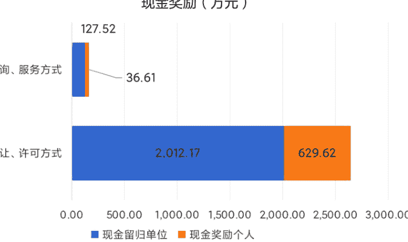

图 6-1 不同转让方式下现金留单位和奖励个人情况

- 106

# 成果转化收入的奖励分配情况 第六章

2024年，陕西医疗卫生机构科技转化现金收入及奖励总金额为2,805.92万元，单位获得的现金和股权奖励金额为2,139.69万元，个人获得的现金和股权奖励金额为666.23万元，分别占比23.74%、76.26%。以转让、许可的科技成果转化现金奖励人次为35次。以技术开发、咨询、服务项目奖励人次为5次。

### 6.3 股权收益分配

2024年，陕西医疗卫生机构科技成果转化无获得股权分配情况。

# 第章 工作案例

2024年陕西省卫生医疗机构转让、许可、作价方式新签订转化科技成果的合同 25项，相关成果均能解决临床需求为导向的应用研究，涵盖高端医疗器械、创新生物材料及药物制剂。整体呈现转化模式灵活（转让、许可）、激励政策明确（研发团队获取巨大益益，80%-95%），一定程度上激发了科研人员的创新与转化动力。但存在转化金额差异较大，部分成果价值可能被低估、缺乏长期合作的收益转化等共性问题。

## 7.1 转让——西安交通大学第二附属医院 陕西医学大学第二附属医院

### 7.1.1 西安交通大学第二附属医院

西安交通大学第二附属医院经过3-5年研发，成功研制出“仿生人工齿关节”技术。该技术通过专利转让实现转化，合同金额59万元，实际到账59万元。该仿生关节属于非融合材料、能够解决椎椎固定后活动丧失、邻近节压力增加和退变加速等问题，具有仿生性、稳定性，可显著改善患者生活质量等。研究结果如下：

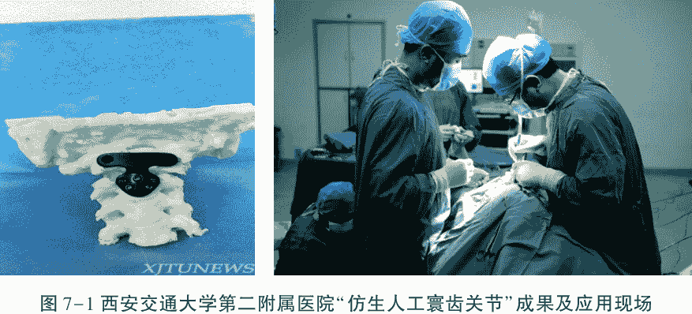

# 工作案例 第七章

医院通过专利转化模式将技术转化为市场，转化金额99 万元全部到账。按照西安交通大学收益分配政策，研发团队获得90%的收益（53.1 万元），医院保留10%（5.9 万元）。
该人工人工关节具备类似正常软关节的功能，可在此屈、侧倾和旋转中保持稳定，显著降低远关节退变和内固定失败概率，具有良好的临床前景。

该案例表明，高校附属医院在推进医工交叉融合、推动原创医疗器械研发方面具有显著优势。明显的收益分配机制（如“90/10”模式）具有有效激励科研人员创新与转化的积极性。同时，此类技术不仅具有重要战略意义，也体现了产学研协同的巨大潜力。

### 7.1.2 陕西中医药大学第二附属医院

陕西中医药大学第二附属医院经过6年研究终获成功，成形“一种通路贴剂及其制作方法”后将该专利以转让方式转给西安医药研发有限公司，转化金额18 万元。该成果是基于中药理论与实践的成果，中药成分相对天然，在合理的使用的情况下，具有较高的安全性，减少不良反应，适合病人。

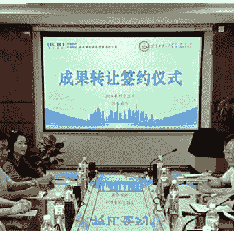

图7-2 陕西中医药大学第二附属医院“一种通路贴剂”成果

项目以转让方式进行转化，合同金额18 万元。该成果陕西中医药大学获得净收益18.5 万元，奖励团队及重要贡献人员奖励88%，做出重要贡献的团队奖励22%。

# 医疗卫生机构案例

该案例表明，高校附属医院在推进医工交叉融合、推动原创医疗器械研发方面具有显著优势。明显的收益分配机制（如“90/10”模式）具有有效激励科研人员创新与转化的积极性。同时，此类技术不仅具有重要战略意义，也体现了产学研协同的巨大潜力。

2024年，我国省卫生机构科技成果转化收入及奖励总额为2805.92万元，单位获得的现金和股权奖励金额为2,139.69万元，个人获得的现金和股权奖励金额为666.23万元。以转让、许可的科技成果转化当年实现配分的现金总额（万元）为3,018.97万元。其中，留单位的金额为2,012.17万元；奖励个人的金额为629.62万元；研发与转化主要贡献人员获得377.18万元的现金奖励。以技术开发、咨询、服务项目当年实现配分的现金总收入为164.86万元。其中，留单位的金额为127.52万元；奖励个人的金额为36.61万元；研发与转化主要贡献人员获得0.73万元的现金奖励。

### 6.2 现金分配

图 6-1 不同转让方式下现金留单位和奖励个人情况

2024年，陕西医疗卫生机构科技转化现金收入及奖励总金额为2,805.92万元，单位获得的现金和股权奖励金额为2,139.69万元，个人获得的现金和股权奖励金额为666.23万元，分别占比23.74%、76.26%。以转让、许可的科技成果转化现金奖励人次为35次。以技术开发、咨询、服务项目奖励人次为5次。

### 6.3 股权收益分配

2024年，陕西医疗卫生机构科技成果转化无获得股权分配情况。

# 第章 工作案例

2024年陕西省卫生医疗机构转让、许可、作价方式新签订转化科技成果的合同 25项，相关成果均能解决临床需求为导向的应用研究，涵盖高端医疗器械、创新生物材料及药物制剂。整体呈现转化模式灵活（转让、许可）、激励政策明确（研发团队获取巨大益益，80%-95%），一定程度上激发了科研人员的创新与转化动力。但存在转化金额差异较大，部分成果价值可能被低估、缺乏长期合作的收益转化等共性问题。

## 7.1 转让——西安交通大学第二附属医院 陕西医学大学第二附属医院

### 7.1.1 西安交通大学第二附属医院

西安交通大学第二附属医院经过3-5年研发，成功研制出“仿生人工齿关节”技术。该技术通过专利转让实现转化，合同金额59万元，实际到账59万元。该仿生关节属于非融合材料、能够解决椎椎固定后活动丧失、邻近节压力增加和退变加速等问题，具有仿生性、稳定性，可显著改善患者生活质量等。研究结果如下：

# 工作案例 第七章

医院通过专利转化模式将技术转化为市场，转化金额99 万元全部到账。按照西安交通大学收益分配政策，研发团队获得90%的收益（53.1 万元），医院保留10%（5.9 万元）。
该人工人工关节具备类似正常软关节的功能，可在此屈、侧倾和旋转中保持稳定，显著降低远关节退变和内固定失败概率，具有良好的临床前景。

该案例表明，高校附属医院在推进医工交叉融合、推动原创医疗器械研发方面具有显著优势。明显的收益分配机制（如“90/10”模式）具有有效激励科研人员创新与转化的积极性。同时，此类技术不仅具有重要战略意义，也体现了产学研协同的巨大潜力。

### 7.1.2 陕西中医药大学第二附属医院

陕西中医药大学第二附属医院经过6年研究终获成功，成形“一种通路贴剂及其制作方法”后将该专利以转让方式转给西安医药研发有限公司，转化金额18 万元。该成果是基于中药理论与实践的成果，中药成分相对天然，在合理的使用的情况下，具有较高的安全性，减少不良反应，适合病人。

图7-2 陕西中医药大学第二附属医院“一种通路贴剂”成果

项目以转让方式进行转化，合同金额18 万元。该成果陕西中医药大学获得净收益18.5 万元，奖励团队及重要贡献人员奖励88%，做出重要贡献的团队奖励22%。

# 医疗卫生机构案例

该案例表明，高校附属医院在推进医工交叉融合、推动原创医疗器械研发方面具有显著优势。明显的收益分配机制（如“90/10”模式）具有有效激励科研人员创新与转化的积极性。同时，此类技术不仅具有重要战略意义，也体现了产学研协同的巨大潜力。

# 科技金融篇

# 科技金融促进成果化的经验做法

进一步推进陕西科技成果转化和秦创联动平台建设，在陕西省、政府的统一部署下，省市各区部门紧密协同，聚焦破解“科技—产业—金融”融合的痛点卡点和机制制约，坚持改革突破，加速推动科技金融深度融合，促进科技成果转化。

## 1.1 科技金融政策

以深化科技成果转化“三项改革”为导向，引导高校建立面向产业需求的应用类立选题模式。严控高校科技成果供给和转化问题，推动“三项改革”拓质增效，引导高校完善科技创新人才一体化培养，提升高校成果质量和转化效率。

在政策保障方面，陕西省、政府发布《秦创原创平台建设三年计划（2021—2023年）》和《秦创原创平台建设三年计划（2024—2026年）》等政策文件，各级部门围绕成果转化、企业培育、技术攻关、产业发展、人才引用、科技金融、保障等方面共发布160余份配套举措，形成了上质贯下、多维联动、层层落实、全社会协同的政策体系，有效促进了政策的收集和分级呈现。2022年，陕西省四条秦原创范围内资金总额达23.6亿元。政府对秦创原创专项经费超过130亿元；全省研发经费投入由2020年的56.45亿元增长到2023年的134.18亿元，增幅高达137.69%；全省研发经费由2020年的632.33亿元增长到2022年的769.55亿元，年增长了21.7%；研发投入强度排位前列，西安市研发投入领先达5.18%，排名全国省级市第2位。秦创原创服务平台建设链条，市、区、三级多项服务，全推实行“免申即享”“即申即享”一站式。

# 科技金融

现，“截至 2023 年，注册用户 8 万多个，累计政策奖金9.1亿元、惠及企业45家。

在财政资金方面，陕西创新科技成果转化，探索“先后投”“拨改”等模式，一次性补助向市场赋能。西安市围绕科技成果转化关键环节，印发《西安市科技成果管理办法》，将财政资金以形式投入支持企业，达到规定后，适当收益退出。截至2025 年，西安市首批“先后投”试点完成17项，联合银行执行，相关荣获国家部级期刊报道。

此外，西安市“先后投”试点联动金融机构推出“先后投+信用贷款+担保”组合服务，为首批支持企业获得绿色绿色通道，有效连接的桥梁，实现了从资金的科技精英队伍，聚焦优质科研成果。

## 1. 科技金融工具

### (一) 资金支持

西安省先行引导金融主体推出秦创贷、资产贷、融资贷、秦创贷等信用贷款，全省16家科技金融机构的74项产品在秦创联合服务平台上线，“秦创”“工信贷”为中小企业提供风险补偿资金47亿元，专利质押贷款金额达54.7亿元、受惠企业943家、首创“技术发明信用贷”“技术人才贷”等产品在西安高新区落地。2024年末，西安省科技型企业贷款为2,794.19亿元，同比增长24.5%。这一增速显著高于全省各项贷款的增速。

西安市创新推出技术信用贷，基于企业技术交易数据发布信用贷，截至2025年3月，累计帮纾353家科技中小企业获得贷款17亿元；创新科技金融保险业务，联合22家银行、15家保险机构，为222户科技企业提供12.38亿元综合贷，“政银贷”五方业务累计担保规模约411.72亿元、财政拨款放大102倍，有效降低科技企业融资门槛。此外，西安“先后投”试点联动金融机构推出“先后投+信用贷款+担保”组合服务，为首批支持企业获得绿色通道，有效连接的桥梁，实现了从资金的科技精英队伍，聚焦优质科研成果。

### (二) 股权支持

陕西省政府引导基金鼓励企业早期创业支持。截至2025年月底，陕西省引导基金已形成规模55亿元，通过出资45家企业，涵盖半导体、航空等领域。西安市引导基金规模100亿元，增长5倍，支持企业67家。西安市引导基金，西安市引导基金规模27亿元。

### (三) 其他工具

陕西省引导基金资金达32亿元，西安市引导基金共28亿元，西安市引导基金项目，西安市引导基金，西安市引导基金，西安市引导基金，西安市引导基金项目，，西安市引导基金，西安市引导基金，西安市引导基金，西安市引导基金项目，西安市的科技资金，西安市引导基金共26亿元，西安市引导基金共26亿元，西安市引导基金，西安市引导基金，西安市引导基金项目。

## 问题与建议

## 1. 高等院校

在科技创新的国家战略和时代潮中，陕西省作为科技大省，高校集群创新园区上的“智引擎”，汇聚着深厚的科研实力与智慧资源。科技成果转化近年来实现了较快发展，但在取得成绩的同时，总体仍然面临科技成果转化不足、没有有效发挥科研资源的问题。科技成果转化方面面临“技术差距”与“转化差异”并存的结构性矛盾，“高产的科研”与“产业化不足”之间经历长期拉锯、折射出结构性矛盾。

具体而言，可归纳为以下六类核心问题：部分高校的科研成果在学术层面展现出卓越的创新性与先进性，与市场实际需求的合度严重不足、缺乏相似引擎、难以严密。以西安工程大学为例，该校拥有大量的“纺织+智能”、“纺织+材料”等尖端技术，等地模式仍以传统加工为主，需求层次不齐，对西安工程大学的先进技术难以被有效吸收与应用，导致在技术供需上出现严重的不匹配。同时，长三角等产业发达地区对这些先进技术有着旺大的需求，由于地域差异、政策差异等制约，科研成果落地过程中面临重重阻碍，形成了“优秀成果难以转化”的局面。

### （一）与市场适配、供需匹配的“结构性”难题

西安大学针对学校科技成果存在的“数量、质量”的突出问题，其根源于科技研发经费不足，限制了研究的深度和选择更新，研究往往偏于理论、缺乏实际应用，理论与实践脱节，学科合作不足，导致创新能力受限，与行业的联系不紧，导致成果转化困难，教师在实际操作和项目管理方面经费不足。

### （二）转化引导机制聚焦人才缺位的“动力转向”

当前高校科研评价体系存在“学术性、轻转化”的倾向，导致科研人员“转化意不强”，对成果转化缺乏足够的重视与投入。科研人员转化的积极性没有充分释放，评价尺度侧重转化数量与金额的量化指标，没有有效社会效益与长期价值的对应。标准未能充分发现成果转化对产业的支撑，导致科研人员倾向于追求“短平快”项目，回避长期投入的核心技术攻关。此外，激励措施的“滞后性”削弱科研人员职业积极性，且收益分配周期过长，导致多数科研人员仍投“短平快”的学术研究。

西安工程和长安财经大学为例，科研人员普遍匮乏，在转化机制下，转化动力不足，难以激发在该领域的创新热情。

### （三）技术转化服务单一，支撑多元的“链条”

科研转化是一个复杂的系统工程，需要资金、平台、人才等要素共同支持。技术转化团队是转化的“桥梁”，多数高校的技术转化服务存在专业能力匮乏、协同差异性的问题，试点短缺、概念差异与试点中心等建设滞后，限制了技术转化。西北大学西安理工大学、西安财经大学调研反映出的科研成果在转化及产业化过程中需要，缺乏场地和资金等条件。

着严峻的挑战。在资金方面，政府科技投入不足，社会资金由于对技术转化成果的高风险认知，转化意愿普遍缺乏。同时，高校自身的科研经费主要用于科研目的的研发，难以直接用于成果转化工作。

金融支持匮乏，尤其是突出的是科技转化的首创激励。近年来，陕西对初创企业的扶力度显著加大，已经取得了不错的良好效果，促进性企业发展作用显著，但作为科技大省和高校资源大省，陕西一千亿的基金规模和全国二十万亿的基金总规模相比，仍显不足，且与北方华及南方发达地区差距较大。特别是对早期项目的首期支持仍不自然。科研人员在成果转化起初面临资金短缺、风险因素的困扰，“第一基金”和早期发展期的支持。

在人才方面，“专业人士”与“人有能力”存在问题。高校人才知识结构短缺，对科技沿、市场需求、资本运营等领域的了解不够深入，缺乏成果转化流程的实战经验。例如沈中的陕西理工大学，当地发展水平的制，政府科技支出占比高，社会资本投资冷，人才流失严重，科技转化工作困难。西安理工大学也表示技术转化专职队伍建设困难，学校教师及科研人员缺乏经营运营及经验。

（五）政策落实不到：政策执行“中梗”难题

为了提高高校科技转化，国家和地方政府出台了一系列利好政策，如《促进科技成果转化》《科学技术进步法》以及陕西省《关于深化强化科技成果转化“三项改革”》等

然而，在执行过程中，这些政策往往存在“最后一位”后梗现象，政策落地效果不佳。以职务替代成果管理制度为主，许多高校未建立完善的配套机制，导致成果转化过程中权不清、审批流程紧迫、收益不配合等问题，影响了科研人员和企业参与转化的积极性。陕西理工大学、陕西职业技术学院在政策执行过程中遭遇此类困境，转化效率受到很大影响。

西安交通大学表示需要建立单列清单试点。传统专利模式将我国专利所有，强调“防流失”而忽视转化效率，评估、处置层层审批，导致专利价值贬值。推动专利单列清单试点，建立区别于有资产的专利评价标准；允许高校自主决定专利转让、许可或作股，收益按比例反馈；构建专利运营平台，通过大数据需求匹配，提升转化精度。

（六）不同学科成果转化差异：分领域的“差异化”均衡

## 问题与建议

文科与理工高校的成果转化，面临“冰火两重”的差异化困境。人文类高校缺乏传统转化路径，市场价值难以以兑现。

如西安外国大学、西安政法大学等，科研成果多以智库报告、译著、语言数据库、咨询方案等“软成果”形式存在。难以通过传统的许可、转让等转化模式实现价值体现，市场价值识别度低，企业转化意愿不足。

理工高校转化路径更通畅，但存在“重量、轻质重量”问题。如西安科技大学高校转化主要依赖与企业的横向科研项目合作，专利、软件著作权等有形成成果的转让和许可，有形成果的质量和转化效率亟待提高。

## 1 科研院所

### 一）供需对接问题

一方面，从供给来看，科研院所作为科研与成果突破的重要主体，2024年陕西省高校转化成果数量亟待提高。目前，许多高校的科研目标以争取国家级或省级课题项目、发表学术论文或申报奖等为主，成果评价处于“技术水平、应用价值”阶段，导致成果或是在技术层面还无法实现产业化，或者就是取得了实验室阶段，无法满足市场对成本可控、稳定、易于集成的真实所需。例如，陕西省交车辆研究中心反馈产业发展过程中，产业链间的合作不畅，合力不足，末端产品的生产成本有所增加，市场竞争力不足。

另一方面，从需求来看，科研人员对市场的认知以及企业需求的实际技术健康难以深入理解和有效落实。科研院所的研发活动多为技术驱动、市场驱动，但未能紧密结合陕西省航空航、高端装备制造、电子信息、能源化工、新能源汽车等重点产业的需求进行精细研制，导致供给与市场需求错位。例如，大型科技中小型企业面临转化的压力，但它们面临空间有限，技术转化能力弱、风险应对能力的问题，需要大量量开发的实验室环境，“接不上”、“不敢”的问题导致双方无法有效对接。

### 二）转化机制问题

目前陕西省科研所科技成果转化机制仍较为健全。部分科研所还未建立科技转化制度以及专门的科技转化管理机构，对单位内部的科研成果转化缺乏审批制与奖励机制，缺乏相关方面的考核评价体系，单位内部部门没有建设技术转移矩阵机构，在此技术转移在科技转化中起到的作用很小。

二是转化方式多样性不足。科研所的科技成果转化依然依赖于技术开发、咨询、服务等方式，以转让、许可、作价入股方式的科研合同总金额占比为5.66%，其中2024年陕西省科研所作为投入入股方式转化的合同仅1项，金额也只有13万元，占比0.4%，这些说明陕西科研所对于新型科技成果转化方式的探索与应用还不，转化方式的多样性待进一步拓展。

三是转化单位中的国有资产管理权与主要人员的创新激励的平衡亟需深化。在陕西省推进“三项改革”的背景下，……（此处省略部分重复内容，保持原文逻辑）

## 政策建议 第二章

书写以及与转化流程的培训，提升人员和管理人员的专业能力。（西北大学第一医院、西交大第一附陕林医院、陕西省结核病防治院）

引进与培养优秀人才：需要引进的技术转移人才，也需要加强对现有科研人员在转化方面的能力培养。（陕西省康复医院、陕西省核工业二一五医院）

（五）营造生态与宣传引导“解决‘氛围弱”的问题

加强政策宣传与案例引导：通过培训、宣、案例分享等形式，提高院内对转化成果的认知和参与（西安大学第三附属医院、西交大第一附陕林医院、陕西中医药大学附属医院）

建立学习交流机制：组织转向先进单位和个人学习，特别是为市级医院提供帮助和倾斜平台。（宝源中国医学医院、陕西中医药大学附属医院）

聚焦临床需求：引导科研方向从“发表论文”向“解决临床实际痛点”转变，确保科研成果的转化价值。（西北大学第一医院、陕西省核工业一二五医院、西安市公共卫生中心）

综上所述，建议的实施方案重点聚焦于：

- 1.“控缚”：以赋权改革和尽责免为核心，大胆破除制度障碍，解放医务人员的思想包袱。
- 2.“赋能”：以建立专业 TTO 和系统性培训为抓手，为医疗机构弥补能力储备和人才短板。
- 3.“引血”：以建立早期专项资金为引导，吸引社会资本共同解决“死亡之谷”的资金瓶颈。
- 4.“搭桥”：以构建高效对接平台和深化产学研合作作为手段，彻底打通需求信息壁垒。
- 5.“引导”：通过改革评价体系和强化宣传激励，营造“勇于创新、乐于转化”的浓厚氛围。

唯通过这样一套组合拳，才能将医疗机构巨大的创新活力，有效转化为提升人员健康水平、推进生物医药发展的实力。

# 附录

## 附录 1

## 2024 陕西省科技成果转化合同金额排名

2024 陕西省科技成果转化合同金额总体前20

| 序号 | 单位名称 |
| 1 | 西安交通大学 |
| 2 | 西北工业大学 |
| 3 | 西安电子科技大学 |
| 4 | 西安建筑科技大学 |
| 5 | 西安理工大学 |
| 6 | 西北农林科技大学 |
| 7 | 西安科技大学 |
| 8 | 陕西科技大学 |
| 9 | 长安大学 |
| 10 | 西安石油大学 |
| 11 | 西北大学 |
| 12 | 西安光学精密机械研究所 |
| 13 | 西安邮电大学 |
| 14 | 西安工业大学 |
| 15 | 陕西理工大学 |
| 16 | 西安工程大学 |
| 17 | 延安大学 |
| 18 | 榆林学院 |
| 19 | 商洛学院 |
| 20 | 西安航空学院 |

2024 陕西省科技成果转化合同金额排名 附录1

## 2024 陕西省科技成果转化合同金额前 20

| 序号 | 单位名称 |
| 1 | 陕西科技大学 |
| 2 | 西安交通大学 |
| 3 | 西北工业大学 |
| 4 | 长安大学 |
| 5 | 西安电子科技大学 |
| 6 | 西安理工大学 |
| 7 | 西安工程大学 |
| 8 | 西北农林科技大学 |
| 9 | 西北大学 |
| 10 | 西安工业大学 |
| 11 | 西安文理学院 |
| 12 | 西安建筑科技大学 |
| 13 | 陕西理工大学 |
| 14 | 西安科技大学 |
| 15 | 西安医学院 |
| 16 | 西安石油大学 |
| 17 | 西安交通大学第二附属医院 |
| 18 | 西安交通大学第一附属医院 |
| 19 | 延安大学 |
| 20 | 西安光学精密机械研究所 |

## 2024 陕西省科技成果转化许可合同金额前 20

| 序号 | 单位名称 |
| 1 | 西北农林科技大学 |
| 2 | 西安电子科技大学 |
| 3 | 陕西省交油研究中心 |
| 4 | 西安交通大学 |
| 5 | 西北工业大学 |
| 6 | 长安大学 |
| 7 | 西安建筑科技大学 |
| 8 | 西安理工大学 |
| 9 | 陕西师范大学 |
| 10 | 宝鸡文理学院 |
| 11 | 西安光学精密机械研究所 |
| 12 | 铜川市民医院 |
| 13 | 西北大学 |
| 14 | 西安交通大学第一附属医院 |
| 15 | 陕西理工大学 |
| 16 | 西安航空学院 |
| 17 | 延安大学 |
| 18 | 西安文理学院 |
| 19 | 陕西科技大学 |

## 2024 陕西省科技成果转化开发金额前 20

| 序号 | 单位名称 |
| 1 | 西安交通大学 |
| 2 | 西北工业大学 |
| 3 | 西安电子科技大学 |
| 4 | 西安理工大学 |
| 5 | 西安光学精密机械研究所 |
| 6 | 西北农林科技大学 |
| 7 | 西安邮电大学 |
| 8 | 西北大学 |
| 9 | 西安工业大学 |
| 10 | 陕西科技大学 |
| 11 | 西安石油大学 |
| 12 | 西安建筑科技大学 |
| 13 | 长安大学 |
| 14 | 西安工程大学 |
| 15 | 西安科技大学 |
| 16 | 宝鸡文理学院 |
| 17 | 西安航空学院 |
| 18 | 西安文理学院 |
| 19 | 陕西理工大学 |
| 20 | 商洛学院 |

## 2024 陕西省科技成果转化咨询合同金额前 20

| 序号 | 单位名称 |
| 1 | 长安大学 |
| 2 | 西安建筑科技大学 |
| 3 | 西北农林科技大学 |
| 4 | 陕西动物大学 |
| 5 | 西安财经大学 |
| 6 | 陕西理工大学 |
| 7 | 西安交通大学 |
| 8 | 渭南师范学院 |
| 9 | 西安理工大学 |
| 10 | 陕西药科大学 |
| 11 | 西安邮电大学 |
| 12 | 西安石油大学 |
| 13 | 陕西师范学院 |
| 14 | 西北大学 |
| 15 | 西北工业大学 |
| 16 | 西安工业大学 |
| 17 | 陕西科技大学 |
| 18 | 西安电子科技大学 |
| 19 | 陕西工业职业技术学院 |
| 20 | 西安科技大学 |

## 2024 陕西省科技成果转化服务金额前 20

| 序号 | 单位名称 |
| 1 | 西安交通大学 |
| 2 | 西北工业大学 |
| 3 | 西安建设科技大学 |
| 4 | 西安科技大学 |
| 5 | 西北农林科技大学 |
| 6 | 西安理工大学 |
| 7 | 西安石油大学 |
| 8 | 西北大学 |
| 9 | 长安大学 |
| 10 | 陕西科技大学 |
| 11 | 西安电子科技大学 |
| 12 | 西安邮电大学 |
| 13 | 陕西理工大学 |
| 14 | 榆林学院 |
| 15 | 延安大学 |
| 16 | 西安工业大学 |
| 17 | 嵩洛学院 |
| 18 | 西安美术学院 |
| 19 | 西安航空学院 |
| 20 | 西安文理学院 |

## 附录 2

## 2024 陕西省科技成果转化合同排名

2024 陕西省科技成果转化总数量前 20

| 序号 | 单位名称 |
| 1 | 西安交通大学 |
| 2 | 西北工业大学 |
| 3 | 西北农林科技大学 |
| 4 | 西安电子科技大学 |
| 5 | 西安理工大学 |
| 6 | 西安科技大学 |
| 7 | 长安大学 |
| 8 | 西安建筑科技大学 |
| 9 | 陕西科技大学 |
| 10 | 陕西理工大学 |
| 11 | 西安邮电大学 |
| 12 | 西安石油大学 |
| 13 | 西北工业大学 |
| 14 | 西安工业大学 |
| 15 | 商洛学院 |
| 16 | 西安工程大学 |
| 17 | 延安大学 |
| 18 | 西安航空学院 |
| 19 | 西安文理学院 |
| 20 | 榆林学院 |

2024 陕西省科技成果转化数量排名 附录2

## 2024 陕西省科技成果转化让数量前 20

| 序号 | 单位名称 |
| 1 | 陕西科技大学 |
| 2 | 西安理工大学 |
| 3 | 西安交通大学 |
| 4 | 陕西理工大学 |
| 5 | 西安电子大学 |
| 6 | 西安工程大学 |
| 7 | 长安大学 |
| 8 | 西北工业大学 |
| 9 | 西安建筑科技大学 |
| 10 | 西安石油大学 |
| 11 | 杨淮职业技术学院 |
| 12 | 西安科技大学 |
| 13 | 西北大学 |
| 14 | 陕西师范大学 |
| 15 | 西安航空职业技术学院 |
| 16 | 宝鸡文理学院 |
| 17 | 西北农林科技大学 |
| 18 | 西安铁路职业技术学院 |
| 19 | 高洛学院 |
| 20 | 西安邮电大学 |

## 2024 陕西省科技成果转化许可合同数量前 20

| 序号 | 单位名称 |
| 1 | 西安电子科技大学 |
| 2 | 西北农林科技大学 |
| 3 | 西北工业大学 |
| 4 | 西安交通大学 |
| 5 | 西安工业大学 |
| 6 | 长安大学 |
| 7 | 西安理工大学 |
| 8 | 陕能能源职业技术学院 |
| 9 | 陕西理工大学 |
| 10 | 西安建筑科技大学 |
| 11 | 宝文理学院 |
| 12 | 咸阳师范学院 |
| 13 | 陕西工业职业技术学院 |
| 14 | 西安文理学院 |
| 15 | 西安航空学院 |
| 16 | 陕西工业职业技术学院 |
| 17 | 陕西大学 |
| 18 | 高洛学院 |
| 19 | 陕西科技大学 |

2024 陕西省科技成果转化排名 附录

## 2024 陕西省科技成果转化总数量前 20

| 序号 | 单位名称 |
| 1 | 长安大学 |
| 2 | 西安建筑科技大学 |
| 3 | 西北农林科技大学 |
| 4 | 陕西动物大学 |
| 5 | 西安财经大学 |
| 6 | 陕西理工大学 |
| 7 | 西安交通大学 |
| 8 | 陕西工业职业技术学院 |
| 9 | 西安邮师学院 |
| 10 | 渭南师范学院 |
| 11 | 西安理工大学 |
| 12 | 西北工业大学 |
| 13 | 西安交通大学 |
| 14 | 西安工业大学 |
| 15 | 西安石油大学 |
| 16 | 西安文理学院 |
| 17 | 陕西科技大学 |
| 18 | 西安电子科技大学 |
| 19 | 西北大学 |
| 20 | 西安就职业技术学院 |

## 2024 陕西省科技成果转化开发前 20

| 序号 | 单位名称 |
| 1 | 西安交通大学 |
| 2 | 西北工业大学 |
| 3 | 西安电子科技大学 |
| 4 | 西北农林科技大学 |
| 5 | 西安邮电大学 |
| 6 | 西安理工大学 |
| 7 | 长安大学 |
| 8 | 西北大学 |
| 9 | 西安工业大学 |
| 10 | 陕西科技大学 |
| 11 | 西安政法大学 |
| 12 | 西安建筑科技大学 |
| 13 | 陕西理工大学 |
| 14 | 西北建设大学 |
| 15 | 陕西科技大学 |
| 16 | 洛洛学院 |
| 17 | 西安航空学院 |
| 18 | 西安石油大学 |
| 19 | 陕西科技大学 |
| 20 | 西安光学精密机械研究所

## 2024 陕西省科技成果转化咨询金额前 20

| 序号 | 单位名称 |
| 1 | 长安大学 |
| 2 | 西安建筑科技大学 |
| 3 | 西北农林科技大学 |
| 4 | 陕西动物大学 |
| 5 | 西安财经大学 |
| 6 | 陕西理工大学 |
| 7 | 西安交通大学 |
| 8 | 陕西工业职业技术学院 |
| 9 | 西安邮师学院 |
| 10 | 渭南师范学院 |
| 11 | 西安理工大学 |
| 12 | 西北工业大学 |
| 13 | 西安交通大学 |
| 14 | 西安工业大学 |
| 15 | 西安石油大学 |
| 16 | 西安文理学院 |
| 17 | 陕西科技大学 |
| 18 | 西安电子科技大学 |
| 19 | 西北大学 |
| 20 | 西安就职业技术学院

# 感谢单位

浦发银行西安分行 招商银行西安分行
