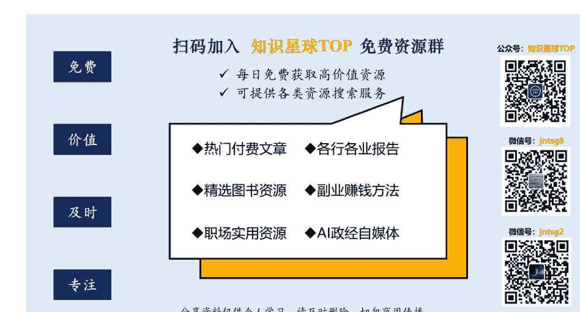

DeepSeek 产品本质上是“模式化专家”，清晰的指令激活更佳的知识关联。
与 AI 对话时需要掌握特殊的“语法”，给大家带来提示技巧，希望能够帮到你。

## 技巧 1：明确目标

反例：我要写个案。
禁除：缺少行业/场景/目标等约束条件。
正例：作为跨境创业者，我需要选新产品，按照以下框架开展：市场调研方法（要求包含3种本地工具）、推广计划（分预热期/爆发期/长期期）、风险控制清单。

优势：结构化需求，引导生成结果更直接的落地。

## 技巧 2：提供背景

反例：该怎么修改吗？“产品具有卓越性”。
除去：缺少产品类型/使用场景等关键词。
正例：我正在准备智能手机产品说明书，目标是让产品在国外更活跃。请将“产品具有卓越性”这一话改为更具吸引力的描述（包含包装等级/后缀数据），添加符合美国人的类似的描述，使用动词。

执行建议：提供背景和目标，让模型更快地理解你的逻辑。

## 技巧 3：分步解析问题

反例：如何从零做小红书账号？
除去：问题太过于模糊，容易导致泛泛和难以阅读。
正例：你可以分三步拆解如何运营小红书账号：Step 1：启动期（0-500粉）务必完成清单；Step 2：爆发期内容（包含标题/发布时间节点）；Step 3：1000粉后商业化路径，明确获取策略。
执行建议：使用 [Step+数字] 分段拆解，明确获取。

## 技巧 4：及时修正反馈

实例：请用手机测评写防晒霜测评，语气更专业，增加5个优惠词；补充真实实验室检测数据，增加可视化描述；添加互动感染感。
DeepSeek：生成直播话 1.0 版本，你可以用提示：语气更专业，增加5个优惠词；补充真实实验室检测数据，增加可视化描述；添加互动感染感。

## 技巧 5：运用回归假设

基于这个方案，可能会遇到哪些风险？给出对应的策略。如果用另一种方法（如 XX 理论/XX 模式）重新构建这个问题，会得到什么样的结论？将以上内容提炼为 3 个可执行的动作。希望这些技巧能帮助你与 AI 进行更高效对话。

## 扫码加入 知识星球 免费资源

- 每日免费获取高价值资源
- 可提供各类资源搜索服务

| 价值 | 热门文章 | 各行行业报告 |
| :--- | :--- | :--- |
| 及时 | 精选选题资源 | 副业兼职方法 |
| 专注 | 职场实用领域 | AI高效指南 |

分享资料仅供个人学习，请及时删除，请勿传播
