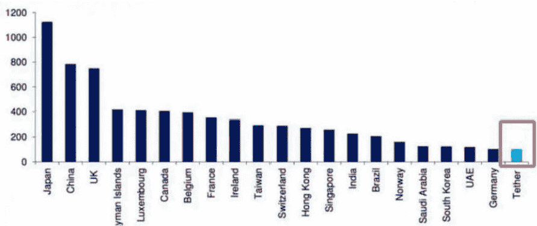

# 6月，史诗级的货币事件与未来

原创思海 思海 2025年5月30日19:49 北京

6月将至，中美同时发生了同样的一件事，新的未来正在到来。
眼眼下，全球所有资产都反弹到了一个新的平衡，然后又没有了方向：美元资产，人民币资产，欧元资产，黄金与比特币等等，停在了路口，不知道通往哪里去。

因为，市场不知道政治局与大国博弈，下一步将往哪里，也未定，未来的新趋势会在哪个方向出现。

历史从来不会空等待。
6月，新的突破口或许已经锚定。
它可能出现在货币领域：

过去几天，中美几乎都发生了同一件事，绝非如此，其未来影响，可能是史诗级别的。

这件事，看起来很简单：

美国参议院于5月19日以66:32通过了《2025年美国稳定创新指导与建立法案》（GENIUS Act）的程序投票，试图为美元挂钩货币稳定提供联邦监管。

这意味着，美国的稳定币将进入大发展时代，货币领域将迎来新的史诗级别的变革。

所谓稳定币，就是某种货币挂钩的虚拟货币。比如挂钩美元、美债、黄金、各本币、算力、比特币等。目前市场上已有的币，99%与美元或其他虚拟货币挂钩。

如此，这种虚拟货币价格不会剧烈波动，不像比特币或者其他虚拟货币那样。

美国的稳定法案在参通过后，意味着美国的金融新边界来到了一个历史的高度，就像当年里根政府的新全球大战战略一样，是把货币霸权的竞赛主动推向更深层级。

哈耶曾说过，货币的最终形态将走向人类的历史：历史上第一种货币是金银等天然货币，第二种货币是由政府发行的货币，第三种货币是私人货币，由私人发行的。

微信jntsg，进资料分享群

比特币等虚拟货币，实际上就是私有货币的实践。但是，由于比特币等虚拟货币没有价值，由于波动非常大，非常不稳定，无法大面积的普及。

到为止，比特币的市值不超过3万亿美元左右，相当于一个微软的市值。而黄金的总市值是25万亿美元。

稳定币一旦获得监管，指数级增长，花京预计到2030年，美国国内的稳定币规模可能达到1.6至3.7万亿美元规模。

未来至少是万亿级规模，甚至有百亿美元级规模。

这将意味着什么？史诗级别的金融革命。

按照稳定币的设计，不仅像某某某这样的个人可以发行，微软、特斯拉、英伟达等企业都可以发行自己的稳定币。

持有这些企业的稳定币，可以交易该企业的产品和服务。这可能会带来新的金融与产业形态的革命，比如如何帮助人工智能时代的升级。稳定币交易是最适合AI时代的交易方式：快速、便捷、标准化、安全、匿名私密等等。

稳定币的核心是资产挂钩，目前来看主要是美元挂钩。如此，可能会形成这种新的模式：

比如微软为了发行稳定币，购买美国国债，以国债背书自己发行的稳定币。这样，微软在拥有美国国债的时候，也拥有了自己的货币，而自己的稳定币可以在全球范围内交易，甚至投资。

可以说，企业发行自己的虚拟货币合法化，前提是与美债或美元挂钩。这样相当于鼓励企业持有美元或美债资产，不仅是美国国内企业，更包括许多国家的公司。

根据基础的数据，2025年，稳定币持有超过120亿美元的美元支持资产，实际充当了支持美国短期债券市场的货币基金的角色。例如，截至2025年3月，Tether持有的美国国债达到了985亿美元，这一数字在2020年几乎为零，Tether现已跻身为美债主要海外持有者之列。

微信intjs，资料分享群

Figure 1:Major foreign holders of US treasuries, billions(2025)-with Tether included for comparison.

美国作为金融帝国，希望美元的霸权永久存在。由于美元开拓资产新兴，将是最重要的任务：简单来说，是给美元找新的资产来锚定。比如欧元、人民币、英镑、日元等，目前抢走的是美元份额。如果未来人民币国际化，美元将失去数万亿美元的份额，需求一旦消失，必须要找到替补，美元就可能无限大，利率就会飙升。对于如此，美国来说，这种转变还是很可能的。

如果按照稳定币的计划，年后，稳定币持有的规模就可以达到几十万亿，甚至百万亿美元。如果这些私人资产绑定到美元上，那么美国就不会再成立。

如此，美国霸权可能胜利并非巧合。在参议院通过后，由于2025年初政府提交的《稳定币条例草案》经签署后正式生效。至此，从大国竞争的角度来看，美国这次动作是：通过立法，虽然有着资本市场的考虑，但另一方面也是摆脱美元霸权的必然选择。人民币国际化成为新的世界货币道路，绝对不是SWIFT的基础上，而是要通过新的支付工具来实现。这也必须在稳定币领域开展。稳定币创新其影响远比规模大。它意味着美国还是要优先维护自己的金融利益，这是全球性的利益。为此，特朗普关税最终可能会收缩，因为没有贸易，金融就自然萎靡。最新的事态再次表明：5月28日，美国法院判决特朗普的关税政策违法。5月29日，白宫申诉至最高法院，特朗普回回暂时撤回决定。

撤回时间大约左右，需要特朗普回回再做出判决。如果特朗普回回支持胜利，则白宫可以上诉至最高法院。这场官司其实是美国国内的机制，特朗普对关税的立场是在退却，如果资本市场再次遭遇衰退，特朗普就此崩塌。美国是法治国家，如此，将恢复国际资金对美国资产的信心。

## 一、美元资产方向

不是美国法院的判决，还是美国出了稳定法案。老美认识到金融利益远比制造利益要重要。5月的美弹其实是对特朗普关税政策的否定，因为这次反弹都是在白宫试图惩罚性关税90天后实现的，尤其是与中国的暂时性促成了美股的反弹，恢复了关税损失。这说明了这一点：关税损失并不符合金融利益，也许美国制造业有一好处，但更大的损失将会发生在美国市场上。特朗普想要的行为将利益转移给群体，展现了美国的金融利益。

华尔街已经出了指导意见：一个是贸易法领域的裁决，另一个是稳定法案的通过。

这一套组合拳，是要特朗普怎么在维护美国金融利益的前提下，进行国际博弈。而这也是6月全球债务与资本的新主题。特朗普对对外融资与资本的方法都会发生巨大的变化。

所以我认为，美国和几个伙伴的关税问题最终都是落地无疑。因此，接下来，美股和美元将会关税问题的关联越来越小，而更加取决于自身的趋势。

美股：
从技术角度来看，目前美股处于一个分界点，往上回弹突破点，则回归熊市；往下跌，则结构筑底。鉴于稳定币的推出，以及特朗普可能在关税问题上的逐渐软化立场，让全球资本对美元资产的信心有一修复。6月美股可能会尝试底部，冲击前高。道指指数是否突破44000线，纳斯达克看能否冲击20000一线。目前，突破这两个压力的概率是相对较低，可以预期降低。

美元指数：
中期股市已经基本确立，但是目前美联储依然保持强势立场，不愿意透露其何时降调，主要还是要等美股强势走上去，摆脱下行区间。

此，6月美元指数仍然可能弱震荡，震荡区间101-97。

## 二、人民币资产方向

6月份，从时间窗口来说，美国关税泡沫的影响可以忽略。人民币资产的走势将回归内部因素为主。

大A：
在机器人与AI带领下调整重心之后，目前没有情绪板块能够带动A股走向向行情。5月的稳定板块开始发酵。节后可能会继续，有不错的交易机会，但是多走远，目前尚未确定。

从五月的情况来看，神秘的……
