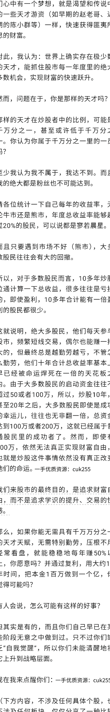
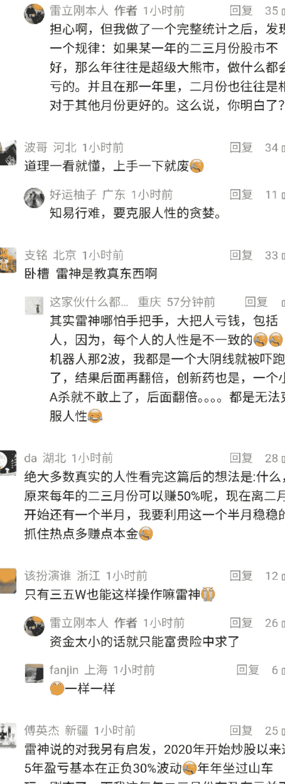

# 普通人，想要年入10万真的那么难吗？

作者：林小五 2021-01-02 10:38

很多人问我：月薪三千，真的能年入十万吗？

其实，只要你肯努力，这真的没那么难。

很多人觉得，薪水低就没法存钱，其实你想错了。存钱不是看你赚了多少，而是看你留下了多少。关键在于理财规划。

只要掌握了正确的方法，坚持下去，年入十万不是梦。

今天我想和大家分享几个实用的理财方法：

- 第一，坚持记账

很多人一个月下来，都不知道钱花到哪去了。通过记账，你可以发现很多钱都花在了不必要的开支上。比如，房租、水电费、交通费，这些开销看似不大，但积累起来是一笔巨大的数字。

- 第二，强制储蓄

发工资后，先把存出一笔钱，剩下的再用来消费。这样可以保证你每个月都有钱存下来。长此久之，这笔钱会通过复利效应，变成一笔巨大的巨款。

- 第三，学会理财

理财并不是为了让你一夜暴富，而是为了让你的钱生钱。你可以学习一些理财知识，从低风险的理财开始，比如基金、理财，慢慢找到适合自己的投资方式。

总之，只要你坚持做到这几点，年入十万并不难。

最后，我想对大家说：理财是一场马拉松，需要耐性和耐心。只要你坚持下去，一定能看到回报。

觉得文章有帮助，欢迎点赞收藏哦！

也欢迎大家在评论区分享自己的理财心得！

点赞148

# 深度视野优质集群（链接优质社群，助你成功）

全部包含以下内容：限时年费188/年 加微信cuk255

- ① 吃瓜群众含圈加微信时群对话（原价 365 元/年）
- ② 子明享汇（含）内部文章（原价 568 元/年）
- ③ 政事室（子明优）付费内容再送顺子明群聊
- ④ 米联储锦美【作者米楼】（原价 599 元/年）
- ⑤ 欧洲金雀会员专属文章（原价 328 元/年）
- ⑥ 砖瓦斥内部文档（原价 400 元/年）
- ⑦ 卢克文青读书会专属文章（原价 699 元/年）
- ⑧ 鉴茶财经知识星球（原价 3310 元/年）
- ⑨ 猫哥的视界知识星球文章（原价 299 元/年）
- ⑩ 财经新周【独家新闻】（原价 1498 元/年）
- ⑪ 杨世光在金钱圈（原价 2200 元/年）
- ⑫ 森森财经知识星球（原价 1600 元/年）
- ⑬ 激源译译付文书群集（持续更新）
- ⑭ 司马林解读谋选全套音频和全套书籍收藏版无损减（原价 2.3 万）
- ⑮ 虚构三部曲[民国梦、帝国扩张、不被理解的MAO]（原价 599 元）
- ⑯ 卢克知识星球文章（原价 268 元/年）
- ⑰ 额外再送：卢祺元新浪微博付费专栏、三村丰老王、三花九树集文

不定内容：——（更多资源不写下去了……）

- ① 守夜人才知识星球、接换魔王后星球、星财富知识星球、
- ② 创始圣纪、达叔译论星球、成就财富圈、雪雪花甲老头等
- ③ A 视野、大树乡谈、江初优、泮咩说、上海海学等付费文集
- ④ 西风付费文章、老端、赢在八小时之外、局外的视界、升值、老体制内等其它一些大 V 付费文集

# 深度视野文集
群微信cuk255

深度视野（付费文集）

限时年费188/年 低成本链接全网大优质内容
