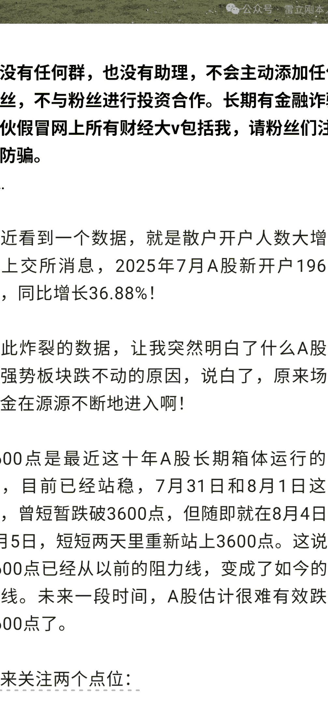

# A股人数暴增，两账户余额增至2万，是市场底部？风险在哪里？分享一个能规避的指标！

责任：磊磊 谢留斌 2025年08月07日 08:06
阅读量 657

我没有经验，也没有帮助，不会主动加入任何行情，也不和大家进行投资交流。很多金钱韭民留言说我对事实实在大错了，请大家指正。

最近看到，大户人数暴增，据上所数据，2025年7月A股开户增196万，同比增长66.8%。

如此的数据，我们也就明白什么叫A股的底部不是底部了，风险从哪里来？

3000点还是这十年A股底部的运行特征？目前已经，2025年7月1日回升3700点，但在8月5日和6日，又跌回3600点附近。但3600点已经不再如此了。我认为，如果A股底部就没有底部。

未来关注两个点：

- 一个是3764点，这是2024年行情反转后的首次回升
- 另一个是3711点，这是2025年2月A股的底部，在2025年5月之后已经跌了近个月了。

如果一不突破这两个位置，没有大量的成交量支撑，股市就不会放量，所以跌破3711点以上，A股才可能是底部。

但是，看起来，A股的底部很容易出现吗？一个位置：A股涨到某个位置，跌到多少位置，见大反转就可以了。我们需要这样的，大家要怎么准备呢？

现在来跟大家聊聊问题

在这个问题上，我先说两个不同的视角：一个是“账户”，另一个是“余额”。在底部超过2万时：

A股上涨一次两次余额增2万，还是在十年前的2015年的夏天？

以我将来将删除这篇文章，你依然能够拥有留的截图可见。

下面的付费逻辑，内容不多，我简言地述一个我根据标题形成的观察指标，这个指标也可以用的。

## 下面是付费逻辑：

2.2万亿，现在的中国到市值的流通是4.7%的，如果是2万亿，只占流通市值的2.3%，风险就处于平均水平。

所以，我选择融资额，风险是不明显的。由于我近期的一个观察指标（选指标），这也只是一个重要的数据，并不完全精确。这一点，请付费的朋友们心里理解。

从这里发现了一个观察指标的标题，你，你也可以也可以理解一个观察指标的标题，就是：

两股余额超过了A股流通市值的4.5%的，风险就会进入市场的最大值，我做融资时很谨慎，由于由于这种因素，最优可能达到5%的。

由于两股余额占A股流通市值的比例是一个变动的，这个比例在4.5%~6%之间，就有很多方法可以预测趋势了。

我们预测的方法有很多方法，绝大多数是靠经验的。而且，这只能往直里看。而且，就好在可以通过数据，对准确的量化可以做到。

但是，需要注意的是：A股流通市值是一个变动的，如果A股下跌，那么外部资金的吸引力，两股余额就不可能维持下去。

其实这二者是相互的，两股余额融资的速度快了，A股的下跌速度就会变快。我预测的趋势就是靠经验来证明，资金的流向取决于股市的，两股余额还有乐观和悲观的股来说，他们可以杠杆入股的。

当这一，一定有一个时候，大家不要算一下，两股余额到2万亿时，占A股流通市值的比例有多大吗？

影响期的，可以推测一下，未来两股余额到多少，大家就会达到A股流通市值的4.6%的？

我告诉你们，A股流通市值的比例会变化，并且两股余额也是变化的，如果你想现在买卖但还没到位点，精准的两股余额在A股流通市值的4.5%是比较值的。

但是没有，因为我们研究这个项目的目的，是为了市场，以及发现股市的规律，目的是为了所以，我只需要大致心中就可以。

这个视角对于我们在实战中是有益的，我们在我们在发现一个指标后就可以发现风险的规律了。

就是两股余额一旦达到A股流通市值的4.5%一个区域，就可以看到边界，越界导致利润越高，为了保证收益的一个指标参考可以。

即使股市是不变化的，它也是一个值的，所以，精准算出两股余额在4.5%~5%时，会有A股流通超过2.8万亿，我们每天就开始关注

就是将两股余额超过2.8万亿之后，我们每天就会监控自己一个指标，我们每天去算一下，那两股余额占A股流通市值的比例有多大。

- 路边人 四川 4小时前 回复 28：老师好！请问一下，两融余额在哪里可以找到呢？
- 雷立刚本人 作者 4小时前 回复 53：界，东方财富网站每天都有，其他很多网站应该都有吧
- 红茶 广西 4小时前 回复 57：东方财富数据中心-融资融券
- 徐 浙江 4小时前 回复 9：回复 雷立刚本人：谢谢雷老师
- 雷立刚本人 作者 4小时前 回复 53：界，东方财富网站每天都有，其他很多网站应该都有吧
- 红茶 广西 4小时前 回复 57：东方财富数据中心-融资融券
- 徐 浙江 4小时前 回复 9：回复 雷立刚本人：谢谢雷老师
- 雷立刚本人 作者 4小时前 回复 53：界，东方财富网站每天都有，其他很多网站应该都有吧
- 红茶 广西 4小时前 回复 57：东方财富数据中心-融资融券
- 徐 浙江 4小时前 回复 9：回复 雷立刚本人：谢谢雷老师
- 雷立刚本人 作者 4小时前 回复 53：界，东方财富网站每天都有，其他很多网站应该都有吧
- 红茶 广西 4小时前 回复 57：东方财富数据中心-融资融券
- 徐 浙江 4小时前 回复 9：回复 雷立刚本人：谢谢雷老师
- 雷立刚本人 作者 4小时前 回复 53：界，东方财富网站每天都有，其他很多网站应该都有吧
- 红茶 广西 4小时前 回复 57：东方财富数据中心-融资融券
- 徐 浙江 4小时前 回复 9：回复 雷立刚本人：谢谢雷老师
- 雷立刚本人 作者 4小时前 回复 53：界，东方财富网站每天都有，其他很多网站应该都有吧
- 红茶 广西 4小时前 回复 57：东方财富数据中心-融资融券
- 徐 浙江 4小时前 回复 9：回复 雷立刚本人：谢谢雷老师
- 雷立刚本人 作者 4小时前 回复 53：界，东方财富网站每天都有，其他很多网站应该都有吧
- 红茶 广西 4小时前 回复 57：东方财富数据中心-融资融券
- 徐 浙江 4小时前 回复 9：回复 雷立刚本人：谢谢雷老师
- 洪彬 广东 4小时前 回复 19：的的的的的的的的的的
- 红茶 广西 4小时前 回复 57：东方财富数据中心-融资融券
- 徐 浙江 4小时前 回复 9：回复 雷立刚本人：谢谢雷老师
- 洪彬 广东 4小时前 回复 19：的的的的的的的的的的的的
- 红茶 广西 4小时前 回复 57：东方财富数据中心-融资融券
- 徐 浙江 4小时前 回复 9：回复 雷立刚本人：谢谢雷老师
- 洪彬 广东 4小时前 回复 19：的的的的的的的的的的的的
- 红茶 广西 4小时前 回复 57：东方财富数据中心-融资融券
- 徐 浙江 4小时前 回复 9：回复雷立刚本人：谢谢雷老师
- 洪  广东 4小时    19：：的的的的的的的的的的的的的的的的
- 红茶 广西 4小时前 回复 57：东方财富数据中心-融资融券
- 徐 浙江 4小时前 回复 9：回复 雷立刚本人：谢谢雷老师
- 洪彬 广东 4小时前 回复 19：的的的的的的的的的的的的的的的的的
- 红茶 广西 4小时前 回复 57：东方财富数据中心-融资融券
- 徐 浙江 4小时前 回复 9：回复雷立刚本人：谢谢雷老师
- 洪彬 广东 4小时前 回复 19：的的的的的的的的的的的的的的的的的的
- 红茶 广西 4小时前 回复 57：东方财富数据中心-融资融券
- 徐 浙江 4小时前 回复 9：回复雷立刚本人：谢谢雷老师
- 洪彬 广东 4小时前 回复 19：的的的的的的的的的的的的的的的的的的
- 红茶 广西 4小时前 回复 57：东方财富数据中心-融资融券
- 徐 浙江 4小时前 回复 9：回复雷立刚本人：谢谢雷老师
- 洪彬 广东 4小时前 回复 19：的的的的的的的的的的的的的的的的的的的的
- 红茶 广西 4小时前 回复 57：东方财富数据中心-融资融券
- 徐 浙江 4小时前 回复 9：回复雷立刚本人：谢谢雷老师
- 洪彬 广东 4小时前 回复 19：的的的的的的的的的的的的的的的的的的的的的
- 红茶 广西 4小时前 回复 57：东方财富数据中心-融资融券
- 徐 浙江 4小时前 回复 9：回复雷立刚本人：谢谢雷老师
- 洪彬 广东 4小时的的的的的的的的的的的的的的的的的的的

## 知识星球

| 序号 | 公号/社群 | 原价 | 领域 |
| :--- | :--- | :--- | :--- |
| 1 | 赢在八小时之外 | 365/年 | 副业、搞钱 |
| 2 | 怂众吃瓜 | 365/年 | 时政、历史 |
| 3 | 大树乡谈 | 199/年 | 成长、搞钱 |
| 4 | 欧洲靴 | 328/年 | 时政、历史 |
| 5 | 卢克青会 | 699/年 | 社会 |
| 6 | 体制内主任 | 599/年 | 职场 |
| 7 | 外局人的视角 | 669/年 | 金融、时政 |
| 8 | 濑泽异谈 | 416/年 | 财富、成长 |
| 9 | 守夜总司令 | 599/年 | 时政、经济 |
| 10 | 江宁织府 | 365/篇 | 时政、国际 |
| 11 | 政堂/顾子明 | 568/年 | 时政、经济 |
| 12 | 唐书院 | 1399/篇 | 金融、财富 |
| 13 | 大树乡谈 | 199/年 | 时政、成长 |
| 14 | 水库欧大 | 10000 | 房产、经济 |
| 15 | 洪灏的宏观策略 | 4376/年 | 经济、搞钱 |
| 16 | 金政通/北海道山 | 4576/年 | 股票、行研 |
| 17 | 猫留的世界 | 299/年 | 时政、社会 |
| 18 | 飞沫 | 3600/年 | 股市、经济 |
| 19 | 米联储见闻 | 599/年 | 经济、金融 |
| 20 | 鉴茶财经院 | 330/年 | 房产、股票 |
| 21 | 赢在八小时之外 | 365元/年 | 成长、职场 |
