# 《项目总角色定位与项目核心管理能力提升》

## 前景：

- 经济低迷，股市萧条，债务扩张，压缩产能去杠杆；
- 政策模糊，调控失效，花样百出，因城施策；
- 市场扭曲，价格高估，投机意明显，资本市场不理性；
- 楼市冻结，资金端结，交易端结；
- 企业纠结，地价高企，新房遇冷，形势严峻；
- 逻辑混乱，管控逻辑、房价逻辑、拿地逻辑、项目开发逻辑、企业发展逻辑理不清......

## 知识星球TOP 资源分享社群

公众号：知识星球TOP

让更多人获取高价值信息

汇聚网付费资源

微信信号：jntsg8

添加微信免费进群

- ◆付费文章
- ◆付费社群
- ◆付费课程
- ◆副业&搞钱
- ◆财经&股市
- ◆行业报告

时政·历史·职场·体制·自媒体学习·军事·软件·影音·社会学

微信信号：jntsg2

在新的市场环境下，各地地产企业面临严峻挑战，房地产企业如何破局，如何逆袭成功，

## 必须关注并实现地产项目的高效高质量开发！

## 课程纲要

第一部分：房地产项目总的角色定位
第二部分：房地产项目总决策管理要点
第三部分：房地产项目总项目开发各阶段各部门深度配合要点

## 第一部分：房地产项目总的角色定位

房地产项目总是决策者还是执行者？

房地产项目总的关注点

房地产项目总应具备的核心能力

### 一、地产项目总是决策者还是执行者？

董事会 -> 公司层面 -> 决策
项目总 -> 项目层面 -> 决策加执行
各部门 -> 专业板块层面 -> 执行

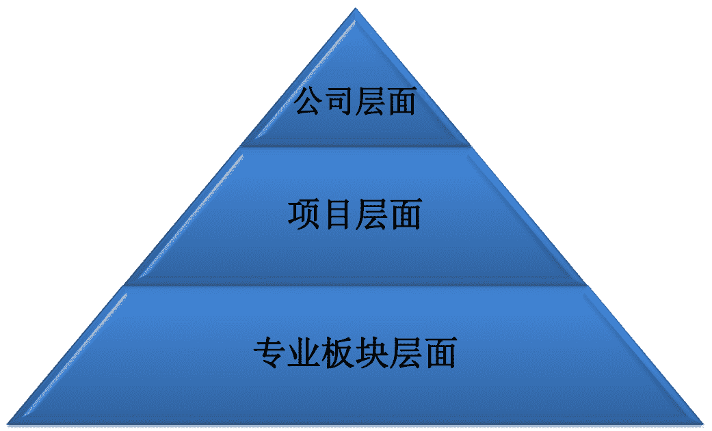

### 一、地产项目总是决策者还是执行者？

决策者

执行者

### 一、地产项目总是决策者还是执行者？

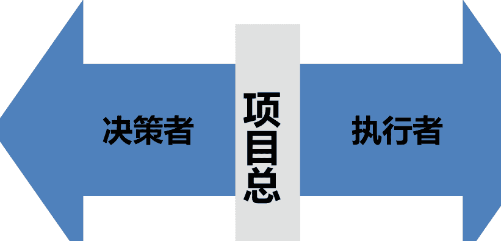

执行：
同时项目总监必须坚定的执行董事会的投资意图，在项目进度、工程质量、成本控制、营销推广上不得半点差错；

决策：
项目总监必须拟定项目系统的整体开发计划和分步执行计划，以及对应的资源配置，参与到公司决策当中。

### 二、地产项目总的关注点

- 各专业之间的协调与配合。
- 多维度的综合分析与决策。
- 项目开发全过程运营与管理。
- 项目开发的核心目标与关键点。

### 三、地产项目总应具备的核心能力

| 项目总核心能力 |
| :--- | :--- | :--- | :--- | :--- |
| 投资能力，做正确项目选择与决策风险 | 产品能力，能够设计客户需要的产品 | 营销能力，怎样把房子尽快卖出去 | 运营能力，项目有效推进实施的重要保障 | 团队能力，提升领导，做好信任和授权 | 社交能力，与政府及项目周边关系协调 |

## 课程纲要

第一部分：房地产项目总的角色定位
第二部分：房地产项目总决策管理要点
第三部分：房地产项目总项目开发各阶段各部门深度配合要点

## 第二部分：地产项目总决策管理要点

房地产行业特点

房地产行业管理现状分析

地产项目总决策管控点

### 一、房地产行业特点

| 速度慢 | 15年房子不好卖 |
| :--- | :--- |
| 成本高 | 16年便宜卖了 |
| 产品差 | 17年没赶上 |
| 不好卖 | 18年限价 |
| 不赚钱 | 19年怎么办 |
| 管理差 | 以后的发展 |

### 一、房地产行业特点

技术密集型：设计、成本、工程、营销、财务等专业深厚

资本密集型：自有资金、融资能力、资金周转

资源密集型：外部资源、土地合作、政府资源、综合管理体系各项资源全面结合

## 二、房地产行业现状分析

技术密集型管理特点：

- 策划：指鹿为马
- 规划：照猫画虎
- 公司：一手遮天
- 设计总：要数据
- 成本总：烧钱
- 工程总：想简单
- 物业总：怕麻烦
- 项目总：目标
- 乙方策划：忽悠
- 乙方设计：难
- 甲方策划：满意

## 二、房地产行业现状分析

技术密集型管理特点：

## 二、房地产行业现状分析

技术密集型管理特点：

- 为什么设计好看，但盖出来的不好？
- 为什么我们的产品定位与客户需求不对？
- 为什么客户需求多，我们产品对客户敏感性不足？
- 为什么设计计划赶不上营销变化？
- 为什么领导层重视设计，却推进不？
- 为什么设计单位达不到我们想要的效果？
- 为什么图纸一直在改？
- 为什么设计报是不通过？
- 为什么成本总是超？

## 二、房地产行业现状分析

技术密集型管理特点：

- 设计周期不正常，影响设计进度？
- 设计管理与设计单位协调？
- 方案深度不够，到施工图时还在修改，设计成果？
- 是否存在图纸滞后与图纸错误？
- 如何在专业知识、技术能力、管理等方面尽量提升？
- 设计的关键目标有哪些？如何保证？
- 如何做好限额设计？
- 施工图的图纸审查成果，如何考核并满足“经营目标”？
- 控成本，还是保进度、竞品质？三者之间矛盾如何处理？
- 如何规避“三边”的成本失控？
- 规划方案及施工图开始前需要完成的工作有哪些？
- 设计部与主要业务部门之间配合的内容？
- 如何做好设计阶段的成本控制？

## 二、房地产行业现状分析

设计质量的好坏，到底说了算

## 二、房地产行业现状分析

2、通用类管理部门现状

- (1)人力-人事变动异常频繁
- (2)法务-到处都是坑
- (3)财务-账总理不清
- (4)拓展-又没钱还要抢地
- (5)报建-政府啥管
- (6)行政-接待任务重
- (7)审计-全都是问题

## 二、房地产行业现状分析

3、企业文化，战略发展方向

- 战略属性
- 区域属性
- 资源属性
- 金融属性
- 核心竞争力

### 三、地产项目总决策管控点

2012年6月政府招挂拿地
2014年3月开始销售
成都锦江区二环路以东攀成城网区域城市核心主城区域交通方便，配套设施成熟，舒适住宅设计
售楼室室内设计公司：KSL林冠成设计公司
建筑施工图设计公司：成都西南院，建筑方案设计公司：中建国际
总包：中建二局

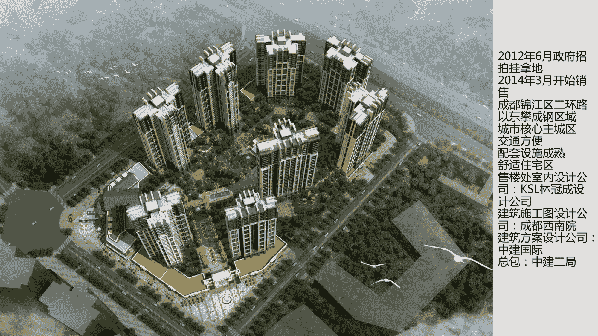

用地面积：54589平方米
绿率：3%
密度：22%
绿地率：30%
总面积：178236平方米
总容积：112892
住宅：102229平方米
商业：10205平方米
配套：457平方米
地上容积：1888平方米
地下容积：63
地下面积：63156平方米
车库：53334平方米
建筑高度：100米

| 类别 | 面积(平方米) | 备注 |
| :--- | :--- | :--- |
| 住宅 | 102229 | |
| 商业 | 9822 | |
| 配套 | 457 | |
| 车库 | 53334 | |

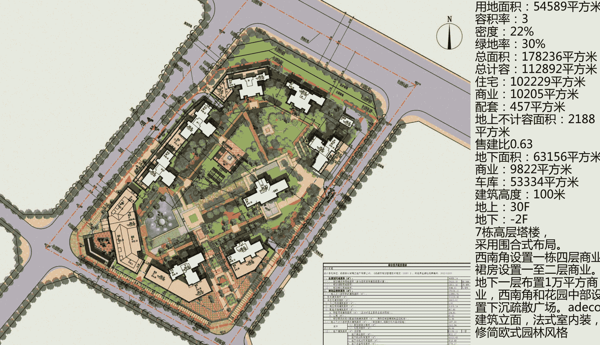

立面采用古典主义，黄色和棕色结合，设计通过明确的竖向线条处理，使建筑更加大气。裙房为对称。立面石材，室内装修简约欧式。

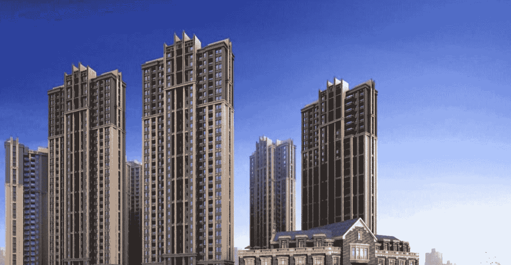

成都中央城售楼室实景图，地板全是石材，墙壁全是吊光灯处理。

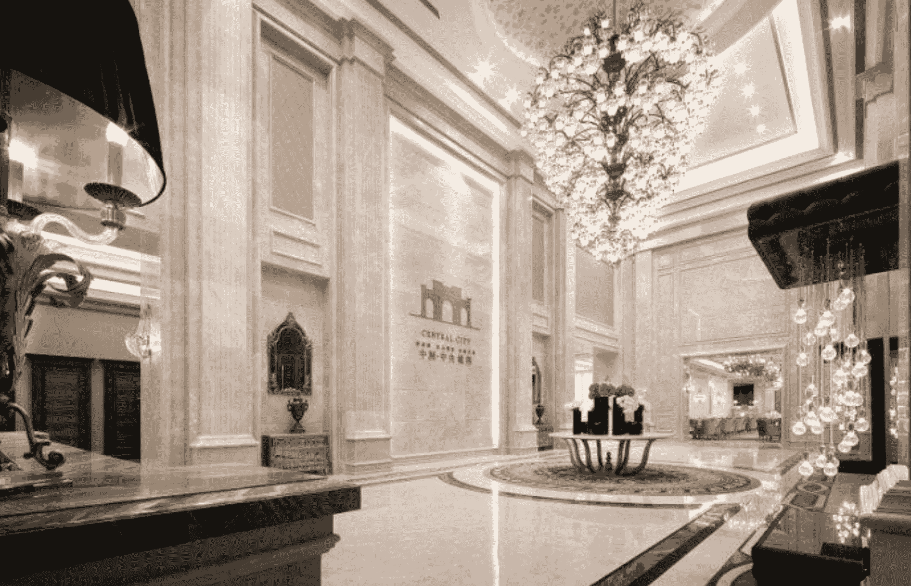

## 三、地产项目总管控点

结果：5500元拿地，
卖1000元，
亏损4000万

## 三、地产项目总管控点

拓展：2012年拿地，主城区核心地段，3.0容积率，楼面5500元每平米，当时价格1000元每平米。
设计：效果图漂亮，有一些地方有问题，设计单位质量不好。
工程：展示效果不错，总体质量尚可。速度慢。
成本：非常高，但因素多。
营销：市场不好，不好卖，因素多。

#### 营销：产品定位

1、商业面积偏大，合计10000平方米。二层为主，出现四层商业，销售困难。

| 统计单位：平方米，杭州城红项目 |
| :--- | :--- |
| 建筑面积统计(m²) | |
| 1层商业面积(m²) | |
| 2层商业面积(m²) | |
| 3层商业面积(m²) | |
| 4层商业面积(m²) | |
| 合计商业面积(m²) | |

#### 营销：产品定位

2、地下商业10000平方米。无法销售，无法租赁，同时在入口处及中央园林处设置下层疏散，增加成本，影响美观，非常影响小区品质。增加消防隐患。

| 计费单位 | 成租单价 | 产权 |
| :--- | :--- | :--- |
| 建筑面积(㎡) | (约定) | |
| 使用面积(㎡) | (约定) | |
| 景观面积(㎡) | (约定) | |
| 公用建筑面积(㎡) | (约定) | |
| 绿地面积(㎡) | (约定) | |

#### 营销：产品定位

3、住宅定位过于高端，大户型太多
250平米（17%）
180平米（12%）
160平米（28%）
140平米（12%）
110-130（21%）
85-95平米（10%）
定位模糊85平米到250平米，都有。

| 250m² |
| 180m² |
| 160m² |
| 140m² |
| 110-130m² |
| 85-95m² |

#### 营销：产品定位

4、宅套面积偏大
250平米（五房三卫）
180平米（四房三卫）
160平米（四房两卫）
140平米（四房两卫）
110-130平米（三房两卫）
85-95平米（三房一卫）
营销：深化定位，赠送面积，配套设施

成都中央城售楼室，面积为159平方米，大户型的挑空空间感，天花及墙面欧式造型，水晶吊灯，设计立面为欧式风格。设计交映，浑然。

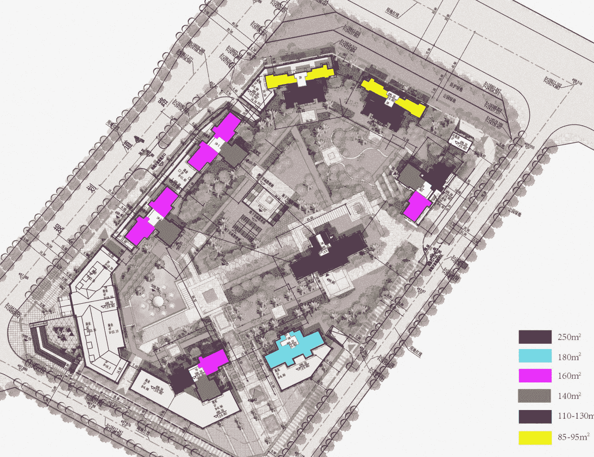
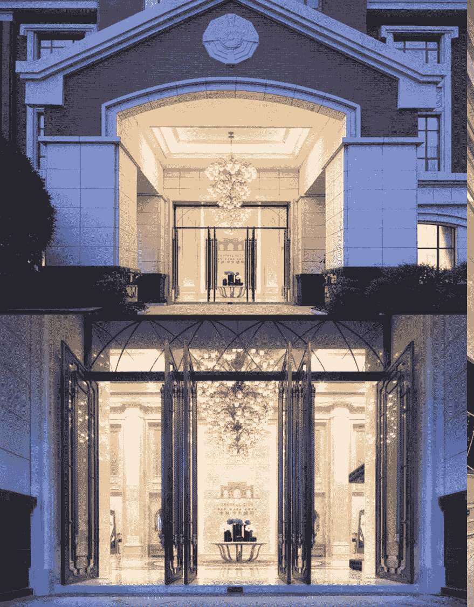

## 楼型1：

面积：160+140+160
实用率：79.11%

户型特点：

- 1、通过阳台改造房间，赠送较多
- 2、两侧户型厨房流线与玄关有交叉、流线不顺畅
- 3、两侧大户型客厅受南侧户型影响大，景观阳台与南侧干扰较大
- 4、对于160米大户型配置偏低
- 5、核心简暗
- 6、对于大户型来说，得房率偏低
- 7、中间户玄关过长

## 楼型2：

面积：125+105+90
实用率：78.46%

户型特点：

- 1、通过阳台改房间，赠送较多
- 2、两侧户型主客厅视线南侧影响大
- 3、客厅无阳台
- 4、体型系数差
- 5、中间户房间走道与卧室关系错乱

## 楼型：3：

面积：266+266
实用率：80.48%

户型特点：

- 1、对于266米大户型得房率偏低
- 2、玄关体系较差
- 3、电梯厅的尺度较佳
- 4、赠送面积较多
- 5、南北通过弱了了一些。

## 楼型4：

面积：193
实用率：76%

每个单元有30个柱，柱尺寸600X1000
采用GRC二次结构构件，每一个GRC构件大概3万元（此处OCR误为1000000000000000000）
额外增加外墙面积，贴面多花钱且容易裂缝，有质量隐患，有漏水风险
功能优先，质量优先（耐久性，耐风雨等恶劣天气），成本可控，施工方便，材料本地化，在此基础上尽量完美。

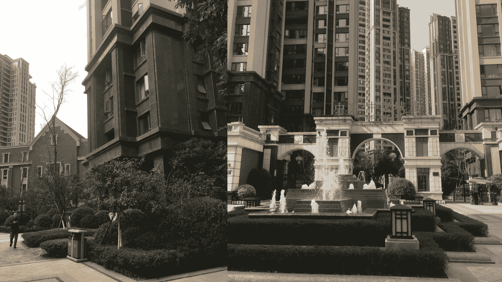

# 案例分享成都中央城后评估

**产品及业态定位：**
1：产品面积从80-250跨度较大，快销或豪宅定位不明；
2、定位过于豪华；
3、房型面积巨大，总价高，单价低，回款慢；
4、规划地上商业1万，量太大。局部二层商业价值不高；西南角四层商业价值极低；
5、地下不计容商业1万，无法售或租赁，目前仍闲置。

**规划：**
1：花园中央出现大量疏散楼梯，对景观及花园空间破坏极大；
2、两层地下地下地下室，成本较高；
3、均好性差。

**立面：**
1、立面 Base石材高四层，实际实现的效果与投入不正比；
2、塔楼立面上竖向装饰线条过多，对立面提升作用不大，但成本高，施工复杂。

**结构：**
1：地下室含钢量150公斤/平米，超标较多；
2、地上含钢量56公斤，超标较多；
3、地上地下混凝土含量均较高。

**户型：**
设计很差，面积都偏大，空间尺寸较小。

**室内设计：**
成本太高，售楼处面积太大。

**景观：**
成本高，每平方700元。

**运营效率：**
拿到地到开盘周期2年，销售速度太慢。

**成本：**
太高。

**工程：**
工艺差，速度慢。

## 三、地产项目总决策管控

1、决策管控系统
2、如何全局系统考虑统筹融合七大关键点
3、管控模式及权责体系
4、会议机制——项目总如何如何建立会议管理机制？
5、全过程综合决策体系所对应的工具

## 三、地产项目总决策管控

| 1、决策管控系统 |
| :--- |
| 项目的层面-决策与执行的衔接 |
| 定位与设计不吻合 |
| 设计好的图纸报通过通过 |
| 项目成本是个无底洞 |
| 工程工艺不到设计要求 |
| 效果好看，楼盖起来难看 |
| 市场变了，房子不好卖 |
| 商铺卖不动，车位卖不动 |
| 政策老在变 |
| 领导总在换 |
| 物业总在修 |

## 三、地产项目总决策管控

### 1、决策管控系统

综合系统决策
各层面的交叉与整合
项目成功与否的评价
成功与否的关键点有哪些
各个板块的目标和方向是否统一
各个板块的深度是否足够
决策与执行的互补

# 三、房地产项目总决策管控点

### 1、决策管控系统

多维度的综合决策

- 时间
- 费用
- 质量 性价比
- 卖价高
- 成本低
- 速度快
- 风险低
- 短期利益和长期利益
- 数据的对比（横向与纵向）

### 三、地产项目总决策管控点

### 2、如何全局系统考虑统筹融合七大关键点-(1)质量系统

质量系统的核心在于预防，而不是检验

- 预防什么：设计预防
- 招标采购预防
- 合同预防
- 材料预防
- 施工工艺
- 施工工序控制预防
- 施工单位
- 监理单位品质体系管理预防

管理规范化系统能提高一个项目的决策水平，可以避免很多风险，事先预防很多不确定因素带来的影响，避免由于不规范操作带来意外损失。

### 三、地产项目总决策管控点

2、如何全局系统考虑系统统筹融合七大关键点-(2)进度系统

进度系统的核心在于前置，而不是抢工！

前置形式：资金投入前置
采购单位前置
技术储备前置

标准化和产品线就是最好的技术储备前置

前置基础定义：拿地
合同签订
资金投入

决策系统清晰高效
提前预见性及进度

### 三、地产项目总决策管控点

### 2、如何全局系统考虑统筹融合七大关键点-(3)成本系统

成本系统的关键在全过程板块，而不是建安！

- 全过程：从拓展到维护
- 全板块：设计费用
- 管理费用
- 财务费用
- 税金
- 土地费用
- 配套费用
- 建安成本重点在于设计与工期
- 成本管控技巧也是前提
- 成本管控还需要统筹与协调

# 三、地产项目总决策点

2、如何全局系统考虑统筹融合七大关键点-(4)财务系统

财务系统的关键在房地产属性，而不是做账！

- 金融属性三个理解
- 投资回收杠杆
- 现金流的管理
- 从财务的角度对拓展和项目开发的建议
- 主要思路：财务更多的是服务，而不是监管
- 税务、规划
- 讨论：项目投资收益

# 三、地产项目总决策点

2、如何全局系统考虑统筹融合七大关键点-(5)设计系统

设计系统的关键是定位和综合决策

- 商品、艺术
- 科学家、艺术家
- 技术、艺术
- 成本、营销在规范、技术方面的决策

# 三、地产项目总决策点

2、如何全局系统考虑统筹融合七大关键点-(6）营销系统

营销系统的关键是策划，而不是销售！

- 业绩论
- 地产其它板块为营销创造条件
- 营销只要达到有效数量
- 前置到项目拓展或者总经理懂营销

# 三、房地产项目总决策点

2、如何全局系统考虑统筹融合七大关键点-(7）投资拓展

投资拓展的关键是高智商博弈，而不是敢拼！

- 房地产的核心竞争力是投资能力
- 拓展的深度是指结合自己的特点和水平
- 资源的有效利用

# 三、地产项目总决策

### 3、管控模式及权责体系

一级管控模式-职能型组织（项目公司），是一种比较集权的专业化组织结构，一般的房地产公司大多属于项目公司：即整个公司的部门职能围绕项目运营。

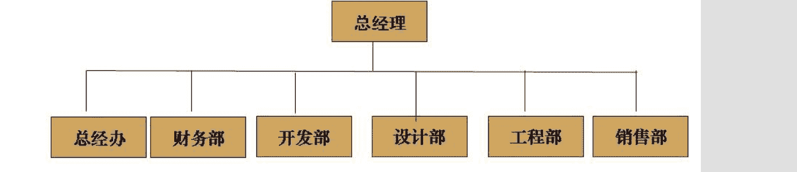

| 优点: | 缺点: |
| :--- | :--- |
| 有助于对项目经营进行直接控制 | 只服从上级，不对盈利承担责任 |
| 通过职能部门下达关键业务指标 | 只关心本部门，不关心项目整体战略 |
| 集中人才优势参与项目开发 | 只关注专业化，限制了跨职能经验 |
| 扁平式管理效率高，管理成本低 | |

# 三、地产项目总决策点

### 3、管控模式及权责体系

二级管控模式-矩阵管控模式

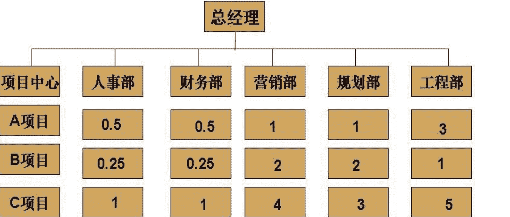

# 三、地产项目总决策控点

### 3、管控模式及权责体系

二级管控模式-矩阵管控模式

| 优点: | 缺点: |
| :--- | :--- |
| 有助于合理利用公司各种内外资源: | 双重领导难平衡，易引发矛盾冲突 |
| 便于从多个方面考虑项目优先顺序: | 权力分享容易陷入困难的僵局 |
| 有助于培养复合型的项目管理人才: | 相互制衡容易影响决策的快速执行 |
| 项目成员除了竣工后的顺序之忧。 | |

# 三、地产项目总决策控点

### 3、管控模式及权责体系

权责体系-在管控模式下的权利分配

权、责、利的匹配

集团对下属公司的管控程度，实质是在集权和分权之间选择一个平衡点。

部门职责和业务流程两个维度来构建权责体系。

由于房地产行业投资规模大，运作周期长，人员使用多，尤其在服务上更要突出其全程全方位特点，因此房地产企业的经营管理所受区域周边环境以及国家政策法规的影响非常巨大。跨区域管控模式的成功运作对于房地产企业的规模化和多元化快速发展具有特殊重要的意义。

# 三、地产项目总决策控点

### 4、会议机制-标杆企业如何构建自己的会议管理机制？

公司层面专项决策会议

- 项目立项的作用与构建方法
- 项目投资决策会议的作用与构建方法
- 项目启动会的作用与构建方法
- 方案评审会的作用与构建方法
- 项目目标决策作用与构建方法

各专项板块的决策及管理会议

- 月度运营会议的作用与构建方法
- 半年度/年度总结的作用与构建方法
- 营销会议的作用与构建方法
- 成本会议的作用与构建方法
- 战略会议的作用与构建方法
- 项目开发周体系的构建方法
- 项目后评估体系的构建方法

# 三、地产项目总决策点

#### 4、会议机制-立会的作用与构建方法

| 会议时间 | 部门名称 | 拓展 | 运营 | 设计 | 营销 | 工程 |
| :--- | :--- | :--- | :--- | :--- | :--- | :--- |
| 主责部门 | | | | | | |
| 参与人员 | | | | | | |
| 拿到土地信息 | 主要工作 | 组织、协调部门进行拓展。 | 协调、统筹部门之间的配合 | 解析基础资料，提供专业意见及建议 | 提供初步数据（按测算） | 提供市场及销售风险 | 开发计划及实施风险 |
| 一周内 | 评审要点 | 1、拓展选择；2、项目的针对性研究。 | 各项目板块统筹和协调。 | 1、强化方案；2、设计成果统计。 | 1、区域成本统计；2、根据设计成果判断成本因素。 | 销售价格和速度判断。 | 开发计划 |
| | 决策要点 | | | | 副总裁或总裁 | | | 1、是否通过；2、通过下次会议；3、下一步工作中部门统筹开展工作需要到的深度。 | | | |

### 立项报告

# 三、地产项目总决策点

# 四、会议机制-投资决策会的作用与构建方法

| 会议时间 | 部门名称 | 主责部门 | | | | |
| :--- | :--- | :--- | :--- | :--- | :--- | :--- |
| 参与部门 | | | | | | |
| | 拓展 | 运营 | 设计 | 成本 | 营销 | 工程 |
| 参与人员 | 部门负责人 | 部门负责人 | 资料 | 提供资料 | 提供资料 | 资料 | 提供资料 |
| 主要工作 | 组织、协调部门进行拓展。 | 协调、统筹部门之间的配合 | 根据立项的决策资源开展深度设计化设计及更为详细的设计成果表。 | 根据设计成果统计表 | 根据设计项目报告及设计成果情况细化成本数据。 | 项目定位报告及精准的市场判断。 | 根据上次会议深化相应的工程内容。 |
| 土地拍卖前期 | 评审要点 | 1、给出拓展建议；2、拿回价格分析。 | 各专业板块统筹和协调。 | 1、强化方案执行；2、设计统计表；3、设计单位的组织和协调。 | 1、区域成本统计表；2、根据设计计划形成成本因素；3、马上开展施工单位的组织及协调。 | 1、销售价格及速度判断；2、营销定位报告。 | 1、二级计划节点；2、初步的组织方案。 |
| 决策人 | | | | | 项目是否拿及价格 | | |
| 决策要点 | | | | | | | |

# 三、地产项目总控点

4、会议机制-项目启动会的作用与构建方法

| 主责部门 | | | 参与部门 | | | |
| :--- | :--- | :--- | :--- | :--- | :--- | :--- |
| 会议时间 | 部门名称 | 运营 | 拓展 | 设计 | 营销 | 工程 |
| 参与人员 | | 部门负责人 | 部门负责人 | 部门负责人 | 部门负责人 | 部门负责人 |
| 拿留土地十天内 | 主要工作 | 组织资源开展工作。 | 1、移交信息资料、确保信息完整；2、配合协同完成项目开发。 | 1、正式全面的设计工作开展；2、组织与其它部门沟通完成概念方案；3、设计单位的选定。 | 更新动态成本测表 | 1、配合设计方案的推进；2、完成深化 | 1、土方、临时工程的开展；2、报建工作的开展 |
| | 评审报告 | 完成启动会报告 | 核对信息数据变化、重点审核项目分析。 | 1、概念方案完成；2、详细完善的设计计划。 | 招标采购工作的开展。 | 固化的项目定位报告（注意定位报告精确及深度） | 1、前置；2、“三边”工程；3、施工组织方案。 |
| 决策要点 | | | | | | 信息的固化与传递；组织资源全面开展工作。 |

### 三、地产项目总控点

#### 4、会议机制-方案评审的作用与构建方法

| 会议时间 | 部门名称 | 设计 | 运营 | 成本 | 营销 | 工程 |
| :--- | :--- | :--- | :--- | :--- | :--- | :--- |
| | | 部门负责人 | 项目负责人 | 项目负责人 | 项目负责人 | 项目负责人 |
| | 参与人员 | | | | | | |
| 拿到土地三十天 | 主要工作 | 推进方案完成设计文本。 | 1、移交资料、确保方案完整；2、协同部门完成项目开发。 | 1、正全面的设计方案；2、组织其它部门完成概念方案。 | 更新动态成本测表。 | 1、配合方案推进；2、完成深化 | 1、土方、临时工程的开展；2、报建工作的开展。 |
| | 评审要点 | 完成启动会议 | 核对信息数据变化，重点核对项目分析。 | 1、概念方案成果；2、详细的设计；3、设计单位的选定。 | 招标采购工作的开展。 | 固化的项目定位报告（注意定位报告精确及深度） | 1、前置；2、“三边”工程；3、施工组织方案。 |
| 决策人员 | | 总裁 | | | | | 汇总 |
| 决策要点 | | | | | | |

# 三、地产项目总管控点

#### 4、会议机制-项目目标决策的作用与构建方法

| 主责部门 | | | | | | 参与部门 | |
| :--- | :--- | :--- | :--- | :--- | :--- | :--- |
| 会议时间 | 部门名称 | 成本 | 拓展 | 运营 | 设计 | 工程 |
| 参与人员 | 部门负责人 | 部门负责人 | 部门负责人 | 部门负责人 | 部门负责人 |
| 拿土地五十天 | 主要工作 | 完整的项目成本。 | 配合目标制定 | 协调部门之间专业配合 | 根据设计的不断更新数据。 | 根据营销活动的更新数据。 | 全面推进、与成本共同采纳。 |
| | 决策要点 | 总体单项的目标均超出 | 核对之前的偏差。 | / | 核对成本信息的一致性。 | 核对营销数据的一致性。 | 统筹工程和成本平衡。 |
| | 决策要点 | | | | | |
| | | 每个阶段的成本均高于一阶段控制，如单项超需出具专项报告。 | | | | |

# 三、地产项目总决策点

5、全过程综合决策对应的工具

设计成果统计表

包含内容：1)常规技术指标；2)对项目重要的配套设施及技术指标；3)客户敏感度高的部件及材料配置；
4)主要限额控制指标；
5)项目需要的地方。

# 三、房地产项目总管控点

### 5、全过程综合决策对应的工具

目标成本测表

填表指引
审批表
封面
规划指标
成本汇总
六类公摊及期间费
住宅
商业
会所
地下室
造价指标
各类产品建造标准
限额指标

# 三、地产项目总决策点

# 5、全过程综合决策对应的工具 - 静态投资分析表

| 序号 | 项目 | 总价（万元） | 可售方（元/m²) | 计容方（元/m²) | 总建方（元/m²) |
| :--- | :--- | :--- | :--- | :--- | :--- |
| 一 | 项目销售收入 | 216260 | 22175 | 21828 | 17263 |
| 二 | 项目总开发成本 | 198534 | 20358 | 20039 | 15848 |
| 1 | 土地成本 | 124907 | 12808 | 12608 | 9971 |
| 2 | 土地使用税 | 95 | 10 | 10 | 8 |
| 3 | 大市配套费用 | 1071 | 110 | 108 | 86 |
| 4 | 开发前期准备费用 | 1699 | 174 | 172 | 136 |
| 5 | 建安成本 | 46918 | 4811 | 4736 | 3745 |
| 6 | 开发接费 | 1803 | 185 | 182 | 144 |
| 7 | 开发期间管理成本 | 1118 | 115 | 113 | 89 |
| 8 | 管理费用 | 97 | 10 | 10 | 8 |
| 9 | 营销成本 | 5406 | 554 | 546 | 432 |
| 10 | 营销成本 | 1343 | 138 | 136 | 107 |
| 11 | 财务费用 | 8288 | 850 | 836 | 662 |
| 12 | 资本化费用 | 5789 | 594 | 584 | 462 |
| 三 | 增值税附加 | 5245 | 538 | 529 | 419 |
| 四 | 土地增值税 | 6819 | 699 | 688 | 544 |
| 五 | 企业所得税 | 3120 | 320 | 315 | 249 |
| 六 | 税后开发利润 | 2542 | 261 | 257 | 203 |
| 七 | 销售净利率（含股权资金成本） | 5.01% | | | |

# 三、地产项目总决策点

5、全过程综合决策对应的工具

设计成果统计表
目标成本测表
静态投资分析表
项目运营综合测算表

## 课程纲要

第一部分: 地产项目总的角色定位

第二部分: 地产项目总决策管理要点

第三部分: 地产项目总项目开发各阶段各部门深度配合要点

# 第三部分：地产项目总项目开发各阶段各部门深度配合要点

- 开发路径图
- 项目拓展拿地阶段
- 项目定位阶段
- 项目设计阶段
- 项目施工阶段
- 两点一线实施阶段
- 开盘阶段
- 入伙阶段
- 物业管理阶段

## 开发路径图

### 实现项目快速开发的思路与方式

实现项目快速开发主要有三种基本思路及方式，具体如下所示，这三种思路与方式地贯穿项目开发过程始终。

- (1) 早起跑：通过工作前置、策划先行，将原定工作提前开展。
- (2) 串改并行：将部分串联的工作改为并行的工作，从而节省节点时间。
- (3) 控周期：在保障合理工期（不损害质量、客户等目标）的前提，控制阶段性工作的工期和时间，尤其是关键线路的时间和周期。

### 标准项目开发路径

# 3-6个月“拿地—开工—一期开盘”——中洲标准项目开发路径

| 关键节点 | 次关键节点 | 辅助节点 |
| :--- | :--- | :--- |
| 基础施工设计 20天 | 土方开收集 | 土方开挖 |
| 方案设计 45天 | 基础准备到位 | 设备验收独立调试 |
| 全施工设计 60天 | 基础绿化完成 | 方案拨款 |
| 土方准备、基础施工进行45天（最快可调整） | 施工设计许可通过 | 方案拨款 |
| 施工后接条件90天 | 施工单位申请政府拨款配合 | 方案拨款 |
| | 土方完成、基础施工完成 | 土方挂牌开许可 |
| | 总拨款到位 | 施工外围完成 |
| | 施工许可证许可 | 施工单位验收 |
| | 施工许可证许可 | 开工完成 |
| | 开盘完成 | |
| | 禹一套方案验收（普通版、签版、调试） | |
| | 禹一套设计评审通过 | |
| | 禹一套基础施工验收报告、验收申请 | |
| | 禹一套基础施工完成 | |
| | 禹一套外围完成 | |
| | 禹一套开工 | |
| | 禹一套开盘 | |
| | 开工（主体挂接开工） | |
| | 开工会议（含审评审备案） | |
| | 土方挂牌开工许可证 | |
| | 施工单位验收、验收报告 | |
| | 资金到位对预算 | |
| | 开发调试验收 | |

标准项目：项目编号，高，地上30层，1层结构，剪，条件为主主体施工法标准三分之二参照进度（20层），报价5万以上，且包括监理现场验收不影响价，禹一套施工（挂接拱验收）。

## 一、项目拓展拿地阶段

#### 1、战略发展方向

- 重资产-轻资产
- 政府资源
- 区域深耕
- 市场竞争
- 公司特有资源
- 自身技术特点

## 一、项目拓展拿地阶段

#### 2、城市的选择

- 城市的分级
- 城市的资源
- 城市的发展与规划
- 城市的核心特点
- 城市房地产市场的专属属性
- 北方与南方

## 一、项目拓展拿地阶段

#### 3、决策逻辑依据

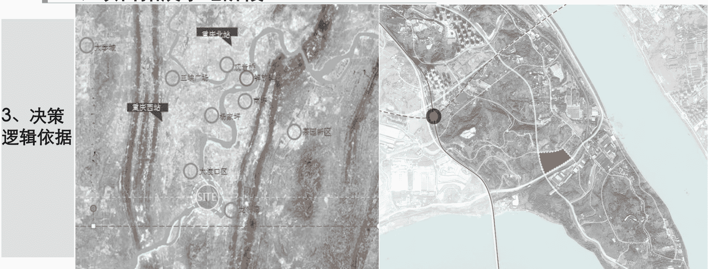

项目位于重庆主城区钓嘴片区南段，未来将成为大渡口重点建设居住区域。项目总占地约 75734 平方米，地上建筑面积 180692 平方米。容积率2.2，钓嘴片区有地铁 2 号线与规划 8 号线经过。两条线路在基地附近白寺站交汇。基地的主要线路为西侧的西城大道，北侧的星港路与1号路，东侧的滨江路。

## 一、项目拓展拿地阶段

#### 3、决策逻辑依据

- 城市：重庆
- 区域：大渡口
- 位置：距离区域中心10公里的郊区
- 道路：双向4道，较为方便
- 设施：市政配套齐全
- 环境：生态绿化环境好
- 人气：距离最近的住宅
- 拿地价格：预计4500元每米
- 当地售价：7000元每米
- 时间：2017年

关键点：售价、地价、未来、优缺点

## 项目拓展拿地阶段

#### 4、各部门配合要点

- 营销
- 设计
- 工程
- 财务

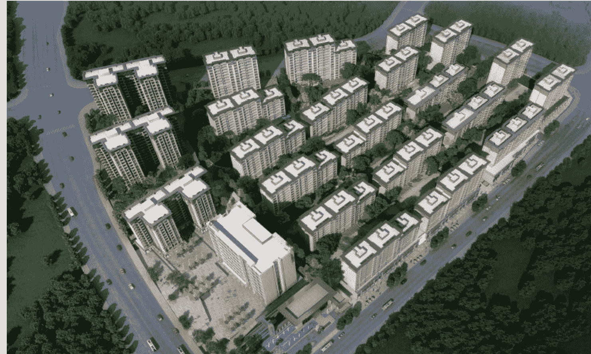

## 二、定位阶段

#### 1、关键要素

- 分析市场
- 分析地块
- 分析公司
- 分析规划设计

## 二、定位阶段

#### （1）分析市场的八大要素

- 当前房产的趋势及政策
- 政策的影响
- 当地房价、地价水平
- 当地竞争激烈
- 当地发展水平
- 主要竞争对手与特点
- 当地客户群的需求及喜好
- 当地商业

## 二、定位阶段

### (2)分析地块的六大要素

- 地块地段及前景
- 外部环境
- 内部环境
- 地形貌
- 地块周边配套设施
- 人气

## 二、定位阶段

### (3)分析公司的五大要素

- 品牌能力与技术水平
- 团队能力
- 当地资源的成熟度
- 资金的速度
- 项目定位

## 二、定位阶段

### (4）分析地块规划条件

- 常规指标
- 当地具体的规定与做法
- 特殊要求
- 尤其注意配套设施

## 二、定位阶段

#### 2、“五位一体”定位由谁负责

- 综合意见
- 综合定位
- 项目专业
- 房子卖

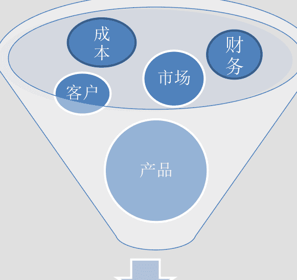

## 二、定位阶段

#### 2、“五位一体”市场定位

- 市场形势及走向
- 市场价格
- 市场机会及风险
- 顺应市场还是-领市场还是逆周期

## 二、定位阶段

#### 2、“五位一体”客户定位

- 客户在哪里
- 客户喜好
- 客户敏感点
- 经济承受能力
- 如何引导客户

## 二、定位阶段

#### 2、“五位一体”产品定位

- 第一居所还是第二居所？
- 产品形态
- 房型、面积及配比
- 建筑风格

## 二、定位阶段

#### 2、“五位一体”产品定位（深化定位）

- 赠送面积
- 房型改造空间分析
- 立面标准及要求
- 配套设施的标准要求
- 园林的标准
- 室内的标准

## 二、定位阶段

### 2、“五位一体”产品定位（深化定位——赠送面积）

- 赠送面积的形式
- 赠送面积的数据及比例
- 赠送面积的成本变化（由开发商还是业主改造）
- 赠送面积的施工难易程度
- 赠送面积的报建隐患及验收隐患
- 赠送面积对应的投入与产出（投资逻辑）

## 二、定位阶段

#### 2、“五位一体”产品定位（深化定位——赠送面积别墅项目）

- 花园面积及面宽进深尺寸（有产权证）
- 露台面积及尺寸（可否实现及难易程度）
- 中空
- 地下室
- 阳台
- 凸窗
- 花池

## 二、定位阶段

### 2、“五位一体”产品定位（深化定位-配套设施的标准要求）

（1）政府要求做的指标（占面积指标的）
- 文化设施
- 体育设施
- 幼托设施
- 物业管理设施
- 卫生服务设施
- 养老设施
- 消防设施
- 供电设施
- 卫生间
- 垃圾站
- 居委会

> 规划设计要点文字要求的肯定要做到；规划设计要点没有明确需规范要求要做；规范没有强制规定的灵活掌握并注重沟通；沟通引导与技巧；尤其要分清楚是否计容率。

## 二、定位阶段

### 2、“五位一体”产品定位（深化定位-配套设施的标准要求）

(2)政府要求做的但不计划面积的指标
- 集中绿地
- 健身场所
- 架空空间
- 开敞广场
- 露天公共停车位
- 公共避难要求
- 消防蓄水要求

> 不要影响规划效果；在概念方案阶段有所考虑。

## 二、定位阶段

### 2、“五位一体”产品定位（深化定位-配套设施的标准要求）

（3）项目品质配置要求做的指标
- 露天泳池或者室内泳池
- 游泳池配套设施
- 独立门厅及入户大堂或者门卫室
- 运动天地
- 泛会所
- 棋牌用房
- 儿童游乐室
- 室内用房
- 机电设备用房
- 停车收费岗

## 二、定位阶段

### 2、“五位一体”产品定位（深化定位-配套设施的标准要求）

(4)商业及生活配套

- 健身房
- 咖啡厅
- 茶室

> 指标上不要写会所及配套有的小区；没有房证导致不能销售利益。

## 二、定位阶段

#### 2、“五位一体”成本定位

- 全过程的成本
- 大建安2500元，综合建安3500
- 三项费用（管理、营销）
- 地价款支付安排

## 二、定位阶段

#### 2、“五位一体”财务定位

- 前期投入尽可能
- 现金流尽快正
- 少投钱，多滚动，越越大
- 多利用销售回款
- 项目做好分期，前期强调
- 更多利用开发贷
- 税务划
- 房产的金融属性

## 二、定位阶段

#### 2、“五位一体”产品定位

- 用多少时间、多少钱
- 用什么样的团队
- 借助资源
- 做什么样的产品
- 卖给哪些人
- 卖什么价
- 最多能赚钱
- 未来还能赚钱

## 二、定位阶段

### 2、“五位一体”产品定位（深化定位-项目定位-运营节奏）

- 运营节奏
- 分期组合
- 首次开盘
- 全盘运作
- 系统性
- 统一性

## 二、定位阶段

#### 2、“五位一体”产品定位

- 做挣钱的项目
- 做钱快的项目
- 做钱稳的项目
- 能持续赚钱的项目

## 二、定位阶段

### 3、项目综合定位的“五化原则”

- 化复杂为简单
- 化为主为客观
- 化单一为融合
- 化专业为整体
- 化“山穷水尽”为“柳暗花明”

## 三、项目设计阶段

设计很重要，行业对待设计的一些：

01 “明天基础图拿出来”速度要求
02 “先搞几张效果图”节奏安排
03 “做一个标志性的建筑”形象定位
04 “请某大师大师”让建筑解决开发问题
05 “把设计费降低100万”可能不一样
06 “设计师就是要找到灵感”灵感来源于积累和分析
07 “这个房子不好卖，是设计的问题”设计师解决不了所有问题。

- 1、设计的龙头作用
- 2、设计主导的四大系统思想
- 3、设计理念的八大转变
- 4、以投资效益为核心的决策导向
- 5、以客户敏感点为导向的资源分布原则
- 6、以数据为依据的决策体系
- 7、设计专业决策的要领
- 8、设计管理

## 三、项目设计阶段

### 1、设计的龙头作用

- 设计影响项目进度的50%
- 设计影响项目成本的70%
- 设计影响项目投资收益的80%
- 设计对接的专业最多
- 设计整体及全局属性
- 设计的导向

## 三、项目设计阶段

### 2、设计主导的四大系统思想

- 设计内部各专业（规划、建筑、结构、景观、立面、户型、机电等）之间系统结合
- 设计与其他部门（拓展、营销、成本、工程、物业等）的深度配合
- 产品的设计与项目公司发展的系统考虑
- 产品设计特征与公司的战略发展如何结合

## 三、项目设计阶段

### 2、设计主导的四大系统思想

企业总体战略与产品战略的关系

产品战略是企业核心战略之一。在很大程度上，企业商业模式依附于产品模式（如万达模式、恒大模式），市场战略、品牌战略都体现在产品战略上。

- 产品设计特征与公司的战略发展如何结合：绿域、星河湾、泰禾、万达、SOHO中国

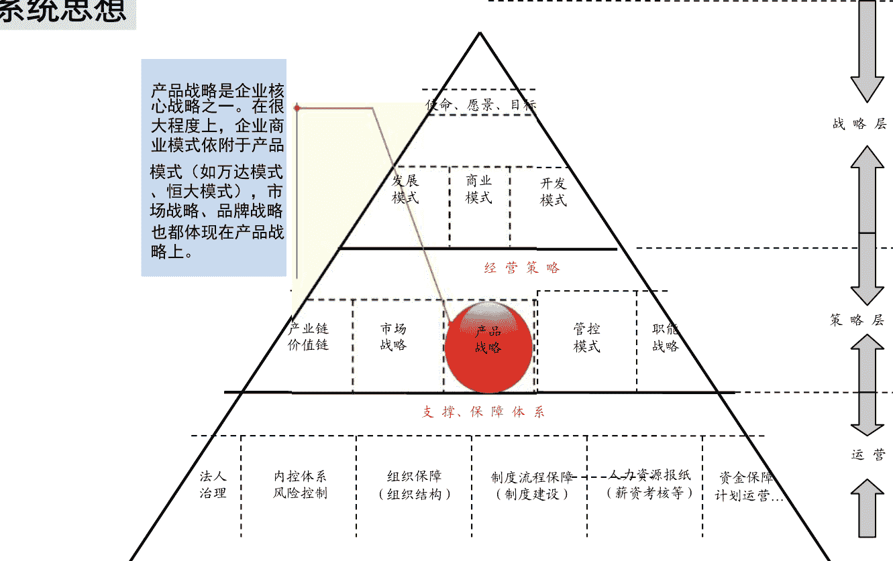

## 三、项目设计阶段

### 3、设计理念的八大转变

- 投资收益—整体面的资本运作
- 货值及利润分析—货值最大化货值利润最大
- 市场意识—市场机会及风险
- 客户的思想—理解与引导客户的思想
- 主观与客观的辩证思想—客观为主，主观的内容需要量化控制
- 成本意识—每一分钱的投入都需要产出
- 功能与空间—回归本质：适用、经济、美观
- 形式与艺术—要有，需要量化

## 三、项目设计阶段

### 4、以投资效益为核心的导向总体经济指标

| 项目 | 指标 |
| :--- | :--- |
| 1 总用地面积 | 81810.00 |
| 2 总建筑面积 | 128970.51 |
| 3 A、B、C住宅面积 | 98171.94 |
| 其中 A、B、C住宅面积 | 91665.68 |
| 5 层以下住宅 | 4505.50 |
| 6 层以上住宅 | 46129.78 |
| 5 A、B、C住宅配电房 | 6401.26 |
| 5 精品酒店 | 2495.75 |
| 6 酒店餐厅（卖处） | 302.95 |
| 6 设备用房 | 2390.19 |
| 6 卫生用房 | 520.00 |
| 6 社区用房 | 447.73 |
| 7 地下建筑面积 | 3098.57 |
| 7 A、B地下建筑面积 | 18509.27 |
| 7 C地下建筑面积 | 12287.89 |
| 8 地下密度 | 1.20 |
| 9 建筑面密度 | 24461.19 |
| 10 绿地率 | 30.05% |
| 11 车位 | 714 |
| 12 地上住宅 | 306 |
| 12 复合住宅 | 408 |
| 13 地面停车 | 770 |
| 13 地面停车场 | 923 |
| 13 地下停车场 | 37 |
| 14 非机车停车场 | 2026 |
| 14 公共停车场 | 1843 |

## 三、项目设计阶段

### 5、客户敏感点为导向的资源分配原则

- 改造前
- 改造后
- 户型

## 三、项目设计阶段

### 6、以数据为依据的决策体系设计信息表

| 设计成果表 | 备注 |
| :--- | :--- |
| 单位：平方米 | |
| 项目名称 | 中州悦城 |
| 建设地点 | 成都华区临街西 |
| 建设单位 | 成都中州有限公司 |
| 国证号 | （2016）五字第26号 |
| 建设用地 | 绿地+绿用地 |
| 结构类型 | 99.9/85.4 华区要求高层 |
| 建筑高度 | 34/2F 处影响地下室面积 |
| 户数 | 606 |
| 机动车停车位（地上/地下） | 671（0/671） |
| 丰动车停车位 | 687 |
| 计划用地面积 | 15100.62 |
| 建筑基础面积 | 2019.8 |
| 建筑容率 | 3.8 |
| 建筑密度 | 25.0% |
| 绿化技术指标 | 79544.88 |
| 详细表总建筑面积 | 57380.64 |
| 其中 1.商业面积 | 5045 | 不含经济性面积，此需说明 |
| 2.住宅面积 | 52176.18 | |
| 3.其他面积 | 160.2 | |
| 其中 计容不可售 | 160.2 | 备注：物业停车位地上/下一 |
| 1. 物业管理用房 | 0 | |
| 2. 防控监控 | 0 | 防控设备设置在内 |
| 3. 其他面积 | | basement垃圾房不计容 |
| 不计容建筑面积 | 22164.64 | |
| 1. 地下机车停车面积 | 20133.21 | |
| 2. 地下机动车停车面积 | 7568 | 地下总面积为21765.65㎡ |
| 3. 地下物资间面积 | 159.23 | |
| 4. 地下设备间用房面积 | 719.21 | |
| 5. 地上架空面积 | 353.58 | 地下总面积为398.59㎡ |
| 6. 上层垃圾处理面积 | 45 | 备注：绿化率>70% |

## 三、项目设计阶段
### 6、以数据为依据的决策体系(设计数据决策)

| | | | | 备注 |
|---|---|---|---|---|
| 地上 | 1*栋楼高度及密度 | 99.9 (34F) | | 备注：因成本控制，建筑距离控制在100m以内（绿防距离） |
| | 3*栋高度及密度 | 85.1 (29F) | | |
| | 1*栋标准层高 | 2.90 | | |
| | 1*栋标准楼盖率 | 13%~15% | 15%*1#38层，2*3#楼27层；规划要求最低，要最少标准15% |
| | 3*栋楼盖率 | 38层/28F | | |
| | 业用楼高度及密度 | 2F | 绿地 6m；2*3#楼间 4.7m | |
| | 业用楼强度 | 45kg/m²（成本控制，后期再次调整） | | 备注：公司范围53~55kg/m² |
| | 1*栋销售面积 | 45kg/m²（成本控制，后期再次调整） | | |
| | 3*栋销售面积 | 45kg/m²（成本控制，后期再次调整） | | |
| | 业用楼间 | 50m（后期部门需要调整） | | |
| 景观 | 建筑外墙 | 材+玻璃结构 | | |
| | 建筑外立面门窗 | 铝合金L-80中空玻璃幕墙（部分分染玻璃窗） | | |
| | 围栏 | 金刚材质铝围杆 | | |
| 装饰 | 公共区景观 | 参考公司标准，大面积控制在20m左右 | | |
| | 景观围墙 | 不造 | 无标准不造 | |
| | 户平均面积 | 32.40/个 | | |
| | 地下室 | 8.0*5.0（含一二层） | | |
| | 地下停车 | 3.7m (车高含一二层) | | |
| | 地下室形式 | 夏季基础-未加装基础 | | 备注：楼楼部分为夏季地区，地下室部分为冬季地区 |
| | 地下基础类型 | 增强筏基础+独立柱基础 | | |
| 地下 | 地下室防水层含量 | 86kg/m²（成本控制，后期再次调整） | | 备注：公司标准为95kg以内，规定标准为90kg/m²；地下室以二为主 |
| | 地下泵房防水 | 0.9m/m² | | |

| 户型类型 | 户区总数 | 户占比 | 户区面积 | 占比 |
|---|---|---|---|---|
| 70-72 | 180 | 29.7% | 12635.57 | 24.2% |
| 85-89 | 204 | 33.7% | 17578.19 | 33.7% |
| 98-102 | 222 | 36.6% | 21962.43 | 42.1% |
| 合计 | 606 | 100.0% | 52176.19 | 100.0% |

### 7、设计各专业决策的要领

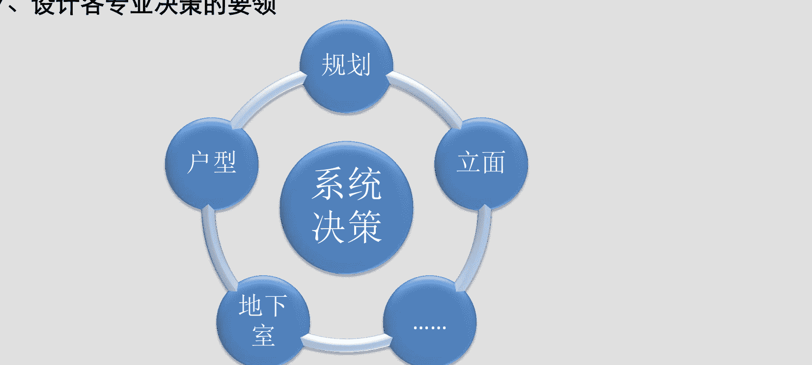

#### 7、设计各专业决策的要领-规划决策

##### 数据系统-用客观数据说话
- 庭院尺寸
- 各朝向的户数比及面积对比
- 朝好的户数比及面积对比
- 各户型的面积及比例
- 受商铺影响的住宅面积及比例

##### 专业融合-规划与户型结合
- 多方案比选
- 专项工具-标准层平面图

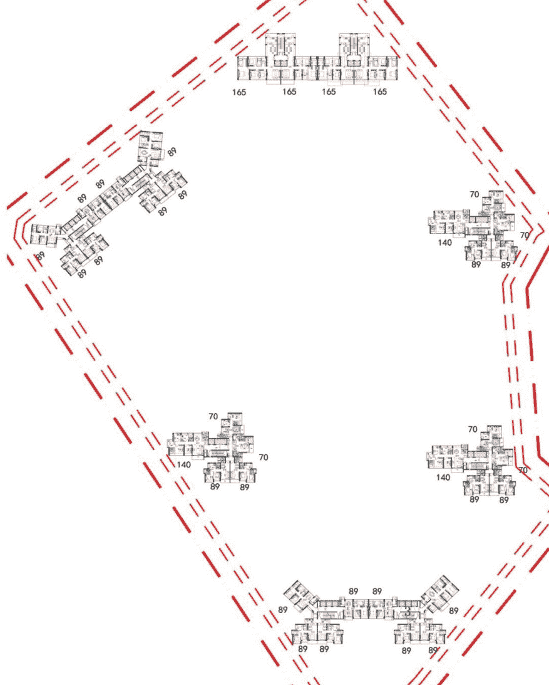

#### 7、设计各专业决策的要领-户型决策

##### 投资效益为核心的导向：户型及面积
- 总价及单价
- 功能配置及标准
- 竞品的针对性研究

##### 客户敏感点：户型设计中最为敏感的地方
- 客厅与餐厅
- 主卧室
- 数据系统
- 得房率
- 体型系数
- 每个功能空间及占内面积比例
- 每个功能空间的宽和进深满足家具布置
- 户比
- 电梯服务户数及面积
- 入户大堂面积及宽与进深
- 地下室平均车位
- 结构钢-混凝土含量
- 阳台率
- 赠送率
- 高宽比

##### 户型决策要点
- 每个功能空间面积及占内面积比例
- 走道8.4%
- 净走道4.1%
- 辅助走道4.0%
- 客厅15.5%
- 餐厅12.0%
- 主卧8.74%
- 次卧8.33%
- 厨房6.02%
- 主卧4.0%
- 衣帽间2.9%
- 次卧2.9%
- 洗衣区2.5%
- 储藏间3.1%
- 南阳台3.9%
- 工作阳台2.75
- 户型：三房两厅
- 建筑面积：137.84
- 套内面积：122.05
- 得房率：88.54

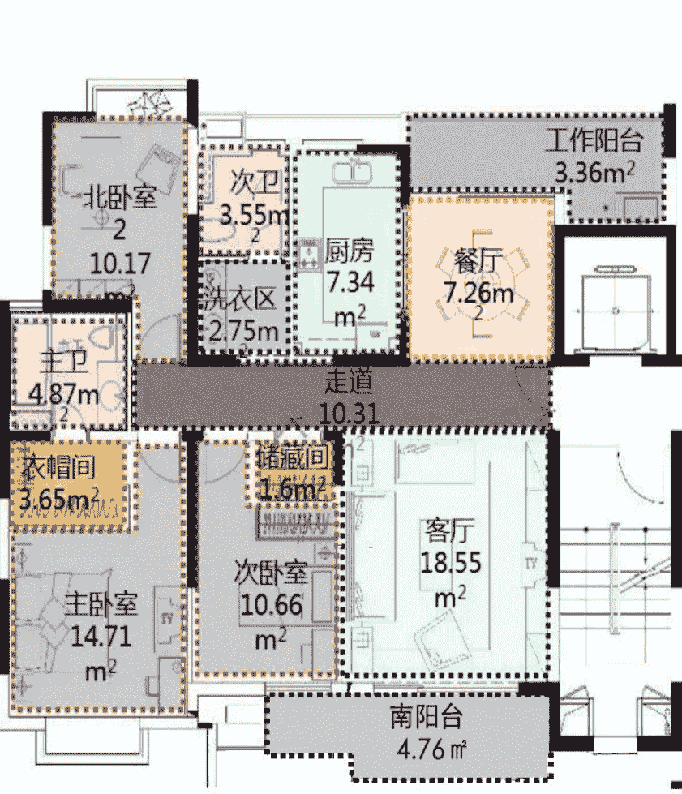

##### 户型：套内面积121m² 四室两厅双卫
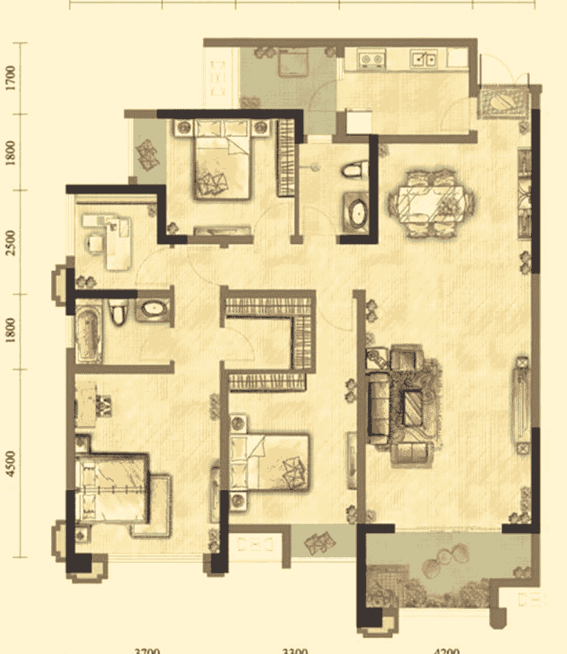

龙湖标准145平

#### 7、设计各专业决策的要领-立面决策

##### 立面决策的细分技术要点
- 外立面率
- 主要材料及比例
- 附属构的数量及比例
- 风格
- 成本与品质结合要点
- 门窗
- 栏杆
- 屋顶

##### 立面决策15个观点
（一）标志性品质的立面楼盘的宣传及公司品牌非常有利
（二）经典的持久的立面风格和材料对楼盘的保值及增值作用较大
（三）优美的建筑立面对城市空间及景观有贡献
（四）好的立面容易造型品质和价值感，好的立面容易吸引眼球，快速得到客户认可
（五）好的立面风格选择，漂亮的效果容易得到领导的认可，报批容易通过
（六）定位高的楼盘对立面及材料的要求很高，创新美且耐久材料的立面设计对定位高的楼盘销售促进明显
（七）从成交角度来说，立面的作用不如地段、价格、户型产品的吸引力，也不如景观效果、样本房装修效果。但是，客户高度认可的立面风格会促进成交
（八）应该是为了更好（更漂亮或者更耐久或者成本更低）而创新立面，而不是为了变化而创新，坚决避免很怪且成本高的立面
（九）反对为了立面而严重影响功能及实用性，广告位、雨棚、开启扇通风、防水、视线
（十）特殊的设计造型带来的结构审批风险及成本超越
（十一）立面设计需体型系数及外墙面积的大小结合
（十二）立面设计需控制好窗墙比（窗的成本远高于实墙）
（十三）注意造型构件增加的质量隐患和增加的成本，尤其是GRC构件
（十四）注意常用外立面材料的价差
（十五）注意材料样板的控制

#### 7、设计各专业决策的要领-地下室决策

1）指标地下建筑总面积4316.54m²，其中地下住宅465.93m，地下车库398.61m²，地下室面积1865.68m²，非机动车库2539.76m，地下机动停车169辆，地下非机动停车390辆
2）停车效率：单车面积是每个车位35m²
3）是否有赠送地下住宅储藏空间之外32m²，含绿量9.22米，混凝土含量0.99，层高3.5m无梁盖，周边布置，柱网7800X5200，设备用塔楼，车道入口量贴在地库布置，每个车位35m²，标高设计高于地面1米，非机动车在塔楼下层布置，车位价格6~8万元，小型车位指标常规防地面车位5%

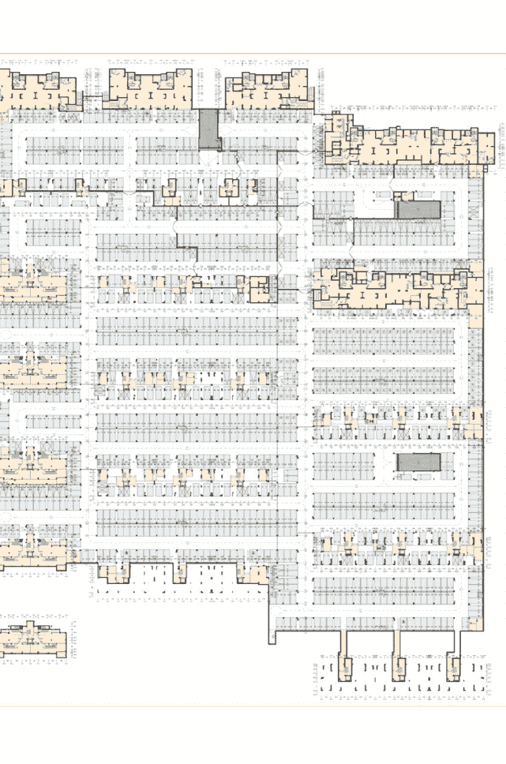

##### 地下平面图
1. 建筑图纸不供使用
2. 比例尺：1:100
3. 尺寸单位：mm
4. 现场尺寸以现场放线为准
5. 结构尺寸以结构设计图为准
6. 施工详以深化图纸为准

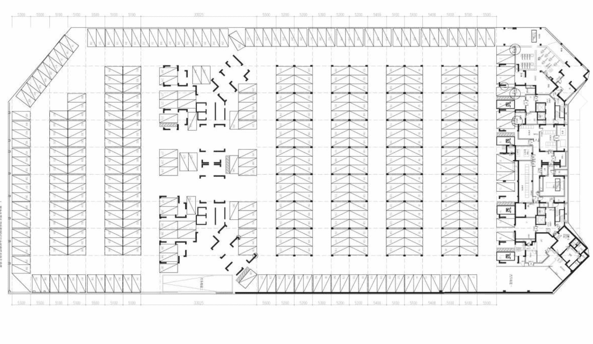

##### 7、设计各专业决策的要领-地下室决策-优化
1、周边布置车道的原则可以大幅提高停车效率
2、大小柱网结合的方式7800X5000，柱子可以设计为400X700左右，车位宽度由8000减小至7800，提高停车效率
3、柱网减小，层高减少100到200，层高减少100至200，减少土方量和基坑支付费用，节约造价
4、柱网减小，层高减少100到200，柱子截面减小，减少结构钢含量和混凝土含量，节约局部微结构剪力墙，提高停车效率
5、尝试优化车道布置，提升停车效率
6、精细化尺寸，车位靠布置，车位长5300，车尾与车尾相对，5100即可
7、平均车位面积有望由原来的39平米优化为32平米

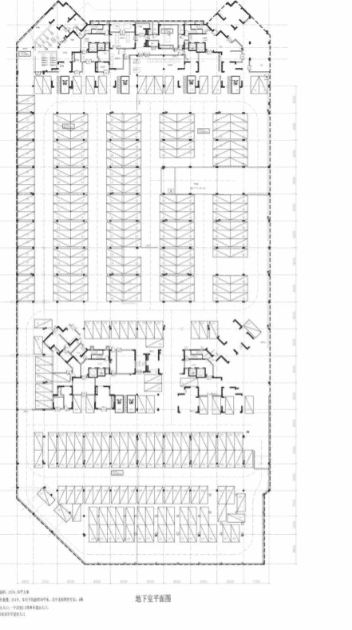
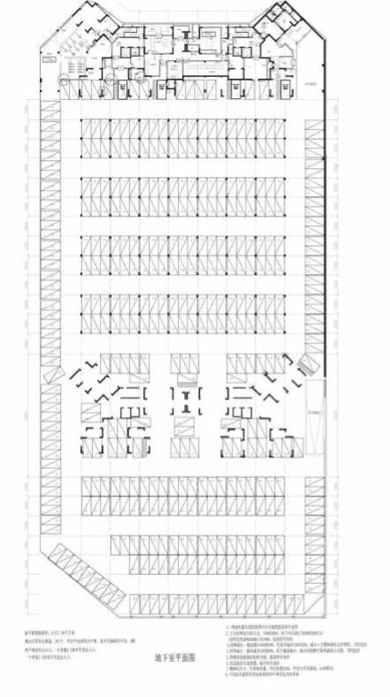

### 8、设计管理

#### 如何在确保设计质量的情况下缩短设计时间

| 质量的多维度 | 设计单位的选择 | 落实到人 |
|---|---|---|
| 错漏碰缺乏 | 设计团队的选择 | 管理到位 |
| 图纸表表达清晰 | 成熟熟悉的做法的推广 | 决策者 |
| 成本审审 | 标准化的推广 | 高效决策 |
| 客户美誉高 | 部门的配合 | 严格管理 |
| 工程施工便利 | 报建的可靠 | 计划详细 |
| 报建能快速通过 | 定位的精准细致 | 预判 |

#### 四、项目施工阶段主责部门工程管理
一、项目施工阶段决策点：
- 合同-施工总平面图
- 施工组织方案
- 施工计划表
- 施工样板

二、成本管控要点：
- 价- 合同明确说明
- 调差

三、设计管控及配合要点：
- 设计优化
- 工程施工阶段复核

#### 五、两点一线实施阶段主责部门工程管理

| 阶段 | 序号 | 节点清单 | 节点等级 | 会议清单 | 会议级别 | 关键成果 |
|---|---|---|---|---|---|---|
| 两点一线专项节点计划 | 131 | 两点一线选址、定位及开发计划、策划建议 | 二级 | | |
| | | 132 | 两点一线建筑方案 | 二级 | 方案评审（建设） | 总部 | 设计成果、意见及纪要 |
| | | 133 | 两点一线景观方案 | 二级 | 方案评审（景观） | 总部 | 设计成果、意见及纪要 |
| | | 134 | 两点一线精装方案 | 二级 | 方案评审（两点一线室内） | 总部 | 设计成果、意见及纪要 |
| | | 135 | 两点一线及结构施工评审 | 二级 | 施工评审（两点一线建筑） | 总部 | 设计成果、意见及纪要 |
| | | 136 | 两点一线室内装修设计评审（含清单） | 二级 | 施工评审（两点一线室内） | 总部 | 设计成果、意见及纪要 |
| | | 137 | 两点一线景观施工设计评审（含清单） | 二级 | 施工评审（两点一线景观） | 总部 | 设计成果、意见及纪要 |
| | | 138 | 两点一线建筑部件、标准确定 | 二级 | | | 两点一线部件、标准 |

| 阶段 | 序号 | 节点清单 | 节点等级 | 会议清单 | 会议级别 | 关键成果 |
|---|---|---|---|---|---|---|
| | 139 | 两点一线室内装修定位 | 二级 | 工程定标准（如需） | 城市公司 | 招标文件、入围考察报告、评定标记、通知书、供方合同 |
| | 140 | 两点一线景观单位定位 | 二级 | 工程定标准（如需） | 城市公司 | 招标文件、入围考察报告、评定标记、通知书、供方合同 |
| | 141 | 两点一线主体结构开工 | 二级 | | | 两点一线结构开工图片 |
| | 142 | 两点一线结构封顶 | 二级 | | | 两点一线结构封顶图片 |
| | 143 | 两点一线外装完成 | 二级 | | | 两点一线外装完成图片 |
| | 144 | 销售处室内装修及软装完成 | 二级 | | | 销售处室内装修及软装完成图片 |
| | 145 | 首批样板房毛坯装修（清水板房）完成 | 二级 | | | 首批样板房毛坯装修（清水板房）完成图片 |
| | 146 | 首批样板房室内装修及软装完成 | 二级 | | | 首批样板房室内装修及软装完成图片 |
| | 147 | 两点一线景观施工完成 | 二级 | | | 两点一线景观完成图片 |
| | 148 | 两点一线验收验收 | 二级 | | | 整改报告 |
| | 149 | 两点一线开放 | 一级 | | | |

## 五、两点一线实施阶段一主责部门工程管理

| 阶段 | 主责专业 | 关键活动 | 要求 | 配合专业 | 配合活动 | 本阶段关键成果 |
| :--- | :--- | :--- | :--- | :--- | :--- | :--- |
| 三、全景施工图一开盘 | 营销 | 物业公司确定 | 两点一线开前 | 财务、法务 | 参与合同审核 | 招标文件、入围考察报告、评定标记、中标通知书、供应合同 |
| | | 两点一线到位 | 开盘前 45 天 | | | |
| | | 项目首期开盘评审通过 | 开盘前 1 个月内 | | | 开盘方案 |
| | 营销 | 销售物资完成 | 开盘前 1 周 | 设计 | 提供合同附图及销售物资材料 | 销售物资 |
| | | 开盘销售价格完成 | 开盘前 1 周 | 物业 | 参与销售定价、进行经济效益测算 | 销售价格 |
| | 工程 | 施工至预售期 | 标准项目按 4.5 天/层的进度，90 天内主体施工达到20 层；如遇春节，总工期可顺延15 天；如遇冬暖期按照地方规定顺延，春节与冬暖期不能重复计算。 | | | |
| | 报建 | 取得预售许可证 | 提前准备预售许可证办理手续，首期开盘前 | 营销 | 参与检查 | 预售许可证 |
| | 客服 | 售前风险检查完成 | 首期开盘前 | 设计 | 参与检查 | 销售前风险检查 |
| | | | | 工程/客服 | 参与检查及整改 | |
| | 营销 | 首期开盘 | -- | 设计/工程/客服/物业 | 参与开盘 | -- |

## 六、开盘阶段-主责部门营销部

### 1、开盘阶段决策与技巧

- 遵循原则
- 开盘三大基础
- 开盘目标
- 开盘范围
- 开盘定价
- 开盘时间
- 开盘选房方式
- 开盘组织实施

### 1、开盘阶段决策与技巧 - 遵循原则

- 客观求实，密切关注市场
- 大胆预测小心求证，预测、调整、再预测、再调整、反复论证
- 超前思考，预先提出条件要求
- 全公司参与
- 理性推理，量化分析

### 1、开盘阶段决策与技巧 - 开盘三大基础

- 政府销售许可文件的取得
- 良好的前期推广
- 充分的客户储备

### 1、开盘阶段决策与技巧 - 开盘目标

开盘目标是指开盘当日的成交套数、成交比例。

- 根据各项目的开发进度计划安排，预计各项目的开盘时间和销售周期。
- 根据各项目的规模、产品类型、发展进度、销售周期将公司年度销售指标分解为各项目的年度销售指标。
- 根据销售周期和市场旺季，预计A项目可集中开盘次数，并预计每次集中开盘的消化量。

### 1、开盘阶段决策与技巧 - 开盘范围

开盘范围是指在项目开盘时首批向市场推出的可售单位集合。

确定开盘推售范围的原则：

- 最大化消化有效储备客户
- 通过模拟销售控制客户需求的分布，在满足公司策略性“销售控制”的前提下，推售范围应尽可能与客户需求匹配。
- 最大化实现开盘目标
- 有利于维持价格体系

## 一、开盘阶段决策与技巧 - 开盘定价

开盘定价是在综合考虑市场、成本、经营目标三个因素的基础上确定的。

- 运用市场比较法初定均价

在初定均价的基础上，确定不同阶段对外放价的范围。对外放价要遵循聚焦原则，即“逐步缩小放价范围，逼近客户心理价上限”。对于新开盘楼，开盘前至少经过三次放价过程。

- 前期推广阶段。在初定均价的基础上，视情况上下下各浮动一定量作为对外放价范围。一般情况下，此阶段的价格范围较大，且上限高于实际开盘均价。
- 认筹阶段。在前期推广阶段放价范围的基础上，根据认筹情况和客户对价格的反应，认筹逐步缩小放价范围；认筹期未对外公布“竖向”均价范围并根据客户反应进行调整。
- 开盘前。在竖向均价范围的基础上，对外公布各单位单价范围，并根据客户反应进行调整。

### 1、开盘阶段决策与技巧 - 开盘时间

- 项目卖场条件具备时间
- 策略性避开主要竞争者或国家宏观调控政策
- 便于客户到场
- 天气因素

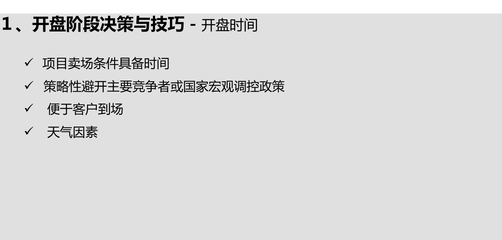

### 1、开盘阶段决策与技巧 - 开盘选房方式

选择开盘选房方式的原则：

- 成交客户最大化
- 营造热烈秩序氛围有利于成交
- 具体开盘方式对有效客户数量的要求
- 客户感受（不同档次楼盘目标客户的消费习惯）
- 常用的开盘选房方式有排队、抽签、诚意金顺序等，不同的开盘方式有不同的适用条件和开盘流程。

### 1、开盘阶段决策与技巧 - 开盘组织实施

开盘组织实施的内容：

- 开盘组织流程设计
- 人员分工及培训
- 开盘空间组织
- 销售流程中的关键点控制
- 开盘物料清单及落实
- 促销策略
- 开盘信息发布
- 突发事件的应对措施
- 销售氛围营造
- 防止开盘未成交客户失

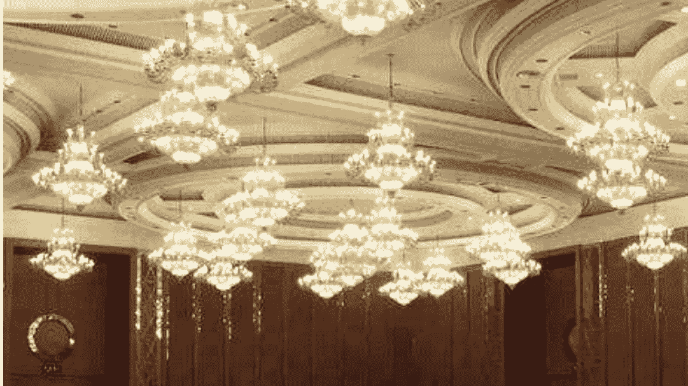
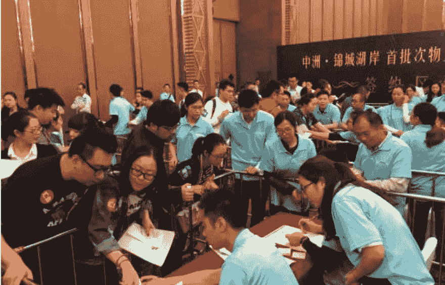
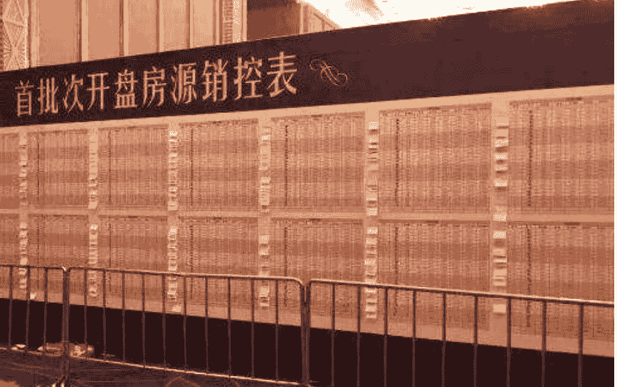

## 六、开盘阶段-主责部门营销部

### 2、开盘后评估及要点

- 客户分析
- 各户型成交情况分析
- 销售目标评估
- 销售定价评估
- 营销策略评估
- 后续计划和建议
- 找到成功的要点或者失败的要点并在后续改进

## 七、入伙阶段-主责客服

### 1、入伙阶段管理要点

- 对客户始终如一（前后信息一致）
- 对客户进行细分（分散客户）
- 分析和预测客户的需求（对症下药）
- 从客户的角度处理问题（换位思考）
- 让客户自我服务（优质互动）
- 考核制度、考核客户觉得重要的（提示自己，服务客户）

### 2、应对业主权益的经验

入住阶段引发纠纷的种类有：“赠送面积”、“违建”、“学区”、“精装修标准降低”、“水电问题”等。开发者如何开展危机公关呢？

- 成立危机公关小组，危机公关监控有关的信息，处理业主矛盾，小组员应当观察、沟通，小组中至少要得到授权的副总以上，还要外聘的高级公关顾问，对于棘手危机，需要快速落实、选用经理和总出门，以重视和缓息矛盾。
- 收集业主反映的问题，不要收集处，还包括网络上的相关信息。因为时代，业主权益不在处，一言就会引起波动，可能造成不可见的影响。危机公关时应当具备舆论识别能力，随时通过渠道收集业主以及媒体平台上关注的事情，进行信息整理、针对不同情况提出建议或解决方案，及时报公司。
- 每次危机事前预判，能够预判到危机，并提出防范策略，比后期重要。制定危机公关计划并做好准备，充分准备和正确的处理方式会使企业公关更加游刃有余。对于一定影响的业主，应当区别对待，还要考虑补偿。

### 2、应对业主权益的经验

- 处理网络危机反应要快。时代传播非常快，开发商要迅速控制网络流言，不能给对手机会，最好现场解决。公关处理速度越快，影响越小。往往危机发生的24小时，走向就已经完成了。因此解决危机只有采取比平时更为严格、快速、有力的措施，才可能在业主面前赢得信任。
- 做好网络传播和公告，针对网络流言和业主反映的问题，及时在媒体上声明，予以澄清。另外通过正面宣传楼盘优势，传达其他客户对项目的认可或客观的，以缓冲、削弱负面消息的影响。
- 错开住房入住时间。入住纠纷就有种类，但集体交房容易出现问题，所以交房时间不要集中，最好避开“五一”、国庆节、春节等假期期间，以免产生大的负面影响。

## 八、物业管理阶段

### 1、思想和意识

- 安全观念：物业管理的首要观念是安全，安全管理中包括防火、防毒、防盗、防乱、防场等。
- 服务观念：在物业过程中，分分秒都有发生各种障碍可能，渗透、断电、电梯损坏、水管堵塞、抽水马桶失灵等这些问题，绝对不是上班小时才出现的。这些故障报到值班室和调度室，值班员工毫无犹豫就赶到现场，立即恢复正常，故障就是命令。从这个意义上讲，员工要有意识，绝对对值班和上级的指挥，绝对不能借口困难或在休息而不服从。

- 客户面前“七个不”：不、不会、不知道、不是我管的、不行、不干、不能……
- 上级面前，下不能说“七个不”：“不、不会、不知道、不是我管的、不行、不干、不能......
- 在在线部门面前，保障部门不能说“七个不：“不、不会、不知道、不是我管的、不行、不干、不能......
- 出现问题“三不放”：即，问题原因不查清楚不放，责任者未查清不放，处理意见和改进措施拿出不放。

只有这样，企业才有战斗力，顾问才有安全感和舒适感。

- 营销观念
- 成本观念
- 参与观念：参与观念主要指物业管理事先参与开发工作，严把“四关”：规划设计关、建设配置关、工程质量关、入住关。
- 科技观念
- 细微观念
- 人才观念
