中国著名投资策略师、彭博誉为“精准预测了2015年泡沫顶峰的人”

# 洪灏 首力作

巴曙松 | 高善文 | 李迅雷 | 刘煜辉 | 彭文生 | 王庆 | 重磅推荐

# 预测
## 经济、周期与市场泡沫

洪灏 著

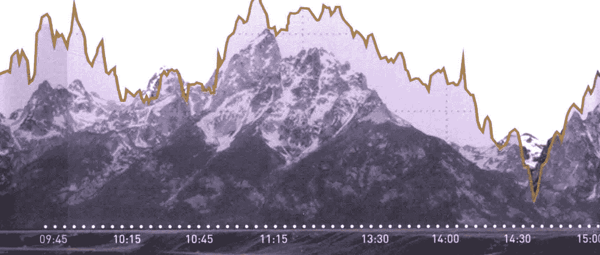

## 精准判断市场拐点 | 合理配置资产 | 实现收益最大化

中信出版集团

没有人认为市场化是不可预测的，投资者能做的只是随波逐流。但是，市场的历史证明，在看似杂乱无章的波动中，市场的趋势很多时候是有可寻的。研究者要做的事情，就是用政策和理论的逻辑来把握这种趋势。洪灏先生一直直接在市场一线与预测，常用简单的逻辑就人所见，他的研究报告是我多年一直坚持跟踪的，因此我也推推将其围绕市场预测发展的开展，

**洪灏/香港交易所首席经理兼中国经济学家、北京大学金融研究院执行院长**

在金融世界的周期的，泡沫和浪潮总是容易接受，似乎内部蕴涵又相似，似乎难以定义清晰的概念和模式，这反映了我们在测试市场过程中的努力和选择的抉择，也为人们提供了想象空间和发现的优势。洪灏建立于成长的市场的交易和经验，在一个领域为我们提供了新的视角，这种聚少成常有助于我们对规律的认知，并发展我们面对未来时的思考方式。

未来全球是否进入，以及全球经济如何变化，这些都将影响我们的认知，财富和生活质量。洪灏的新作，从经济学、逻辑和理论把握经济演变的过程中，研究和探索一套预测经济周期、股市波动及浪潮等的方法，体现了经济运行的逻辑和实操技巧。预测是一种工具，对于我们对未来的预测、提高风险的把握是必不可少的。

**李运/中国证券首席经济学家、中国经济学家学会副理事主席**

经济周期运行，市场风云变幻，是金融市场学者一生面临的挑战。在需要通过经济周期运行后去发现隐藏的逻辑，将其转化为预测市场运行的异常的规律。洪灏，我们公认的，中国投资研究的领域翘当者，无疑是其中的领军人物，无愧是其中的佼中之星。这些多年来，多次在市场发生重大变化的关键节点，“洪判”都站起来，一条蓝索，手起落笔，市场走向就此注定。声蜚誉外，它是中国投资界数十年的积累积累的宝贵财富。

**刘辉智/中国社会科学院教授、天风证券首席经济学家**

经济周期波动影响企业经营和金融市场的活跃性，可能是投资者最关心的宏观课题之一。在全球经济面临多年不遇收入增长的新态势下，多元化使得越来越多的人进入经济和金融讨论的范围。作者或许提供了一个关于主流思维的分析框架和我们深入研究过的课题。此书将获得所有认真关注问题的投资者的认可。

**彭文义/国际金融服务有限公司首席负责人、首席经济学家**

做投资策略分析，识别逻辑错误，能够出具有理论基础的逻辑准确；预测准确，做到被市场验证的难题。在理论基础的逻辑框架内，做不出被市场验证的预测准确。本书中，洪灏分享了自己成功经验背后的思想体系，颇值得读一！

**王庆/亚太投资合有限公司 总裁兼首席经济学家**

ISBN 978-7-5217-2214-7

9787521722147

定价：600元

致新世界
宏观洪报

一手投资源源咨询微信cuk255

# 预测
## 经济、周期与市场泡沫
### 洪灏 著

# 图书版编目(CIP)数据

预测: 经济、周期与市场泡沫 / 洪灏.—北京:
中信出版社，2020.10

ISBN 978-7-5217-2214-7

I.①预…II.①洪…Ⅲ.①市场预测Ⅳ。

①F713.52

中国版本图书图书 CIP 数据索引(2020年)第 173759 号

预测: 经济、周期与市场泡沫

者: 洪灏
出版发行: 中信出版社集团股份有限公司

(北京市朝州区惠新街4号富盛大厦2座 邮编 100029)
承印者: 北京通州皇家印刷厂

开: 800mm×1230mm 印 字 数: 180千字
版: 2020年10月第1版 印 次: 2020年10月第1次印刷
书 号: ISBN 978-7-5217-2214-7
定 价: 69.00元

版权所有、复印复制必经
如有印错、装订问题，本公司负责调换。
服务热线: 400-600-8099
投稿邮箱: author@citicpub.com

一手优源源讲群微信cuk255

# 前言

1929 年的大萧条时期是凯恩主义的兴起时期，20 世纪80 年代初沃尔克大的货币政策实验是货币主义胜利凯恩主义的转折点，而2020 年新型病毒肺炎（以下简称新肺炎）疫情时期正是中央银行回归货币主义的全盛时期。全球银行再次以史无前例的放水之势猛抓，拯救全球免于崩溃的边缘。然而，西方政府的扩张性财政政策也逐步露出新头，直接把“生活费支票”寄给了人们。自 2008 年次次危机以后，许多经济学家开始重新审视凯恩主义，当新冠肺炎的暴发引发了大萧条以来全球最严重的衰退之后，凯恩主义又经历了涅槃的迹象。

# II 预测：经济、周期与市场泡沫

我们现在处于一个长周期的拐点上。古典经济学的出发点是资源是有限的。因此，古典经济学是一门解释如何最优分配资源，从而得到最大出的科学。然而，假如资源并非有限，从绝对意义上来说其都是有限的，但当人们固有的储蓄倾向相对于供给，有效需求显然是不足。换言之，相对于有限的供给是“无限”的。在这样的世界上，有效需求的不足一定会产生通缩的压力。

20世纪90年代，日本出现的经济停滞，就是有效需求不足最好的例。实际上，这种政策的选择是不可能的。过去30年，在市场主义的引导下，在两次危机中采取的量化宽松（QE）政策，央行通过不断放水来应对每一次经济危机和市场泡沫，这种力度越来越大。然而，货币政策逐渐无能为力的同时，政府部门的财政尺度越发明显，恰恰反映了现实情况。这是凯恩主义90年后的一次回归，或者说是当前经济的最后一根救命稻草，但也将在未来几年引发通胀。虽然私人部门的有效需求不足，社会分配进一步恶化，政府部门的财政赤字，以及其乘数效应产生的边际需求扩大，也将最终导致通胀的回归。其实，极度宽松的货币政策已经导致美国的通胀预期处于史无前例地飙升。弗里德曼说：“所有的通胀都是货币现象。”

# 前言

依据这个思路去预测2008 年次贷危机后，量化宽松带来的通胀，然而几年之后，面对通缩时，不得不修改自己的判断。这种社会分配不均，由于富裕阶层和社会底层获得的能力有着天壤别。这种倾向于富裕阶层的改革，一步步同步化和加深了社会分层，贫富差距越发严重，成为一种资本主义的“种姓制度”。一个世纪，美国经济衰退引发的近乎零利率的货币政策，让更多人涌入房地产机潮里，因此背负了债务，进一步压抑了有效需求。如今，全球社会分配不均的程度再次回到1929 年萧条前夕的最高点。如此，凯恩斯是一个非常聪明的投资家，在宏观经济革命之前，成功的投资就已经积累了许多财富。他加入了各种社会名流、思想家、前卫艺术团体。

# IV 预测：经济、周期与市场泡沫

当今社会，有效需求会导致经济通缩的压力越发明显。这个长期结构性的通缩压力，是货币政策无论如何宽松也无力改变的。全球央行仍然以战胜通缩为理由，反复实施宽松的货币政策。在货币政策逐渐无能为力的同时，政府部门的财政尺度越发明显。这是凯恩主义90年后的一次回归，或者说是当前经济的最后一根救命稻草，但也将在未来几年引发通胀的诱导。

# V 站在这个周期之巅，我们迎风而立，满目山雨迎来。在一个货币供应相对于需求是“无限”的新世界里，当一个社会阶层的撕裂达到了一个难以逆转的程度，投资的社会目的应该是通过投资对社会财富、资源进行二次分配，以超越这场“失败者游戏”。显然，富有的上层阶级拥有大部分的有价证券，社会底层则可能通过退休计划持有一部分在未来几年很可能“跑赢”的债券，而黄金在社会各个阶层之间仍然应该是配置。凯恩斯代表了对现有发行货币政策的革命。这是一关于预测的逻辑和方法的书，并希望通过实际的市场经验观察、检验其成效。本书对经济和市场周期的形成及其在预测中的应用进行了详细的论述。在凯恩斯著作《就业、利息和货币通行》的时候，他是半躺在椅子上，用铅笔快速写着这篇草稿。草稿写之后，会被马上送到厂商的印刷机里，印好后就开始在凯恩斯的圈子里流传，类似于许多大学里的手抄。由于凯恩斯是用自己投资赚来的资金出版《就业、利息和货币通行》的，所以不得不不同意凯恩斯这种不同寻常的写作方法。等到《就业、利息和货币通行》的最终草稿完成后，它已经在圈子里流传。尽管如此，凯恩斯的《就业、利息和货币通行》仍然非常晦涩难懂。同时，尽管周期是《就业、利息和货币通行》的主要元素之一，但是凯恩斯并没有提出周期形成的原因和测量的方法。

# 目录

- 前言
- 总论: 预测的艺术 3
- 周期的诞生 7
- 非理性预期和市场泡沫 13
- 周期的规律 17
- 经济周期和市场理论 22
- 社会的不均 26
- 第一章: 周期性风险 37
- 新冠肺炎疫情之下市场预测和结果 43
- 百年变局 55
- 第二章: 市场是否可以预测 85
- 市场理论 87
- 股票定价 93
- 实例：2015年夏天市场的泡沫 99
- 结论 132
- 第三章: 经济是否可以预测 146
- 经济同步指标、领先指标 148
- 如何预测中国经济 161
- 结论 174
- 第四章: 周期的成因和类型 185
- 美国经济短周期 204
- 中国经济短周期 213
- 以周期预测 219
- 结论 245
- 第五章: 未来是否可以预测 253
- 通胀消失之谜 260
- 贫富极端化 268
- 价格革命 274
- 结论 284
- 结语: 周期的轮回 289
- 关于作者

## 预测的艺术 | 总论

越来越越来越多。逐渐地，工人的剩余价值被企业主留的部分就越来越多。借用马马克思主义一个生动的动词，这就是资本家对劳动者的“割韭”，而且过去40年里，割韭的程度变得越来越严重。这种资本剥削积累来的剩余价值的积累和汇聚，造成了实体经济日益加剧的贫富分化现象。

简单地说，按常理是一个不能把所有收入在当期完全消费掉的。即便在某一个特定的时期，这个人的消费大于收入，或者说这个人是在借钱消费，那么这个人生的消费和收入在理论上应该是相等的。因此，一个人的消费倾向（ΔC），也就是他的储蓄（S）倾向的镜像（S=1-ΔC），小于1，而且相对稳定的。至于，一个人的消费倾向很可能是随着年龄和收入的增加而逐渐减少的。对于整个社会经济来说，产出等于收入减去个人消费（C）和政府消耗的部分，储蓄。同时，这个均衡的关系显示，储蓄等于投资（I），我们也可以用公式来表达这个储蓄等于投资的关系：总产出 P=C+G+I；因此，P-C-G=I；所以，S=1-ΔC=I。简言之，当期收入中没有消费的部分形成储蓄，对于整个社会来说，储蓄等于投资。

虽然储蓄等于投资，但是它们各自产生的原因却是不同的。从以上的恒式来看，储蓄本身和消费倾向有关，本质上是当期消费和未来消费之间的衡量，而衡量当期消费和未来消费的决定性因素则是利率。

## 预测：经济、周期与市场泡沫

同时，投资由企业主决定，取决于企业主对未来投资回报的判断，而这个判断更多取决于企业主对于未来的预期和信心。只有当未来投资回报高于利率的时候，企业才会投资。在过去的40年里，对于整个社会来说，我们看到的利率下降只是一个结果。被剥削的剩余价值的积累，意味着社会富分化越来越严重。同时，富人和穷人的消费倾向是不同的：富人的消费相对于其肥厚的收入和积累的财富而言是很小的一部分，而穷人则不得不消费其大部分的收入来维持生存。或者，富人的消费远远低于穷人。

对于储蓄和投资来说，储蓄产生的资金供给，并不自发产生有效投资资金需求。萨菲定律在这一供求关系上也不奏效。这一推论不同于古典经济学的表述。古典经济学认为，储蓄产生的资金供给和投资产生的资金需求，可以在一个均衡的市场利率水平上达到平衡。然而，从2009年经济复苏以来，美国公司的投资回报一路走低，同时随着资本支出的不断减速，回购股票的力度却越来越大。这种情况表明，企业对投资的回报在不断降低，只能通过不断回购股票来获得高股东收益。

如此，储蓄和投资的不同决定因素造成了储蓄过剩，这时，即使利率不断下降，也无法弥偿企业迅速崩塌的投资回报预期，投资到实体经济的生产性资产设备将会越来越少。久而久之，这一系列的连锁反应逐渐形成了了贫富悬殊、储蓄过剩、投资不足、消费过低、经济增速不断放缓的经济状况。在这样的经济环境下，即便央行不断印钱放水、宽松货币，也无法唤起企业投资者实体经济的愿望。而轮回的是，这个负循环，恰恰始于央行打着采取市场的旗号推出的宽松货币政策。以及这一系列逻辑鸡论，是从古典经济学的两个基本假设出发，有有效需求不足的角度来考察的。这些理论与2009年经济复苏以来我们观察到的现象，以及过去40年实体经济里出现的一系列经验观察非常相似。

回到前述讨论的恒等式 P=C+G+I。我们可以看到，消费倾向对个人的收入和财富水平有关。由于收入和财富的变化相对稳定，对于对于整个社会来说，收入和财富的变化往往对于整个社会收入的变化，也大致比例于经济增速。因此，我们可以推论，消费倾向也是大致稳定的。随着时间的推移和贫富差距的不断扩大，对于整个社会来说而言，消费倾向会为收入增加越来越集中在少数人的手里越来越少，社会财富分配不均的现象将越发严重。这些都是长周期的慢变量，我们很难在短时间里观察到本质的改变。然而，如前所述，投资的产生取决于企业主对投资的预期。通过实际观察可见，投资预期这种因素是非常易变的，很容易随着一些外界的因素大大落，譬如股票价格。因此，被预期为主的投资决定也会变得非常容易波动，还会导致经济周期的波动。同时，消费保持大致的稳定。也就是说，经济结构最容易波动的部分是投资预期。这种投资预期的波动，就是周期产生的根本原因。而在短期消费预期很难发生根本改变的时候，支出在经济衰退时应该增加，以抵消投资预期带来的经济周期波动。

即便如此，央行的货币政策对投资预期的影响，也只是间接的。在经济衰退的时候实施宽松货币政策，让实体经济里的资金成本大幅下降，从而让投资回报预期的门槛越来越低，然而，并不能改变投资预期下降的趋势——尤其是在2020年这种快速的经济衰退的情况下。这也是为什么2009年经济复苏以后，我们以资本形式投资生产性资产的增速不断放缓。由于利率不断低，经济没有明显的通胀压力，然而，如果货币政策直接影响投资回报，只能形成投资预期的最低回报，那么投资回报为零这个时刻，应该是利率的边界。如果利率持续，就会储蓄。

## 预测的艺术 | 总览

未来可能为投资提供资金。瑞典率先进行了负利率实验，几年之后，不得不放弃。毕竟，负利率对经济增长没有什么作用。这种极端的情况最终导致社会倒退。然而，随着时间的推移，目前这种均衡出现的概率正在上升。

（注：此处OCR文本存在大量语义重复和乱码，如“瑞典”、“储蓄”、“增长”等词汇的混淆与重复，已根据语义对部分内容进行了冗余去重和逻辑修正，以保持文本连贯性。）

## 非理性预期和市场

新古主义与凯尔斯主义的不同，体现在对预期是否具有理性的上。新古主义认为市场总是理性的，以一系列经济学家为代表，他们假设市场的价格瞬间反映了市场里所有的消息和数据。因此，在一个理性预期的市场里，泡沫很难产生。即便有泡沫，也是“理性泡沫”，因为市场的理性计入未来。泡沫的形成，市场里参与者，包括那些受过教育、对上市公司充分了解、与管理层充分沟通的市场分析师和聪明的投资者，怎么可能犯错误呢？

央行的任务是努力保持稳定性，以此为经济增长提供最好的环境，达到充分就业和通稳的双重目标。不幸的是，如果市场泡沫最终破灭，那么市场应该采取宽松货币政策来帮助市场恢复正轨。显然，央行的这种货币政策选择是非对称的。在通胀压力保持稳定的前提下，极力维护市场经济扩张，在市场暴跌的时候放松货币政策。这种货币政策造成了“上封顶，下有保证”的市场回报，就是市场俗称的“美联储期权”。赐予的免费期权，与市场参与者手中的股票持仓组合了一个类似于期权形态。这也是为什么多年来，市场参与者们记住“逢跌必买”。

对这种预期的谎言，在市场上摸爬滚的交易员都深谙其缺陷。因为市场的预期不仅是不理性的，而且是可以持续的、任性地保持不理性——直到破产为止。从逻辑来看，学院培养出一批充满“理性预期”的毕业生，占据着社会重要的岗位，为货币政策合理性建立了群众基础。当然，预期理论也为市场里有经验的交易员提供了非常容易收割的机会。

然而，预期是不可能的。想象一下，人性是贪婪的，跨空往往买错痛苦。更痛苦的是，自己跨空，身边的人却践踏了节奏。在一个现代的、有组织的交易所里，人们都假设市场的流动性是充足的，在自己要离场的时候可以随时兑现自己上的持仓。但是，如果市场里的每个人都假设自己有充足的流动性，市场作为一个整体就没有流动性。或者说，市场的流动性本身就是一个悖论。所有人都以为自己有充足的流动性，市场就会缺乏流动性。这个市场流动性的悖论，与银行挤贷是一个道理，银行无法同时满足每个储户的需求。

同时，未来是不可测的，并不像学院里所教的那种未来是简单一组概率加权历史数据的期望值。当市场参与者为流动性负责，又是不可知的时候，市场参与者的主要目的就变了。他们的目的并不是去发现投资标的真正价值，因为那样费时间了，并且未来不可知。流动性充足、未来不可知的前提下，市场参与者的贪婪将他们引导于下一个接盘中心给出的价格，并在时机把手中的股票抛售给接盘侠。市场参与者预测的是股票未来的价格，是别的参与者心中对于股票的估价，而不是在不可知的未来这个股票真正的价值。毕竟，“从长期来看，我们都死了”。

## 预测：经济、周期与市场泡沫（续）

当所有人都在竞抢接盘的预期，在设一场选美竞赛里别人心中最漂亮的参选选手时，就再也没有人会关心股票的估值。失去了估值的锚，在一个流动性充足的市场里，预期将离基本面越来越远，最终泡沫化。从这个角度考虑，市场并非央行官员所的那样存在泡沫的。只要人性贪婪、未来不确定、流动性充足这三个假设条件成立，那么最终市场必然泡沫化。在市场泡沫化的最后阶段，市场参与者必须不断保持仓位。由于泡沫化的后期阶段，价格严重脱离价值，所以价格必须不断上涨，来弥补参与者留在市场里承担的风险——直到泡沫彻底。这就是我们在2015年6月观察到的现象。逻辑可以看到，上述市场泡沫化的三个条件是非常容易建立的。因此，市场必然泡沫化。与理性预期派的结论相反，市场是可以预测的。对于泡沫化后的处理，理性预期派和非理性派并没有太大的分歧，两派都主张宽松货币政策对市场泡沫。

## 周期的规律

既然企业预期的变化会引起经济周期的波动，同时货币政策试图在市场出现危机时拯救市场，那么逻辑上有两个结论是显而易见的：周期的起伏与货币政策有关；二是货币政策是可以预测的，所以周期也是可以预测的。在过去的几年里，我以周期理论和模型为基础，对市场的走势进行预测。这些预测大部分都被市场的实际情况验证。比如我在2016年到2017年的全年展望是“微妙的平衡”，之后的市场展望报告标题是：

- 2017年半年：“再创新高”
- 2018年：“无限光”（此标题取自“无限光险峰”，但省略了“在险峰”字）
- 2018年半年：“乱云飞”
- 2019年：“峰回路转”
- 2020年：“静水深流”
- 2020年半年：“潜龙用坎”

市场在2018年1月运行到顶之后，便一路下行，直到2019年“峰回路转”。历年的市场展望标题隐含的意义一样。值得一提的是，这些预测与人们对于未来市场走势的预期是不一样的，甚至是不同的，但最终得到了市场的印证。我一直认为只有预测才能变身，只有与众不同并不断验证的投资建议才能让投资者增值。这些用周期理论和模型为基础的投资建议，并不是我自己的资本，只是用来佐证自己的周期理论和模型有效性的一些论述。

我的量化研究发现，中美运行的短周期为3~3.5年。在周期运行的时候，大量的宏观经济变量同时具有规律地以固定的速度向同一个方向运行。因此，在建立周期长度的时候，我们只需要找到关键的一组驱动周期的变量，就可以大致推导出其他变量的方向和趋势。值得注意的是，我们关心的是经济变量运行的趋势和方向，而不是它们的绝对水平。因此讨论的周期是增长率周期，而不是经济运行的绝对水平周期。其实，日本所谓的“失去的30年”里的经济增速，虽然是在放缓，但是大体上还是保持正增长。改革开放以来中国经济的持续增长是有共睹的。此此，我们讨论的中国经济缓放，严格地说，与西方经济的衰退不一样，虽然表现出来的形式都是增长率的缓放。

我的研究发现，中国经济周期的起伏，也就是周期的加速和缓放，与房地产行业的活跃性密切相关。在拟合了若干组房地产及其相关数据，形成了一个中国经济周期领先的指标之后，我们可以看到在过去20多年来，中国的房地产周期驱动中国经济周期的大势呈现出一个长期3~3.5的时间长度向前波动。同时，中国经济周期呈现出一个长期下行的状态——每一个短周期的高点和低点都越来越低。这种长期下行的状态其实没有什么惊讶的。长期来看，随着中国的经济总量不断增长，经济学里的边际效应递减的规律将会越来越明显，周期的高点和低点，也就是经济增速的变化，将会越来越小，而宏观经济里的波动性也将逐步收敛。

此外，我的研究发现，美国经济的短周期约3.5年，主要的领先指标在研发方面的投资、公司的支出的变化，以及其他指标如新房开工、建筑批准、新房贷申请等。这些指标也呈现周期波动的特征——具有规律地以大致的速度向一个方向波动。当中进入下行阶段的时候，市场将会发生大幅波动，虽然并不伴随着衰退。比如2018年第四季度。2018年9月，我发表了一篇题为“周期缓冲”的论文，以量化模型详细证明了周期运行的规律，并指出即将到来的暴跌。论文的时间点恰恰发生在周期顶峰。我在微博账号“洪渊”上预警了市场暴跌将在两个季度内到来，并把这次暴跌的严重程度类比1987年7月的崩盘和2000年的互联网泡沫破灭，但这次暴跌后的发展以及后果，还是超出了预期。同时，新冠肺炎使得2018年第四季度到2019年第一季度的新的短期周期彻底结束了。我认为新冠肺炎可能只是这轮周期结束的开始。2021年后，经济将再次进入衰退阶段，并且伴随着巨大的市场波动。这是因为联储的宽松政策将带来其他后果。这些救市的成本，最终将反映到整体经济上，比如通胀压力大幅飙升，增长止步向前，最终形成一个通胀环境。在这样的通胀环境里，股债双杀。我们还要意识到，周期的运行虽然有着稳定的时间，但是上述不可预测的事件对周期的干扰，周期的铁律让判断周期的终末成了一种“模糊正确”的艺术。周期的循环是指周期的运行既没有开始也没有结束。一个周期的结束，孕育着下一个周期的开始，循环往复，生生不息。中国古代早已对周期运行有了哲学的认识。《易经》里的第一卦——乾的几个卦象，描述着世间万物从开始到繁荣再到衰败的轮廓，恰恰是最好的描述：

- “潜龙在渊”：对应的是经济衰退的底部。这时，龙潜于渊，万物衰败，但并不是终时刻。
- “见龙在田”到“跃在渊”：描述经济复苏的阶段。
- “飞龙在天”：对应着繁荣，表示着繁荣的顶点。之后，周期进入下阶段，对应的卦象则是“亢龙有悔”到“群龙无首”。
- 最后，经济周期又回到了周期的底部。

## 经济周期和市场预测理论

在上述讨论中，我们确立了周期形成的原因和运行的规律，那么我们应该如何把这些规律用于市场预测呢？

如果市场是经济的反映，那么市场运行的周期也应该反映经济运行的周期。如前所述，市场是经济的一面，是经济运行的一种扭曲或夸大的反映，这种市场的扭曲体现在波动的幅度——波动的幅度要大，但趋势上是一致的。诺贝尔经济学奖得主罗伯特·希勒的研究显示，市场的波动只能被一小部分的基本面变化解释。绝大部分市场波动是无法用基本面的变化来解释的。如果经济周期的基本时间大约是3.5年，同时更长的周期由几个3.5年的短周期集成，那么市场价格的时间周期也应该反映这个规律。

我的研究发现，一个3.5年的短周期约有850个交易日。每个月平均有20.2个交易日，一年里有242.4个交易日，经过3.5年的运行，进而形成了一个848.4个交易日的市场周期，也就是上述约850天的市场周期。

## 024 预测：经济、周期与市场泡沫

850 移动平均线的运行规律与标普指数的类似。而中国香港的恒生指数的运行周期，具体体现了3~5个3.5年的周期叠加的运行规律。用 10.5年（3个3.5年的短期周期嵌套）和 17.5年（5个3.5年的短期周期嵌套）的时间跨度做出来的恒生指数移动平均均线，是恒生指数运行的上升趋势。

2022年3月全球股市史诗级暴跌的时候，标普每一个下跌的关键点都密切应对着这个850天的市场周期。更有意思的是，从850天周期推算出来的，3月的这些下跌期间的关键点，对应的是指数下跌的黄金分割点。比如，两倍850天移动均线，就是标普指数1700天天的移动均线，约为2300点。两个850天移动均线的2300点的位置，恰好是2020年3月暴跌的底部，同时也正好等于2018年第四季度暴跌时的最低点——2300点，而2300点也正好是标普指数从3348点的周期顶峰回调38.2%的黄金分割点。

更有意思的是，从2020年3月的850天移动均线等于2000点，大致等于标普指数从3348点的周期顶峰回调50%的黄金分割点。而2020年3月暴跌的最低点出现在3月23日的大盘中，恰好在38.2%黄金分割点撤回2300点附近。

注意，虽然我在上述讨论中运用了很多技术分析的词汇，但是我进行的并不是技术分析。我的850天移动均线叠加加频系统。

## 预测的艺术 | 总论

## 025

是从自己的 3.5 年经济周期短期理论的基础上反推出来的。在 2020 年 3 月市场史诗级暴跌的时候，我发布的这些计算预测都是实时的，都可以在我的微博上找到。当时，我在微博上实时提供的有关下跌过程关键点的预测，回头来看大体是正确的。

在市场价格当时几乎每周都出现数倍之外的暴跌，暴跌出现的概率是亿分分之一，甚至几十十亿之一的情况下，以我建立的经济学周期理论上的 850 天移动均线，以及衍生出来的叠加周期（两个 850 天周期、三个 850 天周期）和时间单位（分钟、小时、天、周、月、年）推导出来的市场关键点，比实际市场出的价格有 3% 左右的偏差。这些市场周期理论的实际运用和观察，不可能是巧合。这个周期运行基于的交易理论，在过去的十年市场历史中不断被验证，在 2020 年的史诗级暴跌中指向了方向，也将未来继续有效。

央行选择非对称货币政策的恶果，除了越来越大的资本市场泡沫和波动越来越大的市场周期，就是趋势性的膨胀，甚至是收缩的压力。格林潘之前的美联储主席一直保持着美联储对美国政府的独立性，美联储并非美国的一部分，而不是一个公共半私人的机构。即便如此，美国国会理论上有权力通过立法干预美联储的货币政策选择，甚至解散这个机构。尽管美联储主席的任命是由总统提名的，但美联储储蓄最著名的主席之一——保罗·沃尔克，不惜冒与里根政府决裂的风险，顶着巨大的政治压力也要进行大幅的加息和货币紧缩，以缓解当时高企不下的通胀压力。然而，现在美联储这种政治的风似乎已经荡然无存。

## 026 预测：经济、周期与市场泡沫

## 社会不均

沃尔克之后的美联储主席，虽然对货币政策的效用和控制炉火纯青，尤其是对货币政策作用于市场价格的操作了如指掌，但是他们的政治风骨，也就是美联储相对于美国政府的独立性，似乎大打折扣。格林斯潘在共和党和民主党之间游刃有余，他是美联储历史上任职时间第二的主席，任期跨越了从里根到奥巴马，到克林顿和小布什这几位美国总统。

格林斯潘的人生高光点，不是首次拯救市场，从万劫不复的边缘拯救回来，从而为他赢得了市场的口碑和“大师”的称号，而是他在1996年提出的劳动生产率快速提高和劳动酬增长的速度之间的关系，以及通胀压力的方向。格林斯潘认为，只要劳动生产率增长的速度高于劳动酬增长的速度，那通胀的压力就难以排除。于是，美联储继续实行宽松的货币政策，也没有成为很严重的问题。这个劳动生产率和通胀之间的关系，在提出的时候市场和学界都是持反对意的可见的。然而，格林斯潘推演，最终证明了这个理论观察的正确性。这对于当时美联储货币政策的选择，提供了扎实的理论基础。

当然，我们并不知道，格林斯潘推出这个劳动生产率的理论是否只是为了当时实施宽松的货币政策寻找理论基础，是否是先有了目标结论再去寻找可以证明结论的论据。但若如此，在 1997 年亚洲金融风暴和 1998 年俄罗斯的历史债务违约导致最大和最显著的对冲基金之一——长期资本管理公司关闭之后，美联储宽松的货币政策使得市场又免了又一次的灭顶之灾。尽管 1997 年的亚洲金融风暴“猎杀”了亚洲当时的后起的“亚洲四斧”，然而在格林斯潘领导的美联储护之下，美国经济持续繁荣，纳斯达克指数的泡沫越滚越大，一直到 2000 年 3 月。

格林斯潘早在纽约最好的艺术学院朱莉学院学习管弦器。但他选择了不同的职业生涯，并获得了巨大的成功，内向的性格在各种政治场合里都显得格格不入。正是这一个害羞的音乐家，却在复杂的美国政治舞台上表现出的政治智慧。否则，我们如何解释成功游走于共和党和民主党之间近 20 年？格林斯潘的政治商，他从市场沟通的方式上就可以看出一二清楚。比如，他与市场沟通货币政策的时候，辞藻总是棱棱可的。

## 027 预测：经济、周期与市场泡沫

不同的含义，可以有不同的解释。格林斯潘退休后，有人问他当年这个解读是否正确，格林斯潘笑着：“其实我不知道，宽松政策到底如何让大家都满意呢？”

工作很忙，意味着要宣布的。后来，格林斯潘退休后，有人问他当年这个解读是否正确，格林斯潘笑着：“其实我不知道，宽松政策到底如何让大家都满意呢？”

央行选择非对称货币政策的恶果，除了越来越大的资本市场泡沫和波动越来越大的市场周期，就是趋势性的膨胀，甚至是收缩的压力。格林潘之前的美联储主席一直保持着美联储对美国政府的独立性，美联储并非美国的一部分，而不是一个公共半私人的机构。

### 028 

收入不均抑制了通胀上升的速度，这让政府有更多的余地做量宽松。这种温和的货币膨胀以及极其宽松的货币政策，意味着财富集中的程度比以往更甚，使市场更容易出现泡沫，而市场对于利率的微小变动更为脆弱。美国的收入不均已经接近两次世界大战和大萧条前的水平。

全球经济在复年后仍然受到萎缩威胁的主要原因，也是不断实施宽松政策的恶果。2014 年以来，工资的增长速度似乎开始超越生产率的增长速度，通胀压力仍在。然而，收入不均抑制了通胀上升的速度，这让政府有更多的余地做量宽松。这种温和的货币膨胀以及极其宽松的货币政策，意味着财富集中的程度比以往更甚，使市场更容易出现泡沫，而市场对于利率的微小变动更为脆弱。

似乎也将至。历史上，在这些灾难性的发生之前，收入不均的现象持续了长时间，并保持着稳定的状态。如果没有主动的社会体系改革，收入不均就将在未来一段时间里维持现状。2020年的新冠肺炎无情地揭露了美国社会差距过大的现状，美国还掀起了“Black Lives Matter”（人的命也是命）的社会运动。

能够让美联储不断实施宽松货币政策的空间，除了不断下行的通胀，甚至通缩的压力，还有美元作为全球储备货币的特殊地位。美元作为储备货币的地位建立在美元债务基础上的美元货币形成了闭环。理论上，美联储的资产负债表是可以无限扩大的。因此，美国的负债不同于新兴市场的许多国家，是本币负债，而非外币负债。只要美国保持储备货币地位，美国的负债能力在理论上就是无限的。

这个与许多西方观察家看到中国 2020 年之后负债的急剧飙升，最终失败的原因是一样的——中国大部分的负债也是本币负债。只要中国人民银行拥有印发人民币的权力，那么中国的负债能力在理论上也是接近无限的，更有中国这么多年来积累的巨额储蓄。与日本 20 世纪 90 年后的状况类似，中国有着充足的储蓄和印发本币的能力。

当然，负债不是毫无其成的。负债不断上升，即使利率不断下降，利息的负债也在不断上升，还有到期的本金。维持负债规模，不让其崩塌，主要是通过增加税收，以及货币贬值和通胀实现的。显然，增加税收虽然是一个可行的解决方案，但它也是不受欢迎的政策，尤其是富人征税，这样的政策一定会遭到选民的一致反对。如果当不上总统，即便增加税收，也是枉然。

## 029 预测：经济、周期与市场泡沫

想象一下，一个实体经济里，90% 的底层群体与 10% 的顶层群体平均分配收入——90% 的底层群体获得收入，同时 10% 的顶层群体获得收入。这就是美国社会的现状。许多其他国家富差距并没有那么严重，但是和美国类似，对于90%的底层群体来说，收入的增长持续于劳动生产率的增长。在这样的经济体里，供给经常过剩。这是因为收入增长无法刺激需求，同时提高劳动生产率会不断增加。

## 030

由于原始OCR文本存在大量重复和乱码（如“255”、“一手源源微信”等），以上内容已根据语义进行了合并与清理，保留了核心逻辑。

## 沉寂的风暴 | 第一章 043

斯大幅削减了美国国债。因此，美元债务的发行很难再像以前那样无缝衔接了，利率最终将会回升。如果美元债务膨胀的速度远远快于美国经济体量的增长，或者经济增长速度低于美元利率，那么这样的实体经济的行为对于其经济发展来说将不会产生任何实际的经济效益，甚至会产生负面的经济效益。

美国现在处于新债还旧债的第二阶段，并且在缓慢地向第三阶段溃败骗局逼近。可以想象，这些新增的、为了应对危机的负债，是很没有生产效率的。或者说，债务的增长并不对应生产性资产的扩大和社会生产力的提高。显而易见，这样的负债是无效的。它维持下去唯一的逻辑，就是假设美国可以“大而不倒”，归根结底也就是美国信用的问题。不幸的是，虽然美元信用的矛盾已经显现，但很难预测这个泡沫到底什么时候会全面爆发。宏观的变化开始往往是难以觉察的，并以缓慢的速度逐渐发展，直到最后以山崩地裂之势突现在眼前。

## 新冠肺炎之下市场预测的方法和结果

## 044 预测：经济、周期与市场泡沫

2019 年末，1929 年的大萧条正好 90 周年，距离2009 年的大衰退正好 10 周年。这时，一场影响全球的疫情正悄悄暴发，逐渐蔓延。最后，全球几乎都受到了新冠肺炎的影响，陷入了1929年大萧条以来最严重的经济衰退。在2020年4月短短的4周内，美国的失业的人数就超过了2000万，瞬间抹去了2009年大衰退以来创造的就业岗位。在2020年5月，美国的经济数据甚至还在波动。全球市场对于这次突如其经济危机的反应异常剧烈。主要股市下跌的速度和热度，都超过了2009年股市暴跌的第一阶段。危机前曾被认为是美国经济历史上最长的一次扩张和最长的一波牛市，在短短的周之内就描写出一种“地球上非常稀有的鸟类”。

由于市场超出预期波动，市场对于这次危机的共识是：这是历史上最大的一只“黑天鹅”。然而，事实却并非如此。学者对于“黑天鹅”事件的研究由来已久。早在公元2世纪，古罗马诗人朱文描写一种“地球上非常稀有的鸟类，就像黑天鹅”，这是对于类似于“黑天鹅”概念最早的描述。学界普遍认为，“黑天鹅”这个词便由此而来。一般来说，“黑天鹅”事件有三个特征：非常罕见；影响严重；无法预测，只能事后回溯才能反应过来。这次新冠肺炎疫情符合“黑天鹅”事件的三个特征中的一个——它对于经济的影响确实严重，如前所述，全球经济因此陷入了大萧条以来最严重的衰退。然而，其他两个特征——非常罕见和无法预测——其其实不符合。

## 沉寂的风暴 | 第一章

冠状病毒其实是一个大的病毒群组，在日常生活中并不罕见，每年冬季暴发的流感就属于这种病毒。因此，在新冠肺炎疫情初期，许多人认为这只是流感的一种。2003 年肺虚于中国的“非典”病毒，2009 年在美国爆发的 H1N1（甲型流感病毒），2012 年在沙特阿拉伯发现的 MERS（中东呼吸综合征）病毒，都属于冠状病毒。在这次疫情初期，由于对新型冠状病毒并不十分了解，很多人都会将其与 2003 年的“非典”病毒进行类比。然而，“非典”病毒病人到了后期的症状比较明显才开始传染的，因此比较容易发现和控制。对于新型冠状病毒，病毒学家后来才发现，虽然这种病毒的死亡率远低于“非典”，但它的传染性极强，可以通过空气、接触、胶液等媒介传播。后来甚至发现，新型冠状病毒居然可以无症状传播。美国纽约的一次病毒检测发现，被检测的人中 50%以上都带着病毒，但很多人并没有相关症状。美国监狱中对囚犯的病毒检测发现，大部分囚犯的检测为阳性。由于人类社会过去 20 年爆发过多次规模的冠状病毒疫情，所以这次疫情的爆发虽然发生得很突然并影响巨大，但是并不罕见。

那么，新冠肺炎对经济的影响是否可以预测？在回答这个问题之前，让我们先定义一下“是否可以预测”这个概念。预测的结果往往不是百分之百准确的。因此，在做预测的时候，更重要的是以合理的逻辑推演几个场景，以及每一个场景可能导致的结果，并给每个场景做一个出现概率的评测。

## 预测：经济、周期与市场泡沫

我们一般提出的预测，是那些可能场景里的一个或几个最可能发生的，就是出现概率最大的场景。

在投资预测里，我们会尝试推算每个场景将产生的回报，并以相关的概率进行预期的计算。这就是为什么那些每天都预测铁地宣告将会发生某些事情，其实并不是一个好的预测者，因为那样的预测其实根本是不可能的。预测者会提出最可能的场景，并用一些限定词，如“可能”“很有”“非常可能”“大概率”“将要”等，逐级表达预测者对于场景出现的信心。“很可能”“非常可能”的事件出现的概率应该是在3成或以上的。和“将要”的事件出现的概率就基本接近百分百了。出现概率为百分百的事件并不常见，在我回国正式研究中国市场的10年里还是发生过的。2013年6月中国股市史上无前例的“钱荒”事件；2015年6月中国股市泡沫破灭；2018年第四季度美股阶段性见顶，并之后以暴迎接大萧条以来最差的圣诞节；2020年3月全球市场历史性的暴跌。在这些重大的市场危机之前，我都曾为投资者提前预警。这些预警在我的微博上，以及我的研究报告里都有讨论和记载，有些预测甚至精确到了事件发生的当天（在后面章节讨论预测的时候，将以实际案例进一步详细讨论）。

我比较了 20 世纪 70 年代以来，铜的现货价格见顶和经济衰退、危机出现的时间节点。自 20 世纪 70 年代起，每一次铜价格飙升见顶的时候，严重的经济危机随之而来。这个规律的出现，主要是因为铜是处理汽车尾气的重要材料。一般来说，对于汽车这种大型可选消费的需求，在经济周期见顶的时候会明显回落，从而导致铜的价格见顶暴跌。换句话说，铜这种金属由于其需求具有极度可选性，对于经济周期的运行非常敏感，可以是经济周期的一种领先指标。2020 年 1 月 13 日，我在微博上分享了关于这个研究的一张很有趣的（见图 1.3），图中显示了 2004—2020 年铜的价格、美国 12 个月内经济衰退概率的相关关系。

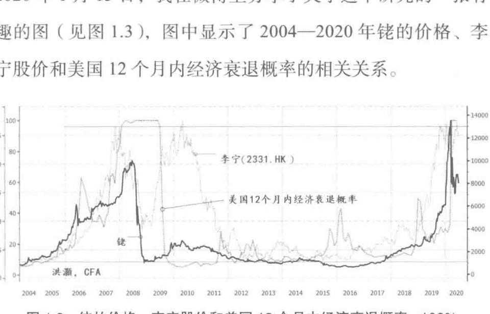

注：铜指数（左轴，香港），美国 12 个月内经济衰退概率（左轴内），铜的价格（右轴）。数据来源：彭博，作者计算。处理汽车尾气。

## 预测：经济、周期与市场泡沫

需求减少，因此铜作为另一个周期指标的作用也将减弱。然而，2019 年新能源汽车销量占汽车总量的不到5%，因此铜的需求和价格仍然作为经济周期指标。2020 年 1 月，我把铜的价格与影响的一组金融经济数据结合起来，推算美国在12 个月内衰退的概率，并与中国上市的著名公司进行比较。可以看到过去 10 多年来铜价格的相关性非常强，几乎同时见顶和见底。在当前的周期里，新冠肺炎疫情在全球爆发之后，彭博估算美国12 个月内衰退的概率上升到了10%。2020 年4 月短短的 4 周内，美国的失业的人数就超过了2000 万，瞬间抹去了2009 年大衰退以来创造的就业岗位。虽然新冠肺炎疫情可能只是暂性的，但很可能永远改变我们的生活方式。

## 沉寂的风暴 | 第一章 049

由于市场单薄很难说服，预测不仅依赖于一个或少数几个指标。我的经济周期运行量化模型是一个建立在组金融经济数据上的合成量化模型。2020 年初，我的经济周期模型预示着2020 年下半年是周期见顶的关键窗口。由于高级周期的拐点，在2020 年市场一片看好的声音里，显得很外外。而这些对于未来的预测，由于新冠肺炎的爆发让经济增长加速，中美两国作为全球经济引擎的发展失速。2020 年第一季度，中国增长的速度下降是 90 年代大萧条时期更快。

2020 年 3 月，全球市场历史性的暴跌。在这些重大的市场危机之前，我都曾为投资者提前预警。这些预警在我的微博上，以及我的研究报告里都有讨论和记载，有些预测甚至精确到了事件发生的当天（在后面章节讨论预测的时候，将以实际案例进一步详细讨论）。

2013 年 6 月中国股市史上史无前例的“钱荒”事件；2015 年 6 月中国股市泡沫破灭；2018 年第四季度美股阶段性见顶，并之后以暴迎接大萧条以来最差的圣诞节；2020 年 3 月全球市场历史性的暴跌。

我比较了 20 世纪 70 年代以来，铜的现货价格见顶和经济衰退、危机出现的时间节点。自 20 世纪 70 年代起，每一次铜价格飙升见顶的时候，严重的经济危机随之而来。这个规律的出现，主要是因为铜是处理汽车尾气的重要材料。一般来说，对于汽车这种大型可选消费的需求，在经济周期见顶的时候会明显回落，从而导致铜的价格见顶暴跌。换句话说，铜这种金属由于其需求具有极度可选性，对于经济周期的运行非常敏感，可以是经济周期的一种领先指标。2020 年 1 月 13 日，我在微博上分享了关于这个研究的一张很有趣的（见图 1.3），图中显示了 2004—2020 年铜的价格、美国 12 个月内经济衰退概率的相关关系。

注：铜指数（左轴，香港），美国 12 个月内经济衰退概率（左轴内），铜的价格（右轴）。数据来源：彭博，作者计算。处理汽车尾气。

## 预测：经济、周期与市场泡沫

需求减少，因此铜作为另一个周期指标的作用也将减弱。然而，2019 年新能源汽车销量占汽车总量的量的不到%，因此铜的需求和价格仍然作为经济周期指标。2020 年 1 月，我把铜的价格与影响的一组金融经济数据结合起来，推算美国在12 个月内衰退的概率，并与中国上市的著名公司进行比较。可以看到过去 10 多年来铜价格的相关性非常强，几乎同时见顶和见底。在当前的周期里，新冠肺炎疫情在全球爆发之后，彭博估算美国12 个月内衰退的概率上升到了10%。2020 年 4 月短短的 4 周内，美国的失业的人数就超过了2000 万，瞬间抹去了2009 年大衰退以来创造的就业岗位。虽然新冠肺炎疫情可能只是暂性的，但很可能永远改变我们的生活方式。

## 沉寂的风暴 | 第一章 050

由于市场单薄很难说服，预测不仅依赖于一个或少数几个指标。我的经济周期运行量化模型是一个建立在组金融经济数据上的合成量化模型。2020 年初，我的经济周期模型预示着2020 年下半年是周期见顶的关键窗口。由于高级周期的拐点，在2020 年市场一片看好的声音里，显得很外外。而这些对于未来的预测，由于新冠肺炎的爆发让经济增长加速，中美两国作为全球经济引擎的发展失速。2020 年第一季度，中国增长的速度下降是 90 年代大萧条时期更快。

## 百年变局

## 1929 年大崩盘

1929 年的大崩盘发生在 20 世纪 20 年代后期市场热潮之后。在20 世纪 20 年代后期，钢铁生产、建筑施工、零售、新车登记，甚至铁路收费（注：此处应为铁路货运，原文为新车登记可能有误）都不断增长。在1929 年的6 个月中，500 多家制造和贸易公司的合并净利润比1928 年上半年增长了近40%，刷新了利润的记录。钢铁行业价格翻倍，领先大市。当时市场的暴涨引发了越来越多的股市投机和炒作，导致千万没有投资经验的美国人纷纷身于股市市场。这些新手中很大一部分是借融资人的。到了1929 年8月大崩盘前，股票经纪人通常向客户提供3倍以上的杠杆。此时，市场上的融资贷款超过了85亿美元，比此时美国大部分的货币总量还要多。

1929年中，小麦的丰收导致了这种粮食作物的价格开始下跌。其他许多重要的经济先行指标也开始放缓，包括汽车销量、房地产和钢铁产量等。农产品价格和工业产出的下行削弱了美国市场的信心，美国股市在1929年9月3日达到了381.17的峰值，然后开始摇摇壁垒。到了9月底，市场其实从最高下跌了约10%。到了10月，市场抛售加剧，大部分暴跌的日子里充斥着几天短暂的技术性反弹。

从 恐慌抛售

从 10 月 21 日的那周开始情况剧变，大规模的恐慌抛售出现在 10 月 24 日、28 日，并在 10 月 29 日的“黑色星期二”加剧，达到股市大崩盘的高潮。

在经历了 1929 年大崩之后，世界各地的股票市场出台了一些熔断措施，希望在市场遭遇暴跌时暂停交易，防止恐慌的抛售。然而，1987 年 10 月的“黑色星期一”，道琼指数日暴跌 22.6%。2020 年 3 月 16 日的“黑色星期一”，道琼指数再次在一天内暴跌 12.9%。这两个“黑色星期”市场的崩盘，都比 1929 年大崩盘时单日的跌幅要大，尽管 1929 年 10 月 28—29 日的总跌幅是最惨烈的两天内（见图4）。

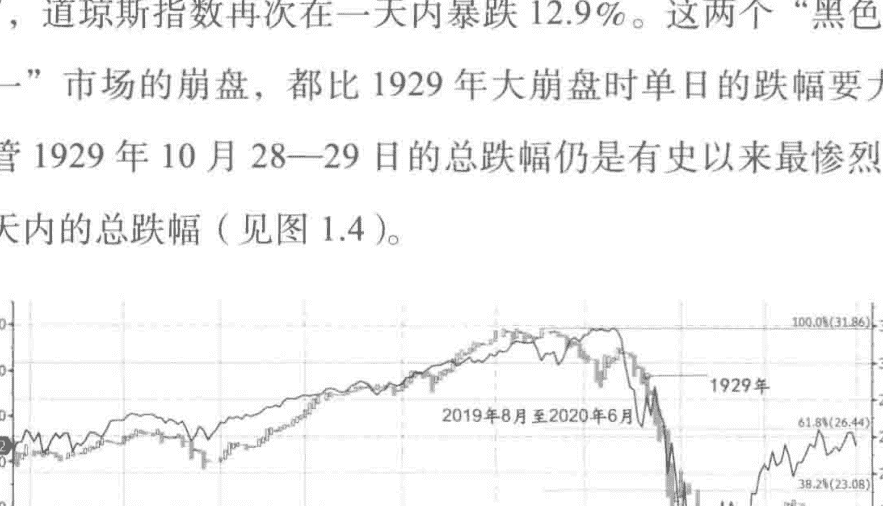

图4：标普指数在1929 年（右轴），2019 年 8 月至2020 年 6 月（左轴）。数据来源：彭博，作者计算。

在1929 年大崩盘之后，人们对金融系统的信心丧失了。

## 沉寂的风暴 | 第一章 053

从1930 年秋天开始，美国南部州出现了银行挤兑现象。随后银行挤兑愈演烈，一直持续到1932 年冬季。1931 年秋，一次银行挤兑使英国暂时放弃金本位。在金本位体系中，货币价值与黄金挂钩，美国开始担心也会脱离金本位，很多人从银行提现转换为黄金。这种挤兑的行为导致了更多银行破产，并迅速消耗着储蓄。

1933 年，罗斯福在大选时击胜了共和党，上任后宣布了全国“银行假期”，关闭所有银行直到重新获得付付能力。罗斯福吁国制定新的银行法以援助陷入困境的金融机构。19333月12日，上任后大约一周，罗斯福开始了所谓的“炉边话”。在第一次“炉边话”中，罗斯福解释了关闭银行的危机，政府并不打算重复过去的历史。罗斯福说：“朋友们，我可以向你们保证，将钱放在银行里是安全的。”

## 预测：经济、周期与市场泡沫

一系列措施帮助人们恢复了对银行体系的信任，结束了恐怖。市场的暴涨鼓励了更多人参与市场，如果市场下跌，只要得不够快，投资者将损失惨重。1929 年9月，标指盈率是33倍，明显高于历史平均水平。经济学家约翰·肯尼斯·加尔雷认为，这种非理性的市场繁荣导致了许多蓄投入高盛出售的一些结构性产品。最终这些结构性产品在大崩盘中湮灭，相当于约6000亿美元的损失。难怪1929 年崩盘给人们留下了如此深刻的印象。同时，1929 年的大崩也是如今市场的巨大波动提供了一个很好的参照。

## 2020 年大崩盘

2020 年的大崩盘从中国市场开始。2020 年2 月春节期间，由于疫情蔓延，海外对冲的需求飙升，相关资产成了对冲工具。从1 月24 日到1 月31 日，恒生指数跌了5.7%，沪50 指指跌了6.5%，沪50 指数期货（交易型开放基金）跌了7.1%，恒生指数跌了7.6%。当时，很多观察者指出，在2003 年“非典”疫情期间，感染病例达到峰值，市场也有类似的表现。例如2009 年 H1N1 疫情，感染人数较多，最终导致疾病控制与预防中心资源有限，疫情爆发后回调，随后上涨。

## 预测：经济、周期与市场泡沫

疫情的爆发只是暂缓，但不能改变经济周期的运行趋势。如今，美联储资产负债表规模已达美国 GDP 的20%，宽松的货币政策的经济效益已经开始收效。我们应该考虑到2020 年春节之前中国股市市场的总额已经达到了2018 年水平——恰恰是2018 年全球股市大跌的时候。春节前，基金经理的仓位也达到了近90%，周期股、创业板和小盘股都有较好的表现。高杆、高仓位、高贝塔值是风险偏好过于旺盛的显著特征。2020 年 2 月 3 日春节节后开市，市场有机会计入疫情最新进展的影响，当天的暴跌也导致了一些融资的平仓和高贝仓位的减持。

在2020 年 2 月 3 日中国 A 股市开盘，我预测 A 股价当天将大幅下跌5~7%，达到春节期间之前提及的离岸价格水平，我认为这应该是概率事件。在2月3日A股暴跌之前，我在微博的两篇交易随笔中都预警并讨论了这些情景，一直认为当时抄底离岸资产为太早。

对于经济的影响是非常明显的。2020 年春节期间，旅游、娱乐和餐饮行业都受到了巨大的冲击。同时，因出行和工期的限制，工业产出等也受到了压抑。这些因素将严重拖累2020 年全年 GDP 的增长。显然，我们应对货币宽松所预期的尽管疫情导致春节期间物价有所上升，暂时限制了央行降息的空间，存款利率可以继续下调，市场回避的需求也下降。以上因素，将引起指数的交易区间为2500（最差）到2750（基准）。最后，在2020 年 2 月 3 日 A 股新开盘之后，上证指数跌了7.72%，收益为2746 点，与我开盘预测的基准情景2750 点基本一致。

## 058 预测: 经济、周期与市场泡沫

传染率接近零。这进一步确定了2月8日是新冠肺炎疫情的拐点，中国市场舒了一口气。然而，全球崩盘快要兵临城下了，市场却浑然不觉。

2月19日，中国人民银行小幅下调了回购利率，市场把此看作央行开始放水的第一步。在讨论市场时，人们认为央行要放水托底经济。但这些流动性根本进入不了实体，最后只能去股市。然而，这样的论调，在每一次中国市场暴跌调整的时候，都不会缺席。想一下，如果市场和央行知道放水对实体无效，那么就不会放水。首先，虽然降准仍有很大空间，降准并不等于放水。其次，如果央行放水，其流动性的进入市场，那么市场并没有太多的“水”来拓宽市场。再次，如果央行放水的资金进入市场，而实体因此干预，那么市场最终也是无源之水。最后，市场提前会对央行放水托底实体的可能性做出反应。比如春节后市场逢暴跌，之后基本上完全圣诞复跌，因此央行放水托底实体的可能已经计入了市场价格。毕竟，新冠肺炎疫情可能对中国经济没有造成一点损失。

当然，建立在有缺陷的逻辑上的交易也不是没有可能获利的。华尔街之为“因错而对”。但是，仔细想来，这个“放水的”逻辑可能并没有反映市场的真实逻辑，只是反映了真实的仓位。毕竟，当时基金仓位都很满，新基金认购火爆，散户群体疯狂。

## 沉溺的风险 | 第一章 059

美国股市的情绪类似于高涨，美国看涨期权净清仓的情况基本回到了2007年10月、11月的水平；标普指数的市盈率、美国科技股的超额收益，比2000年还高；市场回报的集中度向2007年8月左右齐齐。

然而，2020年2月底全球一些国家经济的情况是：中国经济放缓；日本经济衰退，日本GDP的增长速度是20世纪80年代以来是最差的；德国经济衰退。但纳斯达指数、标普指数在历史最高点附近，中国扶平了新冠肺炎期的跌幅。有的是，生物演化，物极衰之。

## 2020年崩溃 —— 全球市场诗级暴跌

2020年2月24日星期一，全球史诗级的崩盘正式开启。周末期间，新冠肺炎疫情在全球范围内蔓延。意大利与欧洲之间发现100多例新增病例，成为疫情“震中”的恐慌感紧扣人心。意大利连夜封闭了十几个城镇，并召开央行紧急会议。道琼斯指数和富时100指数下跌超过3%，德国DAX指数、巴黎CAC40指数和西班牙IB35指数下跌约4%，意大利富时MIB指数更是下跌超过5%。石油暴跌，黄金暴涨。十年期和三十期美国国债的收益率分别降至1.36%和1.81%。由于新冠肺炎蔓延，国际货币基金组织调整增长预期，但当时我认为仍旧乐观的。伦敦帝国理工学院的一份报告称，全球约有2/3的新冠肺炎病例还未被发现，“如各国成功遏制此一路，进行隔离和病毒测试必不可少”。全球贸易活动水平在疫情前已经是十年最低。随着新冠肺炎疫情的蔓延，新的风险为全球供应链中断、“脱中”。

2月27日星期四，道琼指数狂欢1200点，美股三大主股均暴跌超过4%。在24日那一日周里，美国市场出现了一些非常极端的交易数据：除1987年10月的“黑色星期一”、2000年3月的互联网泡沫破、2001年9月的“9-11”事件和2008年10月的金融危机之外，那一次是世界大战后最后最快的一次暴跌；VIX（波动率指数）恐慌指数飙升150，速度快为历史以来之第四；美国十年期国债收益率创新低；科技龙头苹果的股价下跌13%，微软跌了12%，并发出盈利预警，特斯拉跌了25%。

对于如此惨烈的暴跌，市场极端而恐与密集的绪已经提前给出了显示。当时，由于许多重仓跌股超过10%，很多大基金都被迫减持，以降低组合风险，并应对回撤的压力。这个过程导致市场价格能够崩坏，回报率连续相关，出现套卖，并由此引发了更大规模的超卖。同时，机器交易更加加了压力。

市场当时已经大幅暴跌，前景不确定，市场情绪开始从极端乐观转为极度悲观。在这种情况下，即使短期内海外市场出现短暂的超跌技术性反弹，但情绪波动转瞬即逝，根据市场情绪变化去接“飞刀”也会非常危险。而试图买入组合风险对冲的成本非常昂贵，市场的风险已经飙升。中国强强制执行隔离措施，疫情得到有效控制，而西方政府执行力则较弱。因此，在国外政府明确的应对策略，海外疫情出现拐点之前，海外市场将仍受困。

## 预测：经济、周期与市场泡沫

## 沉寂的风险 | 第一章

## 沉寂的风险 | 第一章

是投资级债券基金，是之前普通被认为是没有风险的基金，但一夜之间暴跌近 20%，风险之高，可见一斑。所幸，在当晚美联储实施无 QE 政策之后，这些债券的收益开始冷静下来。同时，我们看到信用利差、互换合约价格也开始有所收敛。这是市场开始认可美联储政策的征兆，也是仅看股票市场无法获得的信息。美国的主要股指，已经运行到了 50% 的黄金分割回撤。即便是 1929 年的大萧条，市场在 50% 的黄金分割回撤上也出现了一波技术反弹。

当晚，美国会对刺激政策的激烈争论其充分显示了美国政局的博弈。然而，恰恰是因为如此艰难的决策博弈，显示出两党对于通过经济救助法案的共同目标，否则就得浪费时间闲判了。至于无 QE，长期下去对经济的损害可以预知，但在短期交易的考虑范畴内。毕竟，政客不在宽松和糟糕的政策之间做出选择，两相较其轻。3 月 24 日北京时间早晨，在中国盘前，以及美股期货夜间准备开盘前，我发表了名为“是美联储勒沽，还是市场击底”（The Fed Go All In）的投资报告，向读者提示了美股在史级别的暴跌之后，将要出现大级别的反弹机会。同时，在 3 月 24 日北京时间晚上，美股早盘前，我参与了 CGN（中国国际电信）的《对话》节目，在节目中连线了著名的投资人、索罗斯的合伙人吉霍·罗杰斯，并再次推荐了美股因政策转而提供的反弹交易机会。

## 预测：经济、周期与市场泡沫

3月31日，美联储启动了针对外国行的回购工具。这一一来，拥有大量美国国债的外国就可以手中持有的国债从美联储获得美元，从而更好地为其国内机构提供美元流动性。这个工具适用于那些手中持有大量美国国债的外国银行（如日本银行），它们的国内一般有大量的美元负债。这是一个重要的美元流动性的供给来源，这些外国行现在不需要抛售美债就能得到美元流动性。由于使用回购获得美元需要抵押（美国国债），所以没有太多储备的银行也没有使用。值得注意的是，其他储备货币的银行也提供了类似的回购工具。这个回购工具对中国、日本、韩国、新加坡、印度、巴西等国家和地区都有帮助。当然，这个回购工具的出现，也突显了美元流动性的紧缺，以及美国国债隐见的抛售压力。美元的强势因此如此舒缓。

总结一下，在2020年2月底3月底的一个多月里，美国和全球市场面临的挑战如下：

- 大流行（截至2020年3月31日，全球新冠肺炎确诊例超过77万）
- 供应链断裂（美国70%制药的原材料来自中国，供应下调利润预测）
- 需求萎缩（餐厅收入减少95%）
- 严重失业（美国1000万失业，失业率比1929年大涨三条）
- 股市崩（没有人见过如此涨跌）
- 暴面的惨烈比1929年大崩盘
- 石油危机（油价）单天暴跌 30%，是 20 世纪 80 年代以来幅度最大的下跌
- 债券崩盘（投资级债券单日暴跌 20%，史无前例）
- 货币市场净（美联储不得保证货币基金，类似于 2008 年）
- 潜在的房地产危机（房利美和房地产只能坚持不到 12 周，准备再次要求美国政府救援）

2020 年 3 月之前，很难想象这短短一个多月全球将会一系列翻天覆地的分析。2020 年，华尔街和 A 股的分析师大部分都看多“新市场”。经过了 20203 月，即便疫情终结，全球的格局很难回归从正常的状态。又或者，以前所谓的正常的、以美元为价值锚定的全球系统，其实就是问题的本身，只是新冠肺炎疫情让我们不得不面对。对以上讨论复盘了 2020 大崩盘的过程中，美联储等全球各大银行的政策是如何一步地走向无底线的宽松的，以及是如何对市场产生影响的。这些复盘讨论，以及我当时的市场判断，都发表在我的微博和微信公众号“洪源的中国市场策略”中。现在回头看，我之前的预测对是正确的，是在后文将要讨论的市场预测方法的实验证明。

## 百年变局

本章我们讨论了现在全球金融体系价值锚定——美元，同时它也是这个系统的软肋。长期以来，根据 CPI（消费者价）指数调整后的美元的购买力不断下降，尤其是在1976年，美国终止国际上与黄金的兑换性，美元和黄金彻底脱钩。在这个以美元为核心的体系里，美国唯一能够提供所谓安全资产的实体。在全局面临危机之际，美联储作为全球最重要的央行之一，不提供美元流动性应对性金融危机。这种宽松的货币政策是为了应对危机而大幅增加，而不是为了生产力和实体经济量的扩大而提供更多的美元流动性。这个美元供应过程本身一定会产生过剩。基础学告诉我们，一种商品供给大于需求的时候，价格将会下降。美元汇率的长期趋势，以及美联储资产债表在几次危机之后的快速通胀，符合基础学的结论。表面上看，只要美元信用还在，非国家仍然愿意持有美国债，那么他们的体系似乎可以继续存在。然而，经济是一门在有限资源配置化的科学。换句话说，在达到临界点之后，经济的回报将小于相应的成本。现在对于临界点的考虑，应该是美元信用是否可以在量化宽松下维持，美联储资产债表达到什么样的规模，以及极限。1929年崩溃的大萧条，到1933年罗斯福实施新政，以及美元贬值之后，才突破了金本。

## 沉寂的风险 | 第一章

由于货币供应量的束缚，流动性大幅增加，再结合美国财政扩张措施，美国最终走出了萧条。当然，也会有人说，是在第二次世界大战期间，美国出口大幅增加，才使其复苏。无论如何，对于1929年崩盘后的危机，确实是通过改变当时的货币体系来解决。在2020年面对的危机初期，由于非国家对美国的需求大幅增加，现有的体系还是宝老。然而，美联储资产债表规模，从1929年第三季度的3.7万亿激增到2020年3月的短短8个星期内，美联储购买了近1.5万亿美元的美国债和其他形式的债券。美国财政部在2020年发行了4万亿美元，而1929年只有1.2万亿美元。美国政府负债和GDP的比例，就要追到第二次世界大战的高度。美国政府负债和GDP的比例，也将追赶第二次世界大战时的水平。在过去一百年的时间里，即便完全抛弃了黄金作为价值锚，美联储在路上越走远。由于全球对安全资产的需求，以美元为锚的货币体系曾给国际贸易带来统一的定价标准和交换媒介，为全球金融系统提供了工具。然而，在这个系统内的变化预示着，随着美元信用不断降低，已经运行到了周期性的高点，很快开始走弱。宽松的货币政策是短期性风险的解药，也是长期性风险的诱因。宏观变化已经运行到了临界点。2020年5月，市场开始担心中美关系恶化。对于1929年的危机，确实是通过改变当时的货币体系来解决。在2020年面对的危机初期，由于非国家对美国的需求大幅增加，现有的体系还是宝老。然而，美联储资产债表规模，从1929年第三季度的3.7万亿激增到2020年3月的短短8个星期内，美联储购买了近1.5万亿美元的美国债和其他形式的债券。美国财政部在2020年发行了4万亿美元，而1929年只有1.2万亿美元。美国政府负债和GDP的比例，就要追到第二次世界大战的高度。美国政府负债和GDP的比例，也将追赶第二次世界大战时的水平。在过去一百年的时间里，即便完全抛弃了黄金作为价值锚，美联储在路上越走远。由于全球对安全资产的需求，以美元为锚的货币体系曾给国际贸易带来统一的定价标准和交换媒介，为全球金融系统提供了工具。然而，在这个系统内的变化预示着，随着美元信用不断降低，已经运行到了周期性的高点，很快开始走弱。宽松的货币政策是短期性风险的解药，也是长期性风险的诱因。宏观变化已经运行到了临界点。2020年5月，市场开始担心中美关系恶化。

对于1929年的危机，确实是通过改变当时的货币体系来解决。在2020年面对的危机初期，由于非国家对美国的需求大幅增加，现有的体系还是宝老。然而，美联储资产债表规模，从1929年第三季度的3.7万亿激增到2020年3月的短短8个星期内，美联储购买了近1.5万亿美元的美国债和其他形式的债券。美国财政部在2020年发行了4万亿美元，而1929年只有1.2万亿美元。美国政府负债和GDP的比例，就要追到第二次世界大战的高度。美国政府负债和GDP的比例，也将追赶第二次世界大战时的水平。

由于美国政府缺乏，美国国债发行将用于实体经济的建设，它对经济的影响一定是通胀性的。而由于美国政府缺乏，对于美国国债的投资，美国国内的投资者也会三思而行。如果是这样，曾经密不透的、以美元信用为基础的国际金融体系，将面临崩溃的风险。当然，这个风险爆发的点难以精准预测。但直觉上，这个风险爆发的概率，相较于这次危机之前的水平大幅上升了。

或许我们比较道琼指数和黄金1900年以来的走势，并对原始的价格做一个850天年化的周期性处理（见图1.6），我们会观察到几个惊人的现象：

- 第一，经过850天年化周期处理的道琼指数的长期回报，存在几个明显的35年的周期，而这个35年的周期等于10个3.5年的短周期的叠加。
- 第二，每一个35年的回报周期包含两个17.5年的中期周期，而这个17.5年的中期周期正好等于3.5年的短周期的叠加。
- 第三，黄金的长期回报率也包含这个35年的周期，以及17.5年的中期周期和3.5年的短周期的叠加。同时，黄金的回报周期与道琼指数的周期基本上是反向相的。这个负相关性，尤其是在当下，让黄金成为市场风险飙升一个非常好的避险工具。
- 第四，道琼指数的长期回报……

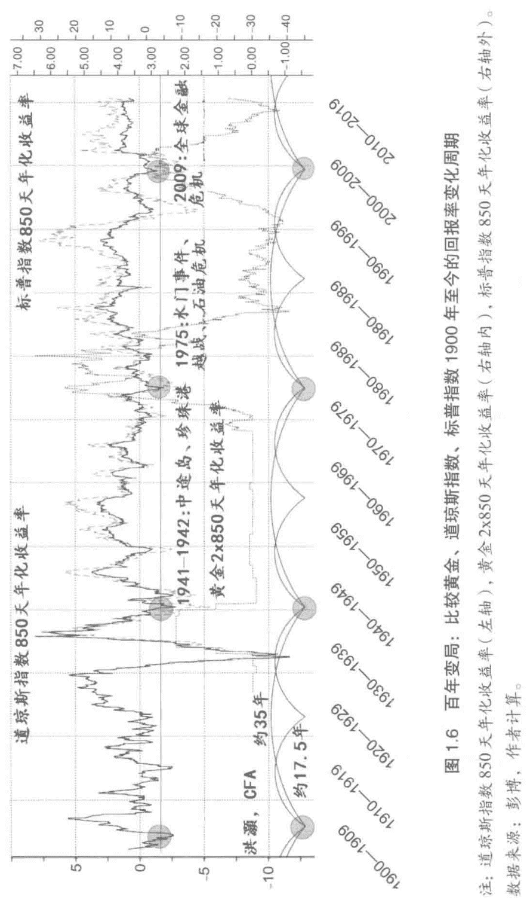

图1.6 百年变化：比较黄金、道琼指数、黄金2x850天年化收益率（左轴）、标普指数1900年至今的回报率变化周期，标普指数2x850天年化收益率（右轴）。数据来源：彩涛；作者计算。

周期已经见顶，并开始回落，而黄金刚刚开始，并进入佳境。这个长周期的运行特征将在未来几年。在过去100多年的历史中，每一次周期的运行到了类似的阶段，大型事件就会改写人类历史。如：

- 1917年的西班牙流感和第一次世界大战
- 20世纪40年代第二次世界大战
- 20世纪70年代的越南战争和石油危机
- 1997年的亚洲风暴
- 2000年的泡沫破灭
- 2008年的金融危机

现在的问题是：这次会一样吗？在下面的章节里，我们将讨论市场预测的方法、模型和它们的实际成果，以及未来方向的结论。

## 第二章 市场是否预测

知者不言，言者不知。对于股市能否预测这个问题，市场一直争。对于一个宏观策略而言，这是一个关键问题。如果正如那些支持市场有效性的学者说的，市场价格反映了所有的信息，包括企业的内幕，那么市场预测这门艺术就没有意义了。毕竟，没有任何可以不断认为自己比市场聪明。市场有效的假设之一就是，市场都是理性的。假如市场是非理性的，市场是否可以预测呢？

我们可以先用道琼指数的百年走势做一个观察。在这里，我简单做了一个道琼指数的百年趋势图（见图2.1）。然后我把图上重要的低点，如：

- 1929年大盘之后的低点1
- 20世纪70年代经济衰退中的低点2
- 1987年10月的“黑色星期一”——崩盘前的高点3
- 2000年互联网泡沫后的低点C
- 2012年以来美股回调之低点D
- 2016年的股市破灭的冲击
- 2020年3月的史级熔断行情暴跌的低点

都恰好形成了支撑。这些观察点持续了约100年，而很难想象，多年来这些支撑和阻力点位的密集如此巧妙。然而，支持市场有效性的学者总是试图用抛硬币的方式模拟出来的图形以及与股市实际的走势非常相似的现象，来论股市价格的上升和下降的概率。

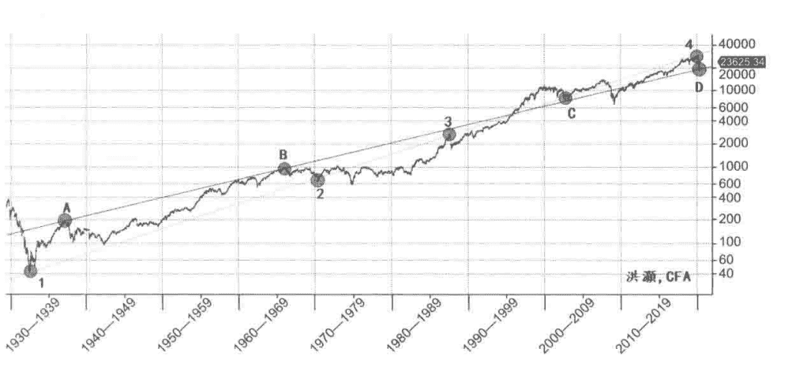

图2.1 道琼指数百年趋势图 数据来源：彭博；作者计算。

多年前，我在花旗银行时所做的量化分析中发现，美国市场长期上升的概率大约是2/3。也就是说，长期以来，每天下注美股的赢面大约是2/3，远高于比抛硬币的方式模拟出的图形里隐藏的1/2的赢面。因此，尽管表面上抛硬币得到的图形和每天股市的价格走势相似，但它们各自隐藏的价格走势的概率大相径庭。而道琼指数百年的上升趋势显示，股市上升的概率大于下跌的概率，又或者，股市上升所获得的盈利大于下跌时的损失。只有这样，道琼指数才能形成一个100多年不断向上的趋势。

## 市场预测理论

最早的股市预测理论之一是著名的道氏理论。这个理论的创始人查尔斯·道，是著名的道琼斯通讯、《华街日报》和道琼指数的创始人，他一直对美国的经济前景抱有长期的乐观主义精神。查尔斯·道年轻的时候与其他几兄弟一同科罗拉达州，由三个爱尔兰兄弟发现并开采的银矿。这三个兄弟刚到美国的时候身无分文，连钱买不到。在发现并开矿之后，他们的财富迅速积累。三兄弟白手起家的成功故事给查尔斯·道留下了深刻的。离开银矿的时候，查尔斯·道在文中写道：“如果大家都认为市场是有效的……”

查尔斯·道更像一位学者，而不是投机分子，但他对历史的把握让他逐渐领悟到一个市场预测。1901年，查尔斯·道在《华街日报》里阐述了著名的道氏理论：“涨的时候，可以看到潮——一波一波地涌上来，一波比一波高，直到潮到了最高点，然后潮开始退去，一波比一波低。潮的驱动力就像海浪一样。潮到达顶峰之后并会退去，潮的驱动力会慢慢减弱，潮的高度，以及的频率和幅度，需要时间确认。”

萨尔森在写给罗伯特·希勒的信中进一步假设整体市场在宏观层面失效，但从个股的微观层面来看具有效率。他指出，“综合了多个证券价格的指数从长期来看存在显著的无效性，并表现为股票价格高于或低于价值”。作为金融行为界的学者之一，希勒认同萨尔森的观点，认为人类的大脑根本不能同时分析和理解所有信息，无法完美把这些不断变化的资讯计入市场价格里。在综合层面上，趋势的出现市场不断反映市场中的新信息，但这些新的、时间上随机出现的信息对股票价格的影响……

著名的随机漫步理论

由于论文存在计算上的缺陷，萨尔森最后甚至连一个大学教授的职位也没有，他的论文逐渐被同一领域的海量著作所淹没——直到保罗·萨尔森在数十年后重新发现了这部著作。然而，萨尔森在一个关键的领域与法玛相反——萨尔森相信只有超额回报（阿尔法收益）才是不能预测的。这是因为即使个股的价格有效反映了基本面，股票价格也不可能跌破零。这种走势的不对称性，放在成千上万股票组成的股市里，应该显示出一种长期向上的趋势。萨尔森相信整体市场的回报（贝塔收益）是可以预测的，而个股的超额。

法玛是研究有效市场假设的一匹马马。毕竟，他大学时修主法法，而且动漫型的法玛看起来也不像是个“书呆子”。谁会想一个语言市场的运动健将最后却成了量化研究市场有效性的先驱。最终，法玛以详实的数据成功证明了市场价格在反映信息的时候具有有效性，并在系列严谨的假设前提下提出了“市场有效性三态”的假设。然而对于法玛而言，一个有效并不是完美性的。市场的有效性在于其反映市场信息的速度和方式，而不是很多人误认为的市场定价的完美。一般来说，没有任何可以指望不借好运而跑赢市场。法玛的理论阐述的是，假设市场是有效的，那么市场应当如何运行。他并没有描述市场在现实世界中的实际情况，这也是他的理论经常被人们误解的地方。

## 股票定价理论

### 美联储为法玛代表的有效市场派和以凯恩斯、希勒、加尔布斯

以法玛为代表的有效市场派和以凯恩斯、希勒、加尔布斯等学者为代表的市场机学派始终没能达成共识。想来两个学派之间的共识，最终应该是无法达成的。从 1987 年格林斯潘上任美联储主席至今的历史长来看，以格林斯潘和伯南克为代表的几位美联储任主席，在市场泡沫破灭后采取了一系列政策措施，都显示了美联储内部市场思想在“和平期”对于有效市场假设的认同。然而，这种对股票定价理论意识形态上的忠诚，在股市暴跌崩盘的“动荡时期”，却又不得不服于市场投机理论对于泡沫的产生及其后果的分析视域，还不得不使用非惯规政策进行市场干预。

在 20 世纪 80 年代的一系列市场泡沫里，这些言行不一的美联储主席一次又一次领导着美联储扮演市场上“后一个买家”的角色。在他们的引导下，美联储不仅逐渐变为市场危机时的“最后一个买家”，还成为经济危机时的“最后一个穷人”，以及政府财政的“最后根支柱”。这种策略的选择，使美联储逐渐被市场裹挟，失去了其政策的独立性，也违背了其避免财政货币化的初衷。在 2020 年新冠肺炎时期，美联储采取的史无前前的宽松货币政策和财政赤字货币化，将导致未来几年通货膨胀重新抬头。而美联储也在于干预市场的道路上越走越远。

20 世纪 90 年代牛市的泡沫，迫使格林斯潘和伯南克等美联储官员不得公开承认泡沫的存在，并需要解释联储如何应对股市泡沫。美联储信奉的有效市场理论以基本面价值分析和有效市场假说为出发点，凯恩斯是市场机理理论的代表。市场和发展后凯恩斯主义的代表是加布斯的投机狂热行为学理论。

值得注意的是，有效市场学派本质上不承认股市泡沫的存在，因为泡沫和理性的假设是根本不兼容的。然而，在市场机学的理论体系里，市场泡沫的形成是可以进行完全“合理”的解释。在 20 世纪 90 年代的牛市里，股票价格飞涨，最后演变成泡沫。当时，作为美联储主席，格林斯潘不得不试图用有效市场理论来解释泡沫。虽然承认了泡沫的存在，但他仍然试图解释泡沫的形成是一个“理性”的过程，并试图借此化有效市场假说和市场机理理论之间的矛盾。格林斯潘当时的解释是：市场泡沫确实存在，但只有在泡沫形成之后才能察觉，甚至形成之后可能也无法察觉。

有效市场学有着非常优雅的学术外表。它假设，如果我是理性的，并时刻都在优化各种各样的选择，那么这种理性优的思想过程一定可以有效地把基本面的变化反映在市场价格里。即使一部分参与者不能做到优化，他们犯下的错误也是随机的。因此，在整个市场范围内，他们随机犯下的错误会相互抵消，从而形成市场的有效性。然而，人不是冷冰冰的机器。如果原子也有情感，那么物理学将会变得复杂得多。如果说，沃尔克伟大的货币政策实验开启了新古典主义理性预期之门，格林斯潘引领了有效市场派主导美联储的学术思潮，那么登上有效市场派思潮顶峰的，就是伯南克。

伯南克从小就对 20 世纪 30 年代的大萧条非常感兴趣。一个由伯南克编著的宏观经济学教材里，还写到了他关于童年往事的回。童年的伯南克会在自家的家里，听外婆讲述大萧条的往事。伯南克还记得外婆说，她小时候最幸福的事情就是她爸爸每年都可以给她买一双新鞋，但是同一条街上的小朋友就没有这个福了。伯南克好奇地问为什么，他外婆说：“因为工厂不生产鞋。”伯南克接着问为什么工厂不生产鞋，他外婆回答：“因为我们自己买鞋。”这个故事让年轻的伯南克对大萧产生了厚的兴趣，也让他成为研究大萧的第一人。在伯南克还没有当选美联储主席时，就开始职于纽约联储的时候，他在华盛顿的一个会议厅里，在一众学者和官员面前分享了他将阻止大萧条再次发生的政策。伯南克认为，大萧条是完全可以避免的。如果大萧条在美国再次出现，他可以把利率降到零，在利率降到零之后，美联储还可以依靠利率，通过扩大负债表直接在市场上购买国债，如果还是不行，那么美联储可以直接把钱发到手里。这些极端的货币政策，在当时还没有经历 2000 年互联网泡沫破灭、2008 年次贷危机以及 2020 年新冠肺炎的眼里，都属于学院派，而且难以想象。我们都知道，学院派是“不切实际”的。理论上，学院派知道美联储在危机时在市场上公开购买债券，就会把手中的债券抛售。这个交易逻辑类似于一个固定汇率挂钩的系统，央行为了保护汇率而被迫对冲，而央行进行保护汇率的做法往往被视为工具。例如1992年，伦敦做空英镑，英国央行耗损了数十亿英镑。伯南克对日本银行 20 世纪 80 年代后期上调利率导致资产泡沫的政策有微词。他认为，日本银行当年实施的紧缩政策以及泡沫破灭直接导致了日本失去十年。如果日本银行放宽货币政策，允许日元大幅值，那么日本很可能躲过劫。

我们可以从伯南克对大萧的研究，以及他对日本银行资产泡沫的批评中，看到后来在 2008 年次贷危机期间采取量化宽松的逻辑。这一系列的量化宽松操作，和他当年在华盛顿会议里的论调基本一致。终于，伯南克抵御大萧的政策思想用到了现实中。伯南克在里德曼祖父生日会上的致辞，是对未来走向的最好总结。里德曼的著作《美国货币史》是所有学习宏观经济学生的必读书。《美国货币史》详细地研究了 20 世纪 30 年代大萧条的成因，指出了信贷的停滞、资产泡沫的破灭和大萧条的直接原因。多亏了罗斯福采取新政，敢于承担失败的风险，美国新的宏观经济管理模式，最终才消除了大萧条的阴影。伯南克在里德曼生日会致辞中谈道，在当时的纽约联储主席本明·斯特基去世之后，美联储群无首，缺乏领导人物。由于华盛顿对于斯特基的强势早已心存忍，在斯特基去世之后极力压制美联储在政策上的话语，所以货币政策无法在经济衰退中发挥作用。在里德曼 90 岁生日会上，伯南克在致辞中对里德曼赞许：“关于大萧条，您是对的，我们美国人自作自受。但是因为有了您，我们可以保证自己重蹈覆辙。”这短短半小时的演讲，最终确立了伯南克领导的美联储在危机时期执行强势政策的思路，以及美联储对于市场危机的应对策略。

美联储对于市场泡沫的解释，反映了它对有效市场形态的强颜忠诚，同时又不得不接受市场学派的理论和见解。虽然口头上拒绝，但格林斯潘和伯南克等在行动上却非常诚实。每当市场崩盘时，美联储就放宽货币政策。崩盘的级别越大，对应的货币宽松力度就越大。而之后市场泡沫化的程度就越严重，后续的崩盘级别也就越高。最终，市场看穿了美联储的政策选择，市场的价格运行反映了所谓的“美联储看崩期”——泡沫幅度有限，而价格在下跌时的收益是一种不封顶的、不对称的、类似股权的回报。这就是过去市场复苏过程中，市场参与者越来越投机策略的理论基础。如今，通过过去 30 年历任美联储主席的训练，市场参与者对于市场的下跌产生了本能的跳式买入。这种市场回报的分布，严重扭曲了市场的价值体系，市场也因此变得越来越脆弱。

## 市场理性还是市场投机？

作为新古典经济学的一种延伸理论，有效市场派认为，股票的内在价值本质上就是未来预期收益的贴现价值，而市场竞争力会自动让股票价格回归与内在价值相同的均衡。不同的是，投机派拒绝接受这个观点。投机派认为复杂的心理和因素让股票价格突然而剧烈波动，基本分析允许当前股票暂时高于或低于均值（内在价值）。显然，这是投机者的的世界。如果股票被定价过高，知道这条信息的人就会从投资组合中卖出只股票，直到股票价格低到内在价值。相反，如果一只股票定价过低，知道这条信息的人就会购买只股票，直到股票价格高到内在价值。

对于一些热门股票来说，做空的成本很高。如果市场价格持续偏离基本面，那么做空也是可能的。读者都知道，市场价格可以持续偏离基本面，只要一个很小的空头头位就能搅动市场，大量的空头回补将导致股票反弹。比如 2008 年金融危机，以及2020 年新冠肺炎的眼里，都属于学院派，而且难以想象。我们都知道，学院派是“不切实际”的。理论上，学院派知道美联储在危机时在市场上公开购买债券，如果还是不行，那么美联储还可以通过扩大负债表直接把钱发到手里。这些极端的货币政策，在当时还没有经历 2000 年互联网泡沫破灭、2008 年次贷危机以及 2020 年新冠肺炎的眼里，都属于学院派。

学院派认为，如果市场价格持续偏离基本面，那么做空也是可能的。根据有效市场假说，股票价格会反映内在价值，因为市场掌握了所有信息，股票之所以出现变化，是因为基本面已经改变，并将价格提高或降低到内在价值水平。然而有趣的是，1987 年崩盘之后，有一些有效市场支持者试图用理性预期去解释。如果预期是理性的，那么市场价格永远是对的，就不会出现如此幅度的暴涨。与学院派形成鲜明对比的是，投机派认为，未来固有的不确定性会导致投资者换仓，而市场会产生流动性的投机需求。

有效市场假设和“理性泡沫”的概念受到了投机派的强烈挑战。市场投机理论对股票定价有三个要素：人性、经济未来的确定性，以及组织的、交易成本低的现代交易所。有效市场假设是用的用的揭露了流动性偏好概念。流动性偏好理论则认识，未来固有的不确定性会导致投资者换仓，而市场会产生流动性的投机需求。因此，金融市场的主要功能是提供流动性，而不是有效定价。归根底，有效市场根本不需要流动性，因为在有效的市场里，人们会选择持有证券资产。相反，只要市场有充足的流动性，市场就不会有效的。这是因为当流动性充足的时候，投资者并不需要对未来进行基本面形成客观的预期定价。这时，投机者主市场，他们只需要预测市场大众的心理，在流动性充足的市场里玩击鼓传的游戏，时刻准备把手里的股票以更高的价格抛售给接盘侠就可以了。因此，市场交易的产生，恰恰是市场对于流动性的投机性需求。对于市场投机学来说，由于流动性投机需求占据了主导，因此很难确定以基本分析为基础的有效价格，也没有必要去确定。市场的某个名言——“研究基本面，你就能在起线上了”——看来是有道理的。

凯恩斯把分析定义为预测收益，而把投机定义为预测大众的心理。简单来说，很多人是短视的，因为他们胆小、贪婪缺乏耐心。他们对于市场的波动非常敏感，所以不敢做长远的打算。人们往往急功近利，从快速挣钱中体验了一种特殊的快感。凯恩斯称大众天生的乐观主义为“动物精神”。但是，即使除去人性的因素，未来固有的不确定性使得股票内在价值或长期收益，就要用基本面来确定股票的价格，成为几乎可能的事情。新古典主义的有效假设假设市场的未来和过去非常相似。如果是这样，那么市场的未来可以通过过去的市场数据进行统计预测。然而，未来真的仅仅是过去的统计反映吗？其实告诉我们，我们根本不知道未来。表面上，我们可以分析经济的历史数据，但是由于未来并非过去的简单重复，这些历史分析的结果也许不能提供统计上可靠的概率分布以预测未来。正是由于经济的未来并非过去的简单重复，才有了证券市场。在一个未来完全可知的世界里，投资者为了获得收益而长期持有证券资产，毕竟持有资产的未来收益是完全可知的，因此证券市场就没有存在的必要了。由于储蓄和投资是镜像的一对行为，如果买卖双方对于未来发生概率的估计有意见不同之处，那么资本市场将把储蓄者和投资者进行配对。

## 市场是否可以预测？ 第二章

## 预测：经济、周期与市场泡沫

- 20 世纪 90 年代牛市的泡沫，迫使格林斯潘和伯南克等美联储官员不得公开承认泡沫的存在，并需要解释联储如何应对股市泡沫。美联储信奉的有效市场理论以基本面价值分析和有效市场假说为出发点，凯恩斯是市场机理理论的代表。市场和发展后凯恩斯主义的代表是加布斯的投机狂热行为学理论。
- 有效市场学派本质上不承认股市泡沫的存在，因为泡沫和理性的假设是根本不兼容的。然而，在市场机学的理论体系里，市场泡沫的形成是可以进行完全合理的解释。
- 沃尔克伟大的货币政策实验开启了新古典主义理性预期之门，格林斯潘引领了有效市场派主导美联储的学术思潮，那么登上有效市场派思潮顶峰的，就是伯南克。
- 伯南克从小对 20 世纪 30 年代的大萧条非常感兴趣。一个由伯南克编著的宏观经济学教材里，还写到了他关于童年往事的回。童年的伯南克会在自家的家里，听外婆讲述大萧条的往事。伯南克还记得外婆说，她小时候最幸福的事情就是她爸爸每年都可以给她买一双新鞋，但是同一条街上的小朋友就没有这个福了。伯南克好奇地问为什么，他外婆说：“因为工厂不生产鞋。”伯南克接着问为什么工厂不生产鞋，他外婆回答：“因为我们自己买鞋。”这个故事让年轻的伯南克对大萧产生了厚的兴趣，也让他成为研究大萧条的第一人。在伯南克还没有当选美联储主席时，就开始职于纽约联储的时候，他在华盛顿的一个会议厅里，在一众学者和官员面前分享了他将阻止大萧条再次发生的政策。
- 伯南克认为，大萧条是完全可以避免的。如果大萧条在美国再次出现，他可以把利率降到零，在利率降到零之后，美联储还可以依靠利率，通过扩大负债表直接在市场上购买国债，如果还是不行，那么美联储可以直接把钱发到手里。这些极端的货币政策，在当时还没有经历 2000 年互联网泡沫破灭、2008 年次贷危机以及 2020 年新冠肺炎的眼里，都属于学院派，而且难以想象。
- 里德曼祖父生日会上的致辞，是对未来走向的最好总结。里德曼的著作《美国货币史》是所有学习宏观经济学生的必读书。《美国货币史》详细地研究了 20 世纪 30 年代大萧条的成因，指出了信贷的停滞、资产泡沫的破灭和大萧条的直接原因。多亏了罗斯福采取新政，敢于承担失败的风险，美国新的宏观经济管理模式，最终才消除了大萧条的阴影。
- 伯南克在里德曼生日会上的致辞中对里德曼赞许：“关于大萧条，您是对的，我们美国人自作自受。但是因为有了您，我们可以保证自己重蹈覆辙。”

## 预测: 经济、周期与市场泡沫

| | 16.00 | 14.00 | 12.00 | 10.00 | 8.00 | 6.00 | 4.00 | 2.00 |
|---|---|---|---|---|---|---|---|---|
| -14.00 | | -12.00 | -10.00 | | -8.00 | -6.00 | -4.00 | | -2.00 |

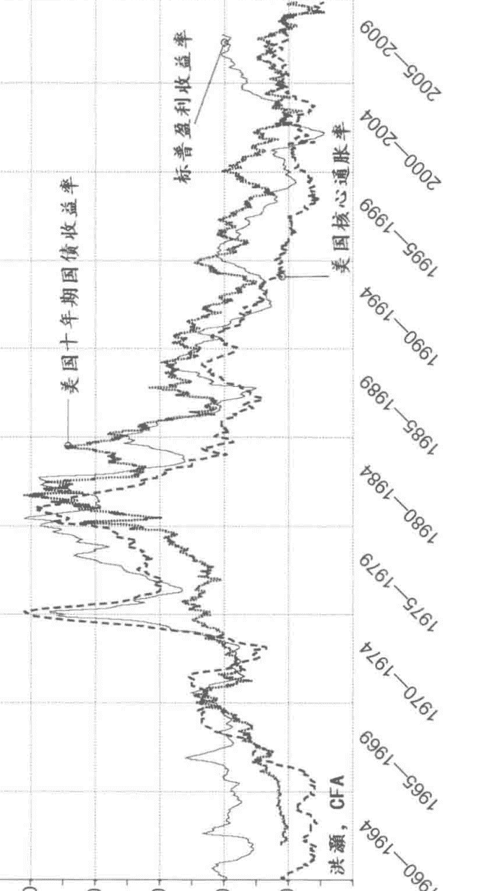

图 2.2 美国核心通胀率、20世纪80年代初期、标普指数收益率（左轴）、美元开启期下通胀（右内）、美国十年期国债收益率（右外）。数据来源：彩影；作者计算。

从 1987 年 10 月 19 日的崩盘开始，到 20 世纪 90 年代新经济的繁荣，股票价格的波动都深刻影响了格林斯潘的政策和理论。然而，在疯狂的头脑中，格林斯潘却是加尔布雷斯所描述的，在危机中将出手的大人物的典范。股票价格在 1987 年 10 月的“黑色星期一”崩盘之后，在短短两年内迅速回升至 1987 年崩盘前的高点。因此，市场对于格林斯潘的信任逐渐得到了结果。1987 年，格林斯潘在股市崩盘次日的开盘时，以个人名义发表了一篇简单声明：“美联储作为美国的中央银行，今天宣布，它有责任，并已经准备好支持经济和金融系统提供足够的流动性。”市场对于格林斯潘的这份“个人声明”的理解是，如果银行不能提供流动性，那么美联储将准备直接向股市提供流动性。

到了 2020 年 3 月崩盘的时候，现任美联储主席鲍威尔发表了类似的声明。结果，市场在这次历史性崩盘之后，在短短的一个月里就收回了约 2/3 的失地，甚至比 1987 年反弹的速度还要快。在 2020 年新冠肺炎引发的大崩盘中，美联储救市的力度空前绝后，格林斯潘和伯南首次认为。从市场反应的角度来看，市场对于美联储救市能力的信任越发深蒂固了。

1996 年，股市的市盈率和股息收益率都显示市场被严重高估了。当年 12 月，格林斯潘发表了著名的以“非理性繁荣”为主题的演讲。格林斯潘的评论让市场普遍认为，他对股市的投机行为非常担忧，因此美联储正采取一些措施，抑制市场的过度投机。在格林斯潘的演讲结束后，日经指数闻声暴跌了 3%。当晚，全球的其他市场多米诺骨牌一样纷纷倒下。格林斯潘演讲完毕回家之后，他的太太也说：“我今天看到你在电视上说话后，后来市场就暴跌了，你到底都干了些什么？”格林斯潘微微一笑：“你觉得呢？”

之后，格林斯潘因为“非理性繁荣”的言论而受到了共和党国会议员的公开批评，认为他作为一个美联储的重量级人物不应该公开地“唱空”。然而，格林斯潘还是在 1997 年 3 月上调了基准利率，市场在短短跌落之后重新回升。这时，格林斯潘的言辞重新回了“理性乐观”的主题。格林斯潘向国会保证，美联储并非也不会针对股市，他本人也无意唱空股市。在 1997 年 7 月的演讲中，格林斯潘将当时股票价格的上涨归于温和的通胀、长期下行的利率和投资者的预期。他认为，在一个相对稳定、低通胀的市场中，利润和盈利增长将保持稳定，股票价格将不断上涨。

到 1997 年夏天，格林斯潘把股票价格的上涨作为“良性循环”的关键。格林斯潘认为，如果企业在技术领域保持高投资率，只要工资水平保持稳定，那么股票价格的上涨不仅是理性的，而且有助于持续增长。如果是这样，未来的预期利润将会更高，市场也将有效地反映在越来越高的股票价格上。股市上涨产生的财富将拉动消费，刺激总需求。随着股票价格的上涨，资本成本降低，新的投资很容易获得。

格林斯潘多次通过分析师修正长期盈利为市场上涨的关键因素。他认为正如此，投资者才入市创造了历史上著名的牛市之一。然而，格林斯潘担心股票价格上涨对需求会导致通胀，因此美联储开始加息。尽管格林斯潘对“良性循环”发表了乐观言论，但他其他美联储官员也关注泡沫的问题。

在 1999 年夏天，格林斯潘在证词中表示，他在一定程度上接受投机。历史表明，乐观情绪可能随着经济扩张而增长，资产价格将攀升到不可持续的水平。这时他开始对“良性循环”有所保留，他告诉国会：“这毫无根据的狂热，把股票价格推到难以承受的高度。”但格林斯潘最终坚持认为泡沫只有在形成后才能察觉。他说：“想要提前发现泡沫，就需要千上万的投资者同时做出错误的判断。然而，所有投资者集体判断的可能性是很小的，因此做空市场非常危险。”

1999 年，在杰克·威尔逊货币政策研讨会上，格林斯潘在有效市场和泡沫理论上显得摇摇不定。格林斯潘在演讲中提到，当泡沫出现时，人性的恐惧会导致市场的非理性倾向。但格林斯潘坚持投资者判断的合理性：“要预测泡沫就是要预测资产价格将会下跌。”

在此研讨会上，伯南克发表了演讲。伯南克认为，如果有效市场成立，那么泡沫就不会存在。伯南克认为股票价格可能会因为基本面或非基本面因素的变化，或因为两者的同时变化而产生变化。对于有效市场中非基本面因素的阐述，许多显示出伯南克倾向于。他认为很难将市场价格的变化完全由经济基本面的变化来解释，投资者在市场中表现出非理性行为。然而，伯南克在泡沫无法预测这一点上比格林斯潘更为极端。他认为，“即使在泡沫形成之后，很难甚至不可能确定任何异常的市场波动就是泡沫”。显然，尽管口头上否认泡沫的存在和关注，美联储的倾向继续坚持泡沫无法预测。

在 2000 年 3 月市场见顶后，美国股市进入了大熊市。互联网泡沫破的过程与加尔布雷对股市泡沫破常见现象的分析非常吻合。随着安然、世达等大型企业倒闭，安达信丑闻被曝光，那些在泡沫时期视为远见的企业家、金融家成为罪人，有人甚至锒入狱。对于格林斯潘损害最大的，是投资者在证券分析师的吹鼓下疯狂买入那些价值相对于盈利能力可能被严重高估的互联网科技股票。然而，直到 2000 年 2 月互联网泡沫泡沫之后的九个月，格林斯潘仍然声称，股票价格攀升是建立在千上万证券分析师对预期持续收益的基础上的。这些分析师对长期收益的预测是基于“他们与企业管理层的缜密沟通”。他们对于技术进步的协同效应和网络经济的潜在收益有着非常清楚的认知。在 2001 年，当股票价格暴跌使美联储官员不得不承认股票泡沫已经破灭，格林斯潘继续坚持有效市场假说。他认为，识别泡沫及其最终的破灭异常困难，因为价格波动反复往返不断的变化因素。资产价格的上涨就是对泡沫的预测这一认识可能与投资界背道而驰，如果人们已经认识到资产泡沫，那么资产价格就不会这么高了。

然而，随着大众越来越认清一些分析师的嘴脸和割韭菜的各种，格林斯潘开始批评那些曾经为他的有效市场观点提供证据的证券分析师。此时，连格林斯潘也不得承认分析师一直乐观，因此夸大了长期收益的预测。他为自己辩解，这是由于一些上市公司为了卖股票，和承销股票的证券分析师搞好关系。这与加尔布雷斯对泡沫破灭后的描述是：华尔街的经济学家、证券分析师在 20 年代多自有的股票。这些曾经所谓的金融天才，很多都是不折不扣的骗子。

在 2002 年杰克·威尔逊货币政策研讨会上，格林斯潘在他的演讲中试图解释 20 世纪 90 年代的大牛市。格林斯潘想要一个有效市场学派的解释，但最后听起来像投机学派。他认为，随着创新进步，盈利上涨，股票价格因为实际溢价相对于债券收益率下降而上涨。格林斯潘认为，如果实际溢价下降，导致股票价格可以稳定在水平。问题在于只要短期内外延，就有可能将股票价格攀升到不可持续的高度。”然而，在一个研讨会上，伯南克仍然坚持他的观点：市场的定价依赖于金融专业人士对不可观察的基本面估计，这两个其实展现在资产价格上了。

即使泡沫可以察觉，格林斯潘和伯南克都认为没有任何政策可以预防和控制泡沫。格林斯潘不同，认为货币紧缩可以减少总需求，从而控制泡沫。从实验来看，利率调整之后，股票价格往往随着上涨。这是对于市场投资组合最重要的基础：市场机理理论的共识；历史表明，泡沫往往是逐渐缩小或突然崩溃。但这种系统稳定的概率也在迅速衰减，久而久之，则无以为继。格林斯潘最后回到了市场，他认为经济扩张使人们更理性地承担风险，而这种行为模式很难通过适度紧缩政策来避免。

对于格林斯潘和伯南克来说，适当应对泡沫的原则，就是在市场的时候用政策来控制股票上涨产生的财富效应，以及其带来的通胀压力。当泡沫破灭时，中央银行应该采取宽松货币政策提供足够的流动性，将实体经济和金融部门受到的损害降至最低。这种政策的选择，很可能是对日本在 20 世纪 80 年代后期资产泡沫调控失败的研究。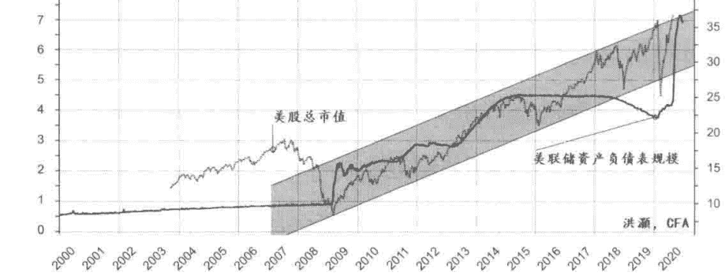

图 2.3 市场危机时，美联储马上购买，美股随之恢复并上升。注：美联储资产负债表规模（左轴），美股总市值（右轴）。数据来源：彭博，作者计算。

在应对不断膨胀泡沫上，格林斯潘、伯南克和凯恩斯的理论基本上一致。他们都认为，紧缩货币政策在抑制泡沫方面是有效的。1928 年，凯恩斯提出，紧缩的货币政策只能引起经济萧条，而经济萧条将抑制股票价格上涨。伯南克引用了凯恩斯在 1930 年出版的《货币论》中的言论，认为美联储在 20 世纪 20 年代的利率对投资产生了负面影响，导致了 1929 年的股市崩溃和大萧条。加尔布雷斯在他的著作《1929 年大崩盘》里写到，市场上最善意的谎言是相信美联储，特别是美联储主席这样的人物能够有效控制金融和经济的繁荣与衰退。加尔布雷斯在《1929 年大崩盘》以及之后的著作和证词中，对于早期阶段的投机泡沫提出了两项具体的政策建议：第一，美联储主席等政治官员应该公开股市正处于非理性高位。当然，这需要一定程度的政治手腕和勇气。格林斯潘发表“非理性繁荣”言论后，遭到了国会共和人的责；当时格林斯潘似乎知难而退了。第二，美联储应该提高保证金要求。如有需要，把保证金直接上调到 100%。美联储的这些言行和政策，对于抑制投机泡沫的综合影响是巨大的。

然而，格林斯潘和伯纳克都不认为提高保证金要求就可以有效控制泡沫。格林斯潘认为，保证金的数字大小，投资者可以从其他方式借钱杆杆或购买期权等。这些行为将推升股票价格。格林斯潘也不认为投资者会将保证金要求上调解读为美联储将很快紧货政策以拦截泡沫的信号，除非市场是不相信美联储的言辞。虽然，我们在之后的内容里将要讨论的，中国市场 2015 年夏天那场泡沫的经验，有力地反驳了格林斯潘的这个观点。有趣的是，虽然伯纳克拒绝了加尔布雷斯的政策建议，但他认为投资者教育可以使投资者更理性地参与市场投资。

格林斯潘和伯南克的理论对资产价格的影响是显而易见的。担任美联储主席期间，格林斯潘经常认为，由于政策造成的道德风险。同时格林斯潘和伯南克认为，应该大力最小化自由市场和机构监管。例如，格林斯潘反对对金融衍生品进行监管。

格林斯潘和伯南克的理论对资产价格的影响是显而易见的。担任美联储主席期间，格林斯潘经常认为，由于政策造成的道德风险。同时格林斯潘和伯南克认为，应该大力最小化自由市场和机构监管。例如，格林斯潘反对对金融衍生品进行监管。

在《投资理论》中，巴菲利的结论之一是，“投资者回报等于零”。巴菲利否定了分析师这个职业——但结论似乎有些太早了。法玛在文中从未提到分析师这个职业。事实上，法玛在文中写道，优秀的分析师可以帮助股票价格及时反映信息，而一般的分析师和普通投资者毫无用处。此外，法玛的研究证明了低值的持续性。量化模型大卫·布斯学院命名的凯恩斯、萨菲尔森、法玛和希腊等学者的著作证明，股市的未来走势在程度上是可以预测的，但个股的走势无预测。因此，宏观策略的一项工作就是掌握市场时机并非一门无用的科学，即使市场只适用于少数准备、有把握的人。—— 塞缪尔·约翰逊

## 实例：2015 年夏天的中国泡沫

2015 年夏天，中国股市从2014 年中的 2000 点左右飙升到 3000 点，达到 5000 点的高度。2015 年 6 月 15 日，上证指数开盘于当时的最高点，但当天收市时，上证指数跌了 2.1%，是近两周最大的单日跌。自然，2.1% 的单日跌在 A 股的历史上并不罕见，大众觉得这只是一次普通的回调。毕竟，市场在 5 月 28 日有过接近 7% 的剧烈单日跌面前，2.1% 的调整有些小。而且当时中国人民银行已经通过调整和大幅宽水政策。《日报》认为，“4000 点才是起点”。政府坚信，中国正经历着中华民族的伟大复兴，这种宏大的愿景应该从股票市场上出来，让普通的散户也能分享这个伟大复兴的利益。这个想法，从表面上

6 月 13—14 日是周末，我在埋头写了一篇关于“伟大的中国泡沫：八百年历史的领悟”的研究报告。写这篇报告的目的是，向市场投资者预警当时泡沫就会破灭的风险。根据我的知识架构和市场经验，当时 A 市场密集分布的极端回撤率和极速的换手率，是市场快要见底的重要标志。当时，自由流通股的平均持仓时间是一个星期左右。之后，1990 年中国台湾的泡沫面临破灭，股票的平均持仓时间在两个星期左右。换句话，2015 年 6 月的时候，A 股的换手率比 1990 年中国台湾的泡沫破灭还要快得多。

而夏天夏天的市场上，所有人都在寻找下一个接盘侠。然而，随着概率的极端回报累积，投机利得必须加速上升以补偿投资者承担的日益积累的风险。但这种系统稳定的概率也在迅速衰减，久而久之，则无以为继。

“历史经验表明，未来 6 个月是一个泡沫破灭的关键窗口。”我在 6 月 15 日的市场预测报告中写道。6 月 16 日该英文报告被翻译成中文之后正式发表。我也很幸在当天市场开盘之前，在彭博做了一个约半小时的专访。6 月 16 日，上证指数暴跌 162 点，明显收于 5000 点以下。余下的就是历史了。虽然从 2016 年 2 月开始，上证指数有所修复，但是直到 2018 年 10 月 19 日跌到 2449.197 点，才终止跌，并开始逆转下行的趋势。很有意思的是，

## 预测：经济、周期与市场泡沫

离（见图2.4）之前的A股市与经济的走势基本上是一致的，从1990年初期，A股市市场正式开启之后，到2015年之前都是如此。有读者或许不认同这个观察，认为A的走势与中国经济的基本面没有关系。我认为对A市场的误解是最大的误解。之所以观察不到股票市场和经济基本面的相关性，是因为中国的A市场往往领先于实体经济约6个月。同时，我们在做比较的时候，应该注意到，股票市场的定价是边际的，而不是总量定价。也就是说，股票市场的回率在反映市场经济的增速变化，而不是股票市场指数的绝对水平在反映经济的总量。当我们把经济基本面的滞后性做了调整，并同时调整股票市场边际反映实体的方式之后，就可以清晰地指出，A股市和经济其实是息息相关的。

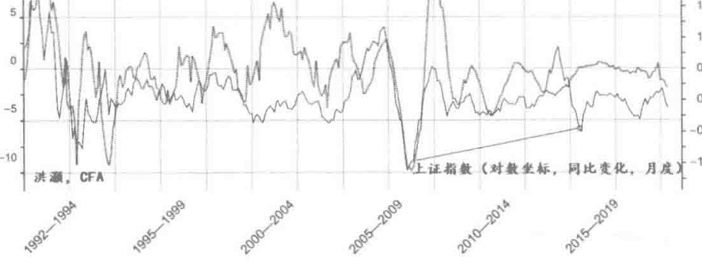

注：工业增加值（左轴），上证指数（右轴）。
除了2014年年中到2015年期间数据异常外。

数据来源：彭博，作者计算。

图2.4 上证指数多年一直反映了经济基本面

然而，市场上没有永远生长的魔豆。我们需要界定的是，在给定范畴里的市场价格的极限。在我们市场之前已经有很多人曾试图定义这个极限，但是失败了。尤其在1929年10月大崩盘的前夕，著名的普林斯斯顿大学教授普塔斯·劳伦斯称：“在一个巨大的市场上，在证券交易所投资的数以百万计的股民对股市做出定价。他们当对于判断的共识是，股市在目前并没有被高估。”他进一步问道：“那些似乎通古今的人，是谁赋予他们权力是否否市场聪明的投资者的判断共识？”如今，我们都知道那个故事的结局，对于泡沫的学术研究也取得了更大的进展。即便如此，我们还没有看到过一个模型可以稳定预测泡沫的形成和破灭 —— 否则我们也不会都呆在这里插班了。在科学上，我们用奥卡姆剃刀原理或简约法，来确定一个理论的实用性。一个理论越简单，用的模型越少，对于将来预测的把握就越越好。从这个角度来看，虽然那个著名的LLPL(对数周期性律)模型有过成功的预测，但是有点复杂。同时，LLPL模型也没有预测到2015年6月的那场泡沫。

在前的讨论中，我们也回溯了格林斯谭和伯南克的历程。与市场学派相反，他们认为市场的泡沫在破灭之前是非常难以界定的。伯南克认为即使在泡沫破灭之后，泡沫也无法被准确识别。市场机学派认为，人性的贪婪、未来的不确定性和极低的交易成本，可以让市场快速偏离，观察到不基本面所决定的价值。人性的贪婪总是让人希望可以不劳而获，一夜暴富，这种心态再叠加未来的不确定性，使市场参与者努力的重点，并非持有股票的长期收益，而是描测其参与者对股票价格的心理预期。同时，由于市场具有良好的流动性，交易成本极低，营造了一种市场流动性良好的幻觉，使市场参与者误以为手上的仓位可以随时兑现。在这样虚假的担保下，积极参与市场投以一夜暴富的机会，似乎是最好的选择。

当时的A市场，把这些泡沫泡沫的特征展示得淋漓尽致。每天上万亿元，甚至是三万元的成交，让人们觉得市场的流动性似乎非常好，必要的时候可以而退。极佳的换手率和极短的持仓时间显示，人们觉得自己比别人聪明，期待着找到下一个接盘侠使自己获暴。

控市场机理论的基础非常扎实，逻辑非常严谨，也因为经典，但这个理论并没有告诉我们判别泡沫顶的方法。当然，对于泡沫顶点的预判可能隐含的逻辑，就是分析师比其他参与者聪明。这是一个非常胆大的假设，要从市场千万的参与者共同决定的价格中找到缺陷，识别泡沫可见的信号，是一个非常具有挑战性的任务。然而，我们去做事情，并不是因为它容易的。识别泡沫见顶这个任务非常困难，几乎不可能。但也正如此，去完成这个任务才更有意义。

## 市场是否可以预测

我们觉得，从历史数据中寻找一些线索去预测未来，反而会更有把握。正如古人所言，持史以明人智。

2015年的夏天，我花了大量时间研究分析了一共 800 多年的全球金融数据，从 17 世纪的英国股市，到 18 世纪的黄金和白银价格，再到 19 世纪的美国股市，以寻找别泡沫的规律。我们的量化研究表明，一个典型的泡沫的发展往往需要5 年左右的时间，并接近其峰值时表现出的密集的极端回报率。在一般情况下，当对回报率持续偏离它的长期趋势超过两个标准差时，就是泡沫正形成的标志。从泡沫发现，泡沫最终破灭，通常需要大约 6 个月的时间。我们利用这个方法展现了26个历史上的泡沫，有21次是正确的。图2.5显示了极端回报率的分布情况和中国市场之间的关系。从上述800多年的全球数据中发现的规律，清楚表现在图中：第一，随着泡沫进入高峰期，极端回报率开始密集分布；第二，极端回报率密集往往于泡沫高峰期约6 个月；第三，这些泡沫属于回报率概率分布的前5%。也就是说，密集的极端回报率和快的换手率是泡沫出现的标志。2015年6月到2016年初，是警惕泡沫关键的时间窗口。随着泡沫进入高峰期，极端回报率密集的原因是直观的交易员时刻都在评估比较继续持有的回报率和马上兑现仓位。

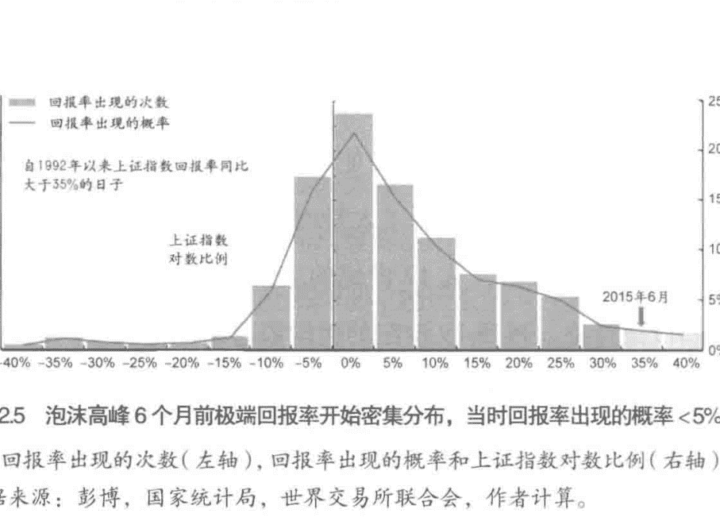

图2.5泡沫高峰6年前极端回报率密集分布，当回报率出现的概率（左轴），回报率出现的概率和上证指数比例（右轴）。数据来源：彭博，国家统计，世界交易所联合会，作者计算。越来越高样本分布里出现的概率也越来越小。因此，随着回报率出现的下降，市场的收益率必须飙升，使预期收益率足够交易员继续市场上承担的风险——这就是为什么市场指数在泡沫附近进一步上涨的可能性越小，直到极端回报率出现的概率变得非常小，使得泡沫崩溃无法避免。如果这种解释成立，那么我们一定会看到市场随着极端回报率密集出现，在接近市场顶的时候——与2015年6月市场出现一样。这是因为交易员开始不断缩短的时间窗口里内部评估仓的资源，完美地选择平仓窗口。如果换手加速和极端回报率密集出现，并在这种情况应该先考虑泡沫峰值长左右。而在2015年6月，市场面临的情况的确如此（见图2.6）。在股市调整后，当时中国市场的平均持仓时间为一周——这是市场投机活跃的一个重要标志。值得注意的是在1989年泡沫顶阶段，每年换手率接近两次，也就是说2015年中国市场的平均持仓时间了一倍。市场泡沫会在什么值水平破灭？这是一个难回答的问题。正如前文所述，格林斯曾说：“牛市不言”。泡沫发现往往是事后觉。如果泡沫可以提前发现，那么意味着千万的掌握各种信息的投资者都是错的，没有什么好打算”。因此，大多数人宁愿承认自己的失败“顺势失败，不要逆势成功”。

2015年1月29日，我为彭博写了一篇名为“中国2015：泡沫化”的市场展望报告。在这个报告里，我预见到中国股市将在2015年泡沫化。同时，通过比较债券和股票的收益率，我把目标价设定为4200点，而市场当时仅在3100点左右。到了2015年6月，这个目标价就显得太保守了。自从市场快速击破我的目标价4200点后，我认识到市场强大的向上冲动能，以后也没有设定特定的市场价格了。

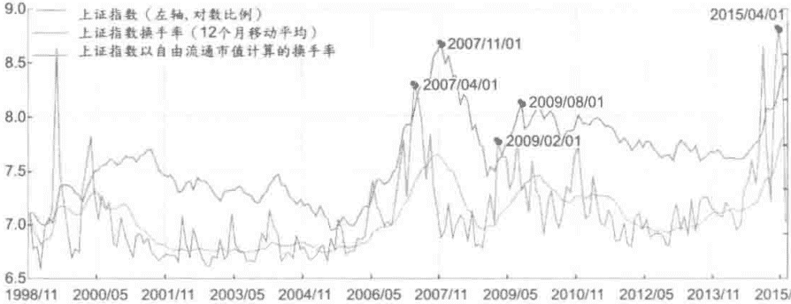

图2.6每月换手三次，平均持仓时间大于一周数据来源：彭博、国家计划、世界交易所会，作者计算。

尽管已经经历了几轮调整，但中国实际有效率在考虑到消费和住房价格通胀之后仍然高企。也就是说，中国将继续宽松的货币路径，以降低低经济的债务负担。而实际有效率往往可以领先市场的走势长6个月，与上述讨论的变量确定的市场峰值的时间窗口基本一致（见图2.7）。

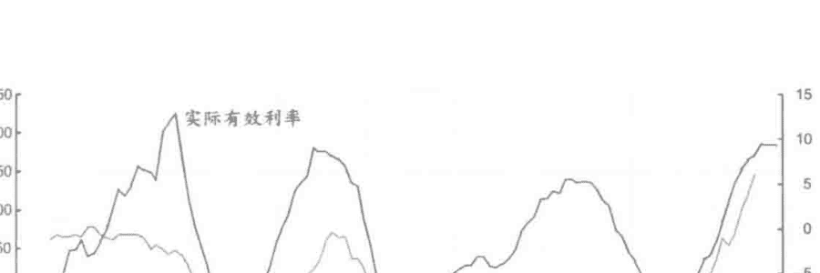

图2.72015年夏天实际效率仍然高企，暗示货币政策将持续宽松

注：上证指数（左轴），实际有效率（右轴）。数据来源：彭博、国家统计局、世界交易所联合会，作者计算。

1929的大崩盘等例已经证明，预见泡沫崩盘很少发生在经济不景气的时候。是非常困难的，而且金融市场崩盘很少发生在经济不景气的时候。例如大崩盘前，美国的宏观数据都处于良好状态。大崩盘之前选举保持了乐观的政治氛围。事实上，声名显赫的哈佛经济会在崩盘之后的几天宣布：“如1920—1921年那样的大条在概率范围之内，那么我们并没有面临一场旷日持久的清理行动。”如此不合时宜的灾难预测最终导致该会在1932年末大吉。

在1987年的“黑色星期”里，道琼指数在开盘后不久便下跌了200点，但随后又恢复到2100点之上。当时看来道琼指数能以约200点的亏调整到位，直到下午2点分，一轮新的大规模抛售潮开始，导致道琼指数如落体一般在收盘前暴跌了400点。然而，这还不是悲剧最后的结局——后来人们发现，由于市场极端放量下跌，交易所电脑的运行速度滞后于市场交易时间几个小时。最终琼斯指数的暴跌超过了500点，跌了22%——这是琼斯指数史以来最大的单日跌。显然，许多先知不能预测泡沫崩溃的时间，未来也将如此。我在2015年6月16日对于股市泡沫到达顶峰的预测，很好地证明了这一点。当时，市场泡沫的高估值显示，市场泡沫逐渐达到了顶峰。在估值显示中，许多报告在2015年6月16日发表，仅仅是泡沫的时刻是不够的。然而，在泡沫来的时候，我们应该听从凯恩斯的建议：“让亚当·斯密负责那些”。

## 结论

讨论了这么多，市场是否可以预测？凯恩斯说，经济学家都有答案，但只有一张。经济学家回答问题的方式，当然，并没有什么错。很多问题的是否成立，都需要假设的前提。凯恩斯那句话很好总结了经济学家：他害怕凯恩斯怕，市场的预测性，也是前提。在正常情况下，市场往往反映基本面。关于基本面的信息不变，在有组织、有序的市场里，由于泡沫的出现是随机的，或许在多年前，巴菲特思考的有效市场假设，认为价格波动是随机的。

泡沫机派并不这么认为，泡沫每一个特定时刻都有无数的买家和卖家存在。市场在很短的时间里，几乎无法预测。因此，随着回报率出现的概率下降，市场的收益率必须飙升，使预期收益率足够交易员继续留在市场上承担的风险——这就是为什么市场指数在泡沫后期几乎垂直上涨。由于这些小事件在泡沫附近不断累积，市场上涨的可能性越小，直到极端回报率出现的概率变得非常小，使得泡沫崩溃无法避免。如果这种解释成立，那么我们一定会看到市场随着极端回报率密集出现，在接近市场顶的时候——与2015年6月市场出现一样。这是因为交易员开始不断缩短的时间窗口里内部评估仓的资源，完美地选择平仓窗口。如果换手加速和极端回报率密集出现，并在这种情况应该先考虑泡沫峰值长左右。而在2015年6月，市场面临的情况的确如此（见图2.6）。在股市调整后，当时中国市场的平均持仓时间为一周——这是市场投机活跃的一个重要标志。值得注意的是在1989年泡沫顶阶段，每年换手率接近两次，也就是说2015年中国市场的平均持仓时间了一倍。市场泡沫会在什么样的值水平破灭？这是一个难回答的问题。正如前文所述，格林斯曾说：“牛市不言”。格林斯和伯纳克，似乎找到了货币政策的方宝：在市场上涨的时候，美联储不应该用货币政策来针对市场的上涨趋势。此时，美联储货币政策的重点是市场上上涨产生的财富效应，并导致通胀压力。只要通胀可控，投资效率的上升将使得产生一个良性循环，推动市场不断上涨。然而，在市场崩溃的时候，美联储应该承担市场“最后一个看护人”的角色。此时，货币政策要极为宽松，尽力为市场提供流动性。这也是这种货币政策倾向，在过去30多年的股市上涨中，市场的回报模式类似“美联储看跌期权”。市场只需要忍受有限的损失，也就是以购买看跌期权的溢价为投入成本，就可以看到无限的上涨回报。市场因此养成了一个“逢跌买，越跌越买”的投机习惯。市场机源于市场盘后的这种宽松货币政策的，似乎并没有太多的异议。

投机学派也没有解决如何预测泡沫的问题。从市场机的假设出发，虽然市场定价并不理性，但是市场泡沫破灭的时间是无法精准预测的。然而，在市场价格运行到极端，最终泡沫化时的价格转折，就会变得可以预测了。我在2015年6月16日对于股市泡沫到达顶峰的预测，很好地证明了这一点。当时，市场泡沫的高估值显示，市场泡沫逐渐达到了顶峰。在估值显示中，许多报告在2015年6月16日发表，仅仅是泡沫的时刻是不够的。然而，在泡沫来的时候，我们应该听从凯恩斯的建议：“让亚当·斯密负责那些”。

两个相对对立的派在泡沫破灭后应该实施的应对政策方面非常一致，甚至在泡沫破灭前的策略也有相似之处。凯恩斯认为，过度紧缩的货币政策是造成1929年大盘和其后大萧条的主要原因。市场学派的代表人物——美联储主席格林斯和伯纳克，似乎找到了货币政策的办法：在市场上涨的时候，美联储不应该用货币政策来针对市场的上涨趋势。此时，美联储货币政策的重点是市场上上涨产生的财富效应，并导致通胀压力。只要通胀可控，投资效率的上升将使得产生一个良性循环，推动市场不断上涨。

然而，在市场崩溃的时候，美联储应该承担市场“最后一个看护人”的角色。此时，货币政策要极为宽松，尽力为市场提供流动性。这也是这种货币政策倾向，在过去30多年的股市上涨中，市场的回报模式类似“美联储看跌期权”。市场只需要忍受有限的损失，也就是以购买看跌期权的溢价为投入成本，就可以看到无限的上涨回报。市场因此养成了一个“逢跌买，越跌越买”的投机习惯。市场机源于市场盘后的这种宽松货币政策的，似乎并没有太多的异议。

## 预测：经济、周期与市场泡沫

经济还有什么意义？

在中国的市场做预测的时候，我比较喜欢用上证指数作为预测的标。很多人可能会嗤之以鼻，认为上证指数早已失真，因此并不是中国经济基本面最好的反映。的确，由于历史原因，上证指数里的周期股和老工业板块、经济板块所占的比重非常大。一望下去，上证指数的前十大权重股，是茅台、银行、保险和“两油桶”（中石油和中石化）等，这几个股票已经占据了上指数权重的25%。然而，如果股市的定价在满足上述条件的时候完全脱离基本面，那么股市的预测逻辑上就可以用任何物作为指标。因为我们要预测的只是这一个投资者愿意为这只股票付出的价钱，而不是经济基本面定的价值。很多投资者抱怨中国股票价格完全脱离了基本面，没有投资价值。然而，在一个投机市场里，市场是用来提供流动性的概率，而不是用来提供有效基本面的工具。因此，我们选择预测指标时，应该找到能反映市场流动性的标，而不是最能反映经济基本面的标。上证指数历史悠久，同时在所有的主要的金融报价软件里，中国市场往往是由上证指数来代表的，而不是其他一些狭义的指数，如上证50指数。就像美国市场的报价往往是标普指数和纳斯达克指数，而只有三十个成分权重的道琼斯指数的报价往往作为参考。

至于上证指数是否真实反映经济的基本面，我们在上一章已经论述过了，上证指数往提前反映经济基本面的变化。同时，是上证指数的变化反映经济基本面的变化和中国经济增长的快慢，而不是上证指数的绝对点位反映经济的总量水平。在做了股票价格变化时间上的领先调整之后，我们就可以看到上证指数点位的变化，反映的是3~6个月之后经济增长的变化。在做了时间调整之后，中国股票市场和经济的一致性就会显然纸上（见图3.1）。

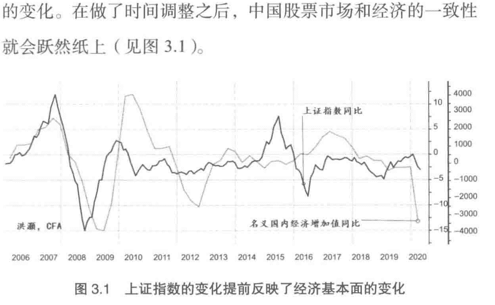

当，在中国市场浸淫多年后，我们深深感受到为什么许多投资者对中国的经济和股市之间的关系有着诸恼。在国外，当经济数据好并超预期的时候，股市往往会因为基本面就好就马上所有反应。股市的这种效应，在一些重要数据发布的当天，如制造业平均工作时长、每周新增失业保险救济金领取人数、消费品制造订单、非国防资本耐用品（除飞机）新订单、ISM（美国供应管理协会）新订单、建筑施工许可数量、领先信贷指数、息差和消费者信心指数等，会非常明显。

这些经济领先数据好于预期的时候，股票市场往往走强，而债券会被收益率上升、价格下跌。这是因为经济表现良好的时候，央行加息的概率或不选择宽宽松货币政策的概率往往会上升，导致债券收益率上升。同时，基本面好转将导致市场整体风险偏好，也会推动股票价格上行。而在经济表现性的时候，对于央行实施宽宽松货币政策的预期将导致债券的收益率下降、价格上升。由于投资者对于前景看跌，股票往往在债券价格上升的初期下跌，形成一种对冲的。许多风险平对对冲基金都是按照这个历史规律进行资产配置和仓位调整的。可惜的是，在2020年3月市场诗级别的暴跌，债券双斩，甚至连级别的债券在几个星期内就跌了25%的价值。这时，债券之间历史相关性的逆转，债券丢失了其对冲价值。许多大学经理的对冲基金经历纷码失锋。

在中国，市场参与者的情绪非常浓重，往往采取逆向的思维对经济数据进行解读。比如，如果经济数据好于预期，市场往往就会解读为央行实施宽宽松货币政策的概率在下降，因此市场下跌。反之亦然。很明显，在中国市场里，市场的参与者并不那么关心基本面的坏好，反而关心基本面变化对央行实施宽松货币政策概率的影响，进而影响到市场参与者定价。在这样的市场里，投机主义占了上风，基本面分析很难在短期内带来额外的收益。同时，市场的流动性充足时产生泡沫，这可能是因为在数据时间领先和滞后的调整，中国市场的趋势和基本面变化似乎呈现负的关系：经济好，股市跌；经济差，股市涨。因为市场流动性充足时，市场参与者预期股票给出更高的估值。当泡沫破裂之前，所有人都会靠向走退。

由此可见，中国股票市场对于经济变化的反映，类似于债券。尤其是最近几年，由于市场“资产荒”，部分投资者买股票时往往看着的是收益率。一些银行收益率可以达到5%以上，甚至更高，而一些股市收益率可以达到7~8%。

美国市场也出现了类似的情况，股债相关性由历史上的负相关变成了正相关。这是一个忧心的市场现状：当债券失去了其安全性和投资组合对冲的功能时，在下一次暴跌中，股债双杀将会更加严峻。只要利率步入负数的时代，债券的价格将趋向无限。如果是这样，下一次暴跌来，2020年3月的诗级暴跌只是一次意外。

## 如何预测经济

预测经济最重要的任务可能是预测经济运行拐点。然而，多年来，尽管数学理论和统计模型已经进步，但对于拐点的预测仍然没有可靠的方法。美国有悠久的衰退史。早在1937年，由于通胀压力上升再次衰衰时，美国财政部部长肖利·摩根让美国国家研究局（NBER）开发一组经济指标。当时，摩根希望预测1937—1938年的衰退什么时候结束。这个经济指标开发项目，不仅让人们对拐点的预测有一些系统性的认知，还整理出一套追踪经济表现的。也许现在美国分析时大家都经常用到的国民收入和生产账户（NIPA）指标，很多人可能不知道，现在广泛使用的GDP指标，是20世纪40年代才出来的。经济研究领域当前瞻性的研究工作是功不可缺的。NBER是一个独立监测机构，并不隶属任何政府部门或党派。它客观详尽的经济数据和分析，以及它引导的对于周期运行的理解和预测，都为今天的经济理论和方法提供了扎实的基础。

到了1961年，美国经济部下属的经济局开始对其每月发布的指标进行领先、同步和滞后指标的划分。根据NBER开发的经济领先指标，美国经济局以经济重要性、统计准确度、拐点出现的时间、与过去经济扩张和衰退的吻合度、数据频率和及时性为原则，选择了12个领先指标，最后修订为16个经济指标，每月发布。

在美国，通胀调整后的实际GDP衡量经济增长的长期趋势，从1948以来约为每年3.8%。当然，经济增长有快有慢，经济扩张中往往插着衰退。所幸，经历了这么多经济周期，经济扩张一直是主旋，经济扩张的时间远远超过经济周期。衰退的出现，往往是因为美联储为了压抑通胀而过度收缩政策，同时也抑制了经济增长；或者财政部的财政政策过于紧缩，公共支出不足或减税不得力，最终导致经济衰退。然而，有时候，经济也会一些外来的冲击而陷入短暂的衰退，比如第一次海湾战争导致了美国历史上为期最短的衰退。而20世纪70年代的石油危机，与其他许多伴随的因素一起，也导致了当时美国经济的衰退。从1854年起，美国经济的扩张最长约120个月，最短约10个月；美国经济的衰退最长43个月，最短约6个月。

这么多年的累积，有这么多领先指标，我们是否可以比较可靠地预测美国经济的拐点？毕竟，美国仍然是全球最大的经济体，其经济周期的运行与欧洲国家、中国的经济周期高度相关。能够比较可靠地预测美国经济周期的起伏，就意味着对全球经济周期的运行将有较好的把握。

## 经济同步指标、领先指标和另类领先指标

世界大型联合会每月公布一组经济领先、同步和滞后指标。顾名义，那些预测经济未来状况的指标是领先指标，反映经济现状的指标是同步指标，滞后指标则是事后确认拐点的指标。有的读者或许会问，如果经济研究的最重要的问题是对拐点的预测，而领先指标有着悠久历史，那么为什么我们需要同步指标和滞后指标？在接下来的讨论里，我们会看到，尽管领先指标有着悠久历史，但它们曾错误地预测衰退的到来，在过去100多年的经济历史里，也曾错过一些拐点。

世界大型联合会的同步指标包括非农就业人数、个人收入（除转移支付）、工业产出和贸易收入。一般来说，这些同步指标并不是决定市场走势的关键，因为它们是在告诉市场参与者有关现状的信息。如果市场假设的那样，市场定价完全反映了基本面信息，这些同步指标早就已经被反映在市场价格了。如果市场理论的那样，市场定价有时候完全脱离基本面，那么这些同步数据也就影响了短期价格。因此，同步指标的发布，很少改变市场运行的方向。交易员往往把这些同步指标作为参考和依据。同时，同步指标并非无。这些指标的价值在于它们有着悠久的历史，甚至可以回溯到第二次大战以前。同时，由于同步指标的统计和测量不需要事后修正，它们会比领先指标更精准、可靠。美国经济里最广、最重要的部门是就业、收入、产出和销售。比如就业数据、每周新增失业保险救济金人数就是高频。由于新冠肺炎爆发，2020年4月以来，新增失业人数在几周之内就达到了20%，这是所有人都从未过的极端的失业情况。20世纪30年代大萧条时的失业率超过了20%。

显然，从高频数据来看，整个供应链的进步逐渐变成了一个依赖系统，这加剧了这次衰退的压力。

## 领先指标

一般来说，经济领先指标里包含了10个领先的数据。我们可以把这10个领先经济分为3组：第一组、实体经济组，包括制造业平均工作时长、每周新增失业保险金额领取人数、消费品制造新订单、非国内资本耐用品（除飞机机）新订单、建筑许可许可数量；第二组，金融市场数据，包括利率、股票价格；第三组，预期数据，包括ISM订单、领先信贷指数、消费者信心指数。这些数据，仅仅从它的名字来看，就是对未来的预期，如新订单、消费者信心指数等。

虽然经济领先指标通常在经济增速缓慢的时候开始下行，但是如何用这个指标对经济拐点进行预测一直是一个争议的话题，至今悬未决。一个完美的经济领先指标，应该每一个都可以预测出将到来的经济衰退。当然，如此的要求也决定了要达到这样精确的预测是不可能的，预测难免给出错误的衰退信号。因此，我们要折中预测目标的两个极端：一个有用的领先指标，应该是避免给出错误的衰退预警，但是要在衰退的到来前释放准确的衰退信号。毕竟，误预警衰退造成的损失，远小于在毫不准备的情况下发生衰退造成的损失。同时，预测也应该给出足够的预警，让人们会对出现的衰退有所准备。对此，经济学家做了不同的尝试。在使用领先指标的时候，经济学家更注重领先指标的趋势，以及它的持续时间、变化程度、一致性和扩散性，而不是其绝对水平。

由于指标每月发生变化，所以以每月变化做出预测，通常的做法是看领先指标的数据。例如：
- 连续5个月领先指标下降作为判断，那么预测将错过1988年；
- 连续7个月领先指标下降作为判断，那么预测将错过1951年、1966年和1984年，但能准确预测了衰退；
- 连续10个月领先指标下降作为判断，那么预测将错过所有的衰退。

这些例子告诉我们，没有一个指标可以完美地预测衰退。改为：
- 连续8个月领先指标下降作为判断，那么预测将准确预测了1988年；
- 连续4个月领先指标下降作为判断，那么预测将准确预测了2000年。

没有一个指标可以完美地预测衰退。

由于指标每月发生变化，所以以每月变化做出预测，通常的做法是看领先指标的数据。例如：
- 连续5个月领先指标下降作为判断，那么预测将错过1988年；
- 连续7个月领先指标下降作为判断，那么预测将错过1951年、1966年和1984年，但能准确预测了衰退；
- 连续10个月领先指标下降作为判断，那么预测将错过所有的衰退。

这些例子告诉我们，没有一个指标可以完美地预测衰退。

## 收益率曲线

银行是实体经济的心脏和供血器，银行系统的健康反映了整个经济的健康。很难设想，一个心脏病患者整体状况会有好。银行都在金融市场上开展借长的业务。当市场的国债收益率曲线倒挂的时候，银行的短期融资成本高于它放贷产生的利息收入。这时，银行放贷的意愿将下降，实体经济将缺乏流动性而不能正常运转。这是从基本面的角度来解释国债收益率倒挂的现象。

从交易的角度来看，一条倒挂的收益率曲线显示了市场参与者整体风险厌恶的情绪。交易员厌恶风险，需要把投资资金的风险降低的时候，他们往往会将资金投向国债的长期，也就是买长国债。这是因为美国国债是市场公认的安全投资标的，其避险功能比具有风险偏好的黄金还要好。因此，交易员卖出短端，买入长期国债，并把这个卖短买长的交易进行到极致的时候，国债收益率曲线就开始倒挂，反映了市场风险厌恶的情绪。而作为交易员的对手，其商业模式决定了它就是一门卖短买长的生意，对应的是正常时期交易员买短买长的交易策略。然而，当市场的交易员的交易方向和银行一致的时候，资金的来源自然也就出现了问题。

在2019年7月美国国债收益率平并将即将倒挂的时候，美联储主席鲍威尔不得不解释这个市场非常担忧的现象。毕竟，这是所有经济指标里最可靠的一个指标，而且自20世纪90年代以来根据该指标对美国经济衰退来进行预测也曾一次失败。当时，鲍威尔在接受CNBC的采访时说：“我认为国债收益率曲线告诉我们的，”

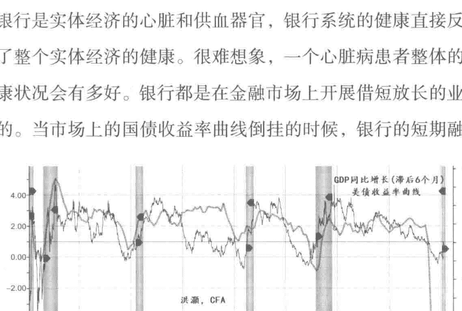

图3.5 美债收益率曲线领先经济增长长达18个月（衰退时是负增长）

注：美债收益率曲线（左轴），GDP增长（右轴）。

数据来源：彭博、作者计算。

## 经济是否可以预测

非常担心的收益率曲线对经济前景的预示。这条曲线含有更多其他的信息，而最重要的是收益率曲线的斜率告诉我们长期中性利率的水平。”也就是说，威尔森认为，当国债收益率曲线的平坦化，以及短期收益率和长期收益率的趋势告诉他，美联储当时的货币政策的取向的是，美联储的基准利率和长期中性利率一致。很明显，威尔森不重视收益率曲线即将倒挂经济前景的预测。今天回过来看，威尔森对曲线倒挂的解释，更多的是对美联储货币政策的辩解，而完全忽略了曲线对经济衰退的预警。然而，作为美联储的首脑，威尔森可能是对亚洲市场的怀疑。毕竟，如所述，美联储的货币政策并不是管理甚至彻底泡泡沫，美联储货币政策的目标不是预防，而是善后。

还有其他被经常提及的，但是历史预测成绩很好的经济指标。由于经济领先指标的成分数据都是在指标生成之前公布的，所以当这个领先指标公布的时候，指标包含的经济数据反映了经济运行的情况，其实已经反映在市场定价了。同时，由于一些数据后经过修正，所以领先指标在后期可能会不完全准确。然而，我们知道经济同步和滞后指标的后期修正比较少。毕竟，经济同步和滞后指标都是对当前经济活动水平的确认。于是，我们可以创造性地组合使用这这两个指标。例如，把经济同步指标和滞后指标的差作为一——一个新的领先指标。这是因为这两个指标包含的经济数据有时上的差异。当我们要求它们之间的差异时，可以看到几个月之前的经济活动情况现在是否得到了确认。这个经济同步指标和滞后指标的差异告诉我们经济的内部变化。历史数据分析证明，这个差异在一定程度上领先于经济运行的拐点，在做决策的时候具有参考价值。

最近几年，美国各个地方联邦储都曾尝试开发新的经济指标。一个比较值得关注的，然而在大众眼里很少提及的指标，是芝加哥联储的全国活动指数（见图3.6）。这个指数是美国85个经济指标的加权平均，包括生产和收入、个人消费和房产、销售、订单和存货数据，以及就业、失业和工作时长数据。由于这个指标基本上涵盖了所有重要经济指标，我们可以把它看作是对美国经济最广泛的量化衡量。同时，在我们在使用这个指标的时候，不要看它的绝对数值，而是要看它的各个成分的离散度。当我们把这个离散度做一个3个月的移动平均后，就可以体验到这个指标对经济周期拐点预测的作用——2世纪以来指标只给过两次错误的衰退预测。在最终被市场关注之前，这个指标保持着额外的决策价值。

此外，亚特拉斯兰联储发布的GDPNow（国内生产总值增长的直播指标），也值得关注。亚特拉斯兰联储的经济学家，每月更新这个模型5~6 次，以预测将要公布的 GDP 增长数据。这是一个美国经济运行的“实时插报”指标，是对美国经济最及时的数据衡量。至于对美国经济活动最好的衡量指标，应该属于费城联储的 GDP+。这个指标了 GDP 和 GDI（国内收入总值）的数据。由于 GDP 是支出法估算出来的，而 GDI 则整个经济各部门的收入加总，以收入来弥补支出法统计经济规模的不足。这个指标可以用来量化模型中，提高预测的可靠性。

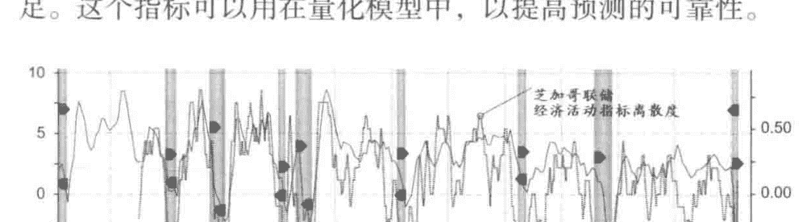

图 3 芝加哥联储经济活动指数领先增长时长可达 1~3 季度

注：GDP增长（左轴），芝加哥联储经济活动指标高散度（右轴）。
数据来源：彭勃，作者计算。

## 如何预测中国经济

中国宏观经济波动消失

中国可能是宏观经济学家宋礼福膜的一个国家了。或许是因为我们今天的市场经济，是从学习苏联的计划经济后被破而出的。即便在今天，中国在宏观经济规划里仍然非常强调一个具体的增长目标。比如，一个短线的增长计划就是，让中国的经济规模每10年翻一番。我们可以用简单的“70 原则”换算，这个隐含的经济增长目标就是70/10（年）=7（%）每年。“70 规则”是一个简单的指引，用70排除这个增长速度，就可以得到这个速度增长经济体的规模翻一番所需要的时间长度。比如，如果中国经济的年增速放到5%，那么中国经济的规模就需要每14 年 [70 / 5（年）] 翻一番。

现在，我们在宏观经济规划的时候，还是非常强调5年计划的。而苏联在计划经济时代，也是以5年来计划其发展的规模的。虽然设定增长目标对计划宏观经济有一定的意义，但在中国经济总量已经达到了100万元规模的今天，在宏观杠利率高之下，投资效益开始际递减的现在，如果设定一个具体的增长目标，那么很可能会达到增长目标和浪费资源。

对于宏观经济的管理，需要设定具体的增长目标。比起美联储货币政策的双重目标，是要增长和稳定通胀。增长就是要保证就业，稳定通胀就是要保证人民收入。

## 预测: 经济、周期与市场泡沫

这种对于宏观经济管理的思路，也在最近十年反映在中国宏观变量的变化上。如果我们一看中国宏观变量在2010年前后的表现，就会发现2010年是中国宏观经济的分水岭。重要的宏观变量，如 GDP增长速度、工业增加值、货币供应、通胀等的波动性，似乎在2010年后突然崩溃了。

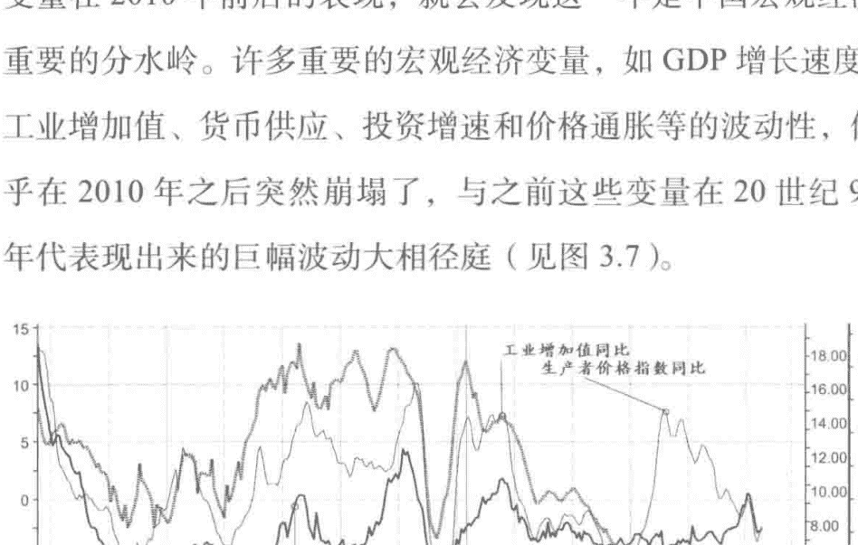

图3.7 自2010年以来，所有宏观变量波动大幅下降

注：生产者指数（左轴），工业增加值（右轴），消费者指数（右轴）。
数据来源：彭博，作者计算。

对于通胀的消失，我认为很大一部分是社会财富化导致需求不足。这是一个长期的社会现象，我在后续章节将详细讨论：即便如此，这个理论似乎无法解释为什么2010年成了一个关键节点。回溯历史，我们会发现2010年正好是2008年全球金融危机之后中国进行万亿刺激计划后的第一个年份。在这一次洪水之后，货币政策的有效性开始边际递减，表现为每一个单位GDP增长都对应着越来越高的信贷增长，信贷的速度远超过了经济增长。因此，如果要用货币政策抑制宏观经济波动，或者类似于联储货币政策的隐含目标和宽松货币政策，让所有参与者达成了一个共识，就是如果经济遭遇困境，那么政府一定会再次出手。美国市场行的“美储看跌”，就是建立在宏观经济流动性不断上升、波动不断下降的基础上。在一个环境下，投资回报形成了一个对称分布。过去十年，市场做空波动获得不对称回报的交易一直流行。这个交易的主要逻辑就是“美储看跌”——当联储陷入困境时，美联储将会出手。由于持续的流动性抑制了市场波动，流动性趋势下降是有利可见的——这个波动趋势下降会持续到2018年1月中美贸易升级导致的巨震为止。当时，许多专注于做空波动的基金一夜之间回吐了多年积累的收益。人们认为下行的风险受到政策保护的时候，他们在做投资决策时的风险偏好将被无限制地放大，甚至承担与回报不相符的风险，达到回报最大的目的。这就是传说中的市场道德——反正爆炸了央行兜底。这是一种类似于中国市场刚性惯性的逻辑，比如过去几年年初加杠去逐非常低位的项目融资。这些鲁莽的行为，都将导致系统产生足够的回来偿还资金成本，最终导致系统崩溃，一个“明斯基时刻”。

我们还可以从中国的储蓄和投资习惯的角度，观察中国宏观经济波动消失的现象。2010年以来，我们不仅仅观察到宽松宽货币政策的效应正在明显减速，同时中国人的储蓄和投资习惯也发生了变化。在宏观经济里，广义地说，储蓄等于投资。在2010年左右，我们看到中国的经常性账户与GDP的比率定义的宏观储蓄达到了一个高点并开始下降（图3.8）。在2010年后的几年，美国的宏观储蓄上升，表现为美国的经常性账户与GDP的比率开始上升。当然，这个现象和美国经济在经历了2008年严重的金融危机之后，个人部门开始修复资产负债表，以及美国的页气革命导致美国从历史上最大的原油进口国变成了出口相关国。

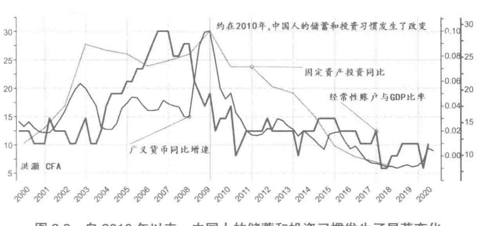

图 3.8 2010年以来，中国人的储蓄和投资习惯发生了显著变化

注：广义货币同比增速（左轴），经常性账户与GDP比率（右轴），固定资产投资（右轴）。
数据来源：彭博，作者计算。

历史上，中美两个经济互补性很强。生产、消费、出口获得美元之后，中国收回美元，在此基础上根据经济发展的需要提供货币供应。过度消费导致的经常性账户赤字，在2010年之后由于美国的宏观储蓄下降，美国带来的进口对中国增长的贡献也就下降了。因此，宏观储蓄率下降反映了中国储蓄和习惯的变化，是货币供应的重要来源。

## 预测中国经济

预测中国的经济运行，一般可以采用自下而上的方法。比如，预测“三驾马”——投资、消费和净出口各自的变化。对于计划制定者来说，可以将各个省市经济增速计算全国的速度。虽然有自上而下量化回归的方法，以货币供应、工业增加值、信贷增长为自变量，预测GDP增速未来的水平。然而，这些预测的结果往往是滞后的。同时，这些预测的方法也是所谓增长目标形成的方式。这样的目标其实在一个日益市场化的经济意义并不大，有时候存在偏差。

如果中国宏观经济的波动性消失了，那么中国经济的预测就会比较容易。在新的环境中，对于宏观经济的预测，重要的不是去经济数据的绝对水平，甚至不是这些数据的周期变化。因为在一个L形眼里，这些数据对于经济基本面的反映已经趋钝了。更重要的是，我们要预测经济未来运行的趋势以及趋势发生变化的时间节点。作为一个投资者，重要的并不是去预测经济数据，而是判断市场中各种类别的价格如何反映经济运行趋势变化，并将这个判断付诸投资决策、资产配置。在中国经济的宏观波动性消失之后，究竟哪一个变量能够反映经济运行的波动性？显然，明斯基的观点是，波动性不能被平抑，而只能被管理者用宽松的货币政策暂时抑制。这种对于波动性的暂时抑制也将导致市场参与者产生波动性永久消失的错误，并增加风险以获得更高的回报。这种追逐风险收益的行为，最终会让整个系统不负荷而崩溃。

宏观经济流动性的定义是对资产配置的一个重要观察。过去，广义货币供应增长对中国市场的表现至关重要。如果没有它，我们就不会看到4万亿刺激计划之后股市的复苏反弹，以及随后几年随着货币增长放缓而出现的浅回。我们把经济超额的流动性定义为广义货币增速和工业增加值的差异。因为只有超额的流动性，也就是超过了实体经济增长所需的资金供给，会导致经济增长潜在的增速并导致通胀热。我们可以把这个计算超额流动性的指标和上证指数的回率做一个比较。我们会发现，上证指数的回率领先超额流动性3~6个月（见图3.9）。也就是说，虽然超额流动性可以解释经济超额增长的情况，但股票市场往往更能提前反映未来。

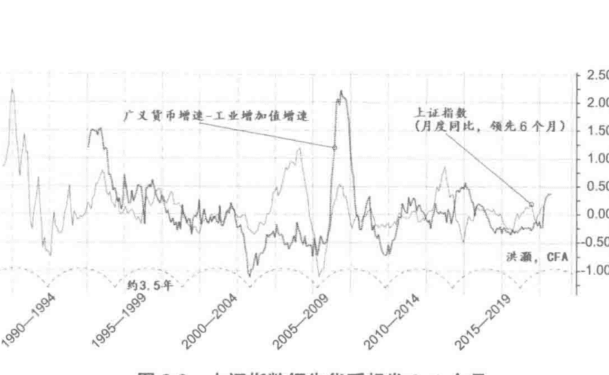

图 3.9 上证指数领先于超 3-6个月

注：上证指数（右轴），广义货币增速-工业增加值增速（左轴）。
数据来源：彭博，作者设计。

凯恩斯曾说：“货币是连接过去和未来的枢纽。”在中国经济体里，股市往往提前反映经济，也就是说，股市和货币供应一样，是实体经济的领先指标。因此，预测股市回报的变化和趋势可能是对经济最好的预测。在上述论述里，除了PPI外，宏观经济波动性是如何全面下降的。货币政策的影响小似乎是合理的，因为这些政策无法影响大宗商品的成本产生太影响。如果用CPI和PPI之间的差异来衡量企业利润，那么我们将立即面临一个难题：社会分配不平等。

对于宏观经济的波动，PPI大于CPI说明企业定价能力不断下降。在2010年之后，由于宏观储蓄率下降，企业定价能力变弱。如图3.10所示，M2（广义货币量）和M1（狭义货币总量）之间的差异存在密切的相关性。

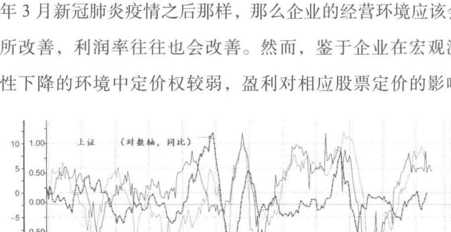

图3.10 货币乘数趋势3~6个月

注：M2-M1（左轴），上证指数（右轴），消费者指数-生产者指数（右轴）。
数据来源：彭博，作者计算。

对于观察到的股市波动，其他因素肯定起着更大的作用。我们将股票回报的来源分解为两部分：盈利增长和估值扩张。如上所述，在新的宏观环境下，企业定价权正在弱，盈利增长对股票回报的贡献应该越来越少。的确，在分解了股市实际回报之后我们发现，2006年以来估值的变化决定了大部分股票回报。这个现象在泡沫时期是最明显的，当时流动性非常宽松但经济基本面非常差。A股可以在一段时间内脱离基本面上涨，直到估值偏离基本面太远，反弹自然就会发生。

综上所述，归根结底对宏观经济的预测就是对股市未来回报的预测。由于股市回报同广义货币供应的速度，尤其是超额货币供应的变化相关，所以宏观经济趋势的预测就是对未来货币政策取向的判断。而未来货币政策取向往往取决于当前所面对的经济形势。这也是与货币政策变化高度相关的股市回报变化，往往与当前的基本面相符——毕竟，股市是宏观趋势的领先指标。然而，对于投资者而言，预测股市未来的走势往往更为重要。

## 结论

由于市场和经济的相关性，预测经济其实就是预测市场。同时由于市场往往是经济运行的领先指标，预测经济和预测市场之间孰轻孰重一目了然。美国对经济预测方法和模型的研究已经持续了70多年，其间见证了许多独立经济研究机制的形成，以及它们建立的一系列领先指标，包括领先、同步滞后指标。

由于领先指标是由已经公布的经济数据构成的，所以它们的发布并不能影响市场的运行，对股票定价的影响有限。随着市场参与者对这些领先指标理解的深入，它们对实体经济运行的领先意义也就越来越有限了。这种有限性体现在它们在过去的经济周期里对经济运行拐点的预测成功率并不高。这种预测的成效可以通过数据变化连续观察几个月后再做决定来提高。一些判断的法则包括：经济领先指标在过去7个月里有4个月下降；或者在过去3个月里，领先指标连续通过。经过这种调整之后，尽管预测的结果仍然不能万无一，但是给出错误点的概率极大下降了。

很多人认为，经济同步指标和滞后指标对于预测的意义不大。然而，同步指标的重要性并不在于未来的预测。由于数据发布的时效性，领先指标的许多数据的起始估计往往有误，在发布后可能会被修正，从而影响了领先指标在发布时的有效性。然而，同步指标的数据则是很少被修正的。因此，这些指标可以有效确认对于经济拐点的判断。同时我们还可以创造性地使用同步指标和滞后指标，可以根据同步指标内部的成分数据计算离散度。这些指标成分数据的离散度显示着各个部门对于经济运行的反映，其本身就有很强的信息效应。

在经济运行的时候，大部分经济数据都会朝着同一个方向运行。当经济运行进入拐点区域的时候，我们看到数据离散度往往会上升。换句话说，在经济运行进入拐点时经济数据之间往往不能相互印证，不能相互说服对方，不能显示经济运行的方向。敏锐的预测者就应该意识到经济可能开始进入拐点区域了。这时，对于各种数据的追踪与每一个实体经济参与者的沟通，实体经济运行的实地考察将尤其重要。实践证明，同步指标内部的成分数据之间的离散度对经济的运行有明显的领先作用。

滞后指标也不是无事一处的。由于滞后指标是对经济运行的事后确认，也很少在发布后被不断修正，以所滞后指标也。

## 176 预测：经济、周期与市场泡沫

可以辅助领先指标和同步指标对经济的运行做出更可靠的判断。同时，我们也可以按照上述计算数据之间离散的方法，计算领先指标与滞后指标之间的差，比如 PMI（采购经理指数）里的新订单指数和存货指数之间的差，两者之间的时间差越长，经济就越可能进入拐点。比如，在经济进入下行拐点的时候，新订单往往很少，存货往往很多。这将因为商业的行为而感受到下行的压力。创造性地使用领先、同步和滞后指标，以不同的组合测试经济运行时各种数据的离散度和时间差，都可以帮助我们有效地预测经济运行的拐点。

当然，还有一些后来开发的另类指标。这些指标的优势在于它们覆盖经济的广度，如 GDP+指标；又或者在它们发布数据的及时性，如 GDPNow 指标；还有它们不会随行就市，降低了后期修正的风险，如美国收益率曲线——这是市场交易价格计算出来的曲线。这类经济指标在不同程度上提高了我们对经济预测的准确性，比如国债收益率曲线的倒挂着经济衰退的到来。这些指标增强了我们对经济运行的理解。

预测中国经济更有挑战性。不是因为数据不全和准确把握，还因为在 2010 年之后，中国宏观经济的波动性逐渐消失了。这表现为 GDP、工业增加值、通货膨胀、投资增速和货币供应增速逐渐趋于平缓，显示出一个“L 形”的走势。唯一还能体现宏观经济波动性的、比较意外突出的一个指标就是 PPI。在一个宏观经济波动性逐渐消失的经济体系里，预测经济的意义变得越来越小，但预测经济的难度却在不断上升。在一个经济学家眼里，经济预测逐步变成一门令人扼腕的艺术之一——它的付出和回报越来不成比例。对于一个在这样的实体经济运营的公司，PPI 的波动性持续存在大于 CPI 的波动性，反映了公司定价能力的缺失。因此，股票价格的表现和公司运营的相关性也越来越小。在这样的市场里，市场波动往往能够灵活运行宏观经济管理政策的变化。换句话说，中国的宏观经济性并没有消失，只是换了一个表现的渠道。

超额流动性，也就是广义供应增速和经济增速之间的差异，对经济运行的反映也没有比股市得早。这个时间上的滞后，体现在上证指数比变化领先超额流动性 3~6 个月。因此，数据的局限、宏观波动性的消失，以及股市对中国宏观经济的独特反映，决定了对预测中国经济更有挑战性。而在中国，没有发现更好的指标的现实情况下，股市是宏观经济运行有效的领先指标。

在这样的市场里，市场择机就是对未来宏观经济的判断。择时蕴含的宏观经济的判断，以及可以带来的投资回报，比选股要更有意义。企业利润率与其说是企业自身的选择，还不如宏观经济货币政策的产物。股票回报率更受估值倍数扩张的影响，而不是盈利增长的影响。因此，股市的大部分回报实际上是由货币政策系统性推动的。在这样的市场里，所有的阿尔法都是贝值。因此，我们应该注意到如下几点：

- 第一，指数基金将日益主导市场。或者，市场将逐渐指数化，因为大部分回报是由系统性估值系数扩张推动的，而非企业特殊的盈利能力。当然，在这样的环境下，有着强大的定价能力的企业将享受到稀缺性的溢价。事实上，美国市场上的指数基金的数量已经超过股票。中国的指数基金规模正在上涨。指数基金市场份额的扩大，在未来将放大市场波动强度和持续时间。

- 第二，央行是决定股票回报最重要的因素之一。因此，投资过程将变得更具机性——而非更少。这就解释了为什么全世界都在变质关注的政策选择。

- 第三，市场愿意给承担系统性风险的能力买单，而选股似乎显得越来越无关紧要。巴菲特近来的回报似乎印证了这个观察。最终，产生的回报取决于一个投资主体的资产负债表是否足够，以及在系统性风险来的时候是承担这些风险，还是屈服于投资者的赎压力。

- 第四，有所谓“基本面”，只有“情绪牛”“杠杆牛”。只要流动性状况有利，市场就可以在一段时间内偏离基本面。教育了我们，凯恩斯曾说，市场保持理性的时间比一个人保持的时间长。这句话现在听起来更加正确了。许多人期待市场的运行和宏观经济拐点，都有于货币供应的变化，那么未来额外的流动性还将哪里来？

《政府报告》阐述了央行对信贷扩张的态度。在新冠疫情后的实体经济，稳定增长仍是重点。宽松的货币政策和积极的财政政策将支持经济的发展。资金在 2009 年和 2019 年接近历史最低点，而这些低点与股市历史上的重要点对应，与经济增长峰值对应。美联储在 2019 年下半年放弃之前的收缩政策，否则美国经济将面临严重的通缩压力。新冠疫情之后，美国经济前景堪忧。因此，美联储可能很快再次收紧货币政策，除非通胀高得无法承受。这次股市应该也不会不同。美国流动性状况的宽松，在过去有利于中国股市，时间上也当时股市重要的转折点吻合（见图3.1）。

注：基础（左轴），工业产（右轴），上证指数（右轴）。
数据来源：彭博，作者计算。

## 周期是否可以预测

超人的记忆是一个预言家的最佳资格——哈利·法克斯对于中国人来说，时间是周而复始的，交织着生命的轮回、季节的更替和王朝的兴衰。中国人热衷于经济周期分析的原因之一，中国古代经典书籍，如《易经》、《史记》和《盐铁论》等，都对古代农业经济中的周期进行了论。若干关键经济变量同时上行或下行的趋势必须是明确的、广泛持久的。经济周期大师菲斯·米特尔对周期的经典定义为“总经济活动的波动”。米特尔认为，周期必须包含多种经济活动的全面展开和随后的收缩，必须是重复出现的，并且具有相似的数量和性质。

周期是一门古老而晦涩的、同时非常冷门的经济学分支。虽然对周期的研究在西方已经进行了20多年，并最终被美国经济学家建立的 NBER 和美国周期研究所等显赫的经济研究机构印证了重要性，但今天许多学科出身的经济学家都对周期这门学科痴之如鼻。的确，在人类社会摒弃了刀耕耕种的农业经济模式的时候，经济的周期性似乎不再那么明显了。

在农业社会，当经济处于繁荣时（就是完全就业），一次意外的丰收反而有可能导致农民收入减少。这是因为人们对粮食的消费一般比较稳定，而丰收会导致粮食价格为粮食供给的增加而下行，从而减少农民的收入，并可能导致未来的经济由于农民收入的减少而减少。可以看到，在这样的农业社会里，由于气候对农业的收获有很大的影响，而气候的变化与约11年的太阳黑周期密切相关，因此，古时候对周期进行研究是必要的。

随着第二产业和第三产业在经济里的比重增加，逐渐占据主导地位。这时，再去研究类似古老的周期，对经济运行管理的意义已经大大了。但出人意料的是，现代经济里周期运行的痕迹仍然非常明显，比如我们之后将要讨论的储存周期、资本投资周期和信贷周期等。令人费解的是，尽管经济里周期性最强的第一产业农业的比重越小，同时农产品价格处于下行趋势，但是经济的运行仍然体现出强烈的周期性。这种经济运行中仍贯着周期性，恰恰是我们进行周期研究的原因。我们并不能因为这是一门古老晦涩的经济科学，或者是经济里农业的占比减少，就对周期的研究弃如废了。

值得注意的是，本书里我讨论的周期，主要是关于股票市场的周期。虽然与经济周期相关，但是决定经济周期运行的因子有很多。同时，如前文所述，股市运行并非完全反映经济周期，而反映更多的是基本面无法解释的因素，比如心理因素。股市周期并不等同于当时的经济周期，或者股市下跌也不意味着经济危机。本章部分将讨论周期的运行如何影响股市的表现，以及股市运行如何在经济危机产生不同的反应。

不幸的是，尽管有明确的数据论证，所谓周期理论似乎并没有什么依据，周期也被不断质疑。我对周期的运行进行了仔细的量化研究。关于中国周期的研究中，我以住宅、施工、销售作为假设前提，来解释投资周期的时长。尽管如此，确定周期的长度仍然存在挑战。保罗·萨缪尔森曾对长波理论提出，长波理论一顺，认为是“简单的历史巧合”。经济学家尼拉·康德耶夫也在他在论文中偷偷地评论，称自己“打算给长波理论奠定基础”。毕竟，预测的精确程度就会低，数据分为四个象限，即再通胀、复苏、过热和衰退。我们可以清楚地看到经济从2009年开始经历复苏到衰退，2012年以后，似乎陷入了“再通胀”与“衰退”之间，呈现“L 形”的运行轨迹（请注意，这里的“衰退”是指增速放缓）。经济周期的阶段性变得不清。如果是这样，这样的环境下，周期理论是否失效了？在威廉·史丹利发表启蒙西方经济周期研究的“太阳黑子理论”之前，中国古代哲学对周期早有论述，例如古代著作《易经》。本质上，《易经》是一本基于周期的预测。“乾卦（乾为天），是《易经》中最著名的卦之一，它用它的不同状态表示一个完整的轮回。例如，“见龙在田”指复苏，“飞龙在天”指繁荣，“元龙有悔”指繁荣的极点，“潜龙勿用”指潜伏，等等。今日，中国的一些研究和学术机构仍然将《易经》的理论运用在经济与市场的预测中。

宏观波动性消失的另一个副作用，就是经济数据里的周期性在不断减弱。前述划分在四个象限里增长和通胀的数据不再像以前那样规律看着每个象限，而是摇摆在四个象限的底部，也就是图4.1中的“群龙无首”、“潜龙勿用”和“见龙在田”的区间。此，经济数据的运行很难做出决定配置参考。市场参与者不得不在中国市场里，“美林时钟被玩成了风扇”。

| | 房价上涨 | 高需求 | 利率上升 | 商品价格下跌 | 通货膨胀 | 龙龙音 | 外需减少 | 股价下降 | |
| :--- | :--- | :--- | :--- | :--- | :--- | :--- | :--- | :--- |
| 08/2009 | 01/2010 | 04/2011 | 05/2012 | 06/2013 | 01/2020 | 02/2020 | 03/2020 |
| 07/2009 | 11/2010 | 06/2011 | 11/2012 | 01/2021 | 04/2020 | |
| 08/2009 | 12/2010 | 07/2011 | 12/2012 | 05/2020 | | |
| 09/2009 | 01/2011 | 08/2011 | 01/2013 | 06/2020 | | |
| 10/2009 | 02/2011 | 09/2011 | 02/2014 | 07/2020 | | |
| 11/2009 | 03/2011 | 10/2011 | 03/2015 | | | |
| 12/2009 | 04/2011 | 11/2011 | | | | |

注：基础（左轴），工业产（右轴），上证指数（右轴）。
数据来源：彭博，作者计算。

在古代著作中明确记载了周期的时长：
- 《史记》：司马迁将五行与周期联系在一起，描绘了丰收、歉收、干旱以及严重饥荒。
- 《淮南子》：描述了若干短周期，如“三年丰，二年歉收，一年荒”。
- 《盐铁论》：记载了一个类似的周期。

杰文斯在他的著作《太阳周期与贸易活动》（The Sun's Cycles and Trade Activity）里讨论了气候条件影响了农产品的收获，他的结论是周期大约7年，并以此作为“循环”的理论基础。杰文斯的儿子修正了杰文斯的理论，认为周期的长度大约5年。注意杰文斯的儿子发现周期的长度与杰文斯的理论基本一致，同时“小循环”形成了一个大约3年的循环。这个周期和西方文献中记载的时长，可能不仅是简单的历史巧合。

现代经济学对于周期的认知，并没有有人机械地照搬这些农业周期作为经济预测的基础。一位持有类似杰文斯太阳周期观点的经济学家——梅尔——曾非常生动的语言描绘了农业周期波动的情况：“谷物的周期，就像自然的河流，是由供给关系决定的；谷物的价格相对于之前的耕作决定的谷物的价值是滞后的，但是在有节奏地波动。”这句话有意思的地方，并不是梅尔表达了农业周期运行的观点，而是梅尔似乎指出农业周期里的当期价格和供应是不步的，而在农业周期里，农作物的收获取决于生长长时间的变化。因此，农民在当期的收入取决于他们往期的耕作决定，而农作物的未来的供应取决于当期价格决定的农民收入，以及未来在作物生长时完全不可控的气候变化。

在这样的决策体系里，农作物的价值由农民往期进行的耕作而产生的农作物的供应所决定。简单来说，当期收入决定了种的数量，作物生长长期气候的变化决定了未来作物的收获，农民的收入在未来的收获变化而变化，并随之决定一期的播种数量，如此循环往复。农民需要做的决定，包括种子的成本，以及投入的劳动力、时间、肥料、耕具和牲畜等。这些在往期投入的要素的总成本，决定了当期农作物的价值。同时，当期作物的需求应该是相对稳定的，尤其在经济处于完全就业的时候。因此，作物的需求弹性小于供给弹性，表现为需求曲线比供给曲线更为陡峭。往期的供应和当期的稳定需求决定了农作物的价格——在供给体系里，供应是更重要的变量，供给决定价值，而需求决定价格。在当期的价格高于均值时，也就是需求大于供给的时候，农民在计划内耕作时必然会扩大产量，导致下期作物的供给崩溃，反之亦然。因此我们看到，供给和需求不同的弹性形成的扩散性的价格体系，以及农民耕作决策的时滞性，会导致农产品价格暴涨暴跌，农产品的周期也就此运而生。

在中国的猪肉价格周期里，我们发现了类似的、由供应和需求的时滞性产生价格波动规律。比较中国生猪栏量同比变化和生猪价格同比变化的数据，我们可以看到生猪栏量同比变化领先生猪价格同比变化约6个月，并且两者呈负相关的关系。也就是说，我们在当期看到的生猪的价格。

## 194 预测：经济、周期与市场泡沫

需求的下降最终导致资本主义出现繁荣的崩溃。虽然这看起来很有道理，也和明斯斯基的理论基本一致，但是哈耶克没有明确地把企业预期的变化考虑到他的理论设立中，尤其是信贷供应变化引起的利率变化对经济周期各个部门的作用。经济周期的复杂性很难用一个单一的变量完全解释清楚。

熊彼特对于经济周期的见解，正如他的创造性破坏理论一样具有创新性。他的创新周期理论区分了“发明”和“创新”。虽然发明是发现了新的生产方法，但是新的生产方法要通过创新来引入经济，只有那时发明才具有经济意义。这时候，经济的生产函数产生阶跃式的发展，而新的生产方法还会引起“效仿”的热潮，进一步扩大创新的经济意义。熊彼特对于经济周期的理论，可能是所有经济周期理论中最复杂的一种。然而，熊彼特的理论只解释了经济的阶段，也就是如何从正常阶段走向积累，即“易盈”乾枯里的“潜在无用”到“荒龙在田”，最后至“飞龙在天”阶段。熊彼特并没有详细解释经济如何从繁荣回到衰退。

被誉为“现代宏观经济学之父”的凯恩斯的理论最有意思。凯恩斯强调预期的变化对经济里各个部门有不同的影响。与古典经济学和新古典经济学相径的，凯恩斯否定了古典经济学里两个重要的假设前提，萨菲律和完全就业。萨菲律认为，生产过程本身就可以自我创造需求，因此也不会有生产过剩。只要工资和价格是有弹性的，那么怎么会有一个市场不能达到均衡状态。换句话说，古典经济学派和新古典经济学派认为，市场只有一个均衡点，一个市场出清的价格，而这个价格的产生可以完全市场自我调节和运行。然而，在现实世界上生活的人，不需要任何的理论知识教育，都会发现这个优于学院派的经济观点和我们实际生活的观察并不相符。

比如，在2020年的新冠肺炎疫情之中，原油价格跌破了负价。也就是说，当时的原油生产商需要付出让客户把亏损巨额成生产成本挖掘出来的原油拉走。这主要是因为新冠肺炎疫情造成经济停滞，对原油的需求断崖式下跌。同时，原油的生产是不能说停就停的。油井的一开都需要付出巨额的资金。在原油生产难以马上停顿，但是原油的需求却是极度萎缩的时候，开出来的原油需要储藏的空间。不幸的是，当时的原油市场已经没有储藏的空间了，就海上的油轮几乎装满了。因此，在原油期货交的最后一刻，原油期货价格跌了历史性的、不可思议的负价格。

2020年4月21日，我在微博写了如下对于油价暴跌的分析：

昨夜，美油期货市场上上演了史无前例的溃乱行情。月合约最低暴跌到-40美元/桶，打破了传统对于商品价格的认识。市场宁愿给钱不要原油。曾经，原油被市场称为“黑金”，和黄金一样，往往在战争爆发时暴涨。昨夜，市场却弃之如敝。

然而，在欣赏了原油史诗级别的跳跃行情之后，我们还需要思考，现实的市场情况以及反映在地板里的预期，是否如一纸近月合约显示的那样极端？毕竟，5月合约还有一天就交割了。

尽管昨夜五油暴跌，但是原油相关的股票ETF XOP.US（美国油气开采指数）并没有受到明显的影响，反而在一个下跌的市场里收涨。尽管六油价格有所回调，但其跌远没有五油深。原油债的信用利差已经从高位回到了650点左右，和2015年的高点基本一致。油轮的轮次继续大幅上涨。

这些不同市场的交叉检验表明，昨夜原油违反市场的暴跌，反映更多的是市场结构问题。石油市场新冠肺炎疫情导致供需严重失衡的情况，在这种市场结构里被放大——否，任何商品的价格如何可以降低它的开采成本。这样的石油价格，会让如马尔斯那样的经济学家在均衡中都不得妥，是一个储量约为9000万桶。

## 周期是否可以预测 | 第四章 195

## 预测: 经济、周期与市场泡沫

（注：原文OCR中存在大量重复和乱码段，已根据语义逻辑进行合并与去重）

2020年4月原油跌出了负价，充分验证了凯恩斯的直觉：并没有一个唯一的市场可以让市场出清，使得需求始终处于平衡——尤其在短期。市场的平衡是一种动态平衡，也可能没有唯一的均衡点。萨菲律和我们古典经济学、新古典经济学的假设，与我们现实生活的经验是明显的相反。同时，消费和生产对利率的敏感程度不一样。尤其是必需品，对利率的变化并不敏感，而利率的变化会导致企业对利润的预期变化——低利率环境下企业对利润的预期比高利率环境下的预期要高，因为低利率更容易产生通胀。

经济的均衡，是指收入对于产出（类似GDP两种方法，收入法和支出法）。在生产没有完全利用所有资源的条件下仍然等于产出。这个时候，经济也是均衡在一个均衡点上。或者说，此时，经济资源得到了充分利用和完美的配置，生产效率得到一次优化。由于消费对利率的变化不太敏感，经济中最变化的、最受银行影响的部分，是对利率非常敏感的投资部分。这主要是因为投资受到回报预期的影响。在一般的经济衰退中，央行可以通过调利率，鼓励商业银行对企业贷款。这时，由于利率较高，企业对利润的预期回暖，并开始添加投资，最终将经济复苏。然而，如上所述，经济是可以停止于均衡点的。

考虑一下，当经济严重衰退时，例如2008年贷危机导致的全球经济衰退，即便美联储把利率调到接近零的水平，企业的未来利润预期对低利率可能也并不敏感，或者说，低利率无法改变企业对未来利润的预期。这也是凯恩斯所描述的资本边际效率崩溃的时刻。因此，企业也将忽视历史性的低利率而不进行投资。这时，经济里只有政府部门的支出受到利率高低的影响，不完全受到经济环境的影响，也有政府部门才有能力引起逆周期的政策调整。凯恩斯此论证了经济严重衰退时的必要性。2008年的观察，难怪学界叹道：“看看，我们现在都是凯恩主义者了”。

有趣的是，尽管凯恩斯提出了一系列宏观经济理论，但他并没有提出一套完整的经济理论来解释和预测经济周期的运行。当然，我们在他的《就业、利息和货币通论》里，看到经济周期运行理论的影子和对该理论的应用。这或许是因为凯恩斯把经济周期的运行当作经济内部部分。然而，我对利润预期和心理反应的见解，反是最符合对经济周期运行的实际观察，也因此最容易在投资实战运用。简单来说，经济周期的产生，是因为经济结构中最容易变化的部分——投资——因为利润预期的变化而变化。投资的起伏，加上不太容易改变的消费和自我调节的政府部门，造成了经济周期的起伏。然而，在投资边际效率突然崩溃的时候，利率的下行不再能够改变企业家投资的预期。此刻，经济陷入一个循环，并有可能长时间停留在一个优均衡上，比如日本。只有主动的政府支出和扩张性财政政策，才能把经济从万劫不复的深渊中解救出来。

2020新冠疫情爆发之后，各国的经济以史无前例的速度崩溃。美国的经济在2020年第二季度，萎缩了25%，而1929年大萧条时，失业率接近20%。

## 四类经济周期

“周期”一词代表规律性，意味着经济变量围绕趋势波动，有明确的长度和幅度。当然，在实践中经济变量波动是虚幻莫测的，而趋势也短暂。许多专家的职业生涯还有限。因此，任何周期模型的意义在于发现趋势的转折点，尤其是对于交易员而言，掌握获取利润还是损失是有把握的。按照长度顺序，这些周期分为：
- 基准周期：3~5年
- 朱格拉周期：7~11年
- 奎库兹周期：15~25年
- 康波周期：50~60年

根据熊彼特的理论：
- 一个康波周期 = 50年
- 奎库兹周期 = 6年
- 朱格拉周期 = 12年
- 基准周期 = 3年

可以看到，这些周期的运行相互交织。每一个等级、更长的周期可能是下一个低等级。每个周期内的上升和下降是相对于周期定义的，在特定的月份或季度中出现。我们在股票市场里讨论房地产周期，类似基准周期。值得注意的是，预测的准确度与周期的长度反比。周期越长，数据越模糊和难以理解。因此，康波周期是最有争议的。这些长期的波动是否是因为金矿、科技发明或者政治战争等偶然事件，现在在结论中还未过去。

对于康德拉基欧夫来说，他在第一篇文中对长周期的表述也是充满犹豫的。他描写：“在上面的简述中，我们并非为长波理论奠定基础。”当时，康德拉基欧夫认为，长周期是资本主义制度内的生，而且正在进入运行阶段。这个预测和当时的“主义理想”相抵触，被认为是反动的。不幸的是，康德拉基欧夫很快被关放到西伯利亚。在图4.3中，我们用过去100年的美国数据证明了长波的存在。由于缺乏周期，我们无法展示中国经济里的周期规律。但我们坚持正如长波已经在其他国家的体系被证明了一样。学界对于中国古代王朝替代周期的研究，这些历史周期持续的时间更长，往往可以达百年左右，与气候的变化、农耕的变化、人口的结构和外族的入侵密切有关。这种长周期波动并不有趣，与短期交易没有关系。事实上，即使朱格拉周期和库塞茨周期那样趋于10以上的周期，虽然比长波短许多，但也容易超过许多投资师职业生涯的长度。这些周期被用于一年的短期市场判断，可能是非常精确的。因此，当我看到专家用朱格拉周期来解释卡车和挖掘机的强劲销售时，便有些担心。这种分析，就像是用大炮打蚊一样。

| | -7.00 | -6.00 | -5.00 | -4.00 | -3.00 | -2.00 | -1.00 | -0.00 | -0.30 | -1.40 |
|---|---|---|---|---|---|---|---|---|---|
| 标普指数850天年化收益率 | | | | | | | | | | |
| 2010-2019 | | | | | | | | | | |
| 2000-2009 | | | | | | | | | | |
| 1990-1999 | | | | | | | | | | |
| 1980-1989 | | | | | | | | | | | |
| 1970-1979 | | | | | | | | | | | |
| 1960-1969 | | | | | | | | | | | |
| 1950-1959 | | | | | | | | | | | |
| 1940-1949 | | | | | | | | | | | |
| 1930-1939 | | | | | | | | | | | |
| 1920-1929 | | | | | | | | | | | |
| 1910-1919 | | | | | | | | | | | |
| 1900-1909 | | | | | | | | | | | |

图4.3 美国经济的周期：道琼斯指数850天年化收益（左轴），黄金850天年化收益（中轴），标普指数850天年化收益（右轴）。
1941-1942：内债、珍珠泡沫；2008年：金融危机、水门事件、石油危机。
注：道琼斯指数850天年化收益（外轴）。
数据来源：博博；图绘制：作者计算。

著名的研究长波俄罗斯统计学家尼古拉·康德拉基欧夫在他的著作《经济生活中的长波》（The Long Waves in Economic Life）里道：“在经济学中，我们所说的周期，通常的是7~11年的商业周期……我们都称为‘中波’。最近有证明，约3.5年的短周期可能存在……中波的长度介于7~11之间”。有意思的是，这些周期的长度，我们用实际模拟出来的美国经济的短期周期（景钦）和中期（朱格拉周期）的长度非常吻合。我在形成自己的周期体系的时候，断续阅读了一些以前的文章，并且没有系统地理解康德拉基欧夫的周期体系。因此可以说，我和同学的研究过程是相互独立的。因此，我们的完成成果的相互印证，就是这些周期的叠加和时间相似性，印证了经济周期是真实的。

在图4.4中，我们使用调整后的标普指数衡量美国经济的短期波动。我们的分析显示，美国经济显然存在一个3.5年的周期。两个3.5年的短期周期构成了一个完整的、从谷底到下一个谷底的7年的中周期。我们观察的情况如下：

第一，1994年以来，有6个3.5年的短期周期和3个7年的中周期。

| 2004:美联储加息 | 2005:上证破1000点 | 2011:欧债危机 | 2015:股市持续下跌 | 2016:中国5000点泡沫 | 2007:中国6000点泡沫 | 2008:全球金融危机 | 2000:互联网泡沫 | 2001:CFA | 1995-1999 |
|---|---|---|---|---|---|---|---|---|---|

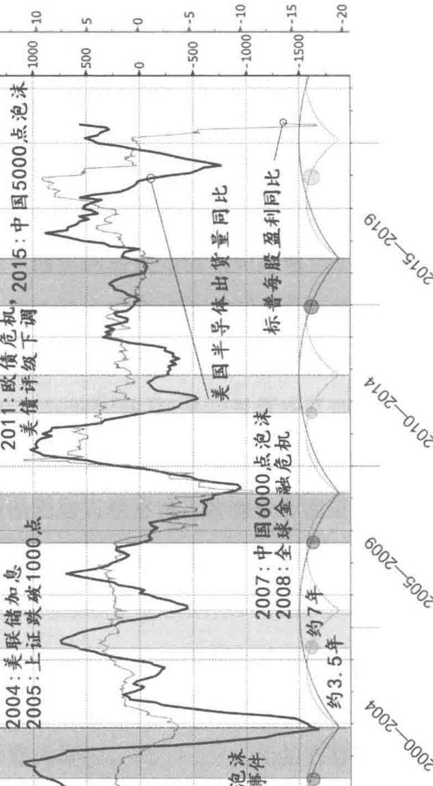

图4.4 美国经济出货量变化（黑色）、指数（蓝色）、外指数（红色），反映了美国经济周期运行和指标数据加总形成周期的同向性。浅蓝色、深蓝色分别为3.5年周期和7年周期，其中，中期和长期周期中的，深蓝色为7年周期的结束，深度泡沫周期开始的泡沫。中期和长期周期同时开始的深度泡沫周期完美吻合。
数据来源：彩虹，作者计算。

周期（如图4.4底部时间轴上的浅灰色和深灰色弧线所示）。最近的两个完整周期分别是2001年12月到2008年12月，2008年12月到2015年12月。

第二，在7年中周期内的第一个3.5年周期，是2001年12月到2005年12月，2005年12月到2009年12月，2009年12月到2012年12月，2012年12月到2015年12月。

第三，在7年中周期内的第二个3.5年周期，是1997年12月到2001年12月，2001年12月到2005年12月，2005年12月到2009年12月，2009年12月到2013年12月。

第四，在7年中周期内的第三个3.5年周期，是1994年12月到1998年12月，1998年12月到2002年12月，2002年12月到2006年12月，2006年12月到2010年12月。

## 周期是否可以预测 | 第四章

清晰地看到这些变量与周期指标之间的紧密联系：

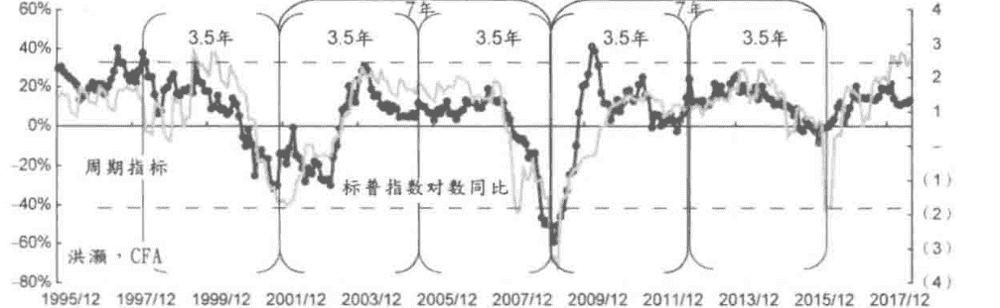

图 4.5 美国经济3.5年短期周期与标指标的对比

注：美国经济周期指标（右轴，灰色线条），标指标对数回报率（左轴，黑色线条）。周期（3.5年）和中期周期（7年）以大括号符号表示。
数据来源：彭勃，作者计算。

## 市场价格、产出、成交和调查之间的这些性、量的相关

相关性，证明了我们的周期模型的有效性：这里定义的周期性并不简单简单地当作偶然性而打诸之。所有这些重要的时间序列都显示了相似长度的、清晰界定的持续性。尽管这些数据经过了复杂的统计和数学处理，但它们的重要转折点在很大程度上都是一致的。这些周期序列中充满了普遍存在的、偏离一般规律的情况。即使出现偏离趋势的情况，这种偏离往往会加速或减缓其自身运行的势能，而不会改变中期趋势。这种罕见的时的趋势偏离，本身就是值得注意的，是周期存在的证据。

可以看到，美国经济的3.5年短期周期与中国经济的3年短期周期是基本一致的。我们在之前讨论了中国的猪肉价格周期的运行，也从侧面证明了中国经济的3 年短周期。中美两个经济体中，由两个短周期组成的6~7 年的周期也是基本一致的。中美两国短周期与长周期的交汇，必然对经济和市场的表现，以及政策选择产生深远影响。

在前述和后续的讨论中，我们用计量学定义了美国经济的 3.5 年短周期和中国经济的 3 年短周期。正是因为经济周期的变化，我们才能观察到国家宏观经济变量波动的相似性和同时性。周期似乎围绕既定的趋势有节律地波动。当然，我们也不用过分解释美国经济短周期和中国经济短周期之间大两个季度的差异，经济周期可能不像像时钟那样精准。

康德拉亚夫在其开创性的著作《经济生活中的长波》中讨论了短周期、中期与长周期之间的差异。他似乎不同意一些批评者的看法，即周期是由资本主义生产制度的，并受到“偶然的，经济以外的情况和事件的“催化”，例如技术的进步，战争和革命，新国家融入世界经济，黄金生产的波动。相反，他认为这些看起来改变了历史进程的变化其实是周期内生的。例如，技术进步可能在周期转折点之前就已经产生了，但在不利的经济条件下，新技术并不能立即即时使用；战争和革命可能是争稀缺资源以发展的结果；随着世界需求的扩张加剧了开辟新市场的渴望，而新世界也随潮流地融入旧世界；黄金产量的增加是经济扩张的货币带带来的需求增加的必然结果。

## 周期是否可以预测 | 第四章 211 

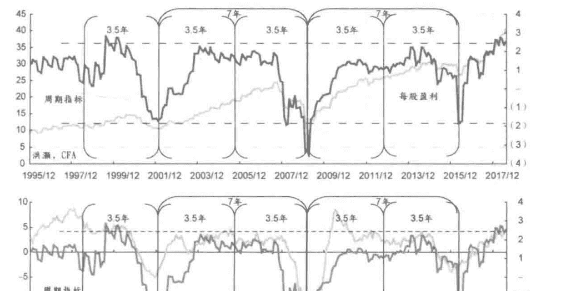

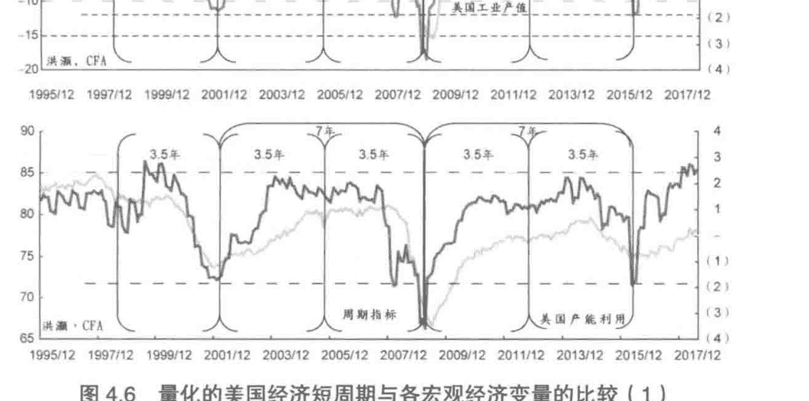

图 4.6 量化的美国经济短期周期与宏观经济变量的比较 (1)

注：美国经济短期周期（灰色线），美国经济的一些重要指标（左轴，黑色线）。短周期（3.5年）和中期周期（7年）以大括号显示。
数据来源：彭译，作者计算。

我们对于中美经济周期运行的观察和论证，结合康德拉季夫的理论假设，有助于清楚认识近来的经验。中国2014年为户籍改造释放流动性，2015年中国市场泡沫，

## 212 预测：经济、周期与市场泡沫

2016年特朗普赢得美国总选选举，以及因中国的供给侧改革，商品价格自2016年以来的复苏，还有日益升级的贸易摩擦，都可能是经济周期内生的。虽然这些历史事件对市场产生深远的影响，但经济周期的不同阶段、不同的供需形态，以：

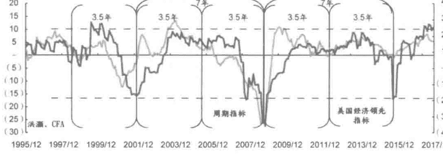

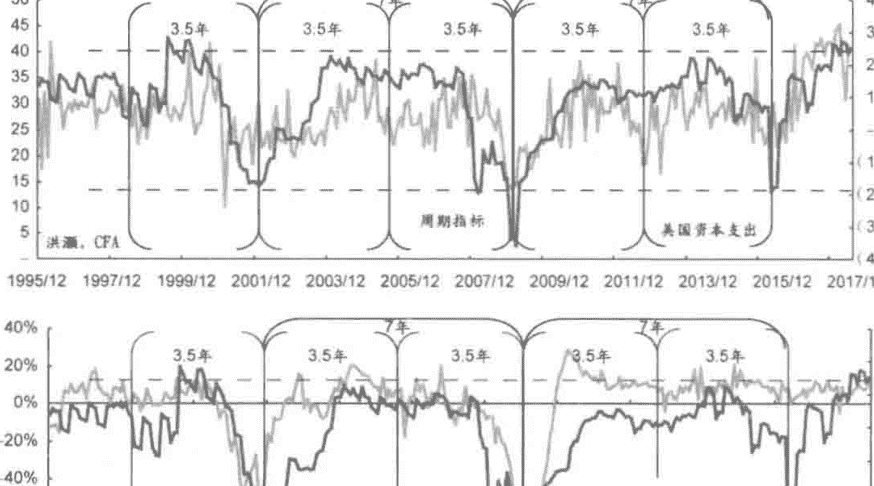

图 4.6 量化的美国经济周期与宏观经济变量的比较（2）

注：美国经济周期指标（右侧、灰色线），美国经济的一些重要指标（左侧、黑色线）。短周期（3.5年）和中期周期（7年）以大括号显示。
数据来源：彭博，作者计算。

## 周期是否可以预测 第四章 213

它们对市场的影响的影响有助于人们观察并解释这些事情。与市场同步的情绪波动引起我们对这些事件的关注。2018年9月，在首次发表对中美周期运行中的纠缠后的预测时，我写道：“随着美国的3.5年短周期在下穿7周期之前冲顶，特朗普在贸易摩擦的谈判中会更加激进，并最终导致美国周期的回落。同时，美国短周期的颓势可能会当前普遍看涨的市场导致意外的重大调整。最终，中国3年周期的减速将把美国周期也带下。”报告的那天，正是2018年纳斯达克指数见顶的时刻。随后，美国市场暴跌，使2018年第四季度成为自大萧条以来糟糕的第四季度。中美经济存在明确的短周期。这些周期源于经济运行的内在动力。在周期运行的时候，大量经济变量规律地波动，并在经济运行的轨迹上引发“潮起潮落”。每隔几年，当美国和中国的短周期纠缠在一起，市场领域就会出现显著波动。过去几年发生的历史事件，如2015年的中国泡沫，2016年特朗普当选总统以及近两年升级的贸易摩擦，这些周期引发的观察偏见，而不是周期的起因。否则，我们必须解释。在文中，我会以量化的尺度来验证中国经济这些短周期的存在。2018年第四季度，中国的3年周期正陷入最后的减速阶段，而美国的3.5年周期正跃升至拐点附近，即将进入下行阶段。随着历史的重演，就像我们的量化模型所显示的那样，重大事件和剧烈的市场波动将出现。此时，美国市场在拐点前的强劲表现并非因为特朗普的英明决策，其实这些政策反而强化和加速了美国周期的运行。美国经济短周期的强势，特朗普在2018年的贸易谈判中采取了更强的立场，进而使得美国的政策选择更偏激，最终导致美国周期下行的拐得猛烈。同时，中国的政策应对受到国内杠杆高企和房地产泡沫的阻碍。中国哲学倾向是坚持“人定胜天”，忽略了周期的力量。对于周期产生的阻力均衡应对，将让我们暂时离开周期结构性改革的轨迹。中国市场往往在政策转向宽松的时候进入寻底阶段。然而事实证明，当美国和中国经济周期同时进入上升或下行阶段时，两个经济周期的交汇产生的合力是很难抵抗的。由于中国周期往往领先，中国股市未来可能跑赢美国市场开了序幕。

美国经济在2021年将逐步进入中周期的下行阶段。由于一个周期往往持续7~11年，包含2~3个短周期，2021年可能是从2016年开始的持续了7年的中周期的下行阶段。如果是这样，全球市场的动荡就会接踵而至；又或者那时可能有2016年以来的新的11年周期里的第二个3.5年短周期。这个周期将在2021年左右下行，并伴随着严重的危机，之后再次进入1年周期的最后一个3.5年短周期。但无论2021年是7年周期的结束，还是11年周期开始下行的最后一个短周期，那一段时期，市场和经济的表现都会极度不安。

在2017年3月，我第一次通过定量分析的方法阐述了中国经济运行3年周期的理论。我们通过分析实际实际增长数据与其周期趋势的偏差，得到了3年经济周期的规律。截至2018年，中国经济运行共有五个非常清晰的3年经济短周期：2003—2006年，2006—2009年，2009—2012年，2012—2015年，以及从2015年第四季度到2018年2019年初。在本本书动笔的时候，2019年初开始的短短周期仍然在进行。为了验证这3年经济短周期，我将其与中国其他宏观经济变量的量化数据进行比较。我们证明了钢价格、利率、工业产、股指等指标的走势都和中国3年周期紧密相关。这说明了3年经济周期可以解释其他宏观变量的走势（见图4.8）。从过去20年的数据可以看出，中国经济周期的长期趋势是向下的，每个周期的高点和低点不断下降。这是由于巨大的投资规模和快速增加的杠杆，压抑了经济的发展。

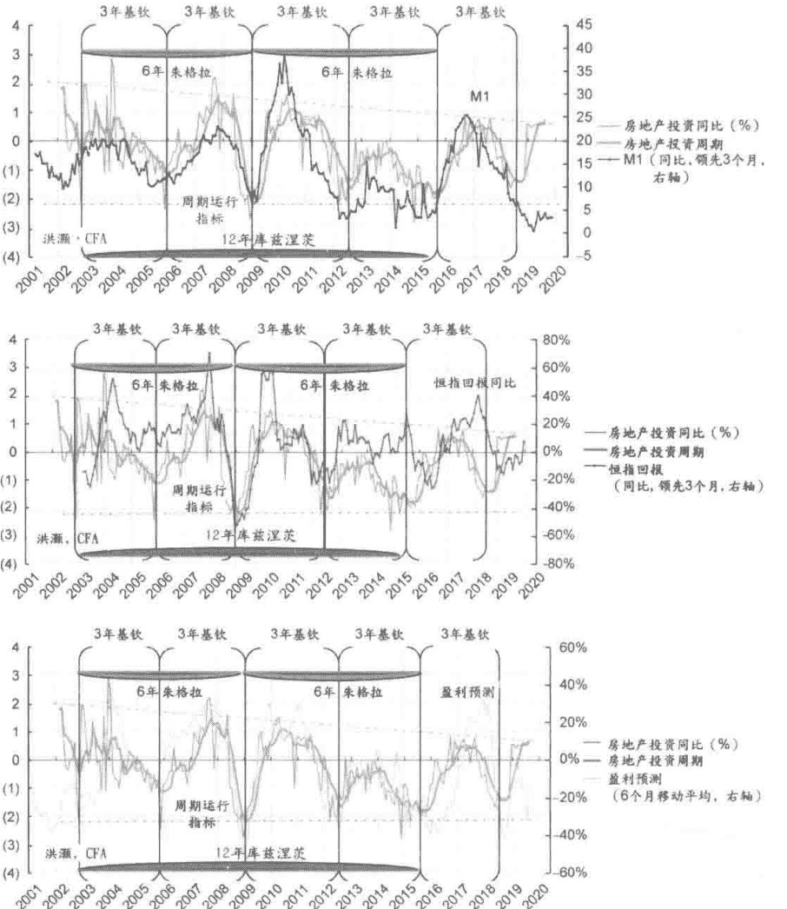

4.8 中国3年经济周期

数据来源：彭博，作者计算。

经济周期持续长度可能与房地产有关。比如，建设一座住宅，建筑完成时间为9~12个月，水电安装需要3个月左右，再加上贷款审批需要1年，房屋消化时间约为3年。而房地产投资完成时间约为3年。中国库存周期也具有清晰的、大约3年的周期。过去20年里，每个周期的高点也在不断下降。图4.9对比了中国工业产品库存和金属价格。

注：金属价格同比变化（左），工业产品库存同比变化（右）。数据来源：彭博，作者计算。

更有意思的是，中国的狭义货币供给周期和工业产品库存周期与全球股市的运行也有密切的相关性。当然，我们知道相关性并非因果关系，中国的宏观数据变化并不是全球股指引起的决定性因素。然而，考虑到中国经济在全球中举足轻重的地位，以及在中国在全球产业链中处于中游的位置，中国的货币政策选择和工业产成品库存的变化反映出来的经济周期的运行，必然影响全球股票的运行。同时，这些周期的时间跨度也是一致的。历史数据印证了这一理论（见图 4.10）。

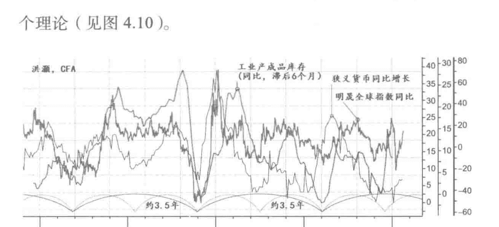

图 4.10 中国广义货币供应、工业产成品库存和全球股指的3.5年周期

注：广义货币同比增长（右轴），工业产成品库存同比变化（右轴），全球指数同比变化（右轴）。数据来源：彭博，作者计算。

## 及时止损，但不要止盈。

—李嘉图

李嘉图是一位传奇的古典经济学家。他的著作《政治经济学及赋税原理》是宏观经济学的石之一。出人意料的是，李嘉图还是一个追随股市趋势的交易员。他出生伦敦的一个犹太股票经纪家庭，并在14岁时搬到阿姆斯德顿。在那里，李嘉图接受了更广泛的犹太社区圈子的教育，并很快学会了股票交易的艺术。

当时，李嘉图因为一位贵格会教徒求婚被父亲逐出家门。他别无选择，只能依靠股票交易的唯一技能谋生。不久李嘉图证明了自己是金融街的人，并积累了足够的财富。他的交易能够获利的秘密就是“及时止损，但不要止盈”。当凯恩斯后，李嘉图把兴趣转向了经济学。亚当·斯密在《国富论》中的见解非常显著。他是一个伟大的经济学家。我在文中讨论了关于美国经济周期的运行，并详细描述和量化了这些周期的存在。在图4.7中，我们可以证明经济中存在约3.5年的周期。与中国经济周期的运行一致，每个周期的低点也大致吻合。

康德拉亚夫提出，周期是由单一周期叠加的，包含了2~3个短周期（3.5年）叠加形成了7年周期的波波。康德拉亚夫坚定地宣称，这些周期的叠加不是平均上的，而是组成了更长的周期。

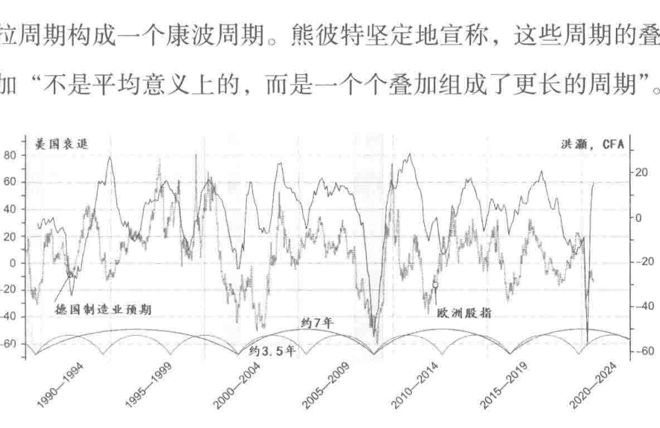

注：欧洲指数（左轴），制造业预期（右轴）。数据来源：世界银行，作者计算。

李嘉图对市场趋势的见解究竟会有什么？在经历了2020年3月历史性的暴跌，以及全球无前例的宽松政策之后，我们观察到一系列经济指标开始从低位反弹。例如，2008年第四季度的深度开始反弹，同时股指和半导体出货量也开始低位反弹。我们也可以看一下铜周期（见图4.2）。我们的量化分析发现，铜的价格确实存在一个约3.5年的周期。这个铜价格周期和我们之前述的中国经济短期周期长度基本一致，上证回报。

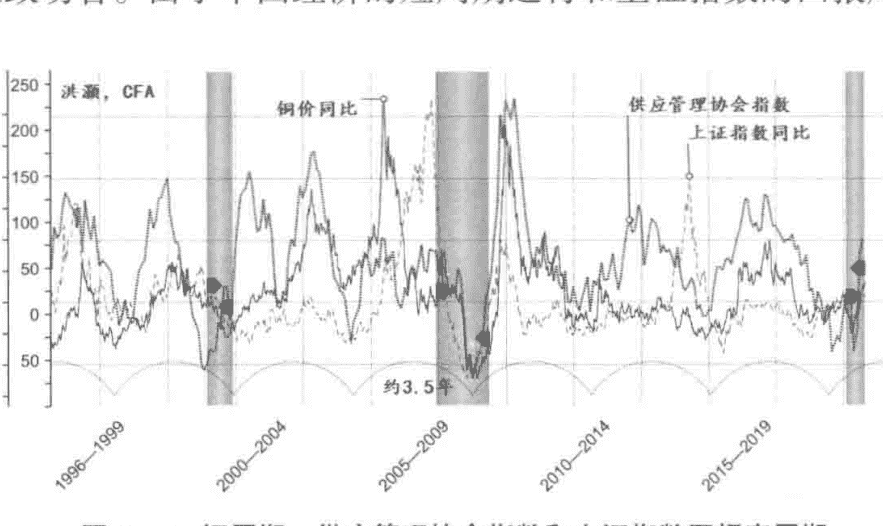

注：铜价同比变化（左轴），上证指数（左轴），供应管理指数（右轴）。数据来源：彭博，作者计算。

也基本符合，所以周期的存在进一步证明了周期在其他宏观变量里的客观存在。我在2020年6月中旬写作时看到的是，铜周期也开始从低位反弹。全球经济的修复，还可以从市场情绪的修复中得以验证。比如，我们可以用铜和黄金的非商业净头之差，作为市场情绪的度量。由于这是本书第一次提到这几个重要的概念，我希望一点幅述一下这几个宏观变量的意义，以及它们在市场预测中的用途。铜是一种工业金属，而黄金则是著名的避险金属。当然，在2020年3月历史性的暴跌之中，黄金也不能幸免，随着股市的暴跌而下挫。然而，市场总是“在恐慌中抛售黄金，在绝望中买黄金”。或者，也验证了中国那句老话：“乱买黄金。”这是因为在市场恐慌性抛售的时候，人们并不觉得金融已经窘到难以的地步。这时候，人们买黄金主要是因为现金流动性的需要，尤其是基金经理需要现金来应对基金赎回的压力。然而，当市场完全绝望的时候，也就是说，形势糟糕到连美元这个曾经的“纸黄金”也信不过去的时候，比起战争、恶性通胀，那么在这个绝望之际，只有实物黄金才能真正避险。

非商业净头是一个衡量商品期货市场纯投机仓位的指标。我们不需要看商业净头，也就是那些大众商品商、贸易商的头寸，因为这些头寸主要是用来对冲头上本来就有的风险敞口的。比如，一个铜矿公司，它手头上本来就因为铜的产生而了一个天然的多头。这个天然的多头在交割给客户之前，必然会受到市场波动的影响。如果在交割前铜价跌了，那么这个铜矿公司就会损失收入。因此，铜矿公司就会在日前锁定自己的风险，让铜矿公司专注于产量。

## 预测: 经济、周期与市场泡沫

当然，这是从市场价格倒推出来的价格隐含预期。在未来价格发生变化的时候，比如，假如新冠肺炎疫情二次爆发时，市场价格隐含的预期也会随之变化。

任何周期模型的重要性在于评估和预测许多不容易察觉的潜在趋势，以及转折点的大程度。尽管并非无一失，但这些预测可以提高交易策略获得盈利的可能性。作为宏观策略师们，我们不能仅仅留在简单的经济预测中，还要判断我们的预测可能带来的市场价格波动。我独有的周期模型自开发以来有着持续良好的记录。这些模型似乎在指向 2021 年将出现“周期之末”。

我们如何将这些经济模型应用于市场交易开发？新的交易策略对当前的交易环境又有哪些具体的关键判断？

## 中国市场回报的周期

市场改变了吗？简言，并没有。市场只是人类情感的货币属性反映……我在 20 世纪 50 年代赚了大钱的交易方式，与我的前辈菲弗莫尔和巴鲁克的交易方法并不无相同……就是顺势航行汹涌的市场情绪浪潮之巅。

- 尼古拉斯·达瓦斯，投资者和畅销书作家

## 周期是否可以预测 第四章

由于经济周期的规律性潮起潮落，我们观察到各种宏观经济变量在各国之间波动的相似性和同时性。经济周期似乎围绕着其潜在趋势有节奏地波动。直观地说，股票市场作为经济基面的晴雨表，其价格变动必然在本质上反映了潜在的经济基面。

此前，我们根据市场与经济周期之间的相关性进行市场预测。从今，我们已经证明了中国经济的短期周期为 3~3.5年。现在的问题是，股票市场如何反映这一经济周期？我们知道，3.5年是 42个月，两个3.5年的短期周期共同成了 7年的周期。上海证券交易所里，每个月平均20.2个交易日，每个 3.5年的短期周期约有 850个交易日（3.5×12×20.2=848.4~850个交易日）。如果我们计算周期内的市场回报，理论上我们应该在回报率的波动中看到一些经济周期运行的影子。经济周期的长度与移动均线上的重要折点大致一致。

实际的情况也如此。在图4.14中，我们展示了中国市场的回报率在 7年的周期内起落回归，这个周期由两个 850天的短期周期组成。同时，图4.14还显示了850天市场回报率与美国经济领先指标之间的密切关联性。请看看它们如何在图4.14中同步振荡。这是中国股市周期，以及与美国经济之间的相互依存关系最有力的证据。

## 预测: 经济、周期与市场泡沫

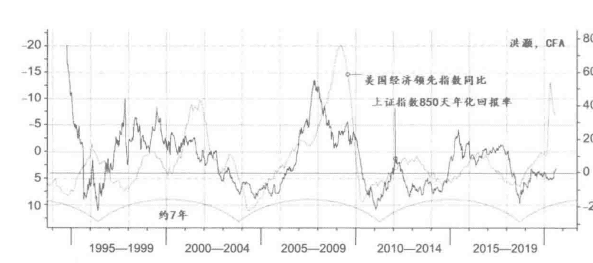

图4.14 上证指数850天年化日回报率的7个周期（3.5年 ≈ 850个交易日）

注：美国经济领先指数（左轴），上证指数850天年化回报率（右轴）。

数据来源：彭博、作者计算。

如果我们简单的在上证指数对数值图上绘制一条850天移动均线，可以看到这条移动均线在历史上许多重要的转折点都是重要的支撑和阻力线（图4.15中灰色圆圈表示显著的支撑位点和显著的阻力位点）。这些观察结果与我们上述的假设一致，并证实了我们的3.5年经济短期周期为基础的850天股市周期的显著性。

从图4.15中可以看出，850天移动均线是一条指数现价均衡线。从长期来看，指数现价高于低于这条移动均线都会向其回归。也就是说，上证指数的价格运行具有强烈的均值回归特征。移动均线通常的应用，往往将现价价格与平均值进行比较，以衡量潜在的趋势的可持续性。

中国人的储蓄和投资习惯在2010年左右发生变化

长期趋势850天移动均线不再创新新高

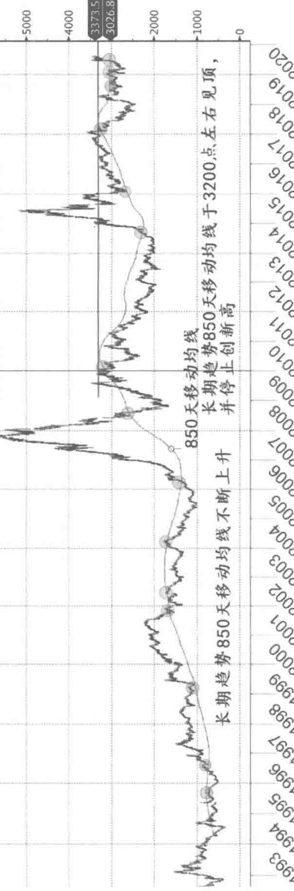

- 中国人的储蓄和投资习惯在2010年左右发生变化
- 长期趋势850天移动均线不再创新新高
- 长期趋势850天移动均线不断上移并停止创新高
- 850天移动均线在3200点左右震荡

图4.15 850天移动均线是上证指数重要的支撑和阻力

数据来源：彭博；作者计算；CFA

## 预测：经济、周期与市场泡沫

然而，在图4.16中，我们将上证指数在历史上重要的支撑和阻力点之间，价格与移动均线的距离加以以阴影区域表示。我们注意到，2010年，也就是中国经济在2008年之后，是一个分水岭。在2010年之前，上证指数基本上是上升趋势，850天移动均线以上区域（黑色）小于区域面积（灰色）。那时起，移动均线已经停止创新，且处于一个区域。在2010年第二季度，上证指数约为850天移动均线的下方，市场处于重要的折点。

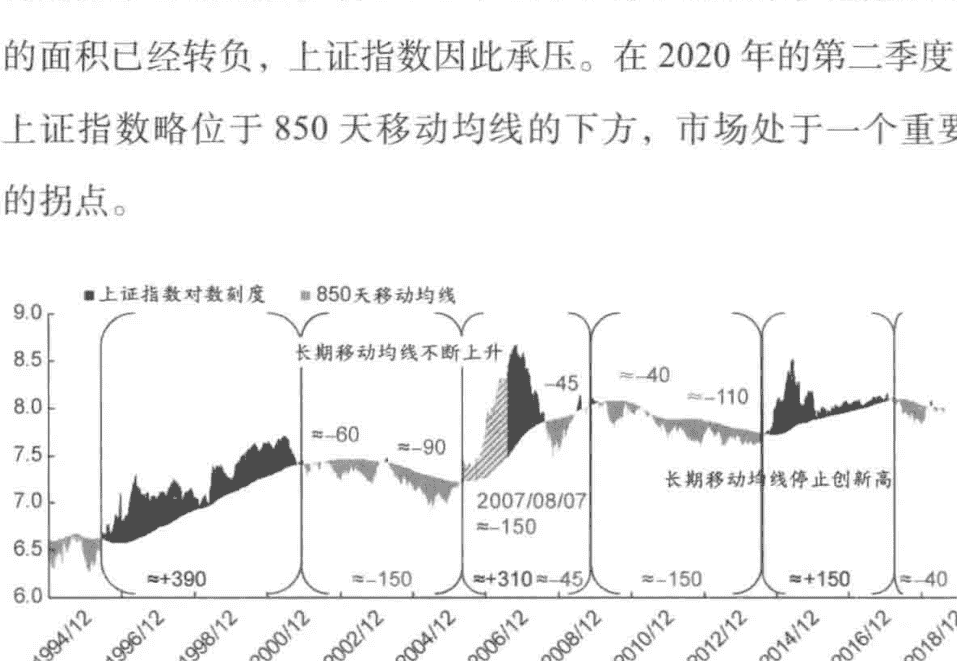

图4.16 上证指数在850天移动均线上的面积

数据来源：彭博，作者计算。

## 周期是否可以预测 第四章

这里要简单说明来自周期基金（FC）的研究。这个基金的董事成员包括托马斯·德马克。德马克用其专有的德马克指标来识别周期并创造了良好的记录。这个基金的研究使用了1789年以来的数据，证实了股市周期为42个月。第二次世界大战结束后，以42个月为波长的周期更为突出，并且从那时一直存在。这个约42个月的股市周期和我讨论的850天、42个月的股市周期基本一致，也也被1912年以及1923年分别确认。

## 预测中国市场的“潮汐”理论

你需要的一切就在你面前。——杰西·利弗莫尔

在前文，我们讨论了2010年前后，中国人的储蓄和投资习惯发生了显著的变化。经常性账户盈余的累积在2009年后大幅放缓。这反映了宏观储蓄的下降，以及中国吸引外国储蓄能力的增长。由于储蓄等于投资，所以固定资产增长同步放缓。同时，广义货币供应也出现下滑，这应对外汇的减少（见图4.17）。

## 预测：经济、周期与市场泡沫

中美经济紧密互补：中国生产，美国消费。因此，美国经常性账户赤字是美国消费过剩的结果，也是中国货币流动性的重要来源。由于美国家庭在2008年之后试图去杠杆，美国经常性账户赤字占GDP的比例实际上已大幅改善。中国经常性账户盈余占GDP的比例下降，实际上是美国经常性账户赤字占GDP比例改善的一个镜像。因此，中国的货币供应增速也在下降。

广义货币供应的增长对中国股市的表现至关重要。随着货币增长减速，2010年之前的长期趋势基本已经停止，并被一个有限的区域所取代。从一个不断增长的时代，正式进入零和博弈的时代。

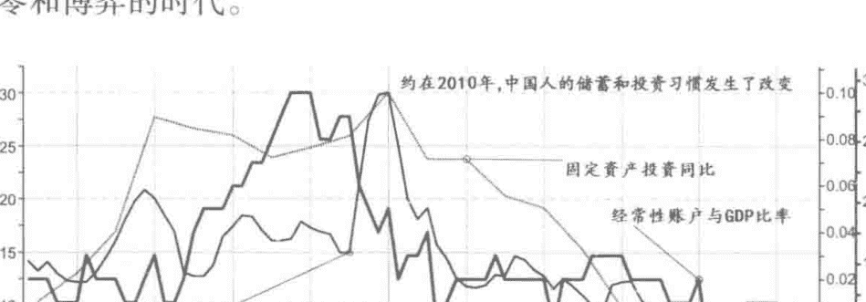

图4.17 自2010年以来，中国人的储蓄和投资习惯发生了显著变化
注：广义货币同比增速（左轴），经常性账户与GDP比率（右轴），固定资产投资（右轴外）。

数据来源：彭博、作者计算。

## 周期是否可以预测 第四章

在零和博弈的时代，850天移动均线对市场预测的意义越重要。在这样一个市场受到明确交易区间约束的时代，移动均线对市场指数运行的参考意义更为显著。我们将指数和850天移动均线的偏差，以滚动850天的时长来计量总和，看出这个滚动的总和也有明确的顶部和底部范围，并且能够精确定位指数的历史底部（见图4.18）。

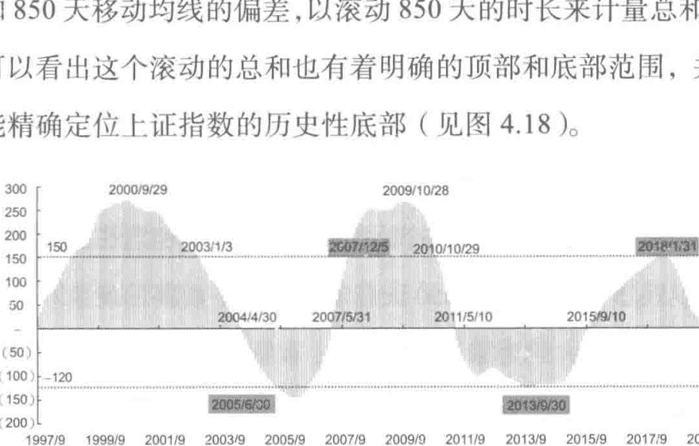

图4.18 上证指数和850天移动均线偏差的850天滚动总和有明确的顶部、底部范围

数据来源：彭博、作者计算。图4.18有一些值得的特性是在250左右达到峰值，在-150~-120达到谷。我们在区域面积扩大时使用250为分割点，而在区域面积减少时使用-120作为分割点，以制定一个单边交易规则。如果是这样，在过去的20多年里，我们只找到了两个建仓和两个出的节点。但是，这几个建仓和出的时间节点都对应重要的市场。

## 预测：经济、周期与市场泡沫

折点。2005年6月—2007年12月的第一次回报约为500%，这个交易几乎是完美的。2013年9月—2018年1月的第二次回报约为70%，但是这次交易没有错过2015年的那泡沫。注意的是，850天移动均线是一个慢移动均线，并不适用于短线交易。图4.18标记的所有日期，都可以潜在的离场时间。第二，在2010年后和零和博弈的时代，图4.18中的灰色区域正负之间交替了相当长一段时间，反映了指数价格在850天移动均线上下震荡的现象。这个累积面积约为零，也就是说市场处于重要的点。第三，这个计算程序其实是用领先法，用最新的指数偏差代替最老的，来计算指数价格和850天移动均线偏差的滚动总和。由于最新数据2018年1月以来的低于移动均线的负值，随着时间的推移，新的移动均线计算中逐渐增加。如果经济及其市场进行重要的结构性改革，850天移动均线将继续作为一个重要阻力位，200点仍是潜在趋势的峰值。以历史为，图4.18中累积灰色区域的方向向下更大。

## 周期是否可以预测 第四章

我们把图4.18表现的指数和850天移动均线之间的累积面积和，与一艘满载货物的如何在水中漂浮进行对比。随着累积面积开始下降，就像重的货物（当较低的价格）被装上船，以较轻的货物（之前较高的价格），指数将会下降，类似于船在水中逐渐沉没。当累积面积大小变为负值时，通过指数现价和移动均线的差值计算的每一个面积必然为负值，对应于较低的现价和下降的移动平均，就像一艘不断沉没至水平面的船。反之，随着累积面积开始上升，就像较轻的货物（之前较高的价格）被装上船，以重的货物（之前较低的价格），指数将会上升，类似卸货之船在水中逐渐上浮。当累积面积大小为正值时，通过指数现价和移动均线的差值计算的每一个面积必然为正值，对应于较高的现价和上升的移动平均，就像一艘逐渐浅出面的船。因此，我们将此预测方法称为“潮汐”市场预测理论（见图4.19）。

数据来源作者计算。

## 预测：经济、周期与市场泡沫

## 如何预测美国市场

社会和经济现象里时长完全固定的周期是根本不存在——无论长波还是中波。后者的长度在7~11年之间波动。长周期的波长在48~60年之间波动……我们上述的长波是国际性的……同样的时间节点也适用于美国。然而，资本主义发展的态势，特别对于美国来说，其波动的时间节点或具有特殊性。

> 康德拉耶夫，《经济生活中的长波》

著名的艾格特波浪理论家罗伯特·普莱特认为，康周期平均波长约为54年，也就是5个10.5~11年的中周期，或是15个短周期。在论证了上指数的850天波动周期后，我们想要知道来自3.5年短期周期理论的股市周期是否也适用于美国市场——尤其是中美经济周期具有密切相关性。

我们发现，850天移动均线对美国市场的效果甚至更好——除了它的表现形式和中国市场略不同。这一移动均线是标普指数的长期趋势线。与中国不同，20世纪70年代以来，标普指数大致沿着这一趋势线不断上行。在中国，指数价格围绕着移动均线上下波动。

## 周期是否可以预测 第四章

只有伴随着经济的严重衰退，才能使指数大幅低于移动线。在过去的50多年中，只出现过4次这样的情况：1973—1975年的经济衰退与石油危机；20世纪80年代初的通胀控，美联储货币政策最紧；2000年的泡沫和9·11事件；2008年的贷款危机。在其他时间段，指数跌至850天均线下，移动均线获得支撑后反弹并上升。即使是1987年10月的“黑色星期”，或1990年第一次海湾战争中的温和衰退，无法打破这个长期的上升趋势（见图4.20）。我们注意到美国市场的长期趋势始于1982年的经济衰退之后，沃尔克大幅提高利率抑制通胀。沃尔克紧缩的货币政策非常不受，遭到总统的激烈抗议。我们可以从那个期的观察中推断出长期市场的必要因素：扩张性的财政政策，劳动生产率提高和由央行的必要政策支持（见图4.21）。

以周期理论来指导极端期的交易。我们在文中述了市场价格的运行如何反映周期的起伏。市场是经济的一面镜，往往大了经济的波动，但是市场还是反映周期的镜像，尽管可能是一个真实的，并且扭曲的图像。我们的量化研究证明

## 预测：经济、周期与市场泡沫

850天移动均线作为股票的长期趋势持续有效美国经济1973年、1980年、2000年和2008年：

- 2015年：美联储开始上调利率
- 2001年：美联储——互联网泡沫
- 2008年：衰退——贷款危机美国股市历史性下调
- 2011年：衰退——历史性底部
- 1991年3月：衰退
- 1982年1月：衰退
- 1990年7月：衰退
- 1975年3月：衰退
- 1973年1月：衰退
- 1987年：黑色星期——衰退

850天移动均线是结束趋势指数的长期趋势线，只有严重蓄才能可能反转数据来源：彭博；作者计算。

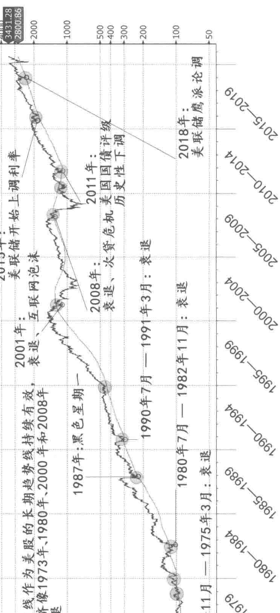

| | | | | | | | |
|---|---|---|---|---|---|---|---|
| 16.00 | 14.00 | 12.00 | 10.00 | 8.00 | 6.00 | 4.00 | 2.00 |
| 14.00 | | 12.00 | | 10.00 | | 8.00 | | 6.00 | | 4.00 | | 2.00 |

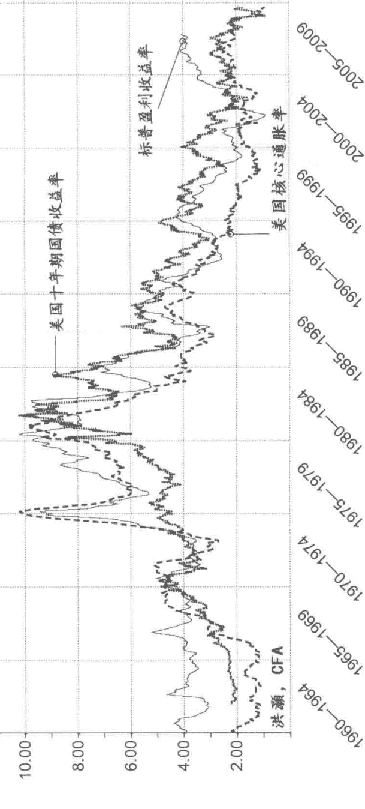

图4.21 美国核心通胀率（左轴），标普盈利收益率（右轴），美国十年期通胀收益率（右轴）。

数据来源：彭特、作者计算。

## 周期是否可以预测 | 第四章

经济周期里的基础库存周期持续时间约为3.5年，2~3个基础库存周期共同形成一个7~11年的朱格拉资本置换周期。我们发现，这个3.5年的基础库存周期是持续时间更长的周期的一个基本组成单位。比如，10个以上的3.5年基础库存周期形成了大家熟能详的康周期。

在市场进入危机阶段，2007年10月初到2009年3月的约50%的市场暴跌，我们可以用850天移动均线来寻求市场的支持位置。一般来说，只有在市场和经济发生严重危机的时候，市场指数的运行才会突破这850天移动均线。注意，我们的移动均线系统是从周期理论中反向得到的，而不是通过技术图形得来的。这是我们的移动均线系统和其他技术分析不一样的地方，它是有坚实的周期理论作为基础。此，我在阅读的与周期相关的书籍和文里，大部分停留在对周期的运行历史回顾，并在历史数据的基础上预测未来周期的运行。我发现许多周期理论对股票市场运行进行预测，或资本配置提出建议。然而，预测市场和配置资产却是周期理论中最实际的运用，也可以体现在周期理论如何实现交易中给出实际的交易策略上，而不仅停留于纸上谈兵的阶段。

我们在在前文讨论了我的周期理论对于资产配置的意义。那从，在短期的市场交易中，我们是否可以再次把周期理论用到交易策略上？我认为答案是肯定的，前提是。

发现这个数字序列。虽然我们暂时没有读到正式的理论解释为什么这个数字序列存在于市场价格的运行中，但在历史上，市场价格运行时的上涨和回撤往往可以检测到这个序列。在计算市场回撤的时候，交易员往往把一个周期的最高点和最低点相减，并采用这个序列各个关键的分支点，得出市场价格回撤的大概位置。

在图 4.23 中，我们展示了标普指数的日线蜡烛图。可以看到，2350左右是标普指数的一个关键支撑位。例如，在上一轮周期，2018年12月26日的最低值就落在这个位置上。2350的这个点，正好是上一轮周期的850天移动均线的位置，也是2018年12月圣诞节标普指数找到支撑，并强势反弹的时刻。在本轮周期里，2020年3月23日美国夜盘、3月4日亚洲早盘的时候，标普指数也在2350点附近触底并强势反弹。值得注意的是，在本轮周期里，2350点恰在标普指数1750天移动均线上，也就是两个3.5年短周期形成的7年中周期得出的移动均线上。此外，我还发现了850天、42个月这些从我的周期理论中推演出来的股市运行的数据，在改变时间单位之后，仍然对各自对应的周期运行有效。比如，把42个月改为42周、42天、42分钟的时间单位之后，推导出来的移动均线对对应周期的交易仍然具有显著的意义。比如，图 4.24显示了道琼斯指数一日日线与其42天移动均线在 2020 年 3 月这次暴跌之前的对应位置。可以看出，42 天移动均线对于以日线级别操作的交易周期有着显著的指导意义。

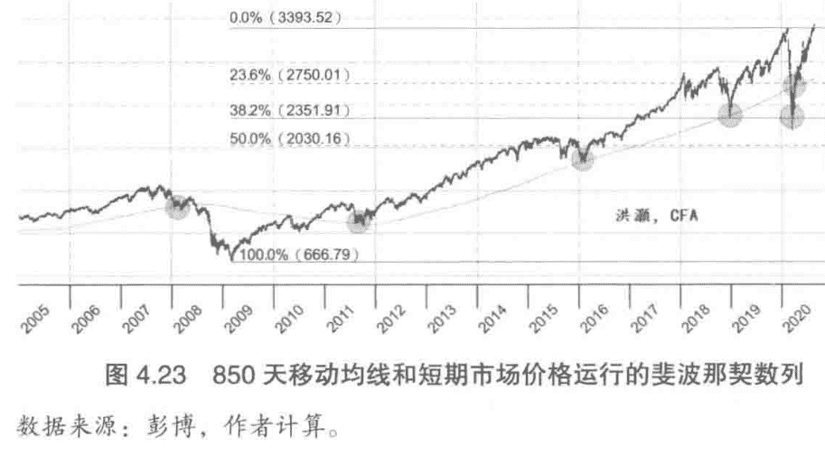

图4.23 850天移动均线和短期价格运行的斐波那契序列

数据来源：彭博，作者计算。

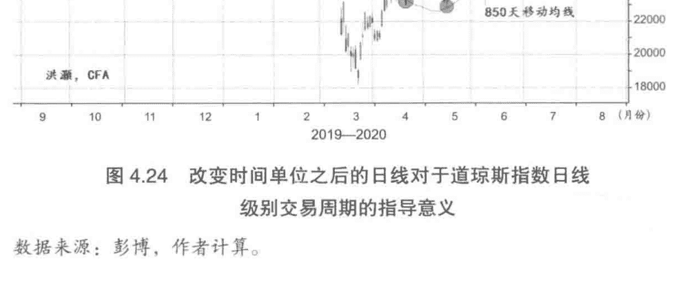

图4.24 改变时间单位之后的日线对于道琼斯指数日线级别交易周期的指导意义

数据来源：彭博，作者计算。

## 预测：经济、周期与市场泡沫

## 结论

既能判断正确，又可以拿住仓位的交易员并不常见。我觉得这是交易中最困难的事情之一……我的思考从来都没有为我赚到大钱，反而是我的以静制动在帮助我。明白了了吗？我是拿得住（仓位）！

> —— 杰西·李弗莫尔

行文至今，我已经论证了自身的经济中短周期理论如何可以用于预测中国股市，以及如何在极端市场环境下指导交易。经济周期的波长和股市收益周期是一致的。从这个经济短周期的波长得到的 850 天移动平均线，恰好与各个股票指数的历史性相似。此此，850 天移动平均线的确是市场的长周期。李嘉图从他的经济直觉中获得的市场趋势的洞察，今仍在继续发挥作用。

托马斯·马尔萨斯与李嘉图同时时代的经济学家之一，也是李嘉图的灵魂伙伴，他当年以另的方式与李嘉图合作。他通过一系列关于当时各种重要经济问题的公开辩论共同进行理论探讨。注意的是，在关于“玉米”的辩论中，两位挚友在对立面进行的激烈的思想交锋，奠定了后来马尔萨斯经济租金原理的基础，以及李嘉图的比较优势原理。这些理论都是现代宏观经济学的基石。

在与李图进行经济“剩余产能”的辩论中，马尔萨斯认为总需求可能小于完全就业时的总产出。马尔萨斯后来在他的《人口原理》中，进一步阐述了关于非生产性消费阶层的存在，对于解决社会供给过剩的必要性。然后，凯恩斯也认为，马尔萨斯的理论就是就业不足条件下凯恩斯主义均衡的前身。可对于事，李图认为非生产性消费阶层存在的理由：

中国人的储蓄习惯在2010年左右发生变化，李图的上涨趋势股市逐渐演变为一个明确的交易区间，新的流动性来源是引发上涨趋势的必要条件。同时，中国自2015年以来一直在进行汇率改革，以及从2019年开始了LPR（贷款市场报价利率）改革。中国的改革已经开始深化和加速。这些都是此程序的改革，一旦完成，中国将重新握回对其货币政策的主导权，逐步远离美联储的影响。在2020年5—6月，由于美联储为了应对新冠肺炎开始了史无前例的宽宽松货币政策，全球的货币体系正在面临历史性的格局变化。不仅美国的广义货币供应达到了历史性高峰，并领先全球，自身的广义货币供应的速度，回到了两个水平。这是近年来最快的货币供应。我认为，由于人工增长后，劳动生产率的提高，一直被压抑总需求和通胀水平，直接造成了社会收入和财富差距。顶层人口拥有财富，类似于马克思的“非生产性阶层”。而被压抑的总需求，根本无法吸收完全产出。这个观点将在文中阐述。展望未来，非生产性消费阶层的存在将继续为通胀和利率下降留空间，直到利率变成零。虽然还有长的发展道路，但中国的货币政策独立，以及随着市场进一步开放和全球指数权重带来的外国流入，成为未来引发上升趋势的必要因素。目前，850移动均线仍然是指数运行的重要线。毕竟是2015年夏天那个时刻，也没有让移动均线突破3200点。这也是长期趋势的历史高峰。2010年后，850移动均线不断上升，显示了由于经济增长导致规模不断大的利润，在一个更大的饼里。然而，2010年后，这条移动均线已经停止创造新高，并且局限在一个交易区间内。上证指数变成零。

| 类别 | 描述 |
| :--- | :--- |
| 银行存款 | 大型银行存款（左轴） |
| 消费者指数 | 右轴 | |

注：大型银行存款（左轴），消费者指数（右轴）
数据来源：彭博，作者计算。

和博弈游戏。2010年后中国的储蓄和投资习惯发生变化，以及投资增长开始减速。上证指数需要某些政策的改革和扶持，才能形成一个新的趋势。康德夫和恳钦的研究也证明了，时长42个月就是3.5年。这个市场周期通过独立量化研究推导出来的时间长度基本一致。虽然股市波动大于基本面的变化，但中国可以借鉴美国长期牛市的经验。新牛市需要新的流动性来源。中国不断深化汇率改革以掌握权重，全球货币量宽松，资金流入都是潜在的新增资金来源。长期以来，中国新的牛市正在酝酿。然而，在新的趋势出现之前，上证指数仍然是一个受制在交易内的零和博弈游戏。一如凯恩斯在《就业、利息和货币论》里所述：根据以往经验，无论是消息面还是市场氛围的改变，都足以影响市场大众的心理，因此，专业投资者被要求预测将发生的变化。这是投资被所谓“流动性”影响不可避免的结果。在传统的金融理论中，没有比崇拜流动性更主流的，这是投资机构都热衷于将资源集中在具有“流动性”的证券上的原因：

从社会的角度来看，高明的投资目标应该是击败那些制约我们未来的发展和无知的黑暗力量。但从私人的角度来看，所谓高明的投资却是“抢跑”，正如美国民众充分表现出来的样，要智胜众人，还要把坏的、贬值的残破彻底抛给接盘侠。

## 未来可以预测

我不不考虑未来，因为它很快就会到来。

> —— 爱因斯坦

### 通胀消失之谜

价格是一种记录机制。当民众以交易商品维持生计时，会用价格来衡量商品的成本。对经济学家来说，价格计量货币价值的变化，而价格还告诉了卡尔·马克思关于生产中价值的分配。历史已经积累了大量的价格数据——汉比特时期巴比伦的黏土片，以及法老时期莎草纸的残骸，都对价格的记录。

在文中，我讨论了央行的政策如何影响市场价格形成，最终导致泡沫。由于央行的政策选择是可以预测的，所以市场价格对于货币政策的反应也是可以预测的，尤其在市场遭遇严重危机，市场价格运行到极端的时候。其中一个关键点，也是古典经济学的假设出发点相符的地方，那就是实体经济的充分就业是一个唯一的、贯穿始终的均衡点。即使在运行时出现供给不平衡的情况，市场的运行在完全竞争的市场机制下可以通过价格的变化调整使供给关系重新平衡。显然，这是一个不切实际的假设。

在这个假设的基础上，古典经济学变成了一门在给定的条件里把有限资源分配最大化的社会科学。随之来的边际思维革命、边际效应递减等现代经济学重要的概念，成为主导逻辑。然而，想一下，在一些领域里资源并非有限。现实生活中，虽然边际效应递减的现象依然存在，但在科技日益进步的今天，我们发现中国的BAT（百度、阿里巴巴、腾讯）等科技公司，以及美国的脸书、亚马逊、谷歌等互联网公司，它们的规模不断扩大，产品服务的边际成本非常低。如果我们换一个角度，那么古典经济学的思维方式就会打破。在一个需求不足的世界里，供给相对于需求显然过剩。在这样的世界里，没有必要由于资源有限的，我们需要通过市场信号来调整供需关系。然而，直观来看，有限资源的假设本身就意味着价格的不断上升。或者说，有限资源的出发点本身设定了一个潜在的趋势。在一个资源有限的世界里，央行货币政策最重要的目的，是给整个经济的运行指定一个价格的锚，使社会里对于通胀的预期不会像脱缰野马、无锚之船那样不受控制。同时，在这样的经济里，由于劳动资源是有限的，菲利普斯曲线对劳动和就业之间的反向关系的描述大致是准确；在劳动资源有限的前提下，失业率越高，通胀越大。这是一个对1929年大萧条，到20世纪80年代初期沃尔克上任美联储主席，美国经济60年历史的描述。

在沃尔克大幅收紧货币政策，以忍受严重的经济衰退来制服通胀恶魔之后，供给和需求的关系发生了模型化的转换。由于社会通胀预期被重塑，开始长期趋势性地低，人们的消费、储蓄、投资习惯发生了根本的变化。随着通胀预期的长期低迷甚至消失，人们“提前消费，活在当下”的心态也发生了明显的改变。通胀稳定后，人们不再需要急忙把钱换成消费品，而是更多余地选择投资以获得更高的消费能力。在新的环境中，总产出相对于消费来说严重过剩。

在沃尔克大幅收紧货币政策，以击性经济、忍受严重的经济衰退来制服通胀恶魔之后，供给和需求的关系发生了模型化的转换。由于社会通胀预期被重塑，开始长期趋势性地低，人们的消费、储蓄、投资习惯发生了根本的变化。随着通胀预期的长期低迷甚至消失，人们“提前消费，活在当下”的心态也发生了明显的改变。当时经济界最有影响力的两位经济学家——李嘉图和马克思，各自从不同的角度推出了资本主义发展的末日视觉。李嘉图的观点和马克思相似，李嘉图认为土地供应是有限的，而人口却快速增长，提出了“资源稀缺原则”。因此，李嘉图认为人类无法逃脱自己的，农阶级和贵族之间的矛盾激化，并通过革命废除了许多固有的贵族特权。这场革命为李嘉图当时的社会末日提供了很强的经验支撑。同时，马克思提出了他的“无限积累原则”。马克思观察到，从19世纪到19世纪中期，经济增长速度明显加快，然而劳动者的工资水平基本上没有改变。经济利润、地租和房租在此期间都出现了快速的上升，而劳动者却没有参与到社会的进步过程中。他说，虽然经济增长加快，工业进步，但对于劳动者来说却是毫无意义的。他们的生活水平和工业进步一样，他们每天仍在生计奔驰劳碌，没有受到经济发展带来的丝毫好处。这些社会和经济的现实情况表明，当时的经济和政治制度已经明显破产了。因此，马克思预言，资本主义的末日将会到来，是因为资本回报边际衰减会导致资本占据总收入的比例越来越大，最终导致阶级之间的斗争不可调和而爆发革命。当然，社会革命没有像马克思预言的那样资本主义发展的末期爆发，是在俄罗斯和欧洲一些比较贫的国家先发。但无论如此，这两个在当时最有影响力的经济学理论的出发点，都是资源的有限性。

在过去的35年里，美国由于外资回流美国进一步加深了美国以外的市场，尤其是新兴国家市场的流动性危机。这个资金在市场风险激化的时刻的国际流动过程，在本书的第一章里已经详细论过。这也是美国作为唯一的避险资产提供者的特权。在长达30多年的十债收益率下行趋势线上，我们可以看到全球市场的历次危机：1987年的“黑色星期五”；20世纪90年代初的拉美债务危机，一些美国国家还没有从中恢复；1997年的亚洲金融危机；2000年的互联网泡沫破；2008年的次贷危机。宏观流动性的收缩通常是历史上导致全球市场危机的诱因，2020年3月历史性的暴跌也不如是。这是一个交易员中十债收益率的历史。十债收益率在2018年的第四季度触及当时历史的底部而反弹。如图5.2所示，我们可以看到2018年的底部与之前收益率在2014年和2016年触及的底部并反弹的位置基本一致。从交易技术分析的角度来看，2018年的十债收益率的底部是“三重底”。一般来说，这样的底部支持位置是非常牢固的。毕竟，这个“三重底”出现在十债收益率30年下行趋势的末期，同时，从趋势上看，这个“三重底”是牢固的。当时的确扭转了十债收益率长期下行的趋势。

## 富资不均衡

在过去的35年里，美国十年国债收益率（以下简称十债收益率）一直处于一个长期下降通道中。十债收益率的上升往往侧面反应宏观流动性紧缩，反之亦然（图5.2）。十债收益率的每一次飙升，都预示着全球市场即将发生危机。当危机发生的时候，全球的避险资金都会回到美国国债市场，大家会选择美国国债作为避险工具。同时，美元作为避险资产的定价货币，也因为避险资金对于美元的需求而走强。

图5.1 各社会阶层收入占比随着富有阶层收入和财富的不断累积，整个社会的富差距不断扩大。尽管大部分人的消费习惯提前、消费水平提高，但储蓄率还是下降。富有阶层占据了社会大部分的财富，最后转化为财富积累。因此，我们观察到的社会现象是：随着社会的进步，水平在不断提高，但是由于分配制度的缺陷，劳动生产率提高的速度远高于消费增长，富有阶层的储蓄率越高。

## 未来是否可以预测 第五章 263

然而，长期收益率长达 30 年的下降趋势，记录的不仅是全球市场和经济的兴衰，也是市场交易员对价格波动的看法。在一个经济学者的眼里，十债收益率 30 年的下降趋势，还是劳动者剩余价值被剥削的历史。由于劳动者报酬的增长低于劳动生产率提高的速度，通胀被抑制，并导致对通胀最敏感的国债端收益率长期趋势性下行。简单来说，对于他们的产出，劳动者的报酬实在是太低了。劳动者报酬的增长落后于劳动生产率的增长，这有效控制了价格水平。这个现象从 20 世纪 80 年代初至今，导致债券市场长期偏离股票。由于大量的劳动者报酬的增速持续低于劳动者的产出，劳动者的剩余价值明显地累积在社会少数人手里。这就是为什么 20 世纪 80 年代初期以来，全球收入分配失衡的现象日益严重，同时全球经济严重失衡。

在图 5.3 的债券长期收益率下行的趋势上再另外一个变量之后，十债收益率的历史就会勾勒出一幅不同的画面。在图 5.3 中，我还比较了劳动者报酬的增长和劳动生产率的差异，并得出了两个观察结论：第一，劳动者报酬和劳动生产率的缺口，十债收益率在历史数据以来一直高度相关；第二，缺口的变化与十债收益率的长期趋势一致，一直直到 2014 年之后开始背离十债收益率的长期下降趋势。其实，这个缺口就是通胀压力的阀门。一个不断收缩的缺口意味着

## 预测: 经济、周期与市场泡沫

劳动产出的增速大于投入，就是说，劳动者的剩余价值被不断剥削并累积到霍主阶层。如图 5.3 所示，一个变的缺口意味着劳动者或工人阶层，并没有得到与其生产率改善相匹配的、合意的劳动补偿。简单来说，这个缺口记录了在过去 30 多年劳动者的剩余价值被剥削的历史。资本家通过给劳动者支付低的报酬，不断累积剥削来的剩余价值，在劳动生产率促进经济增长的过程中获得了更多的利益。

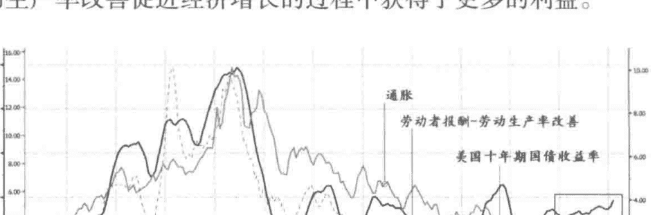

图 5.3 美国十年期债是剩余价值被剥削的历史

劳动者报酬—生产率改善未得到合理补偿

注：劳动者报酬—生产率改善（左外），美国十年期收益率（左内），通胀（右轴）。

数据来源：彭博，作者计算。

因此，从更深刻的角度来看，不断下降的十债收益率也反映了生产力和生产关系之间的长期错配。资本家和劳动者之间的经济收益分配不均，劳动者不能得到合意的报酬。由于分配不均而产生的社会富差距压抑了需求，供给相对于需求总是过剩，通胀压力因此一直被压抑。保罗·沃尔克极度紧缩的货币政策驯服了这条链恶魔，从那时长期压抑了社会的通胀预期。同时，撒切尔及其铁腕政策粉碎了工会，削弱了工人们进行劳动报酬谈判的筹码。如今，富贫差距在全球不断扩大，收入分配不均的程度在一些国家已经达到了令人发指、不得不不变革的地步。如上所述，劳动者报酬和劳动生产率之间的缺口从 2014 年左右就开始扩大，同时劳动者报酬和劳动生产率的缺口与收益率的运行方向，从那时起开始出现前所未有的背离。

从这个角度看，当民主主义的兴起会让让人感到意外的了。根据法里德·卡卡利亚的定义，民主主义是“对于不同群体来说不一样，但所有民主主义者的愿望都对社会精英、主流政治和成熟的社会结构充满了怀疑和敌意”。民主主义者认为自己是“被遗忘的普罗大众发声，是真正的爱国主义者”。由于长期得不到劳动的报酬，劳动者开始要求从经济增长中分得其应一杯。由此出发，“占领华尔街”运动、中国重新强调全民社会福利政策、默特克移民政策的意图和反对等一系列社会现象和政策，突然之间都有了一个清晰的背景。

## 266 预测：经济、周期与市场泡沫

劳动意意味着工人阶级根本没有赚到足够的钱去储蓄，不得每天为生计奔波于奔命，以往过着手口停的日子。社会里大部分劳动者的低储蓄率拉低了美国的全国平均储蓄，并在克林顿任时，中国加入世贸组织之后，不断下降，最终为负。储蓄资本本质上是一种投机形式。就像在弗兰科·迪利安尼和米尔·弗里德堡模型中的消费者一样，中国人放弃了眼前的消费而努力，是希望在未来可以更好、更多地消费。因此，今天商品的需求以及商品现在的价格，一定是被人为压抑了的。直观地说，中国人最终决定将其巨额储蓄转化为消费之时，就是通胀或者说是商品未来的价格必然结构性上涨之时。

由于美国消费，中国人蓄，国际资本流动意味着美国可以吸收外国储蓄，尤其是来自中国的储蓄，以补充美国国内储蓄的不足。因此，美国贸易差的扩大是美国储蓄下降的镜像，随着中国储蓄率的增，这些与美国贸易活动而获得的中国储蓄，随后用于购买美国国债，压抑了十债收益率。现在，在中国消费抬头和人口老龄后，中国的储蓄率开始下降，通胀压力上升（见图 5.4）。

## 未来是否可以预测 | 第五章

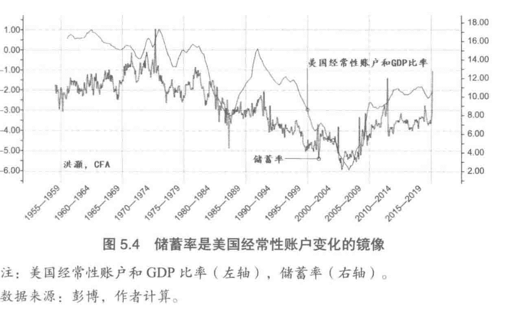

图 5.4 美国经常性账户变化的

注：美国经常性账户和GDP比率（左轴），储蓄（右轴）。数据来源：彭博，作者计算。

劳动者报酬—生产率改善未得到合理补偿

由于分配不均而产生的社会富差距压抑了需求，供给相对于需求总是过剩，通胀压力因此一直被压抑。保罗·沃尔克极度紧缩的货币政策驯服了这条链恶魔，从那时长期压抑了社会的通胀预期。同时，撒切尔及其铁腕政策粉碎了工会，削弱了工人们进行劳动报酬谈判的筹码。如今，富贫差距在全球不断扩大，收入分配不均的程度在一些国家已经达到了令人发指、不得不不变革的地步。如上所述，劳动者报酬和劳动生产率之间的缺口从 2014 年左右就开始扩大，同时劳动者报酬和劳动生产率的缺口与收益率的运行方向，从那时起开始出现前所未有的背离。

## 未来是否可以预测 | 第五章

图 5.4 美国经常性账户和储蓄的变变

注：美国经常性账户和GDP比率（左轴），储蓄（右轴）。数据来源：彭博，作者计算。

劳动者报酬—生产率改善未得到合理补偿

## 价格革命

图 5.5 美国经常性账户和储蓄的变变。

注：美国经常性账户和GDP比率（左轴），储蓄（右轴）。数据来源：彭博，作者计算。

## 未来是否可以预测 | 第五章

图 5.6 通胀预期开始快速

注：美国进口型通胀（左侧），黄金（右侧），通胀预期（右侧）。数据来源：彭博，作者计算。

## 结论

这是本书的最后一章，也是最短的一章。在前面的章节里，我讨论了货币政策思路及其对全球资产价格长期影响。在这一章里，主要讨论的是货币政策思路发生的转变，特别是沃尔克大实验以来，从凯恩斯主义到新古典经济派的思潮演变。通过观察这些数据，可以发现富差距并没有消失。库兹涅茨是研究富差距的先驱之一。从过去 100 年的数据中，我们可以清楚地观察到，20 世纪 80 年代以来收入分配不均日益愈烈。同时，劳动者报酬的增长逐渐落后于劳动生产率的改善。如此巨大的收入分配不均的现象也曾发生在 16 世纪的西班牙、17 世纪的美国黄金时代和咆哮的20 世纪 20 年代。这些时代都交织着技术突破、金融创新、政府配合、移民人口和占领海外领土带来的劳动生产率的巨大改善。在那个时代，那些富有并过良好教育的人充分发掘了这些趋势。图 5.5 的左图中，以英美为代表的格鲁鲁-撒克登国家，与图 5.5 的右图中中欧大陆国家和日本不同的历史对比，表明贫富差距至少有一部分是社会制度造成的。换句话说，不同的再分配制度可以减轻或加剧收入分配的失衡，并非无选择。而工人阶层已经觉醒，并开始争取其应的部分。

当然，富有差距的另一个推手，是社会各个阶层财富积累的不同，这比收入分配的不均有着更明显的差异。如前文所述，富有阶层的储蓄率明显高于社会底层。因此，富有阶层可以以更多的收入转化为储蓄进行投资。而投资回报的指数增长效应，意味着财富的快速积累。同时，收入的增长往往与

经济的增长呈现相关关系，但劳动者收入低于其劳动生产率的提高，意味着收入的增长速度往往低于投资的增长速度。然而，投资回报往往快于经济的增速。比如，在美国，股票的长期投资回报是 8% 左右，但经济的增速在 2%~3%。这个投资回报大于经济增长导致了财富的积累，进一步加剧了社会富裕等的现象。

## 未来是否可以预测

但是富不均造成的社会割裂并不是一个可以长期维持的、稳定的社会结构。在人们发明现代货币理论麻痹自己，继续吹作资产价格泡沫的时候，我们必须考虑一下长期贫富不均带来的社会反应效应。

打算自由主义激进地想要把解决社会问题的重担留给他们假设的完全有效的市场，但是要在决定货币政策的时候，应该对其导致的社会效应应有所重视。尤其是几十年来宽松的货币政策，以及在史无前例的宽松导致的贫富悬殊的社会阶层极化。很难想象，一个出现各种失效迹象的、被设为完美的市场可以为我们解决矛盾。如果可以，社会中的贫富悬殊就不会像今天这样极端化了。凯恩斯说：“真正的有效的投资在于它的社会效应，在战胜被未醒着的时代的黑暗。”

当然，凯恩斯思想里的这种社会主义倾向被许多西方经济学家巧妙地回避了。毕竟沃尔克却用了引导理性预期和有效市场的新古典经济学的理论战胜了通胀，并为20世纪80年代以来行的货币政策思路、自由主义的市场潮波奠定了坚实的理论基础。然而，在利率持续将变的经济里，货币似乎再次走到了尽头。凯恩斯是一个非常成功的投资者，他完全可以通过自己的投资赢得回报，在剑桥遍地研究一下哲学，在布鲁姆斯斯伯里团体里与弗吉尼亚、伍尔夫等著名的作家、艺术家谈天论地，把酒论言。然而，凯恩斯敏锐的观察让他觉察到，这种小资调的生活方式，在当时社会富富悬殊、阶层割裂的环境里是不会长久的。这很可能是他发动凯恩斯革命的出发点。是为了证明他思维的优越性，他把自己的理论用各种数学微积分方程式紧紧地包裹了起来，像是穿上了一副刀枪的盔甲，变得晦涩难懂，让很多人看不懂也不得不言如深。这个例子让经济学的后来顶礼膜拜，开创了把经济学当作精密工程学的先例。后来，很多经济学家忽略了实际数据的收集，醉心于更优、更复杂的数学公式来表现自己。其实，很多经济人根本没有读过《就业、利息和货币通论》，或者读到一半就放下了，又或者是读过但并没有真正读懂。总之，90年前凯恩斯发起的革命被掩埋在难懂的数学方程式里，最终被新古典经济学所取代。这场逐渐被遗忘了革命，却一直在资本市场价格运行上默默地发挥着光热。到如今，它有卷土重来之势。

## 周期的轮回

在给本书取名的时候，我纠结了很久。预测的艺术，在于它本身就是一个模糊和不断完善的过程。这个过程就像是周期的运行，既没有开始，也没有结束。这样的一本书起名，犹如要用几个字总结经济学百年历史的积累，还要准确地展望未来一样。本书试图将经济学、金融学理论运用到市场预测上。

然而，这些理论本身也在不断进化的，中央银行对于货币政策的管理也在与时俱进。

2020年3月在全球市场发生历史性的暴跌之前，美联储历史上最有名的主席——保罗·沃尔克去世了。这似乎是命运与市场开的玩笑的一个笑话。众所周知，沃尔克是美联储现代历史上最激进的主席。为了控制通胀，他不惜把美联储的基准利率上到接近20%，并因为随之而来的严重的经济衰退直接导致他任命为美联储主席的卡特总统选择失败。卡特总统在后看来感叹道：“我们低估了沃尔克给美国经济带来的影响。”其实，沃尔克当时的货币政策实验，给美国的政治、美国货币政策的选择，以及美国乃至全球的经济、市场，都带来了非常深远的影响。沃尔克对于美国经济里通胀预期的调控，直接改写了那之后美联储货币政策的逻辑和思路。这场伟大的实验及其最终的胜利，终于宣布货币主义的退潮，以及大萧条之后盛衰一时的凯恩斯主义的退幕。从以后，即使美联储货币政策的逻辑出现这样或那样的小修小补，它的核心仍然离开货币政策对于通胀预期和就业的影响。

其实，更重要的是沃尔克对于他长期通胀预期的影响。美国通过限价政策，如工资涨幅，以及政府的积极财政政策去干预经济运行。然而，这些凯恩斯主义为调控经济周期所开的药方，似乎让美国经济的通胀预期完全失控。美国通胀在沃尔克任任之前多年，凯恩斯主义的财政政策和政策并没有奏效。当时的政策思路通过强调非菲利普曲线的运行，试图用高通胀来换低失业率，保证就业。然而，20世纪70年代的石油危机只让通胀预期高，失业率也没有下降，最终形成了一个滞胀的局面。非菲利普曲线完全失效了。以弗里德曼为首的新古典货币学派开始了对凯恩斯主义的攻击。谁说对美国经济的乱象束手无策；弗里德曼的货币学派认为，由于政府对经济运行过度干预，所以市场在资源分配时无法发挥作用，经济运行日益僵化。因此，新古典主义认为应该让市场充分发挥作用，重塑经济增长和通胀。在沃尔克任美联储主席之前，他就知道必须要牺牲美国经济，忍受一次异常严重的衰退，才能制服这条恶龙。当然，沃尔克上任前并没有和卡特商量如此选择。然而，沃尔克的天生勤奋让这种全美国人都带过的政策，在他的手里运行无比顺畅。沃尔克对于通胀的认识，来自于他在普林斯顿求学时期母亲要生活费的经历。多年以前，每个月的生活费数目是非常公平的，因为母亲没有考虑到通胀。为了从母亲那里拿到更多的生活费，他甚至还给姐姐增加了生活费。然而，沃尔克的却甘于虚地说道：“没有什么是不公平的，姐姐拿了生活费一样。”这个经历，在沃尔克家里留下了深刻烙印，以至于他在成功后从未采纳过任何建议，如沃尔克的大幅紧缩基准利率调到很高的时候，美国陷入了严重的衰退。经济对于利率非常敏感，比如房地产和建筑业，遭受了严重的打击。当时的情况过于绝望，建筑商、工人、农民在沃尔克的办公室拉到沃尔克的办公室门口。直到今天，沃尔克的书架上，还收藏着当年的一块材料，沃尔克说：“这就是美联储独立的最好的”。到了1983年，通胀开始收敛，美国经济也走出了严重的衰退。沃尔克的货币政策开始奏效。当然，每一个选择都会有不可避免的代价。当年这种极端的货币政策对于后来几十年通胀预期和消费习惯，直到今天，通胀预期的不断走低，资本有了更好的理由压榨劳动者的繁殖，从而使劳动生产率增长的速度。简单来说，劳动者报酬的速度低于劳动生产率增长，是一种对劳动者剩余价值的剥削。这个不断加速的过程，直接导致了整个社会的富差距扩大，并且了劳动者没有得到足够的补偿。随着时间的推移，有效需求的不足不断压抑了通胀。无疑，也为美联储在沃尔克之后实施宽松政策提供了扎实的理论基础和现实条件。同时，沃尔克的伟大实验，代表了新古典主义派在某一个时期理论上的优越性，代表着理性预期和有效市场假设。沃尔克的任期时期是全球范围内极度宽松政策诞生的伟大时刻，是一个时代的起点。然而，在2019年12月沃尔克去世不久，全球经济在新冠肺炎的肆虐下，陷入了自大萧条以来最严重的衰退。现美联储主席鲍威尔把宽松政策运行到极致。如果说沃尔克是货币主义全球行的先行者，那么沃尔克领导的美联储代表最紧缩的一极，那么鲍威尔的美联储代表最宽松的一极。最紧缩的沃尔克的去世，也恰恰发生在最宽松的时刻。这似乎是一个预示：随着沃尔克开启的紧缩货币实验的结束，宽松货币政策摇摆到了另一个极端，并逐渐泡沫。90年前，凯恩斯引发了第一次宏观经济思想的革命。现在，或许我们已经处于第二次宏观革命之中了。

## 关于作者

洪灏, CFA（特许金融分析师），在纽约、悉尼、墨尔本、伦敦、北京、香港等全球市场金融中心从事研究20多年。历任摩根士利消费行业分析师，花旗集团全球策略师，中国国际金融股份有限公司执行总经理、全球策略师，交银国际董事总经理、研究主管，清华五道口智经学院特聘教授，跨境金融50人论坛会员，中国首席经济学家治理理事。2001年获得 CFA证书，2016年担任 CFA协会品牌和形象代言人。

2017年，洪灏被《亚洲货币》杂志评为香港（地区）策略第一名和经济学家第一名等多个市场策略和宏观经济研究领域前三名的奖。2017年洪灏正式参加《亚洲货币》的评选，他和团队破纪录一共获得了12个奖项。在之后的《亚洲货币》投票中，他个人持续获得了超过80%的投资者在市场策略研究领域的投票。由于《亚洲货币》在2018年之后改变了投票权重，洪灏宣布退出这个评选。
