# 知识星球TOP
免费资源分享

添加微信
免费登录

| 序号 | 公号/星崇/群 | 原价 | 领域 |
|---|---|---|---|
| 1 | 生有术 | 2765/年 | 学业 |
| 2 | 怂众吃货群 | 365/年 | 政、历史 |
| 3 | 记忆Legacy/锦树西风 | | 成长、历史 |
| 4 | 欧洲金融 | 328/年 | 政、社会 |
| 5 | 克玄云会 | 699/年 | 社会 |
| 6 | 体内主任 | 365/年 | 职场 |
| 7 | 局人的视角 | 699/年 | 金融、股市 |
| 8 | 源涯井丰 | 4166/年 | 财富、成长 |
| 9 | 宁波顶总司令 | 599/年 | 经济、国际 |
| 10 | 江宁星行 | 365/年 | 经济、时尚 |
| 11 | 政堂/顾子明 | 568/年 | 经济、时尚 |
| 12 | 书怀 | 1399/库 | 金融、财富 |
| 13 | 大树栖语 | | 时尚、成长 |
| 14 | 永旺大犬 | 10000还 | 房产、经济 |
| 15 | 洪澜的宏观策略 | 4376/年 | 经济、股市 |
| 16 | 金通策划/蓝海山 | | 股票、行业 |
| 17 | 寻影的宇宙 | 299/年 | 政、社会 |
| 18 | 飞沫王 | 599/年 | 股市、经理 |
| 19 | 联朕信阅 | | 经济、金融 |
| 20 | 饕茶财经经 | 330/年 | 房产、股票 |
| 21 | 在八小时之外 | 365/年 | 成长、职场 |

更多资源，不再列举
+图书、课程、模板各类高价值资源

★ 免费群 每日分享资源
★ VIP群 每日分享所有资源（日20+），75/

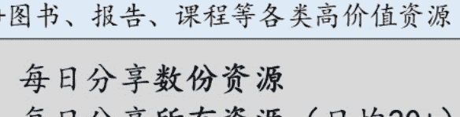

考虑到pdf自带下载（绝大部分免费阅读器都有），建议PC查看pdf，体验更佳，或者访问我们群里制作的在线，还支持关键词搜索

这里不另外送一份，资料要空~

# 【AI相关】15款

## AI定制歌曲礼物，低客单价销量达2000+、多场景变现

作者：锦涛（AI+电商）

日期：2023-08-15

点赞：126

正文：
爱买礼物不要了，给男朋友/女朋友的需求非常旺盛，定制一首会会很很好的选择，用AI来做的这成本只要不要一块钱可以直接定制歌曲，价格299-1000不等等配合一个50块的相框，情感价值更高，且用量就能变成MV，传播性强，音乐的自然流量自带。

同时，一首歌给爷爷侄子定制歌曲，父亲送生日、爷爷生日定制歌曲是很很好的市场，毕业季毕业级教程，教师教学给老师，只要是表达感情的场景就有这种。这类的企业企业定制歌曲，客户可以单价极高且不用会员，某定或某家都有免费的额外价值MV效果就能免费获一个VIPVIP！

# 加入，快来体验吧，项目实施

https://bvp9yto7k.feishu.cn/wiki/TnWWFf6qIytqRkl87hCNxGnKd?from-copylink https://www.suno.com/home/?from=invite&invite_id=38696984

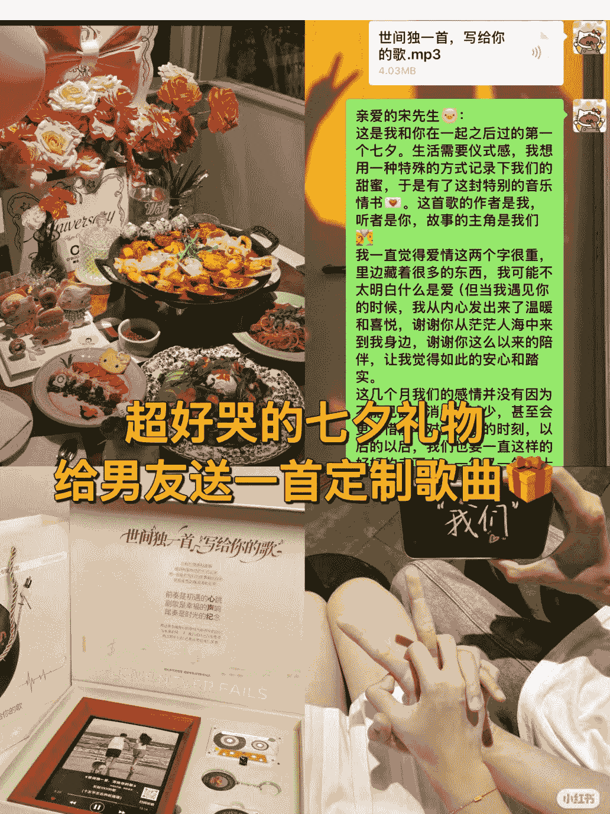

# 原创音乐工作室

专业歌曲定制

## 心声歌曲定制礼物音舞工作室 | 小红书: 947386784IP:陕西

原创音乐工作室，专业歌曲定制
你只给故事负责用心做好每一首歌，生日/纪念/表白……小预算
一首歌不只是礼物，更是回忆。

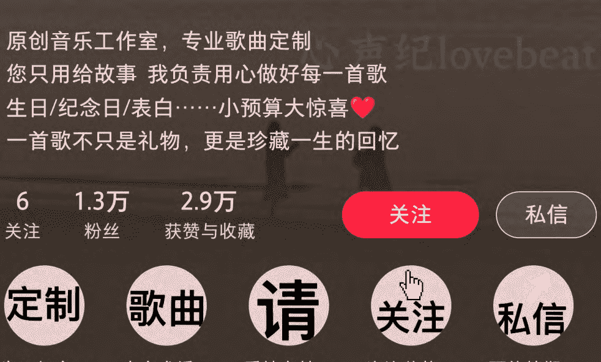

- 6关注
- 9万粉丝
- 9万与收藏
- 关注私信
- 定制生日纪念
- 歌曲表婚
- 请爱情友情
- 关注咨询价格
- 私信预约期
- 笔记收藏
- 小预算浪漫攻略
- 真实展示


- 关注
- 9万预约
- 关注
- 9万

-歌曲定制礼物版！你说故事我写歌！男朋友送什么礼物让他一辈子？每一句都是回忆，能听一辈子，每听都有不同的感受，真的是把回忆做成礼物！他定制一首歌，用一首歌的时间，向他说爱你。


## 心声歌曲定制礼物


# 仪式礼物

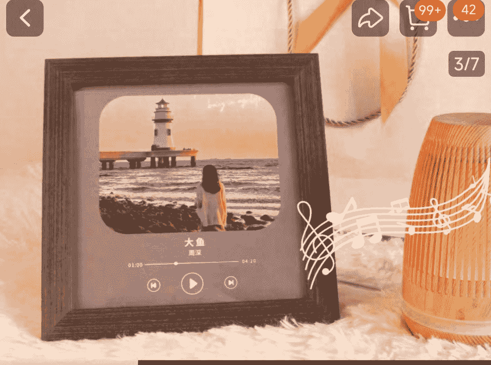

# 定制音乐相框送朋友、送恋人、送长辈定制创意音乐相框播放器可唱歌录音，Type-C充电耐用一键播放操作简便。成为企业会员，领千元权益。本月平均2天内发货，承诺7天内发达广东中山快速：免运费。不支持7天理由退货。颜色分类，客服收藏，加入购物车立即购买。

# 商店业务介绍

## 编曲
具体根据不同风格、难度、配器、录、音而定，500元起

## 作词
根据风格不同，150元起

## 作曲
可根据提词、主题、伴奏作曲，免费提供范唱，400元起

## 歌曲定制
作曲+作词+编曲+歌手演唱，整首800元起（单价变更需费）

## 混音处理
单轨(不含和声):200元起
包含：降噪+调整流量/口水音量调整/对轨/高音修正节奏修正/EQ均衡/压缩/混响/Delay/总线

## 合唱:300元起
包含：双人节奏修正(连唱）标准单轨混音。顶及带声制作:根据难度、轨数及要求而定

## 代唱:300元起

## 特殊评价区：
镇海(AI电商):[笑]烦躁的朋友点个，超过50赞我出一篇详细的攻略
亦奇：感谢分享，已中标
空：求攻略哈哈哈哈[呲]
优佳佳：哈哈哈哈期待！
冬后寻奇：期待你一份攻略，看看能不能跑闭环

# 镇(AI+电商): 策略攻略 https://copy.com/mayulong

斯诺起nice: 等攻略
临舱潜：把十九号了，攻略喽[呲]

公众号肉猎人搜索、懒人专属粉享

## AI办同类自媒体，广告投放带来1W抖音曝光

作者：哈哈

日期：2025-08-15

点赞数61

正文：
最近在做AI自媒体，发现一个现象：AI生成ppt、AI识别word到excel这种办公类的AI产品，需求量很大。

而且策划商的单价的很多，3500粉就有300元的单价收入。他们一起写一个小程序模板直接投放在五六个主ppt，七八个商家到到处找他们广告投放，我感觉他们很可爱(150块钱)，给他们带来带抖音1W的曝光，其他平台也有好几千，纯赚的还是很多人赚生财朋友评论区：
阿豪John:[强]很好的机会可以考虑发在风向标上!
哈咯：好的，PPT制作、老师师傅，都是AI生成，但是我试用了，效果很差，还是拦不住他们用狂横扫。
哈嗨：哈哈，官方打算把我推给我了。
亦二：我丢[发来]感谢分享，已中标
哈咯：我丢[发来]老大了，简单直接：图片吗？
哈咯：图片吗？程序的就好，商家是带流信息不好。

# 通过Claude,24小时把网站SEO到第一，并赚3000金

作者：文少

日期：2025-08-09

点赞数57

正文：
用Claude，24小时把网站SEO到第一，并赚3000金。YouTube看到一个很狠的案例：一位叫James的营销人，主要是Claude Code为一个全新的市场站（卡神器），24小时内冲了多个关键词的前三，立刻带来了3000金收益。先上原文：

## How Claude Ranked First on Google (IT for Agencies)

YouTube · Greg Young 2024年5月24日

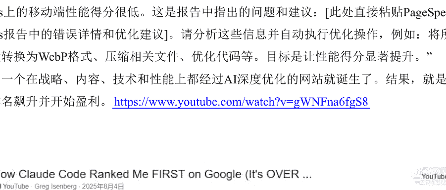

- Step 1: 关键词
- Step 2: 页面优化
- Step 3: 数据结构
- Step 4: 提升活跃度
- Step 5: 自然流量

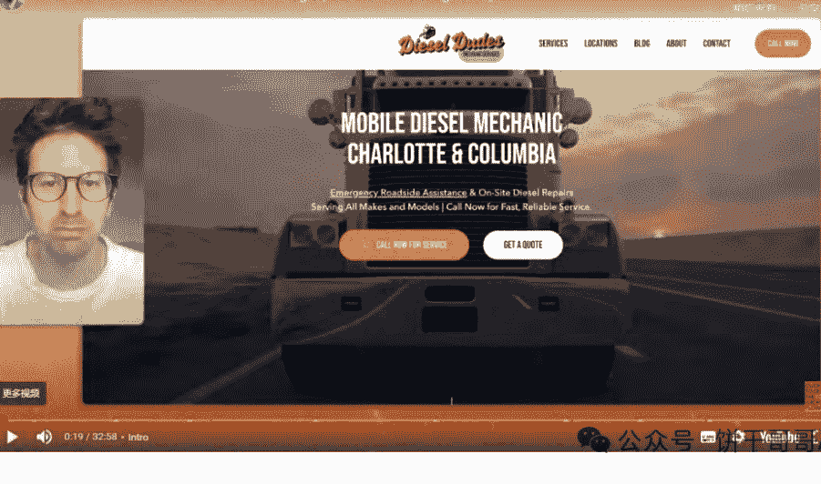

## 用 Claude 24小时冲上谷歌，SEO全到第一

AI驱动的全新排名，颠覆传统法。从零到一快速实现。

| 24小时 | 3000+ | SEO |
|---|---|---|
| 上海排名 | 每日真实收入 | AI驱动优化 |
| 循环 | 赛特哥

## 编程实操：Claude植入“资深工程师”思维，高效完成12个项目

作者：坤哥

日期：2025-08-13

点赞：48

正文：
项目实操最近在网站出海，刚刷一位大神用Claude在短时间内完成了12个项目，效率惊人。他的秘诀就是给CC一个“资深工程师”的灵魂模式和职业素养，创建了一个全局配置CLAUDE，这个文件包含了完整的信息，非常值得被编程的老铁收藏。原文链接：https://www.dzombak.com/blog/2025/08/getting-good-results-from-claude/

## Getting Good Results from Claude

I've been experimenting with LLM programming agents over the past few months, Claude has become my favourite. It is not limits allowed me to write ~12 projects in relatively little time, I wouldn't have been able to do all this in the same amount of time without it. Most of them I wouldn't bothered to write without Claude, simply because they'd taken too much of my time. I'm still far from Claude expert, and I have a backlog of blog posts and documentation that might be useful. But this is critical—you don't have to read everything out to start seeing results. You don't need to read this post, just type some prompts in and see what comes. That is because I wrote this for a job application, here's how I'm getting results from Claude: I've added some time to examples where appropriate.

- A key is writing clear spec ahead of time, which provides context to the agent as it works in the codebase. (examples: 2)
- Having a document for the agent that outlines the project's structure and how to run it e.g. Builders and testers in detail. (example: 2)
- Asking the agent to produce a code review on its work is surprisingly fruitful.
- Finally, I have a personal "global" agent describing best practices for agents to follow, specifying things like problem-solving approach, as of TODO, etc. (This file is listed near the end of this post.)

Then there's the question of validating LLM-written code.

# Personal "global" agent guide

This lives at ~/claude/CLAUDE.md:

```
# Development Guidelines

# Philosophy

## Core Beliefs

## Incremental progress over big bangs - Small changes that compile and pass tests
## Learning from existing code - Study and plan for implementing
## Progress over perfection - Adapt to reality
## Clear intent over clever code - Be boring and obvious

## Simplicity Means

- Single responsibility per function/class
- Avoid premature abstractions
- No clever tricks - choose the boring solution
- If you need to explain it, it's too complex

# Process

## 1. Planning & Staging
Break works into 3-5 stages. Document in IMPLEMENTATION_PLAN.md:
```markdown
## Stage [Name]
## Goal: [Specific deliverable]
## Success Criteria: [Testable outcomes]
## Tasks: [Specific, atomic tasks]
## Status: [Not Started|In Progress|Complete]
```
Update status as you progress
- Remove file when all stages are done

## 2. Implementation Flow
1. **Design** - Study existing patterns in codebase
2. **Test** - Write test first (or red)
3. **Implement** - Minimal code to pass (green)
4. **Refactor** - Clean up with passing
5. **Commit** - With clear message linking to plan
## 3. When Stop (After 3 Attempts)
CRITICAL**: Maximum 3 attempts per issue, then STOP.
1. **Document what failed:**
- What you tried
- Specific error messages
- Why you think it failed
2. **Research alternatives:**
- Find 2-3 similar implementations
- Different approaches used
3. **Question fundamental:**
- Is this the right abstraction?
- Can we scale this to matter problems?
- Is there a simpler approach entirely?
4. **Try different angle:**
- Different library/feature set?
- Different architectural pattern?
- Remove abstraction instead of adding
```

各位，作为5000以内的老朋友，好久没发贴了（但是有在），最近2年在国内创业了，做的是影音RA+AI，目前也是影音官方服务商，我提一个方向，也是我们团队跑通的业务出，专注海外华人

用RA+AI服务帮我找到了方向，天然沟通顺畅，机会很多；海外的软件服务比较一般，还挺，国内团队服务，利多：

先做做获客平台：小红书、抖音，后期获客平台：TG、IG、FB；

我们已经在服务一些的了，接下来还有在准洛杉矶的华人客户（付费就花费人民币），刚开始0-1启动可能要几个月（国内一样的没望哈……），需求来自关键词，长尾，但是跑通就好了，圈里还有小伙伴兼职，试试吧，还会有机会的。

差韭朋友

# 测评结论：

- 亦仁：有海外源可以尝试
- 优二十：有海外资源可以一试
- 创业者迷茫：你是做什么服务内容的，我是做出海的，有什么合适的吗？怎么联系我？
- C调：直接去找资源就行了，然后调整

## AI产品黑客夺冠：AI看风水 & Plan Coach

作者：Elaine
日期:2025-08-13
点赞:42

正文：

分享两个在获取小红书引流黑客”中获得最强的AI产品：AI风水、plan coach。
这两个产品都是所有人入产品中用户需求最强的两个，因为完全击中了人性的痛点，一个是故事，是一个性我写了下作者笔记，评价为非常精彩；plan coach。

coach。是一个能帮他们推迟或拒绝垃圾行为的工具，测评有10个用户用OS在榜上签。
AI风水，测评时发现这个产品出火了，分享这两个产品，优缺点如下：

- 我有信心做小红书引流太难了！AI可以和用户直接面对交流，同时，还能节省时间并用来分析用户的反馈和需求，用最快的速度迭代开发它。

在日常需要用它时，其实有很多需求是用户很容易被忽略的，大家做很多事都怕麻烦，推迟或拒绝一个就好了，如果反复反馈第二天又起来不来算一个习惯。很多人在每天早上早起床，快到给我微信说“还没10点”，又一个做到了？那个不是靠谱？用AI来解决问题，其实还有很多呢！附作者笔记：我发现了一个小红书笔记，来看这里，打开【小红书】看链接内容！我发现了一个小红书笔记，来看吧。

亦仁：感谢分享，已中标
田新一：感谢分享，已关注[嘿哈]
Elaine：❤️

## AI做案件改编视频，流量破百

作者：感恩学习相信信-小陶
日期：2025-08-08
点赞数：46

正文：

做真实案件改编视频。很简单很容易改，AI很容易改。没有声音，背景音乐，字幕，大概8个场景。最后一个是还是真实的新闻画面。接单某某某助即可。感觉可做。

哇哇吧关注
八枪是弹夹的极限，不是一个母亲的极限
#真实故事 #像素风 #真实改编 #展开

自己7岁的女儿遭受了斧徒无视人道的残虐与对待，并最终被给活活拆解了。事后斧徒伪装成精神病人通过鉴定制裁，于是这位母亲在法庭上连开枪，终身毁法庭上。
安检搜到她带枪，睁一闭就放进去了，他的律师在她说清裸后，尊敬的法官认为我认为我的当事人看到嫌人的那一刻头脑中浮现了她女儿被杀死的画面，从而对我的当事人产生精神上的刺激，做出过激举动，精神出现问题，所以我申请无罪辩护。

哇哇吧关注
八枪弹夹的极限，不是一个母亲的极限
#真实故事 #像素质 #真实改编 #展开

# 故事由真实事件改编
视频由土巴兔赞助
找装修公司、找老板、就上土巴兔平台帮验收合格才付款

八枪是弹夹的极限，不是一个母亲的极限
#真实故事 #像素风 #真实改编 #展开

评论区：
亦仁：感谢分享，已中标
感恩学习相信：这下不错：开心😊
换钱顺畅：这下缺素材了

## AI+直播赛创新：动漫IP球员上场，观众观看4000+，太野了！

作者：福脑筋
日期：2025-08-14
点赞数：40

正文：

AI+直播赛看到一个篮球赛事直播，里面的球员是：光头强、熊大二、唐橙、孙悟空等动漫形象...

你说强不说，理解是其他赛事的（要是直接讲解本次赛事并且观众互动数据应该更好），观看AI+发展也太快了，AI直播见过多，没见过这么野的！

## 墨妍有声

游戏主播热度榜
| 小时 | 点数 |
| :--- | :--- |
| 6887 | 本场点 |
| 4625 | |

互动榜
人气榜
直播广场
当前环境
欢迎来到直播！未成年人直播或礼物严禁出现违法、低俗色情、烟酒、人身伤害。理性消费，如引导打赏，请谨慎甄别勿私下交易以免人身损失，谨防诈骗。实际下载应用信息为准。源源子：哈哈哈哈，向日葵：把这些全部看完。

## 墨妍有声

互动榜
人气榜
直播广场
当前环境
欢迎来到直播间！未成年人直播或礼物严禁出现违法、低俗色情、烟酒、人身伤害。理性消费，如被引导打赏，请谨慎甄别勿私下交易以免人身损失，谨防诈骗。实际下载应用信息为准。源源子：哈哈哈哈，向日葵：把这些全部看完。

- 源源子：哈哈哈哈
- 向日葵：把这些全部看完
- 酷萌：哈哈哈哈
- 3大情：把这些全部看完
- 睡觉宝宝：分享
- 乐加：杰哥我来了
- 大海：😂😂😍😍
- 磊乌鸟：分享
- 浅光：太大了

评论区：
大佬：这种制作有点东西哦，
福临：就是第一次见到，互动数据很高
亦仁：感谢分享，已中标
天花宋：还是原本的模型，因为我在小红书。B站能看到视频，只不过换了直播的形式，直播形式非常新鲜！重要的是这个AI视频的生成和调试。

福临：看这个 https://t.zsq.com/WDcp
福临：看这个，是软件教程 https://t.zsq.com/WDcp

## 纯AI视频1天20万播放表达欲望才是工具的最快途径

作者：徐富贵
日期：2025-08-10
点数：44

正文：

刷到刚藏老师的分享，一个纯AI视频的爆款，发布一天20万播放“当你欲望足够强烈，工具的学习对你来说不是问题”。

归藏(guizang.ai) @op7418
当你表达的欲望足够强烈，工具的学习对你来说不是问题。

## 归藏(guizang.ai) @op7418

B站视频排排行19名，发布一天20万播放，纯AI视频终于被大家接受，又出了一个超级爆款。整个视频所有图片看起来都是生成的，部分场景和模型是抠图贴上去的，和黄色氛围形成鲜明对比，而且不违和。目前来看图像和视频模型的提示理解和循环是排在第一位的能力。

## AI原创动漫，小红书点赞量100w+，后续可以多变现

作者：子禾
日期：2025-08-10
点数：45

正文：

原创动漫讲述故事，这个可以由自己创造人物，然后把故事整体整合进去，人物和故事都可以用AI创作，保持人物一致性，时长1分钟到3分钟左右，后续变现可以通过接单、广告、卖课、收徒，还可以做成其他语言版发到海外平台，如果人人火了还可以卖周边。

## 呆话西游Daihuaxiyou

小红书号：446770085
IP属地：四川

原创动画《呆话西游》目标就是让你……笑出腹肌！持续更新，获赞数37.8万，收藏数3.7万。

## AI生成明星图片，流量达10w+

作者：吃瓜
日期：2025-08-14
点赞数：40

正文：

赛道，用AI生成卡通图片，配上简短的文字，多篇。

- 赵丽颖：知性优雅、气质独特
- 周积累雨：外形下功夫技巧八分
- 娱乐圈中8位颜值与演技并存的女演员
- 娱乐圈长得美，演技好的8位演员
- 娱乐圈长得好看的8位演员
- 天生反骨爆笑句子，笑到不住
- 背起来，吵架能镇住场的文案

## 关于公众号

简介：画明星趣，每日画，你来定，我来画！
基础信息：微信号：gh_85c2aef7656
主体类型：个人
IP属地：河南
名称记录：2025年07月19日改名“画渣阿”，2024年10月13日注册。

## 画渣阿

河南，画明星趣，每日画，你来定，我来画！关注公众号。

- 揭秘张碧晨的8位圈内密友：从跨界知己到音乐伙伴，友谊各有模样
- 与张碧晨“关系亲密”的8位女明星

## 给外籍伴侣的6位女星：不同文化里的幸福模样

## 6位女星的跨国情缘：她们与外国伴侣的婚姻故事

## 这7位明星，台前是艺人身份，私下却已悄然当官

 表面是光鲜艺人，实则悄悄入仕的7位明星

## 娱乐圈里，这6位明星大方承认“前任”
- 公开“众多前任”
- 娱乐圈有7位未婚子的明星，你都知道吗？

## AI人物运营拆解：情怀、刚需、沉浸创意与高价值实现传播

作者：Lisa
日期：2025-08-14
点赞数：35

正文：

【AI】IP运营案例：情怀（金曲）+刚需（场景）+沉浸创意（章节）+高价值（实用）=病毒传播。

10美元都有人剪，甚至是无限修改。字幕、音效、转场都有（没有印度跳舞），所以直接外包出去，遇到很合适的就多给奖金。

- 靠，这真的是太卷了
- 剪出来的东西真的能看吗 😅
- 说实话，很多印度人的PR、AE的超扯，有些剪辑随便剪的，相较下就是弟弟，好在他们不会中文，就算是幸运了

- 涵澈雨人的诗：你可以做差价套利
- 亦仁：感谢分享，已中标

## 用AI做短剧，批量产出洗脑剧视频，收获10万+粉丝

作者：王小武
日期：2025-08-08
点赞数：31

正文：

用AI做短剧，批量产出洗脑剧视频，收获10万+粉丝。

## 印度剪辑市场超卷，有条件可以利用第三世界廉价动力

作者：Lin/林/小林
日期：2025-08-13
点赞数：31

正文：

我们还在愁AI的市场价值，已经有台湾人用AI剪辑拿到了结果。

- 【AI】IP运营案例：情怀（金曲）+刚需（场景）+沉浸创意（章节）+高价值（实用）=病毒传播。

 02:11 微信
 00:12 日记
 39:28 视频
 31:38 粉丝
 14.3万
 2.7万
 35.9万


# 免费去看合集: 九尾狐男妖爱上我

4317 条评论

工地花
想学！有没有能教的，感觉会成为风口🙊
昨天 00:41·浙江 回复

有点抱歉了
7-14·加拿大 回复
展开1条回复

感觉和那个九州天下的剧情好像像，不记得是……
善语结善，恶言伤人心。

# 免费去看合集: 九尾狐男妖爱上我

145 条评论

芭芭呀*
虽然癫但不知道为何就能看下去，期待下一集
7-27·安徽 回复
展开6条回复

月半蛋小蛋蛋堡
小狐狸原型可爱捏😂
7-27·上海 回复
展开1条回复

ℜ-love雪
哈哈哈哈，我居然在追起AI短剧了😂😂😂
7-29·湖北 回复

小路人123
太好啦，青冥女王👸要哒起来，早晚都要打回天庭
7-27·广东 回复

善语善善，恶言伤人心。

评论区:
亦仁：感谢分享，已中标
公众号搜搜索，懒人专属群。

## B站AI通过小说本土打造短视频，两周涨2万

作者：黄金号
日期：2025-08-12
点赞：29

正文：
B站刷到的AI视频通过类似小说的脚本打造短视频。AI实测视频通过谷歌的veo3生成的短视频，提示词打得好，效果不错，视频从7月22日更新后已经涨了两万，变现方式可以加入商家广告，以及IP。

朱光:美州禹造大明Vlog (1-24)

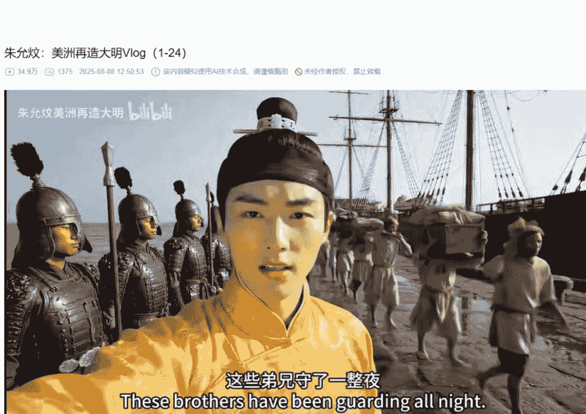

> These brothers have been guarding all night.

朱光:美州禹造大明 vlog
看完哭了（哭）

回复：看到那个小说已经完结，看完《美州禹造大明》，发现很多人在等这个番的，求加入书架，求更新！

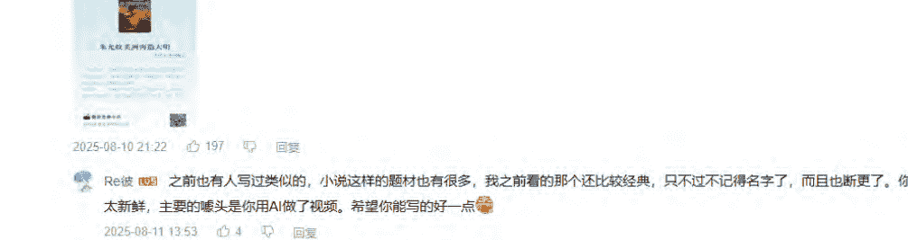


# 合集：朱光:美州禹造大明Vlog 30


评测区：
亦仁：感谢分享，我中标。

# 【公众号】6篇

## 新注册公众号漫画号，聚焦挣钱行业主题，评论阅读量5万+，具备IP拓展潜力

作者:发达
日期：2025-08-14
点赞数: 70

正文：
公众号写挣钱行业/工作主题，漫画风格形式的账号。8月2日注册，评论阅读量5万+。这个号感觉还可以往挣钱IP拓展。

## 你看不起的7个行业，正在悄悄产生“隐形富豪”！
阅读 3.5万 赞 61


## 未来十年最吃香的6个行业!
阅读 5.0万 赞 150
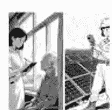

## 女生“最反感”男生从事的这6种行业
阅读 5.1万 赞 54


## 当代年轻人“坐牢”的6种工作
阅读 5.0万 赞 71


## 永不倒的6个行业，普通人选择了也能一食无忧!
阅读 5.3万 赞 118


## 健身教练收入不稳定，从业者容易显老风险
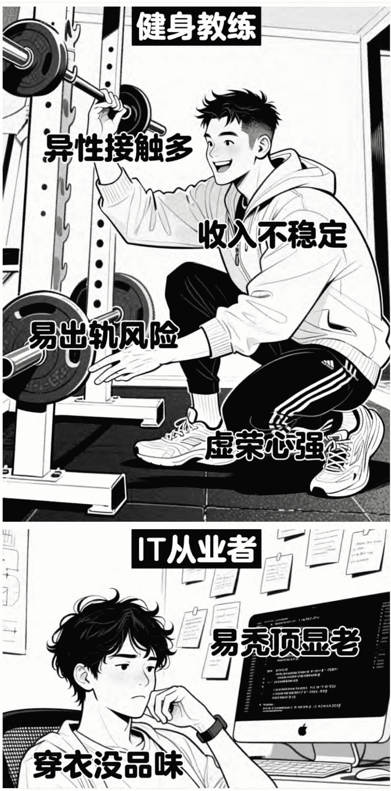

## 公众号简介基础信息
主体类型：个人
IP属地：广西
名称记录：2025年8月02日注册。
画画日常，坚持日！

## 小红书红利期搬运内容破万
作者：哈默
日期：2025-08-13
点赞数：60

正文：
小红书红利期，以后会限流了吗？答案：不是，目前野蛮增长，所以是红利期。给大家举例子，某个小红书，阅读量都过万！抓住流量和机会，搞起来！每天5-10分钟，流量主就有几万，关键你还可以批量做号！用AI矩阵批量做小红书，无论是流量主还是引流，红利超级大！
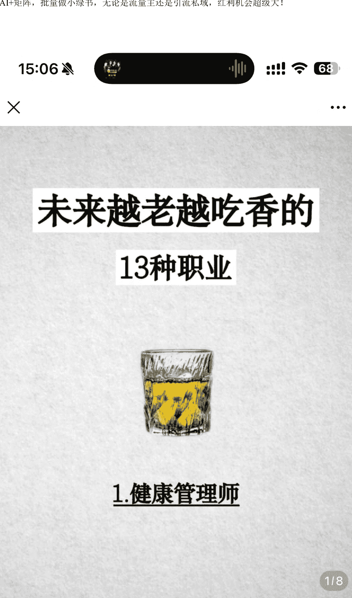

## 未来职业预测仅供参考！
阅读 9.2万 福建 7月6日 11:20 留言 43。

## 未来越老越香的13种职业


### 1. 健康管理器
未来，会越老越香的13种职业。个人感觉越老越香的13种职业，感兴趣的朋友可以参考，提前为自己规划半生的路径！

## 账户明细

| 日期范围 | 近七日 | 近30日 | 自定义 | 广告位 | 全部 | 底部 | 文中 | 后否 | 中帖 | 互访 | 返侧 | 收入（元） |
| :--- | :--- | :--- | :--- | :--- | :--- | :--- | :--- | :--- | :--- | :--- | :--- | :--- |
| 2025-08-12 | | | 46.36 | | | | | | | | | |
| 2025-08-11 | | | 34.53 | | | | | | | | | |
| 2025-08-10 | | | 43.72 | | | | | | | | | |
| 2025-08-09 | | | 25.79 | | | | | | | | | |
| 2025-08-08 | | | 34.74 | | | | | | | | | |
| 2025-08-07 | | | 24.31 | | | | | | | | | |
| 2025-08-06 | | | 10.10 | | | | | | | | | |
| 2025-08-05 | | | 32.19 | | | | | | | | | |
| 2025-08-04 | | | 64.00 | | | | | | | | | |
| 2025-08-03 | | | 45.33 | | | | | | | | | |

评论区：
吐槽萌：小红书我看目前是没有广告的呀，有广告的只有推文和纯文字类型。
哈喽：评论区的……
吐槽萌：看了，确实有部分评论区广告[强]。
张姐：小红书开了广告：粉丝即可开启！按照广告曝光，结算收入！
吐槽萌：对，以前以前都了，但是广告用户比较随机，很多小红书没有广告。
哈喽：
亦亦：感谢分享，已中标
公众号搬入搜索，懒人专属群。

## 公众号情感边缘故事连载，每篇阅读量10w+

作者：杨哥
日期：2025-08-15
点赞数：47

正文：
公众号边缘故事连载，数据挺好。今天刷到一个公众号，有意思的，以前像本故事，一般三集，数据还不错，评论区给大家看。


8月7日：土地上的年龄（十七）。阅读量 636。
8月6日：土地上的年龄（十七）。阅读量 141。
8月5日：土地上的年龄（续）。阅读量 197。
7月30日：土地上的年龄（十六）。阅读量 300。

它是块美玉，故肯庸，与瓦尔。原创内容。关注公众号。选选（10万+）。


今天：一个女的自述（三）。阅读 2619。
（10万+）。
昨天：一个女的自述（二）。阅读（10万+）赞 124。
今天：一个女的自述（三）。阅读（10万+）。
一个女的自述（三）。

没有爱情，为了五星，没有浪漫，我们两个人简单躲过了时光，有人说你的珍惜可以视作恩惠，也不好为你花钱？”但他又觉得，男人和女人的份，由眼神动到话，每刻都一样验证。我也曾后悔为对方而后悔，但看着身边热闹的他，怀恨和不安我深，从我不再提起家里。就打算再好，总还是要，也有。我知道自己可怜，丈夫和孩子还在我，我想抱着孩子逗趣的小笼，那个应该是孩子妈妈了。
行人如：桂桂：
上一章：一个女的自述
下一章：一个女的自述（三）

## 公众号：杨成长·深度营养

### 主任
在时代，人性不够！贪婪（不恰下的拥有）是性的基因，然而却是我们是每个人都要爱上的，拥有的都是最好的安排，希望我们懂得当下。
作者：作者害怕

### 江月
以记忆的恋爱结束，死亡对现在的来说是最奢侈品。世事发展的太快，一个人的内心不是他们的表现，内心的无处安，希望以后他们的道理能上，让未来今天之事的，不再是奢侈品。
作者：作者害怕

### Murray
以前有多少爱情变成相隔，三高二白的故事可能是，但是事实是想象的。
作者：作者害怕

### 孙
这个太正常了，不要少见多懂，什么，以此手魔法的高一点就行。
作者：作者害怕

### 柠檬树
看来是个老老，伤害妻子，伤害到家庭会报应的，你不信，你有不知道的时候。
作者：作者害怕

评论区：
亦亦：感谢分享，已中标
公众号搜索，懒人专属分享

## 小红书新玩法，每条笔记阅读量超10万+

作者：郭耀天
日期：2025-08-09
点赞数：51

正文：
公众号这个玩法有点些。

## 中国各省离婚率排名

1. 吉林离婚率:71.50%
2. 黑龙江离婚率:67.16%
3. 辽宁离婚率:65.83%
4. 天津离婚率:63.62%
5. 北京离婚率:57.26%
6. 重庆离婚率:50.65%
7. 河北离婚率:50.07%
8. 内蒙古离婚率:49.76%
9. 湖南离婚率:47.15%
10. 上海离婚率:45.54%
11. 湖北离婚率:43.8%
12. 新疆离婚率:43.3%
13. 四川离婚率:43.2%
14. 福建离婚率:40.3%
15. 江苏离婚率:40.2%
16. 浙江离婚率:38.9%
17. 贵州离婚率:38.1%
18. 陕西离婚率:37.0%
19. 安徽离婚率:36.0%

中国各省离婚率排名，第一名超你的为什么离婚率攀升？录于官方媒体/新闻。


1. 1990年，粮。
2. 1992年，粮。
3. 1997年，下岗。
4. 1998年，福利。
5. 2001年，手机。
6. 2006年，农业。
7. 2007年，汽车。
8. 2008年，上涨。
9. 2011年，社交。
10. 2013年，网上。
11. 2016年，政策。
12. 2020年，疫情。
13. 2022年，预制菜。
14. 2023年，现身。
15. 2024年，电动。

有些事情不能回头，阅读10万+ 河南 7月23日 14:52 朋友关注。

## 公众号“央企赛道”两天破万

作者：嘻嘻姐
日期：2025-08-13
点赞数：43

正文：
最近有点服了，公众号上“央企赛道”似乎火了！今天刷到一个号，专门写央国的，7月30号注册发文。最的是内容还挺AI的，感兴趣的朋友可以试试赛道。

## 关于公众号专注职场洞察
主体类型：个人
IP属地：浙江
名称记录：2025年7月30日注册“吃鱼”。

## 吃鱼

## 央企业的“干部年轻化”怎么变味了？
阅读 531 赞3


8月4日：在央企，只有两种人可以往爬。阅读 9098 赞22


8月3日：央企的领导为啥一天到晚上都在开会？阅读 6.2万 赞787 2朋友看过


8月2日：很多央企员工，离职后找不到工作。阅读 7.2万 赞388 2朋友转发


8月1日：在央企，寒门难出贵子。阅读 2571 赞17 4朋友看过


## 所以，普通中国员工根本很难等到“光荣退休”。

对大多数普通工人来说，能不欠债、不背一身病等到退休年龄，都是奇迹。更多的人，注定在退休的漫漫时光中，提前透支健康、耗尽心力，甚至被残酷地踢局。留下的只有一个冰冷的现实——想体面到退休？那是领导们才享的福气。普通员工的真实剧本，叫：笑死，根本热不到退休。

如果觉得文章不错，请关注、点赞、转发，非常感谢！
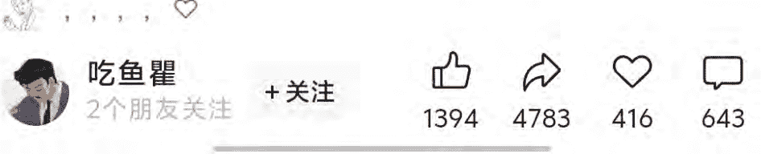

评论区：
金天：真厉害。
喵喵：确实实实。
花酱：太棒了，除了了吃鱼流量，怎么变现
喵酱：第一波吃鱼流量很高，如果加入IP属性，就可以引流私域变现相关的产品。
花酱：优秀！学习了！

## 小红书红利期搬运内容
作者：哈默
日期：2025-08-13
点赞数：46

正文：
小红书红利期，以后会限流了吗？答案：不是，目前野蛮增长，所以是红利期。给大家举例子，某个小红书，阅读量都过万！抓住流量和机会，搞起来！每天5-10分钟，流量主就有几万，关键你还可以批量做号！用AI矩阵批量做小红书，无论是流量主还是引流，红利超级大！


## 未来职业预测仅供参考！
阅读 9.2万 福建 7月6日 11:20 留言 43。

## 未来越老越香的13种职业


### 1. 健康管理器
未来，会越老越香的13种职业。个人感觉越老越香的13种职业，感兴趣的朋友可以参考，提前为自己规划半生的路径！

## 账户明细

| 日期范围 | 近七日 | 近30日 | 自定义 | 广告位 | 全部 | 底部 | 文中 | 后否 | 中帖 | 互访 | 返侧 | 收入（元） |
| :--- | :--- | :--- | :--- | :--- | :--- | :--- | :--- | :--- | :--- | :--- | :--- | :--- |
| 2025-08-12 | | | 46.36 | | | | | | | | | |
| 2025-08-11 | | | 34.53 | | | | | | | | | |
| 2025-08-10 | | | 43.72 | | | | | | | | | |
| 2025-08-09 | | | 25.79 | | | | | | | | | |
| 2025-08-08 | | | 34.74 | | | | | | | | | |
| 2025-08-07 | | | 24.31 | | | | | | | | | |
| 2025-08-06 | | | 10.10 | | | | | | | | | |
| 2025-08-05 | | | 32.19 | | | | | | | | | |
| 2025-08-04 | | | 64.00 | | | | | | | | | |
| 2025-08-03 | | | 45.33 | | | | | | | | | |

评论区：
吐槽萌：小红书我看目前是没有广告的呀，有广告的只有推文和纯文字类型。
哈喽：评论区的……
吐槽萌：看了，确实有部分评论区广告[强]。
张姐：小红书开了广告：粉丝即可开启！按照广告曝光，结算收入！
吐槽萌：对，以前以前都了，但是广告用户比较随机，很多小红书没有广告。
哈喽：
亦亦：感谢分享，已中标
公众号搬入搜索，懒人专属群。

## 公众号情感边缘故事连载，每篇阅读量10w+

作者：杨哥
日期：2025-08-15
点赞数：47

正文：
公众号边缘故事连载，数据挺好。今天刷到一个公众号，有意思的，以前像本故事，一般三集，数据还不错，评论区给大家看。


8月7日：土地上的年龄（十七）。阅读量 636。
8月6日：土地上的年龄（十七）。阅读量 141。
8月5日：土地上的年龄（续）。阅读量 197。
7月30日：土地上的年龄（十六）。阅读量 300。

它是块美玉，故肯庸，与瓦尔。原创内容。关注公众号。选选（10万+）。


今天：一个女的自述（三）。阅读 2619。
（10万+）。
昨天：一个女的自述（二）。阅读（10万+）赞 124。
今天：一个女的自述（三）。阅读（10万+）。
一个女的自述（三）。

没有爱情，为了五星，没有浪漫，我们两个人简单躲过了时光，有人说你的珍惜可以视作恩惠，也不好为你花钱？”但他又觉得，男人和女人的份，由眼神动到话，每刻都一样验证。我也曾后悔为对方而后悔，但看着身边热闹的他，怀恨和不安我深，从我不再提起家里。就打算再好，总还是要，也有。我知道自己可怜，丈夫和孩子还在我，我想抱着孩子逗趣的小笼，那个应该是孩子妈妈了。
行人如：桂桂：
上一章：一个女的自述
下一章：一个女的自述（三）

## 公众号：杨成长·深度营养

### 主任
在时代，人性不够！贪婪（不恰下的拥有）是性的基因，然而却是我们是每个人都要爱上的，拥有的都是最好的安排，希望我们懂得当下。
作者：作者害怕

### 江月
以记忆的恋爱结束，死亡对现在的来说是最奢侈品。世事发展的太快，一个人的内心不是他们的表现，内心的无处安，希望以后他们的道理能上，让未来今天之事的，不再是奢侈品。
作者：作者害怕

### Murray
以前有多少爱情变成相隔，三高二白的故事可能是，但是事实是想象的。
作者：作者害怕

### 孙
这个太正常了，不要少见多懂，什么，以此手魔法的高一点就行。
作者：作者害怕

### 柠檬树
看来是个老老，伤害妻子，伤害到家庭会报应的，你不信，你有不知道的时候。
作者：作者害怕

评论区：
亦亦：感谢分享，已中标
公众号搜索，懒人专属分享

## 小红书新玩法，每条笔记阅读量超10万+

作者：郭耀天
日期：2025-08-09
点赞数：51

正文：
公众号这个玩法有点些。

## 中国各省离婚率排名

1. 吉林离婚率:71.50%
2. 黑龙江离婚率:67.16%
3. 辽宁离婚率:65.83%
4. 天津离婚率:63.62%
5. 北京离婚率:57.26%
6. 重庆离婚率:50.65%
7. 河北离婚率:50.07%
8. 内蒙古离婚率:49.76%
9. 湖南离婚率:47.15%
10. 上海离婚率:45.54%
11. 湖北离婚率:43.8%
12. 新疆离婚率:43.3%
13. 四川离婚率:43.2%
14. 福建离婚率:40.3%
15. 江苏离婚率:40.2%
16. 浙江离婚率:38.9%
17. 贵州离婚率:38.1%
18. 陕西离婚率:37.0%
19. 安徽离婚率:36.0%

中国各省离婚率排名，第一名超你的为什么离婚率攀升？录于官方媒体/新闻。


1. 1990年，粮。
2. 1992年，粮。
3. 1997年，下岗。
4. 1998年，福利。
5. 2001年，手机。
6. 2006年，农业。
7. 2007年，汽车。
8. 2008年，上涨。
9. 2011年，社交。
10. 2013年，网上。
11. 2016年，政策。
12. 2020年，疫情。
13. 2022年，预制菜。
14. 2023年，现身。
15. 2024年，电动。

有些事情不能回头，阅读10万+ 河南 7月23日 14:52 朋友关注。

## 公众号“央企赛道”两天破万

作者：嘻嘻姐
日期：2025-08-13
点赞数：43

正文：
最近有点服了，公众号上“央企赛道”似乎火了！今天刷到一个号，专门写央国的，7月30号注册发文。最的是内容还挺AI的，感兴趣的朋友可以试试赛道。

## 关于公众号专注职场洞察
主体类型：个人
IP属地：浙江
名称记录：2025年7月30日注册“吃鱼”。

## 吃鱼

## 央企业的“干部年轻化”怎么变味了？
阅读 531 赞3


8月4日：在央企，只有两种人可以往爬。阅读 9098 赞22


8月3日：央企的领导为啥一天到晚上都在开会？阅读 6.2万 赞787 2朋友看过


8月2日：很多央企员工，离职后找不到工作。阅读 7.2万 赞388 2朋友转发


8月1日：在央企，寒门难出贵子。阅读 2571 赞17 4朋友看过


## 所以，普通中国员工根本很难等到“光荣退休”。

对大多数普通工人来说，能不欠债、不背一身病等到退休年龄，都是奇迹。更多的人，注定在退休的漫漫时光中，提前透支健康、耗尽心力，甚至被残酷地踢局。留下的只有一个冰冷的现实——想体面到退休？那是领导们才享的福气。普通员工的真实剧本，叫：笑死，根本热不到退休。

如果觉得文章不错，请关注、点赞、转发，非常感谢！


评论区：
金天：真厉害。
喵喵：确实实实。
花酱：太棒了，除了了吃鱼流量，怎么变现
喵酱：第一波吃鱼流量很高，如果加入IP属性，就可以引流私域变现相关的产品。
花酱：优秀！学习了！


## 专注于人工智能、机器人的微信垂直小号，每篇阅读量5000+

作者：蓝穹
日期：2025-08-15
点赞数：43

正文：
找到了公众号超级标杆的案例：专注于人工智能、机器人等新兴行业公司汇总，靠道足够垂直，内容很简单，流量很高，目测的是流量主变，没看到其他链接/接广告。有点朋友的味道~

## 小研笔记

### 人工智能，最正宗的5家公司
阅读 3.0万 赞 198

8月4日

### 人智能，强相关的7家公司
阅读 6687 赞 44

8月1日

### 人形机器人，中报预增的7家公司
阅读 3.9万 赞 160

7月29日

### AI + 算力，相关的7家公司（最新版)
阅读 3.0万 赞 246

7月28日

### 可控聚变，背后的7家企业
阅读 8302 赞 55

7月27日

## 小笔练笔记本

### 机器人概念，强相关的6家公司
阅读 9393 赞 72
星期六

### 人工智能+机器人概念，背后的5家企业
阅读 6133 赞 51
星期五

### 人形机器人，强关联的7家公司
阅读 1.0万 赞 87
8月7日

### 机器人概念+固态电池，成长较快的6家企业
阅读 1.0万 赞 71
8月6日

### 人形机器人，强关联的6家企业
阅读 9031 赞 85
8月5日

## 小研笔记本

### 机器人概念+稀土永磁，成长较快的7家企业
阅读 4202 赞 55
昨天

### 人形机器人+PEEK材料，最正宗的6家企业
阅读 7265 赞 81
星期三

### 光刻机领域，强相关的6家公司
阅读 5221 赞 54
星期二

### 人形机器人+固态电池，成长较快的6家企业
阅读 6234 赞 61
星期一

### 人工智能，成长较快的7家公司
阅读 6004 赞 55
星期日

## 人形机器人+PEEK材料，最正宗的6家企业
原创 小研笔记 2025年08月13日 17:02 湖南
12人

### 1、中欣气材
成立时间：2000


### 2、新瀚新材
成立时间：2008


### 3、中研股份
成立时间：2006


### 4、金发科技
成立时间：1993


评论区：
亦二：感谢分享，已中标
王二二：这内容确实简单
公众号懒搜索：懒人专属分享

## 程序推广APP-小程序的新思路：利用素人矩阵搭建高楼推荐
作者：林晓顾
日期：2025-08-11
点数：20

正文：
程序员推广自己的app或者小程序新思路：利用素人矩阵搭建高楼推荐，找素人发帖子推荐自己的app突出优点，很多人喜欢这种。

### 一个人一个小众APP

交付宝藏APP #实用app #小众APP #宝藏APP #app推荐 #小红书 8-06 江苏

### 云汐青小红书的，叫点点
化祖宗，长得像个
这个和其他有啥呀
4天前 上海
44分钟前 湖北
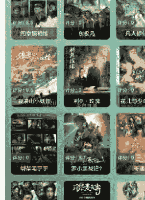
3小时前 河南

评论区：
亦仁：感谢分享，已中标
公众号搜索：懒人专属分享

## 微小店推出「推客货」，社群与朋友轻松赚金
作者：Mark
日期：2025-08-11
点赞：14

正文：
微信小店推出「推客货」新模式。商家可将商品入驻联盟并设置推广，通过“推客货”，以金形式激励推客们在微信内帮助商家进行销售。推客可以注册后，在社群里与朋友推荐好的商品获得金。
https://mp.weixin.com/s/lk5-RzzgkAVhrJ

## 快试试微信小店「推客货」新模式！
希阳 微信小店助手 2025年08月11日 03:11 广东 星星最近有很多商家反馈，想了解微信小店经营，除了直播、短视频、联盟等模式外，还有哪些好的经营模式可以探索？当然今天我们就给各位商家讲讲微信小店的“推客货”经营模式，以及如何使用推客货进行经营。首先，到底什么是「推客货」？“推客货”是基于推客（导购、促销等）在社群、朋友圈传播的带货方式。商家可将商品优选联盟并设置推广，通过“推客货”，以金形式激励推客在微信内帮助商家进行经营微信小店助手 286 221616

评论区：
亦仁：感谢分享，已中标
公众号搜索：懒人专属享

## 【小红书】5篇 小红书目标笔记评论区，带商品留言，获得精准客户
作者：微生
日期：2025-08-14
点数：38

正文：
小红书评论区正常留言，能引流来精准客户。用自己的小红书账号，没有刻去留言，只是偶尔打开目标笔记后随机发笔记，目前成交一车4.2万和一个工厂考察客户。图一图二是到工厂考察客户。图三图四是本地客户直接要求的4.2米车货。好的，计划下周过去，我到北京保定的时候提前联系您。好的，快跑了，去北京建议带好随身身份证提前做好攻略好呦👍 下午2:40我在保定东边来的路上了 下午2:52 通话时长00:35 下午2:57 大在呼吸必须前往。稍等我下好呦 下午3:08 通话时长00:11 晚上7:38

7月17日 上午11:22 我是京岳，小红书上的通过你的朋友验证请求，以上是打招呼的消息。老总，你好，怎么称呼呢叫我小李就好。请问您有什么可以帮您的？这样的，您好。
7月17日 上午11:24 李总，您的工厂现成商标的抽纸挂纸类的产品，还是只定制类的？我们有达人给我们带货，我也在弄自己号，能给我们2个链接上抖音。你们的达人是拍视频还是直接直播带货呢？直播哦，然后平时的话链接橱窗能否发下达人的账号？李总，下我们不能达成合作吗？

5月30日 20:35 我是京辰。施大通过你的朋友验证请求，以上是打招呼的消息。什么价？明天把价格表给你哈。保定哪里的？
5月31日 07:23 市区。6月2日 09:34 https://rppnbla.feishu.cn/sheets/MHFAsizJhwvc4tP2WMfvvOnKe?from=copyl 13:54 好吧，休息呢？6月3日 18:00 通话时长00:38 6月3日 18:16 明天上午过去价格偏高吗？

评论区：
亦仁：感谢分享，已中标
公众号搜：人专属分享

## 小书专卖虚拟资料，客单价18.8
作者：良人
日期：2025-08-12
点数：40

正文：
小书虚拟，开店8天卖了1万，客单价18.8，每天发帖十几篇。开店时长80天，88天已售1万，客单价18.8。

### 苏涤·C盘清理灵速电脑系统垃圾清理系统硬盘扩容分区分内存迁移
口碑5000+加入购，3个月内2000+内购买500+人收藏
- 预计2小时发货，承诺24小时内发货，晚发必赔广东深圳包邮
- 退包运费家必赔假一赔四7天无理由退货
- 已选：自己清理

### 9.9 已售2万+
可爱科技已售1万 | 粉丝102
- 交易保障运费7天无理由货极速退款
- 店铺品质历史好评率100%
- 物流服务近0天平均回复
- 客服90天平均1小时22秒
- 综合时长88天

### 基础信息开店看全部商品
可爱科技已售1万 粉丝102 99+篇笔记直发包邮好评74次客服平均22回复1小时发货综合新品价格限时立减


### 人工机器人普及
19.9 已售52 当月热销第1名
陶艺课程幼儿园儿童陶土
19.9 已售46
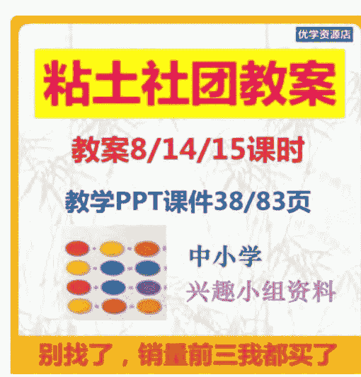

### 手粘土社团教案word黏土
19.9 已售37 限时立减1.36
梵高清图片全集高清素材
18.54 已售36


## 委托代理协议
甲方（委托人）：________________ 身份证号码：________________
乙方（代理人）：________________ 身份证号码：________________
因甲方委托乙方就某某事宜（如：某某起诉某公司案等）办理某某诉讼代理事宜，双方经友好协商达成如下协议：
1. 委托事项：__________________________________________________
2. 委托范围：__________________________________________________
3. 委托期限：__________________________________________________
4. 委托费用：__________________________________________________
5. 权利义务：__________________________________________________
6. 违约责任：__________________________________________________
7. 其他：______________________________________________________
本协议一式两，甲双方双方执一份。
甲方（签字）：________________ 日期：20__年____日
乙方（签字）：________________ 日期：20__年____日

## 申请书
甲方：________________ 身份证号码：________________
乙方：________________ 身份证号码：________________
申请事项：____________________________________________________
申请理由：____________________________________________________
申请请求：____________________________________________________
此致申请人（签字）：________________ 日期：20__年____日

## 民事纠纷神器离婚模板自动生成情感话
## 合同审查模板!附配套协议
小可爱科技
Deloitte.
企业财务报表分析
2012.05.29
申请有关专业知识的人出庭作意见的意见出意见的申请书
申请人：________________ 身份证号码：________________
申请事项：____________________________________________________
申请理由：____________________________________________________
申请请求：____________________________________________________
此致申请人（签字）：________________ 日期：20__年____日

评论区：
lily：你好，问一下这个问题解决呀
哈哈哈哈：你们的免责声明吗？
黄华：你好呀，你是在热搜看到的吗，明显是蓝色的可能进了流量的，没有免责声明有用不？
加林：亦仁：感谢分享，已中标
公众号搜：人专属分享

## 小红书卖电脑爆满解决方案销售额高达w+ 小红书教务流量期，单日收入可达2000+
作者：蓝子
日期：2025-08-11
点赞数：36

正文：
今天电脑c摆满，在小红书上找解决方案，排在第二位的一帖子，居然卖了2万，每个月至少一千五这种属于客户有很需求的，价格又不贵，成交容易，可以围绕某一群体提供解决方案。

### ¥9.9 已售2万+
- 12期免息花呗满0.69减0.68 苏涤·C盘清理灵速电脑垃圾清理系统硬盘扩容分区分内存迁移口碑5000+加入购，3个月内2000+内购买500+人收藏
- 预计2小时发货，承诺24小时内发货，晚发必赔广东深圳包邮
- 退包运费家必赔假一赔四7天无理由退货
- 已选：自己清理

## 苏苏·苏苏 d盘空间给c盘扩展c盘扩容
1. 准备工作：首先确认CD盘是同一块硬盘
2. 把D盘资料剪贴到E盘或者移动存储设备上
3. 格式化D盘

第一步：[我的电脑]-[管理]-[磁磁盘管理]-[D盘]-[删除除卷]
第二步：[C盘]-[扩展卷]-[选择空间量]-[102440]
注意：这里输入的需要把D盘分配给c盘的空间大小，以10G为例*10=10240。如果需要把D盘全部分配给C盘输入最大可用空间即即D盘全部分配给C盘的可以从下面所有步骤，此D盘空间分给c盘完成！
下面来演示如何不足剩余的空间重新分配给D盘第三步：[新建卷]-[一步]-[一步]c盘空间不够用的推荐最近使用的c盘清理精灵，它能深度清理c盘空间，软件卸载，开加速！
#C盘扩容#C盘满了怎么扩容#如何给C盘扩容#电脑盘扩容#■C满了#怎么清理c盘#怎么快速清理电脑C盘扩容#电脑分盘


# 扩C内存扩容怎么弄

全部 用户 商品 地点 问问

扩容C空间通常有两种方法：磁盘管理工具和第三方分区软件，以下是具体的步骤：

- 1. 磁盘管理工具：打开“磁盘管理”，右键选择“扩展卷”，根据向导提示一步步操作，把未分配空间并入C盘完成扩容。
- 2. 第三方分区软件：从渠道下载DiskGenius这样的分区软件，打开软件后，可以压缩多余空间的分区，释放出未分配空间，然后将这些新的未分配空间给C盘，实现扩容。

AI总结29篇笔记 😅

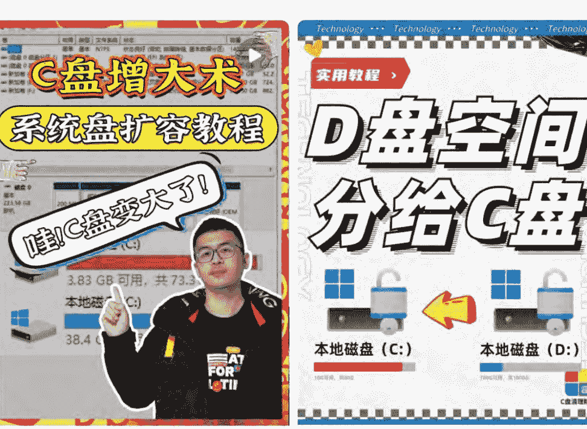

C盘扩容超详细教程 小小白也能随便加一个100G...

数码柜子 2024-02-07 ❤️1.3万

d盘空间分配给c盘扩容 d盘空间给C盘扩充... 苏苏 06-03 ❤️2459


评论区：n亦仁：感谢分享，已中标

公众号搜索：懒人专属分享

# 小红书博主分享小幸运视频视频视频有1000+点赞

作者：Bang

日期：2025-08-12

点赞数：28

正文：
最近小红书刷看到这个榜，就是分享分享自己的日常生活的小幸运，没有什么爆款标题，但是感觉很有幸运视频看起来都很不错。博主个人看起来是非常有能量那种，和另一个小红书博主“废话多”很像。感觉这类的内容是会受欢迎的。

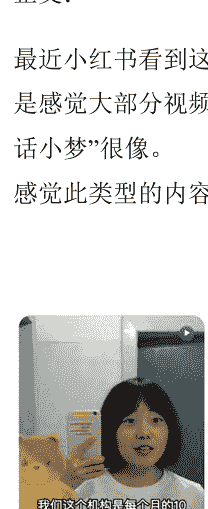
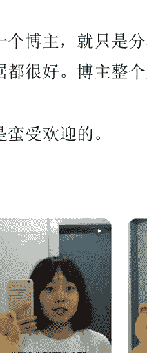
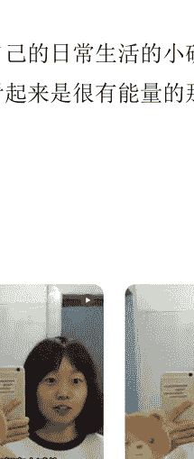
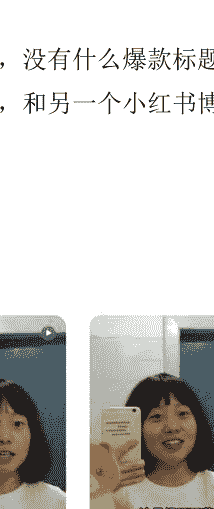


测评：

花园：这个我也看到了，后面通过广告变现。超级真实也太真实了，感觉像是一个很真实的博主，主打一个真实，靠接广告变现。

Bang：目前这个圈的博主没有，但是“废话多”那个蛮，很厉害。

亦仁：感谢分享，已中标。

林林/林小：就是小红书的文亮。

公众号搜索，闲人闲鱼专属群

# 【闲鱼】2篇

作者：空气

日期：2025-08-13

点赞数：51

正文：
9月1号新增，合作协议书几天卖爆，卖了4w+

# 温度
# 评价
# 内容

# 达人

小店 闲金稳定性 >

推荐数据 30天

| 销量 | 浏览量 | 化率 |
| --- | --- | --- |
| 4.1万 | 11.57万 | 35% |
| 2025/08/11 | | |
| 销量 | 6,452 | |
| 浏览量 | 2.27万 | | |
| 出单人数 | 29 | |
| 下单转化率 | 25%~30% | |

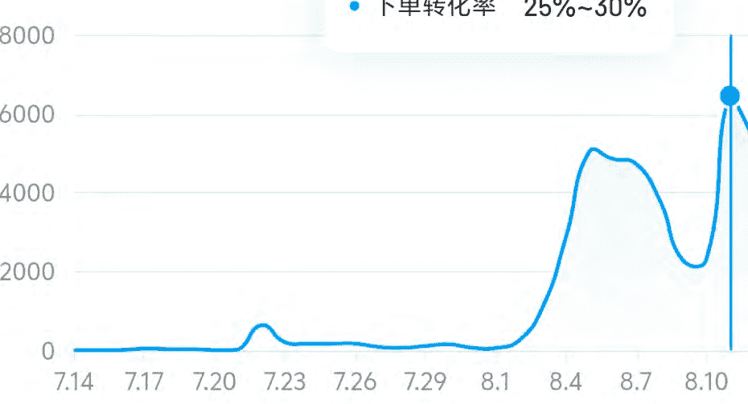

商品评价 93.8% 好评价 646条评价

- 回头客 57 推荐 11 回购 10

> 宝宝**8 2025-08-12 11:30:24
内容丰富，字体清晰！解决了现在的难题。

> 法** 2025-08-13 00:04:24
外观：完美无暇做工：非常精致，功能：专业不错，值得推荐。


评论区：
生财：新规是什么呀？空气：要交社保。金：真的是会热点。亦仁：感谢分享，已中标。

廖廖：请问下成。空气：某音：真伏啊。公众号搜懒人，懒人专属群

# 闲鱼8月热榜和趋势榜

作者：A

日期：2025-08-12

点赞数：30

正文：
这两个月放假，同时时尚旺季，所以各地旅游景可以上一。年轻人，深入了解之后，可以试试这个增加流量的方式。闲鱼上买东西如果你很难选好品。

# 缺货榜 趋势榜 爆卖榜

笔记/资料/报 月榜 榜单于8月11日更新

- 搜索求购人数10000+ 近期成交100+
 更多 我来补货

- 播放器求购人数5500+ 近期成交100 99.0。
- 播放器求购人数5500+ 近期成交100 98.3。
- 乐可求购人数2500+ 近期成交100 98.8。
- 小p公考求购人数4500+ 近期成交100 96.4。
- 高照求购人数5500+ 近期成交100 96.3。
- 助眠求购人数2500+ 近期成交100 93.6。
- 狼辅导求购人数4000+ 近期成交100 91.8。
- 机械设计求购人数4500+ 近期成交100 91.1。

# 养牛

# 闲 缺货榜 趋势榜 爆卖榜

笔记/资料/报 月榜 🕒 更新于8月11日 更新

- 求购人数1000+ 近期成交100+ 近期成交 99.4
- z哥求购人数3000+ 近期成交100+ 99.4
- 少年新知求购人数3500+ 近期成交100+ 99.2
- 资料求购人数7000+ 近期成交100+ 99.2
- 扣子工作流求购人数6500+ 近期成交100+ 99.2

# 【抖音】

作者：阿

日期：2025-08-13

点赞数：25

正文：
太久没来了，不知道这个有没有发过，最近经常刷到，是官方提供的，在做直播或者带货的可以试试这个增加流量的方式。

# 不吃鱼

# 闲 缺货榜 趋势榜 流量榜

- 4小时求购人数15000+ 近期成交100 4.9/次 共4次
- 8天不限次求购人数6000+ 近期成交100 9.9/周 共8次

# 暑期大促

- 小1温泉票+2500立方泳池+3楼休息餐厅畅享周末假日...销量已售8000+

# 中山城·幻之夜

(售票，8月13日开园)中山城梦幻夜+影视域+千年非铁...中山城·梦幻夜 ¥19.9 ¥183.32 1.3折热销

# 中山温泉

# 闲 缺货榜 趋势榜 爆卖榜

笔记/资料/报 月榜 榜单于8月11日更新

#笔记/资料/报 月榜 榜单于8月11日更新

# ：公众号搬入搜索，懒人专属分享

# 聊天信息(201)

张海杰
闪闪
凉枫
麦子
豆豆俄
一颗糖
小娘
燕儿
是橙子
这条小
冉再真
乐乐
小夕
喀呦梅
花花
佛山若
想。
芭比拉
更多群成员

# 群名称 闲电达直播自报名执行群
# 群二二维码
# 群公告

公告声明：1、关于大家对闲直播的疑问和开播的流程不了解或者想要学习的，每周一到周五下午15:00~16:00，“

# 备注
# 查找聊天记录

# B站的流量不是技术：垂直赛道深耕3万粉，持续产出才是核心竞争力

作者：凌晨

日期：2025-08-11

点数：78

正文：
平台的机制和激励机制，都是在奖励那些能够在一个领域持续提供价值的创作者。只要你足够耐忍、放量稳定，创作者计划就能提供一个相当可见的稳定收入。

我的主号就是这个，已经积累了百万粉，现在都想下十万粉丝了。这套SOP验证有效，我又熟悉化了一个新号，现在无论是口播模式还是视频模式，我都获得了非常异常的增长。

技术只是锦上添花，而“持续产出”的执行力，你才是核心竞争力。


# 小红书运营全维度解析

🚀行业营销销售大火了！🚀行业7月销量爆单来袭！多家店铺老板们一来说看看有没有这几个【实操】营销技巧

行业类目型的和热门款、不同场景布局有🚀@经营实获客之旅！@1周营销技巧

此外还有其他4位的优秀的商家爆款视频（见上图）@1周营销技巧【行业2】垂直行业运营

各种需要的类目，你就能在小组找到它！此外还有其他你所找的优秀的商家爆款视频（见上图）@心

老板还有其他4位的优秀的商家爆款视频（见上图）@行业【4】专业博主精准投放导师和老师

提升教学效率的工具都在这里@物理老师
手机又要“圈内”，摄像头又要美美哒@晴天美女拍摄技巧

TOP增长之实获客之旅！此外还有其他4位的优秀的商家爆款视频（见上图）@晴天美女拍摄技巧

TOP增长之旅！此外还有9位的优秀的商家爆款视频（见上图）@行业【5】咨询营销

行业类目领域的专业服务，一对一的专业咨询，解决你的问题@U哥哥带你看
集团运营

TOP增长之旅！此外还有其他4位的优秀的商家爆款视频（见上图）@蓝言姐姐
此外还有其他4位的优秀的商家爆款视频（见上图）

【行业6】如何成为行业美妆大师，人生靠一张照片就能惊艳光彩✨@摄影师星星

TOP增长之旅！此外还有其他4位的优秀的商家爆款视频（见上图）

@无优趣晚后工作室TOP增长之旅！想要优秀的商家获得月度销量爆单吗？我们用高质量的内容和专业的让更多商家登录店铺！让用户感受到店铺的流量🔥期待7月的新单可以看到更多优秀的身形✨财朋友项目运营

# 7月实操运营模板/小红书商家


# 7月电子资料包/TOP商家

## 成交之星 >
本月铁3w流量爆发
@参森赛运营的店

### TOP2-3 >
本月铁3w流量爆发
@OneCup插画学习卡卡的店

### TOP4-5 >
本月铁1w流量爆发
@Better Living智能家居的店
@New Vision学习英语的店

## 增长之星 >
本月铁0w流量爆发
@等心潮流测评的店

### TOP2-3 >
本月铁3w流量爆发
@古越酱运营代理的店
@峰之大流量的店

### TOP4-5 >
本月铁1w流量爆发
@BookPad无充流量的店
@微学社的店

小红书 115300697

# 7月头像壁纸 / TOP商家

## 成交之星 >
本月1w流量激励

## TOP2-5 >
本月3w流量激励

## TOP6-10 >
本月1w流量激励

## 增长之星 >
本月1w流量激励

### TOP2-5 >
本月3w流量激励

### TOP6-10 >
本月1w流量激励


# 月度奖/小红书商家

## 成交之星 >
本月涨10w流量激活
@流量的店

### TOP2-3 >
本月涨3w流量激活
@活跃的店

### TOP4-5 >
本月涨1w流量激活
@爆发的店

## 增长之星 >
本月涨10w流量激活
@转化店

### TOP2-3 >
本月涨3w流量激活
@精准的店

### TOP4-5 >
本月涨1w流量激活
@精准的店


# 7月咨询清单 小红书商家

## 成交之星 >
本月涨1w流量激活


### TOP2-3 >
本月涨3w流量激活


### TOP4-5 >
本月涨1w流量激活


## 增长之星 >
本月涨1w流量激活


### TOP2-3 >
本月涨3w流量激活


### TOP4-5 >
本月涨1w流量激活


# 7月课程案例报/TOP商家

## 成交之星 >
本月1w流量爆发

### TOP2-5 >
本月3w流量爆发

### TOP6-10 >
本月1w流量爆发

## 增长之星 >
本月1w流量爆发

### TOP2-5 >
本月3w流量爆发

### TOP6-10 >
本月1w流量爆发

## TOP增长
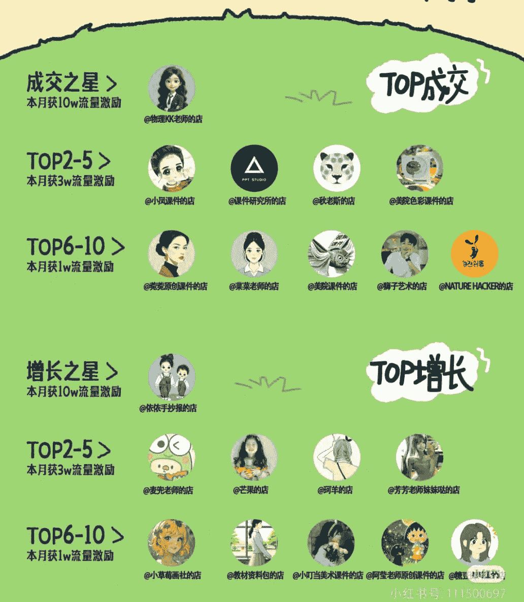

评论区：
信通：这榜不真实，我搜了几个号呢，我的数据碾压他们，也没榜
百哥：官方方的，可能是官方有自己的判断标准吧
Ann：高手在这里
亦仁：感谢分享，已中标
百哥：嘚嘚，谢谢老大
涵源用人的诗：我发现大多是图文类的，ai起步不准
群众懒人搜索，懒人专属群享

# 得物全明星主计划：搬运就能赚现金红包，8周最高210元
作者：阿宝
日期：2025-08-13
点赞：28

正文：

# 公告：关于流量变现激励计划的作者专享

得全明星主计划参与之后进入活动持续8周，只需运营操作即可奖励现金红包【210元】

- ①参加活动审核通过首周发布有效作品≥3天，每周即可获得100元现金红包（总包100元）
- ②后2-8周，每周发布有效作品≥3天，每周可获得80元现金红包（总包660元）
- ③活动周内发布作品满足50%即可获得200元现金红包（总包1500元）

【家居装】满足本周发布视频作品50%
【美妆】只要封面整洁真人出镜最好作品都是参加马拉戈的【视频】
【只要视频】【美妆教】【搞笑50%】【美容容】【美甲】【跑步步】
【数码和a1】，小书标题b正常更新要求月活跃

任务周期内发布作品单条播放量≥2w即可获得300元红包【总包1500元】
- 家居：满足计划发布视频作品50%
- 美妆：沉浸护肤、发型
- 健身：局部减脂、局部肌
- 跑步：马拉松、 视频时长大于30s
- 数码：a1、小书标题b

# 出海：这篇网站在海外平台爆火，一个月达到7万浏览量
作者：达伦
日期：2025-08-11
点赞：46

正文：
这几个者彻底了。他做了一个网站，功能齐全，然后看它。瞬间来了一堆流量、域名是2025年6月30日注册的，7月拿下了.8万访问量。灵感也能做爆款网站。Reddit的链接最的是：
https://github.com/aldenhallak/fishes

# drawafish.com
N/A
Global Rank: 425,811
Country Rank: 108,008
Total Visits: 67.96K + 79550.0
Avg. Duration: 00:03:16
Pages per Visit: 3.39
Bounce Rate: 31.46%
Domain Creation: 2025-6-30
Domain Expiration: 2026-6-30
Last Changed: 2025-6-30
Domain Age: 42 days

评论区：
亦仁：感谢分享，已中标
达轮：谢老大

# Temu全托开放：单主体可开3店，GMV达标可再获2个店铺额外名额
作者：顺亿
日期：2025-08-10
点赞：23

正文：
Temu全托今日可以开放一个主体店铺的限制，会变成三个店铺同时商家达到某个GMV的值（待定）还可以获得额外1-2个店铺的名额

全托预计今日可以开放一个主体店铺的限制，会变成三个店铺同时商家达到某个GMV的值（待定）还可以自动额外1-2个店铺的名额

注册链接：https://seller.kuajingmaihuo.com/mobile-main/register.html?
专属邀请码：jdhtqo【全托管-常规店铺】不确定政策一直是会改，先把店铺申请好！记得输入邀请码，对对接更方便！

【店铺注册】两种方式：
第一种：点击下方注册链接https://seller.kuajingmaihuo.com/mobile-main/register.html?invitationCode=rdwwfw
如果没有代邀请码，手动输入rdwwfw勾选“是”

# drawafish.com 排名趋势报告

| 指标 | 数据 |
| :--- | :--- |
| Monthly Visits | 68K |
| Bounce Rate | 31.46% |
| Pages Per Visit | 3.39 |
| Visit Duration | 00:03:16 |
| Global Rank | 425,811 |
| Country Rank | 108,008 |

# Traffic Sources
- direct: 49.06%
- referral: 32.82%
- social: 16.29%
- email marketing: 1.89%
- search: 0.77%
- other: 0

# Top Keywords
No. 117 / 122
