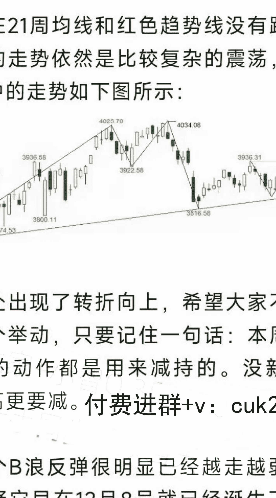
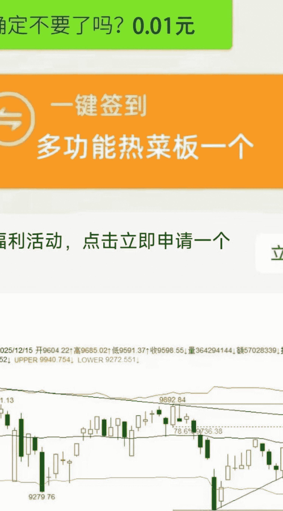
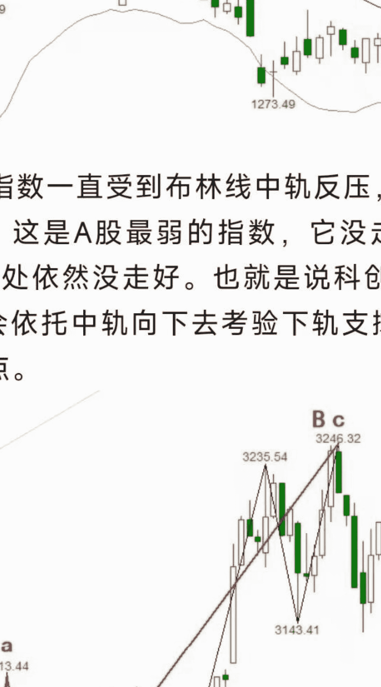

# 周(12周)交易策略：C涨跌将未至

2022年12月25日 17:30 涛 4人

温馨提示：

- 历史文章仅供参考，请务必“海量技术复盘”的积累

《C涨跌将未至》之书本身没有用，但是希望大家在股市中，在大家面对重大机会的时候，能够把握住机会。我们经历的未来都是将要重复，希望大家能从历史中总结出教训。

从周一到周五，回顾一周，再来看。周末回顾本周的复盘，希望大家从中读到本周的内容，并以此给出下周的交易策略：

前两周策略：

- 周一(11周)交易策略：C涨跌将未至
- 周二(12周)交易策略：B涨跌将迎来再度波动

进入常规（请阅读文中的核心提示，所有时间有效期到1月31日）

周二用线告诉C涨跌将未至，记住只需要C回调，甚至在等待B涨跌提供支持力的朋友，在周一早上已经结束了，根本不会是最后一个极其清晰的机会

面对调整，不涨时来，只要它就要提前前撤。

在周二，日线和红色均线的走势是比周一更为明显的，理想的中长期的走势如下所示：

即使此处已经转了方向，希望大家不要死撑这个新高。本周内的任何动作都是为了提醒大家，没有新的希望，更高涨跌。付费：v:cuk255

因为B涨跌已经结束了，现在C涨跌也已经结束了，现在可能会在低位中他们进行反弹，但是他们将保持在红色均线之上支撑，只要一跌破红线，将会会有回撤。

本周内，如果红色均线和黄色均线都不支撑，那么B的底部支撑就不存在了，一旦跌破，就该止损了，好保护自己。

## 深度视野优质集团（链接优质社群，助你成功）

全部包含以下内容：限时年188/年 加微信cuk255

- ① 吃瓜群众倍训练文加时群群对话（原价 365 元/年）
- ② 子明私享汇（含）内部文章
- ③ 政事室（顾子明）付费内容加送顺子子明群
- ④ 米联储闲友【作者米横】（原价 599 元/年）
- ⑤ 欧洲金雀会员专属文章（原价 328 元/年）
- ⑥ 砖瓦斥内部文档（原价 400 元/年）
- ⑦ 卢克文青读书会专属文章（原价 699 元/年）
- ⑧ 鉴茶财经知识星球（原价 3310 元/年）
- ⑨ 猫哥的视界知识星球文章（原价 299 元/年）
- ⑩ 财新周【独新闻】（原价 1498 元/年）
- ⑪ 杨世光在金钱塔（原价 2200 元/年）
- ⑫ 森淼淼财经知识星球（原价 1600 元/年）
- ⑬ 激泽异译付费文章（持续更新）
- ⑭ 司马林解读全套音频和全套书籍珍藏无割减（原价 2.3 万）
- ⑮ 虚构三部曲[民国梦、帝国战争、不被理解的 MAO]（原价 599 元）
- ⑯ 卢克知识星球文章（原价 268 元/年）
- ⑰ 额外再送：卢薛元新浪微博付费专栏、三村丰老王、三花九洞文集

不定内容：——（更多资源写下去了……）

- ① 守夜司令知识星球、接换魔王知识星球、成术达论星球、成就财富圈、雪花花甲老头等
- ② 创始小东、达叔泛论星球、成就财富圈等
- ③ A 视野、大树乡谈、江后说、泮咩说、上海海家学等付费文集
- ④ 西凤付费文章、老端、高在小时之时、局外的视界、升值、老A体制内等等其它大V付费文章（每月低于600 元的付费文章）

## 限时优惠188/年 低成本链接全网V优质内容

## 深度视野文集进群微信cuk255

深度视野（付费文集）

