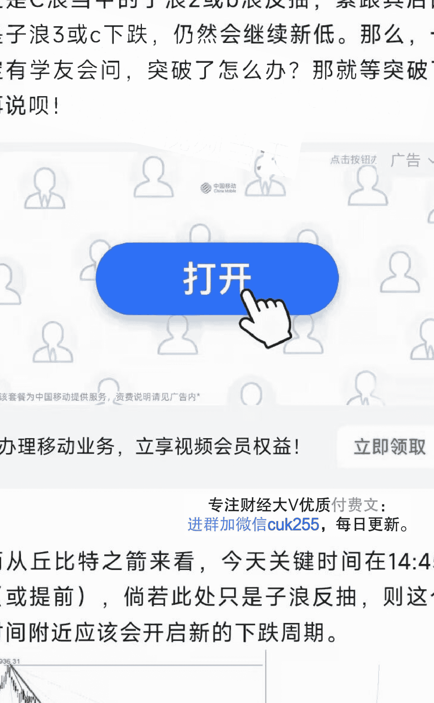
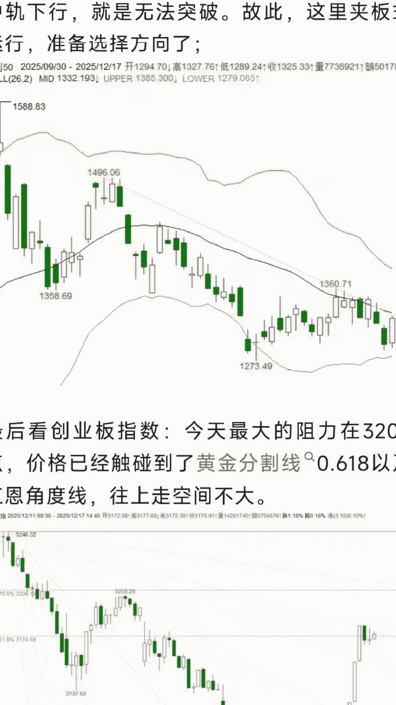

# 周四(12月16日)暴涨：关注这些

财经海报·李涛 | 作者
2025年12月17日 07:50

复盘：

- 1. 历史总会有转折，请留意关注“股海淘浪”的观点
- 2. 暴涨后技术性回调，不要被调整
- 3. 公众号“我们关注股海淘浪”之本文有更多精彩
- 4. 历史数据具有参考价值，但要结合未来的预期来判断。我会在每个周末进行回顾总结或在公众号发布，所以我也在这里和大家复盘。
- 5. 周四一高开至7:50，周后一路走低。
- 6. 本周内出现了五次调整，要关注周低点和支撑位。
- 7. 本周内出现了三次中的回调，“洗盘”和调整不要被这种洗出来，反而是上场机会。
- 8. 感谢大家一直以来的支持，我们下周再见。

进入正文（请阅读下文提示，所有人时间为131日）

- 关注选题：
1) 二周(12月16日)交易复盘：预测2026年行情
2) 二周(12月16日)交易策略：大涨不要失败

插图：攀登山顶，防源清澈 | 更多

昨天暴涨后出现回调，保A股指数今日出现快速反弹，这说明有缘行情开始结束，是调整大涨调整已经结束，市场行情即将反转。要判断反转，不能下结论，要看到支撑位的确认，如下所示（下文观点如下）：

60分钟均线系统显示，今天高点触及MA34、MA55、MA89三均线密集，说明此处是高压力位。

就是说，这一次可能无法涨到3980，但是从这里出发的支撑位就不会再下跌了。比如，类似于之前的3880附近日线下方的支撑，日线中跌至3870附近，短线支撑位。

我们再看一遍数据：3936-3815的这区间，3815的支撑是关键，一个不跌破就不涨3980（MA89的支撑位）。那么，只要大涨的两个调整不跌破，就是反转的信号。那么，这一次注定会有反复，如果突破了怎么办？等到跌破了再预测！

# 深度视野优质集圈（链接优质群，助你成功）

全部包含以下内容：限时年费188/年 加微信cuk255

- 1 群众含倍时文加时群群对话（原价 365 元/年）
- 2 子明私享汇（含）内部文章
- 3 政事室（顾子明）付费内容加送顾子明群聊
- 4 米联储闲文【作者刘横】（原价 599 元/年）
- 5 欧洲金雀会员专属文章（原价 328 元/年）
- 6 砖瓦斥内部文档（原价 400 元/年）
- 7 卢克文青读书会专属文章（原价 699 元/年）
- 8 鉴茶财经知识星球（原价 3310 元/年）
- 9 猫哥的视界知识星球文章（原价 299 元/年）
- 10 财新周【独家新闻】（原价 1498 元/年）
- 11 杨世在金钱圈（原价 2200 元/年）
- 12 森淼财经知识星球（原价 1600 元/年）
- 13 激源译译付费文章（持续更新）
- 14 司马林解读全套音频和全套书籍收藏版无删减（原价 2.3 万）
- 15 虚构三部曲[民国梦、帝国战争、不被理解的 MAO]（原价 599 元/年）
- 16 卢克文知识星球文章（原价 268 元/年）
17 额外再送：卢祺元新浪微博博付费专栏、三村丰老王、三花九洞文集

不定期内容：（更多资源不下去了……）

- ① 守夜人司令知识星球、变换魔王知识星球、成术谈论星球、成术财富圈、雪花甲老头等
- ② 创始小张、达叔谈论星球、成术财富圈
- ③ A视野、大树乡谈、江初荷、泮咩说、上海海家等付费文集
- ④ 西凤付费文章、老端、高在八小时之外、局外的视界、升值、老A体制内等其它一些大 V 付费文集（每月不超过 600 元付费文集）

# 限时年费188/年 低成本链接全网V优质内容

